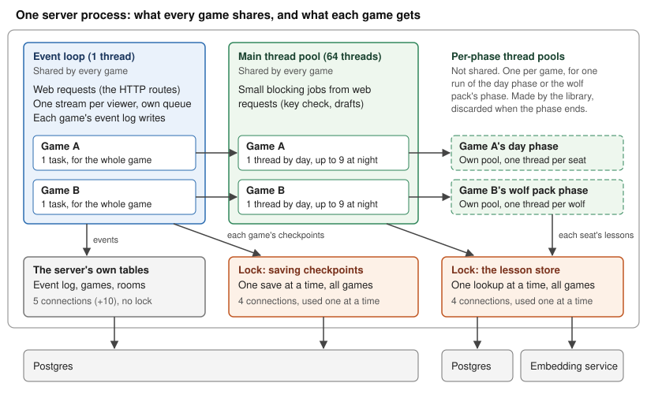

# U2. Concurrency, blocking work and shared limits: the concepts, and a review of my system

**Reading time:** about 90 minutes · **Builds on:** U0, U1 · **Feeds write-up chapters:** 7 and 8

**The question these notes answer:** one slow piece of work is holding up everything else on my
server. Why does that happen, and how do I stop it?

**First answer, before reading on:** two or three sentences, with an example that is not from this
project.

U1 ended on a question it did not answer: while one call waits its 30 seconds, what keeps the rest
of the server moving?

## What these notes cover

1. How one thread serves many requests, and the single mistake that makes it serve one at a time.
2. Where slow work is sent, and why a pool of workers is a budget that runs out silently.
3. How a shared lock can turn ten workers into one, and what a bulkhead does about it.
4. Why two requests can both act on the same stale fact, and where the rule has to be enforced.
5. A review of how my Werewolf server runs its games, with its limits measured where I could
   measure them, ending with a claim the code supports.

**Covered in other notes:** timeouts, retries and breakers (U1), what has to be saved so work
survives a restart (U3), making a repeated request safe (U4), a game waiting for a person (U5),
streaming to each viewer (U6), and measuring any of this in production (U8).

---

# Part 1 — Why one slow job can hold up a whole server

A server does many things at once for many people, with far fewer hands than it has requests. This
part is about how that works and the ways it goes wrong. It answers five questions:

1. **Who is doing the waiting?** (the event loop, and blocking it)
2. **Where does slow work go?** (worker threads and processes)
3. **What happens when the workers run out?** (a pool is a budget)
4. **What do the workers share?** (locks, queues behind them, and bulkheads)
5. **What if two of them change the same thing?** (races)

The example throughout is a ticket-booking website. A buyer picks a seat and pays; the site calls a
payment service, which normally answers in about a second. Other visitors are only browsing.

## 1.1 Who is doing the waiting?

Most of what a web server does is wait: for a database, for a payment service, for the next chunk of
a download. On the booking site, a payment request needs about 2 milliseconds of the server's own
work and about a second of waiting for the payment service. The server's thread has nothing to do
during that second.

An **event loop** uses that idle time. It is one thread that runs a piece of one request until that
request has to wait for something, sets it aside, and runs a piece of another. Each request in
progress is a **task**. When the thing a task was waiting for arrives, the loop picks the task up
again where it left off.

Say 100 buyers press Pay in the same moment. The loop runs the first 2 milliseconds of each, one
after another, and each then waits on the payment service. All 100 waits run side by side, so
everyone has an answer after about 1.2 seconds, not 100 seconds.

Two limits remain. Requests do take turns for the loop's own work, so the hundredth buyer starts
0.2 seconds after the first. That is harmless while each turn is a few milliseconds. And the loop
does nothing about the speed of the payment service itself. If that service can handle only ten
payments at a time, the other ninety wait for it. The loop only makes sure the server is not the
one holding them up.

### What the loop actually is

The loop is a scheduler, and it is ordinary code: a `while` loop running on one thread. It keeps
two lists and repeats two steps. This is a sketch of what Python's `asyncio` does, not its real
code.

```python
ready = []        # tasks that can run right now
waiting = {}      # tasks set aside until something arrives

while True:
    # 1. Ask the operating system which of the awaited things have arrived
    for thing in operating_system.which_have_arrived(waiting):
        ready.append(waiting.pop(thing))

    # 2. Run each ready task until its next await
    for task in ready_tasks_in_order():
        task.run_until_next_await()
```

The loop does the queueing, and it picks the next task by the simplest rule: the next one in the
ready list. Running a task means calling its code like a function. That code runs until it reaches
an `await` on something not yet there, and then returns to the loop.

Nobody in the program does the waiting. The operating system receives the payment service's reply
whenever it comes. On each pass the loop asks it what has arrived and moves those tasks to the
ready list. The payment service never touches a task; it only sends bytes.

The setting-aside is the important part. A task has to give the loop back by its own choice, at the
points where it waits. In Python that point is the word `await`. This is **cooperative
scheduling**: the loop cannot interrupt a task; it can only run the next one when the current one
lets go. One thread can serve thousands of visitors this way, as long as every task lets go
whenever it waits.

### Process, thread, task

These three nest inside each other.


| Term        | What it is                                                            | Who manages it       |
| ----------- | --------------------------------------------------------------------- | -------------------- |
| **Process** | One running program, with its own memory                              | The operating system |
| **Thread**  | A line of execution inside a process; a process can have several      | The operating system |
| **Task**    | A function that can pause and resume, with a note of where it stopped | The event loop       |

The loop runs on one thread of one process, and the tasks live inside the loop. The operating
system does not know tasks exist. It sees one thread running one `while` loop. That is why
thousands of tasks are cheap, and why nothing can interrupt one. A process normally has one event
loop. A site run as three processes has three loops and three separate memories.

### How a task that was set aside is woken

A **future** is an empty box for a result that is not here yet. Every wait is the same two steps:

```python
receipt = await future            # the task is set aside here
future.set_result(receipt_data)   # elsewhere, later: the task goes on the ready list
```

What differs between waits is only who fills the box. For a payment made through an async library,
the library fills it when the loop reports that the reply has arrived, so the code shows only
`await`. For something only the program itself knows about, such as a manager approving a refund
in another request, the program creates the future and fills it itself.

### Concurrency and parallelism

Two words are easy to mix up here. **Concurrency** is many tasks in progress over the same period,
taking turns. **Parallelism** is several pieces of work running at the same instant, which needs
more than one processor core. An event loop is concurrent and not parallel: a hundred requests in
progress, one thread. That is enough when the work is mostly waiting.

## 1.2 The call that freezes everyone

The site's payment code is written with an ordinary payment library. Its `charge()` function sends
the request and does not return until the answer is back. The code calls it directly from the
request's task.

```python
async def checkout(order):
    receipt = charge(order)      # ordinary function: holds the thread until the answer is back
    return receipt
```

The handler is marked `async`, so it looks right. But `async` on the outside does not change what
`charge()` does on the inside. That one line breaks the arrangement. `charge()` waits, but it never says "I am waiting" to the
loop. It simply holds the only thread until it returns. In the sketch of 1.1, the loop is stuck inside step 2,
waiting for one function to return, and cannot reach the next task. No other visitor is served: no pages load, no seat maps refresh, nothing.

Writing `await charge(order)` would not fix it. `await` does not make a function give the thread
back; it only waits on something that already knows how to. An ordinary `charge()` still runs to
the end first, holding the thread for the whole wait, and then Python raises an error because a
receipt is not something that can be awaited. The function itself has to be an async one (1.3).

This is a **blocking call**: one that keeps the thread for the whole wait. A **non-blocking call**
hands the thread back while it waits. On an event loop, a blocking call is harmless only if it is
too quick to notice.

Now the payment service has a bad day and answers in 20 seconds. Fifty buyers press Pay. The loop
runs the first buyer's `charge()` and is stuck for 20 seconds. Then the second, for another 20. The
fiftieth buyer waits almost 17 minutes. So does a visitor who only wanted the home page, which
needs no payment at all. Nothing in the logs says "error". The server is not down, and its
processor is idle. It is waiting, one buyer at a time.

The usual blocking calls are the same in every codebase, and they come in two kinds. **I/O-bound**
work spends its time waiting on something outside the program: a library that talks to the network
without `await`, a database driver of the ordinary kind, `time.sleep`, reading a large file.
**CPU-bound** work spends its time calculating: resizing an image, a long loop over data. Both hold
the loop. They are fixed in different ways, which is the next section.

### Check

A page handler on an event loop does three things: reads a row with an async database driver,
resizes an image, which takes two seconds of pure calculation, and sends the result. Visitors
report that every page on the site freezes for a couple of seconds, again and again.

1. Which of the three steps causes it?
2. A colleague says "that step isn't waiting on the network, so it can't be blocking". Why is that
   wrong?

<details>
<summary>Answer</summary>

The resize. Blocking is about holding the thread, whatever the reason. A calculation never reaches
an `await`, so for two seconds the loop runs nothing else. The database read is fine because the
async driver lets go while it waits.

</details>

## 1.3 Where does slow work go?

There are two ways out of 1.2.

**Make the slow call non-blocking.** Use a payment library written for the event loop, so the call
is `await charge()` and lets go while it waits. This is called **async all the way down**: every
function between the request and the network has to be the async kind, and every library on the
path needs an async version. Quick helper functions that never wait can stay ordinary. Where that
holds, nothing more is needed.

**Hand the blocking call to someone else.** Keep the ordinary library, and have the loop pass the
call to a **worker thread**: a second thread whose whole job is to sit and wait on that call. The
loop is told when the answer is back, and meanwhile serves everyone else. A set of such threads is
a **thread pool**, and the thing that hands work to it is an **executor**. The task on the loop
`await`s the hand-off, so from the loop's side it has become a non-blocking call.

```python
async def checkout(order):
    receipt = await asyncio.to_thread(charge, order)   # charge() blocks a worker thread, not the loop
    return receipt
```

### Threads for waiting, processes for calculating

Threads suit work that waits, the I/O-bound kind. They do not make calculation faster in standard Python, where only
one thread runs Python code at any instant. (Libraries written in C can lift that limit while they
work, and newer builds of Python can remove it.) Two seconds of image resizing on a worker thread no longer freezes
the loop completely, but it still competes with it. CPU-bound work goes to a **process pool**:
separate processes, each with its own processor time, at the price of copying the data across.

### Outside the server: a queue and a worker

A third arrangement moves the work out of the web server altogether. ("Web server" here is the
backend program that answers requests, not the frontend.) The server puts a job on a
**queue**, and a separate **worker process** takes it from there. The web server stays quick
whatever the jobs do. The cost is a second program to deploy and an agreed format for the jobs. A queue does not by
itself make a job survive a crash; that depends on how the queue stores it (U3).

### What the framework does without being asked

Many backend web frameworks, FastAPI among them, do the second option without being asked. A handler written as a plain
function, not an async one, is run on a worker thread automatically. The trap in 1.2 is the
mixture: an async handler that calls blocking code. The framework trusts an async handler to be
non-blocking and runs it on the loop.

## 1.4 What happens when the workers run out?

### A full pool queues, with no error

The site moves `charge()` to a pool of 10 worker threads. On a normal day a payment takes a second,
so 10 workers handle 10 payments a second, and the pool is never full.

On the bad day each payment takes 20 seconds, and fifty buyers press Pay. The first 10 get a worker
each. The other 40 wait in the pool's queue. Buyer 11 gets a worker at second 20 and an answer at
second 40. Buyer 50 waits 80 seconds for a worker and 20 more for the answer.

Two things are different from 1.2, and one is the same:

- **Browsing still works.** The loop is free, so pages that need no worker load at once. Moving the
  blocking call off the loop protected everyone who did not need it.
- **Ten wait at a time, not one.** The fiftieth buyer waits 100 seconds, not 17 minutes.
- **There is still no error.** A full pool does not refuse work; it queues it. The symptom of an
  exhausted pool is **latency without errors**: everything that needs a worker gets slower, and
  nothing reports a fault.

### Why a bigger pool is not always the fix

So a pool is a **budget**. Its size is the number of slow things that can be in progress at once,
and everything else waits its turn. Sizing it is a real decision. Too small, and ordinary traffic
queues. Too large, and the server opens more connections and uses more memory than it or the
services behind it can take. On the bad day, a pool of 50 would send fifty calls at once to a
payment service that is already struggling. A bigger pool helps only if what sits behind it can
take the extra work.

### How to see it: queue wait

A job's time has two parts: **queue wait**, before a worker picks it up, and **run time**, once it
has one. The honest way to see an exhausted pool is to measure the queue wait. Processor use and error counts both look healthy while buyers wait a minute and a half.

### Backpressure: refusing work early

**Backpressure** is the name for telling the sender to slow down when the queue is long, and not
accepting work that cannot be done in time. The site can answer "payments are busy, try again in a
minute" once 20 buyers are queued. A buyer told at once is better off than one who waits 100
seconds and gives up.

The patterns of U1 are what keep the budget from draining. With a 3-second timeout on `charge()`,
each worker is back in the pool after 3 seconds, not 20. With a breaker open, the calls are not
made at all.

### The same limit without a pool

Everything above was about a thread pool, which has its ceiling built in: its size. Code written
with async tasks, with no pool, needs the same limit and does not get one for free. A task that is waiting
occupies no worker, so nothing stops a program starting 400 calls in the same instant, and all 400
reach the payment service together. The limit on how many things may be in progress at once is a
**concurrency limit**, and with tasks it has to be added by hand. The usual tool is a
**semaphore**: a counter that lets a set number through and makes the rest wait their turn.

```python
limit = asyncio.Semaphore(10)

async def pay(order):
    async with limit:                 # at most 10 inside at once; the others wait here
        return await charge(order)
```

Either way the number is a decision. With threads it arrives bundled in the pool; with tasks it is
missing until someone chooses it.

### Check

A site has a pool of 8 worker threads. Its dashboards show processor use at 5%, no errors, and
healthy database times. Users say pages that export a report take a minute to start. What is the
likely cause, and what one measurement would confirm it?

<details>
<summary>Answer</summary>

The pool is full of slow jobs and new ones are queueing. Low processor use and no errors are what
an exhausted pool looks like, because the workers are waiting and nothing has failed. The
measurement is queue wait: the time between a job being handed to the pool and a worker starting
it.

</details>

## 1.5 What do the workers share?

Ten workers are not ten independent servers. They share things, and what they share can undo the
benefit of having ten.

### When a lock is needed

A **lock** lets one worker at a time through a piece of code; the rest wait at its start. It is
needed when something else could get in the way while that code is running. There are two ways
that happens:


| What is shared                           | What goes wrong without a lock                                          | Example on the site                                                     |
| ---------------------------------------- | ----------------------------------------------------------------------- | ----------------------------------------------------------------------- |
| Data that another worker could change    | A worker acts on a value that changed under it, or sees it half-changed | A counter of tickets sold: two workers both read 100 and both write 101 |
| A tool that can serve one user at a time | Two workers' use of it gets mixed together                              | One connection to the venue's seat-map service                          |

Two things follow that are easy to get wrong:

- **Reading can need the lock too.** If another worker could change the data partway through a
  read, the reader can see half of the old state and half of the new. And with a one-at-a-time
  tool, two reads collide just as two writes do.
- **No lock is needed when nothing else can get in.** That is the case when each worker has its
  own copy or its own connection, or when the data never changes after it is created.

How easily something else can get in differs between tasks and threads, which 1.6 takes up.

### A lock held across slow work

The seat-map connection is the second kind. Two workers using it at the same moment would garble
each other's messages, so the code puts a lock around it: whoever holds the lock uses the
connection, and the rest wait.

A lock is correct and cheap when it is held for an instant. The trouble starts when a worker holds
it across something slow. Suppose the code takes the lock and then makes a network call that hangs
for 20 seconds. Every other worker that needs the seat map now waits behind it, though each has its
own thread and nothing of its own is slow. Ten workers have become one. This is **head-of-line
blocking**: the first in a queue is slow, and everything behind it waits whatever its own speed.

### Getting the slow work out: two cases

The rule that follows: **hold a lock only around work that is quick and cannot hang**. How to get
there depends on what the lock protects.

- **The lock is held for longer than the thing it protects needs.** Say the lock guards a table of
  prices kept in memory, and the code takes it, fetches a price over the network, then writes it
  in. Only the write needs the lock. Do the slow fetch first with no lock, then take the lock for
  the write.
- **The slow thing is the protected thing.** In the seat-map example the lock guards the
  connection, and the slow call is made on that connection. It cannot be moved outside the lock.
  The fix is to stop sharing: a pool of connections, so each worker has its own and no lock is
  needed. Until then, a timeout on the call (U1) limits how long everyone waits.

### Bulkheads: one kind of job cannot take every worker

A second kind of sharing is the pool itself. The site also makes ticket PDFs, which take five
seconds each, on the same 10 workers. A group booking of 30 tickets takes every worker for 15
seconds, and payments queue behind PDFs. Nothing is wrong with the payment service.

A **bulkhead** fixes that by dividing the budget: 6 workers for payments, 4 for PDFs. A flood of
PDF jobs can now fill only its own 4. The name comes from the walls that divide a ship's hull, so
one flooded section does not sink the ship. The cost is that the divided parts cannot lend each
other spare capacity. The same idea applies to anything shared: a limit on how many requests may
wait on one service, or a separate connection pool per customer.

### Check

A service has 20 worker threads and a database connection pool of 5. Under load, requests queue,
and adding threads up to 40 changes nothing. Why not, and what does that say about where the
budget is?

<details>
<summary>Answer</summary>

Each request needs a thread and a database connection, and only 5 connections exist. Beyond 5, the
extra threads each wait for a connection. The real budget is the smallest shared thing on the
path, here the connection pool, and a larger thread pool only moves the queue.

</details>

## 1.6 What if two of them change the same thing?

### The race, on one event loop

One seat is left for Saturday. Two buyers press Pay within the same second. Each request does
this:

1. Read the seat: it is free.
2. Charge the card.
3. Mark the seat sold.

Both requests read "free" at step 1 before either reaches step 3. Both charge. Both mark the seat
sold. The site has sold one seat twice.

This is a **check-then-act race**: a decision is made from a value that can change before the
decision is acted on. No threads are involved here. The two buyers are two tasks on a single event
loop, and the race happens because step 2 is an `await`: while one task waits there, the loop runs
the other.
Any shared state read before a wait can be stale after it.

```python
async def buy(seat, order):
    if seat.free:                  # both tasks read True here
        await charge(order)        # the loop runs the other task during this wait
        seat.free = False          # both reach this line
```

### The same race between threads

Tasks on a loop can only be swapped at an `await`. Threads are different: the operating system
switches between them on a timer, in the middle of any line. So for data that several threads
touch, "no wait between the check and the act" protects nothing.

`count += 1` is three steps underneath: read the value, add one, write it back. Two worker threads
can both read 5, both add one, and both write 6. One update is gone, with no error. This is a
**lost update**, the same check-then-act race at a smaller scale.

The fix between threads is a lock around the steps (a `threading.Lock` in Python), held only for
those few quick lines, as 1.5 requires. A task waiting for a lock is set aside; a thread waiting
for one is blocked, which is fine for a worker thread and not for the loop's.


| Shared between         | Can be interrupted                 | What protects check-then-act                                         |
| ---------------------- | ---------------------------------- | -------------------------------------------------------------------- |
| Tasks on one loop      | Only at an`await`                  | No`await` between the steps, or an async lock if there has to be one |
| Threads in one process | Anywhere                           | A thread lock around the steps                                       |
| Processes              | Anywhere, and they share no memory | The database: a conditional update or a unique constraint            |

The same table answers "does this read need a lock?" (1.5). Between threads, any read of data that
another thread may change does. Between tasks, only a read with an `await` partway through it
does, because that is the only place another task can get in.

### Three ways to protect the rule

The rule is "a seat is sold once". The bug is a gap between checking the seat and marking it sold.
Each fix closes that gap. They differ in where the "taken" fact is kept, and in what the second
buyer has lost by the time they find out.

**1. A lock per seat, in the program**

```python
async with seat_locks[seat_id]:
    if seat.free:
        await charge(order)
        seat.free = False
```

Only one buyer at a time can be inside this block for a given seat, and buyers of other seats are
not affected. By default the second buyer waits for the first payment to finish. That can be
improved: the code can ask whether the lock is held and answer "someone is buying this seat" at
once, which makes the lock a reservation kept in memory.

Limit: the lock lives in one process's memory. If the seat's data is in a database, nothing stops
a second server process, or any other program that writes to that database, from selling the same
seat, and a restart loses every lock. One lock for all seats is a different thing, and it is the
mistake of 1.5: one slow payment holds up every buyer.

**2. A conditional update, at the moment of marking**

```sql
UPDATE seats SET status = 'sold' WHERE id = 12 AND status = 'free';
```

The database checks and marks in one statement, then reports how many rows it changed: 1 means
this buyer won, 0 means they lost. Every process that writes goes through the database, so it
holds across all of them.

Limit: this runs after the charge, so the loser has already paid and needs a refund.

**3. A reservation, before paying**

```sql
UPDATE seats SET status = 'held', held_until = now() + interval '5 minutes'
WHERE id = 12 AND status = 'free';
```

This is the same statement, moved to the front. The winner goes on to pay and then confirms, and
the loser is told the seat is held before paying anything.

Limit: a hold must expire, or a buyer who walks away keeps the seat for ever. A time column, as
here, is one common way to do that.

**Choosing between them**


| Where the data lives | What the loser would lose         | Use                  |
| -------------------- | --------------------------------- | -------------------- |
| One process's memory | Anything                          | A lock per item      |
| A database           | Little: some setup, a few seconds | A conditional update |
| A database           | Money, or a slow step             | A reservation first  |

### Where the rule has to live

The reach matters as soon as the site runs as two server processes, which is the ordinary way to
grow. A lock inside one process means nothing to the other. Only something both processes go
through, the database's conditional update or its unique constraint, protects the rule across
them. A rule that must always hold belongs in the one place every writer shares.

In production this is the usual case: the data that matters is in a database, and more than one
server process writes to it. Two of the database's tools cover most rules.

**A conditional update.** The condition is part of the statement that makes the change, as in the
previous sub-section. It fits a rule about one row's current value. The same goes for a value that
is changed from what it is now, such as a counter or a balance: the arithmetic has to be inside
the statement too. Reading the value into the program, adding to it and writing it back reopens
the gap.

```sql
UPDATE events SET sold = sold + 1 WHERE id = 3 AND sold < capacity;   -- 1 row: sold; 0 rows: full
```

**A unique constraint.** A rule declared once on the table, that no two rows may have the same
value in a column. Neither process checks first. Both simply insert, and the database, which both
go through, lets exactly one succeed. It fits "at most one of these": one account per email, one
booking per seat.

```sql
CREATE TABLE bookings (seat_id int UNIQUE, buyer_id int);
INSERT INTO bookings VALUES (12, 501);   -- works
INSERT INTO bookings VALUES (12, 502);   -- error: duplicate
```

The first insert wins. Adding `ON CONFLICT DO NOTHING` skips the second quietly instead of raising
an error, which suits storing the same fact twice. When the loser has to be told, as with a
booking, the code checks whether its row was inserted.

Neither depends on each piece of code remembering to do something, which is why they come first.
Two further tools exist for rules that need several steps: a row lock inside a transaction
(pessimistic locking) and a version number on the row (optimistic locking). My system uses
neither, and these notes do not go into them.

### Check

A sign-up handler checks that an email address is not in the users table, then inserts the new
user. Occasionally two accounts appear with the same email. The team adds a lock in the program
and the duplicates stop, until the service is scaled to three processes. What protects the rule
properly?

<details>
<summary>Answer</summary>

A unique constraint on the email column. The database then refuses the second insert whichever
process sends it, and the handler turns that refusal into "this email is already registered". The
check before the insert can stay as a courtesy, but it is not what enforces the rule.

</details>

## 1.7 One busy minute, start to finish

All of Part 1 as one minute on the booking site: a pool of 6 payment workers and 4 PDF workers, a
3-second timeout on payments, and a queue limit of 20.

```text
 0 s   200 visitors browsing. The loop serves each between the others' waits. ... (event loop)
 1 s   A buyer presses Pay. The task hands charge() to a payment worker
       and lets go. The loop carries on serving pages. ..................... (executor)
 2 s   The payment service slows down. Thirty buyers press Pay.
       6 get a worker. 20 wait in the queue. ................................ (the pool is a budget)
       4 are told "payments are busy, try again shortly". ................... (backpressure)
 3 s   A group booking asks for 30 PDFs. They fill the 4 PDF workers
       and queue there. Payments are not affected. .......................... (bulkhead)
 5 s   The first payments time out at 3 s (U1). Their workers are free
       again and take the next buyers from the queue.
 6 s   Two buyers pay for the last Saturday seat. Each request tries
       "hold the seat if it is free". One changes 1 row and goes on to
       pay. The other changes 0 rows and is told the seat has gone. ......... (atomic update)

 All minute: browsing visitors notice nothing.
```

Compare the same minute with the code of 1.2: one blocking `charge()` on the loop, and every
visitor, buyer or not, waits behind every payment.

---

# Part 2 — The choices

The five questions are not alternatives to each other. The choices are inside each one. Within a
table, a system can use more than one row, in different places; the last column says where mine
uses each.

**How is slow work kept off the event loop?**


| Design                                   | What it buys                                                         | What it costs                                                                     | Fits when                                                      | In my system                                                              |
| ---------------------------------------- | -------------------------------------------------------------------- | --------------------------------------------------------------------------------- | -------------------------------------------------------------- | ------------------------------------------------------------------------- |
| Async all the way down                   | No hand-off and no pool to size                                      | Every function on the path is rewritten, and every library needs an async version | The code is new, or the libraries are already async            | The server's own code: routes, the stream to viewers, its database access |
| Blocking code on a thread pool           | The existing code runs unchanged                                     | A pool to size, and state shared between threads                                  | Working blocking code already exists                           | The game engine: every model call                                         |
| A separate worker process fed by a queue | The web server stays quick whatever the jobs do; the two scale apart | A second program to deploy, and an agreed format for jobs                         | Jobs are long or heavy, and need not finish inside the request | Not in my own code: the server runs the games itself. Two things nearby: Langfuse, which I run for tracing, is built this way (a web server, Redis as the queue, a worker); and my offline memory jobs run as separate programs, but started by hand or on a schedule, with no queue. Moving games to workers, the redesign in U0 Part 4 and U5, would be this row |

**How is a pool's size chosen?**


| Design                         | What it buys                                    | What it costs                                                | Fits when                                             | In my system                                                                                                                          |
| ------------------------------ | ----------------------------------------------- | ------------------------------------------------------------ | ----------------------------------------------------- | ------------------------------------------------------------------------------------------------------------------------------------- |
| From one incident              | Quick; fixes what was seen                      | Nobody knows where the new limit is                          | Traffic is low and waiting is cheap                   | The main pool: 8 threads became 64                                                                                                    |
| From a load test               | A known limit                                   | The test has to be built and kept honest                     | A stated capacity is being promised                   | Not used                                                                                                                              |
| Left at the library's default  | Nothing to decide                               | The number was chosen by someone who never saw this workload | Almost never on purpose                               | The pools inside the day and pack phases: 8 each                                                                                      |
| A semaphore around async tasks | A ceiling where tasks would otherwise have none | One more number to choose and justify                        | The work is async and something behind it has a limit | Not in Werewolf, which has no async fan-out. My other project, dota2pred, limits its concurrent match fetches this way, 20 by default |

**What happens when a budget is used up?**


| Design                           | What it buys                           | What it costs                                   | Fits when                              | In my system                                               |
| -------------------------------- | -------------------------------------- | ----------------------------------------------- | -------------------------------------- | ---------------------------------------------------------- |
| Queue without limit              | Nothing is refused                     | Waits grow with no error and no upper limit     | Bursts are short                       | Every thread pool and both locks                           |
| Wait, then fail after a set time | A bounded wait                         | An error to handle                              | Callers can retry or go without        | The database connection pools: 30 seconds                  |
| Refuse at once (backpressure)    | The caller knows immediately           | Some work is turned away                        | The work cannot be done in time anyway | Drafts and seats, each refused with a 409 past their limit |
| Divide the budget (bulkhead)     | One kind of work cannot starve another | The parts cannot lend each other spare capacity | Kinds of work differ in importance     | Not by design                                              |

**Where is a rule enforced when two requests race?**


| Design                                                       | What it buys                        | What it costs                                                    | Fits when                           | In my system                                                                |
| ------------------------------------------------------------ | ----------------------------------- | ---------------------------------------------------------------- | ----------------------------------- | --------------------------------------------------------------------------- |
| No wait between the check and the act, on one event loop     | Free: nothing can run in between    | Holds only inside one process, and only while nobody adds a wait | State lives in one process's memory | A game's live state: starting a game, answering a turn                      |
| A lock in the program                                        | Simple                              | One process only; easy to hold across something slow             | Several threads, one process        | Small shared objects: the breaker's count, the usage meter, the model cache |
| An atomic conditional update or a unique key in the database | Holds across every process          | The rule has to be expressible in the database                   | The rule must always hold           | Stored events and the cast: a repeat write is ignored                       |
| A reservation taken first                                    | The loser finds out before any cost | Reservations need releasing or expiring                          | The act is slow or costs money      | Drafts: counted before the model call, not after                            |

No row is the better design. Each one fits a situation, and the "Fits when" column says which.

---

# Part 3 — My Werewolf system

## 3.1 The prompt that arrived late

On 2026-10-17 a human player in the wolf seat got their first night prompt a few seconds late.
Three causes were found that day. One of them is this note's subject: a night step runs about ten
model calls at once for one game, the pool they ran on had 8 threads, and the work that saves the
game's state was queueing behind them. The pool was raised to 64.

That is section 1.4: slowness with no error, from a budget nobody had chosen. It also shows the
weak point in how the number was picked. No record shows the pool was ever seen full; it was
worked out from ten calls against eight threads. And 64 came from that one evening, not from a
test.

The pool was also not the main cause. That was something else in the same night step:

- The wolf pack's skill step runs two wolves side by side. That night one was the human and the
  other was an AI.
- The human's prompt was created at the start of the step. But this step sits inside a graph
  within the main graph, and the graph library hands a prompt from such a step to the server only
  when the whole step has finished.
- So the human's prompt sat waiting until the AI wolf's model call was done.

The fix was to have the step announce the human's prompt itself, at its start, as the vote and the
other night roles already did. The commit that made this change measured the library's behaviour
and calls it the real cause of the delay. The pool can account for about three seconds at most. So
the pool is a likely contributor, not an established cause.

## 3.2 Who is doing the waiting

The whole of Part 3 in one picture. The outer frame is the one server process. The event loop,
the main thread pool and the three boxes of database access exist once and are shared by every
game. Each game gets one task on the loop, borrows threads from the main pool, and, while it is in
a day phase or a wolf pack phase, has a small thread pool of its own. Two of the three kinds of
database access sit behind a lock, so work queues there even when threads are free. Sections 3.2
to 3.5 take the boxes in turn.

Three words used below:

- A **step** is one round of the game's graph: the library runs every part of the game that is
  due now, side by side, waits for all of them, saves a checkpoint, and decides what is due next.
  "The wolf pack and the eight solo night roles act" is one step. "The day phase runs" is one
  step.
- A **phase with its own graph** is the day phase or the wolf pack's phase. From the main graph
  each is a single step, and inside it has steps of its own (a round of speeches, a vote).
- A **route** is one web address the server answers, with the function behind it: create a room,
  submit a turn, ask for a draft line.



My server is one process with one event loop. On that loop run:

- every HTTP route, all written as async functions;
- the live stream to each viewer;
- the server's own database reads and writes, through an async driver;
- one task per game, which drives that game from start to end.

So a slow game cannot freeze another game's pages or streams, as long as nothing on the loop
blocks.

## 3.3 Where slow work goes

The game engine is ordinary blocking code. A model call sends its request and waits. It is the
`charge()` of 1.2, and it is kept off the loop by the second option of 1.3: worker threads.

| What runs | Where | Limit |
|---|---|---|
| Each part of a step of the main graph: the day phase as a whole, the wolf pack's phase as a whole, each solo night role's turn | The loop's main thread pool | 64 threads, shared by every game |
| Small blocking jobs started by a web request: checking a player's key, drafting a line, refreshing the model list | The same main pool | Shared with the games |
| Seats acting in parallel inside the day phase or the wolf pack's phase: votes, the opening and closing rounds, the wolves' abilities | A pool the graph library creates for that one run of the phase | One thread per seat, separate from the 64 |

**The per-phase pool.** The last row is easy to miss, and I did not create that pool. The day
phase and the pack phase are graphs inside the main graph. A step of the main graph, already on a
main-pool thread, runs one of them with an ordinary blocking call. To work that phase's seats side
by side, the library makes a thread pool for the run and discards it at the end. Its size is the
library's `max_concurrency` setting, which I set to the number of seats for these two phases, so
ten seats start together. Left unset it is Python's default, 8 on this machine, and two of ten
seats waited for a second wave. Gap 5 in 3.7 has the measurement; the setting is not yet deployed.

**A third pool I no longer use.** The web framework keeps 40 threads for plain (not async) helper
functions that prepare a request before its route runs. Mine only read from memory, so they are
`async def` and run on the loop. Appendix B has the detail.

**How the game's task drives the engine.** The task does not push the engine along. It asks the
graph library for the next piece of output and is set aside (1.1) until that piece arrives. The
library runs the step on worker threads, hands back what the step produced, and starts the next
step only when the task asks for more. So the engine goes no faster than the task reads. If the
task stops asking, the calls already running finish on their threads, their output waits, and no
new step starts. This is not the backpressure of 1.4: no queue has a limit and nothing is refused.
It is a reader that pulls. I use it once on purpose: a one-player game whose player has left stops
reading until they are back, so the game does not play on without them (U5).

**Three kinds of wait.** Everything in the server runs on the one `asyncio` loop, and every wait
is a future (1.1). They differ in who fills it:


| The game's task waits for              | Who fills the future                                                                                          | Uses a thread     |
| -------------------------------------- | ------------------------------------------------------------------------------------------------------------- | ----------------- |
| A model call, or any other engine step | `asyncio`, when the worker thread's function returns. The thread itself blocks on the network.                | Yes, one per call |
| A database read or write by the server | The database driver, when the loop reports that the connection has data                                       | No                |
| A human's answer                       | My own code: the route that receives the player's turn fills the future the game's task created for that seat | No                |

The first row is why the thread pool is a budget for model calls and not for the server's own
database work. The third is the one place where I create the future myself. A human's answer
arrives as a new request, and only my game's rules say which waiting task it belongs to. U5 takes
that further.

**Why threads, and not async code.** I chose blocking code on threads so that one engine serves both the batch runs and the server. The
other two options were weighed: a thread per game with a hand-made bridge to the loop, and
rewriting the engine as async code. The rewrite was rejected for its size (about 89 functions and
23 call sites) and because a graph with async steps cannot be run by the ordinary blocking calls
that the batch runs, the command line and the tests use. A partial rewrite would be worse than
none: one blocking call left behind freezes the loop without an error.

## 3.4 The budgets

One ten-seat game uses, at most:

- **By day:** 1 thread from the main pool, plus one per seat (up to 10) from the day phase's own pool.
- **By night:** up to 9 from the main pool (the pack and eight solo roles in one step), plus up to
  2 from the pack's pool.

Every shared limit in the process, and what a caller sees when it is used up:


| Budget                                  | Size                        | When it is used up                           |
| --------------------------------------- | --------------------------- | -------------------------------------------- |
| Main thread pool                        | 64                          | Work queues, with no error and no time limit |
| Pool inside a day or pack phase         | One per seat (8 before 2026-11-12) | Nothing queues inside one game |
| Connections for saving checkpoints      | 4                           | Wait up to 30 seconds, then an error         |
| Connections for the lesson store        | 4                           | Wait up to 30 seconds, then an error         |
| Connections for the server's own tables | 5, plus 10 extra under load | Wait up to 30 seconds, then an error         |
| Games running at once                   | No limit                    | Nothing refuses a game                       |

A night step in seven games at once would ask for 63 of the 64 main threads. That figure is
arithmetic, not a measurement.

None of the limits in this table refuses work early, which is what 1.4 means by backpressure. Each
one queues, or waits and then fails. The refusals my server does make are at the door, on drafts
and seats (the table in Part 2). The one place that holds running work back on purpose is the
pause for an absent player, and it works by not reading (3.3), not by a limit.

## 3.5 What the workers share

Two locks decide more than any of those pool sizes. This is how the server behaves today, not a
past version. The locks do not stop games running side by side: model calls, which are most of a
game's time, do not touch them. They make two operations, saving a game's state and looking up
lessons, run one at a time across every game. The measurements below were run on my own
machine with the database and the embedding service replaced by fixed delays. They show how the
locks behave, not how fast production is.

**The lock on saving checkpoints.** This is only the graph library's checkpoint saver. The event
log and the server's other tables go through a different pool (5 connections, 10 more under load)
with no shared lock, and the lesson store has its own lock, below. Every game saves its checkpoints
through one shared saver, and the
saver lets one save run at a time for the whole server, not one per game. I measured it: eight
saves for eight different games, each 0.2 seconds, took 1.6 seconds, when side by side they would
take 0.2. Worse, a save of a step's checkpoint holds the lock while it waits for a free thread from
the main pool (U3 section 3.7 narrows this: reads do the same, saves of a single task's result do
not). In a
second measurement, with the pool busy, one game's save waited for a thread and another game's
save, which needed no thread, waited behind it.

**The lock on the lesson store.** One store object serves every game, and it holds its lock for a
whole lookup, including the call to the embedding service. I measured four lookups started
together, with an embedder that takes one second: they finished at 1, 2, 3 and 4 seconds. With the
lock removed they all finished at 1.

Both are the mistake of 1.5: a lock held across something slow. The lesson store is the first
case there: the embedding call does not use the connection the lock guards, so it could run before
the lock is taken. And both make a pool of four
connections work as a pool of one. Neither lock is in my code. Each is inside the library that
provides the saver or the store.

## 3.6 When two requests change the same thing

A game's live state (who owes a turn, who is watching, the event list) sits in the memory of the
one process, and it is only ever touched on the event loop. So every race in the table below is
between two tasks. Four techniques from 1.6 cover them:

- **No wait between the check and the act.** Between tasks, a race needs an `await` in the gap.
  With none there, nothing can run in between, and no lock is needed.
- **A reservation first.** When a slow step has to sit in the gap, the claim is made before it and
  given back if the step fails.
- **A unique key in the database.** Both writers insert, and the database keeps one row.
- **A conditional update.** The check is part of the statement that makes the change.

The first two are kept in this process's memory, so they hold only while there is one server
process. The last two hold across any number of processes.

| Race | What my code does |
| --- | --- |
| Two "start game" presses | No wait: the check and the switch to "started" run with no `await` between them. The second press gets a 409 |
| The same turn answered twice (a second tab, a double press, a resend after a restart) | No wait: the seat is looked up in the list of seats that owe an answer and removed from it with no `await` between, and only then is the answer handed to the game. The second copy finds no seat and gets a 409 |
| Several drafts requested at once | A reservation: the draft is counted before the model call starts, and given back if the call fails. Counting after the call let them all through. A request made while a draft is already on its way is refused |
| The same event stored twice | A unique key: each event is keyed by game and number, and a repeat is ignored |
| The house's daily game limit | Nothing. It is checked and not reserved, so starts at the same moment can exceed it. This is known and accepted. The fix would be a conditional update at start: "add one to today's count if it is below the limit". The loser only loses the setup they did, so no reservation is needed |

Worker threads are the other case of 1.6: they can be interrupted anywhere, so what they share
needs a real lock. The engine has six, all thread locks, each around a few quick lines. The
breaker's `note_stall` is the clearest: it adds one to the stall count and may start the cooldown,
and the seats of a parallel round call it from different threads. Without the lock, two stalls at
the same moment could be counted as one. The other five guard the game's usage meter, the cache of
model clients, the model catalogue, the lesson lookup cache and one piece of shared state in the
Anthropic provider module. The server's async code has no lock of its own at all, for the reason
at the top of this section.

Each thread also has to know which game it is working for, so it uses that game's model and key.
The game's task sets this once, and the libraries copy it to every thread the game uses. I
measured that a value set in the task was seen by all ten seat threads of a parallel round.

### Check

During a night step, a viewer's page for a different game keeps updating smoothly, but that other
game's own next step starts late. Which of 3.2 to 3.5 explains the first half, and which could
explain the second?

<details>
<summary>Answer</summary>

The first half is 3.2 and 3.3: the viewer's stream runs on the event loop, and the model calls are
on worker threads, so the loop is free. The second half is 3.4 or 3.5: the other game's step needs
a thread from the shared pool of 64, or a turn at one of the two locks, and it is queueing for
it. Nothing reports an error in either case.

</details>

## 3.7 Gaps

**1. Two locks make every game queue.** Saving a checkpoint and looking up lessons each run one
at a time for the whole server. With one game this costs little. With several it is the real
limit, well below 64 threads. The two locks are separate, with separate fixes. Neither lock can be
changed itself: each is inside its library.

**1.1 The lesson store's lock.** One store serves every game, and its lock is held for a whole
lookup, including the call to the embedding service (3.5).

| Fix | Good | Bad |
|---|---|---|
| Get the embedding first, with no lock held, then run the search | Removes the slow part from under the lock | My code takes over a step the library does today |
| One store object per game, all sharing today's pool, carried by the same per-game copy of the graph as in 1.2 | One game's slow lookup cannot hold up another's; no new connections, since this lock is also per object | Seats of the same game still queue behind each other, embedding call included |
| Limit how many lookups may wait | Stops a pile-up from using every connection | Lookups are no faster |

The second row alone is not enough. Ten seats of one game look up lessons in the same step, so
inside a game the lookups would still run one after another with the embedding call under the
lock. The first row is what removes that, and the two together are the full fix. That the store's
lock is per object and its pool can be shared is read in the library's code, not run.

**1.2 The checkpoint saver's lock.** One saver serves every game, and it allows one save at a
time (3.5). The lock belongs to the saver object, not to the pool of connections behind it: the
saver takes its lock and then borrows a connection from the pool for that one operation. So the
fix is a saver per game, all sharing the pool that exists today. A game's saves then wait only on
that game's other saves, and the four connections are used side by side. No new connections are
needed.

Each game also needs a graph that uses its saver. Three ways to get one, none tried on the server:

| Fix | Good | Bad |
|---|---|---|
| Copy the compiled graph with a different saver (`copy`, the method the library's own `with_config` uses) | 0.1 ms and about 4 KiB per game; the steps are shared, not rebuilt | Every place that reads a game's state has to use that game's copy |
| Compile a graph per game | Plain, documented use | 40 ms and about 72 KiB per game: small, but 400 times the copy for the same result |
| Keep the one graph and hand each run its own saver, through a setting the library uses internally (U3 section 3.7) | Nothing per game but the saver | Rests on a setting the library does not document and could rename |

The figures were measured on my machine on the real game graph, fifty times each, with the
in-memory saver. On a small test graph, a copy saved through its own saver and wrote nothing to
the original's. That the Postgres saver's lock is per object and that a pool can be shared between
savers is read in the library's code, not run. With the lock out of the way, the next limit on
saves is the pool of four itself, which is a setting.

**2. Nothing measures the pools.** No record shows how many threads are busy, or how long work
waits for one. So I do not know whether 64 is generous or tight, and no load test has been run.
U8 takes up what would have to be recorded.

**3. One blocking call runs on the event loop.** When a game ends, the server sends its buffered
trace data out, and that call waits on the network while holding the loop. Every viewer of every
game is paused for as long as it takes. I have not measured how long that is. The fix is to hand
it to a worker thread, as the routes already do with their blocking jobs.

**4. Nothing refuses a game.** There is no limit on games running at once, so under heavy use the
server would slow down for everyone and turn nobody away.

**5. The per-phase pool was 8 for a game of 10 (changed 2026-11-12, not deployed).** Nobody chose
8. With ten seats alive, two waited for the first speakers to finish, which added one model call's
time to a round. The configuration handed to the day phase and the pack phase now sets
`max_concurrency` to the number of seats, never below Python's default. Measured on the real day
phase with each model turn replaced by a half-second sleep: 1.00 second and 8 threads before, 0.51
seconds and 10 threads after, all ten seats starting together. It costs nothing from the main
pool, since these threads are not taken from the 64.

The setting goes on the two phases only. On the main graph it becomes a limit on the whole step:
on a small test graph, a value of 3 made nine parallel parts take 1.5 seconds where they took 0.5.
Everything run inside a seat's turn inherits the value, as an upper limit of 10 on anything it
runs in parallel. Not checked: the pack phase's timing (it runs two or three wolves and never
reached 8), a batch run's night step, and the live server under real model calls.

The work turned up a test that fails by luck. `test_a_human_vigilantes_shot_is_spent_once_across_the_pause_and_resume`
failed in 2 of my 10 runs with the setting and 4 of 10 without it, so the setting is not the
cause. Its scripted players draw from one random generator shared between threads, so the game
played depends on the order the threads run in. When the Vigilante fires and dies the same night,
the engine keeps no record of that night for the dead seat, by its own rule, and the test counts
shots from those records. The bullet is spent once in every run looked at. The test is unchanged;
U13 takes it up as an example of a pass that establishes less than its name says.

## 3.8 What one game can do to another

The aim is a bulkhead between games (1.5): one game's trouble should stay in that game. This is
how far the current build goes.


| Trouble in one game                                                                       | Do other games feel it? | Why                                                                                                                                         |
| ----------------------------------------------------------------------------------------- | ----------------------- | ------------------------------------------------------------------------------------------------------------------------------------------- |
| An error: a bug, or a refused key                                                         | No                      | Each game is its own task. An error ends that task only; it is recorded on that game and reported.                                          |
| Slowness                                                                                  | Yes                     | Games share the two locks, the main pool of 64 threads, the event loop, and the provider's limits on the house key.                         |
| Anything that harms the process: out of memory, a hard crash in a library, a blocked loop | Yes, all of them        | There is one process. The container restarts, and games are meant to continue from their saved state (U3). That is recovery, not isolation. |

So what I can say today: a game that fails does not take others with it. What I cannot say: that
a slow or heavy game leaves the others unaffected, or how many games the server carries.

The steps that would widen the isolation, cheapest first:


| Step                                                           | What it removes                                                                   | What it costs                                                                                                      | Worth doing now?                                                                         |
| -------------------------------------------------------------- | --------------------------------------------------------------------------------- | ------------------------------------------------------------------------------------------------------------------ | ---------------------------------------------------------------------------------------- |
| A limit on running games, with a memory limit on the container | Overload slowing every game; the server growing until the host runs out of memory | Measuring what one game adds; turning a game away                                                                  | Not at today's load. First in line when load grows. The two numbers are chosen together. |
| Send the trace flush to a worker thread                        | Every viewer pausing when any game ends (gap 3)                                   | One line                                                                                                           | Yes, when that code is next touched                                                      |
| One lesson store per game                                      | One game's lesson lookup holding up another's (gap 1)                             | More connections, unless the stores can share a pool; passing the store to each game                               | When several games with memory run together                                              |
| The same for the saver                                         | One game's save holding up another's (gap 1)                                      | Not known; the saver is attached when the graph is built (U3)                                                      | After U3                                                                                 |
| A few worker processes, each running many games                | Process-level trouble hitting every game; the one-core ceiling                    | The redesign of Part 4 and U5: routing, viewers, state out of memory                                               | No                                                                                       |
| One process per game                                           | Everything shared inside the server                                               | Seconds of start-up and the whole program's memory for every game, and something to start, watch and clean them up | No. It suits heavy calculation or untrusted code; my games mostly wait.                  |

Whatever is done, Postgres and the provider's limits stay shared. Isolation is a choice of which
interference to remove, never all of it.

---

# Part 4 — What would change at a larger scale?

**A second server process.** Everything in 3.6 that relies on "one process, one event loop" stops
holding. A game lives in one process's memory, so a turn sent to the other process finds no game
waiting for it. The same goes for the future a parked human seat waits on, the list of viewers
subscribed to a game, and the breaker's count of stalls (U1): each exists in one process only. The
in-process checks against starting twice or answering twice protect nothing
across processes. The design notes already say what comes first: every game's progress goes to a
durable record, and only then can games be spread across processes. The rules that must always
hold would move into the database, as the stored events' keys already are.

**A stated capacity.** "How many games at once" has no answer today. Giving one needs the
measurements of gap 2 and a load test, and then a limit that refuses the game after the last one
that fits.

---

# Part 5 — Worked problems

Each is answered from memory first; my answers are in Appendix A.

## Problem A: The same concepts in another system

A web service has a handler written as an async function. Inside it, the handler calls a model
through an ordinary blocking client. The call takes about 20 seconds. Fifty users send a request
at the same moment.

1. What does each user experience, including one who only asked for the health-check page?
2. Give three fixes, and what each costs.

## Problem B: My system, without Part 3 open

1. Where a turn's model call runs, and what keeps the event loop free while it waits.
2. The thread pools one game uses by day and by night, with their sizes.
3. The two locks, and what each does to its pool of four connections.

## Problem C: A claim, checked against the code

A draft sentence for the write-up:

> "The server handles 64 concurrent games."

What in it is supported, what isn't, and what is the accurate wording?

## Problem D: A pool that does not help

A service looks up documents for each request: it embeds the query with an outside service, then
searches a database. It has 16 worker threads and 8 database connections. When the embedding
service slows from 0.1 to 2 seconds, lookups take up to 30 seconds, and doubling the threads and
the connections changes nothing. What is the likely cause, and how would one measurement confirm
it?

---

# Part 6 — Summary

**1. Never wait on the event loop.** A blocking call there stops every request, including the ones
that need nothing slow. An async function is no protection if it calls blocking code.

**2. A pool is a budget, and it runs out silently.** The sign is waiting with no errors. Measure
how long work waits for a worker, because processor use and error counts will look healthy.

**3. The real limit is the narrowest shared thing on the path.** A larger pool only moves the
queue if a lock or a smaller pool sits behind it.

**4. Hold a lock only around work that is quick and cannot hang.** If the slow part does not need
the lock, do it first, outside it. If the slow part is the shared thing itself, stop sharing it.

**5. Enforce a rule where every writer passes.** A check in one process's memory holds for that
process only. A rule that must always hold belongs in the database.

### My system in one paragraph

My server is one process with one event loop. Routes, viewer streams and its own database access
are async and run on the loop; each game is one task. The game engine is blocking code, so every
model call runs on a worker thread: 64 threads shared by all games, plus a small pool of 8 inside
each day and pack phase. That keeps a slow model from freezing anyone's page. Two limits I'd name.
The pool sizes are not what bounds the server: saving game state and looking up lessons each run
one at a time for the whole server, behind a lock inside the library, and I measured both. And
nothing measures how full the pools are or caps the number of games, so I have no tested figure
for how many games it can hold.

U3 takes up what those saves are for: the process dies in the middle of a game, and something has
to have been written down already.

---

# Appendix A — Answers to the problems

## Problem A: The blocking model call

**1. What each user sees.** The handler runs on the event loop and the blocking call never lets
go, so the server handles one request at a time. The first user waits 20 seconds, the second 40,
the fiftieth about 17 minutes. The health-check request waits in the same line, so a monitor may
declare the service dead and restart it, which loses every request in progress. No error is
logged, and processor use is near zero.

**2. Three fixes.**

- Use the model provider's async client and `await` it. The loop is free while it waits. Cost:
  every function between the handler and the call becomes async, and the client must exist.
- Hand the blocking call to a worker thread, or write the handler as a plain function so the
  framework does that. Cost: a pool to size. With 40 threads, the last ten users still wait behind
  the first forty, silently.
- Put the job on a queue for a separate worker process and return at once with a job id. Cost: a
  second program, a job format, and the client has to ask for the result later.

In all three, a timeout on the model call (U1) is what keeps a bad day from holding every worker
for the full 20 seconds or longer.

## Problem B: Werewolf

**1. The model call.** The engine is blocking code. The graph library runs each step on a worker
thread, so the call waits there. The loop meanwhile runs the routes, the viewer streams and the
other games' tasks.

**2. The pools.** A main pool of 64 threads shared by all games, and a pool of 8 created inside
each run of the day phase and the pack phase. By day a game uses 1 main thread and up to 8 of the
day pool's. By night it uses up to 9 main threads, for the pack and eight solo roles, and up to 2
of the pack pool's.

**3. The locks.** The saver that stores game state lets one save run at a time for the whole
server, and holds its lock while waiting for a thread. The lesson store lets one lookup run at a
time, embedding call included. Each has 4 connections and uses one at a time.

## Problem C: The claim

**Supported:** the main pool has 64 threads.

**Not supported:** "handles 64 games". One game takes up to 9 of those threads in a night step, so
64 threads cover about seven games in that step at once before work queues. Saves and lesson
lookups run one at a time across all games. No load test has been run, and nothing caps the number
of games.

**Accurate wording:** "Each game runs as one task, and its model calls run on a shared pool of 64
worker threads, of which one game uses up to nine at a time. I have not load-tested how many games
the server can hold."

## Problem D: The pool that does not help

A lock held across the embedding call. If each lookup takes a lock, calls the embedding service
and then searches, lookups run one after another whatever the pool sizes, and a 2-second embedding
makes fifteen queued lookups take 30 seconds. More threads and connections only lengthen the
queue. To confirm it: start several lookups together with an embedder that sleeps a fixed second,
and compare the total with one second. About one second means they overlap; about one second per
lookup means a lock.

---

# Appendix B — Implementation and evidence reference

*Each claim carries its support: **code** (the file and symbol were read), **library** (the
installed library's source was read; I re-read none of these a second time), **measured** (a local
script was run on 2026-11-11, with no network and no database: only the connection layer was
faked), **test** (named; not run), **incident** (a dated record), **none**. Read against the code
on 2026-11-11.*

**Who is doing the waiting**

- One process and one loop: the image starts `uvicorn server.app:app` with no worker count, and
  there is one server service. **code** [Dockerfile](../../../Dockerfile),
  [docker-compose.yml](../../../docker-compose.yml)
- Every route is an async function; the viewer stream is an async generator with a 15-second
  heartbeat. **code** [games.py](../../../server/routes/games.py)
- One asyncio task per game, named `game-<id>`, which consumes the graph's `astream`. **code**
  [game_session.py](../../../server/game/game_session.py)::`GameSession.start`, `_drive_graph`
- The loop is plain `asyncio`: `uvicorn` is installed without its optional faster loop. **code**
  `pyproject.toml`
- The server's own tables go through SQLAlchemy's async engine on the async `psycopg` driver.
  **code** [db.py](../../../server/db.py), [config.py](../../../server/config.py)
- A parked human seat is one future in `_pending_answers`, created when the seat is parked,
  filled by `submit_turn`, and gathered by `_collect_answers`. **code**
  [game_session.py](../../../server/game/game_session.py)
- How the loop asks the operating system which connections have data (`epoll` on Linux), and how
  a driver completes its futures: general knowledge of `asyncio`; not read in the library source.
  **none**

**Where slow work goes**

- The six thread locks: `ModelHealth` in `Agents/llm_factory/health.py`, `UsageMeter` in
  `server/game/usage.py`, the model-client cache in `Agents/llm_factory/chat.py`, the catalogue in
  `Agents/llm_factory/catalog.py`, `Agents/memory/retrieval/lookup_cache.py`, and one in
  `Agents/llm_factory/providers/anthropic.py`. No `asyncio.Lock`, `Semaphore` or `Condition`
  anywhere in `server/` or `Agents/`. **code** (searched 2026-11-12; `health.py` and `usage.py`
  read, the other four only located)
- The main pool: the loop's default executor is set to 64 threads at startup; the number is fixed
  in code, with no setting. **code** [app.py](../../../server/app.py)::`lifespan`
- The graph library runs a sync step through the loop's default executor. **library**
  `langgraph/_internal/_runnable.py`, `langchain_core/runnables/config.py`
- The day phase and the pack phase call their inner graph's blocking `invoke` from a step.
  **code** [parent.py](../../../Agents/graphs/parent.py). That `invoke` builds its own thread pool
  for the run, of the standard library's default size, 8 on 4 processors. **library**
  `langgraph/pregel/_loop.py`, `_executor.py`
- Ten parallel 0.5-second seats inside such a phase: at most 8 at once, 1.01 seconds in all.
  **measured**
- Routes hand blocking jobs to the main pool with `asyncio.to_thread`: the key check (with a
  20-second limit), drafts, the catalogue refresh, the memory readiness check. **code**
  [key_check.py](../../../server/game/key_check.py),
  [game_session.py](../../../server/game/game_session.py),
  [_shared.py](../../../server/routes/_shared.py)
- The web framework runs sync dependencies on its own limiter of 40. The eight plain ones in
  [dependencies.py](../../../server/dependencies.py) were made `async def` on 2026-11-12 (server tests: 308 passed, 1 skipped). **library**, **code**, **test**
  The framework runs a plain helper on a thread because it cannot know whether it blocks. Mine
  only read from memory, so the thread bought nothing, and on a thread they read the live
  registry off the event loop, a small exception to section 3.6's "only on the loop".
  `anyio/_backends/_asyncio.py`
- The three options weighed, on 2026-08-08: a thread per game, `astream`, an async engine.
  **incident** [server_design_notes.md](../../../frontend/docs/server_design_notes.md) §5

**The budgets**

- Night: the pack phase and every solo night role that acts run in one parallel step. **code**
  [parent.py](../../../Agents/graphs/parent.py),
  [orchestrator.py](../../../Agents/nodes/orchestrator.py)::`route_night_actors`
- Day: votes and the opening and closing rounds send one task per surviving player; discussion is
  one speaker at a time. **code** [flow.py](../../../Agents/nodes/day/flow.py)
- Connection pools: game state 4, lesson store 4, each waiting 30 seconds by the library's
  default; the server's tables use the database library's default of 5 plus 10. **code**
  [graph_runtime.py](../../../server/graph_runtime.py),
  [postgres.py](../../../Agents/memory/persistence/postgres.py)::`open_store`,
  [db.py](../../../server/db.py); **library** `psycopg_pool`, `sqlalchemy/pool/impl.py`
- No limit on running games: the registry holds any number. **code**
  [live_game_registry.py](../../../server/game/live_game_registry.py)

**What the workers share**

- The saver has one lock for the process and takes it for every operation. **library**
  `langgraph/checkpoint/postgres/aio.py`. Eight saves of 0.2 seconds for eight games: 1.61 seconds.
  A save queued for a thread held the lock, and another game's save finished after it.
  **measured**
- The lesson store has one lock, held around a whole batch, with the embedding call inside it;
  the server builds one store for all games. **library** `langgraph/store/postgres/base.py`;
  **code** [graph_runtime.py](../../../server/graph_runtime.py). Four lookups with a 1-second
  embedder: 4.00 seconds as installed, 1.00 with the lock removed. **measured**
- The comment on `open_store` says the pool lets several seats search at once; the measurement
  says it does not. The comment in `lifespan` says the graph's steps run on the default executor;
  that holds for top-level steps only.

**When two requests change the same thing**

- Starting twice: the lobby check and the swap to a running session have no wait between them.
  **code** [live_game_registry.py](../../../server/game/live_game_registry.py)::`start`
- The same turn twice: the pending request is deleted before the answer is set. **code**
  [game_session.py](../../../server/game/game_session.py)::`submit_turn`; **test**
  `test_turn_without_a_pending_request_is_409`
- Drafts: charged before the model call, with one in flight per seat. **code**
  [game_session.py](../../../server/game/game_session.py); **test**
  `test_drafting_credits_the_wait_and_caps_the_turn`
- Stored events are keyed by game and number, and a repeat is ignored. **code**
  [game_repository.py](../../../server/storage/game_repository.py)
- The house's daily limit is checked and not reserved. **code**
  [house.py](../../../server/house.py)
- Per-object locks: **code** [health.py](../../../Agents/llm_factory/health.py),
  [usage.py](../../../server/game/usage.py), [chat.py](../../../Agents/llm_factory/chat.py)
- The game's model selection is a context variable set in the game's task and copied to worker
  threads by the libraries. **code** [chat.py](../../../Agents/llm_factory/chat.py)::`GAME_LLM`;
  seen by all ten seat threads of a parallel round. **measured**; **test**
  `test_two_games_running_at_once_never_write_into_each_others_capture`

**The blocking call on the loop**

- The game task's last act is a trace flush, called directly. **code**
  [game_session.py](../../../server/game/game_session.py)::`_run`,
  [tracing.py](../../../Agents/tracing.py). That it waits on the network: **library**
  `langfuse/_client/resource_manager.py`. Its duration: **none**.

**From my other project**

- dota2pred: `TaskRunner.run_concurrently` takes an optional `concurrency_limit` and wraps each
  coroutine in one shared `asyncio.Semaphore` before `gather`; `fetch_completed_matches_concurrently`
  passes a default of 20. **code** (read 2026-11-12)
  `dota2pred/packages/dota_oracle_common/src/dota_oracle_common/utils/async_utils.py`,
  `dota2pred/dota_oracle_schedules/src/dota_oracle_schedules/data_fetching/sync_pro_matches.py`.
  How 20 was chosen, and the limits its other callers pass: **none** (not read).

**What one game can do to another**

- An engine error ends that game's task only: the task's handler stores the redacted detail on the
  session and reports the failure. **code**
  [game_session.py](../../../server/game/game_session.py) (the `except Exception` in the task that
  wraps `_drive_graph`)
- The server container has no memory limit and restarts unless stopped; the only memory limit in
  the file is 2 GB on ClickHouse. **code** [docker-compose.yml](../../../docker-compose.yml)
- Memory on 2026-11-12, from `docker stats` and `free`: the server container at about 256 MB with
  no game known to be running; the host at 23 GB in total with about 12 GB available, shared with
  the Langfuse stack and my other projects. **measured** (one reading). Memory added per running
  game: **none**.
- Games continuing from saved state after a restart: seen named in the code and commit messages,
  not traced or tested here. **none** (U3)

**Recorded elsewhere, and used above**

- The engine choice (blocking code under the graph's async stream, the two rejected options, the
  counts of 89 functions and 23 call sites) and the pause of a solo game by not reading the stream:
  `interview_prep/langgraph_langfuse_issues.md` sections 8.1 and 8.4, which cite
  `frontend/docs/server_design_notes.md` section 5 and the orchestration report, decision 13. Read
  2026-11-12; the counts are that note's, not re-counted. `_wait_for_absent_player` is called after
  each chunk in `_drive_graph`: **code**. That the engine starts no new step while the stream is
  unread: that note's statement, **none** here.
- The same note's section 8.2 records that the graph library copies a task's context into its
  worker threads and that a plain thread pool does not, which once lost tracing data in post-game
  extraction (fixed in `85c5eff0`). It agrees with the measurement in 3.6.

**Incidents on record**

- 2026-10-17, the late wolf prompt, game `51226f24`. The pool went from 8 to 64 (commit
  `3b9a7326`, and the comment in `lifespan`). Two other causes were fixed the same day: a prompt
  raised inside the pack's parallel step surfaced only when the step ended (`2814776d`, which its
  message calls the real cause of the original delay), and a reading hold of 28 seconds in one
  night (`3a7fea5c`). The pool explains about 3 seconds at most.
  [deploy_log.md](../../../frontend/docs/deploy_log.md)
- 2026-10-15, drafts sent together all passed the cap; fixed by charging first.
- 2026-10-26, one game replayed another game's opening lines, because a cache shared by all games
  keyed a turn without the game's id; the id is now in the key.
  [deploy_log.md](../../../frontend/docs/deploy_log.md)

**Not established**

- Whether the main pool has ever been full: nothing records how many threads are busy.
- How many games one process can hold: no load test, and no cap.
- How long the trace flush holds the loop at a game's end.
- The lock measurements faked the connection layer, so real database and embedding times are not
  in them.
- Whether the two seats that wait on day 1 add a delay a player would notice.
- Whether games with memory on are being served now; the store lock matters only for those.

**Tests that pin none of this:** the 64-thread pool, the loop staying free under a blocking step,
either lock, and the inner pools' size have no test.

**Framework specifics, pointed to**

- How the graph library schedules steps and how the web framework treats sync and async handlers
  are documented in their own references; the library files named above are where I read them.

**Reading**

- [server_design_notes.md](../../../frontend/docs/server_design_notes.md) §5, the choice among a
  thread per game, `astream` and an async engine; §5b, what has to come before a second process.
- The measurement scripts are kept in [measurements/](measurements/README.md), with what each shows.
