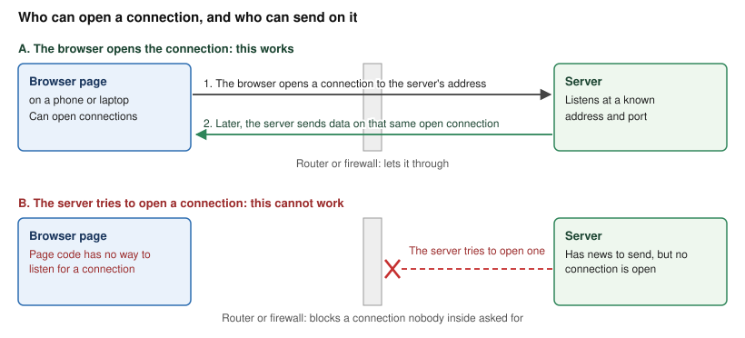
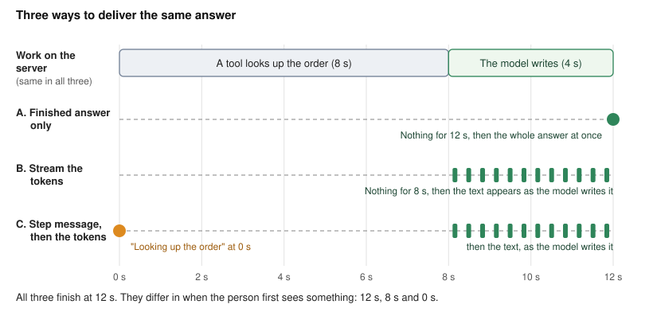
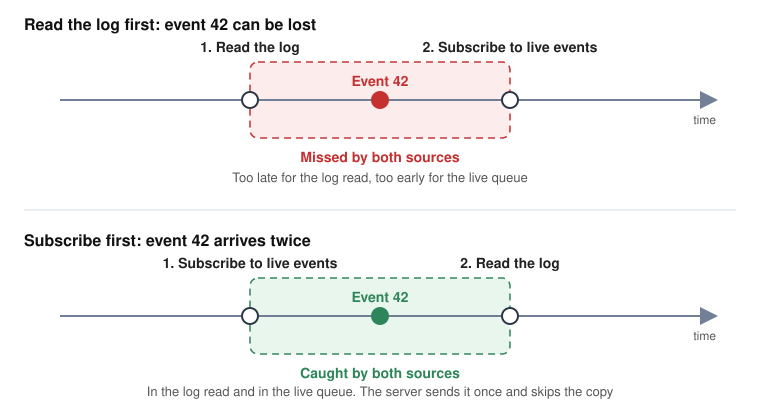
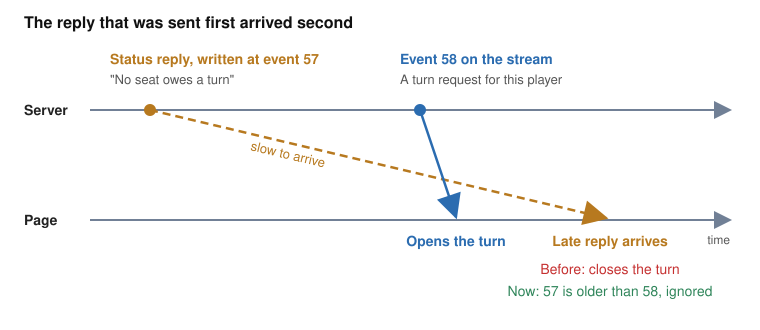

# U6. Keeping a browser up to date: streaming, catching up, and waiting for a model

**Reading time:** about 30 minutes for Parts 1 and 3 (estimate); Part 5, 5 minutes · **Builds on:** U3 (the event log), U4 (a request that may be sent twice) · **Related:** U7 (which viewer may receive which event), U12 (turning the events into a correct screen) · **Feeds write-up chapters:** 8, and 7 for the server's half

**The question:** a browser watches work that takes a long time on the server, such as a model
writing an answer or ten agents playing a game. The connection drops and comes back. How does
the page end up showing what it would have shown, with nothing missing and nothing shown twice?
And while the model is still working, what does the person see?

**First answer, before reading on:** why does a reconnecting page send the server a position,
and what goes wrong if the page drops every event numbered below the highest it has seen? A
rough answer is enough; Part 5 is the stopping check.

**Reading path.** Part 1 is the general idea, in nine sections. Sections 1.1 and 1.2 are
summaries of what my Heptabase cards already hold. Sections 1.3 to 1.8 are what the cards do
not hold, and most of it was learned from faults in this project. Part 3 is my system. Part 5
is the summary.

**Walkthrough closed 2026-11-25.** I read Part 3 with the code open. Part 3 grew during it
(diagrams, the end of a game told once in 3.3, the two audit cases in 3.4), and 1.6 gained
"What 'open' means", so the reading time above is now low. Four code changes came out of the
walkthrough and are in improvements.md, built and tested but not committed or deployed.

**Enough for this pass (2026-11-19).** Explain my system without notes: what travels, how a
page catches up, how it notices a dead connection, one trade-off and one gap. Read Parts 1, 3
and 5. Parts 2 and 4 answer follow-up questions, and Appendix B holds the evidence.

**Core and detail.** The core is four ideas: streaming changes when the first output appears
and not when the last does (1.3); a page catches up from a position, and has to know where
history ends and news begins (1.4); duplicates are dropped by asking "do I hold this one", not
"is this below my highest" (1.5); and a connection counts as alive only while something is
heard on it (1.6).

## The whole idea

```text
server                                          browser
──────                                          ───────
work commits a fact  ─►  event (seq 41)  ─►     apply once, in seq order  ─►  screen
                         one long HTTP response
                         a heartbeat when quiet

the connection drops ...........................  hears nothing for too long, reopens
                     ◄─  "I hold up to 41"
replay 42, 43, 44    ─►                          history: applied silently, in one block
then new events      ─►                          news: shown as it happens
```

| Concept | The question it answers |
|---|---|
| Transport and pattern | Which connection carries the updates, and what is in each message? |
| Latency | What does the person see between asking and the finished answer? |
| Catch-up | After a drop, what does the server send, and how does the page treat it? |
| Duplicates and order | How does the page apply each event exactly once, in the right order? |
| Liveness | How does the page tell a dead connection from a quiet one? |
| Stale updates | When the stream and an ordinary request disagree, which one is newer? |
| Rejection and failure | When a request does not succeed, did the server decide, or did no answer arrive? |

---

# Part 1 — Fundamentals

The example is the support assistant from U8 to U10. A customer asks about an order. An agent
looks the order up with a tool, then writes an answer. The whole run takes about twenty
seconds, and the customer watches it in a browser.

## 1.1 The connection (summary of my card)

In a typical web application, the server listens at a known address and port, while the
browser initiates the connection by contacting that address. For example, when a user visits a
website, the browser establishes a connection to the web server.

The reverse is not possible in a conventional web application. A browser page cannot listen
for incoming connections, because the browser does not provide such a capability to page code.
In addition, personal devices are typically behind routers or firewalls that block unsolicited
incoming connections. So the server cannot initiate a new connection to the browser page.

However, initiating a connection and sending data over an existing connection are two
different things. Once a connection is established, data can travel in both directions. With a
suitable communication protocol, the server can deliver updates over a connection the browser
established earlier.



This creates a challenge for live web applications. The server may generate new information at
unpredictable times, for example when an AI agent finishes generating a response or a game
advances to its next phase, and it can send that information only over a connection the browser
has already opened. There are three ways to arrange that.

| Transport | How it works | Fits when |
|---|---|---|
| Polling | The page asks "anything new?" on a timer | A few seconds of delay is acceptable, or every viewer gets the same bytes and a cache can serve them |
| Server-sent events (SSE) | One long HTTP response; the server writes a message whenever it has one. The page sends anything upward with ordinary requests | Updates flow mostly downward, and the person acts now and then |
| WebSocket | One connection that carries messages both ways | The page itself sends many messages a second: a shared cursor, a game loop, live audio |

The rule I use looks at the upward direction. Occasional human actions go up as ordinary POST
requests, and SSE carries the rest. A WebSocket is needed only when the upward traffic is
continuous. SSE also has a resume mechanism built in (1.4). It is plain HTTP, so cookies and
`curl` work on it, and a proxy passes it once buffering is turned off for that route. The APIs of the model providers stream their answers
over SSE as well.

**What one SSE message looks like.** The format is part of the web standard, not of any
framework. A message is a few lines of text, each `field: value`, ended by a blank line:

```
id: 43
event: game
data: {"type":"speech","player":"seat_4","text":"..."}

```

- `data:` is the content, any text; JSON by convention.
- `event:` is an optional name for the kind of message. The page registers one listener per
  name, and `EventSource` calls only the matching one. Without the line the name is `message`.
  Names let one connection carry several kinds that the page treats differently.
- `id:` is an optional position. The browser remembers the last one and sends it back when it
  reconnects (1.4).
- A line starting with `:` is a comment, which `EventSource` discards (1.6).

*Card:* "Server Client Transports and mechanisms", sections 2 and 7. The browser's API is on
"EventSource API - Server-Sent Events (SSE)" and "WebSocket in the Browser: The Core API".

## 1.2 What a message contains (summary of my card)

The transport does not decide what is in a message. There are four patterns.

| Pattern | Each message holds | If one is lost |
|---|---|---|
| Notification | "Something changed", and the page fetches the data | The next one repairs it |
| Snapshot | The whole current state | The next one repairs it |
| Delta | A change to the state the page is assumed to hold | The page silently shows a state that never existed, unless versions are checked |
| Event | One fact that happened, such as "the order was found" | The page asks for a replay from its position |

Snapshots are the safe default: no positions, no replay, and a duplicate does no harm. Events
are worth their extra work when the history itself is useful (a transcript, a replay, an audit)
or when different viewers may see different parts of it.

What an agent can stream, and how finely, is in 1.3.

*Card:* "Server Client Transports and mechanisms", sections 3 to 5.

## 1.3 Latency: what streaming changes, and what it cannot take back

The section makes three points, in this order.

1. The transport lets the server send. The application decides what it sends and how often.
2. That choice changes when the person first sees something. It does not change when the whole
   answer is finished.
3. Whatever has been sent cannot be taken back, so a thing is sent only when it can no longer
   be replaced.

### The application decides what is sent, and how often

SSE gives the server a way to send a message at any moment over the open connection (1.1). It
does not say what a message holds or when one is sent. That is the application's choice.

An agent can send three kinds of thing, and a product often sends more than one on the same
connection, each message marked with its kind (the `event:` line of 1.1):

| What is sent | The person sees |
|---|---|
| Tokens | The answer's text appearing as the model writes it |
| Steps | What the agent is doing: "looking up the order", "writing the reply" |
| State | Results that are already finished, such as a list of options to click |

Take an assistant that looks up an order with a tool, which takes 8 seconds, and then writes
its answer, which takes 4 seconds. The server can deliver that answer in three ways. All three
can run over SSE.



| Way | What the server sends | First thing the person sees | Whole answer |
|---|---|---|---|
| A. Finished answer only | One message at the end | At 12 s | At 12 s |
| B. Stream the tokens | Each token as the model writes it | At 8 s | At 12 s |
| C. Step message, then the tokens | "Looking up the order" when the tool starts, then each token | At 0 s | At 12 s |

### What the choice does to the wait

There are two waits, and streaming changes only the first.

| Wait | What sets it | What helps |
|---|---|---|
| Until the first thing appears | The first step of the run, or the model's first token | Send something earlier: a step message at once, then tokens |
| Until the whole answer is there | The model's speed and the number of steps | A faster model, fewer steps, steps run at the same time. Streaming does not shorten it |

A slow step early in the run sets a minimum for the total. In the example nothing sent to the
browser makes the answer arrive before the 8-second lookup has finished, and streaming tokens
alone (way B) shows nothing during those 8 seconds. So the first thing to find out is which
step the time is spent in (U8).

### When streaming is worth it

Two questions decide it.

1. **Is a part of the output useful to the person before the rest exists?** Half a paragraph
   can be read. Half of a JSON object, or half of a yes-or-no label, cannot be used.
2. **Can the output still be replaced after the model wrote it?** If a check may reject it,
   sending it early shows the person something that is later withdrawn (next sub-section).

| Application | What to send | Why |
|---|---|---|
| A chatbot writing prose, with no check afterwards | Tokens | Each part is readable, and nothing replaces it |
| An agent that takes several steps | A message for each step | The steps are where the time goes, and each one is a finished fact |
| Output that is checked before it is used: JSON that must be valid, or a reply a rule may block | The finished result, with step messages while it is made | A part is unusable, or may be replaced |
| A background job nobody watches, such as labelling records | Nothing until the end | Nobody is waiting on the parts |

### Streamed text cannot be taken back

Many systems check an answer after the model has written it: a format check that may retry
the call, or a rule that may block the answer. If tokens were streamed as they were written,
the person has already read text that the server then replaced. There are three ways to handle
this.

| Choice | The person sees | Cost |
|---|---|---|
| Stream tokens, and accept that text may be replaced | The fastest first output | Text that appears and then changes |
| Stream steps while the model writes, and send the text once it has passed the checks | Progress at once, then the checked text | The text arrives all at once, later |
| Check in pieces, for example sentence by sentence, and stream each checked piece | Something between the two | The check must make sense on part of an answer |

The general rule is to send a fact only when it can no longer be withdrawn. My cards state
this as "emit at commit points".

*Card:* "Streaming in Agentic AI: Design Patterns & Mental Models".

### Stopping a run, and a failure halfway

**Stopping a run.** If the customer presses stop or closes the page, the browser ends the
request (`AbortController` for a `fetch`, `close()` for an `EventSource`). The server has to
notice that the client has gone and stop the model call. If it does not, the rest of the answer
is still generated and paid for. This applies only when the work runs inside the HTTP request
the browser is waiting on. When the work is durable and continues without a viewer (U5), a
closed page must not stop it, and stopping needs its own request.

**A failure halfway.** The page then holds half an answer. It should say that the answer is
incomplete, and a retry must not repeat a side effect that the first attempt already had (U4).

## 1.4 Reconnection and event catch-up

When a browser disconnects, the server may continue producing events. On reconnection, the
browser needs to recover the missed events before resuming live updates.

There are three concerns: **delivery correctness, presentation behaviour and rendering
performance.**

### 1. Resume from the last received event

Each event carries a monotonically increasing sequence number (`seq`): the server numbers the
events 1, 2, 3 and so on as it creates them, and an event keeps its number for good. On
reconnection, the client communicates its last received sequence number so that the server can
replay the missed events.

```text
                       Disconnected
                     ┌───────────────┐
Server:     40   41   42   43   44   45   46 ...
             ↓    ↓                        ↓
Browser:    40   41      Missed events    Reconnect

Browser → Server: I have events up to 41.
Server → Browser: Replay 42, 43, 44, 45, 46 ...
```

SSE provides built-in support for communicating this position. The server writes each event's
`seq` as the message's `id:` line (1.1), so the id and the seq are the same number.

- **Automatic reconnection:** If the server sends `id: 41` with an event, the existing
  `EventSource` automatically sends `Last-Event-ID: 41` when reconnecting.
- **Manual reconnection:** A newly created `EventSource` does not remember the previous
  position or allow custom headers. The application can pass the position through the URL,
  such as `/events?after=41`.

SSE communicates the position but does not implement event storage or replay. The server must
retain events for replay and provide another recovery mechanism if the required history is no
longer available.

*Card:* "Server Client Transport (Single v.s. Aggregate)", Part I. The cards stop here; the
next three sub-sections are not on them.

### 2. Transition from historical events to live events

The server needs to replay missed events and subscribe to newly generated events. Since events
may be created during this process, the order of these operations matters.

- **Replay:** read the saved events after the client's position and send them.
- **Subscribe:** add the client to the list of viewers that are sent each new event as it is
  created.

**Incorrect: replay first, then subscribe**

```text
Time ──────────────────────────────────────────→

Read history          Event 46       Subscribe
   42–45               created       to live events
      │                   │                │
      ▼                   ▼                ▼
  [42–45]             MISSED          [47, 48 ...]

Events delivered: 42, 43, 44, 45, 47, 48 ...
```

Reading history before subscribing creates a **race condition**: an event produced between the
two operations may be missed.

**Correct: subscribe first, then replay**

```text
Time ──────────────────────────────────────────→

Subscribe          Event 46        Read history
to live events      created           42–46
      │                │                │
      ▼                ▼                ▼
      └──── Buffer [46, 47 ...]     [42–46]
                       │                │
                       │                ▼
                       │           Replay history
                       │                │
                       └───────────────→│
                                        ▼
                                 Drain live buffer
                                 (discard duplicate 46)

Events delivered: 42, 43, 44, 45, 46, 47 ...
```

The server subscribes first and buffers incoming events while replaying history. It then
processes the buffered events, discards duplicates using their sequence numbers, and continues
delivering live events.

This deliberately allows overlap rather than risking a gap in delivery. A duplicate can be
recognised by its sequence number and dropped. A missing event cannot be noticed by either
side.



### 3. Distinguish historical events from live events

Although historical and live events arrive through the same SSE connection, the frontend may
need to present them differently.

For example, a game should reconstruct its current state on reconnection without replaying
every missed animation.

The client makes a fresh request on reconnection to obtain the server's latest sequence
number. This establishes a boundary between historical and live events.

```text
Last received seq = 41
Latest seq at reconnection = 45

Incoming SSE events:

  42    43    44    45  │  46    47    48 ...
                        │
  └──────────────────┘  │  └─────────────────┘
   Historical events    │     Live events
   Apply silently       │     Animate normally
                        │
                 History boundary
```

The boundary must come from a fresh response. A cached response containing an older sequence
number (e.g. 43 instead of 45) would cause some historical events to be incorrectly presented
as live events (3.5).

This is an application-level presentation decision, not an SSE requirement. Another approach
is for the server to explicitly send an event marking the end of historical replay.

### 4. Batch historical state updates (detail)

A large backlog can create a frontend performance problem. If 200 historical events arrive
individually and each triggers a state update, the frontend may render up to 200 times.

Instead, the client can collect historical events and apply them in batches.

```text
Individual updates:

Event 42 → Update state → Render
Event 43 → Update state → Render
Event 44 → Update state → Render
Event 45 → Update state → Render


Batched updates:

Event 42 ─┐
Event 43 ─┤
Event 44 ─┼─→ Buffer → One state update → Render
Event 45 ─┘
```

Batching also avoids repeatedly processing an increasingly large event log during rendering.

When a live event arrives, the client must first apply any pending historical events to
preserve event ordering.

```text
Pending history: [42, 43, 44, 45]
Incoming live:    46

1. Apply historical events [42–45]
2. Apply live event 46
3. Continue normal live processing
```

This optimisation reduces rendering overhead without changing how events are transmitted over
SSE. It batches frontend state updates, not necessarily network messages.

### Summary

| Concern | Problem | Solution |
|---|---|---|
| Delivery correctness | Recover missed events | Sequence numbers and replay |
| Delivery correctness | Avoid gaps during catch-up | Subscribe before replay, deduplicate |
| Presentation behaviour | Avoid replaying old animations | History/live boundary |
| Rendering performance | Avoid excessive state updates | Batch historical events |

The first two mechanisms address reliable event delivery. The remaining two determine how
efficiently and appropriately the frontend presents the recovered events.

## 1.5 Duplicates and out-of-order events

An event-driven system must handle two situations:

- The same event arrives more than once.
- Events arrive in a different order from their sequence numbers.

The client must apply each event only once and in the correct logical order.

### Why duplicates occur

On reconnection (1.4), the server may replay events that the client already holds. This
happens when the position the client sends is behind what it actually holds, or when the
client asks for the whole history again.

```text
Client holds:            [..., 42, 43, 44, 45]
Client reconnects with:  after=43

Server replays:          [44, 45, 46, 47 ...]
                          └────┘
                         Duplicates
```

The overlap between historical replay and the live subscription (1.4) is a second source. In
that design the server discards those copies before sending, but a client should not depend
on every server path doing so.

The client must recognise and discard events it has already applied. This is called
**deduplication**.

### Detecting duplicates

There are two common approaches, using the event's sequence number (`seq`).

| Approach | Rule | What the client remembers |
| :--- | :--- | :--- |
| High-water mark | Discard if `seq` is at or below the highest received seq. | One number |
| Membership | Discard if an event with exactly this seq has already been received. | Every seq received |

Neither is better in general. The high-water mark is cheaper, and membership tolerates events
that arrive late. Which one fits depends on the stream (see "Choosing between them" below).

Both approaches work when events arrive in sequence order without gaps.

```text
Events held: [1, 2, 3, 4, 5]
Incoming:     4

High-water mark: 4 <= 5       → Discard
Membership:     4 is present  → Discard
```

The difference becomes important when events can arrive out of order.

```text
Events held: [1, 2, 5, 6]
Incoming:     3

High-water mark: 3 <= 6       → Discard (incorrect)
Membership:     3 is absent   → Accept  (correct)
```

The high-water mark assumes that receiving a higher sequence number means all relevant earlier
events have already been received.

Membership checking makes no such assumption. It checks each event individually, for example
using a set of received sequence numbers.

### Choosing between them

| | High-water mark | Membership |
| :--- | :--- | :--- |
| Memory on the client | Constant: one number | Grows with the number of events received |
| Correct when delivery is in order with no gaps | Yes | Yes |
| Correct when an earlier event can arrive later | No | Yes |
| Fits when | The stream is long or never ends, and the source guarantees ordered, gap-free delivery | The client keeps the events anyway, or earlier events can arrive later |
| Seen in | A message queue consumer that stores one offset per partition (Kafka). The SSE position, `Last-Event-ID`, is also a single number | A client that holds the whole event history to build its state from |

A consumer that reads millions of messages cannot remember every number it has seen, so it
uses a high-water mark and relies on the queue to deliver in order. A page that already holds
a few hundred events in memory pays nothing extra for membership.

So the high-water mark is the right choice when its assumption holds. It becomes wrong only
when an earlier event can arrive later, which the next sub-section shows.

### Why earlier events may arrive later

One cause is event filtering, where the server temporarily withholds certain events from a
viewer.

Consider a game in which private actions are hidden until the game ends.

```text
Server history:   [1, 2, 3, 4, 5, 6]
                         └──┘
                         Private

During the game:  [1, 2,       5, 6]

After the game:   [1, 2,       5, 6, 3, 4]
                                     └──┘
                                  Newly revealed
```

Events 3 and 4 are not duplicates. They are legitimate events that the viewer was previously
not allowed to receive.

A high-water mark would incorrectly discard them because their sequence numbers are below 6.
Membership checking accepts them.

This is application-level behaviour, not SSE delivering messages out of network order.

### Maintaining the correct event order

Deduplication determines **whether to accept an event**. Ordering determines **where to place
it**.

The client uses sequence numbers, rather than arrival order, to maintain the logical event
history.

```text
Before receiving event 3:

[1, 2,    5, 6]

Insert event 3:

[1, 2, 3, 5, 6]
       ↑
```

If the application derives state from the ordered history, it may also need to recompute the
affected state.

```text
Before: Event 1 → Event 2 → Event 5 → Event 6 → State A

After:  Event 1 → Event 2 → Event 3 → Event 5 → Event 6 → State B
                            └─────────────────────────┘
                              Recompute affected state
```

Sorting the event history alone is not sufficient if the previously computed state depends on
event order.

### Implications for reconnection

The same assumption behind the high-water mark also affects the reconnection position
discussed in 1.4.

```text
Server history:  [1, 2, 3, 4, 5, 6, 7, 8]
Client history:  [1, 2,       5, 6]

Client reconnects with: after=6

Server replays: [7, 8]
```

If events 3 and 4 have now become visible to the client, replaying only events after 6 would
omit them.

The server must account for previously withheld events separately, rather than relying solely
on the highest received sequence number.

### Summary

| Concern | Solution |
| :--- | :--- |
| Duplicate events | Apply each event only once. |
| Duplicate detection | A high-water mark when ordered, gap-free delivery is guaranteed: it needs one number. Membership checking when earlier events can arrive later: it needs every seq received. |
| Out-of-order events | Insert events according to their sequence numbers. |
| Order-dependent state | Recompute affected state when earlier events arrive. |
| Reconnection | Do not assume the highest received seq represents a complete history. |

The key distinction is that **the highest sequence number received is not necessarily the
highest sequence number up to which the client has a complete history.**

## 1.6 Connection liveness and recovery

### Detecting a broken connection

A connection can become unusable without the client immediately detecting it. For example, a
device may go to sleep or lose its network connection without the browser receiving an error.

From the application's perspective, a quiet connection and a silently broken connection may
look identical. The browser may report both as OPEN until it detects a network failure.

### What "open" means (added 2026-11-25)

A connection is not one object shared by the two machines. It is two records, one in each
machine's memory, and the packets that travel between them. Each record names the other
machine's address and port and holds a state, such as "open". Each machine can change only its
own record.

A machine marks its record closed in two cases:

1. It receives a "closing" packet from the other machine.
2. It sends data and receives no acknowledgement, and gives up after several retries.

The two records fall out of step when a closing packet is lost. One machine has closed, and
the other still holds a record that says "open". This is called a **half-open connection**.

```text
Before:          phone: open    ◄───────────────────►    server: open

Phone asleep:    phone: asleep         X ◄── event       server: no acknowledgement,
                                       X ◄── "closing"            gives up, closed

After waking:    phone: open    ── waits for data ──►    server: closed
```

A machine that sends finds out through case 2. A machine that only receives has no way to
find out, because silence from a closed connection looks the same as silence from a healthy
one with nothing to send. On an SSE stream the browser only receives, so it can stay in this
state indefinitely.

So "the connection is open" is each machine's own belief. The only evidence that the other
machine is still there is having received something from it recently. That is why a
long-lived connection needs a heartbeat and a timeout. The same fact applies to every
connection built on TCP, and the same remedy appears under other names:

| Where | How a silently closed connection is detected |
|---|---|
| SSE | A heartbeat event from the server, and a timeout in the page (below) |
| WebSocket | The protocol's ping and pong messages, usually sent by the server; many applications add a heartbeat message of their own |
| A database connection pool | The pool tests a connection before handing it out (`pool_pre_ping` in SQLAlchemy) |
| TCP | An optional keepalive probe, often off or set to a long wait, so applications rarely rely on it |

### Heartbeat and watchdog

Two mechanisms work together to detect silent connection failures:

- **Heartbeat (server):** Periodically sends a small message, even when there are no
  application events to deliver.
- **Watchdog (client):** Tracks the time since the last received message. If too much time
  passes, it treats the connection as unusable and initiates reconnection.

```text
Example: heartbeat every 10s, watchdog timeout of 30s.

Time       Server              Browser
 0s        Heartbeat ────────→ Reset watchdog
10s        Heartbeat ────────→ Reset watchdog
20s        Heartbeat ────────→ Reset watchdog

           Connection breaks

30s        Heartbeat ─── X     Waiting...
40s        Heartbeat ─── X     Waiting...
50s        Heartbeat ─── X     Timeout reached
                                    │
                                    ▼
                               Close connection
                               Open new connection
                               Recover missed events
```

The timeout is normally several times the heartbeat interval to tolerate temporary network
delays.

A heartbeat confirms that messages are reaching the client. It does not necessarily confirm
that the underlying application is functioning correctly.

### SSE: keep-alive comments vs heartbeat events

SSE supports two ways of periodically sending small messages, but they serve different
purposes when using `EventSource`.

**SSE comment:**

```text
: keep-alive

```

**SSE named event:**

```text
event: ping
data: {}

```

| Mechanism | Prevents idle connection timeout | Observable by JavaScript |
| :--- | :--- | :--- |
| SSE comment | Helps | No |
| Named heartbeat event | Helps | Yes |

An SSE comment generates network traffic, which helps prevent intermediaries such as reverse
proxies from closing an idle connection. However, `EventSource` does not expose comments to
application code, so a comment cannot reset the watchdog.

A named event can serve both purposes: keeping the connection active and allowing the
application to monitor its liveness.

A client that reads the raw SSE response itself can also observe comment lines.

### Automatic vs application-managed reconnection

`EventSource` provides automatic reconnection, but it does not recover from every type of
failure.

| Failure | Automatic reconnection |
| :--- | :--- |
| Detected, recoverable network failure | Yes |
| Silently broken connection | Only after the browser detects it |
| HTTP 502 during a connection attempt | No |
| Invalid response content type | No |

For example, a server deployment may temporarily return an HTTP 502 response when the browser
attempts to reconnect.

```text
Connection lost
      │
      ▼
EventSource automatically reconnects
      │
      ▼
Server returns HTTP 502
      │
      ▼
EventSource enters CLOSED state
      │
      ▼
No further automatic attempts
```

The application therefore needs its own recovery mechanisms:

```text
Connection failure
      │
      ├── Detected recoverable network error
      │       └── Allow browser to reconnect
      │
      ├── Watchdog timeout
      │       └── Close stale connection and create a new one
      │
      └── EventSource enters CLOSED unexpectedly
              └── Application-managed retry
```

Application-managed retries should use backoff to avoid overloading an unavailable server.
Intentional closures and permanent failures should not be retried indefinitely.

When creating a new `EventSource`, the application must also supply the appropriate replay
position to recover missed events (1.4).

### Summary

| Concern | Mechanism |
| :--- | :--- |
| Prevent idle connection timeout | Periodic network traffic |
| Detect silent connection failure | Heartbeat + watchdog |
| Recover from ordinary network failures | EventSource automatic reconnection |
| Recover when automatic reconnection fails | Application-managed retry |
| Recover missed events | Sequence numbers and replay (1.4) |

*Cards:* "Server Client Transport (Single v.s. Aggregate)" (heartbeats); "EventSource API -
Server-Sent Events (SSE)", section 2D (give up or retry).

### Check

A customer's laptop sleeps for two minutes while the assistant is answering, and wakes. The
page uses `EventSource`, and the server sends an SSE comment every 15 seconds. What does the
page show after waking, and what two changes make it correct?

<details>
<summary>Answer</summary>

Possibly a frozen half-answer, for as long as the browser believes the dead connection is
open. No error fires, and the comment lines never reached the page's code, so the page has no
way to notice the silence. The two changes: the server sends a named event as its heartbeat,
and the page reopens the stream when it has heard nothing for a few heartbeats. On reopening,
the page sends its position and the server replays what was missed.
</details>

## 1.7 State synchronisation: handling stale updates

A browser can receive information about the same application state through different paths:

- **HTTP request:** asks the server for its current state (a state snapshot).
- **Event stream:** receives changes as they happen.

Information that arrives later is not necessarily newer. Different communication paths can
take different amounts of time to deliver information.

### The problem: out-of-order updates

Suppose a browser uses both an HTTP request and an event stream to determine whether it is the
user's turn.

```text
Browser                                  Server
   │                                        │
   │────── Is it my turn? ─────────────────>│
   │                                        │
   │                   Server prepares "No" │
   │                                        │
   │<───── Event: "Your turn" ──────────────│
   │                                        │
   │ Shows "Your turn"                      │
   │                                        │
   │<───── Delayed HTTP reply: "No" ────────│
   │                                        │
   │ Which answer should it believe?        │
```

The HTTP reply was produced before the event but arrived after it.

If the browser simply applies every update as it arrives, it will overwrite the correct state
with an older one. This is known as a **stale update**.

Always trusting the stream is not necessarily correct either. A stream may replay historical
events after a reconnection, or it may not report every change to the application state.

The browser therefore needs to determine how recent the information is, regardless of where it
came from.

### Solution 1: versioning

The server associates its state with a version number that increases as the state changes.
Both events and HTTP responses carry the version of the state they represent.

```text
Event:       "Your turn"   (version 43)
HTTP reply:  "No turn"     (version 40)
```

The browser remembers the version of the information it has already applied.

| Incoming update | Current version | Action |
|---|---|---|
| No turn (v40) | 43 | Ignore: older information |
| No turn (v45) | 43 | Apply: newer information |

Instead of comparing arrival order, the browser compares versions. This is known as **stale
update rejection**.

The version must accurately represent the state contained in the message. Simply attaching the
server's latest version to an older snapshot would defeat the purpose.

When both the stream and the HTTP response use the same event sequence, the sequence number
(`seq`) can serve as the version, provided it accounts for the relevant state changes.

### Solution 2: avoid competing updates

An alternative is to let only one mechanism update a particular piece of browser state.

For example, the browser could obtain the current turn exclusively through HTTP requests,
while the event stream handles other information.

This removes the need to reconcile competing updates.

| Approach | When to use it |
|---|---|
| Versioning | Multiple communication paths need to update the same state |
| One update mechanism | A single mechanism can provide all the necessary information |

Both approaches can still use the server as the **single source of truth**. The difference is
how the browser receives and applies that information.

## 1.8 Distinguishing rejection from failure

When a request is unsuccessful, the client must distinguish between a definitive rejection and
an inconclusive failure.

| Outcome | Examples | Client response |
| :--- | :--- | :--- |
| Definitive rejection | Invalid credential, resource no longer exists | Act on the server's decision |
| Inconclusive failure | Network error, timeout, 502 | Preserve existing state and retry |
| Temporary rejection | 429 rate limit, expired access token | Resolve the condition and retry when appropriate |

An inconclusive failure does not establish whether the server received or completed the
request. A retry may therefore repeat an operation that already succeeded. Operations that are
retried must be safe to repeat (U4). Retries use backoff and a limit on attempts (1.6).

The rule that follows: a client takes an irreversible action, such as deleting a stored login
or discarding a draft, only after a definitive rejection.

HTTP status codes help distinguish these outcomes, but the appropriate response depends on the
API's semantics, not simply whether the status code belongs to the 4xx or 5xx class.

**Example:** A browser attempting to reclaim a game seat should delete its stored seat
credential only when the server definitively rejects it. A temporary network failure should
not cause the player to permanently lose their seat (3.6).

## 1.9 Deciding it for a new system

| Question | What the answer decides | Section |
|---|---|---|
| 1. Does the page send many messages a second upward? | WebSocket if yes; otherwise SSE with POST, or polling | 1.1 |
| 2. Is only the latest state useful, or the history too? | Snapshots, or events with sequence numbers and replay | 1.2, 1.4 |
| 3. Can anything shown be withdrawn by a later check? | Whether tokens may be streamed, or only step messages and finished results | 1.3 |
| 4. Should a returning client see missed events differently from live ones? | Whether a history boundary is needed, and whether historical updates are batched | 1.4 |
| 5. Does every viewer receive the same events, in order and without gaps? | If yes, a high-water mark is enough. If not: filtering on the server (U7), a replay position that accounts for withheld events, and deduplication by membership | 1.5 |
| 6. How long may the page be wrong after a connection dies? | The heartbeat interval and the watchdog timeout | 1.6 |
| 7. Which failures does the browser not recover from by itself? | The application-managed reconnection, with backoff | 1.6 |
| 8. Does the same state reach the page through more than one path? | Versioning, or one update mechanism for that state | 1.7 |
| 9. Which client actions cannot be undone? | Those wait for a definitive rejection; retried requests must be safe to repeat | 1.8 |
| 10. Does the run stop when the viewer leaves? | Whether closing the connection cancels the work | 1.3 |

---

# Part 2 — What the browser and libraries do, and what my application does

| Responsibility | The browser or library | My application | Section |
|---|---|---|---|
| Open and keep the stream | `EventSource` holds the connection and reconnects automatically after a network error | Application-managed reconnection: after a watchdog timeout, and when `EventSource` has closed for good | 1.6 |
| Detect a silently broken connection | Nothing. `EventSource` discards comment lines and reports the connection as open | A named heartbeat event from the server, and a watchdog on the page | 1.6 |
| Carry the replay position | `EventSource` remembers the last `id:` and sends `Last-Event-ID` on its own reconnect | Writes the `id:` on each event, and puts the position in the URL when the page opens a new stream itself | 1.4 |
| Decide what to replay | Nothing. SSE carries the position and does not store or replay events | Keeps the log, and filters it by position and by what the viewer may see | 1.4, 1.5 |
| Deduplicate and order | Nothing | The page's store: membership check on `seq`, insertion by `seq` | 1.5 |
| Batch updates into one render | React (18 and later) batches updates made in one browser task, not across tasks | Collects historical events into one block before the store | 1.4 |
| Reject a stale update | TanStack Query treats an answer as fresh for a set time. It knows nothing about versions | Compares the status's `last_seq` with the `seq` of what it would change, and fetches the status again on every visit to a game | 1.7 |
| Write the response as a stream | Starlette's `StreamingResponse` | An async generator that yields SSE text | 1.1 |

---

# Part 3 — My Werewolf system

A hosted game is watched live in a browser by its human players and by spectators. A game has
ten seats and many turns, and it is often watched on a phone, so a sleeping phone or a network
drop during a game is an ordinary case.

## 3.1 What travels, and when

**The main point.** While a game is watched live, the page and my server use three HTTP
requests. The game itself
reaches the page as events on one long SSE response. The server sends an event only after the
engine has committed the change that the event describes, and the page computes everything it
shows from the events it has received.

The section answers six questions, in this order.

1. Which requests connect the page and the server?
2. How does one event get from the engine to the screen, and when is it sent?
3. Which kinds of message does the stream carry?
4. What does the page do with an event?
5. What is the status?
6. How was the set of events decided?

### 1. The three requests

| Request | Direction | What it carries | How often |
|---|---|---|---|
| `GET /games/{id}/events` | Server to page | The event stream: one SSE response for each viewer, kept open during the visit | Opened once, and opened again after a drop (3.2, 3.4) |
| `POST /games/{id}/turns` | Page to server | A human player's answer to a turn request | When the player acts, a few times a minute at most |
| `GET /games/{id}` | The page asks, the server replies | The status: a small snapshot of where the game is (question 5) | Every 12 seconds while the game is running |

The first two rows are the "SSE downward, POST upward" arrangement of 1.1. It fits because the
updates flow mostly downward and a player acts only now and then. The status is a second path
by which the page learns about the game, so the stream and the status can disagree. Section 3.5
covers that.

These three are the requests of a live game, not every request the page makes. Catching up
after a reconnect is not a separate request: it is the first request opened again with a
position (3.2). A finished game is watched through a different request, `GET
/replays/{game_id}`, which returns the game's whole event log as one JSON reply and no stream.
The requests of the waiting room (join, leave, start) and the request for a draft line are
outside this note.

### 2. The path of one event, and when it is sent

An event passes through five places on its way to the screen.

```text
1. Engine       A step of the game finishes, and the engine commits the change it made.
                     │
                     ▼
2. Translator   Turns the change into one or more events and gives each the game's
                next seq (57, 58, 59 ...).
                     │
                     ▼
3. Log          The event is written to the events table (U3), then appended to the
                game's event log in the server's memory.
                     │
                     ▼
4. Queues       A copy goes into the queue of every viewer whose stream is open.
                     │
                     ▼
5. Stream       Each viewer's stream takes the event from its own queue, checks that
                this viewer may see it (U7), and writes it as one SSE message.
                     │
                     ▼
   Page         Receives the message and updates the screen (question 4).
```

- The **engine** is the LangGraph graph that runs the game. A **step** is one run of one node
  of that graph.
- The **translator** is my code that converts the engine's output into the events the page
  understands.
- The game has one log and one seq counter. Each viewer has their own queue and their own SSE
  response, and the filtering is done per viewer in step 5.
- **Commit** in this note means that the step has finished and its result will not be
  replaced. It does not mean that the result is saved. The events are written to the events
  table in step 3, and the engine's checkpoint is saved separately, in the background (U3,
  section 3.4).

Steps 3 to 5 for a game with three viewers:

```text
                 The game's event log (one, with one seq counter)
                                   │
              ┌────────────────────┼────────────────────┐
              ▼                    ▼                    ▼
       Viewer A's queue     Viewer B's queue     Viewer C's queue
              │                    │                    │
              ▼                    ▼                    ▼
       May A see it?        May B see it?        May C see it?
              │                    │                    │
              ▼                    ▼                    ▼
       A's SSE response     B's SSE response     C's SSE response
```

Because the check is made per viewer, two viewers of the same game can receive different
subsets of the same log.

**When an event is sent.** This is the "emit at commit points" rule of 1.3. A seat's line can
still be replaced after the model has written it: a failed format check makes the server call
the model again, and two further checks can withhold the line. So the server sends no text
while the model is writing. It sends the `speech` event after the step has committed the line.

```text
The model writes a line
        │
        ▼
Format check ─────────── fails ──→  the server calls the model again
        │ passes
        ▼
Two further checks ───── fail ───→  the line is not published, and the turn
        │ pass                      is recorded as a pass
        │
        ▼
The step commits the line
        │
        ▼
The server sends the speech event
```

The two further checks each use one cheap model call to judge whether a line is worth
publishing. Neither judges whether the line is true.

- The **opening filter** reads the opening statements of a day together. It keeps a role
  claim, the speaker's own night action or result, and a challenge to an earlier claim, and
  holds everything else.
- The **echo gate** reads a line from a seat that was offered the floor without being
  addressed. It holds the line when it adds nothing to the day's discussion, for example a
  restatement or an agreement with no new reason.

A held line is not replaced by another line. The turn is recorded as a pass, and the server
sends a `pass_marker` event in place of the `speech` event. The marker keeps the held text for
the record, and it is one of the events withheld from players during the game (U7). Both
checks keep the line when the check itself fails, and neither is applied to a human's line.

One event is sent earlier. `turn_started` is sent when a seat's turn begins, before anything
is committed. It says only that the turn has begun, which stays true whatever happens to the
line.

```text
Time ───────────────────────────────────────────────────────────────→

Server:   seat 4's turn begins       model writes, checks run      step commits the line
                 │                                                          │
                 ▼                                                          ▼
Sent:     turn_started (seq 57)            nothing                   speech (seq 58)
                 │                                                          │
                 ▼                                                          ▼
Page:     shows seat 4 thinking       still shows thinking           shows the line
```

In the terms of 1.3 this is way C without the tokens: a step message, then the finished
result. Section 3.7 covers what the viewer sees during the wait.

### 3. The four kinds of message on the stream

Each kind is a named SSE event (the `event:` line of 1.1). The name is a label on the
message, and the browser calls only the listener registered for that label. It is separate
from the `type` field inside a `game` message's JSON, which says which game event the message
holds (`speech`, `vote_cast`, `game_over` and about thirty others).

| `event:` name | What it holds | Kept in the log, with a seq and an `id:` line | Replayed after a reconnect |
|---|---|---|---|
| `game` | One game event: a speech, a vote, a phase change, a turn request | Yes | Yes |
| `pacing` | The progress bar of the wait in progress (a night, a vote, a round of the day): how many of its turns are done | No | No |
| `deadline` | The deadline now in force for a seat's turn, sent to that seat's own streams only (3.5) | No | No |
| `ping` | Nothing. It is the heartbeat (3.4) | No | No |

A `game` message is **durable**: it is kept in the log, it has a seq, and it is sent with that
seq as its `id:` line. That is what lets a reconnecting page name its position and receive
what it missed (3.2).

The `pacing` and `deadline` messages are **ephemeral**: they are not kept and have no seq and
no `id:` line. Two things follow. They never change the position the browser reports when it
reconnects, and they are never replayed. Each one describes a value that is true only for the
moment, so the page keeps only the current value and no history of them.

### 4. What the page does with an event

The page registers one listener for each of the four names. The listener for `game` writes the
event into the **store**, which is an object in the page's memory that holds every event
received so far, sorted by seq (3.3).

The page does not keep a separate, hand-updated copy of the game. It computes what it shows
from the events:

```text
events in the store, in seq order  ─►  the fold  ─►  the view  ─►  the stage
```

- The **view** is the page's picture of the game: who is alive, the phase, the lines spoken,
  whether a turn request is open.
- The **fold** is the one function that computes the view (`foldEvents`). It starts from an
  empty view and applies each event in seq order. "Fold" is the usual name for this kind of
  function; `reduce` is another.
- The **stage** is the animated display of the view on the page.

The view is derived state: it can be discarded and computed again from the events, and the
result is the same. This has one consequence for catch-up. An event the page missed has to be
applied to the view like any other, or the view would be wrong. Only its animation is skipped
(1.4, 3.2).

All of this runs in the browser, in the page's JavaScript. The stage reads the store in two
ways, because it holds each step on screen for a few seconds and is therefore often behind the
newest event (3.7).

| What the stage reads | What it describes | What it is used for |
|---|---|---|
| The events, cut into **beats** (one beat is one thing shown on screen), and folded only up to the end of the beat on screen | The game as it was at the step being shown | Drawing the table, the characters, the lines and the votes |
| The store's view, folded over every event | The game now | Whether my turn is open and its countdown, whether the game is over, which seat is mine, and the newest seq |

A player's action does not change the view directly. The page sends it with the POST of
question 1, and the result comes back as a new event.

One piece of what the page knows about a turn does not come from an event: that the status,
or the page itself, has closed the seat's open request (3.5). Since 2026-11-25 the store keeps
that in a field of its own, so the view holds only what the fold produced. The full account of
the store, the fold, the beats and the stage is the browser's design record,
`frontend/docs/client_design/client_design.md`, section 0.

### 5. The status

The status is the reply to `GET /games/{id}`. It is a snapshot, not an event, and the fields
that matter here are these.

| Field | What it says |
|---|---|
| `state` | Whether the game is waiting, running, finished or dropped |
| `last_seq` | The newest seq this viewer may see |
| `pending_seats` | Which seats have a turn request open, limited to the seats this viewer may know about: their own seat during the game (U7) |
| `server_time` | The server's clock when it replied (3.5) |
| `error` | Why the game stopped, if it stopped without finishing (3.4) |

**Why the page needs the status when it already has the stream (added 2026-11-26).** The
status is not a second copy of the stream. It is a snapshot, and it covers three things that a
stream of changes cannot.

| What the stream cannot give | What the status gives | Section |
|---|---|---|
| A starting point. The page needs to know its seat, whether there is a running game to stream, and where history ends, before the stream's first event is of any use | `you`, `state`, `last_seq`. The page asks for the status first and opens the stream after | 3.2 |
| News of its own failure. A dead game task still sends pings. A refused stream request looks only like "closed", because `EventSource` does not let my code read the HTTP status code | `error` and `state`. The status is an ordinary request, so my code can read the reply | 3.4, gap 10 |
| State that has no event. An event opens a seat's turn request, but no event closes one. The server's clock is in no event either | `pending_seats`: a seat that is not listed has no open request. `server_time` | 3.5 |

Only the third row makes the two paths speak about the same thing: the stream opens a turn
request and the status closes it. That overlap is where a late status can do harm, and
section 3.5 covers it. The other way to remove the overlap would be an event that closes a
request, so that the stream is the only path, which is what I did for the deadline.

`last_seq` does two jobs. It is the history boundary of 1.4: events at or below it are
historical (3.2). It is also the version of the reply in the sense of 1.7: it says how much of
the event log the reply had taken into account (3.5).

### 6. How the set of events was decided (added 2026-11-26)

**The main point.** The events were not invented from what the screen needed. I went through
the engine's graph one node at a time, in the order the nodes run, and for every state field a
node writes I decided one of two things: the translator turns it into an event, or it stays on
the server. The record of that pass is `frontend/docs/event_derivation.md`, which has one
section for each node.

**What the translator receives.** The engine streams one **chunk** each time a node finishes. A
chunk has two halves: the name of the node, and the state fields that node wrote (the
**delta**).

```text
{ "DAY_RESOLUTION": { "dead_roster": [...], "day_channel": [...], "no_lynch_streak": 0, ... } }
     node name                      the delta: the fields this node wrote
```

**Where an event can come from.** Most events come from the delta, but three kinds do not. A
list built from the state fields alone would have missed them.

| Source | Why the delta is not enough | Events |
|---|---|---|
| A field in the delta | (the ordinary case) | `speech`, `lynch_result`, `night_result`, `investigation_result` |
| The name of the node that finished | The phase of the game is not a state field. "It is night" means that the night's nodes are running. The page has no way to know which node is running, so the translator sends a `phase_change` when a marker node finishes (`START_VOTING`, `NIGHT_START`) | `phase_change` |
| An interrupt | A human's turn pauses the graph. The pause arrives as a chunk named `__interrupt__` and writes no state | `input_request` |
| A message that engine code writes to the stream before its step has finished | A chunk arrives only when a node finishes, which is too late for "this seat is thinking" and for opening a human's ballot while the AI seats are still voting | `turn_started`, an early `input_request`, `player_reads` |

**How the fourth source works.** I run the graph with two stream modes at once
(`stream_mode=["updates", "custom"]`). An `updates` chunk is the node name and delta shown
above, and LangGraph produces it when a node finishes. A `custom` chunk is whatever engine code
passes to LangGraph's stream writer (`get_stream_writer()`), and it is put on the stream at
the moment the code calls the writer. The translator receives both kinds in one loop and tells
them apart by the chunk's type.

The fourth source is used for two different reasons.

- **Timing.** The first three sources report only when a node finishes. `turn_started` has to
  go out when a turn begins. A human's ballot or night action has to open while the AI seats
  are still acting, so the routing code writes a `human_turn_opened` message before the step
  starts, and the translator turns it into the `input_request`.
- **Content that I keep out of state on purpose.** An agent's suspicions about the other
  seats (`player_reads`) and the memories it consulted (`memory_consulted`) are never graph
  state, so no delta contains them. The node writes them to the stream directly.

A message written this way has one risk: the code that writes it can run twice. A node runs
again when a human answers or when the server resumes a game after a restart. I handle that
in two ways. `turn_started` is written from the routing edge that chooses the speaker and not
from the node, and the edge does not run again when the node does. The other messages are
written inside nodes, so the translator remembers a key for each one it has sent (the seat,
the day, the round and the kind of turn) and drops a repeat.

**The sources were not all found in one pass.** The pass through the graph, in August 2026,
gave the first three: state fields, node names and the interrupt. `turn_started` already went
out through the stream writer by then (2026-07-29). The other direct messages came later, each
for a need that the pass could not have shown: the reads and the consulted memories on
2026-09-17, when they were first shown to viewers after a game, and the early turn request on
2026-10-06, when a human's ballot was opening only after every AI seat had voted.

**The test for an event.** A candidate becomes an event only if all three hold.

1. **It is committed.** The step has finished and the result will not be replaced (question 2).
   `turn_started` is the one exception, and it says only that a turn has begun.
2. **Someone is entitled to know it**, during the game or after it. A field that only steers
   the engine's loop, such as which round of the day is running, fails this and is not sent.
3. **The page cannot compute it from events it already receives.** A seat that passes in the
   opening round gets no event: the page has the `round_opened` event, which lists the round's
   players, and the speeches, so it shows a pass for each listed player with no speech. Sending
   it as well would give the page two sources for one fact, and they could disagree.

The test I rejected was "does it change something on the screen". The screen reads the events,
so defining the events by the screen would make the server's interface change every time the
display does. Some events change nothing on a live player's screen at all, for example an
agent's private strategy note, which is shown only after the game.

**When a fact gets its own event type.** Only when it has different fields from every existing
type, or a different audience. The audience has to be decidable from the type alone, because
the server filters whole events by type (U7). That is why the survivors after a death are sent
as two events: `roster_update` goes to everyone and lists who is alive, and `pack_roster_update`
goes to the pack and lists which wolves are alive. It is never one event with a flag that says
"this is the private version". A type is never created because of which role acted. A day
speech from a wolf and one from a town player are the same `speech` event, and a role tag on
it would carry the game's main secret to every viewer.

**The translation is not one event for each chunk.**

| Case | Example |
|---|---|
| One chunk, several events | `DAY_RESOLUTION` gives the moderator's message, `lynch_result`, `roster_update` and `pack_roster_update` |
| One chunk, no event | A wrapper node whose chunk repeats what its inner graph already streamed; a node that writes only loop control |
| A chunk held and sent later | Each seat's vote node finishes on its own, but a ballot must stay secret until the tally. The translator keeps the ballots in a buffer and sends every `vote_cast` when the `COLLECT_VOTES` node finishes |

So `translate()` is not a function of one chunk. It keeps a small amount of state between
chunks: the buffer of ballots, the current day, the roles, and which early messages it has
already sent.

**The result.** 33 event types, counted in `EVENT_TIERS` on 2026-11-26: 13 public, 4 for the
pack, 7 for one seat, and 9 that nobody receives until the game is over (U7). The three
ephemeral messages of question 3 are outside this count. They fail the test on purpose: none
of them is a fact that belongs in the game's history.

**What keeps the list complete.** Three checks, each of which fails loudly.

- Every node has an entry in the translator that declares the fields it writes. A chunk from a
  node with no entry, or with a field that is not declared, raises `TranslationError`; it is never skipped silently. A new state field therefore forces the decision "send it or keep it".
- `tests/server/test_engine_sync.py` compares the declared fields with the engine's state
  schemas, so most of these are caught before a game runs. No test covers a new node; the
  first live game that reaches it raises the error.
- The server refuses to start if an event type has no audience in `EVENT_TIERS`.

The exact events for one recorded game are pinned by the golden files in `tests/fixtures/`.
The derivation document is prose and nothing checks it, so when the two disagree the golden
files are right.

### Summary

| Concept from Part 1 | In my system |
|---|---|
| Transport (1.1) | SSE downward, POST upward, and a status polled every 12 seconds |
| Pattern (1.2) | Events. The same log gives the live transcript, the catch-up after a drop, and the replay of a finished game (through `GET /replays/{game_id}`) |
| What is sent, and when (1.3) | A step message (`turn_started`), then the committed result. No tokens |
| Named SSE events (1.1) | `game` is durable; `pacing` and `deadline` are ephemeral; `ping` is the heartbeat |
| State derived from an event history (1.5) | The view is folded from the events in seq order |
| What counts as an event (1.2, 1.3) | A committed fact that someone is entitled to know and that the page cannot compute itself. 33 types, found by going through the graph node by node |

**Code:** `server/routes/games.py` (`event_stream`, `_sse`, `_frame`);
`server/game/game_session.py` (`_on_chunk`, `subscribe`, `_deliver`); `server/game/translate.py`;
`frontend/src/hooks/useGameStream.ts`; `frontend/src/game/store.ts`;
`frontend/src/game/foldEvents.ts`. The design record is
`frontend/docs/server_client_transport.md`, sections 2, 3, 5 and 7 to 9. For question 6: `frontend/docs/event_derivation.md`,
`server/schemas/events.py` (`EVENT_TIERS`), `tests/server/test_engine_sync.py`.

## 3.2 Reconnection and catch-up

When a page reconnects, the server has to send the events the page missed, and must not lose
an event that is created while the reconnection is in progress. The page then has to apply the
missed events to its view without playing the animation of each one. This section follows the
four parts of 1.4.

**Replay position.** The page has three ways of opening a stream, and the position differs.

| Case | Who opens the stream | Position sent | Term (1.4) |
|---|---|---|---|
| The page loads a game | The page's code | None. The store is empty after a load, so the server replays the whole log | Full replay |
| A detected network error | The browser's `EventSource` | `Last-Event-ID`, the last `id:` it received | Automatic reconnection |
| A watchdog timeout, or a stream closed for good (3.4) | The page's code, with a new `EventSource` | `?last_seq=N` in the URL, where N is the newest seq in the store | Manual reconnection |

The server reads both forms in one route. The URL holds the position from the moment the
stream was opened and the header holds the latest one, so the header wins when both are
present.

**Subscribe first, then replay.** For a new stream the server subscribes the viewer, which
creates that viewer's queue (the live buffer of 1.4). It writes one ping, replays the game's
log, then drains the queue. It keeps the set of seqs it has sent on this stream and skips any
event already in it. That set is the server's deduplication of the overlap.

**The position does not cover withheld events.** A page that reconnects after the game is
over may not hold the events that were withheld from it during the game (3.3). So the server
skips an event at or below the position only if this viewer was entitled to it while the game
was live. An event that was withheld is sent whatever the position says.

**History boundary.** The page takes the boundary from the status: events at or below the
status's `last_seq` are historical and are applied silently, and later ones are live. After a
drop, everything is historical until a fresh status says how far the log has got. A drop
shorter than 20 seconds is treated as no drop, so the few events missed in it are animated.

**Batching historical updates.** Historical events are held in an array for 50 ms at a time
and written to the store in one update. When a live event arrives while historical events are
still held, the page writes the held block first and then the live event.

Before the batching, the page rendered once per historical event. For one rejoin at seq 200,
in a development build on one machine, the change took the page from 100 renders to 7, and the
time from load to the stage being on the current turn from 6.3 s to 2.5 s.

**Code:** `server/routes/games.py` (`_sse`, `cursor_skips`);
`frontend/src/hooks/useGameStream.ts`; `frontend/src/hooks/catch-up-boundary.ts`
(`catchUpBoundary`, `catchUpBatch`).

## 3.3 Deduplication and ordering

The page has to discard an event it already holds. It also has to accept an event whose seq
is lower than the seqs it already holds, because of what the server does at the end of a game.

**What the server does at the end of a game.** During the game each stream skips the events
its viewer may not see (U7), and records the seq of every event it does send. When `game_over`
comes through the viewer's queue, the stream sends it. It then goes through the game's whole
log once more and sends every event it has not sent on this connection. Those are the
withheld events, and they arrive after `game_over` with seqs below it.

```text
An illustrative case. Events 3 and 4 were withheld. game_over is seq 7.

Order on the stream:   1  2  5  6  7  3  4
Order in the log:      1  2  3  4  5  6  7
```

**Deduplication is by membership (1.5).** The page's store searches its sorted log for the
exact seq and discards the event if it is there. Membership costs nothing extra here, because
the page keeps every event of the game anyway.

**Where duplicates come from.** A reconnect replays some events the page already holds. The
clearest case is after a game is over: the released events are not covered by the position
(3.2), so every reconnect sends them again.

**Ordering is by seq.** An event past the newest one is added at the end, and the view is
updated from where it was. An event that belongs earlier is inserted at its place, and the
whole log is folded again. That is the "recompute affected state" of 1.5.

| The incoming event | What the store does with it | How the view is updated |
|---|---|---|
| Its seq is already in the store | Discards it | Not at all |
| Its seq is higher than every seq in the store | Adds it at the end | The fold applies this one event to the existing view |
| Its seq is missing from the store and lower than the newest | Inserts it at its place | The fold runs again over the whole log |

**The first design used a high-water mark, and it lost the whole reveal.** The store kept
one number, the newest seq it had applied, and rejected any event at or below it as a
duplicate. Applying `game_over` raised that number above every withheld event, so the store
rejected all of them. The live page showed the winner and none of the roles, night actions or
agents' notes. The replay page was not affected, because it loads the whole log at once, in
order. The store's tests at the time fed events in seq order only. An independent review found
the fault on 2026-08-21 (`frontend/docs/build_log.md`, section 3.8), and the fix was the
membership check and the insertion by seq described above.

**The withheld events are applied as a block (since 2026-11-25, built and tested, not
deployed).** The withheld events are most of a game: 226 to 334 of 317 to 439 events in the
seven game logs in `frontend/src/stage/fixtures/`, counted for a spectator. They arrive one
message each. A page that had been open since the start of the game
applied each one separately, and each was an insertion: one sort, one fold over the whole log
and one render of the stage. The page now collects an event whose seq is below the newest seq
it holds, for 50 ms at a time as in 3.2, and writes the block to the store in one update. The
events are still marked as arrived live, as before.

Measured in the store alone, in Node on the development server, for the game with 334
withheld events: 97 ms one at a time, 0.8 ms as one block. The renders saved (up to 334, down
to one for each block) are not measured in a browser.

### From the store to the screen (added 2026-11-22)

The store is a Zustand store (`frontend/src/game/store.ts`). The stream hook writes each event
into it, and React components read from it. The general rule is on my Heptabase card "Global
Client State (Zustand)": a component passes a selector, and it renders again only when the value
that selector returns has changed.

In my code one component reads the store: the live stage's container (`LiveTheatre.tsx`). It
makes one selector call for each field it needs (the events, the view, the pacing bars, which
events arrived live), and passes values down to its children as props. So a change to a field
the container does not select does not make it render again. Whether a child renders again
then depends on its props, which is ordinary React (`memo`, stable references).

The store's header comment says "dozens of components subscribe". That describes the plan, not
the present code, where the container is the only subscriber.

## 3.4 Liveness: heartbeat, watchdog and reconnection

A phone can go to sleep and lose its connection without the browser reporting an error. The
browser still shows the stream as open, so the page's code has to notice the silence itself.
The parts below are the heartbeat and the watchdog of 1.6, with this server's values.

| Part | What it does |
|---|---|
| Server heartbeat | A named `ping` event when the stream opens and after every 15 quiet seconds |
| Page watchdog, silence | Checks every 5 seconds, and reopens the stream if nothing was heard for 40 seconds (the watchdog timeout) |
| Page watchdog, closed stream | Reopens if the browser closed the stream for good and the last try was over 10 seconds ago (application-managed retry) |
| Hidden page | The watchdog does nothing while the page is hidden |
| Page shown again, or back online | Reopens at once |

The check runs every 5 seconds and the limit is 40 seconds of silence, so a dead stream on a
visible page is reopened between 40 and 45 seconds after the last message the page received.
That figure is read from the code and not measured on a device.

This was built after an audit of multiplayer games on 2026-10-15 found two ways a stream
could stop working without the page noticing.

**Case 1: a half-open connection (1.6).** The page's side says "open" and the server's side
is closed.

1. The phone sleeps. The server sends events, receives no acknowledgement, and closes its end.
2. The phone wakes. The browser's record of the connection still says "open", because the
   phone was asleep when the server closed and never received the notice.
3. The browser only receives on an SSE stream, so nothing makes it check. It waits for data
   that will not come, and reports the stream as open.
4. The server's heartbeat at the time was an SSE comment, which the browser does not pass to
   the page's code. So the page's code saw nothing arriving in either case, and could not tell
   a dead connection from a game in which nothing was happening.

**Case 2: the browser closed the stream for good, on a page that stayed visible.**

1. The stream drops, and the browser reconnects automatically.
2. The attempt gets an error reply. The usual one is a 502 from the proxy while the server
   restarts during a deploy, which lasts some seconds.
3. After an error reply the browser marks the stream closed and does not try again.
4. The page's own code opened a new stream only when the tab was hidden and then shown again.
   A player who kept the tab in view never triggered that, although the server was back
   within seconds.

**The result was the same in both cases.** The page received no more events, so the stage
stopped on whatever it was showing. The game continued on the server. When it was that
player's turn, the request never reached their page, the turn's deadline passed on the server,
and the server let the seat's AI agent play the turn. The player was not told any of this.

**What fixes each case.** The watchdog covers both, with one condition for each.

| Case | The watchdog's condition | What it depends on |
|---|---|---|
| 1. Half-open connection | Nothing was received for 40 seconds | The named `ping` heartbeat, which makes a healthy stream never silent for more than 15 seconds |
| 2. Stream closed by the browser | The browser reports the stream closed, and the last attempt was over 10 seconds ago | Nothing else. The heartbeat plays no part |

The three recovery paths of 1.6 map onto this as follows.

```text
The stream stops working
      │
      ├── The browser detects a network error
      │       └── EventSource reconnects by itself and sends Last-Event-ID
      │
      ├── The watchdog finds 40 seconds of silence
      │       └── The page's code closes the stream and opens a new one with ?last_seq=N
      │
      └── EventSource has closed for good
              └── The page's code opens a new one with ?last_seq=N,
                  at most once every 10 seconds
```

In all three the server then replays what the page missed (3.2). The retry of a closed stream
uses a fixed 10-second delay, with no backoff and no limit on attempts (gap 8).

One opposite case remains. A heartbeat shows that messages reach the page, not that the
application behind it is working (1.6). If the server's task for a game dies, the stream keeps
sending pings and looks alive. The page learns of it only from the `error` field of the status
poll.

## 3.5 Stale updates: the stream and the status

The page receives the state of a seat's turn through two paths (1.7): the stream and the
status. Each piece of that state has its own rule.

| State | Updated by | Technique (1.7) |
|---|---|---|
| Whether a turn request is open | The stream opens it; the status may close it | Versioning. The status's `last_seq` is its version, and the request's `seq` is the version of what is on screen |
| The turn's deadline | The stream only, as the `deadline` message | One update mechanism |
| Where history ends (3.2) | The status only, fetched fresh | One update mechanism |

**Stale update rejection for a turn request.** A status may clear a turn request on the page
only if the status could have seen it, that is, if the request's seq is at or below the
status's `last_seq`. The comparison is made per request, not for the reply as a whole. It was
added after a fault: a status answered late had cleared a newer request.

```text
Time ───────────────────────────────────────────────────────────────→

Server:  builds a status           seat's turn opens
         last_seq = 57             turn request, seq 58
         no seat pending                  │
              │                           ▼
              │                    stream delivers seq 58
              │                           │
              │                           ▼
Page:         │                    opens the turn
              │                           │
              └──── the reply arrives late ───→  before the rule: clears the turn (wrong)
                                                 with the rule:   58 > 57, so the status was
                                                                  built before the request
                                                                  existed, and the turn stays
```



A later status with `last_seq` 60 that does not list the seat may clear the same request,
because 58 is at or below 60: that status was built after the request existed.

**The deadline comes from the stream only (since 2026-11-23).** Before that date the status
also set a deadline, under the same versioning rule. That half of the rule is gone, because
the status no longer sets a deadline at all. The cause of the change was
a fault I found by reading the code and then reproduced with a browser test:

- A turn request event is saved with the deadline the turn was asked with, and a saved event
  is never rewritten. The server's clock for the seat moves afterwards without a new event: at
  most 30 seconds left while the seat is disconnected, a new 120 seconds after the game waited
  with nobody connected, time given back for a draft.
- A player who came back to a game that had waited received the old event, with the old
  deadline:

```text
The turn request is saved with deadline A.
        │
        ▼
Nobody is connected, so the game waits. Deadline A passes.
        │
        ▼
The player comes back. The server sets a new deadline B, 120 seconds ahead.
        │
        ▼
The stream replays the saved request, which still holds deadline A.
        │
        ▼
The page finds deadline A in the past and shuts the turn as "played by the agent".
        │
        ▼
A status arrives with deadline B. The page keeps the turn shut.
        │
        ▼
The server waits 120 seconds for an answer the player cannot give.
Then the seat's AI plays the turn.
```

A deadline is a value that changes, so it does not belong in a record that cannot change. The
server now sends the deadline in force as its own message on the stream each time it moves
(`TurnDeadline`, on the `deadline` channel). It is not saved and has no number, like the
progress bar's message, and the page keeps the latest one. It is sent only to the seat's own
connections. The page reads the request event only to learn whether the turn is timed at all,
and shows no countdown until a deadline message has arrived. A turn that the page's own clock
shut is reopened if a later deadline arrives.

A deadline message is never replayed, so a new stream needs another way to receive the
deadline in force. When a seat that has an open turn opens a stream, the server sets that
seat's clock again, and setting a clock sends the deadline to all of the seat's streams,
including the new one. (Read from the code on 2026-11-25, in `subscribe` and
`on_seat_returned`; not run for this note.)

**A stale cached response for the history boundary.** This is the cached reply of 1.4. The
fetching library kept a status for 30 seconds,
so a player who came back to a game within that time got the old `last_seq`, and everything
since played as news. The page now fetches the status on every visit and ignores any earlier
status until the new reply arrives.

**Clock skew, and a server-authoritative deadline.** The server's clock and a device's clock
can disagree; the difference is called clock skew. The page measures it from the status's
`server_time`, and corrects its own clock by that amount before comparing with a deadline. The
measured difference includes the time the reply took to arrive, so the countdown reads slightly
high.

```text
An illustrative case: the device's clock is 5 seconds ahead of the server's.

Server's clock:   12:00:00        Deadline, on the server's clock:  12:02:00
Device's clock:   12:00:05

Countdown from the device's clock alone:   12:02:00 - 12:00:05 = 115 seconds  (5 too few)

Offset   = server_time - the device's clock when the status arrived  = -5 seconds
Countdown = deadline - (the device's clock + offset)                 = 120 seconds
```

The countdown is for display only. The server keeps each deadline on its own clock and
hands the turn to the seat's AI when it passes, whatever the page shows.

## 3.6 Sending a turn: rejection, failure and retry

When a request gets no successful reply, the page has to tell two cases apart: the server
refused the request, or no reply arrived and the page cannot know what the server did. The two
cases below are the outcomes of 1.8.

**An inconclusive failure is retried.** A turn goes up as a POST. If no answer comes back (the
network, or a 15-second limit), the page sends it again after 2, 5 and 10 seconds. The retry
is safe to repeat: a repeat that reaches a turn already answered gets a 409, which the page
reads as "already answered" (idempotency, U4).

```text
Page                                    Server

POST the answer ──────────────────────→ accepts the answer
no reply within 15 s   ←───── X ─────── the reply is lost
        │
        ▼
POST the answer again ────────────────→ the turn is already answered
                       ←─────────────── 409
reads 409 as "already answered"
```

The 409 protects the retry only while the same question is the seat's open turn. The answer
carries no question id, so a retry that arrives after the seat's next question has opened
could be taken as the answer to that question (gap 9).

**An irreversible action waits for a definitive rejection.** A browser proves that it owns a
seat with a secret string, the seat's credential (U7). The page keeps a copy and sends it to
take the seat again after a reload. It deletes the copy only when the server rejects it: 403,
404 or 410. Before that rule, any failed attempt deleted the copy, and a network drop made a
player a spectator for the rest of the game.

## 3.7 Latency: what a viewer sees while a model works

Three things decide when a viewer sees a seat's action: how fast the server runs the game,
when the event reaches the page, and how fast the page's stage shows it. They do not run at
the same speed.

No tokens are streamed, for the reason in 1.3: a line can still be withheld or regenerated
after the model wrote it. In the terms of 1.3, the server sends a step message and then the
finished result. A turn is shown in three steps. The server sends `turn_started` when
a seat's turn begins, and the page shows that seat thinking. When the line is committed, the
server sends the `speech` event. The page then types the line out with an animation of its
own. `turn_started` is the one event sent before a commit, and it claims only that the seat's
turn has begun.

The stage also runs behind the server on purpose: each step of a game is held on screen for a
few seconds so that it can be read. The server does not wait for the stage, so the page can
hold events it has received and not yet shown:

```text
An illustrative case.

The server has run:     turn A → turn B → turn C → turn D → turn E
The stage is showing:   turn B
Received, not shown:    turns C, D and E
```

One exception protects a player's own turn. When the steps still to be shown before that turn
add up to more than 30 seconds, the stage skips to the step just before it.

A viewer cannot stop a model call. A seat's call is started by the game and not by a viewer's
request, so closing the page cancels nothing.

How long a viewer waits between `turn_started` and the line appearing has not been measured
from the browser.

## 3.8 Known limitations

| Gap | Consequence | Possible direction |
|---|---|---|
| 1. A viewer's queue on the server has no size limit, so there is no backpressure | A connection that stops reading keeps collecting events in memory until it closes | A limit, with a rule for a viewer who falls behind: close the stream and let it catch up from the log |
| 2. The server can give a new event a seq it already used, after a restart (multiplayer audit finding 12, accepted; not re-read in the code for this note) | The page deduplicates by membership, which fails exactly when two different events share a seq (1.5), so the new event would be discarded | Continue numbering from the saved log after a restart |
| 3. Closed on 2026-11-25 (built and tested, not deployed). As written: an event is sent to viewers before it is saved (U3, gap 7) | A crash between the two showed a viewer an event the table never held | Done: the event is saved, then sent. A failed save still sends the event and is tried again with the next chunk |
| 4. A dead game task still looks alive on the stream: the heartbeat does not show that the application is working (1.6) | The stage stays frozen until a status poll reports the error | Send an event when the task ends with an error |
| 5. The page's code that opens the stream, and its code that takes a seat again after a reload, have no unit tests; the pure functions they call do | A change to how they are wired together is not checked | A test that drives the hook with a fake `EventSource` |
| 6. The browser tests never meet the real server | The catch-up path is tested on each side separately, not together | One test with the real server and a real browser |
| 7. The 45-second recovery, and the catch-up times, are from code reading and one development machine | The behaviour on a real phone in a real multiplayer game is not measured | Measure one real game |
| 8. The page's own retry uses fixed delays: no backoff, no random spread, no limit on attempts (1.6) | With many viewers, a server restart would make them all reconnect at the same moments | Backoff with a random spread in the delay. Not needed at today's numbers |
| 9. A turn's answer carries no question id, so the retry of 3.6 is not fully idempotent (U4, gap 1) | A late retry could be taken as the answer to the seat's next question | Send the question's id with the answer |
| 10. The page's retry of a closed stream does not stop when the game has left the server. The stream request for such a game is answered 410, the page cannot read a status code from `EventSource`, and the stream's effect is not re-run when the status turns `archived` (read in the code on 2026-11-25, not reproduced) | A page left open on an ended game would ask for the stream every 10 seconds while it is visible, and get 410 each time | Stop the stream when the status says the game is archived or gone; ask for the status when the browser closes the stream |

---

# Part 4 — Design choices

**Which transport?**

| Design | Benefit | Cost | My system |
|---|---|---|---|
| SSE down, POST up | Resume built in; plain HTTP, so the cookie works unchanged and the proxy needs only buffering turned off | One-way; a feature with continuous upward traffic would need its own connection | Yes |
| WebSocket | Both directions on one connection | Reconnect, heartbeat and resume all written by hand | No |
| Polling only | The simplest; nothing held open | Seconds of delay on every line | Only for the status |

**What is sent?**

| Design | Benefit | Cost | My system |
|---|---|---|---|
| Typed events | One log serves live play, catch-up and replay; each event can be filtered per viewer | The page must order, deduplicate and fold | Yes |
| The current state | No positions and no replay; a lost message repairs itself | The game's state holds every seat's secrets, so each viewer would need a filtered copy of the state as well as of the events | No |
| Tokens | The fastest first output | Text a later check can withdraw | No |

State would be the better choice if the product showed only the present, for example a
scoreboard with no transcript and nothing hidden from anyone.

**How does a returning page catch up?**

| Design | Benefit | Cost | My system |
|---|---|---|---|
| Replay the events after its position | The same code path as live events; nothing new to filter | The log must be kept, and a very long log is slow to replay | Yes. One game is a few hundred events |
| Send a snapshot, then events | Fast for a long log | A second message format, and code to reconcile the snapshot with events already held | No |

**At a larger scale.** With more than one server process, a viewer may be connected to a
process that is not running the game, so the events need a broker between processes; today the
game and its viewers share one process and one event loop. With thousands of viewers, a
restart makes them all reconnect together, and the retry needs a random spread (gap 8). With
logs that never end, a returning page needs a snapshot per viewer in place of a full replay.
My card "Server Client Transport (Single v.s. Aggregate)", Part II, covers these.

---

# Part 5 — Review

## In 30 seconds

A server cannot open a connection to a browser, so the browser opens it: SSE when updates flow
downward and actions are occasional. Streaming changes when the first output appears, not when the last
does, and only facts that cannot be withdrawn should be sent. Each event has a seq. A returning
page sends its position and gets the rest. The server subscribes before it replays, so the
overlap is duplicates and not a gap. The page applies old events silently in one block, drops
duplicates by membership, and orders by seq. A connection is alive only while something is
heard, so the server sends a heartbeat the page's code can receive, and the page reopens on
silence. When the same state arrives through two paths, a reply is applied only if its version
is at least as new as what it would change, or one path alone updates that state. A client
acts irreversibly only after a definitive rejection, and retries after an inconclusive failure.

## My Werewolf system in one paragraph

A game reaches the browser as typed events over SSE, one stream per viewer, filtered for that
viewer; turns go up by POST. Events are created when the engine commits a change, so no token
is streamed and a viewer first sees "thinking", then the committed line. A reconnecting page
sends its position, the server subscribes it, replays the log after that position and then
continues live, and the position never hides an event that had been withheld from that viewer.
The page treats everything up to the status's newest seq as history, applies it in blocks, and
drops duplicates by exact seq. The server pings every 15 seconds and the page reopens a stream
that has been silent for 40. The weak points: viewer queues have no limit, a seq can be reused
after a restart, the stream hook has no unit test, and the recovery times are read from code
and not measured in a real multiplayer game.

## Stopping check

In two minutes, without the note: what travels and why not tokens; what a reconnecting page
sends and what the server does in which order; why duplicates are dropped by membership; how a
dead stream is noticed; one gap. If those connect, this pass is done.

## Problems

**Problem A.** A dashboard shows the log of a software build that runs for an hour, to
engineers on an unreliable office network. Design the reconnect. Say what the page must not
conclude from the order in which lines arrive, and when it should treat the connection as
dead.

**Problem B.** Why did I choose events over state here, and what change to the product would
make state the better choice?

**Problem C.** A draft sentence for the write-up: "The live page never misses or repeats an
event, even across a server restart." What is supported, what is not, and what is the accurate
wording?

---

# Appendix A — Answers to the problems

**Problem A.** Each log line gets a line number. The page sends the last number it holds when
it reconnects, and the server replays the lines after it, having subscribed the page to new
lines first. The page must not conclude that a line is new because it arrived late, or that it
holds everything up to its highest number unless every viewer receives every line. It orders
by line number. The server sends a named heartbeat during quiet stretches of the build, and
the page reopens when it has heard nothing for about three heartbeats, and at once when the
tab becomes visible again. A build log can be long, so a returning page may be given only the
last few hundred lines with a link to the rest.

**Problem B.** Three uses need the history: the transcript on screen, the catch-up after a
drop, and the replay of a finished game. The game's state also holds every seat's secrets, so
sending state would need a second per-viewer filter beside the one for events. State would be
better for a product that shows only the present and hides nothing: a scoreboard of the
current vote count, with no transcript and no replay.

**Problem C.** Supported, each by a named test: a reconnect is replayed from its position; the
header's position overrides the URL's; withheld events are not skipped by the position; the
page drops duplicates by exact seq and applies a backlog as one block. Not supported: "even
across a server restart". A seq can be reused after a restart, in which case the page would
drop a new event, and an event sent just before a crash may never have been saved. No test
runs a real browser against the real server. Accurate wording: "A reconnecting page sends its
position and the server replays what it missed; the page applies each event once, by sequence
number. This is tested on the server and on the page separately. Two cases around a server
restart are known gaps."

---

# Appendix B — Implementation and evidence reference

*"The tutorial" below is `frontend/docs/learning/realtime_and_sync/realtime_and_sync.md`, and `improvements.md` is the list beside this note. Each claim carries its support: **code** (the file and symbol were read), **test** (named, and
run on 2026-11-19 unless stated), **doc** (a written record, not re-read in the code), **run**
(a measurement, with its conditions). Read against the code on 2026-11-19. Paths are from the
repository root.*

**What travels (3.1)**

- The stream route, its SSE frames and the `id:` line on durable events only: **code**
  `server/routes/games.py` (`event_stream`, `_frame`)
- One queue per viewer, filled on the event loop: **code** `server/game/game_session.py`
  (`subscribe`, `_deliver`, `publish_pacing`)
- The status poll every 12 seconds while a game runs; `EventSource` opened with the cookie:
  **code** `frontend/src/hooks/useGameStream.ts`
- Events created at commit points; `turn_started` as the one event before a commit: **doc**
  `frontend/docs/server_client_transport.md`, sections 8 and 9, with their notes of 2026-10-26

**Catch-up (3.2)**

- Subscribe, ping, replay, then the queue, with the set of sent seqs: **code**
  `server/routes/games.py::_sse`
- The header overrides the URL's position: **code** `event_stream`; **test**
  `test_reconnect_header_overrides_the_frozen_query_cursor`
- The position does not skip withheld events: **code** `_sse` (`cursor_skips`); **test**
  `test_postgame_reconnect_cursor_does_not_skip_the_withheld_backlog`,
  `test_live_unlock_flushes_withheld_backlog_below_a_reconnect_cursor`,
  `test_sse_replays_the_whole_log_after_game_over` (all in `tests/server/test_game_session.py`)
- History and news, the 50 ms block, the 20-second rule for a short drop: **code**
  `frontend/src/hooks/catch-up-boundary.ts`; **test** `catch-up-boundary.test.ts`
- 100 renders to 7, and 6.3 s to 2.5 s: **run**, recorded in
  `frontend/docs/learning/realtime_and_sync/realtime_and_sync.md`, section 1: one rejoin at seq
  200, a development build, one machine, 2026-10-15. Not repeated for this note

**Duplicates and order (3.3)**

- Membership by seq, append or insert-and-refold: **code** `frontend/src/game/store.ts`
  (`addDurable`); **test** `frontend/src/game/store.test.ts`
- The lost reveal under the high-water rule: **doc** `frontend/docs/client_design/client_design.md`
  and `frontend/docs/build_log.md` ("What happened", the store's `view.lastSeq`)

**Liveness (3.4)**

- The named ping and the 15 seconds: **code** `server/routes/games.py` (`_PING`,
  `_HEARTBEAT_SECONDS`)
- 40 seconds of silence, 10 seconds between tries, reopen when shown: **code**
  `catch-up-boundary.ts` (`streamStalled`, `STREAM_SILENT_MS`, `STREAM_RETRY_MS`); **test**
  `catch-up-boundary.test.ts`
- The fault of 2026-10-15 (finding 7) and the dead-task case: **doc** the tutorial, section 5
- The proxy header that stops a middle server holding the stream is set on the host, not in
  the repository: **doc** the tutorial, section 5. Not checked on the host for this note

**The stream and the status (3.5), sending a turn (3.6), latency (3.7)**

- A status changes a request only if it could have seen it: **code** `store.ts`
  (`syncPending`); **test** `store.test.ts`
- The status fetched on every visit: **code** `useGameStream.ts`; no unit test
- The server's clock: **code** `frontend/src/hooks/useCountdown.ts`
- The retry of a lost send after 2, 5 and 10 seconds, the 15-second limit and the 409: **code**
  `frontend/src/stage/containers/LiveTheatre.tsx` (`SEND_RETRY_MS`, `SEND_TIMEOUT_MS`)
- The seat's credential deleted only on 403, 404, 410: **test** `frontend/src/lib/request.test.ts`
- The 30-second jump before a player's own turn: **code**
  `frontend/src/stage/containers/live-state.ts` (`TURN_JUMP_MS`); **test** `live-state.test.ts`

**Tests run on 2026-11-19.** Seven stream tests in `tests/server/test_game_session.py`
passed. Ninety-four tests in the four frontend files named above passed.

**The gaps (3.8)**

- Gap 1: **code** `game_session.py::subscribe` (`asyncio.Queue()` with no size);
  `improvements.md` row 16
- Gaps 2, 5, 6 and 7: **doc** `client_design.md`, "What is not established"
- Gaps 3 and 9: `improvements.md` rows 18 and 20
- Gap 4: **doc** the tutorial, section 5
- Gap 8: **code** `catch-up-boundary.ts` (a fixed `STREAM_RETRY_MS`)
- Not established: the wait between `turn_started` and the line, measured from the browser;
  any figure from a real multiplayer game

**Where the general half is on my cards**

| Section | Card |
|---|---|
| 1.1, 1.2 | "Server Client Transports and mechanisms" |
| 1.3 (what an agent can send; commit points) | "Streaming in Agentic AI: Design Patterns & Mental Models" |
| 1.4 (the position), 1.6 (heartbeats), Part 4 (larger scale) | "Server Client Transport (Single v.s. Aggregate)" |
| 1.3 to 1.8, apart from those | Not on a card. The project's record is `frontend/docs/learning/realtime_and_sync/realtime_and_sync.md` |

**Further reading, only when needed:** the HTML Living Standard, "Server-sent events", for
comment lines, reconnection, and when a connection is failed for good.
