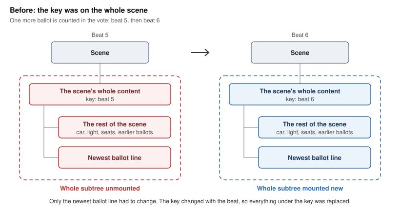
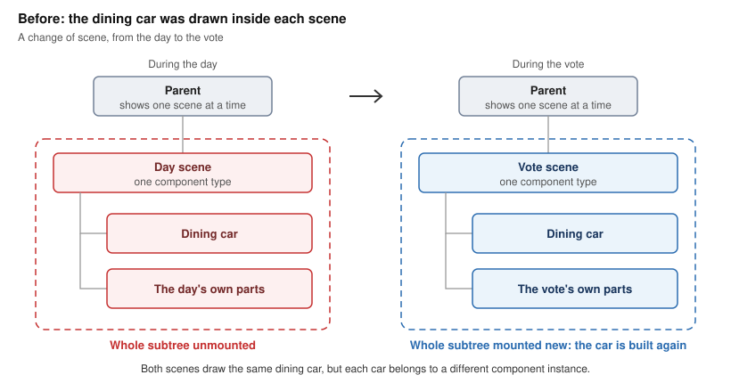
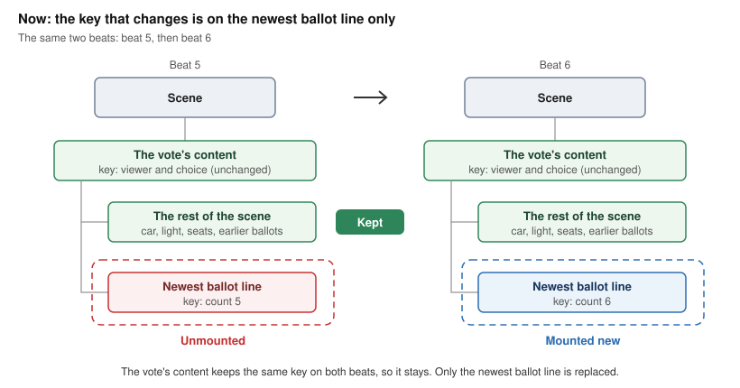
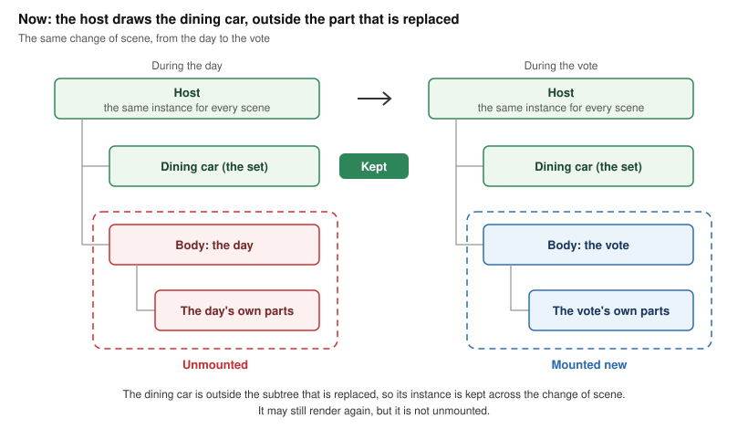
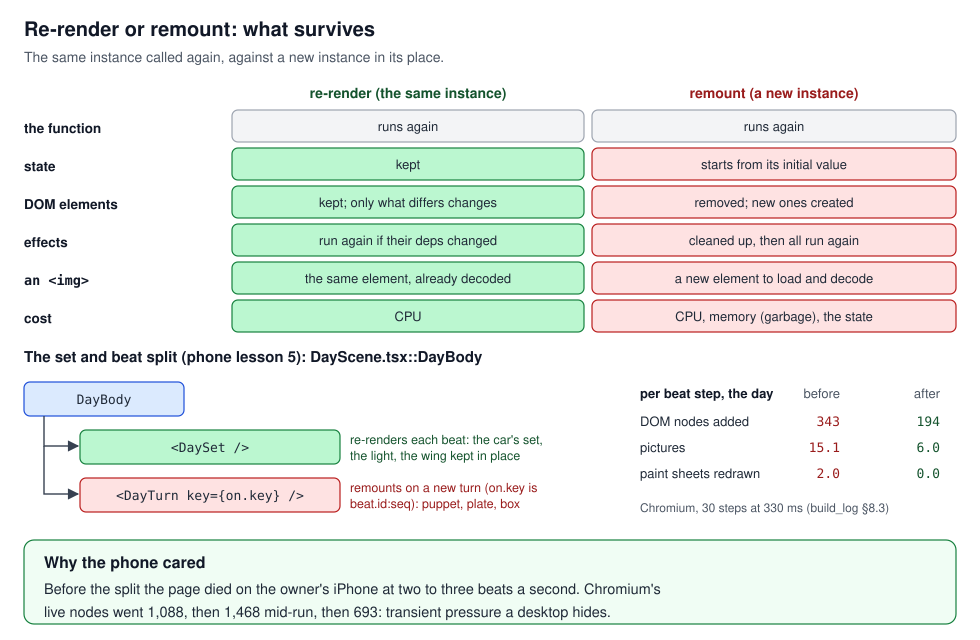
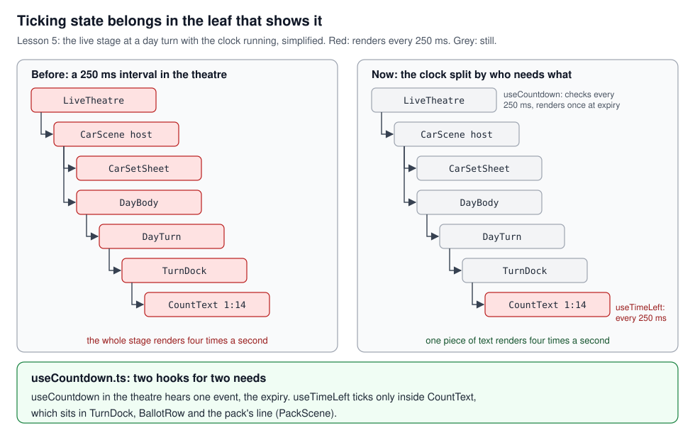
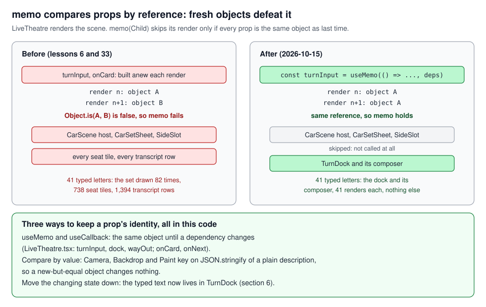
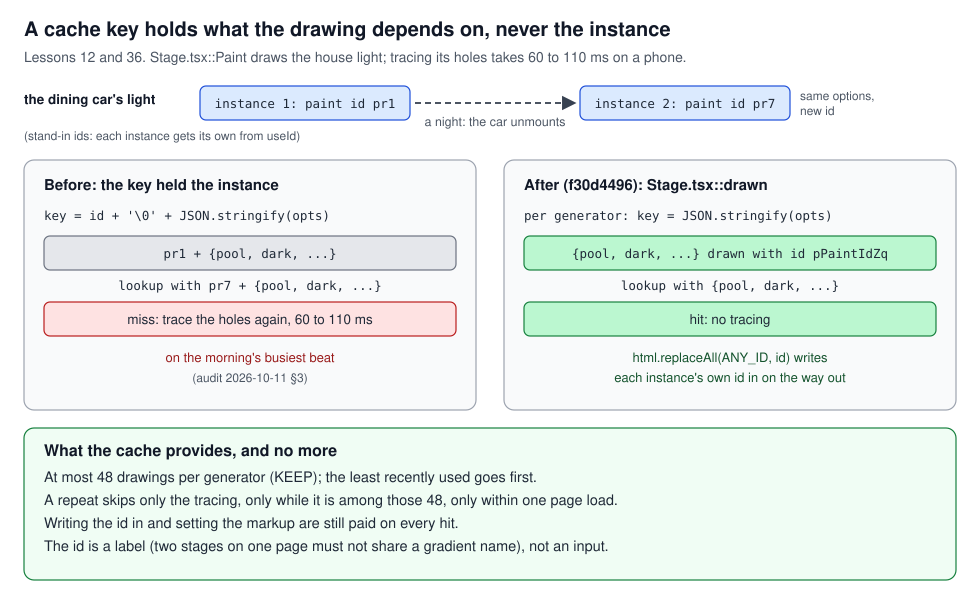

# U12. React identity: what is kept, what is rebuilt, and what renders again

**Reading time:** about 25 minutes for Parts 1 and 3 (estimate); Part 5, 5 minutes · **Builds on:** U6 (the events reach a store in the page) · **Related:** U5 (the engine's turn cache has the same key question as 1.4) · **Feeds write-up chapters:** 8

**The question:** the data on a page changes many times a second. How does the screen stay
correct without rebuilding everything on each change?

**First answer, before reading on:** what does React compare to decide whether a component on
screen is the same one as before, and what is lost when it decides it is not? A rough answer is
enough; Part 5 is the stopping check.

**Reading path.** Part 1 is the general idea in seven sections (rewritten 2026-11-24 in the
form of U6: the concern first, a diagram, a summary table, standard terms). Part 3 is what went wrong on my
Werewolf stage and what the code does now. Part 5 is the summary. This note is short on purpose.

**Scope (2026-11-22).** This note covers React only. It is a shortened form of my tutorial
`frontend/docs/learning/react_identity/react_identity.md`, brought here so that everything I
prepare from is in one folder. The tutorial keeps the full cases, the figures and the steps to
see each effect in the browser. What the browser does after React has changed the page (layout,
paint, pictures, memory on a phone) is in the other tutorials of that folder and is left out
here by choice.

**Enough for this pass.** Explain without notes: what gives a component its identity, the
difference between a re-render and a remount, why `memo` fails on new objects, what belongs in a
cache key, and where a fast-changing value should live. Each with one case from my stage.

**Core and detail.** The core is four ideas: identity is position, type and key (1.1); a
re-render keeps the instance and a remount replaces it (1.2); `memo` and a cache both depend on
comparing the right things (1.3, 1.4); and the owner of a piece of state decides how much of the
page renders when it changes (1.5). Render against commit, and effects, are detail (1.6).
Section 1.7 is a table from symptom to cause.

## The whole idea

```text
something changes (state is set, a store updates, a parent renders)
        │
        ▼
React calls the component functions again          ◄── a RENDER: produces a description only
        │
        ▼
for each child: same position, same type, same key as last time?
        │                                   │
       yes                                  no
        │                                   │
   same instance: state and DOM kept    old instance thrown away, a new one built
   only the differences are applied     state starts over, elements are created again
   (RE-RENDER: costs CPU time)          (REMOUNT: costs CPU, memory and the state)
```


| Concept               | The question it answers                                           |
| --------------------- | ----------------------------------------------------------------- |
| Identity              | How does React decide that a component is the same one as before? |
| Re-render and remount | What is kept in each case, and what does each cost?               |
| Memo and references   | What stops a component rendering again when its parent does?      |
| Cache key             | When may a stored result be reused?                               |
| Where state lives     | How much of the page renders when one value changes?              |

---

# Part 1 — Fundamentals

The example is the page of the support assistant from U6 and U8 to U10. On the left is a list
of the customer's past conversations. On the right is the open conversation, with a text box
under it.

## 1.1 Identity: how React decides what is the same component

React keeps a tree of **instances**. An instance is one occurrence of a component in the tree,
with its own state and its own DOM elements.

When a component renders, it returns **React elements**: plain objects that describe what
should be on screen. The tree of these descriptions is often called the **virtual DOM**. Each
time a parent renders, React compares the elements it returned with the ones it returned last
time, child by child, and decides whether each child is the same instance as before. This
comparison is called **reconciliation**.

A child is the same instance when it has the same parent and passes two checks.


| What React compares | Rule                                                                                                                                                                |
| :------------------ | :------------------------------------------------------------------------------------------------------------------------------------------------------------------ |
| Type                | It is the same component function (or the same HTML tag)                                                                                                            |
| Key or position     | If a`key` is given, check if the key is same, regardless of the child's position. If no key is given, the child position (nth child) is checked if it's the same.  |

```text
Both checks pass   →  same instance:  state kept, DOM kept              (a RE-RENDER, 1.2)
Either one fails   →  new instance:   old one removed, state starts     (a REMOUNT, 1.2)
                                      over, DOM created again
```

The rest of this note uses those two words: a **re-render** keeps the instance, and a
**remount** replaces it.

```jsx
{editing ? <TextBox /> : <TextBox />}        // same position, same type: one instance, state kept
<Conversation key={conversation.id} />       // a new id: a new instance, state starts over
{wide ? <WideList /> : <NarrowList />}       // a different type at one position: a new instance
```

### Keys in a list

In a list, position alone is not enough, because rows move. A key tells React which row is
which.

```text
Before:  [A, B, C]          After removing A:  [B, C]

Key = index:
  position 0: was A, now B  →  React keeps A's instance and shows B's data in it
  A's state (a typed draft, an open menu) now appears on B     (incorrect)

Key = the row's own id:
  A's instance is removed; B and C keep their own instances    (correct)
```

A key must be stable and must identify the item, such as a database id. The array index is
safe when rows are only ever added at the end, or when the rows hold no state of their own. It
is unsafe when rows are reordered, inserted in the middle or removed.

### A key on a single component

A key is not only for lists. Changing the key of one component tells React "this is now a
different instance", which remounts it and resets its state on purpose. The line
`<Conversation key={conversation.id} />` above does this: opening another conversation gives an
empty text box and a fresh scroll position.

Everything under the keyed component is remounted as well, so the key belongs on the smallest
component that has to start over.

### A component defined during a render is a new type each time

Every React element has a `type` property that says what to render. For an HTML element it is
the tag name, such as `"div"`. For a function component it is a reference to the component
function itself.

When React matches elements during reconciliation, it checks whether their `type` values are
equal. For function components this compares function references, not source code: two
functions with identical code are still two different types.

So a component function that is created during a render is a new type on every render. React
sees a different type at that position, removes the old instance and mounts a new one, and the
component's state is lost each time. This includes a component defined inside another
component, and `memo(Thing)` called inside a render. Components are defined once, outside any
render.

## 1.2 Re-render and remount

These are the two outcomes of 1.1.

Identity does not start a render. A component renders because its own state changed, its
parent rendered, or a context it reads changed. During that render React compares each child
position with last time, and identity then decides which of the two outcomes below that child
gets. So "identity matched" means "the same instance continues", not "nothing happens". (Added
2026-11-25.)


|              | Re-render                                                                       | Remount                                                                                                                          |
| :----------- | :------------------------------------------------------------------------------ | :------------------------------------------------------------------------------------------------------------------------------- |
| When         | Identity matched                                                                | Identity did not match                                                                                                           |
| What happens | React calls the same instance's function again and applies only the differences | React removes the instance (unmount) and builds a new one (mount)                                                                |
| State        | Kept                                                                            | Starts from the initial value                                                                                                    |
| DOM elements | Kept; an`` stays the same element                                          | Removed and created again; a picture is a new element to load and decode                                                         |
| Effects      | Run again according to their dependency list (1.6)                              | Cleaned up, then run again from the start                                                                                        |
| Cost         | The CPU time of calling the function and comparing the result                   | Creating the DOM elements again, layout and paint, every effect run again, pictures loaded and decoded again, and the lost state |

One re-render is cheap compared with a remount. Re-renders become costly only when many
components re-render often (1.3). A remount is expensive every time, and it is the cause when
state disappears or the screen flickers.

`memo` (1.3) can only skip a re-render. A component wrapped in `memo` that sits under a key
that changes is remounted all the same.

### Check

The open conversation shows a typed draft. The customer switches to another conversation and
the draft from the first one is still in the text box. What is the cause, and what is the fix?

<details><summary>Answer</summary>

The text box is at the same position with the same type and no key, so React keeps the instance
and its state. Keying the conversation (or the text box) on the conversation's id makes it a new
instance, which starts with empty state.

</details>

## 1.3 What makes a component render again, and what stops it

### The three triggers


| Trigger                                               | What re-renders                                 |
| :---------------------------------------------------- | :---------------------------------------------- |
| The component's own state is set to a different value | That component and the components it renders    |
| Its parent re-renders                                 | The component, whether or not its props changed |
| A context or store value it reads changes             | The component and the components it renders     |

A **context** is a value a parent makes available to every component below it without passing
it as a prop. A **store** is state kept outside the component tree, which components subscribe
to.

Two limits on the first row:

- Setting state to the value it already has re-renders nothing. React compares the old and new
  value with `Object.is`, so changing a field inside an object and setting the same object
  again does not update the screen. State is replaced with a new object, not edited.
- "The components it renders" means the elements this component creates in its own return.
  Elements passed in as the `children` prop were created by a higher component, and they do
  not re-render when this one does.

The second trigger is the one that makes re-renders costly. By default one re-render at the top
of a tree re-renders every component below it.

```text
Page (state changes)
 ├── ConversationList     renders again
 │     └── 200 rows       render again
 └── Conversation         renders again
       └── 500 messages   render again
```

### `memo` skips a render when the props are the same

`memo(Child)` tells React to skip the child's re-render when its parent re-renders and every
prop is the same as last time. It blocks only that trigger: a component wrapped in `memo` still
re-renders when its own state changes or a context it reads changes. Wrapping a component this
way is called **memoising** it.

React compares each prop with `Object.is`, one by one. This is a **shallow comparison**: it
does not look inside objects. Numbers and strings are compared by value. Objects and functions
are compared by **reference**, that is, by whether two variables refer to one object, not by
their contents. This is called **referential equality**.

```js
1 === 1                     // true: numbers and strings compare by value
"a" === "a"                 // true
({ a: 1 }) === ({ a: 1 })   // false: two separate objects
```

### Why `memo` often does nothing

An object or function written inline in the parent is created again on every render.

```jsx
const Conversation = memo(function Conversation({ style, onSend }) { /* ... */ });

// in the parent:
<Conversation style={{ width: 400 }} onSend={(text) => send(text)} />
```

Both props are new objects each time, so the comparison fails and `memo` skips nothing.

### Keeping a reference stable


| Tool                         | What it keeps the same between renders | Until                                  |
| :--------------------------- | :------------------------------------- | :------------------------------------- |
| `useMemo(() => value, deps)` | An object or a computed value          | One of`deps` changes                   |
| `useCallback(fn, deps)`      | A function                             | One of`deps` changes                   |
| `memo(Component)`            | The component's last output            | A prop fails the`Object.is` comparison |

`deps` is the **dependency list**: an array of values that React compares, with `Object.is`,
against the values from the previous render. `useMemo` does not skip a render. It skips
recomputing a value and keeps the value's reference.

Both parts are needed: `memo` on the child, and props from the parent whose references are
kept stable in this way.

### When not to memoise

Memoising has a cost: the comparison runs on every render, and the code is harder to read. It
is worth it for a component that is expensive to render or renders very often. It is not worth
it for a small component whose props change every time anyway. The React Compiler, a build
tool from the React team, adds this memoising automatically and makes much of the manual
`memo`, `useMemo` and `useCallback` unnecessary where it is used.

A store such as Zustand applies the same comparison to what a selector returns. A **selector**
is the function that picks the part of the store a component reads. A component that selects
one field re-renders only when that field fails the comparison. My card "Global
Client State (Zustand)" has the rules.

*Related cards:* "React's Rendering Mechanism", "Render Optimization: memo & useCallback",
"useMemo", "React's Immutability".

## 1.4 A cache key holds exactly what the result depends on

A cache keeps a result under a key and returns it when the key repeats. The rule for the key is
the same in the browser and on the server: the key holds every input the result depends on, and
nothing else.


| Mistake                                                | What happens                                                     | Symptom                                      |
| :----------------------------------------------------- | :--------------------------------------------------------------- | :------------------------------------------- |
| The key has more inputs than the result depends on     | Two requests that would give the same result have different keys | The cache misses, and the work is done again |
| The key has fewer inputs than the result depends on    | Two requests that should give different results share a key      | One request receives the other's result      |

```text
Result depends on:  (user, document)

Key = (user, document, time of request)   →  never repeats; the cache is useless
Key = (document)                          →  user B receives user A's result
Key = (user, document)                    →  correct
```

The first mistake costs speed. The second gives wrong data, and can show one user another
user's result, so it is the more serious one.

### Three things that are called a key or work like one

They are separate rules, and they are easy to confuse.


| Kind                                                      | What it identifies                                              | What a wrong one causes                                                                |
| :-------------------------------------------------------- | :-------------------------------------------------------------- | :------------------------------------------------------------------------------------- |
| A React`key`                                              | A component instance among its siblings                         | State kept when it should start over, or a remount when nothing needed one             |
| A dependency list (`useMemo`, `useCallback`, `useEffect`) | The inputs for which a stored value or an effect is still valid | A stale value, a new object on every render, or an effect that runs after every render |
| A cache key                                               | A stored result of some computation                             | A miss on an equal request, or one request's result served to another                  |

## 1.5 Where state lives

Setting state re-renders the component that owns it and, unless `memo` stops it, the components
it renders (1.3). So the owner of a piece of state decides how much of the page re-renders on
each change.

```text
State held at the top:                      State held in the leaf:

Page  [text]   ← every letter               Page
 ├── List           re-renders               ├── List           not rendered
 └── Conversation   re-renders               └── Conversation   not rendered
       └── TextBox  re-renders                     └── TextBox  [text]   ← every letter
```

### Two directions


| Move                                | Name             | When                               |
| :---------------------------------- | :--------------- | :--------------------------------- |
| Up, to the nearest common parent    | Lifting state up | Two components need the same value |
| Down, to the component that uses it | State colocation | Only one component needs the value |

The rule: **state lives in the lowest component that needs it.** A value that changes many
times a second (typed text, a clock) belongs in the small component that displays it. A parent
may need the value only at one moment, such as when the user sends the message. The child then
passes the value up at that moment by calling a callback, such as `onSend(text)`, and the
parent keeps no copy of it in state.

### Do not store what can be computed

A value that can be worked out from props or other state is called **derived state**. It is
computed during render, not kept in state of its own. A second copy in state has to be kept in step with the first, and the two
can disagree.

### Check

The support page holds the text box's content in the page's top component. What renders on each
typed letter, and what are two fixes?

<details><summary>Answer</summary>

The top component and everything below it that `memo` does not stop: the list of conversations
and every message. Fix one: move the text into the text box component, and pass the finished
line up through `onSend`. Fix two, if the state has to stay at the top: wrap the list and the
messages in `memo` and pass them props that keep their reference (`useMemo`, `useCallback`). The
first fix is the simpler one.

</details>

## 1.6 Render, commit and effects (detail)

React updates the screen in two phases.

```text
State changes
     │
     ▼
Render phase    React calls component functions and produces the React elements.
     │          Nothing on the screen changes.
     ▼
Commit phase    React applies the differences to the DOM.
     │
     ▼
Effects         React runs effects, after the commit.
```


| Term                 | What it is                                                                                             | What follows                                                                                                                                                                            |
| :------------------- | :----------------------------------------------------------------------------------------------------- | :-------------------------------------------------------------------------------------------------------------------------------------------------------------------------------------- |
| Render               | Calling component functions to produce the React elements (1.1)                                        | Everything inside a component function runs on every render, so heavy work does not belong there. A render must also be pure: it computes its result and changes nothing outside itself |
| Commit               | Applying the differences to the DOM                                                                    | A render can commit nothing, if the description did not change                                                                                                                          |
| Effect (`useEffect`) | Code run after a commit, to keep something outside React in step: a timer, a subscription, an observer | Its dependency list (1.3) decides when it runs again. With no list it runs after every commit. With an empty list`[]` it runs once, after the mount                                     |
| Cleanup              | The function an effect returns                                                                         | React calls it before the effect runs again and when the instance is removed. A missing cleanup leaves a timer or a connection running                                                  |
| `useLayoutEffect`    | An effect that runs before the browser paints                                                          | For measuring layout; it delays the paint                                                                                                                                               |

An effect is not for computing a value from props. That can be done during render (1.5).

In development, React's Strict Mode mounts each component, runs its cleanup and mounts it
again. An effect therefore appears to run twice. This is deliberate: it exposes an effect whose
cleanup is missing.

*Related cards:* "Side Effects: The Theory", "useEffect & The Lifecycle".

## 1.7 Summary: from symptom to cause


| Symptom                                                         | Likely cause                                       | Section  |
| :-------------------------------------------------------------- | :------------------------------------------------- | :------- |
| State is lost, or the screen flickers, when data changes        | A remount: the key, type or position changed       | 1.1, 1.2 |
| State stays when it should reset                                | No key, so React kept the instance                 | 1.1      |
| A list row shows another row's state                            | The array index is used as the key                 | 1.1      |
| The whole page renders when one small value changes             | The state is held too high                         | 1.5      |
| `memo` has no effect                                            | A prop is a new object or function on every render | 1.3      |
| A cached result is recomputed every time                        | The key has more inputs than the result depends on  | 1.4      |
| A cached result belongs to another request                      | The key has fewer inputs than the result depends on | 1.4      |
| A timer or connection keeps running after the component is gone | An effect without a cleanup                        | 1.6      |

---

# Part 3 — My Werewolf system

The live page shows a game as a stage: a dining car with ten seats, a speaker, a ballot. The
game is cut into **beats**, one step of the show each (a line of speech, one counted vote). A
fast stretch runs two to three beats a second, and many viewers watch on a phone. A **scene** is
one stretch of the game, such as the day or the vote, and it lasts for many beats.

Most of the stage is the same from one beat to the next. So every case below is an answer to one
question: when one thing changes, how much of the page does the work again? Each case was found
on this stage and is fixed in the code today. The file and symbol names for each case are in
Appendix B, so the text below can stay in plain words.

| Section | What it covers                                                                   | Part 1 term                                  |
| :------ | :------------------------------------------------------------------------------- | :------------------------------------------- |
| 3.1     | Every beat rebuilt the whole scene                                               | Identity (1.1), remount (1.2)                |
| 3.2     | One typed letter, or one tick of the clock, rendered the whole stage             | Where state lives (1.5), references (1.3)    |
| 3.3     | One cache missed when it should have hit; another returned the wrong result      | Cache key (1.4)                              |
| 3.4     | Two shorter items: how the store is read, and an effect with no dependency list  | Selectors (1.3), effects (1.6)               |
| 3.5     | What was measured, the tools that show each problem, what guards the fixes       |                                              |

## 3.1 Every beat rebuilt the whole scene (identity and remount)

### The problem

Two causes made React remount large parts of the page on beats where those parts had not
changed.

**Cause 1: the key was on the whole scene, not on the part that changes.** From one beat to the
next, only a small part of a scene has to change: a new line of speech, or one more counted
ballot. The rest stays the same: the car's picture, the light, the heads of the other nine seats
and the speaking puppet.

But each scene put its `key` on its whole content, and built the key from the beat's id and
sequence number. A key built that way has a different value on every beat. By 1.1, a different
key at the same position is a different instance. So on every beat React unmounted the whole
scene and mounted a new one, including every part that had not changed.



**Cause 2: the shared dining car was drawn inside components that get replaced.** Eight scenes
stand in the same dining car (the deal, the day, the vote, the lynch, the night's lobby, the
morning, the game over and the replay's night). Each scene was a separate component, and each
one drew both the dining car and its own parts.



When the game moves from the day to the vote, React finds a different component type at the
same position in the tree. By 1.1, a different type is a different instance. So React unmounts
the day's component with everything under it, and then mounts the vote's component with
everything under it. React does not look inside the two scenes to see what they have in common.

The result: the dining car was removed and built again at every change of scene, though nothing
about the car had changed.

The fault was not that the scenes were different components: the day and the vote do show
different things. The fault was that the part they share, the car, was inside the subtree that
gets replaced.

Cause 1 acted on every beat. Cause 2 acted once at each change of scene.

### The fix

**Fix 1: only the smallest part that must restart is keyed.**

- In the vote, the vote's content is keyed on the viewer and their choice. Those do not change
  from one counted ballot to the next, so the vote stays in place. The newest ballot line is
  keyed on the count, so only that line is remounted.
- In the day, the text box is keyed on the beat's sequence number, so a new turn starts with an
  empty box and nothing else restarts.



**Fix 2: one host component holds what persists.** One **host** component now stays at the same
position for all eight scenes. The host draws the **set**: the parts of the dining car that the scenes share, which
are the room's picture, the house light and the wing with its seat tiles.

Each scene is now a **body**: a component rendered under the host that draws only that scene's
own parts. A body tells the host which set it wants by passing it a description. The host draws
that set and keeps it from one body to the next, updating it in place.



A change of scene still unmounts the day's body and mounts the vote's body, which is intended,
because those parts differ. The dining car is no longer under either body, so it is not
unmounted with them. The car may still render again, but it is not removed and built again.

Each body is wrapped in `memo` once, and the wrapped version is stored outside the render and
reused. Calling `memo` on a body inside the host's render would create a new component type on
every render, so React would remount the body every time (1.1, "A component defined during a render
is a new type each time").

### Measured

**How much of the stage one beat replaced.** Measured on 2026-10-02 on a production build in
headless Chromium. The script listed the elements under the stage before a beat, then checked
which of those same elements were gone after it.

On that day the day scene had already been split into a set that stays and a small keyed part
that restarts (fix 1). The vote and the wolves' night scene had not.

| Beat                                           | Scene's state | Elements replaced                                         |
| ---------------------------------------------- | ------------- | --------------------------------------------------------- |
| One counted ballot in the vote                 | Not yet split | 385 of 388                                                |
| One line from a fellow wolf, in the wolves' night scene | Not yet split | 402 of 403                                       |
| One turn in the day                            | Split         | 121 of 220: the elements of the turn, which has to restart |

The first two rows are the problem: almost every element was thrown away and built again. The
third row is the fix working: only the turn was replaced, and the set stayed.

**How much one beat built, before and after the day scene was split.** A separate measurement
(Chromium, 30 beats, one every 330 ms, 2026-10-01), for beats in the day:

| Per beat            | Before | After |
| ------------------- | -----: | ----: |
| DOM nodes added     |    343 |   194 |
| Pictures created    |   15.1 |   6.0 |

Worked out here from those figures: about 43% fewer nodes and about 60% fewer pictures per beat.

**On the phone.** Before the split, the page crashed on my iPhone at two to three beats a
second. Rebuilding the scene on every beat is the suspected cause, because a remount creates
every element and picture again (1.2), and a phone has much less memory than a desktop. The
memory in use when the page crashed was not measured (3.5).



## 3.2 One letter or one tick rendered the whole stage (where state lives, references)

In this case nothing was remounted. Components rendered again when a value they do not use
changed. There were two causes: state held too high in the tree (1.5), and props that were new
objects on every render, so `memo` could not skip (1.3).

### Cause 1: state held at the top

The live page's top component held two values that change often:

- **The countdown.** A timer set state there every 250 ms.
- **The typed text.** Every letter typed into the text box set state there.

By 1.3, a state change renders the component that holds the state and everything below it. So
the whole stage rendered four times a second during a live turn, and once more for every letter.
The rest of the stage uses neither value.

### Fix 1: move the state down to the component that shows it (state colocation, 1.5)

**The countdown** does two jobs, and they change at different rates:

| Job                                   | How often the value changes | Where it is now                                                    |
| :------------------------------------ | :-------------------------- | :----------------------------------------------------------------- |
| Show the time left, such as `1:14`    | Every 250 ms                | A hook inside the small component that shows the time              |
| Tell the page the deadline has passed | Once per turn               | A second hook, in the top component                                |

The hook in the top component still runs a 250 ms timer, but it sets state only once, when the
deadline passes. So the top component renders once per turn for the clock, and only the small
component renders four times a second.

**The typed text** is now state of the text box. The parent receives the line as the argument
of a callback when the player sends it, and keeps no copy while the player types.

The parent sometimes has to put text into the box: a draft line that the page fetched from the
server. It passes the draft together with a counter that changes with each draft. The counter is needed because two drafts can be the same string, and the box must
still notice the second one. The box keeps the last draft and counter it received. When either
differs during a render, it copies the new draft into its own state.



### Cause 2: new objects on every render defeated `memo`

The live page built the objects and functions it handed the host as new values on every
render. By referential equality (1.3), each one was a different prop every time. So no
`memo` below the live page could skip a render, whatever caused the live page to render.

### Fix 2: keep the references stable

In the live page's top component:

- The objects passed down are built with `useMemo`.
- The functions passed down are built with `useCallback`.
- The host, the set and the side panel (the transcript and the case file) are wrapped in `memo`.

Where a value is plain data, the code compares by contents instead of by reference. The
component that draws the light receives its drawing options as a plain object. It turns them into a string with `JSON.stringify` and puts the string in the
dependency list of its `useMemo`, so a new object with equal contents does not recompute the
drawing. This suits small plain-data objects only, because the string is built on every render.



### What each fix does

| Fix                           | What it prevents                                                                              |
| :---------------------------- | :-------------------------------------------------------------------------------------------- |
| State moved down (fix 1)      | The top component no longer renders for a letter or a tick, so nothing below it has to skip    |
| Stable props and `memo` (fix 2) | When the top component renders for another reason, the host, the set and the side panel skip |

Fix 2 does not replace fix 1. With the state still at the top, the top component would render on
every letter, and `memo` would only limit how far that render spreads.

### Measured

Measured on 2026-10-15 on a development build: 41 letters typed into the text box, with the
renders counted per component.

|        | What rendered over the 41 letters                                                              |
| ------ | ---------------------------------------------------------------------------------------------- |
| Before | The whole stage. The set and the side panel rendered twice per letter: 738 renders of seat tiles and 1,394 of transcript rows |
| After  | Only the text box and the input component inside it, 41 times each                             |

"Twice per letter" has its own cause: the body sent its set description to the host after every
render, and each send rendered the host a second time.

This is one measurement before both fixes and one after both. It does not show how much each fix
contributed.

## 3.3 Two caches with opposite faults (cache key)

By 1.4, a cache key holds exactly the inputs the result depends on. My system broke that rule
once in each direction. The lighting cache on the page had more inputs in its key than the
result depends on, so it missed. The turn cache on the server had fewer, so it returned another
request's result.

### Case A: the lighting cache on the page (more inputs than the result depends on)

**What is cached.** The house light is drawn by tracing the shapes of the light's holes, which
took 60 to 110 ms on a phone. The drawing depends only on the drawing options.

**The extra input.** Each instance of the component that draws the light also has an id from
`useId`, a React hook that gives each instance a unique id. The id is written into the
drawing so that two stages on one page do not share an SVG gradient name. The id labels the
drawing and does not change its shape.

**The problem.** The cache key was the id plus the options. During a night scene that shows
another room, the dining car's set is taken down, and in the morning it mounts again as a new
instance with a new id. The options were the same, but the key was different, so the cache
missed and the light was traced again on the morning's busiest beat.

**The fix.** The drawing is made under a placeholder id and stored under
the options alone. Each instance's own id is written in when the drawing is read from the cache.
The cache holds at most 48 drawings per generator (the function that produces one kind of
drawing) and drops the oldest first. It lasts for one page load.



### Case B: the engine's turn cache on the server (fewer inputs than the result depends on)

**What is cached.** The engine's turn cache (U5) stores the result of a seat's turn, so that a
paused graph step that runs again does not call the model twice. Its key is built from the turn's
input.

**The problem.** That key once lacked the game's id. So a turn in one game received the stored
result of the same seat's turn in an earlier game.

```text
Earlier game: a seat's turn  ->  key K  ->  result stored
This game:    the same seat's turn  ->  key K  ->  the earlier game's result returned
```

**The fix.** The game's id is now part of the key. The detail is in U5.

### Side by side

|                 | Lighting cache (page)                                   | Turn cache (server)                                  |
| :-------------- | :------------------------------------------------------ | :--------------------------------------------------- |
| The key had     | More inputs than the result depends on: the instance id | Fewer inputs than the result depends on: no game id  |
| What happened   | The cache missed                                        | The cache returned another game's result             |
| Kind of fault   | Performance: 60 to 110 ms of tracing done again         | Correctness: a turn received the wrong result        |
| The fix         | The id left the key and is written in afterwards        | The game's id was added to the key                   |

## 3.4 Two smaller cases

### The store (1.3)

The events from the server arrive in one Zustand store. A single component reads the store, and
it uses one selector per field (1.3). Nothing went wrong here. The detail is in U6, section 3.3 ("From
the store to the screen").

### An effect with no dependency list (1.6)

The stand is the front of the booth that the speaking puppet stands in, and it carries a brass
plate that names the seat. The stand had a layout effect with no dependency list. By 1.6, such
an effect runs after every commit, so it created two `ResizeObserver`s and measured the plate
again on every render of every beat. The stand now creates one observer, and the effect has a
dependency list of four values, so it runs again only when one of them changes.

## 3.5 Measurements, tools and limits

### What each measurement shows

| Measurement                             | What it shows                                                      | Used in |
| :-------------------------------------- | :----------------------------------------------------------------- | :------ |
| Elements replaced in one beat           | Whether existing elements are thrown away and built again (remount) | 3.1     |
| Nodes and pictures created in one beat  | How much one beat builds                                           | 3.1     |
| Renders per component                   | How often React calls a component's function                       | 3.2     |
| Time taken by one function              | What one piece of work costs                                       | 3.3     |
| Behaviour on the phone                  | Whether the page stays usable on the real device                   | 3.1     |

No one of these measurements can replace another. A component can render again without any of
its elements being replaced. And 43% fewer new nodes does not mean 43% less time or memory.

### The tools, and how each one shows these problems

| Tool                                                                 | What it shows                                                                                     | Its limit                                                                                         |
| :------------------------------------------------------------------- | :------------------------------------------------------------------------------------------------ | :------------------------------------------------------------------------------------------------ |
| React DevTools, Profiler tab (a browser extension)                   | Which components rendered in each commit, and why                                                 | Needs a development build. A component listed as rendered may have changed nothing in the DOM    |
| React DevTools, "Highlight updates when components render"           | A flash around each component that rendered                                                       | It does not tell a re-render from a remount                                                       |
| The browser console                                                  | Whether an element is still the same one after a step; how many nodes a step added                | Typed by hand, one check at a time                                                                |
| Chrome's Performance monitor and Performance panel                   | The count of DOM nodes over time; where the time goes, by kind of work                            | Desktop Chromium is not the phone: it shows neither the phone's memory nor its frame rate         |
| Safari Web Inspector on the iPhone, opened from Safari on a Mac      | The phone's own layers and the memory each one holds                                              | It is the only tool here that reads the phone itself                                              |

**A remount (3.1): is this element the same one after the step?**

1. On `/workbench/vote`, hold one element in the console:
   `const el = document.querySelector('[data-layer=paint] [data-room] img')`.
2. Step one beat.
3. Read `el.isConnected`. `true` means the element was kept. `false` means it was removed from
   the page, so its component was remounted.

To see how much a beat builds: `/workbench/day?auto=330` steps a beat every 330 ms, and "DOM
Nodes" in Chrome's Performance monitor shows the count rise and settle. For a number, count the
added nodes in the console, step ten beats, and read `n`:

```js
let n = 0;
new MutationObserver(m => m.forEach(r => n += r.addedNodes.length))
  .observe(document.body, { childList: true, subtree: true });
```

**A render that was not needed (3.2): what rendered for one letter, or one tick?**

1. In the Profiler's settings, turn on "Record why each component rendered while profiling".
2. Start recording, type into the text box in a live game, stop recording.
3. Each bar is one commit. Each commit should list `TurnDock` and its input, and nothing else.
   With the clock running, the commits every 250 ms should list `CountText` and nothing above
   it.
4. If another component is listed, click it and read the reason:

| The Profiler's reason                              | What it points to                                              |
| :------------------------------------------------- | :------------------------------------------------------------- |
| Its state or a hook changed                        | State held in a component that does not show it (3.2, cause 1) |
| A prop changed, though its contents look the same  | A new object or function on every render (3.2, cause 2)        |
| The parent rendered                                | No `memo` on this component                                    |

**A cache that misses, or returns the wrong result (3.3).** No browser tool shows this directly.

- For a miss: log the key each time the cache is asked, for two requests that should share one
  result, and compare the two keys. The part that differs is the input that should not be there.
- For a wrong result: take two requests that must get different results and check that their
  keys differ.
- Both rules are held by tests: `frontend/src/stage/paint/paint.test.ts` ("is the drawing under
  another id once the stand-in is renamed") for the lighting cache, and
  `tests/engine/test_turn_cache_key.py` for the turn cache.

**An effect that runs too often (3.4).** Add `console.count('stand')` inside the effect in
`Stand.tsx`, step beats in `/workbench/day`, and watch the count: it should rise only when the
stand or its words change. Remove the line afterwards. `npm run lint` runs
`react-hooks/exhaustive-deps`, which flags a dependency list that is missing a value the effect
reads.

**The crash on the phone (3.1).** Only Safari's Web Inspector reads what the phone holds: Safari
on a Mac, the Develop menu, the iPhone, the page, then the Layers tab. The two numbers to read
are the layer count and the total memory. One reading was taken this way with the page at rest,
17 layers and 534 MB (`build_log` section 8.3). No reading was taken at the moment of a crash.

The full method, with the limits of each instrument, is in
`frontend/docs/learning/performance_method/performance_method.md`, section 8.

### What guards the fixes

The phone test `frontend/e2e/phone-rule.spec.ts` holds the set's elements before each beat and
fails a beat that replaces them. It guards 3.1 against a whole-scene remount coming back.

### Known limitations

| Gap                                                                                                                                       | Consequence                                                                      | Possible direction                                                         |
| ----------------------------------------------------------------------------------------------------------------------------------------- | -------------------------------------------------------------------------------- | -------------------------------------------------------------------------- |
| 1. The render counts (41 letters) and the element counts (385 of 388) were measured once, in Chromium, and no committed test repeats them | A later change could bring the whole-stage render back without a test failing     | A test that counts renders per component for a typed line                  |
| 2. The memoising is done by hand                                                                                                          | A new prop passed as an inline object breaks `memo` again, silently              | The React Compiler, which adds the memoising automatically (not used here) |
| 3. The crash on the iPhone was observed, not measured                                                                                     | The memory figure at which the page crashed is not known                         | None planned                                                               |

---

# Part 4 — Design choices

**How does a part of the screen start over?**


| Design                                              | Benefit                                              | Cost                                                            | My system                                             |
| --------------------------------------------------- | ---------------------------------------------------- | --------------------------------------------------------------- | ----------------------------------------------------- |
| Key the smallest component that must restart        | The restart is explicit, and nothing else is rebuilt | Each scene has to separate what persists from what restarts     | Yes                                                   |
| Key the whole scene on the step                     | Nothing to think about; every step starts clean      | Everything is rebuilt on every step: memory pressure on a phone | It was; no longer                                     |
| No key; reset the state by hand when a prop changes | No rebuild at all                                    | Each piece of state needs its own reset code                    | Where only a little state restarts (`LynchScene.tsx`) |

**Where does the page's game state live?**


| Design                                        | Benefit                                                                    | Cost                                                               | My system     |
| --------------------------------------------- | -------------------------------------------------------------------------- | ------------------------------------------------------------------ | ------------- |
| A store outside React, read through selectors | A component renders only for the fields it selects; testable without React | One more library; reference rules apply to what a selector returns | Yes (Zustand) |
| Context with a reducer                        | Built in                                                                   | Every reader of the context renders on every change                | No            |

---

# Part 5 — Review

## In 30 seconds

React keeps a component's state while the component stays at the same position with the same
type and key. Change any of the three and React builds a new instance: state, DOM elements and
pictures start over. A re-render keeps the instance and costs CPU; a remount replaces it and
costs CPU, memory and the state. `memo` skips a re-render only when every prop is the same
reference, so objects and functions passed down have to come from `useMemo` and `useCallback`.
A cache key holds exactly what the result depends on. State lives in the lowest component that
needs it.

## My Werewolf system in one paragraph

On my Werewolf stage every scene was keyed on the beat, so each beat threw away and rebuilt the
whole scene: one counted vote replaced 385 of 388 elements, and fast beats crashed the page on
my iPhone. I separated what persists from what changes: one host holds the dining car's set,
each scene only describes the set it wants, and only the part that has to play again is keyed.
The live page also handed down new objects on every render, so 41 typed letters rendered the
whole stage; building those props with `useMemo` and moving the typed text into the text box
left 41 renders of the text box and nothing else. The lighting cache had the instance's id in
its key, so a remount missed and traced 60 to 110 ms of shapes again; the key now holds only
the options the drawing depends on. A clock and typed text live in the small component that
shows them, not at the top.

## Stopping check

In two minutes, without the note: the three things that make an instance the same; what a
remount costs that a re-render does not; why `memo` failed on the live page; what was wrong with
the lighting cache key and with the engine's turn cache key; where the countdown lives now. If
those connect, this pass is done.

## Problems

**Problem A.** A page shows 500 rows under a search box, and every keystroke in the box renders
all 500 rows. Diagnose it and give the fixes, naming the React idea each one uses.

**Problem B.** Open `frontend/src/game/store.ts` and `LiveTheatre.tsx`. Say where the game's
state lives, which component reads it, and why a typed letter does not go through the store.

**Problem C.** A draft sentence for the write-up: "The stage never rebuilds more than the part
that changed." What is supported, what is not, and what is the accurate wording?

---

# Appendix A — Answers to the problems

**Problem A.** The search text is state of a component above the rows, so setting it renders
that component and every row (1.3, 1.5). Fixes, in the order I would try them. One: if the rows
do not depend on the text, move the text's state down into the search box, so the rows' parent
does not render (where state lives). Two: if the rows are filtered by the text, wrap the row in
`memo` and pass it props that keep their reference, with the filtered list built by `useMemo`
(memo and references); give each row a stable `key` from its data and not its index, so React
matches rows when the list shrinks (identity). Three: if 500 rendered rows are still too slow,
render only the visible ones (list virtualisation), which is outside this note.

**Problem B.** The game's state is in the Zustand store in `store.ts`: the events as received
and the view computed from them. `LiveTheatre.tsx` is the one component that reads it, with one
selector call per field, and it passes values down as props. A typed letter is not game state:
it is state of the text box (`useTyped`), and it reaches the parent only as the argument of
`onSay` when the line is sent. So typing changes neither the store nor the top component.

**Problem C.** Supported: the set's elements are kept across beats and scene changes (the phone
test fails a beat that replaces them), and the day's step replaced 121 of 220 elements, which
is the turn. Not supported: "never", and "only the part that changed" for every scene; the
counts were taken once, on some scenes, in Chromium. Accurate wording: "Each scene keeps its
set between steps and rebuilds only the part that plays again; a test fails if a step replaces
the set's elements."

---

# Appendix B — Implementation and evidence reference

*"The tutorial" is `frontend/docs/learning/react_identity/react_identity.md`. Each claim carries
its support: **code** (the file and symbol were read on 2026-11-22), **doc** (a written record
with its date, not re-measured), **test** (named, not run for this note). Paths are from the
repository root.*

**Identity (3.1)**

- The vote's keys: **code** `frontend/src/stage/scenes/VoteScene.tsx` (`VoteBody`, the
  `key={counted}` ballot line); the day's text box keyed on `beat.seq`: **code**
  `frontend/src/stage/scenes/DayScene.tsx`
- The host and the `memoised` map: **code** `frontend/src/stage/scenes/CarScene.tsx`
  (`carScene` builds the host; a body describes its set with `CarSetSpec`; the host draws it
  with `CarSetSheet`)
- The earlier per-beat key and the eight scene types: **doc** the tutorial, section 1
  (`build_log` sections 8.3 and 8.9, 2026-10-01)

**Re-render and remount (3.1, "Measured")**

- 385 of 388, 402 of 403, 121 of 220: **doc** the tutorial, section 3 (rendering audit section
  2, 2026-10-02, production snapshot `04005ca0`, headless Chromium)
- 343 to 194 nodes and 15.1 to 6.0 pictures per step: **doc** the tutorial, section 3
  (`build_log` section 8.3, 2026-10-01)
- The page dying on the iPhone: **doc** the tutorial, section 3; observed, not measured
- The set's elements guarded on each beat: **test** `frontend/e2e/phone-rule.spec.ts`

**Memo and references (3.2, cause 2)**

- `turnInput`, `dock`, `wayOut` through `useMemo`; `onCard`, `onNext` through `useCallback`:
  **code** `frontend/src/stage/containers/LiveTheatre.tsx`
- The 41-letter render counts: **doc** the tutorial, section 4 (measured 2026-10-15 on a
  development build, before at `cab002e2`); the counting hook is not committed
- Comparison by value through `JSON.stringify`: **code** `frontend/src/stage/Stage.tsx`

**Cache key (3.3)**

- `drawn`, the stand-in id `ANY_ID`, 48 drawings kept (`KEEP`): **code**
  `frontend/src/stage/Stage.tsx`; **test** `frontend/src/stage/paint/paint.test.ts`
- 60 to 110 ms to trace the light on a phone, and the miss after a night: **doc** the tutorial,
  section 4 (commit `f30d4496`, 2026-10-15)
- The engine's turn cache key and the game id: U5; **code** `Agents/config/langgraph.py`
  (`turn_cache_key`); **test** `tests/engine/test_turn_cache_key.py`

**Where state lives (3.2, cause 1)**

- `useCountdown`, `useTimeLeft`, the 250 ms tick: **code** `frontend/src/hooks/useCountdown.ts`;
  `CountText`: **code** `frontend/src/stage/instruments/CountText.tsx`
- `useTyped` and `landed`: **code** `frontend/src/stage/instruments/TurnDock.tsx`; the callback
  is `onSay`, and the draft is fetched with `draftLine` in
  `frontend/src/stage/containers/LiveTheatre.tsx`

**The effect case (3.4)**

- One `ResizeObserver` and the dependency list `[speech, g.u, g.railY, plated]`: **code**
  `frontend/src/stage/instruments/Stand.tsx`

**Reading.** react.dev: "Preserving and Resetting State", "You Might Not Need an Effect",
"Render and Commit", and the reference pages for `memo`, `useMemo` and `useCallback`.
