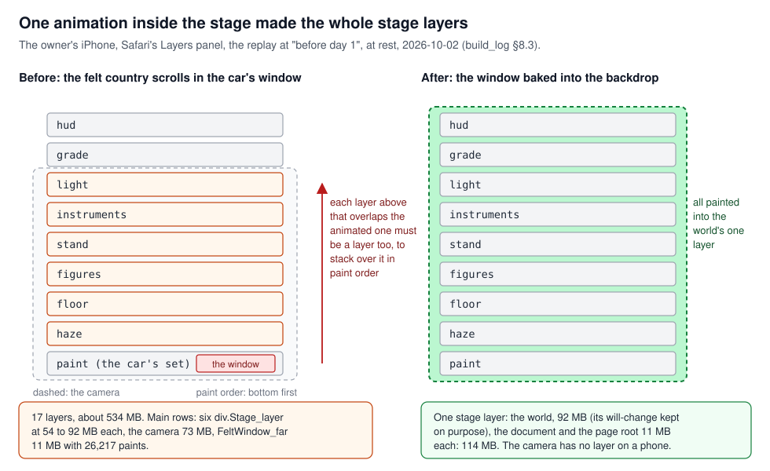
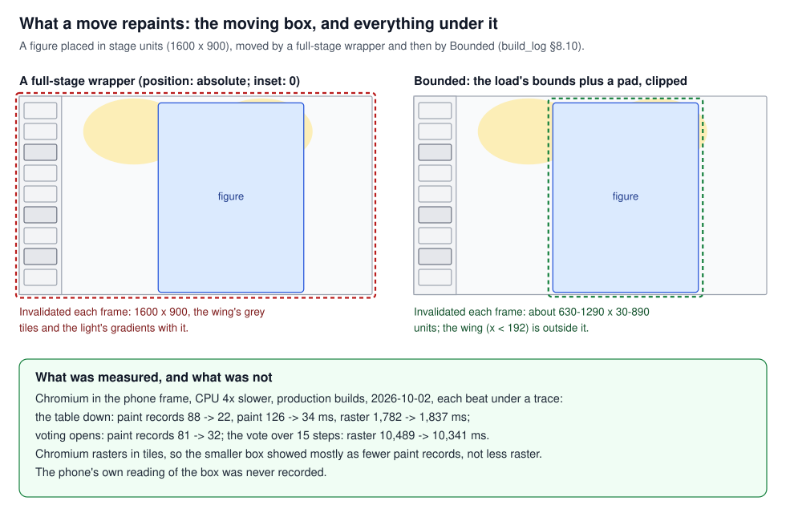

# U16. Rendering cost in the browser: frames, layers, memory, and a page that crashed on a phone

**Reading time:** about 20 minutes for Parts 1 and 3 (estimate); Part 5, 5 minutes · **Builds on:** U12 (React decides what is in the page; this note starts where React stops) · **Feeds write-up chapter:** 8

**The question:** a page works on every desktop and dies on a phone. What does the browser do
with the page after React has changed it, what does each part of that work cost, and how do I
find which part is too expensive?

**First answer, before reading on:** when one small picture moves across a large page, what
does the browser have to draw again on each frame, and what does it hold in memory to avoid
drawing it again? A rough answer is enough; Part 5 is the stopping check.

**Why this note exists (2026-11-26).** U12 covers React only, and says so. The stage's crash on
my iPhone had several causes, and most of them were not React: they were layers, masks, memory
and paint. I found the crash, ran the tests on my phone and read the numbers in Safari's
inspector. What those numbers meant, I asked the agent at the time, and I did not keep the
explanation. This note is that explanation in my own terms. It is a shortened form of four
tutorials in `frontend/docs/learning/` (`rendering_pipeline`, `memory_and_pictures`,
`stage_motion`, `performance_method`), which keep the full cases and the steps to see each
effect in a browser.

**Enough for this pass.** Explain without notes: the three steps of a frame, what a layer is
and what it costs, why one small animation can create many layers, why a phone ends a tab that
a desktop only slows, what is drawn again when something moves, and how to find a cost by
removing one thing at a time. Each with one case from my stage.

**Core and detail.** The core is four ideas: a frame is made in three steps and a change pays
from the first step it touches (1.1); a layer trades memory for drawing work (1.2, 1.3); the
cost of an effect is its area times how many there are times how often it is drawn (1.4, 1.5);
and a cause is found by measuring on the device and removing one thing at a time (1.6). The
tools table in 1.6 and Part 2 are reference.

**Covered in other notes:** what makes React rebuild a component (U12); what a passing test
does and does not show (U13).

---

# Part 1 — What the browser does after React

React's work ends when it has changed the page's elements. The browser then has to turn those
elements into pixels, 60 times a second. This part is about that second half.

## 1.1 A frame is made in three steps

A screen shows a new picture about every 16.7 ms. When something on the page changes, the
browser makes the next picture in up to three steps.

```text
1. Style and layout     Which CSS rules apply to each element, where each box goes,
                        and how big it is.
          │
          ▼
2. Paint and raster     Paint records the drawing commands for each box.
                        Raster runs the commands and produces pixels.
          │
          ▼
3. Composite            The graphics processor stacks the finished bitmaps on the
                        screen, each at its position and opacity.
```

A change starts at the first step it touches and pays for every step after it.

| What changes | Layout | Paint and raster | Composite |
|---|---|---|---|
| A box's width or position (`width`, `top`, `left`) | Yes | Yes | Yes |
| A colour | No | Yes | Yes |
| The position of an element that has its own bitmap (1.2) | No | No | Yes |

**A frame that takes too long is shown late.** A steady 24 pictures a second looks deliberate.
Three frames on time, one late, two on time looks like stutter. So unevenness is the visible
fault, more than a low rate.

**A phone has more pixels to produce than a desktop.** A phone screen has three real pixels for
each CSS pixel in each direction. A box 100 CSS pixels square is 300 by 300 real pixels, nine
times the pixels of the same box on an ordinary desktop screen. Raster work and bitmap memory
both grow with real pixels.

## 1.2 A layer keeps a bitmap so that moving it needs no drawing

**The concern.** Drawing the same picture again on every frame of a move is expensive. The
browser can avoid it.

A **layer** is a bitmap of part of the page that the browser keeps. To move or fade that part,
the graphics processor moves or fades the bitmap. Nothing is painted again. Only step 3 runs.

**What a layer costs.** It is a bitmap, so it costs memory for as long as it exists:

```text
memory of a layer = width × height (in real pixels) × 4 bytes
```

A layer 1,000 by 600 CSS pixels on a phone is 3,000 by 1,800 real pixels, which is 21.6 MB.
The memory is paid whether or not the layer is moving.

**What creates a layer.** The browser gives an element a layer when it is told the element will
move or fade:

- a running CSS animation of `transform` or `opacity`;
- the CSS property `will-change: transform`, which says so in advance.

A script that writes a new `transform` on every frame does **not** create a layer. The browser
sees a style change and paints the element again each time. The animation library on my stage
moves most things this way, which matters in Part 3.

**The rule that makes layers expensive.** Layers are stacked in the order the page is painted.
An element that is painted after a layer, and overlaps it, cannot be drawn into a bitmap that
sits underneath that layer. So it gets a layer of its own. Then so does whatever is painted
after that and overlaps it.

```text
Painted last   ┌──────────────────────┐
               │ Controls             │  ← gets a layer, because it overlaps the one below
               ├──────────────────────┤
               │ Lighting             │  ← gets a layer, for the same reason
               ├──────────────────────┤
               │ Characters           │  ← gets a layer
               ├──────────────────────┤
Painted first  │ Background, with one │  ← one small looping animation here
               │ small animation      │     is given a layer
               └──────────────────────┘
```

One small animation low in the paint order can therefore create a full-size layer for
everything drawn above it. My project's documents call this **the cascade**.



## 1.3 A phone ends a tab that uses too much memory

A desktop that runs short of memory gets slower. It has gigabytes to spare and can move memory
to disk.

A phone gives one browser tab a fixed amount for everything it holds. When the tab goes over,
the phone ends it, with no warning to the page and no error in the page's script. Safari then
shows "A problem repeatedly occurred". A page that is only heavy on a desktop can therefore be
fatal on a phone, and a test on a desktop cannot show it.

Two things share that amount.

| What | Memory |
|---|---|
| A layer (1.2) | width × height in real pixels × 4 bytes |
| A decoded picture | width × height of the picture × 4 bytes |

**A picture's file size says nothing about its memory.** A file is compressed. To draw it, the
browser decodes it to four bytes for each pixel. A 200 KB file and a 2 MB file of the same
2,200 by 900 picture both hold 7.9 MB once decoded.

**Memory that rises for a moment counts too.** If a page builds a new copy of something before
the browser has freed the old copy, both exist for a few frames. On a desktop that is harmless.
On a phone near its limit, it can be the moment the tab is ended. This is how the React problem
of U12 (rebuilding a whole scene on each step) connects to this note.

## 1.4 Without a layer, a move repaints its whole box

When an element with no layer moves, the browser marks a rectangle as needing to be drawn
again: the area the element's box covered before, and the area it covers now. Everything in
that rectangle is painted again, not only the element. That includes the background under it
and any lighting drawn over it.

**The size of the moving box is what matters, not the size of what is drawn in it.** A small
figure placed inside a wrapper the size of the whole page makes the whole page the rectangle.



**This is the central trade.** For anything that moves, there are two prices and one of them
has to be paid.

| | With a layer | Without a layer |
|---|---|---|
| Work on each frame of the move | Composite only | Paint and raster of the box's rectangle |
| Memory | The layer's bitmap, plus a layer for everything painted above it (1.2) | None extra |
| Fails as | A tab ended for memory | Late frames, seen as stutter |

Giving every moving thing a layer is the usual advice, and it is right when little is painted
above the mover. It is wrong when a lot is.

## 1.5 Effects cost area × count × how often

Three kinds of effect are computed from pixels and so cost more than a plain fill.

| Effect | What the browser does | Example |
|---|---|---|
| **Filter** | Computes new pixels from the element's pixels, over its whole box and the filter's reach | `blur`, `drop-shadow`, `grayscale` |
| **Blend mode** | Mixes the element with the pixels under it, through a separate surface the size of the area being drawn | `mix-blend-mode: screen` |
| **Mask** | Draws the content into one surface and the mask into another, then multiplies them. Two extra surfaces the size of the masked area | An SVG `<mask>`, CSS `mask-image` |

An effect on something that stands still is paid once. An effect inside the rectangle of
something that moves (1.4) is paid on every frame of the move. So:

```text
cost of an effect = its area × how many there are × how often they are drawn
```

Any one of the three can be cut: make the area smaller, use fewer, or stop it being drawn
again. A fix does not have to remove the effect.

**Which property a move changes also decides its price.**

| The move changes | What runs |
|---|---|
| `transform` or `opacity` on an element with a layer | Composite only |
| `transform` or `opacity` without a layer | Paint of a finished picture at a new place; no layout |
| An attribute inside an SVG drawing (a group's `transform`, a path) | Layout and paint of the drawing around it |
| `top`, `left`, `width`, `height` | Layout, paint, composite |

## 1.6 Finding the cause: measure on the device, remove one thing at a time

**A report is a claim to measure.** "It lags" says where to look. It does not say what is wrong.

**Measure on the device that fails.** A desktop browser has different memory, a different
graphics path and often a different engine. A cost found on a desktop is a lead. A cost read on
the phone is a fact about the phone.

**Find a cost by subtraction.** Remove one kind of work from the page and measure again under
the same conditions. If the fault goes away, that kind of work is involved. This needs no theory
of the cause. Remove one thing at a time: two things removed together say something only about
the pair.

**Measure a fix before building it.** If a fix can be imitated with a switch, such as one line
of CSS applied to every moving element, its cost can be read in minutes.

**When one rule is broken in many places, fix the class.** Fixing each instance as it is
reported costs one failure and one release each time. The alternative has three steps: list
every instance (a **census**), fix the list in **one batch**, and add a test that fails on any
new instance (a **gate**).

**The tools, and what each one reads.**

| Tool | Where it runs | What it reads | What it cannot tell me |
|---|---|---|---|
| Safari Web Inspector, **Layers** tab | Safari on a Mac, attached to the iPhone by cable (Develop menu, the phone, the page) | The number of layers, the memory of each, and the reason each one exists | Nothing about time |
| Safari Web Inspector, **Timelines** tab | The same | Frames that ran late, and time in script, layout and paint | Memory by layer |
| Chrome DevTools, **Performance** panel | A desktop, optionally with the processor slowed four times | Time in each step of 1.1, task by task | A phone's memory. A slowed desktop is not a phone |
| A script that drives a browser and counts elements, layers or raster time | A desktop, in a test run | The same numbers, repeatably, for a before and after | The same limit |

**How I read the Layers tab.** Two numbers matter: the count of layers and the total memory.
One layer the size of the page is expected. Several layers each about the size of the page
means the cascade of 1.2: something low in the paint order is animating and has lifted what is
above it. Selecting a layer shows the reason the browser created it.

### Check

A small spinner animates in the corner of a page's background. Above it are a large picture
and a toolbar. Memory on a phone is far higher than expected. Why, and what are two ways to fix
it without removing the spinner?

<details><summary>Answer</summary>

The spinner is a running animation, so it has a layer. The picture and the toolbar are painted
after it and overlap its layer, so each gets a layer too (the cascade). Two fixes: move the
spinner so that it is painted after the other two, or so that nothing overlaps it; or replace
the running animation with something that needs no layer while the page is at rest.

</details>

---

# Part 2 — A mover stutters: the choices

These are options for one decision, what to do about a move that does not fit in a frame.

| Design | What it buys | What it costs | In my system |
|---|---|---|---|
| Give the mover a layer | The move is composite only | The layer's memory, and a layer for everything painted above it | Refused for the stage as a whole after it was measured (3.4). Used for one figure, and only while it moves |
| Shrink the moving box to what it carries | A smaller rectangle to repaint | The positions inside the box have to be recalculated | Used for every large mover (3.5) |
| Cut the effects inside the rectangle | Less work for each repaint | Some visual detail on phones | Used: the grain and one shadow are off on phones (3.5) |
| Ask for fewer positions a second | An even rhythm in place of an uneven one | The move is visibly stepped. It does not make any single repaint cheaper | Used on phones: 24 positions a second (3.5) |
| Replace the move with a cut | No frames to draw | The move is gone | Used for the camera on phones (3.5) |

None of these is the better design in general. The first is right when little is painted above
the mover; the others are for when a lot is.

---

# Part 3 — My Werewolf stage

The stage is the animated picture of the game: a train's dining car, ten characters, lighting,
and the controls. It is drawn as nine stacked parts, from the painted background at the bottom
to the controls at the top. Agents wrote the code. I tested on my iPhone, read Safari's
inspector, and made the decisions marked below. The full record is `frontend/docs/build_log.md`,
section 8.

## 3.1 The order of events

| Date | What I saw on the phone | What was found | What changed |
|---|---|---|---|
| 2026-09-28 to 10-01 | Every page with a stage died at once. Desktops were fine | Five full-stage SVG masks (3.2) | The masks became plain shapes with soft edges |
| 2026-10-01 | The page stayed up at one step a second and died at two to three | Each step rebuilt the whole scene (U12) | The scene was split into a part that stays and a small part that restarts |
| 2026-10-02 | Memory at rest was very high | 17 layers and 534 MB, from one looping animation (3.3) | The animation was baked into the background picture: 3 layers, 114 MB |
| 2026-10-02 | No more crashes, but moves stuttered | Paint under each mover did not fit in a frame (3.5) | Smaller moving boxes, fewer effects, 24 positions a second |
| 2026-10-02 | The same rule kept being broken in new places | Four rounds of one fix each | I ruled: census, one batch, a gate (3.6) |

## 3.2 The first crash: five full-stage masks

**What I saw.** From the redesign's release on 2026-09-28, every page with a stage died on my
iPhone with "A problem repeatedly occurred". Pages without a stage were fine. Desktop Chrome
and desktop Safari never crashed, so no test could have found it.

**How the cause was found.** By subtraction (1.6). The stage's test page takes a word in its
address that removes one kind of work from the whole page: no filters, no blends, no masks, no
shadows, no SVG, no pictures, or one of the nine parts at a time. I opened eight of these links
on my phone. Only "no masks" and "no SVG" let the page survive. The agent proposed the switch,
after I had done the same kind of comparison by hand in Chrome a few days before.

**What it pointed to.** The stage had five SVG masks the size of the whole stage: the house
lighting, two parts of the atmosphere, the night room's candle light and a curtain's fade. A
mask costs two extra surfaces the size of what it masks (1.5), at three times the resolution
on a phone.

**What changed.** Each mask became an ordinary shape with holes cut in it and a soft gradient
at each hole's edge. A unit test now reads the stage's source and fails if a mask appears
outside a few very small symbols.

**What is and is not established.** Established: with masks or SVG switched off the page
survived, and with anything else switched off it did not. Not established: why. The build log's
explanation, that iOS draws a masked SVG through a slow path at three times the resolution, is
the agent's reading of that result, not a confirmed fact about Safari.

## 3.3 Memory at rest: 534 MB to 114 MB

**The reading.** Safari's Layers tab on my iPhone, the replay page at rest before anything had
played, 2026-10-02, one reading: 17 layers and about 534 MB.

**What it meant.** The view through the dining car's window was a landscape that scrolled past
in an endless CSS animation. A running animation gets a layer (1.2). It sat in the lowest
part of the stage, so every part painted above it was lifted to a layer too, at 54 to 92 MB
each. This is the cascade.

**What changed.** The landscape was baked into the background picture, so nothing animates
while the stage is at rest. The same tab then read 3 layers and 114 MB: the stage as one layer
of 92 MB, and two page layers of 11 MB each.

**The rule that came out of it:** nothing inside the stage animates while it is at rest. A
later sweep found the same rule broken five more times: the night room's window, glows that
pulsed on the seat panel, seventy snowflakes at the station, a prop that swayed, and one
`will-change` held for longer than its move. On a phone all of them now stand still or keep no
layer.

**Not established:** the phone's actual limit. "About a gigabyte" is the build log's working
estimate and was never read from a device.

## 3.4 A fix that was measured and refused

With the crashes gone, moves still stuttered on the phone. The obvious fix was the first row
of Part 2: give each moving element a layer.

The test page has a switch that does this for every element marked as a mover, without
changing any component. I opened the vote scene with it on my phone. The Layers tab read nine
stage layers of 52 to 74 MB each, about 670 MB, and the tab died.

The reason is the cascade again. The lighting and the controls are painted above every mover,
so each mover's layer lifts them. The measurement took about ten minutes and saved building the
change. One layer is still used: a speaking character gets `will-change` only while it rises,
which cut raster time per speech from about 1.5 s to 0.3 s on a slowed desktop.

## 3.5 Stutter: what was cut, and by which factor

Each change below reduces one factor of 1.5 (area, count, or how often) or one row of Part 2.

| Change | Factor | What was measured |
|---|---|---|
| **Smaller moving boxes.** Six movers were each inside a wrapper the size of the stage. Each now moves in a box the size of what it carries | Area | On a desktop slowed four times: paint records for one step 88 to 22, paint time 126 to 34 ms. Raster time hardly changed. The phone's own reading was never recorded |
| **The lighting's blended sheets boxed to their gradients** | Area | Hiding the lighting doubled the frames drawn during a rise (20 to 42), which is what showed it mattered |
| **The film grain off on phones.** A noise texture over the whole stage, under one pixel in size on a phone | How often | Hiding it raised frames drawn by 60 to 90% |
| **A character's shadow off on phones.** A blur recomputed on every frame the figure moved | How often | Not measured alone |
| **Pictures moved as boxes, not as SVG attributes.** Two props were moved by rewriting an attribute inside a stage-sized drawing | Which property (1.5) | Smooth on my phone after; no number |
| **24 positions a second on phones.** The same curve, sampled at fixed points | Fewer positions | Not measured alone. It aims at an even rhythm and does not guarantee one |
| **The camera cuts on phones.** A zoom repainted the whole stage on each frame | A cut | Raster for that step was 3,555 ms on a slowed desktop, against 393 to 1,071 ms for steps with no full-stage move |
| **The role cards.** Each card on the guide page had ten ink filters and a blurred shadow. Fine at 270 pixels wide; at 417 pixels, 2.4 times the area, the row of cards ran at 18 frames a second scrolling and 12 turning a card. The ink became plain and the shadow became a painted gradient | Area × count | 42 and 48 frames a second, on a desktop slowed four times |

The role cards are the clearest example of the formula. The filters were not new. The area
grew, and the cost grew with it.

**One batch, one number.** Eight of these changes went out together on 2026-10-02 and were
measured once before and once after. Raster time for the vote scene over 41 steps fell from
67,480 ms to 23,064 ms. That number belongs to the batch. It cannot be divided among the eight.

## 3.6 From one fix per crash to a test

Four rounds each fixed one more instance of the rule of 3.3, and each was found only when my
phone crashed or stuttered again. I called it whack-a-mole and ruled the method of 1.6.

- **Census.** A search of the stage's CSS for everything that creates a layer, then a walk
  through every scene and step.
- **Batch.** All of them fixed together. One flag in the code answers "is this a phone".
- **Gate.** A browser test walks about three hundred steps at phone size and fails on an
  animation that runs at rest, a `will-change` in the wrong place, a large mask, a large mover,
  or a step that rebuilds the scene's fixed parts.

**Limits of the gate.** There is no automatic run: it catches a new instance only when someone
runs it. It first looked only at what was still animating at the end of its watch, and so
passed a 600 ms fade over the whole stage. It runs in desktop Chromium, so it checks the rules
and not the phone's memory.

## 3.7 What is not established

| Statement | Status |
|---|---|
| Which single change stopped the crashes | Only the masks were isolated (3.2). For the rest, the page died before and did not after |
| The cause of the crash at two to three steps a second | Inferred from the scene being rebuilt on each step. No crash log and no memory reading at the moment of a crash |
| The phone's memory limit | An estimate, never measured |
| That smaller moving boxes reduced work on the phone | Measured on a desktop only |
| That 24 positions a second gives even frames | It asks for them. Two audits say it does not guarantee them |
| Any number from a slowed desktop, as a statement about an iPhone | These ran on software graphics. They show differences, not an iPhone's memory or frame rate |

### Check

Why did giving every mover a layer use more memory (about 670 MB) than the page had used at
its worst before any fix (534 MB), and why did one layer for a rising character work?

<details><summary>Answer</summary>

Every mover's layer lifts whatever is painted above it and overlaps it, and the lighting and
the controls are above every mover. Many movers each lifting full-stage parts gave nine layers
of 52 to 74 MB. The rising character's layer exists only for the length of the rise, so the
extra memory is held for under a second and for one mover.

</details>

---

# Part 5 — Review

## In 30 seconds

The browser makes a frame in three steps: layout, paint and raster, composite. A layer is a
kept bitmap, so moving it costs no drawing, but it costs memory, and anything painted above it
gets a layer too. A phone ends a tab that goes over its memory. Without a layer, a move repaints
its whole box and every effect inside it on each frame. A cause is found on the device, by
removing one thing at a time.

## My stage in one paragraph

Every stage page died on my iPhone and worked on desktops. Removing one kind of work at a time
on the phone pointed at five full-stage masks. Safari's Layers tab then showed 17 layers and
534 MB at rest, from one looping animation that lifted everything above it; baked into the
background it was 114 MB. Fast steps still crashed because each step rebuilt the scene, which
was split. The remaining stutter was paint under moving boxes; a layer for each mover measured
at 670 MB and killed the tab, so the fixes were smaller boxes, fewer effects and fewer positions
a second. I stopped fixing one instance at a time and had every instance listed, fixed together,
and guarded by a test.

## Stopping check

I can stop when I can answer these without the note.

1. Name the three steps of a frame, and say which ones run when a colour changes.
2. What is a layer, what does it cost, and what creates one?
3. Why can one small animation create many large layers?
4. Why does a phone end a tab where a desktop only slows down?
5. A small figure moves and the whole page is repainted. What is the likely cause?
6. What three factors make up the cost of a filter, and how did the role cards show it?
7. What did the eight links on my phone establish, and what did they not establish?
8. Why was a layer for every mover refused?
9. What are the census, the batch and the gate, and what does the gate not check?

---

# Appendix B — Where each fact comes from

All paths are under `frontend/docs/` unless they start with `src/` or `e2e/`, which are under
`frontend/`.

| Section | Record | Code or test |
|---|---|---|
| 1.1 to 1.5 | `learning/rendering_pipeline/rendering_pipeline.md` §1 to §7; `learning/memory_and_pictures/memory_and_pictures.md` §1, §2 | |
| 1.6 | `learning/performance_method/performance_method.md` §1, §3, §4, §6, §8 | |
| 3.2 | `build_log.md` §8.1; rendering_pipeline §7 | `src/styles/gpu-probe.css` (the switch); `src/stage/paint/light.ts`; `src/stage/paint/paint.test.ts` ("no mask on the stage") |
| 3.3 | `build_log.md` §8.3, §8.6, §8.7; `phone_lessons.md` 1, 2, 4; memory_and_pictures §2 | `src/stage/Stage.module.css` (`.world`, `[data-small] .camera`) |
| 3.4 | `build_log.md` §8.4, §8.9; performance_method §4; rendering_pipeline §2 (lesson 40) | `src/stage/cast/Puppet.tsx` (`rising`) |
| 3.5 | `build_log.md` §8.4, §8.5, §8.9, §8.10; rendering_pipeline §3 to §5 (lessons 8, 9, 11, 26); `learning/stage_motion/stage_motion.md` §1 | `src/stage/instruments/Bounded.tsx`; `src/stage/motion.tsx` (`stepped`, `PHONE_FPS`); `src/stage/Atmosphere.module.css`; `src/app/(site)/_components/RoleCard.module.css` |
| 3.6 | `build_log.md` §8.6, §8.7; performance_method §6 | `e2e/phone-rule.spec.ts`; `src/stage/set.ts` (`useSmall`) |
| 3.7 | `rendering-audit-2026-10-02.md` (opening and last section); `frontend-audit-2026-10-11.md` §4 | |
