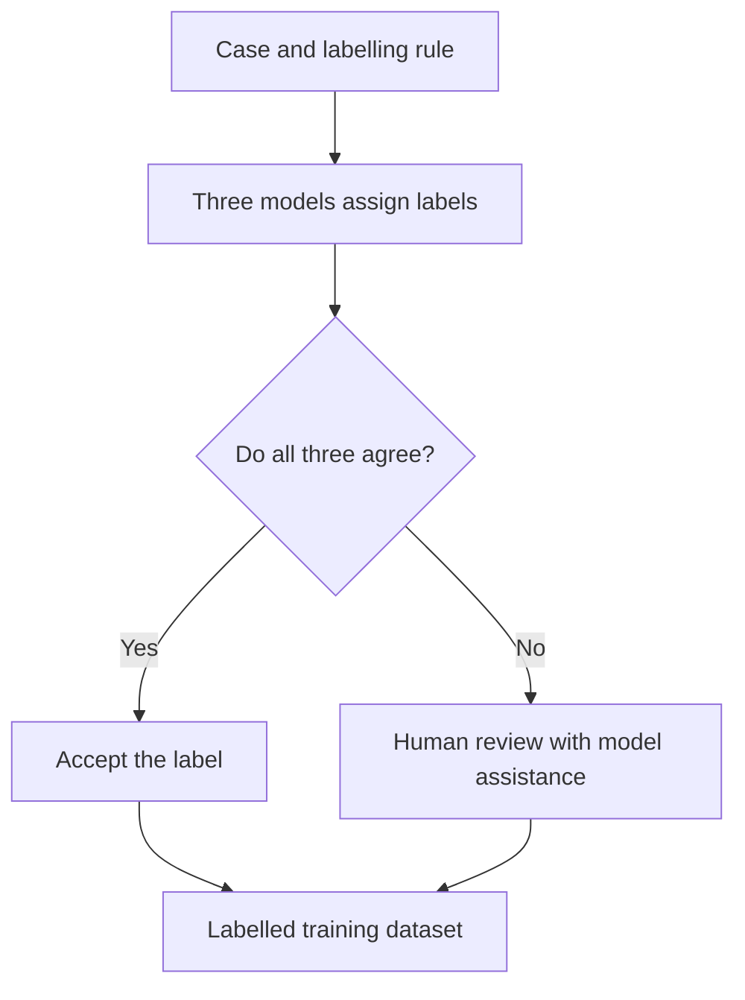

# Labelling: building reference sets

A **reference set** pairs examples with expected answers so that an evaluator can be tested consistently. In this project, reference sets are used to validate LLM judges, compare deduplication models and calibrate similarity thresholds. **Labelling** is the work of assigning those expected answers.

I build these sets through manual labelling, model-assisted review or model-generated labels. The process starts with selecting cases and defining the labelling rule, then assigning and reviewing the answers before using them for evaluation. The hand-labelled dedup golden sets provide an established evaluation reference; other sets still need human validation.

## What the reference set will evaluate

Start with the decision the evaluator must make. For deduplication, the expected answer is whether to keep or discard a memory, with merge also included in earlier experiments. For a factual-error detector, it is whether a response contains a specified factual error. For an embedding prefilter, labelled memory pairs establish which automatic keep or discard decisions are acceptable.

A case must preserve the inputs needed to make that decision. The dedup cases contain the new memory and the stored candidates it was compared with. Factual-error cases need the response and the facts against which it should be checked. Once the expected labels are recorded, code can compare an evaluator's predictions with them without another LLM grading the result.

Where the answer follows directly from the game record, code or an explicit expectation can supply it. Interpretation is needed for questions such as whether two memories convey the same lesson. That judgement needs a written rule before labels are collected.

## Choose cases and preserve their context

Case selection depends on what the set is intended to establish:

| Purpose | Selection | Use |
|---|---|---|
| Check known failures | Freeze failures and important edge cases with expected answers | Detect regressions after a change |
| Assess performance on a task | Sample the decisions the evaluator is expected to handle | Measure accuracy, with the sample's coverage and weighting stated |
| Calibrate a threshold | Include labelled cases around the decisions the threshold will automate | Inspect false keeps and false discards as the threshold changes |

The initial dedup golden set used a seeded sample of **50 cases from 390 recorded decisions across 30 games**, balanced between 25 observations and 25 strategy points. Observations record a situation, action and outcome; strategy points give advice. Each case retained the new entry, candidate memories and similarity scores. Full original text was consulted when a summary was ambiguous. The set later grew to 65 cases.

Balancing memory types supported separate checks of each type. The overall score reflects that balance rather than their frequency in live use. The sampling and review record is in [Per-extraction dedup](../../dedup/per_extraction/experiment_log.md), “Building the golden set.”

The labelling tools also support **stratified sampling**: drawing cases separately from groups that need coverage, such as flagged and unflagged outputs. Checking only flagged outputs can reveal false alarms but misses errors the evaluator never flagged. `evaluation/src/labeling/anchor.py` draws reproducible samples by group and records their membership for later scoring. This is available infrastructure, not a claim that every historical set used the same sampling process.

For regression tests, selection is deliberately targeted. The factual-error sets freeze known failures with written expectations so they can be replayed after changes. Their construction and use are recorded in [Factual errors](../factual_errors/report.md).

## Define and review the expected labels

A rubric needs to say what distinguishes the labels. For deduplication, similar wording is insufficient:

- An **observation** is a duplicate when its situation, approach and outcome match. Opposite outcomes make contrasting lessons worth retaining.
- A **strategy point** is a duplicate when the situation matches and the advice points in the same direction.

The 65-case hand-labelled set went through two revision rounds, changing **14 labels**. Repeated disagreements across models prompted rereading, and the later review sharpened the criterion to whether retaining only one memory would lose useful retrieval coverage. Disagreement identified cases to inspect; the criterion supplied the reason to change a label.

For genuinely borderline cases, the label file can record an alternative acceptable answer. The scorer reports both strict accuracy against the primary answer and lenient accuracy accepting either. The hardest cases also have a separate explanation of the ambiguity and its implication for the prompt. See [Dedup evaluation](dedup.md) for the label format and scoring apparatus.

Written expectations need review too. One factual-error case incorrectly expected that a speaker had never claimed a role, although the speaker had claimed investigator. Correcting the expectation was necessary before the case could reliably test the judge.

When collecting a human check of model labels, keep the model's answers out of the labelling packet until the human answers are complete. The prepared check packets use this separation so the reference is not simply a confirmation of the existing verdicts.

## Scale labelling with model assistance

Hundreds of labels can be expensive to assign manually. The dedup classifier experiment tried accepting unanimous model labels and reviewing disagreements. This was training-data construction, but its review strategy is also relevant when expanding a reference set.

*Original routing: unanimous labels bypassed review.*

Three models labelled 863 cases. Review began with the 244 split decisions. Discard majorities were overturned more often than keep majorities, prompting review of the 373 unanimous discards as well. **Eighty unanimous discards changed to keep.** Under the original routing, those labels would have entered the dataset unchecked.

The review covered 617 cases; 246 unanimous keeps remained accepted without review. The reversals came from an owner-and-model review, not an independent benchmark. They showed why review must include agreed cases before consensus can justify accepting labels automatically.

A later relevance-labelling panel mixed vendors but still produced groups of models that disagreed with one another, without a human check of that round. The detailed review, later panels and resulting protocol are in [the labelling record](experiment_log.md), §3a–3c, and [Why unanimous model labels still needed review](../../../writeup/evaluation/reference_labels/model_panel_review.md).

Model assistance can also propose reference answers for an existing evaluator. For the ten-player memory store, model readers identified 65 groups of duplicate lessons. Those groups became reference cases for a dry run of the dedup judge. They belong here because their answers were used to check another evaluator; their human validation remains outstanding. The original construction is recorded in [the v8 memory log](../../memory_system/v8/experiment_log.md).

## Score against the set and maintain it

Freeze the cases and labels for a comparison, run the evaluator on the same inputs, and score its predictions against the expected answers. The dedup scorer reports accuracy, a confusion matrix, per-label precision and recall, and mismatched cases. The [scoring report](../scoring/report.md) explains the measures.

Per-label scores distinguish different failures. Discard precision measures how many proposed discards the reference supports; discard recall measures how many reference discards the evaluator finds. Poor precision loses distinct lessons, while poor recall leaves duplicates. The mismatch list then provides concrete cases to inspect.

The hand-labelled set supported dedup prompt revisions and embedding-threshold calibration. Because it was repeatedly used to develop those decisions, its scores describe a development set. Fresh or held-out cases are needed to assess transfer beyond the examples used for tuning.

Threshold calibration illustrates why broader case coverage matters. A discard threshold that made no errors on the small human-labelled strategy-point subset conflicted with labels in a larger 232-pair cross-game set. Those additional labels were model-generated, so the conflicts identified cases for inspection rather than independently proving which answer was correct. The threshold experiments are documented in [Dedup evaluation](dedup.md).

Maintenance has two distinct tasks: rerun existing cases when the evaluator changes, and add or relabel cases when the task changes. The original dedup labels predate later memory fields and candidate filtering. The old cases remain useful, but their recorded scores do not measure the current pipeline. Keep the case inputs, rubric and relevant game/store version together so that this difference is visible.

## Reference sets in this project

The table groups sets by their use rather than treating every labelled output as a golden set. Sizes refer to the recorded evaluations; they are not all current deployment checks.

| Reference | Cases | Use and checking | Record |
|---|---:|---|---|
| Online dedup golden set | 65 | Human labels with two revision rounds; prompt and threshold development | [Dedup](dedup.md) |
| Batch dedup golden set | 111 entries evaluated in 11 clusters | Human-labelled keep/discard/merge decisions | [Dedup](dedup.md) |
| Factual-error reader golden set | 23 | Human-labelled cases used through four calibration rounds | [Factual errors](../factual_errors/report.md) |
| Situation-retrieval reference | 108 | Twenty cases labelled manually, then expanded with unchecked model labels; scorer tied to the older store | [Retrieval evaluation](../llm_judge/agent_decision.md) |
| Retrieval relevance labels | 84 reviewed in the first round; 1,848 in the second | First round included corrections; second round had model labels without human review | [Labelling record](experiment_log.md) |
| Cross-game prefilter reference | 232 pairs | Model-labelled pairs used alongside the small golden set for threshold checks | [Dedup](dedup.md) |
| Tell-detector reference | 40 | Model-labelled cases; a limited human check in one game | [Labelling record](experiment_log.md) |
| Accusation-tag reference | 183 messages | Model labels used to check speaker-generated tags; human validation pending | [LLM judges](../llm_judge/report.md) |
| Ten-player duplicate reference | 65 groups | Model-identified duplicates used to test the dedup judge | [Memory v8](../../memory_system/v8/experiment_log.md) |
| Echo-gate reference | 65-line calibration set | Model labels used to tune the gate; human validation pending | [LLM judges](../llm_judge/report.md) |
| De-halo judge reference | 40 observations | Reviewed examples used to compare candidate judges | [Memory v8](../../memory_system/v8/experiment_log.md) |
| Factual-error regression cases | 5 nine-player; 47 ten-player | Written expectations for known failures; ten-player verdicts also checked manually | [Factual errors](../factual_errors/report.md) |

The 863-case dedup panel dataset is training data and is discussed above for its labelling method. The classifier's evaluation used the separate 65-case golden set.

### Checks still to complete

Existing golden sets support completed evaluation work. The outstanding work concerns model-generated references and whether older sets still cover the deployed system:

- **Accusation tags, echo gate and factual-error judge:** prepared [human-check packets](owner_checks/) await labels. The calibration tool, built in October 2026, computes agreement, uncertainty and per-label scores against those labels; it has not yet been run on a panel.
- **Dedup and factual-error models:** rerun the older golden sets on the current models and add cases covering the expanded game where needed.
- **Prefilter and retrieval references:** review disputed model labels and update cases tied to older embeddings or stores before relying on them for new calibration decisions.

The historical pipeline implementation and run records remain in [the detailed record](experiment_log.md); proposed improvements are in [the labelling plan](plan.md).

<!-- Revised 2026-10-29 around reference-set construction. Removed output-review comparisons, spot checks and output-quality narratives. Retained model-generated answers where used as evaluator references, and the panel training dataset as evidence about scaling labelling. Source checks: per-extraction experiment log (sampling and rules), dedup.md (scoring and sets), anchor.py (stratified sampler), existing report and linked records. Inventory is selected, not an exhaustive certification of every dataset. -->

<!-- Previous report before reference-set scope revision
# Labelling: reference sets and sampled reads

This page covers how the project labels items by reading them, and the two things those labels are for:
**golden sets**, kept as a reference that a cheaper check is scored against, and **sampled reads**, made
once to decide between two versions of a prompt or feature. Both use the same techniques; the first part
below explains them once. The rest of this page covers the golden sets; the sampled reads have their own
page, [sampled_reads/](sampled_reads/report.md).

## Start of Writeup

A *reference set* is a set of items with ground-truth labels that a cheaper check (a classifier,
a threshold, an LLM judge, a model reader) is scored against. *Labelling* is how those labels are made.

In this project, reference set is either lablled by myself, or with assistance from a frontier large language model. In some cases, where the labelling task itself is straightforward with clearly defined objectives, it is mostly delegated to an llm model.

## Where labelling is used for this project

1. To create a reference set for calibrating/ validating llm-as-a-judge
2.

|                             | Golden and silver sets (this page)                                                 | Sampled reads ([sampled_reads/](sampled_reads/report.md))                         |
| --------------------------- | ---------------------------------------------------------------------------------- | --------------------------------------------------------------------------------- |
| **What the labels are for** | A reusable reference: a cheaper check is scored against it, now and later          | A one-off measurement: which version's lines deny less, fit better, change a fact |
| **Kept for**                | Every later calibration                                                            | That decision                                                                     |
| **Examples**                | The 65-pair dedup set; the census reader's 23 cases; the ten-seat duplicate groups | The evil-cover read; the voice-rewrite read; the decision-tag read                |

**The techniques both use:**

1. **Draw the items without bias.** A seeded, stratified draw (flagged and unflagged, by role and phase), and
   never a selection that can see who won, since a sample chosen by the outcome measures the outcome. Code:
   `evaluation/src/labeling/anchor.py` (seeded stratified draw, and the sample size an interval needs:
   about 62 items for ±10%, 96 for ±8%, 246 for ±5%); the outcome-blind case sampler
   (`evaluation/src/diagnosis/sampler.py`).
2. **Hide the source.** The reader sees the item and what it needs to judge it, never which model or version
   produced it; a key file maps each opaque id back. Code: the labelling exporter (blind packets and an
   answers template) and the October packet-read runners.
3. **Fix the rubric, and the bar, before reading.** One rubric, word for word, for people and models; a pass
   bar set before the read (the decision-tag read's 90%).
4. **Measure agreement.** Two readers on the same items. Done by accident twice so far: labels tied to an act
   (did the seat claim a role) held exactly, labels needing judgment moved by several items
   ([sampled_reads/](sampled_reads/report.md), §4).
5. **Anchor to a person.** A small blind sample labelled by the owner, against which a model's or a panel's
   labels are scored. Code: `pipeline calibrate` (built 2026-10-23), which reports agreement with its
   interval, Cohen's kappa, per-label precision and recall, and a pass or fail against set thresholds.
   Owner-check packets for three model sources (the accusation tags, the echo gate, the factual-error judge)
   are waiting in [owner_checks/](owner_checks/).

## Why golden sets

A cheap check is only useful if it agrees with the truth, and the truth for most of what this project
checks is a matter of meaning: are these two lessons the same, is this memory relevant to this
situation, did this turn state a false fact. A golden set gives a fixed set of items where the answer
is settled, so a check can be scored on it and two versions of a check compared on it.

**When a golden set is needed.** Every model judgement or tag that a live feature or a published number
rests on needs a gold sample to be checked against. Two things come first where they exist: code, when the
answer can be computed from the game record, and an outcome (a win, a true role), which is a better
reference than a person's label. A golden set covers what is left, the judgements of meaning. It can be
small: 30 to 100 items, mixing easy and hard ones, measure a judge's agreement, and the judge then labels at
scale. A set used to tune a prompt keeps part of itself back, or it overstates how good the judge is. A read
used once to steer a design can stay silver, if it is marked as silver.

A golden set is only as good as whoever labelled it. So this page says, for every set, who did the labelling,
and whether anyone checked the labelling itself.

## Ways of labelling, compared

|                         | A person labels everything                                  | A model panel, a person on the disagreements                      | Models only                                                                                | A written expectation per case                             |
| ----------------------- | ----------------------------------------------------------- | ----------------------------------------------------------------- | ------------------------------------------------------------------------------------------ | ---------------------------------------------------------- |
| **Cost**                | The owner's time on every item                              | Model calls, plus a person on the minority the models disagree on | Model calls only (Claude readers run on the owner's subscription, with no per-call charge) | A person writes one rule per case                          |
| **Scale**               | Tens of items                                               | Hundreds to thousands                                             | Any size                                                                                   | Tens of cases                                              |
| **How far to trust it** | Highest, if the rubric is clear                             | As good as the review; agreement alone proves nothing             | Unknown until a person checks a sample                                                     | As good as the expectation                                 |
| **Typical failure**     | One person's drift; too few items to separate close results | Models that share a bias agree confidently and wrongly            | Readers do not agree with each other; nobody notices                                       | A wrong expectation makes every verdict on that case wrong |
| **Used for**            | Dedup decisions; the census reader                          | Dedup classifier training; reranker relevance                     | Most ten-seat reference sets                                                               | Factual-error regression cases                             |

## Every golden set in the project

| Approach                  | Set                                    | What it checks                                                          | Size         | Game · date            | Was the labelling checked?                                                | Current?                                                                     | Detail                                                                   |
| ------------------------- | -------------------------------------- | ----------------------------------------------------------------------- | ------------ | ----------------------- | ------------------------------------------------------------------------- | ---------------------------------------------------------------------------- | ------------------------------------------------------------------------ |
| **A person**              | Online dedup set                       | The dedup model's keep or discard decision                              | 65           | nine-seat · May 2026   | Two revision rounds (14 labels changed); no second labeller               | Partly: set the embedding thresholds in October                              | [dedup.md](dedup.md)                                                     |
|                           | Batch dedup set                        | Batch dedup decisions per cluster                                       | 111          | nine-seat · May 2026   | No                                                                        | Stale                                                                        | [dedup.md](dedup.md)                                                     |
|                           | Census reader's golden set             | Chose the two-model factual-error reader                                | 23           | nine-seat · July 2026  | Four calibration rounds                                                   | Not re-run since the judges moved to Haiku 5.5                               | [factual_errors](../factual_errors/report.md)                            |
|                           | Owner's read of the census             | The reader's precision and misses                                       | 90 + 25 + 15 | nine-seat · July 2026  | —                                                                        | Gemini era                                                                   | [factual_errors](../factual_errors/report.md)                            |
| **A panel, then review**  | Dedup classifier labels                | Training labels for the classifier                                      | 863          | nine-seat · May 2026   | The panel was measured against the review; the reviewers were not checked | Stale (fine-tune concluded)                                                  | case 2                                                                   |
|                           | Reranker, round 1                      | Retrieval relevance (0, 1, 2)                                           | 84 reviewed  | nine-seat · May 2026   | 14 of 84 corrected                                                        | Stale (reranking off live)                                                   | case 2                                                                   |
|                           | Situation-retrieval set                | Situation-summary query prompts, by ranking score                       | 108 cases    | nine-seat · May 2026   | 20 cases by hand; the model-added labels never checked                    | Stale (scorer tied to the v4 store)                                          | [llm_judge](../llm_judge/agent_decision.md)                              |
| **Models only**           | Reranker, round 2                      | Retrieval relevance                                                     | 1,848        | nine-seat · May 2026   | Models agree 36–73% pairwise                                             | Stale                                                                        | case 2                                                                   |
|                           | Prefilter cross-game set               | Embedding thresholds                                                    | 232          | nine-seat · May 2026   | Two models agree on 75%                                                   | Stale                                                                        | case 5                                                                   |
|                           | Tell-detector cases                    | The tell detector's precision and recall                                | 40           | nine-seat · July 2026  | Owner upheld 7 of 8 in one game                                           | Stale (never run on ten-seat)                                                | case 3                                                                   |
|                           | Discussion-evidence judge's reads      | The speakers' own accusation tags (79% agree; 13% missed an accusation) | 183 messages | nine-seat · Oct 2026   | No: the judge itself has no human check                                   | Current: the tags pick who gets a closing defence and open reply obligations | [llm_judge](../llm_judge/report.md)                                      |
|                           | Credit attribution spot check          | The agent's "I followed this lesson" claims                             | 15           | nine-seat · July 2026  | —                                                                        | Stale                                                                        | [credit](../../credit/report.md)                                         |
|                           | Ten-seat duplicate groups              | The point dedup judge                                                   | 65 groups    | ten-seat · Oct 2026    | No                                                                        | Applied in the published store                                               | case 3                                                                   |
|                           | Lesson-fit read                        | The stage filter on retrieved lessons                                   | 268 lessons  | ten-seat · Oct 2026    | No                                                                        | Current                                                                      | case 3                                                                   |
|                           | Decision-tag read                      | The decision tagger                                                     | 102          | ten-seat · Oct 2026    | No                                                                        | Current (feeds the halo measure)                                             | [sampled reads](sampled_reads/report.md)                                 |
|                           | Silence labels                         | The echo gate as shipped                                                | 156 lines    | ten-seat · Oct 2026    | No                                                                        | Current (the shipped gate rests on it)                                       | [llm_judge](../llm_judge/report.md)                                      |
|                           | Voice-rewrite reads                    | The rewrite fidelity check                                              | 90           | ten-seat · Oct 2026    | No                                                                        | —                                                                           | [sampled reads](sampled_reads/report.md)                                 |
|                           | De-halo reference                      | Chose the de-halo judge                                                 | 7 in 40      | ten-seat · Oct 2026    | No (one game, one reader)                                                 | Live                                                                         | [v8 log](../../memory_system/v8/experiment_log.md)                       |
| **A written expectation** | Pinned cases in the nine-seat test set | Known factual failures stay fixed                                       | 5            | nine-seat · Oct 2026   | Hand check: 10 of 12 verdicts upheld                                      | Current                                                                      | case 4                                                                   |
|                           | Ten-seat pinned cases                  | Known ten-seat failures                                                 | 47           | ten-seat · Oct 2026    | Every verdict read by hand                                                | Current                                                                      | case 4                                                                   |
|                           | Summary-claim patterns                 | The summariser and the claim ledger, scored by code                     | —           | ten-seat · Oct 2026    | Caught one regression before it shipped                                   | Current                                                                      | case 4                                                                   |
|                           | Novelty probes                         | The standalone novelty label                                            | 20           | eight-seat · June 2026 | Answer fixed by how the probes were made; extreme cases only              | Retired                                                                      | [sequential_discussion log](../../gameplay/discussion/experiment_log.md) |

**What the table shows.** Every gold set is from the nine-seat game, May to July 2026. Every ten-seat
set is silver (labelled by model readers) or is a hand-written expectation, and none of the
model-read sets has a person's check. Several of them back live features: the accusation tags that
run the closing defence, the echo gate, the published memory store.

Where the record says "by hand" without naming who (the 23-case set, the nine-seat test set's hand check, the
ten-seat expectations), this page says "by hand" too.

---

## Case 1. A person labels everything: the online dedup set

**What and why.** Dedup decides, for each new memory, whether to keep it or discard it as a repeat of one
already stored. Whether two lessons say the same thing is a meaning call, and the models doing dedup
get it wrong often enough (the baseline model matched 78% of decisions) that their own output cannot
serve as the answer.

**Why a person.** The set exists to grade those models, so it cannot come from them.

**How it works.** A person labelled 50 sampled pairs, grown to 65 over two sessions (40 observations, 25
strategy points). Two revision rounds followed, each set off by models disagreeing with a label; 14
labels changed, about 10 of them from discard to keep after a "would retrieval lose anything?" test. Code scores
any dedup run against the set, with no model involved (`evaluation/src/audits/dedup_score.py`).

**Result.** It steered the dedup prompt from v1 to v11b (about 83% agreement at the end), and in
October 2026 set the thresholds for the new embedding model.

**How far to trust it.** One labeller and no second opinion. Its 25 strategy points cannot separate an
8% difference. Its labels are from nine-seat, May-era memories, and its own metadata still describes an
earlier draft of the file.

## Case 2. A model panel, a person on the disagreements: the labelling pipeline

**What and why.** Training the dedup classifier needed 500 to 1,000 labelled cases, and only the 65 of
case 1 existed. Labelling a thousand by hand was not possible for one person.

**Why this way.** Several models label every item; where they agree, the label is kept; where they
disagree, a person decides. The person's time goes only to the hard minority.

**How it works.** The first round labelled 863 dedup cases with three Gemini models: 619 unanimous, 244
split. The splits, and the 373 cases all three called "discard", were reviewed by hand (the owner with
Claude), 617 records in all; the 246 unanimous "keep" cases were trusted. The scripts became a reusable
pipeline (`evaluation/src/labeling/`): models label, the votes are combined, the split cases are exported
for a person, and the person's labels are merged back.

**Result.** The review showed the panel was wrong in one direction: a "discard" majority was wrong 37% of
the time, a "keep" majority 7%, and 21% of the unanimous "discard" cases flipped. Three models from one
vendor shared a bias, so their agreement looked like reliability and was not. The reranker rounds then
mixed vendors. Round 1 (four models, 84 items reviewed, 14 corrected) kept a review; round 2 (five
models, 1,848 items, with ChatGPT and Claude Sonnet run by hand as voters) had none. The models split
into two camps that agreed within themselves (Mistral with Llama, 73%) and not across (36–43%), and the
merged labels over-credit relevance on 514 of 1,848 items, measured against the two careful models. Mixing vendors helped, but a shared lean
was still caught only by a different kind of judge.

**How far to trust it.** The labels are as good as the review, and the review itself was never checked.
The step that measures the panel against people, and says when its agreement is safe to keep, was designed
in [plan.md](plan.md) and every round computed it by hand; it was built on 2026-10-23 (`pipeline calibrate`) and has not yet been run on a panel. The second reranker round is model labels only. The
pipeline's labelling stage has not been used since June 2026.

## Case 3. Models only: the ten-seat readers

**What and why.** From October 2026, reference sets for the ten-seat game were made by Claude model
readers launched from the working session: blind reads of lessons, decisions, silent turns and rewrites.

**Why models.** They are fast, cost no per-call charge, and can read a whole game's context. The owner's
time went to building and playing instead.

**How it works.** Example: four Claude Sonnet readers each read a quarter of the ten-seat memory store
(605 strategy points) against the game's rules. They grouped points that give the same move in the same
situation, 65 groups and 78 points to drop. Those groups then became the reference for a dry run of the
point dedup (`evaluation/experiments/v8_sp_dedup_dry_run.py`). The same readers re-read the fit of the 96
lookups below against the larger store. Five more sets were made the same way (the table above). The July
tell-detector cases are an earlier version: five Claude Opus readers labelled 40 cases without seeing the
detector's answers.

The **lesson-fit read** behind the stage filter (2026-10-12) is the other main ten-seat memory set: 96 of
352 lookups, drawn stratified by model, role and phase (`evaluation/experiments/v8_gate_lookups.py`), read
by four Sonnet subagents against the rules and the games' true roles for each lesson's fit, the situation's
errors and any leak. The runner names a second reader, the owner, after the subagents; no record of that
pass was found. Because the fit re-read used different readers, the before-and-after comparison is
approximate (`memory_system/v8/experiment_log.md`; data in `memory_system/v8/data/{gate,reextract}/`).

**Result.** The dedup caught only 9 of the 65 groups (16 with a looser split), which located the problem
in its judge. The groups were applied when the published store was built.

**How far to trust it.** Unknown. No person has checked a sample of any ten-seat reader set, and the
readers were not interchangeable: on the same task, one quarter flagged 4 rule errors and another 13. The
tell cases had one game checked by the owner (7 of 8 upheld), and half their cases came from the
detector's own output.

## Case 4. A written expectation per case: the factual-error regression cases

**What and why.** A known failure, frozen as a test case, needs a label that says what a correct turn
looks like, so that every replay can be scored against it.

**Why this way.** The label is a rule about one case ("the only checks it made were…"), cheap to write
and needing no panel. A narrow judge applies it to each sample. Where the output is structured, as with
day summaries, code applies fixed patterns instead and no judge is needed. A related form is a label
fixed by how the case was made: the June novelty probes were built so that the right answer was known.

**How it works.** 5 pinned cases in the nine-seat test set and 47 on the ten-seat sets, each with a written
expectation; every ten-seat verdict was also read by hand.

**Result.** The cases showed whether known failures still happen after a fix; the code-scored summary
patterns caught one regression before it shipped
([factual_errors](../factual_errors/report.md), step 4).

**How far to trust it.** The hand read caught a wrong expectation once (it said "never claimed any role"
on a day the speaker had claimed investigator), and in one set its counts differed from the judge's
(about 19 and 6, against 16 and 5). So the judge's errors come from the expectations as well as from the
model. The probes covered only clear-cut cases; the borderline middle was never tested.

## Case 5. A small gold set checked by a large silver one: the prefilter

**What and why.** The prefilter is the no-model first layer of dedup: it keeps a new memory outright when
it is far from everything stored, and discards it outright when it is nearly identical. Its cut-offs
are set on labelled pairs.

**Why both.** The 65 human labels of case 1 are trusted but few; a 232-pair cross-game set labelled by
two Gemini models is larger but unchecked. Each covers the other's weakness.

**How it works.** The cut-offs were swept on both sets for the widest ones with no labelled errors
(`evaluation/src/studies/eval_auto_dedup.py`).

**Result.** In May the large set caught a small-sample mistake: a strategy-point discard line of 0.90,
clean on the 25 human strategy points, would have misfired on the 232, so it was set at 0.93. In October,
when the store moved to a new embedding model, the cut-offs were set on the 65 alone; re-embedding the
232 showed the new strategy-point line would discard two labelled keeps.

**How far to trust it.** The 232 are model labels: the two models agree on 75%, and one leans to discard.
No person has read them. That path is dormant in the live game, so no harm followed.

---

## What is missing

- **The labelling pipeline's check against people has not been used yet.** Built on 2026-10-23
  (`pipeline calibrate`); its first use is the owner checks in [owner_checks/](owner_checks/), which wait on
  the owner's labels.
- **A person's check on any ten-seat set.** Every one is model-read or a written expectation.
- **Judges with no golden set at all:** the memory-component judges, the extraction judge and the
  discussion-evidence judge ([llm_judge](../llm_judge/report.md)).

### Golden sets against what is deployed today

The parts of the deployed game, and the evaluation that checks it, whose golden set is missing or
predates them. Two kinds of update: **re-run** an existing set on today's model (code only, no labels),
or **label** a new gold sample. Parts not deployed are left out (the reranker is off by default; batch
cluster dedup, the tell detector and the application judge serve research only).

| # | Deployed part                                                                                     | Golden set today                                                                           | Update needed                                                                                              | Who                | Size or cost                 |
| - | ------------------------------------------------------------------------------------------------- | ------------------------------------------------------------------------------------------ | ---------------------------------------------------------------------------------------------------------- | ------------------ | ---------------------------- |
| 1 | **Accusation tags** (each speaker's own; they pick who gets a closing defence and who must reply) | Silver: the discussion-evidence judge, nine-seat, itself unchecked                         | Label who, if anyone, each message accuses                                                                 | Owner              | ~50 ten-seat messages        |
| 2 | **Echo gate** (decides which open-floor lines are heard)                                          | Silver: four Sonnet readers, 65 lines                                                      | Label each line worth hearing, or a repeat or filler                                                       | Owner              | 30–50 lines                 |
| 3 | **The factual-error judges on Claude Haiku 5.5** (every prompt or model change runs through them) | Gold, Gemini era: the census reader's 23 cases; hand checks of 12 verdicts                 | Re-run the 23-case gate on Haiku (`role_fact_read.py --golden`); then label flagged and unflagged verdicts | Claude, then owner | Cents; then 50–100 verdicts |
| 4 | **The memory tick's keep-or-discard dedup on Claude Haiku 5.5** (builds the served lesson store)  | Gold, nine-seat: the 65-pair online dedup set, never run on a non-Gemini model             | Re-run the 65 on Haiku; then label a ten-seat sample, since ten-seat memories differ in form               | Claude, then owner | Cents; then 30–50 pairs     |
| 5 | **The embedding prefilter** (Qwen thresholds)                                                     | Gold 65 plus silver 232; the 232 already show a misfire on the strategy-point discard line | Label a sample of the 232, if that line is ever turned on (dormant today)                                  | Owner              | 30–50 pairs                 |
| 6 | **The rule-error screen and duplicate groups behind the published store**                         | Silver: Sonnet readers that disagreed (4 against 13 flags per quarter)                     | Check a sample against the owner, if the store's numbers are cited                                         | Owner              | 30–50 items                 |
| 7 | **The retrieval query** (the situation agent, when memory is on)                                  | Gold 20 cases plus silver, on the nine-seat v4 store; its scorer is tied to that store     | Relabel on the current store, only if a retrieval claim is cited                                           | Owner              | ~20 cases                    |

Rows 1 to 3 back numbers the write-up is likely to cite or parts players notice; rows 4 to 7 matter only
if their numbers are cited. The owner's labelling sessions are scheduled in
[`writeup/_planning/map.md`](../../../writeup/_planning/map.md), "Evaluation hardening tasks".

## What we would do differently next time

Changes by stage of making a golden set: what could be standardised so sets are cheaper, sounder or reusable.
Each could have been chosen at the start; lessons that needed results first are left out.

| Stage  | Change                                                                                                                                              | What was done                                                                                                                                       | What it would buy                                                                         |
| ------ | --------------------------------------------------------------------------------------------------------------------------------------------------- | --------------------------------------------------------------------------------------------------------------------------------------------------- | ----------------------------------------------------------------------------------------- |
| Design | **1. Size each set from the precision it must give**, before labelling (about 62 items for ±10%, 96 for ±8%, 246 for ±5%)                        | Sizes were set by what was at hand; 25 strategy points could not separate an 8% difference                                                          | No set too small to answer its question, and no labelling past what it needs              |
| Design | **2. One rubric, word for word, for people and models**                                                                                             | The panel's prompt carries the rubric; the export for people is generic                                                                             | Disagreements that come from the item, not from different instructions                    |
| Label  | **3. A small blind sample read by a person in every silver set** (30 to 50 items, mixing flagged and unflagged)                                     | None for the ten-seat sets or the 232 prefilter pairs; one game for the tell cases                                                                  | An error rate for every silver set, and model labelling that can scale on that basis      |
| Label  | **4. The check of a panel against people built before the first panel run**                                                                         | Worked out by hand in every round; still not code                                                                                                   | Each run reports how wrong each agreement tier is, instead of each round rediscovering it |
| Label  | **5. Who labelled each item, and with what, written into the set's file**                                                                           | The labeller is unnamed for three sets; the online dedup file's metadata contradicts its labels                                                     | Trust that can be traced, and mismatches caught when the set is loaded                    |
| Keep   | **6. One registry of golden sets**, each tagged with its game version, memory store and labeller, and scorers that warn when run on another version | Sets spread across many folders in different formats; one scorer is tied to the v4 store; the October thresholds were re-set on the small set alone | A new judge can find a set to check against, and a stale set shows as stale               |

**Bottom line.** The project's gold sets are nine-seat and from May to July 2026; the dedup set is the
strongest of them. Since the move to the ten-seat game, every set has been silver: made by model readers
with no person's check, and the same holds for the sampled reads. The cheapest upgrade is the same
everywhere: a person reads a small blind sample of each silver set and each read's rubric, which would turn
its labels into checked ones, and the tooling for it now exists.

*Rewritten 2026-10-23 from an inventory of every golden set, checked against the records named above. On
2026-10-24 the former `sampled_human_review/` folder was dissolved into this one as
[sampled_reads/](sampled_reads/report.md), and this page gained the shared techniques. The 2026-06-29
account of the pipeline (modules, verification, the seven gaps) is kept in
[the detailed record](experiment_log.md).*

-->
