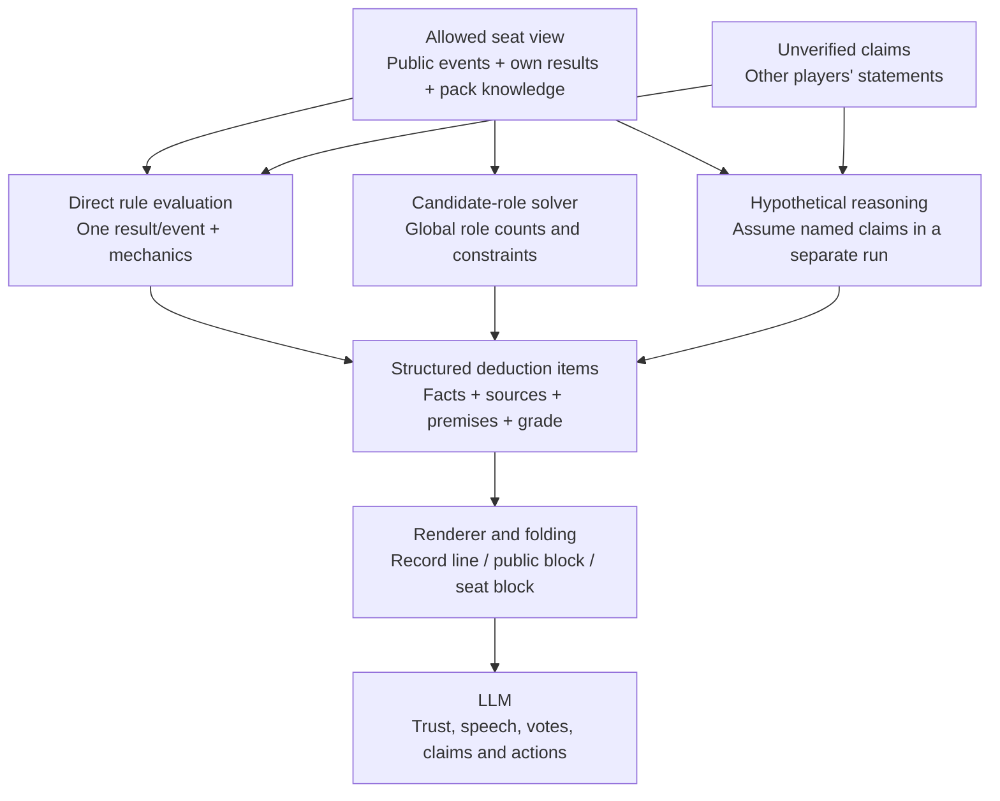
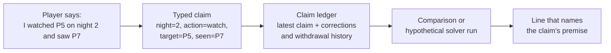
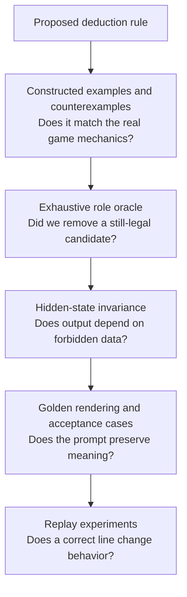

# Deduction Engine — Technical Learning and Reference Guide

**Project:** Werewolf / AI social-deduction agents  
**Audience:** A reader of the record, and the project owner revising the design or inspecting the code  
**Basis:** The [deduction catalogue](deduction_catalogue.md) (updated through slice 17, 21 October 2026), the [experiment log](experiment_log.md), the recorded datasets under `data/` and `../data/`, and the implementation pinned at `588a3273` (26 October 2026; the deduction code and its tests have not changed since).  
**Status of this guide:** Revised 2026-10-31. This revision replaces the 26 October report (git history keeps it). Its facts were checked on 2026-10-31 against the catalogue, the experiment log, the datasets and the code at `588a3273`; file paths name the files as they stand at that commit. Pages elsewhere in the record cite the old report by section: old §2 (the Healer example) is now §1.2 and §2.4; old §3 (how it works) is Chapters 2–7; old §4 (verification) is Chapter 8; old §5 (what improved) is Chapter 9.

> **How to use this guide:** Read Chapters 1–4 in order for the core mental model. Chapters 5–8 explain extensions and verification. Chapter 9 separates *whether the computation is valid* from *whether the agent behaves better*. Chapters 10–12 are interview/review references. Every example is labelled **recorded case** or **teaching example**; do not mistake invented demonstrations for measured outcomes.

## Contents

1. [The problem and why code-based deduction was introduced](#1-the-problem-and-why-code-based-deduction-was-introduced)
2. [The mental model: inputs, reasoning paths and output](#2-the-mental-model-inputs-reasoning-paths-and-output)
3. [Direct deductions: no general solver required](#3-direct-deductions-no-general-solver-required)
4. [Constraint propagation: why a solver is necessary](#4-constraint-propagation-why-a-solver-is-necessary)
5. [Claims and conditional reasoning](#5-claims-and-conditional-reasoning)
6. [Evil-seat covers: reasoning in service of plausible claims](#6-evil-seat-covers-reasoning-in-service-of-plausible-claims)
7. [How deductions become prompt text](#7-how-deductions-become-prompt-text)
8. [Verification: what each test proves—and does not prove](#8-verification-what-each-test-provesand-does-not-prove)
9. [Behavioral evidence, cost and unresolved questions](#9-behavioral-evidence-cost-and-unresolved-questions)
10. [Boundaries, guardrails and engineering trade-offs](#10-boundaries-guardrails-and-engineering-trade-offs)
11. [Reference appendices](#11-reference-appendices)
12. [Self-review and interview questions](#12-self-review-and-interview-questions)

---

## 1. The problem and why code-based deduction was introduced

### 1.1 Four failures that look similar, but need different fixes

A social-deduction agent can behave irrationally for several fundamentally different reasons. The original reliability work distinguished them:

| Failure | What has gone wrong? | Appropriate first intervention |
|---|---|---|
| Missing information | The result or earlier event never reached the model, or was distorted in a summary. | Repair the state, event record, or summary pipeline. |
| Ambiguous wording | The relevant event reached the prompt but its description invited misinterpretation. | Correct the wording and replay the failing turn. |
| Missing inference | Correct premises are present, but the model does not connect them—or makes an unjustified leap. | Reasoning effort, stronger model, or explicit deterministic consequence. |
| Stale strategy | The model has understood new evidence but continues to follow an earlier plan. | Revisit how the strategy note is revised and how new evidence competes with it. |

**Why this distinction matters:** A deduction engine cannot compensate for a missing observation. And giving an agent a correct fact does not ensure it will act on it. Those are different failure modes.

The broader [factual-error report](../../evaluation/factual_errors/report.md) found about **3%** of July nine-seat public messages had factual errors. Another October game included an invented investigation that contributed to an innocent elimination and a Serial Killer win. These episodes motivated reliability work; **3% is not a measured baseline for the deduction engine**.

### 1.2 Recorded motivating case: the roleblocked Healer (AC1)

The Healer protects another player at night. In the recorded case `2f19d908`, day 2, the Healer (`player_8`) attempted to protect `player_5` on night 1 but was roleblocked. A Trailseer (`player_3`) claimed to have followed `player_7` to the Healer, and `player_7` admitted the visit.

The relevant game mechanics were:

- In that dealt cast, **only the Chanteuse** (a wolf role) could roleblock.
- A successful roleblock is a **visit** to the blocked player.
- A visit by `player_7` does **not** prove that `player_7` performed the block: there could have been another visitor.

Across three daytime turns, the Healer retained the premises in its notes without drawing or voicing the useful connection. Its earlier night record also ended with the unhelpful phrase “you learned nothing tonight.” Two things therefore needed attention: **repair the misleading record**, and **supply the mechanically justified inference**.

The desired output has two logically different parts. Both lines below are verbatim from the engine's acceptance test for this turn; the first is shown beside the Healer's own night record:

> **Certain:** Night 1 (last night): You were roleblocked: your protection of player_5 did not happen. Only the Chanteuse could roleblock that night, and a block is a visit, so the Chanteuse, a wolf, came to you that night.
>
> **Conditional, with alternatives:** player_3 says player_7 came to you on night 1, and player_7 agrees. If that is true, either player_7 is the Chanteuse, or player_7 and the Chanteuse both came to you.

The first follows from the trusted night result and rules. The second depends on unverified reports. A line saying **“player_7 is the Chanteuse”**, with or without a premise, would exceed what the evidence proves; only the either/or form is allowed. This “must not say” condition is part of AC1's acceptance test.

### 1.3 Why not solve the problem solely with prompting or better models?

Earlier interventions were not uniformly failures:

| Experiment (different test cases; do **not** compare as one common benchmark) | Observation | What it tells us |
|---|---|---|
| July prompt bundle | Errors on selected turns fell from **48% to 30%**. | Input and prompting improvements have value. |
| Nine-seat replay on gemini-3.5-flash-lite, medium against minimal thinking | Bad samples fell from **82 to 27 of 267**. | More thinking helped substantially on that model. |
| Higher Haiku thinking, ten-seat vote screen | **65/160 → 98/160** correct votes; output tokens ~**2.7×**; discussion errors barely changed. | More thinking can help voting but is not a general remedy. |
| Stronger day summariser | **18/30** flawed summaries in each condition. | No improvement in this screen. |
| Rewritten private-note prompt | **15 → 27** fact/rule errors out of **56** samples per arm. | Asking for explicit reasoning can sometimes make this metric worse. |
| Majority of three low-effort votes | **41%** for one vote versus **39%** for majority-of-three. | Repeated samples can share the same error. |

The Haiku vote numbers are from the enforced output mode. Re-run in the game's live output mode ([experiment log §9](experiment_log.md)), the same screen gave **97/157 → 122/158** at about **1.5×** the output tokens; the direction is the same, the gap smaller.

In the Healer's later *live-output-mode* replay, higher thinking and larger models could often make the connection themselves. Their costs are discussed in Chapter 9. The design choice was therefore **not** “LLMs cannot reason”; it was:

> If a conclusion is a repeatable consequence of known game mechanics, compute it predictably in code rather than requiring the live small model to rediscover it on every turn—while retaining the model for uncertain social judgments and actions.

This creates a new cost: rules, exceptions, correctness tests, and maintenance. It is worthwhile only if the bounded help justifies that engineering burden.

**Check your understanding:** If a Healer's block result was absent from the prompt entirely, would the solver be your first fix? No: repair the input. If the Healer already had the deduction in its notes but chose silence, you would investigate the strategy/decision layer, not claim that another deduction necessarily fixes it.

---

## 2. The mental model: inputs, reasoning paths and output

### 2.1 The whole system in one diagram



**Key distinction:** The two core *reasoning mechanisms* are direct rules and constraint propagation. The *sources of information* are the seat's own results, public events and other players' claims. They are different dimensions. A claim can be tested by a direct join or by an assumed-premise solver run. Public data can lead to either a direct conclusion or a solver result.

### 2.2 Trust boundary: what counts as known?

| Input | Can ground an unconditional (“certain”) line? | Why |
|---|---|---|
| Public announcements, deaths/revealed roles, votes, dealt cast | Yes, subject to the correct night/rule version | Every seat knows them. |
| A player's own night records and own role | Yes, for that player | Privately observed or assigned to that player. |
| Revealed dead player's read-out will | Yes, **after** the reveal | Prior private records become public through the reveal. |
| Wolf pack identities and pack kill record | Yes, for appropriate wolf seats | Explicit faction-private knowledge. |
| Another player's role or action claim | **No** | The player may be lying or mistaken. |
| Pack chat, an agent's notes, earlier public statements | **No** | These are statements/strategies, not engine-certified observations. |
| Global hidden-role assignments or other seats' private results | **Never** | Using them would cheat even if output contains no copied secret field. |

A `SeatView` is built from the same authorized payload as the agent's prompt. A `PublicRecord` contains only shared facts. The engine should not receive the omniscient state and promise merely not to print it. The distinction is **information-flow safety**: a deduction can leak hidden state by *dependence*, not just by quotation. The existing [information boundary](../../agent_boundaries/report.md) remains responsible for constructing that input correctly.

### 2.3 Three runtime modes (plus off)—not the same as implementation modules

| Configuration | Intended assistance | Main limitation |
|---|---|---|
| `off` | No deductions | Baseline. |
| `record` | Direct consequences beside the seat's own results | Does not provide broader public/candidate/claim deductions. |
| `public` | Record assistance plus public and seat-specific lines that do **not** rest on claims | No claim-premised lines. |
| `full` | All eligible verified deductions, including joins and conditionals | Still bounded by the registered mechanics and available evidence. |

`RunConfig.deduction_mode` defaults to `full` in the documented implementation; `deduction_by_side` permits faction-specific settings. Human-controlled seats receive none of this AI assistance. **These four modes must not be confused with the catalogue's eight conceptual output categories or its historical numbered build slices.**

### 2.4 What the engine does *not* own

The deduction engine can determine that a night result implies a blocker, or that some roles are inconsistent with the record. It does **not** decide whether a witness is trustworthy, whom to lynch, whether to reveal a finding, or what lie to tell. It may establish that a proposed lie is *consistent with known observations*—which is not the same as saying it will persuade anyone.

---

## 3. Direct deductions: no general solver required

### 3.1 The simplest useful pattern

A deterministic rule can often be expressed as:

```text
IF the receiver has a trustworthy observation O
AND the dealt rules imply consequence C whenever O occurs
THEN add C to that receiver's prompt.
```

For the Healer:

```text
Trusted observation: Healer was roleblocked on night 1.
Game rule: Only Chanteuse can block in this cast.
Game rule: A completed block is a visit.
Conclusion: A Chanteuse visited the Healer on night 1.
```

This does not need a generic search solver. It needs correctly modelled rules and enough contextual checks to ensure the rule is valid for **this** cast and **this** night. A rule valid for a standard cast may be false if a second blocking role is introduced.

### 3.2 Other direct deductions and why details matter

**A check reading “Suspicious.”** Wolves read Suspicious. But in a Necromancer cast, the Necromancer can also read Suspicious **on a night when it made a kill through a body** (a sigil, block, protection, check, watch or follow through a body does not count). Thus a Suspicious result does not always prove “wolf.” In acceptance case AC3, no one had died before the relevant night; the Necromancer had no usable body and could not meet that exception. There the Investigator's check **did** prove `player_6` was a wolf. The conclusion depends on the event chronology, not just the word “Suspicious.”

**A watch is itself a visit.** A Sentinel watching a target visits that target, even though the watcher's own result excludes its own visit from the list of visitors. A Trailseer following the Sentinel could therefore truthfully report where it went. In one recorded game (`2b29bfe8`) seats read a true watch and a true follow as contradicting each other for exactly this reason, and the real Sentinel then denied going anywhere; slice 17 added the rule that spells the relationship out. (The separate confusion between who *came to* a target and where a player *went* is AC3's problem, handled by its own rule, E17.)

**Blocked attempt versus completed action.** A blocked agent may have chosen a target, but its action did not go ahead: no action effect, no completed visit and normally no completed use. A claim “I tried to protect X” must not be interpreted as “I visited X.” This is why the ledger and rule logic distinguish *attempted* from *completed* actions.

**Time matters.** Night actions resolve simultaneously: a player killed on night `n` may still have acted that night. A revealed body is available to the Necromancer only when it was already revealed dead **before** the night starts. A will revealed tomorrow cannot be used to justify a deduction made yesterday.

**Concealment matters.** A living Illusionist can hide its pack carrier's visit to the concealed victim. A reanimated Illusionist's conceal does **not** hide that visit under the revised R5 mechanic. Failing to distinguish them can turn an actual hidden visit into a false assertion of “no visit.”

These are not random exceptions: they illustrate why **the model of game mechanics is part of the correctness boundary**.

### 3.3 Role traits prevent duplicating special cases everywhere

The implementation records capabilities as traits in `Agents/schemas/role_traits.py` (`ROLE_TRAITS`) alongside the role specifications. Examples include:

- can be blocked / night immunity;
- has a visit, and under whose name the visit appears;
- attacks in its own name;
- can read Suspicious under specified circumstances;
- may make two visits when carrying the pack kill;
- must act; the verb the Necromancer borrows through this role's body; role-specific limits.

Rather than repeatedly hard-code “which roles never visit under their own names?”, a rule can ask the trait table. But a trait declaration is itself a claim about the game. The committed tests (`tests/engine/deduction/test_role_traits.py`) derive every trait from the **real night-resolution engine** on constructed nights, with every role attacked, blocked, watched, followed, checked and sigilled, and fail on any disagreement with the table. A one-off check during the build (recorded in the catalogue, 2026-10-18) flipped 168 single trait values, and every flip was caught. Thus traits simplify implementation only when their correspondence with game behavior is maintained.

**How adding a new role should work:** declare its mechanics and traits, run trait tests, identify any new deductions or broken uniqueness assumptions, run the broader deduction tests/oracles, and only then add the role to `VERIFIED_ROLES`. Merely adding a role name does not establish that the old deductions remain valid.

### 3.4 Private results becoming public facts

A revealed town player's read-out will makes selected earlier night results public **from the reveal onward**. For example, a will confirming that `player_4` checked `player_6` on night 2 establishes that `player_4` visited `player_6` that night. If another player earlier said it saw that visit, the content of that report is supported—**not necessarily the reporter's claimed role**.

Two pitfalls are worth remembering:

1. A night-death will omits the night of the death. It would be wrong to infer what the player did or did not do on that fatal night from the missing clause.
2. A complete earlier will with no clause for a prior survived night can imply no choice was made that night, **but not** that the player was roleblocked: a block generates a record.

Direct rules supply facts that the global solver can subsequently use as constraints. But not every direct line needs to pass through the solver just to be printed.

---

## 4. Constraint propagation: why a solver is necessary

### 4.1 The limitation of isolated if/else rules

A direct rule asks, “Given this particular observation, what follows?” A global role puzzle asks a different question:

> “Given everything known about several people, who can still occupy which limited roles?”

The candidates are **interdependent**. You cannot settle them one player at a time: the limited copies of roles are shared among all players, including concealed dead bodies.

### 4.2 Worked teaching example: one role for each of three players

**Assumptions for this demonstration:** exactly one Healer, one Sentinel and one Chanteuse are assigned to three unknown players. Other evidence has already restricted their candidates to:

| Player | Candidates before propagation |
|---|---|
| A | Healer, Sentinel |
| B | Healer, Sentinel |
| C | Healer, Sentinel, Chanteuse |

Step 1. A and B cannot be the Chanteuse. They must collectively fill the **one Healer and one Sentinel** slot. We do not know which one holds which role.

Step 2. Those two role copies are therefore **exhausted** by A and B. Remove Healer and Sentinel from C's possibilities.

Step 3. C has only one candidate left: **Chanteuse**.

| Player | Candidates after propagation |
|---|---|
| A | Healer **or** Sentinel |
| B | Healer **or** Sentinel |
| C | **Chanteuse** |

The decisive insight is **not** that an observation about C directly ruled out two roles. It is that a **group constraint** on A and B removed candidates for C.

Now add new evidence: A cannot be Sentinel. A becomes Healer, and because the Healer copy is used, B becomes Sentinel. This is a *cascade*: one removal unlocks the next.

**Important:** This is a teaching example, not a historical gameplay measurement.

### 4.3 The actual solver's representation

Conceptually, for each uncertain holder `p`, maintain a set `Candidates[p]` of roles consistent with the known evidence. Holders include:

- living players whose roles are unknown to the observer;
- dead players whose roles were **concealed**;
- fixed known holders (the observer's role, known packmates, revealed roles), used as constraints rather than guesses.

The dealt cast supplies finite role multiplicities. If a role has one copy and a known holder occupies it, remove it from other unknown holders. If there are exactly `k` available holders for `k` outstanding copies of a role, those holders must occupy them. More generally, **closed groups** of holders can exhaust a group of role copies, as the A/B example shows.

The solver does not need to store a probability distribution. Its question is *possible or impossible under the stated constraints*, not *how likely does the model think this person is evil?*

### 4.4 Four families of constraints in the documented implementation

| Constraint | Intuition | Game-specific application |
|---|---|---|
| **Role multiplicity** | There are only so many copies. | A revealed Chanteuse consumes that Chanteuse slot. |
| **Closed groups** | If a subset of holders must consume a subset of roles, nobody outside can hold those roles. | A/B exhaust Healer and Sentinel, forcing C to Chanteuse. |
| **Observed actors / role capabilities** | An established action can only have been performed by compatible roles, at a legally possible time. | A proven blocking visit restricts possible blockers; an announced attack or save places its actor among the visitors a watch saw. |
| **Game continuation** | A proposed hidden-role assignment cannot imply that the game should already have ended. | A concealed-body assignment that would have triggered a winner earlier conflicts with the observed continuation. |

Other checks precede or supplement the propagation loop: whether a candidate was alive at the start of the relevant night, whether a dead body was usable then, how concealed deaths affect role accounting, and which actions were actually completed.

**Why keep concealed bodies in the census?** Suppose a role exists once and an unrevealed dead player might hold it. Assigning that same role to a living player would be unjustified unless the dead body is ruled out. **Dead but hidden is not the same as nonexistent.**

**Why game continuation helps:** The fact that a new day occurred is itself observable. Some assignments of hidden roles might imply that win conditions should have fired earlier. Those assignments can be excluded, subject to correct night chronology and a correct win check. The production rule (`candidates/continuation.py`) re-implements that check as its own `game_continues` function rather than calling the orchestrator's `determine_winner` and `is_draw`; the brute-force test oracle calls the real ones, so a disagreement between the two would surface in the oracle comparison. The production continuation check enumerates placements of up to four concealed bodies; the overall production algorithm is still best described as propagation, not exhaustive enumeration of all complete deals.

### 4.5 The fixed-point algorithm, in readable pseudocode

```text
candidates := legal initial roles for every unknown holder
apply direct, certain facts as constraints

repeat:
    changed := false
    for each supported constraint:
        remove candidates that this constraint proves impossible
        if any candidate was removed:
            record which rule and evidence justified the removal
            changed := true
until changed is false

if constraints are inconsistent:
    suppress candidate conclusions
else:
    emit supported candidate / role-count conclusions
```

This is **fixed-point iteration**: apply deductions until another pass makes no change. It terminates because (1) there are finitely many candidates, and (2) the algorithm only removes, never re-adds, candidates inside one solve.

What a fixed point **doesn't** mean: it doesn't prove that every possible mathematical consequence of the game is discovered. The algorithm stops when *its implemented propagation rules* can remove no more candidates.

### 4.6 Soundness and completeness—two very different goals

- **Soundness (safety):** Never eliminate a role that remains possible under the observer's information. A solver that says “C cannot be Healer” when a compatible game allows C to be Healer is unsafe, even if the actual hidden role happens not to be Healer.
- **Completeness (coverage):** Discover every exclusion that follows from the constraints under consideration. A solver may safely leave C as `{Healer, Chanteuse}` when a fuller search could establish Chanteuse alone; that is a *missed deduction*, not a false claim.

Safety is the stricter requirement for prompt injection. **An omitted deduction leaves the LLM with less help; an incorrect elimination supplies misinformation with deterministic authority.**

A crucial detail: candidate sets must be sound relative to **the observer's evidence**, not merely consistent with the omniscient actual deal. Chapter 8 explains the exhaustive oracle used to check this difference.

### 4.7 The role of explanation and traceability

Each deduction item can retain its derivation: source events, role constraints, eliminated candidates and rule identifiers. The user-facing prompt generally gets a readable conclusion, not the full proof trace. The trace is logged so a developer can answer: **“Why did this line appear at this turn?”**

This is operationally more useful than a mysterious correct label. If an output is wrong, the investigation can identify whether the trusted input was wrong, a role trait was wrong, a constraint was too strong, or the renderer omitted a qualifier.

---
## 5. Claims and conditional reasoning

### 5.1 Why claims require a separate reasoning model

A player may truthfully report a visit while lying about its role. Another may accurately say “I visited nobody” while someone else says “two people visited me”—these claims describe different directions and can both be true. A third may report an attempted action as though it had completed.

The engine therefore needs to distinguish at least three layers:

1. **Established game fact:** The receiver's record or the public record proves X.
2. **Reported proposition:** A named player claims X, but the engine cannot certify it.
3. **Consequence under an assumption:** If that claim is true, Y follows from the mechanics and other constraints.

Without this separation, a model can repeatedly recycle a tentative claim until it feels like an established fact. Putting **“If player_2's watch is true…”** in the sentence—not merely in a heading—helps preserve provenance when the LLM later copies the conclusion into its note.

### 5.2 How a statement becomes a structured claim

The catalogue describes a typed `claimed_night_actions` field on the model's `DayDiscussOutput`. Each claim records **night, action, target, result and the players seen**; the speaker is the author of the message that carries it. A plain statement that someone “went to” a target can be represented as a `visit` claim even if no action type was given. Discussion claims are folded into the claim ledger, and the engine reads them through `claim_view.py` / `SeatView.claims`.



This matters because the engine cannot safely treat every sentence as a complete formal report. For example, **“I saw B”** may be a partial sighting; **“B and nobody else”** is an exhaustive list. The catalogue explicitly distinguishes a sighting list's named entries from “no visitors” and “not stated.”

Corrections also matter. The ledger tracks later corrections to previously named visitors and preserves a sighting when a speaker later dates an earlier undated watch claim without restating every name. A withdrawn role claim should not remain a current premise.

**Boundary:** The typed field is a representation of what the speaker said, **not** a trusted report of what actually happened. If extraction is wrong, the deduction may be valid for a premise the speaker never asserted. That is an input-integrity risk and a reason to retain the original statement and check the ledger.

### 5.3 Direct join: confirm a visit, not a claimed role

Return to the Healer's AC1 example. Its own block result proves the Chanteuse visited. The Trailseer and `player_7` claim `player_7` visited. Those can be combined directly without a full candidate-role search:

> If their visit account is true, either `player_7` was the Chanteuse **or** `player_7` and the Chanteuse were two visitors.

The engine may confirm a **reported event** without confirming the **reporter's title**. This distinction also appears in AC3: the Investigator's own check confirms it visited `player_6`, as another player reported, but does not prove the reporter really is the Sentinel.

A direct join is not necessarily a “certain line” in full: the fact about the seat's own visit may be certain, while the linkage to the report is conditional on the reported content. The sentence must mark that boundary.

### 5.4 Hypothetical solver run: what follows *if* a claim holds?

Take the A/B/C teaching example at its fixed point:

```text
Baseline:
  A = {Healer, Sentinel}
  B = {Healer, Sentinel}
  C = {Chanteuse}
```

Now A *claims* Healer. For the hypothetical run, add **A = Healer**:

```text
If A's role claim is true:
  A = {Healer}
  B = {Sentinel}
  C = {Chanteuse}
```

The conditional result **“If A is the Healer, B is the Sentinel”** is valid. But the base state must remain unchanged. Otherwise the engine would silently promote A's testimony into trusted evidence and could contaminate later turns.

The implementation's premise logic is more detailed. According to the catalogue, it can incorporate the latest current role claims, a claimed Suspicious/Not suspicious check, a claimed roleblock, or a compatible claimed visit, with checks against role capabilities, night timing and observations. The claim-dependent propagation output is separate from the baseline `seat_candidates` solve. Impossible premise combinations yield no candidate line, rather than turning incompatible claims into factual conclusions.

**Not every imaginable premise is supported.** The catalogue records as *not built*, for example, two named claims taken together as one premise, a claimed sighting's completeness (“no one”), and sigil, shot and protection results as premises (only their visits are read). The existence of a general `Premise` type should not be mistaken for an exhaustive natural-language theorem prover.

### 5.5 Read conditional conclusions in both directions—carefully

Acceptance case AC2 includes a conditional:

> If `player_2`'s watch is true, `player_8` is the Healer.

Its logical contrapositive is:

> For `player_8` **not** to be the Healer, `player_2`'s watch must be false.

These are two forms of one implication, not independent pieces of evidence. On a vote turn, the renderer may use a form closer to the vote target, such as:

> `player_8` can be the Serial Killer only if `player_2`'s watch is false.

A common error is to reverse an implication incorrectly. **“If A, then B” does not mean “if B, then A.”** A contrapositive (*if not B, then not A*) is valid; a converse is not. The renderer's choice must preserve exactly the proposition that the solver established.

### 5.6 Conflict, non-conflict and incomplete explanations

A pair of claims that cannot both be true is **not** evidence identifying which claimant lied. The engine can say “these cannot both be true” without selecting a liar. A claim can be called false without a conditional only when a trusted seat/public source refutes its actual content.

**Direction example (AC3):** `player_9` says it watched `player_6` and saw visitors. `player_6` says it *visited nobody*. The first is about arrivals **to** `player_6`; the second is about departures **from** `player_6`. They do not inherently conflict. The chapter's terminology must keep “went to” and “came to” directional; vague “visited” language creates avoidable mistakes.

**Attempt example:** A player claiming it *tried* to protect X is not contradicted merely because another observation shows it did not visit X: its action might have been blocked. A report that the action *went ahead* carries a stronger premise.

**Complete alternatives:** Suppose a player says it shot someone who remained alive. Depending on game mechanics, the possible explanations may include a block, immunity, or a false claim. If the line lists possibilities, it must retain **every viable branch**, including “the claim was false” unless the whole line explicitly assumes it true. Omitting a branch would falsely narrow the situation.

**Role implied by actions:** An agent may never explicitly claim “I am the Vigilante” but say it *held fire* on several nights. The later implementation recognizes that a series of role-exclusive action claims can imply a role claim. That implication remains **a claim**, not certified identity; it must also respect withdrawal and conflicting later statements.

**Quick review:**

- “What does my record prove?” → trusted consequence.
- “What does another player say happened?” → claim, not fact.
- “If I temporarily accept that claim, what follows?” → conditional consequence.
- “Which explanations remain possible?” → a complete alternatives list, including the false-claim branch where appropriate.

---

## 6. Evil-seat covers: reasoning in service of plausible claims

### 6.1 Observed failure and why a generic strategy prompt was not enough

The engine's usefulness is not restricted to catching wolves. In recorded evil-seat behavior, wolves or the lone killer often **stayed silent, avoided a role claim or denied an observed visit** when challenged. The four-game silence calibration observed **2 role claims among 12 evil seats**, and the seats that denied a sighting were voted out.

The strategic instruction “defend yourself” cannot guarantee a coherent answer. A player must know:

- Which roles are still claimable under public role counts and known reveals?
- Is a real living holder available to truthfully counterclaim?
- Would an observed visit be compatible with that role's action?
- Would the proposed story contradict announcements, wills, earlier claims, or ability-use limits?

This is a deduction problem **before** it becomes a decision problem.

### 6.2 The split: cover facts from code, cover choice from the agent

The deduction engine can supply factual scaffolding such as:

> No living player holds the Sentinel, so if you claim it, no one can counter-claim you truthfully.

That sentence does **not** guarantee a Sentinel story is believable. Other players may know its visit history is impossible, or distrust the speaker for other reasons. The engine calculates compatibility; the evil role card instructs the model to prepare a claim, explain observed visits and avoid useless outright denials. The model decides **which** cover to use and **when**.

This keeps a consistent design boundary with the town's deductions: **logical consequences, not strategic commands**. But a list of claimable roles is clearly *strategically useful information*, so the engine is not behaviorally neutral. It influences the menu of actions without selecting one.

### 6.3 A concrete cover-story reasoning exercise

**Teaching example, not a replay:** An evil player was observed going to P5 on night 2 and is considering claiming Investigator.

A plausible Investigator night story must involve a check targeting **P5** (not a check on some other player). If the player already claimed two completed checks and the configured Investigator has only two, it cannot add a third completed check. If a public event independently places the Investigator's only visit elsewhere that night, the claim contradicts the record. If the player made two independently visible visits in one night, an Investigator cover cannot explain both.

Thus a cover generator is constrained by **both role identity and night history**. The useful output is not merely “claim Investigator”; it is a statement of which story, if any, is consistent and why others do not fit.

### 6.4 What the catalogue says the implementation actually did

The later `evil/claimable.py`, `evil/own_visits.py` and `evil/covers.py` implementations addressed distinct pieces:

1. **Claimable roles:** the list is computed from the public record alone, so a claim from it contradicts nothing the public can know. Seat-private knowledge adds only one separate line: the role of a hidden body that the seat's own kill record shows (the pack's kill for a wolf, its own kill for the Necromancer). The Serial Killer never gets that line.
2. **Own visits:** identify night events the seat must account for, without pretending that every private action was publicly visible. Living-Illusionist concealment is an important exception.
3. **Compatible night stories:** construct role-appropriate accounts consistent with shown visits, public results, and remaining uses. A night with no shown visit can sometimes be “held back,” but must-act roles such as Healer and Trailseer cannot use such a story.
4. **Recheck from the public observer's view:** a proposed story is treated as a set of role/action claims and compared against what a public observer could legitimately know. This guards against selecting a cover contradicted by public evidence.

The build evolved. Slice 14 initially described cover stories for wolves and the Serial Killer, and was later **extended to Necromancer seats**, along with use-count and no-valid-story messaging; the same extension added stories *as* a neutral (the Fortune Teller or Speculator), whose bets and picks are not visits and so fit nights with no shown visit. Cover lines go to wolf, Serial Killer and Necromancer seats only. Earlier documentation rows should not be treated as the final behavior without reading their later amendments. The Necromancer's actions appear under borrowed bodies' names, so its explanation problem differs from that of a normal visible visitor.

A later rule (E18, slice 15) arose because the public record could place a role's one visit **elsewhere**. For example, a player claiming Healer protection of P2 can be refuted if the morning establishes that the Healer saved P5 that same night, under the relevant one-action mechanic. The slice 14 oracle found the gap when a sigil cover was proposed for a night the Sigilist's strike was announced elsewhere; the matching contradiction was then added on the town's side as well.

### 6.5 What improved—and the important caveat

In the documented screen of **41 pressured evil turns**, with **two samples per condition** (82 responses per arm), adding cover information while holding revised role-card advice constant produced:

| Measure | Without added cover line | With added cover line |
|---|---:|---:|
| Role claims | 36/82 | **44/82** |
| Outright denials | 4/82 | **0/82** |
| Claims a careful town could demonstrate false | 0 | **3** |

The original analysis says **different judges labelled the arms**, making this an exploratory comparison rather than a clean causal estimate. Some wrong claims also increased. The later `covers3` refinement is recorded as reducing detectable bad claims from **3/44 to 1/42** and sighting contradictions from **1 to 0**, but it is a subsequent screen with changed logic; those counts should not be pooled into the first comparison.

**Interpretation:** the intervention seems to have made evil agents more willing to offer role claims and less prone to reflexive denial on those selected turns. It did **not** establish a higher deception success rate or an isolated improvement in whole-game wolf win rate.

---

## 7. How deductions become prompt text

### 7.1 From structured item to spoken-language line

A solved fact is not enough. The LLM receives text, and text can exaggerate certainty, omit a premise or place attention disproportionately on one player. The documented system uses a `DeductionItem` representation with information such as:

- which rule produced it, subject and relevant night;
- conclusion represented as facts rather than prose only;
- certainty grade;
- named premises and sources;
- supporting derivation;
- receiving seat.

A renderer then turns items into accessible sentences, deduplicates overlapping propositions and assigns them to prompt blocks. The derivation stays in a logged `deduction_log`, not in every sentence shown to the agent.

This split is important: **logic decides what follows; rendering decides how that consequence can be communicated without distorting it**.

### 7.2 The three destinations

| Destination | Typical content | Rationale |
|---|---|---|
| **Beside own night result** | Direct consequences of the seat's private action/result | The deduction is immediately adjacent to the fact that establishes it. |
| **Public block** | Shared role-status and persistent public consequences | Same across seats; cache-friendly stable prefix. |
| **Seat block** | This seat's candidate census, private joins, claim comparisons and conditional conclusions | May depend on private records or live claims; cannot be cached as shared public knowledge. |

The engine runs at prompt construction. A public block is updated by relevant public events (morning, reveal, vote). A seat block may change with the seat's knowledge or the discussion's claims. The final implementation keeps the seat block **before** the carried-forward strategy note; an experimental before/after setting (`RunConfig.deduction_placement`) was removed on 2026-10-24 after no reliable behavioral benefit was established for the alternative.

### 7.3 Folding and ordering are correctness decisions

Rendering must preserve **the exact logical scope** of every proposition:

- A conditional must keep its **“if”** premise on the same line.
- A report can be **partially confirmed** without certifying the reporter's role. The limiting clause belongs in the displayed sentence.
- Two opposite-looking lines may be the *same implication and its contrapositive*. On a vote turn the clearer form may be selected, but the meaning cannot change.
- A line can be removed as redundant only if another displayed line states the same fact **under the same premises**.
- Conclusions, including candidate lines, are always shown. Some public-event working steps appear only when the day's discussion raises the event they explain.

Player entries are arranged in **fixed seat order**, not by how much evidence they contain. The reports observed sensitivity to list order and first-named players. Prioritizing the most-discussed person at the top could inadvertently steer votes. Seat order does not eliminate all salience effects, but it avoids one systematic source of manipulation.

**Example of a dangerous fold:**

> Full: “`player_2`'s watch reports `player_7` came to you. Your own record confirms `player_7`'s visit. **This does not establish that `player_2` is the Sentinel.**”
>
> Bad shortened line: “`player_2`'s Sentinel report is confirmed.”

The shortened text silently promotes a supported *event* into a verified *identity*. This is a rendering bug even if the underlying logical item was correct.

This is the seat block an Investigator received at a day-3 vote in acceptance case AC2. As played, before the engine, it voted out the Healer who had protected it:

```
- If the current role claims are true, the Serial Killer is player_6 or player_10.
- You were roleblocked on night 2, so the Chanteuse came to you, and player_7 was the
  Chanteuse. player_2's report that player_7 came to you that night is true. This does
  not show that player_2 is the Sentinel.
- player_8 can be the Serial Killer only if player_2's watch is false.
```

### 7.4 Budget and runtime evidence

A **278-turn prompt census** of saved Haiku turns (`data/deduction_block_census/`) gives a median of about **four lines / 742 characters for the seat block**, and a median public block of about **one line** at the documented implementation stage. The historical catalogue shows smaller figures at earlier slices because each later feature added possible lines. These are **snapshot-dependent**, not contradictory claims about the same code revision.

The solver census (`data/solver_census/`) measured median candidate construction and solving at about **0.45 ms** over **3,408 views**, and both deduction blocks for one acceptance-case vote at **10.5 ms** median over **30 builds**, on one aarch64 host. Those narrow measurements suggest runtime was not the dominant cost for the measured configurations. Rule authoring, verification, and prompt attention were larger engineering concerns; the benchmarks should not be extrapolated to arbitrary casts or populations.

---

## 8. Verification: what each test proves—and does not prove

### 8.1 Start with the risk, not the name of the testing technique

The worst failure is not a missed inference. It is an **unjustifiably certain line** becoming a repeated premise in the LLM's notes or speech. To assess that risk, use several checks that fail for different reasons.



The arrows are a **teaching sequence**, not a claim that every production test literally calls the next one. The tests are complementary; later stages cannot substitute for earlier ones.

### 8.2 Example and near-counterexample: is the rule itself valid?

Consider the direct roleblock inference. Build a legal night in which the Chanteuse blocks the Healer, execute the **real `resolve_night`/night-record/resolution logic**, then inspect the line.

Now change one fact at a time: a different cast, an attempted action that was blocked, a borrowed action through a dead body, or the identity of a hidden visitor. The rule must either remain valid, use weaker wording or stay silent.

This catches rules that are right in the usual case but wrong at an edge case. A golden rendered-text assertion additionally checks that an earlier careful sentence was not accidentally weakened or stripped of its premise.

### 8.3 The exhaustive oracle: correct about *all compatible games*, not only the real one

Return to the teaching puzzle:

```text
A = {Healer, Sentinel}
B = {Healer, Sentinel}
C = {Chanteuse}
```

The **complete role assignments** compatible with these constraints are:

| Assignment | A | B | C |
|---|---|---|---|
| World 1 | Healer | Sentinel | Chanteuse |
| World 2 | Sentinel | Healer | Chanteuse |

If the actual hidden deal is World 1, a broken solver that declares **A must be Healer** will appear *correct against the actual roles*. But World 2 fits everything the observing seat knows. The solver's certainty was not justified.

The brute-force oracle searches compatible role assignments in test cases. For each holder, it takes the union of roles that occur across all compatible assignments. That union is the **oracle's support** for the holder.

The safety condition is:

```text
Every role allowed by an oracle-compatible assignment
must remain allowed by the production solver.
```

Equivalently, the solver's candidate set must **contain** the oracle support; if it contains *more*, it is conservative but may miss deductions. If it contains *less*, it may have made an unsafe exclusion.

If tests establish equality, that demonstrates completeness **on those tested inputs relative to that oracle's model**. It is not a general proof across all possible games. The oracle itself could omit a game mechanic, and the production solver could share the same mistaken assumption.

The documented role-assignment oracle in `tests/factories/role_assignments.py` compares compatible deals with actual game constraints, time rules and the real win-condition checks. In the separate census of **150 generated games (3,408 seat views, 525 public views)**, candidate supports matched the oracle on those inputs. Conditional runs were not part of that particular completeness census.

### 8.4 Metamorphic testing: detect an information leak without knowing the right answer

A metamorphic test verifies a **relationship** between two test runs, not merely a known expected answer.

Construct state A and state B with identical permitted information for the observing seat. Change actual hidden assignments, private actions or records **that the seat should not see**, while preserving the visible input. The engine's output should be identical.

| | State A | State B |
|---|---|---|
| Actual hidden wolf | Alice | Bob |
| Observer-visible facts | Identical | Identical |
| Permitted deduction output | Identical | Identical |

If the output names Alice in state A and Bob in state B, it is implicitly using hidden state, even if neither line includes an explicit secret field.

Tests of this shape sit in nearly every deduction test file (candidates, own results, joins, conditionals, comparisons, covers, explanations), alongside tests that the public block is identical for every seat. The catalogue also records a planted-state check over **25,946 views**: hidden state was altered behind the seat view and no line changed.

**What this proves:** independence from the particular hidden changes exercised by the test. **What it does not prove:** correctness of the deduction itself. Both states could produce the same **wrong** sentence. Therefore information-leakage tests and correctness oracles are complementary.

### 8.5 Acceptance cases: end-to-end checks of real failures

The catalogue retains four frozen cases. An acceptance test rebuilds the turn from the recipient's payload, renders the actual prompt, and checks required **and forbidden** content.

| Case | Original failure | Essential expected result | Important prohibited result |
|---|---|---|---|
| **AC1 — Healer, day 2** | Knew the block and reported visit but missed the connection. | The Chanteuse blocked; the report yields conditional alternatives. | `player_7 = Chanteuse`, with or without a premise, outside the either/or line. |
| **AC2 — Investigator, day 3 vote** | Voted out the Healer using a Chanteuse visit as suspicious evidence. | Wolves eliminated, remaining Serial Killer candidates, confirmed block and conditionals. | Treating the Chanteuse's visit as evidence against the Healer, or verifying Healer without its premise. |
| **AC3 — Investigator, visit-direction turn** | Misread incoming visits versus outgoing action; ignored a decisive Suspicious check. | Check proves wolf given no usable Necromancer body; visitor report consistent with own check; no direction conflict. | Declaring the incoming/outgoing claims contradictory. |
| **AC4 — Vigilante, day 5 vote** | Treated a partially confirmed Sentinel report as unverified. | Remaining Necromancer possibilities and will-confirmed visit, while preserving reporter uncertainty. | Singling out one of three remaining possible Necromancers as certain. |

**Why the “must not say” list matters:** A system could produce all required lines *and* an unsafe extra certainty. Checking only the expected lines would miss precisely the failure this system is intended to avoid.

The four acceptance cases are **representative recorded failures**, not a claim that every catalogue row is individually exercised by all four. Per-row constructed tests cover other rules.

### 8.6 Random legal nights and broken-rule checks

The source material documents repeated runs of **20,000 legal random nights** in each of the own-results, public-event and candidate test families (the latter two played as multi-night games), checking deductions against resolved game facts. It also records generated multi-turn games, role-assignment comparisons, and the role-trait suite described in §3.3, with its one-off check of **168 single-trait flips**.

A broken-rule check deliberately introduces a wrong rule—such as failing to account for a concealed body, omitting an immunity exception or treating a blocked attempt as a completed visit—and confirms that some existing test catches it. The catalogue's build table records such checks slice by slice during the build, each broken rule “caught and reverted”: count propagation ignoring hidden bodies (slice 7), the immune branch of the Vigilante case skipped (slices 10 and 12), a roleblocked own action read as a visit (slice 9b), a chosen protection read as gone ahead (slice 11). They were run at build time and recorded, not kept as tests in the suite. Three of them were caught by the constructed tests only, not by the random nights. This is stronger evidence that tests are sensitive to a relevant bug than merely seeing the suite pass.

Still, sampled random nights do not guarantee coverage of rare branches. One explanation-line type did not appear across **278 recorded turns**, despite being implemented and tested. A test passing on 20,000 random nights cannot guarantee that every low-probability interaction was sampled.

### 8.7 A practical verification hierarchy

When examining a suspicious line, check in this order:

1. **Input provenance:** Did the source really exist, and was it visible *at that turn*?
2. **Game mechanics:** Does the underlying rule agree with the night engine, including exceptions?
3. **Logical justification:** Is the conclusion true in **all** compatible assignments (and under exactly the named assumptions)?
4. **Information independence:** Would changing hidden facts leave the conclusion unchanged?
5. **Rendered wording:** Did the sentence preserve source, hedge, direction and alternatives?
6. **Agent outcome:** Did the model use the deduction meaningfully, or merely copy it?

The first five evaluate the **deduction system**; the sixth evaluates its usefulness as an AI intervention.

### 8.8 What is not established

The tests were largely **AI-written** and have had **no independent audit**. Some oracle conditions and production rules may share underlying assumptions. The broken-rule checks demonstrate sensitivity to selected incorrect changes, not all conceivable defects. And a passing acceptance case demonstrates behavior for its frozen state, not generalized policy improvement across games.

This is not a reason to dismiss the tests. It is the difference between **credible, complementary evidence** and an unjustified guarantee.

---
## 9. Behavioral evidence, cost and unresolved questions

### 9.1 Keep three questions separate

1. **Can the engine compute an appropriate line?** Assessed by unit, oracle, leak and acceptance tests.
2. **Does the LLM notice and retain it?** Assessed by sampled replays of the turn and private notes.
3. **Does it actually make a better decision or game?** Assessed by votes, speech, survival, deception outcomes and adequately controlled whole-game comparisons.

A positive answer to question 1 does not imply 2; a positive answer to 2 does not imply 3. Several of the project's experiments illustrate exactly that gap.

### 9.2 The Healer experiments happened in stages

The record contains **two different experiments on the same missed inference**, not one set of interchangeable numbers.

| Screen | Original / without | Intervention | Interpretation |
|---|---|---|---|
| Earlier replay with *enforced output schema* | Chanteuse visit entered notes **0/10** | **10/10** recorded the inference; **0/10** spoke | Strong uptake of a supplied deduction, but no speaking improvement under that setting. |
| Later replay in the game's *live output mode* | Assessed `player_7` as Chanteuse **2/10**; spoke **3/10** | Assessed `player_7` as Chanteuse **8/10**; spoke **7/10**, about five of them tying `player_7` to the block | More favorable sampled behavior on this turn, under the actual output regime. |

The later intervention bundled engine output with a **repaired roleblock record**, replacing wording that had said the Healer learned nothing. It therefore does **not** isolate the incremental causal effect of the deduction rule alone. Ten samples per arm, one turn and one model setting also do not justify a general improvement claim.

A separate earlier strategy-note screen retained the injection but changed the Healer's carried-forward “stay quiet” stance. With a neutral note, it spoke **9/20** times versus **3/20** with its existing stance. This supports the distinction between *possessing information* and *being willing to act on it*.

### 9.3 Alternatives: additional reasoning versus code-based assistance

On the Healer's later turn, the same small model at higher thinking reached the connection in **9/10** samples, with turn latency around **17.4 seconds**, versus **6.3 seconds** for the lower-effort comparison—roughly **2.8×**. The reported Sonnet and Opus screens reached the connection in **9/10** and **10/10** respectively. A game-wide larger-model cost comparison cited approximately **$2.30** per game for Sonnet, the cheaper of those two, against **$0.12** for the live model at the time.

Those figures are **specific historical settings**, not present-day model price benchmarks. The correct conclusion is that deterministic assistance was a plausible cost/latency compromise for this failure, **not** that a solver beats all stronger models or that its full maintenance cost has been economically evaluated.

### 9.4 Other screens: positive, null and unfavorable evidence

| Tested behavior | Observed result | Limitation |
|---|---|---|
| False visit-rule statements in own-result report turns (Sentinel and Trailseer; `../data/visit_wording_ab/`) | **6 → 2 of 40** | The gain was on the Sentinel's turns; based on selected frozen turns. |
| Replies to those reports | **17 → 17 of 55** | Replies still saw the original disputed transcript; correction had not propagated forward. |
| Evil cover support | Claims **36 → 44/82**; denials **4 → 0/82** | Different judges for arms; some detectable false claims rose. |
| Investigator vote cases | Healer still received **33/100** votes over four injection/placement variants | New reasoning alone did not reliably correct that voting error. |
| Corrected moderator closing line | Healer votes **9/25 → 5/25** | Suggestive, small, and not an isolated engine estimate. |
| Prompt placement | Before-note versus after-note screens did not establish a reliable winner | Final design chose the cache-friendlier before-note placement. |
| Counter-claim account summaries (proposed extra line) | Pooled screen had no meaningful improvement; one target case moved the wrong way | **Feature dropped**, not part of the active explanation. |
| Whole-game wolf comparison | Wolves won **3/8 paired games versus 0/8** | The town-side engine was fully on in both arms; what changed was the revised evil cards, implied role claims and the evil covers line, so neither is separable. |

The tests used model judges where a judge was needed (the vote screens were counted by code), with changes between some comparisons and without measured inter-judge agreement. They are useful exploratory evidence, but not calibrated measurements of a population-wide win-rate impact.

The written sources report **no paired town-side whole-game engine-on/off test and no measured post-engine factual-error rate**. They also do not isolate the solver's contribution to behavioral improvement. That is a priority gap, not a reason to pretend the direct-rule results establish solver usefulness.

### 9.5 What I would test next—and why

The following are **proposed follow-ups**, not completed work:

1. **Isolate the solver.** Run otherwise-identical prompts with direct deductions held constant and only candidate/conditional solver lines enabled or disabled. Measure both note correctness and downstream decisions.
2. **Test a repaired-record-only baseline.** For AC1, compare old prompt, corrected night record without deduction, and corrected night record plus deduction. This separates input repair from inference injection.
3. **Carry corrected reports into later turns.** A fixed report may help downstream replies or votes only when the transcript itself changes. Frozen replies cannot measure that effect.
4. **Independently inspect critical tests.** Manually derive a small set of tricky counterexamples, especially concealed bodies, continuation and conditional claims, before relying on AI-generated oracle code.
5. **Measure adverse effects.** Count false certainty, misprioritized targets, confidence inflation and strategic mistakes—not just whether a desired phrase appears.
6. **Retest rare outputs deliberately.** The branch-explanation feature produced no lines in the 278-turn historical census. Targeted cases can assess correctness and usefulness, even if natural frequency is low.

A sensible research prioritization is to isolate the solver before launching an expensive general whole-game comparison: it answers whether the sophisticated component supplies behaviorally useful information beyond direct rules.

---

## 10. Boundaries, guardrails and engineering trade-offs

### 10.1 The five core safeguards

**1. Information boundary:** Every line must be a function of what the receiving seat is allowed to see. Hidden-role invariance tests cover one failure mode; the authorization architecture must ensure only a seat-safe payload enters the engine.

**2. Certainty boundary:** A line stated as certain must hold in every compatible legal assignment. A conditional must name its premise, and an alternatives list must be complete. An inconsistent input is not an excuse to manufacture a conclusion.

**3. Strategy boundary:** The engine should state *what follows*, not *what the model must decide*. The agent owns trust judgments, speech, votes and cover choices. However, the renderer's ordering and choice of facts may still bias behavior; “not direct advice” is not the same as “neutral.”

**4. Scope boundary:** The deduction rules are verified for the **standard twelve roles** and the standard ability limits (two checks, watches, sigils, conceals and self-bets). A cast outside that set, or a non-standard limit, switches the engine off: those seats receive no deduction lines. A new role can invalidate an old uniqueness premise, such as “only the Chanteuse can block.”

**5. Temporal boundary:** Facts become usable when known, not when they secretly occur. Night timing, simultaneous actions, reveal times, will availability, rule revisions and withdrawn claims all matter. An old frozen replay should not benefit from tomorrow's reveal or be interpreted under unacknowledged later rule changes.

### 10.2 Why abstention is a feature

Consider two system outputs:

- **Unsafe:** “C is the Chanteuse” when evidence only narrows C to Healer or Chanteuse.
- **Conservative:** “C could be Healer or Chanteuse” when an unimplemented extra constraint would actually force Chanteuse.

The conservative line leaves work for the LLM but does not invent a false premise. The unsafe line can be copied into memory and shape multiple future votes. The design therefore favors **withholding overclaiming**, especially under incompatible evidence or unsupported game rules.

### 10.3 Maintenance is part of the design cost

The source catalogue shows why this isn't “just a set of if-statements”: new game mechanics changed the implications of suspicious checks, roleblocks, concealed visits, reanimated saves and use counts. Structured announcements and wills were introduced so code need not parse fragile moderator prose. The claim ledger required multiple corrections to preserve named visitors. Cover-story work revealed a missing contradiction that required adding E18.

That work is valuable engineering, but it establishes a trade-off. Every additional deduction category expands the correctness surface, test burden and possibility of confusing the model with extra text. The dropped counter-claim account line is a reminder that **a true additional fact need not improve a decision**.

### 10.4 Responsibility for AI-generated code

The deduction implementation and most of its tests were largely AI-generated. The owner's contributions were identifying failures, specifying the logical bar and constraints, choosing acceptance cases, directing experiments and evaluating changes. That is a meaningful ownership story, provided the actual implementation is understood and independently questioned.

For a future code review, the most important modules to personally inspect are the seat-view boundary, constraint initialization, propagation loop, conditional-premise isolation and one oracle test. You should be able to explain the difference between **a passing generated test** and **a property you independently understand and can challenge**.

---

## 11. Reference appendices

### Appendix A — The twelve roles and why each matters to deduction

This is a learning index, not a replacement for the exact mechanics in the catalogue and the [role sheet](../roles/role_sheet.md).

| Role | Side | Deduction-relevant behavior |
|---|---|---|
| Investigator | Town | Limited checks; Suspicious results have cast/night-specific caveats. |
| Sentinel | Town | Watches visitors to a target; own watch is a visit but own visitor list omits self; limited watches. |
| Trailseer | Town | Follows where a target went; “visited no one” does not necessarily mean “took no action.” |
| Vigilante | Town | Shoots or holds fire; shots interact with immunity and announcements; exact bullet count is not public knowledge. |
| Sigilist | Town | Places limited sigils; a sigil kills its target if the target attacks in its own name that night (the pack carrier, the Serial Killer or the Vigilante; never the Necromancer). |
| Healer | Town | Must protect another player; protection/save and blocked attempts have distinct implications. |
| Chanteuse | Wolves | Blocks a non-wolf and visits the blocked player; the block takes effect on town only; as pack carrier may make two visits in one night. |
| Illusionist | Wolves | Conceals the pack victim's role and, while living, the carrier's visit; two conceals, spent only when a body is concealed. |
| Serial Killer | Lone killer | Must attack; night-immune; not blockable; can only die by lynch under the documented mechanics. |
| Necromancer | Lone killer | Acts from night 2 through revealed dead bodies; cannot be killed on nights 1 and 2; cannot be blocked; actions appear under the body's name; Suspicious only after a kill through a body. |
| Speculator | Neutral | Its pick affects public event and outcome reasoning; does not make normal visits. |
| Fortune Teller | Neutral | Must act every night; ordinary bets are unlimited, self-bets are limited; a successful attack-blocking self-bet is announced under revised mechanics. |

The documented public cast includes one of two lone killers and one of two neutrals, yielding `SK+SP`, `SK+FT`, `NE+SP`, and `NE+FT` configurations. The standard limits in the catalogue include two checks, two watches, two sigils, two conceals and two self-bets; the Vigilante has two bullets in code, but that exact number is **not public rules text**. Some deductions therefore cannot safely use it as public information.

### Appendix B — The eight conceptual output categories

The implementation's own taxonomy is more detailed than the runtime `record/public/full` modes:

| Category | Purpose | Simple example / reference |
|---|---|---|
| 1. Own-result consequences | Interpret what a private record mechanically proves. | Healer roleblock, Investigator Suspicious caveat. |
| 2. Public-event consequences | Explain announcements, deaths, wills and visible uses. | Read-out will proves a visit; public kill destination constrains the explanation. |
| 3. Candidate roles | Apply census and global role constraints. | Serial Killer is among five remaining seats. |
| 4. Joins | Connect own or will-certified facts to a claim without verifying the claimant. | The reported visit occurred, but the claimed role is not proven. |
| 5. Conditionals | Re-run role propagation under a named, temporary premise. | If P2's watch is true, P8 is Healer. |
| 6. Comparisons | Detect agreements, conflicts, false claims against trusted records and role-claim status. | “No one came to me” versus an actual completed block. |
| 7. Explanations / budgets | Retain all remaining explanations; track visible use exhaustion. | Block, immunity or false claimed shot; no conceals remaining. |
| 8. Evil-seat facts | Identify claimable cover roles and compatible night narratives. | No truthful living Sentinel counterclaim; a plausible story fits a known visit. |

These categories share infrastructure and are not eight independent algorithms. Some features were implemented in later slices, and individual rows may have been superseded or consolidated by the renderer.

### Appendix C — Source-code navigation map

Paths are as they stand at `588a3273`; check them against the current repository before citing exact line numbers in an interview.

| Need to understand | Principal documented path(s) | What to look for |
|---|---|---|
| Entry points and data contracts | `Agents/deduction/__init__.py`; `Agents/schemas/deduction.py` | Deduction modes, item and premise types. |
| Authorized input | `Agents/deduction/seat_view.py` | How private/public/pack data is projected; no omniscient role table; the mode chosen for a seat. |
| Verified scope | `Agents/deduction/verified.py` | `VERIFIED_ROLES` and `VERIFIED_LIMITS`; outside them the engine is off. |
| Direct rules | `Agents/deduction/own_results/`; `Agents/deduction/public/` | Result and event rules; their exact prerequisites. |
| Reading the record | `Agents/deduction/records.py`; `morning.py`; `night_state.py`; `self_knowledge.py` | Own night records split into fields; a night's morning announcement; who was dead or immune before night n; roles another player can still hold from what the seat knows. |
| Role capabilities | `Agents/schemas/role_traits.py` | `ROLE_TRAITS`, role-dependent assumptions. |
| Solver initialization | `Agents/deduction/candidates/constraints.py` | Facts converted to role restrictions, counts and hidden bodies. |
| Propagation loop | `Agents/deduction/candidates/solver.py` | Which constraints run until no candidate changes. |
| Game continuation | `Agents/deduction/candidates/continuation.py` | Which concealed-role assignments would have ended the game. |
| Claim model | `Agents/deduction/claim_view.py`; claim ledger in `Agents/rules/claim_ledger.py` | Current claims, corrections, implied roles, withdrawn premises. |
| Direct joins | `Agents/deduction/joins/` | Confirmed visits versus unverified identities. |
| Conditional solver | `Agents/deduction/conditionals/` | Premise construction, separate solve, conditional wording. |
| Claim comparisons | `Agents/deduction/comparisons/` | Conflicts, direction, public-record refutations. |
| Complete alternatives | `Agents/deduction/explanations/` | Branch completeness and use budgets. |
| Evil covers | `Agents/deduction/evil/` | Claimable roles, own visits, compatible night stories. |
| Rendering and placement | `Agents/deduction/render.py`; `blocks.py`; `raised.py`; `wording.py` | Folding, caches, chronology, prompt positions, logs; every sentence template in one place. |
| Solver oracle | `tests/factories/role_assignments.py` | Enumeration of observer-compatible role assignments. |
| Random real-night oracle | `tests/factories/random_nights.py` | Generated legal nights and truth checks. |
| End-to-end cases | `tests/engine/deduction/test_acceptance.py` | Required and forbidden prompt lines for AC1–AC4. |
| Role-trait verification | `tests/engine/deduction/test_role_traits.py` | Truth of declared role capabilities. |
| Replay settings and evidence | `data/` here and `../data/` (listed in Appendix F) | Sample definitions, conditions and judge outputs. |

**Suggested reading order for code:** `seat_view.py` → one Healer direct rule → `candidates/constraints.py` → `candidates/solver.py` → `role_assignments.py` → one conditional premise → `render.py`/`blocks.py` → acceptance test. Read the catalogue row beside any function whose mechanics are not obvious.

### Appendix D — Historical decisions: active versus superseded

| Decision or feature | Documented state | Why it matters |
|---|---|---|
| Correct the “learned nothing tonight” roleblock wording | **Built** | Record repair was part of the Healer intervention; do not attribute all benefit to added inference. |
| Structured morning announcements and read-out wills | **Built** | Depend on structured events rather than parsing arbitrary prose; wills are time-gated. |
| Candidate propagation, claim comparisons and conditional runs | **Built** | Different inference mechanisms, with separate tests and outputs. |
| Role traits refactor | **Built, behavior unchanged** | Reuse rule capabilities, validate against game engine. |
| Full runtime modes including `public` and faction overrides | **Built** | Do not confuse mode names with output categories. |
| Before/after strategy-note placement experiment | **Screened; setting removed 2026-10-24** | Final design keeps the seat block before the note, not because of a proven behavioral advantage. |
| Evil cover stories and use-budget refinements | **Built with later extensions** | Early slice description omits later Necromancer/neutral-story and story-exhaustion improvements. |
| E18: publicly placed visit contradicts a claimed different target | **Built (slice 15)** | Found while checking cover stories; closes a real comparison gap. |
| Extra counter-claimant account summaries (slice 16) | **Screened and dropped; never committed** | True extra facts did not improve voting; should not appear as active capability. |
| “A watch is a visit” and watch/follow fit (slice 17) | **Built 21 October 2026** | Remedy for a true watch and a true follow being read as contradictory; the direction confusion in AC3 is E17. |
| Whole-game isolated solver contribution | **Not established** | Correctness evidence is not behavioral benefit evidence. |

### Appendix E — A practical debugging worksheet

When an injected line looks questionable, fill this out before editing a rule:

```text
Turn / game / role / configuration:
Exact engine line:
Trusted source events visible at this turn:
Unverified statements or assumed claims:
Claim withdrawal/correction history:
Role mechanics and ability limits involved:
Possible counterexample (one changed fact):
Compatible hidden-role assignments the line must respect:
Was the logical item wrong, or only its rendered wording?
Which current test should fail? Which new test is needed?
Was downstream behavior actually measured, or only line uptake?
```

This distinguishes a bad rule from a bad input, missing constraint, leakage, rendering error or model-policy failure. It is also a useful record to keep when an AI coding assistant proposes a fix.

### Appendix F — Sources and provenance

**Version.** This guide describes the implementation at `588a3273` (2026-10-26). The deduction code and its tests have not changed since; the solver census ran at `e765a18e` and the prompt census at `07393835` (2026-10-18, before slice 17), so their figures are snapshots. Historical experiments keep their original models, prompts and configurations; they are not all measurements of this snapshot.

- [Deduction catalogue](deduction_catalogue.md): the rules (R1–R11), §0 and the lemmas, build slices 1–17 with their broken-rule checks, rendering and fold rules, acceptance cases AC1–AC4, owner rulings and open questions.
- [Experiment log](experiment_log.md): observed failures and the thinking, summary, injection, private-note, live-output-mode and model-comparison experiments.
- [Factual-error report](../../evaluation/factual_errors/report.md): motivation, definitions, earlier prompt results and diagnosis workflow.
- [Information boundary](../../agent_boundaries/report.md): how the seat's payload is constructed.
- [Roles report](../roles/report.md) and [role sheet](../roles/role_sheet.md): the evil role cards, the silence calibration and the paired wolf games.
- Code: [seat view](../../../Agents/deduction/seat_view.py), [solver](../../../Agents/deduction/candidates/solver.py), [continuation rule](../../../Agents/deduction/candidates/continuation.py), [conditional deductions](../../../Agents/deduction/conditionals/__init__.py), [block assembly](../../../Agents/deduction/blocks.py); [deduction tests](../../../tests/engine/deduction/), [role-assignment oracle](../../../tests/factories/role_assignments.py), [random-night generator](../../../tests/factories/random_nights.py).
- Recorded studies: `data/deduction_injection/`, `data/deduction_block_census/`, `data/deduction_placement/`, `data/deduction_placement_n10/`, `data/deduction_ac2_2x2/`, `data/deduction_ac2_closing_fixed/`, `data/solver_census/`, `data/healer_model_compare/`, and the sibling gameplay datasets `../data/evil_cover_screen/`, `../data/evil_cover_games/`, `../data/counter_claim_votes/`, `../data/visit_wording_ab/`, `../data/silence_calibration/`.

The catalogue mixes requirements, owner rulings, proposed specifications, built features, later corrections and superseded experiments. This guide prioritized explicit **build status** for implementation claims and treated experimental outcomes as **historical measurements under their recorded conditions**. Where the source doesn't establish an implementation-level detail, the guide uses conceptual pseudocode or labels an example as illustrative.

---

## 12. Self-review and interview questions

Try answering these aloud without looking at the guide; follow the answer pointers only after your first attempt.

1. **Why didn't prompting alone settle the problem?** Distinguish missing inputs, vague wording, missing inference and stale strategy. Use the Healer example and explain why earlier interventions did help in some cases.
2. **Why do direct rules not need a solver?** Show observation + unique mechanic → conclusion. Then explain why cross-player role counts are different.
3. **Teach constraint propagation in under two minutes.** Reproduce A/B/C, a closed group exhausting two roles, then one additional elimination that triggers another.
4. **What is a fixed point?** Explain why the loop terminates without suggesting that every logically possible deduction has been found.
5. **Why include hidden dead bodies?** Demonstrate how omitting one could let a living seat claim a role copy already possibly held by the corpse.
6. **What does game continuation contribute?** Identify the observable fact (“the game continued”) and how earlier win conditions could eliminate an otherwise plausible assignment.
7. **Why is “the actual deal was correct” insufficient for a certainty test?** Contrast the two compatible A/B/C worlds with an oracle's union of roles.
8. **What exactly does a hidden-state metamorphic test prove?** Describe the input transformation and output invariant, and why both outputs might still be wrong.
9. **What is the difference between an attempted and a completed visit?** Use a blocked protection and explain how careless claim parsing could produce a contradiction.
10. **How can a visit be confirmed without confirming the claimant's role?** Use AC3's Investigator check or AC4's will-confirmed visit.
11. **How are hypothetical claims prevented from becoming facts?** Describe the baseline solve, added temporary premise, conditional line and unchanged baseline candidates.
12. **Why do evil seats receive candidate cover roles?** Explain the observed silence/denial failure, logical role/visit compatibility and the role card's separate strategic responsibility.
13. **Why did the extra counter-claimant accounts get dropped?** True additional information sometimes shifted votes unfavorably; the screen found no useful benefit.
14. **What can go wrong after the solver returns a correct item?** Premise-dropping, source loss, conflating visit confirmation with role confirmation, order bias or unhelpful placement.
15. **What does the Healer replay actually establish?** Distinguish enforced-schema and live-output experiments, repair of the record, the small sample and incomplete causal isolation.
16. **What is the strongest remaining evaluation gap?** No isolated behavioral measurement of the solver's contribution and no paired town-side whole-game or measured post-engine error-rate comparison.
17. **How much of the code can you personally defend?** Choose one role constraint, one candidate elimination and one independent counterexample you have verified yourself; do not confuse AI-produced passing tests with personal audit.

### Closing mental model

**Input authorization → mechanical rules → global role possibilities → qualified claims → safe rendering → model judgment.**

A good deduction engine is not valuable because it “knows the answer.” It is valuable when it can state **what the allowed evidence really entails, why it entails it, and exactly where certainty ends**. The most important engineering distinction is between **a conclusion that happens to match the hidden truth** and **a conclusion justified by every game compatible with the observer's knowledge**.
