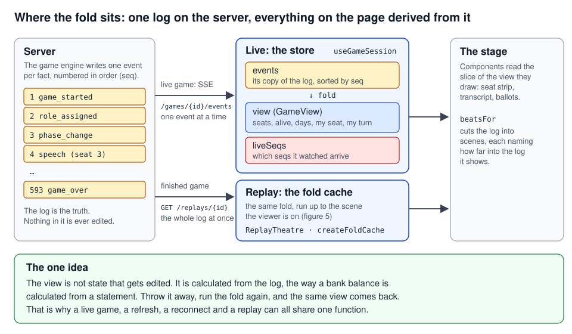
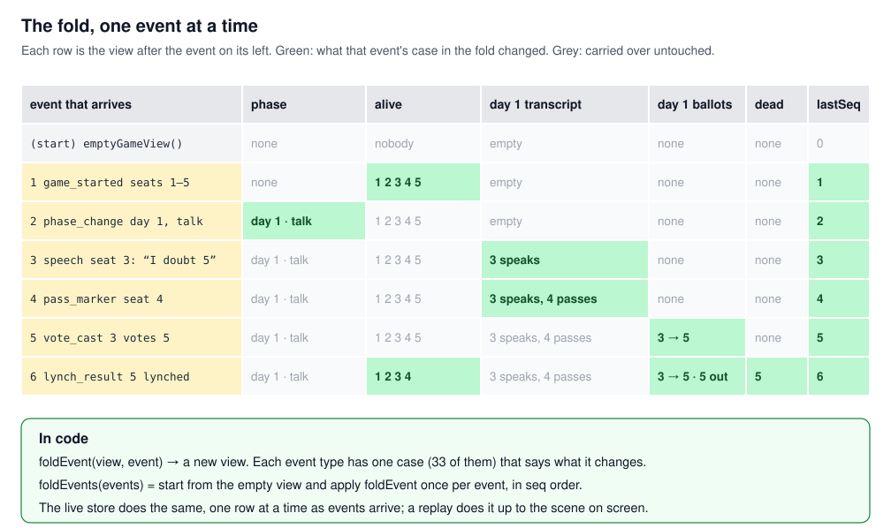
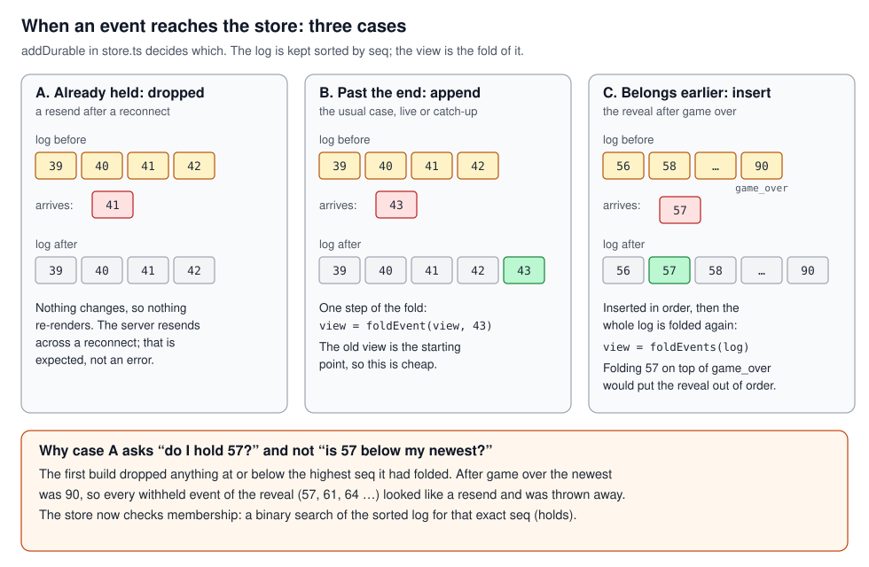
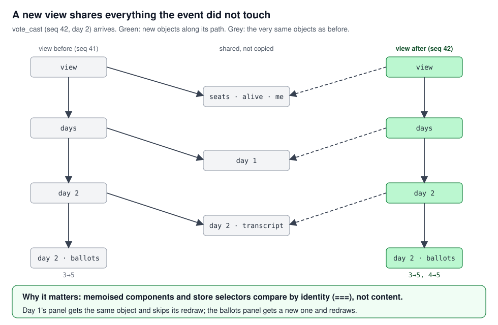
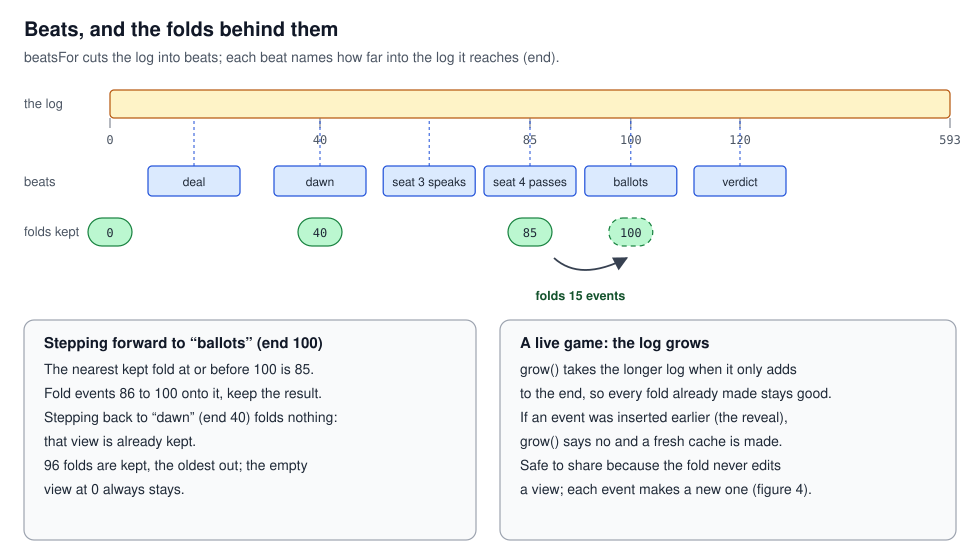
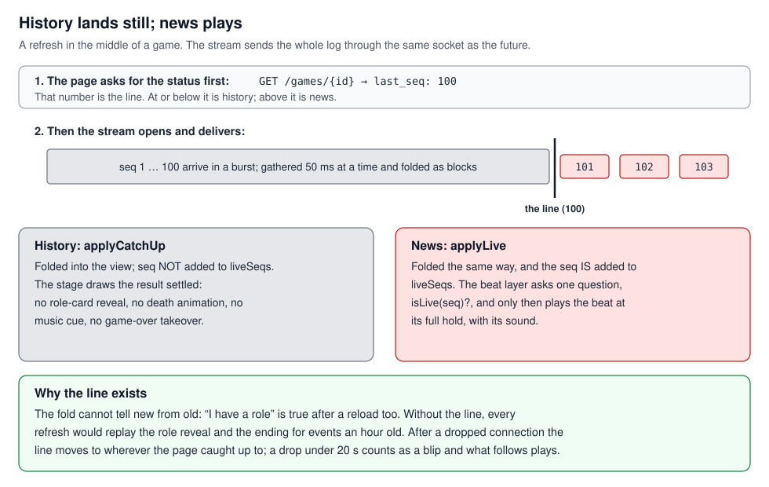
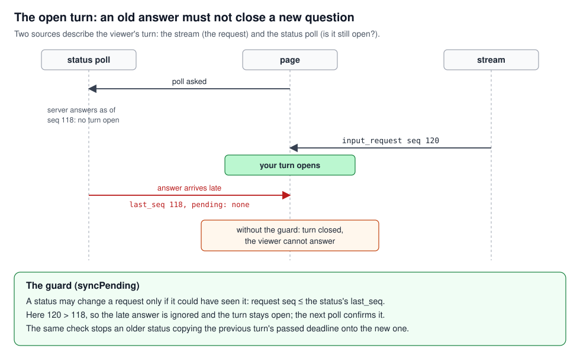

# The browser's half of the game: a design record

The game server streams a game to the page as small typed events, decides per event who may receive
it, and lets a client resume from where it left off. That half is [`server_client_transport.md`](../server_client_transport.md).
This record is the other half: what the page does with the events it receives. It follows one game
through the page, from the first event to the reveal at the end, and at each step says what was
decided, why, what went wrong on the way, and which test now holds it.

Status: written 2026-10-26 from the code at HEAD. Rulings are dated in place. Code paths are
relative to `frontend/`; server paths to the repository root. The owner wrote the event schema and
co-wrote the beat sheet; the browser code and its tests were built by AI agents to those specs and
rulings, and [`build_log.md`](../build_log.md) is the builder's own record of the build.

## 1. What the page receives, and what it keeps

A game reaches the page as a stream of events, each a complete fact ("seat 3 spoke", "seat 5 died
at night") with a per-game sequence number. The page keeps three things: the events, in order; one
**view** of the game folded from them; and a note of which events it watched arrive.

The **fold** is one pure function. Give it a list of events, it returns the view: who is seated,
who is alive, what each day's transcript holds, whose turn is open. It has a case for every one of
the 33 event types and two rules written at its head. It never decides what the viewer may see: it
renders whatever arrived (§4). And it does not know whether an event is news or history, which is
what lets a replay being scrubbed and a live game being refreshed run through the same code.

Because the view is a pure function of the log, it is disposable. Throw it away, fold again, get it
back. The store leans on that. When events arrive past the end of the log, it folds on from the
current view. When one arrives that belongs earlier, it inserts it in order and folds the whole log
again. When the page learns which seat it is, it folds again too, because "my role" and "am I alive"
depend on the seat. "Who am I" is always told to the fold, never inferred from the events: a replay
carries every seat's role card, so guessing from the cards would make the viewer whichever seat was
dealt last.

Three facts were learned by folding a real 593-event game before any code depended on it, which the
builder did on 2026-08-21 (build_log §2):

- A day's transcript is a list of **slots**, not speeches. One counter is shared by speeches, passes
  and the narrator's lines, and 18 of that game's 149 agent annotations attach to passes. A model
  built on speeches would have dropped every reason an agent gave for staying silent, which is the
  content the reveal exists to show.
- Nights belong to the day before them, and not every day has every phase. Day 1 of that game went
  straight to night; nobody spoke, so there was no vote.
- A seat's own role card is not observer data. The first build filed every card into the reveal's
  role map, so a live seat got a "reveal" holding only its own card.

**Why a store at all, and why this one.** Every stream event writes the session while dozens of
components read it. A plain React context would re-render all of them on every event; the store
lets each component subscribe to the slice it draws. The planned "one store per open game" became
one store, reset and hydrated per game. The plan's sketch of the view was refined in the building,
as it said it would be.

| Where it lives | |
|---|---|
| The fold and the view | `src/game/foldEvents.ts::foldEvents`, `src/game/types.ts::GameView`, `FoldOptions.mySeat` |
| The store | `src/game/store.ts::useGameSession`; `addDurable` (append, insert or drop), `setMySeat` (the re-fold), `liveSeqs` |

| What went wrong | The fix | What pins it |
|---|---|---|
| Annotations modelled as decorations on speeches | A day is slots; annotations join by slot number | `foldEvents.test.ts`, "annotates PASSES as well as speeches" |
| A seat's own card filed into the reveal's role map | The map comes from observer-tier data only | "a seated wolf sees its own card but no observer role map" |
| The viewer guessed from the role cards | The seat is an input from the status | "never guesses 'me' from role_assigned" |

## 2. What the viewer sees

The viewer does not see the view. They see **beats**: one step of the stage at a time ("voting
opens", "a chip is counted", "seat 4 rises to speak"), each shown for a **hold**, a few seconds set
by what it shows. The beats are cut from the event log by a second pure function. Each beat names
how far into the log it reaches, and those reaches never shrink, so seeking forward only ever
reveals more. A scene then renders from five inputs and nothing else: the view folded up to the
beat's reach, the beat, who the viewer is, and how they have arranged the stage (which pane is open,
the speed, the reveal switch).

That is why one renderer serves three surfaces. The replay steps a cursor through a finished log.
The live game grows the log and moves the cursor behind a queue. The landing's preview is the replay
in miniature, looping one stretch. The rules for moving the cursor are two pure reducers with no
timers, one for live and one for replay, so a test can feed a game in one event at a time; the
theatre components run the clock. Folding a prefix for every beat would be wasteful, so each fold is
kept by where it stopped (96 kept) and the next starts from the nearest one before it; for a live
game the cache grows with the log instead of starting over.

The live stage paces itself by rules (owner, 2026-10-01 to 2026-10-15), and they all follow from one
sentence in the timing sheet: the human's turn is the tempo, and where there is no human turn the
stage reads or jumps, never hurries.

- History lands still; news plays at its normal hold, however many beats are queued. The stage
  therefore runs behind the server by design, and catches up whenever the engine waits for a person.
- A solo prompt waits for the stage to reach it. A room's prompt, which has a clock running, cuts
  the beat on stage short once (2026-10-12).
- For the seat's own turn only, when more than 30 seconds of reading is queued before it, the stage
  lands still just before the turn (2026-10-15). The general jump for any long queue is designed and
  not built.

The beat sheet is the truth for what the stage shows: change the table, change the code, regenerate
the golden, in that order. The goldens dump the public and reveal beat lists of two archived games.
The v1 theatre, which had its own cutter and separate live components, was replaced rather than kept
behind a flag; it lives at the tag `theater-v1-baseline`.

The cost of recutting the live beat list on every event is that the stage cannot hold its place by
index. It holds it by which beat it was on, and equal beats keep their old identity so memoised
scenes do not redraw.

| Where it lives | |
|---|---|
| The beats | `src/stage/beats/beatsFor.ts::beatsFor`; goldens in `src/stage/beats/__goldens__/` |
| The cursor | `src/stage/containers/live-state.ts::liveReducer` (its head lists the pacing rules; `TURN_JUMP_MS`, `keepSame`), `replay-state.ts` |
| The folds | `src/stage/containers/fold-cache.ts::createFoldCache`, `grow` |
| The scene's inputs | [`stage_architecture.md`](../stage_architecture.md) §2 |

| What went wrong | The fix | What pins it |
|---|---|---|
| The ballot opened while the stage still played twenty passes (solo game 403f4dbc, found by the owner, 2026-10-12): the vote was cut where the server's request sat, before its announcement | A prompt goes after its announcement; a solo prompt waits; a run of passes is one beat | `live-state.test.ts`, "the ballot, asked before the vote opens, waits for the day's passes and the opening"; two goldens |
| Every arriving event rebuilt every fold, so nothing memoised held (lesson 35) | The cache grows with the log | `fold-cache.ts` |
| A room's clock ran out while the stage read toward the turn (multiplayer audit, finding 10) | The turn jump | "a stage further behind its turn than TURN_JUMP_MS lands still before it" |

**Dated note.** The plan made the URL the source of truth for the replay's position
(`?day=3&seq=214`, for shareable links). The stage replaced the scrubber on 2026-09-25 and that was
never built; the replay page reads only `from` and `still` from its URL.

## 3. When the page was not watching

The stream sends history through the same socket as the future. An hour-old role deal arrives
exactly as a fresh one would, and "is this new?" cannot be read from the view, because "we have a
role" is also true after a reload. So the page draws a line, and everything up to it is history,
which lands still, and everything past it is news, which plays. Ruled binding on 2026-08-21: beats
fire on live arrival only.

**A first visit, or a refresh.** The page asks for the game's status first, then opens the stream.
The status says the newest event this viewer may see, and the line is drawn there. The stream then
delivers the whole filtered log, silently, in blocks: frames that arrive together are gathered for
50 milliseconds and folded as one. On a 200-event rejoin on a dev build that was 7 renders instead
of 100, and 2.5 seconds instead of 6.3. The status is always asked again when the page mounts and
not used until this visit's answer is in, because a status served from the query cache is a snapshot
of an earlier moment, and a viewer who came back within its freshness window used to see everything
since play as news.

**A dropped connection.** From the drop until a fresh status after the reopen, everything is
history. A drop under 20 seconds is treated as a blip and what follows plays as news (2026-10-17),
after the owner saw a one-second drop open the "you were away" notice. Reopening is the page's job,
not the browser's: the browser's own retry backs off, and a phone back from a two-minute sleep sat
waiting on it (2026-10-11). The page reopens at once when it is shown again or comes back online,
and a watch reopens a stream that has been silent for 40 seconds or that the browser closed for
good; the server pings every 15 seconds so that silence means something. Each tab remembers the
newest event it saw live, so after a reopen it can say what went by while the viewer was away. The
words of that notice were ruled on 2026-10-11, after a seat was killed during a two-minute drop and
nothing on the page said so.

**The reveal at game over.** The server sends the ending first, then every observer event it had
withheld during play, in their original order. Those events carry lower sequence numbers than the
ending but are new to this viewer. This is why the store deduplicates by membership (does the log
already hold this sequence number?) and not by the highest number seen: the first build used a
high-water mark, folding the ending raised it, and the whole reveal was dropped as duplicates. The
live queue holds the winners' stand until the roles have landed.

**The open turn.** A turn request owns the shape of the form; the status's list of pending seats
owns whether the turn is still open. A status may change a request only if it could have seen it,
that is, only when the request's sequence number is at or below the status's own. Otherwise a status
asked before a new turn and answered after it would clear the turn, or copy the previous turn's
passed deadline onto it, which happened on back-to-back pack lines.

The status poll (every 3 seconds while a room waits, every 12 while the game runs) is also the only
thing that detects a dead game task, which sends no stream signal at all.

**Alternatives considered.** Sending the current state instead of the missed events was rejected on
the server side (transport §7): the state holds every secret and would need a second filter. A
silent reconnect was the v1 rule and the owner overruled it. Leaving reconnection to the browser was
the 2026-08-20 plan.

**The trade-off accepted.** During a drop, every event is history, so a death or an open turn that
arrives then lands still, and the notice is how the viewer learns of it. The stream's event ids
carry the global sequence number, so the gaps between the ids a viewer receives count the hidden
events between them; the owner held this because reconnects resume from those ids.

| Where it lives | |
|---|---|
| The line, the blocks, the blip, the watch | `src/hooks/catch-up-boundary.ts`: `catchUpBoundary`, `catchUpBatch`, `briefDrop`, `streamStalled`, `STREAM_SILENT_MS` |
| The stream and the status | `src/hooks/useGameStream.ts` (`reopenNow`; `refetchOnMount: 'always'`) |
| The store's side | `store.ts::applyCatchUp`, `applyLive`, `addDurable`, `syncPending` |
| The notice | `src/lib/storage.ts::liveSeen`, `awayTold`; `live-state.ts::missedEvents`; words in [`ux_journeys.md`](../ux_journeys.md) D23 |

| What went wrong | The fix | What pins it |
|---|---|---|
| Every refresh would have replayed the role reveal and the ending (build_log §3.2) | The line drawn from the status | `store.test.ts`, "marks NOTHING live on hydrate"; `catch-up-boundary.test.ts`, "on the first connection, history is everything up to the status's last seq" |
| The live reveal threw away its own backlog (§3.8, found by an independent review) | Dedupe by membership | "absorbs the exact R7 order: game_over first, then unseen lower-seq backlog" |
| An answered turn stayed actionable; a stale status cleared a new one (§3.9) | Request owns the form, status owns whether it is current, guarded by sequence | "lets status clear a historical request and refresh its live deadline"; "does not let an older status response erase a newer SSE request" |
| An older status gave a new turn the old deadline (audit finding 8) | The same guard on the deadline | "does not let an older status response give a newer request its passed deadline" |
| A cached status made a return play as news (finding 9) | Always refetch on mount | No unit test; the query options |
| A dead stream went unnoticed (finding 7) | The watch and the named ping | "a stalled stream" |
| A one-second drop opened the notice (owner, 2026-10-17) | The blip rule | "a drop under 20 s is a blip; longer is an absence" |

**Dated note.** The plan's error handling (ignore errors while hidden, otherwise close and surface)
was replaced on 2026-10-11, 2026-10-15 and 2026-10-17 by the reopen, the watch, the blip rule and
the connection pill. The first connection now asks for the whole log; only the page's own reopen
carries a cursor. The hook's head comment still shows the planned URL.

## 4. What the page may show

The security boundary is what the server sends, per connection, per event (transport §5, §6). The
page's rule follows from that: it renders everything it received, arranged for the viewer, and it is
never a permission system. The view's flag for observer data means "arrived", not "allowed". A
wolf's screen differs from a villager's only in which sections have content.

The reveal switch is arrangement. In a replay it re-cuts the beats, and it is disabled when the log
holds no observer data. Live, after game over, every viewer is entitled to the observer events, but
the page shows the reveal only once the stage has reached the first ending beat, so a viewer whose
stage is still in the last night is not spoiled. That is the page's one lock, and it guards against
spoilers only.

Two more rules came with the ten-seat cast (2026-10-10 and 2026-10-11). A concealed body stays
concealed on every surface but the reveal: the wire's empty role becomes "unknown" in the view, so no
screen prints a blank. And the night's progress bar counts living seats, one unit each, computed the
same way on the server and the stage, so the bar cannot show which roles still have uses left.

The first build got this wrong in the direction of hiding. The wolf channel rendered only with the
reveal switch on, which a live wolf cannot turn on, and private results had no renderer at all: the
server delivered what the seat was entitled to and the page hid it. "The reveal" had become a client
gate by accident. The audit of 2026-10-15 found the opposite error on the server: a public status
counter that ticked once per night action, so a spectator polling it could count the night actors.
The page needed nothing for that fix, because it only ever receives its own events.

What the page cannot do is prove any of this. The browser suite runs against a mocked API, and the
live spec decides what a seat receives from its own copy of the server's entitlement table, so a
tier change on the server passes the browser tests. The night's length still shows that a human
night actor is choosing; the owner accepted that.

| Where it lives | |
|---|---|
| Never gate; "arrived" not "allowed" | `foldEvents.ts` head; `types.ts::XrayView.available` |
| The ending's lock | `live-state.ts::seesXray` |
| The bar | `server/game/pacing.py`; the stage's `nightUnits` |

| What went wrong | The fix | What pins it |
|---|---|---|
| Faction and private data delivered and hidden (build_log §3.10) | Live renders all entitled data; the switch arranges a replay | `drawer-lines.test.ts`, "gives a seated investigator its own reading as an Only-you line", "gives a seated wolf the pack's chat"; `beatsFor.test.ts`, "keeps private results out of the public replay and in the X-ray" |
| A public counter leaked the night's progress (audit finding 1) | Server-side: the status counts only what the viewer may see | Server test |

## 5. Who the page is

There are no accounts. A seat is a random token minted when the seat is claimed. It travels as an
HttpOnly cookie, because a browser attaches cookies to the stream automatically and `EventSource`
cannot set a header (transport §6b). Every request is sent with credentials, and the API is
same-origin in production because the cookie is same-site.

A cookie dies with cleared data or a new browser session, so the join response also hands the token
to the page once, and the page keeps a copy in local storage, a different lifecycle that usually
survives what kills the other. Recovery is a reclaim door: one rejoin call re-proves the seat and
re-sets the cookie. The hard part was the trigger. The status endpoint is public, so a lost cookie
does not make it fail; it answers "you are nobody". The page rejoins when the status says nobody,
the game is past its waiting room, and this device holds a token for it. A refused turn does the
same, once, and retries the unchanged answer.

Two refinements came from use. A rejoin restored the cookie but not the stream: an open stream keeps
the credential it began with, so the status said "you are seat 4" while role and turn events kept
arriving on the public tier. The stream's lifetime is now keyed to the seat as well as the game;
when a rejoin resolves the seat, the anonymous stream closes and a credentialed one catches up. And a
rejoin that failed for any reason used to forget the token, including a network blip or a server
restarting, leaving the player a spectator. Since 2026-10-15 the token is forgotten only when the
server refuses it (403, 404, 410); on anything else it is kept and tried again after five seconds.

A lost send is retried after 2, 5 and 10 seconds, and a retry that lands on an answer already taken
gets a 409, which the page reads as answered (2026-10-17). In the waiting room the creator keeps a
separate host key for departing, locking and closing; a second join from a browser already aboard
gets its own seat back.

With both copies gone, on a new device, the seat is orphaned and its agent plays it: an orphaned seat
and an absent player are the same failure mode (`seat_continuity.md`). That convergence is why the
demo needs no accounts. The price is that the local copy is readable by page script, unlike the
cookie.

| Where it lives | |
|---|---|
| Credentials on every request | `src/lib/request.ts::requestWithHeaders`; the stream's `withCredentials` |
| The trigger and the retry | `app/games/[gameId]/_components/GameClient.tsx`; `src/stage/containers/LiveTheatre.tsx::asSeat`, `postTurn` |
| Forgetting | `request.ts::ApiError.refusesToken` |
| The stream following the seat | `useGameStream`'s effect, keyed on the status's `you` |

| What went wrong | The fix | What pins it |
|---|---|---|
| Recovery wired to a failed status request, which never fails (build_log §3.1) | The trigger above | Driven against the real API; no unit test drives the effect |
| Rejoin restored the cookie but not the stream (§3.11) | The stream keyed to the seat | No unit test on the hook |
| Coming back to your own room made a second passenger (§3.13, found by the owner) | A browser aboard gets its seat back | Server tests |
| A network blip during a rejoin cost the seat (audit finding 11) | Forget only on a refusal | `request.test.ts`, "is one the server will never take, not a failure that says nothing about it" |

## 6. What stays on the device

Twelve keys, and the server reads none of them. Ten are named in one module whose accessors survive
disabled or full storage; two live outside it, which breaks the plan's "one module owns the key
names". "Local" is `localStorage`; "tab" is `sessionStorage`, gone with the tab.

| Key | Where | Holds | Cleared |
|---|---|---|---|
| `seat_{gameId}` | local | The seat token's copy | Leaving a room, the host closing it, or a refusal; kept after the game, so the device can list the games it played |
| `host_{gameId}` | local | The room creator's host key | After Depart succeeds, or the room closes |
| `byok_key:{provider}` | local | A player's own API key, one per company, opt-in only (2026-10-21; the old single slot is migrated) | The clear button |
| `ghost_{gameId}` | local | Ghost-mode guesses; nothing reads or writes it today | Never |
| `notes_{gameId}` | local | The seated player's notes on each seat (in the case file since 2026-10-18); sent only with a draft when the player ticks it | Never |
| `music` | local | On or off | Never |
| `live_{gameId}` | tab | The newest event this tab saw live | With the tab |
| `away_{gameId}` | tab | The last event the "You're back" notice told | With the tab |
| `depart_{gameId}` | tab | A solo game's departure: puppet and time; ignored after 60 s | Once the train has left |
| `ninth-express:home-screen-tip` | local | How many times the "add to Home Screen" line showed | Never |
| `music-bench-keep` | local | The music workbench's kept takes | Never |

Where it lives: `src/lib/storage.ts::KEYS`; `src/stage/HomeScreenTip.tsx`;
`app/workbench/music/_components/MusicBench.tsx`. Against the plan's table: the death-only notice key
was folded into "You're back" on 2026-10-11, whose two tab keys the plan lacked; the plan cleared the
seat token when a game finished, and the code keeps it.

## 7. How the page knows the shapes

Python on one side, TypeScript on the other, and a union of 33 event types that grows with the game.
A silent mismatch shows up weeks later as a blank panel. The contract has one definition, the
Pydantic schema the owner wrote, and everything downstream is generated from it or tested against it
(transport §10). On the client: a script dumps the server's OpenAPI document into the repo and
generates TypeScript from it; a hand-written façade is the only contracts module app code imports,
and it aliases and narrows, never redefines, so a regenerated file breaks it at compile time rather
than at runtime; the event union is derived from the replay route's response, so the server owns its
membership. A server-side test fails when the committed document and the live server disagree.

Two things sit outside that. The turn body has no schema: the route takes a dictionary and the
engine validates it, so the client's four payload shapes were read out of the engine's source. One
consequence is visible to players: the request carries no "may pass" flag, so Pass is offered on
every discussion turn and the server's own refusal is shown in its words. And the pacing frame is
hand-transcribed, because it is stream-only and never reaches the OpenAPI document.

**Alternatives considered.** Hand-written interfaces; runtime validation on the client (skipped,
since the server already validates); generating from a running server (the plan, replaced by the
committed document).

**The trade-off accepted.** Every build carries the whole union, so a villager's bundle knows the
shape of a wolf message it never receives; privacy is what the server sends, not what the client
was compiled with. The turn body stays a dictionary because the engine's validation is the
contract, which leaves one place the client cannot check before sending.

| Where it lives | |
|---|---|
| The pipeline | `package.json` `generate-api-types`; `src/types/contracts/openapi.json`, `api.ts`, `index.ts` (the façade) |
| The drift test | `tests/server/test_openapi_snapshot.py::test_saved_openapi_matches_the_server` |
| The turn body | `server/routes/games.py::submit_turn`; `src/lib/api.ts::TurnPayload`; `Agents/turn/human_turn.py::validate_human_response` |
| An unknown event type | the fold's `default` case records it in `GameView.droppedEventTypes` |

| What went wrong | The fix | What pins it |
|---|---|---|
| Six contract facts no document stated (build_log §2): slots, nights, absent phases, no pass flag, the untyped body, the stream's frame names | Read out of a real game and written at the call sites | `foldEvents.test.ts` on the fixture, "drops nothing it was not told to drop" |
| The countdown needed the server's clock (§3.12) | `server_time` became a required generated field | The generated types |

**Dated notes.** The façade's comment says the union "is 27 members"; it is 33. It also says a new
type makes the fold's switch fail to compile; it does not, because the switch has a default case.

## What is not established

- There is no CI. Every test named here runs only when a person or an agent runs it.
- The stream hook and the seat-recovery effect have no unit tests; their pure parts do.
- The browser suite never meets the server. The API is mocked, and the live spec's tier table is a
  hand copy of the server's.
- A new event type does not fail the build; it lands in a field only the fixture test reads.
- The server can reuse a sequence number across a restart (audit finding 12, accepted). The store
  deduplicates by membership, so a different event under a number the page holds would be dropped.
- No real multi-human game has been measured; the audit was two read-only scans.
- The cost of a full re-fold is not measured. The phone numbers behind §2's structure are one phone's,
  one session (build_log §8).

## Glossary

| Term | Meaning |
|---|---|
| beat | One step of what the stage shows, cut from the event log; the beat sheet lists every one |
| hold | How long a beat stays on the stage at normal speed |
| tier | An event's audience: public, faction (the pack), seat (one player), observer (nobody until game over) |
| the dock | The seated human's controls for a turn |
| the strip | The band across the top of the stage: the reveal switch, the tabs, the door out |
| the fold | The pure function from the event log to the view; also the view it returns |
| the reveal (the X-ray in code and older docs) | The observer-tier reading of a game: every role, the agents' reasons, the private night acts |
| the bar | The count of a vote or night in progress, fed by the server's pacing frames |
| seat token | The random secret proving a browser holds a seat: an HttpOnly cookie with a copy in local storage |
| park | The server leaving a human seat's question waiting with nobody connected |

## Sources

`server_client_transport.md` §3, §5 to §7, §10; `build_plan.md` §4, §5; `build_log.md` §2, §3, §4,
§8; `stage_architecture.md` §2, §8, §10; `ux_journeys.md` §0, D22, D23; `beat_sheet.md` §0, §11 to
§13; `live_timing_sheet.md`; `multiplayer-audit-2026-10-15.md`; `ten_seat_pass.md` §1, §10, §11;
`frontend_lessons.md` 32, 35. The code named in each section's table.
