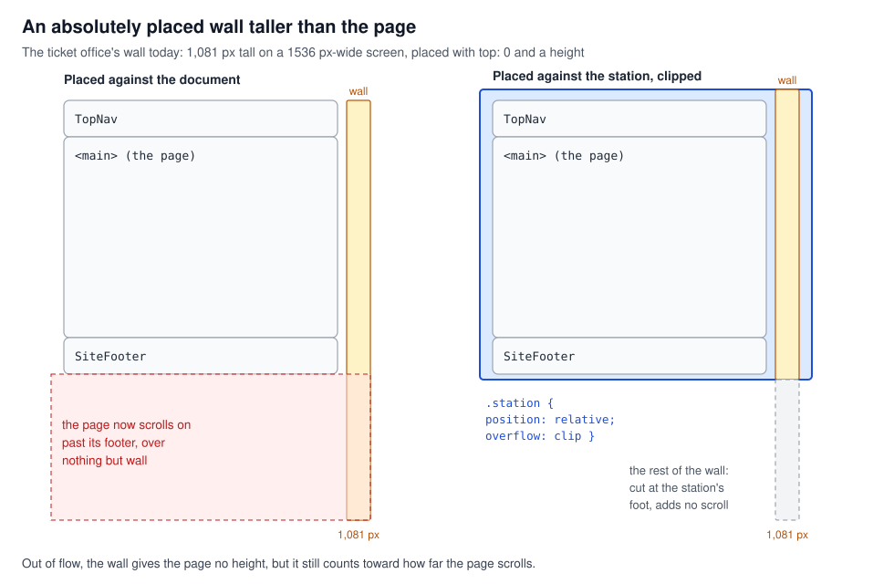
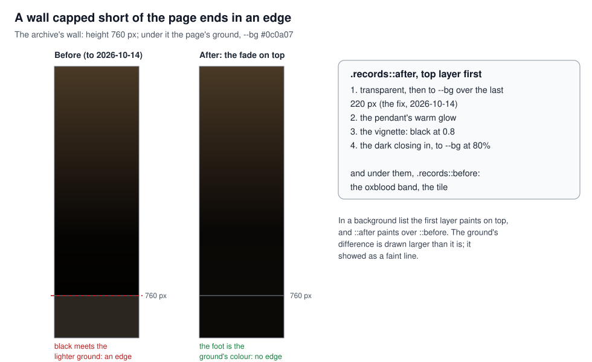
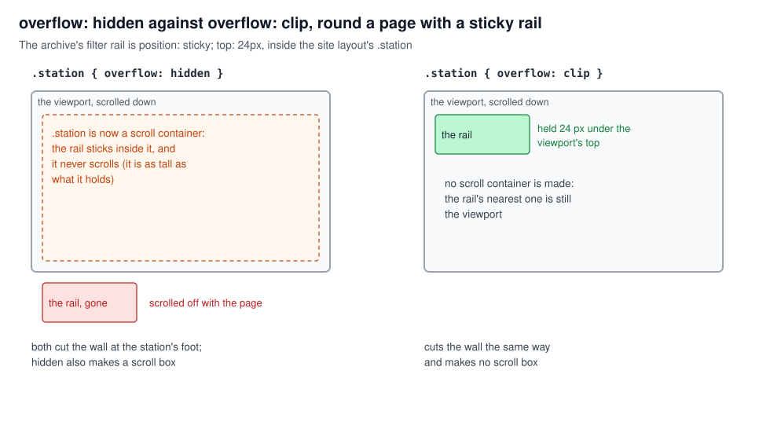
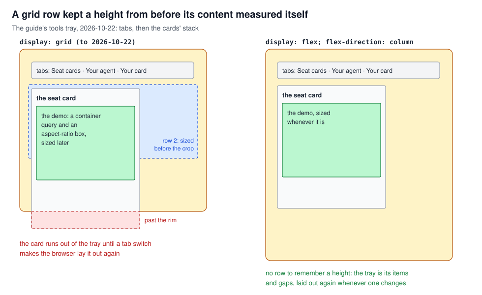
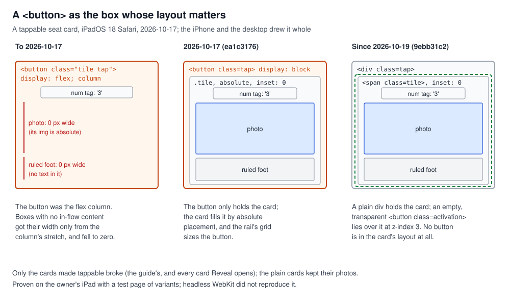

# CSS layout facts that cost an afternoon

## What this teaches, and what you need first

Five CSS layout facts, each of which cost the site's builders an afternoon. The cases are the
"small things" S2, S7, S8, S14, S17 and S23 in [`frontend_lessons.md`](../../frontend_lessons.md).
This tutorial stands alone: you need only know what a CSS rule and a class are. The small things
about paint order and clips (S13, S15, S20) are in
[`rendering_pipeline.md`](../rendering_pipeline/rendering_pipeline.md).

Two words used throughout:

- **Box**: the rectangle the browser lays out for an element.
- **Normal flow**: the default layout, where blocks stack down the page and a parent is as tall as
  the children stacked inside it.

---

## 1. A CSS module turns a class name into one class

A **CSS module** is a file named `X.module.css`. At build time each class name in it is renamed to
a name unique to that file, and the component imports the mapping: `styles.head` is the generated
name for `.head`. That stops two files from clashing. It does nothing inside one file: every rule in
the file that names `.head` targets the same generated class, so all of them apply to every element
that has it. Where two rules set the same property, the later one wins.

### In this project

**S2, a header became a playhead.** While the music bench (`/workbench/music`, committed
2026-10-15) was built, the file held a `.head` for the page's header and another `.head` for a 2 px
playhead further down. They were one class, so the header took the playhead's rules and became a
2 px absolutely placed strip. The committed
`src/app/workbench/music/_components/MusicBench.module.css` names the second part `.playhead`
(`position: absolute; top: 0; bottom: 0; width: 2px`), and the header keeps `.head`.

### See it yourself

On `/workbench/music`, DevTools, Elements: select the header. Its `class` is one generated name,
and the Styles pane lists every rule in the file that targets it.

### The rule

Name each part for what it is; inside one module, one name is one class.

---

## 2. Out of flow: what an absolute box is placed against, and what it lengthens

`position: absolute` takes a box **out of flow**: it gives its parent no height and is placed by
`top`, `right`, `bottom` and `left` against its **containing block**. That is the nearest ancestor
whose `position` is not `static` (`relative`, `absolute`, `fixed` or `sticky`). With no such
ancestor it is a viewport-sized rectangle at the top of the page. `top: 0; bottom: 0` makes the box
as tall as its containing block; `top: 0; height: 760px` makes it 760 px whatever the
block's size.

Out of flow is not ignored: the page's scrollable area grows to take in every box past its end,
absolute ones included, unless an ancestor clips them (section 3).

A **stacking context** (made by `isolation: isolate`, among others) decides what a box paints
above and below, not where it is placed.

### In this project

**The walls.** Each site page has a station wall behind it,
`src/components/site/StationWall.tsx::StationWall`. Its box, `StationWall.module.css` `.wall`, is
`position: absolute; top: 0; bottom: 0; left: 0; right: 0; z-index: -1`. The page's `<main>` takes
`wallPage` (`isolation: isolate`), so the wall paints above the body's ground and below the page's
content. But `<main>` is not positioned, so the wall is *placed* against the next positioned
ancestor: the site layout's `.station` (`src/app/(site)/layout.module.css`, `position: relative`).

Two walls are capped with a height instead of a bottom: the archive's (`.records`, 760 px) and the
ticket office's (`.granite`), which by its CSS is 1,081 px tall on a 1536 px-wide screen (computed,
not measured).

**S8, a wall that lengthened the page.** Absolutely placed, a wall taller than a short page made
the page scroll on past its footer, over nothing but wall. The fix, with the walls on 2026-10-14
(`1804868f`): the walls are placed against `.station`, which clips them at its foot (section 3).

**S7, a capped wall ends in an edge.** A `background` with several layers paints the first one
listed on top, and `::after` paints over `::before`. The archive's wall has its tile in
`.records::before` and its light in `.records::after`, including a black vignette
(`rgba(0, 0, 0, 0.8)`). Just above the cap was the vignette's near-black; just below, the page's
ground, `--bg` (`#0c0a07`), slightly lighter: a faint edge across the page. The fix (`181cb905`,
2026-10-14, then on the landing's latest-games wall) made the topmost layer a fade to `--bg`, so the
foot is the ground's own colour. Today it is the first layer of `.records::after`, over the last
220 px; `Rooms.module.css` `.navy::after` fades the landing's wall into `--bg` at both ends. Why cap
a wall at all is lesson 25: past the lamp's reach the ground looks the same and costs nothing.

### See it yourself

- On `/play` on a wide screen, DevTools: select the layout's outermost `div` (the `.station`), untick
  `overflow: clip` in Styles, and compare `document.documentElement.scrollHeight` before and after.
  Where the wall is taller than the page, it grows.
- On `/replays`, untick the first layer of `.records::after` in Styles and look at the wall's foot.

### The rule

Place an absolute box against a positioned ancestor you chose, and end anything painted short of
the page in the page's own colour.

---

## 3. Clip against hidden, and the root

`overflow: hidden` and `overflow: clip` both cut what runs past a box's edge. `hidden` also makes
the box a **scroll container**: it has a scroll position that script can move, though the user
cannot. `clip` makes no scroll container.

That matters for `position: sticky`. A sticky box sticks within its nearest ancestor scroll
container. Wrap a page in `overflow: hidden` and that wrapper becomes the scroll container; it
never scrolls, because it is as tall as what it holds, so nothing inside it sticks.

The root is a special case. `overflow` set on `<html>` is applied to the viewport, and the CSS
Overflow specification says a viewport given `clip` treats it as `hidden`. So the viewport is still
a scroll container, its `scrollWidth` still counts the overflow, and whether the user can reach it
is up to the browser.

### In this project

**S8's other half, clip and not hidden.** `.station` is `overflow: clip`, in its file's words "so
nothing scrolls inside it and sticky pieces still stick". Two sticky pieces sit inside it: the
guide's side list (`Guide.module.css` `.nav`) and the archive's filter rail
(`src/app/(site)/replays/_components/Archive.module.css` `.rail`). With `hidden` the walls would be
cut the same way and both would scroll off with the page.

**S14, `overflow-x: clip` on `html`.** The landing's wall and carriage span the screen, so
`src/app/(site)/_components/landing/Landing.module.css` sets
`:global(html):has(.landing) { overflow-x: clip }`. On a desktop nothing scrolled sideways; on an
iPad the page could still be panned, because the carriage's buffers reached 2 px past the window on
screens narrower than 1448 px. The fix (`fb94e0bf`, 2026-10-14) clips the wide element itself:
`Carriage.module.css` `.depot` has `overflow-x: clip`, on an ordinary element, where `clip` means
clip. Later that day `.station` came to clip every site page's sides too.

### See it yourself

- On `/replays`, change `.station`'s `overflow` to `hidden` in Styles and scroll: the filter rail
  leaves with the page.
- On the landing, in the console:
  `document.documentElement.scrollWidth - document.documentElement.clientWidth`. A positive number
  is sideways overflow the root only hides.

### The rule

Clip with `clip`, not `hidden`, unless you want a scroll box, and clip the wide element, not the
root.

---

## 4. How a grid row gets its height

A grid with no `grid-template-rows` makes rows as it needs them, each sized `auto`: as tall as its
tallest item when the grid is laid out. The row and the item are separate boxes; an item taller
than its row runs out of it, and the grid does not grow. When an item's content changes size, the
browser is meant to lay the grid out again. A flex column has no rows: its height is its items and
the gaps between them.

### In this project

**S17, a row that kept a stale height.** The guide's tools tray
(`src/app/(site)/_components/guide/ToolsTray.module.css` `.tray`) was a grid: a row of tabs, then a
row holding the cards. The seat card's demo sizes its crop with a container query (sizes taken from
the container's own size) and an `aspect-ratio` box. On 2026-10-22 the second row kept the card's
height from before the crop was sized, and the card ran out of the tray until a tab switch made the
browser lay it out again. Why was not established, nor which browser showed it. The tray is now a
flex column (`622789d0`). The tell: the item in a grid's row measures right
(`getBoundingClientRect`) and the grid wrong.

**Lesson 27, the layout-shift half: reserve the box.** A section that grows after load moves
everything below it, including an anchor jump's target in mid-flight: the guide's tools and case
file grew 50 to 430 px when their demos mounted. The guide reserves a tab set's box with a grid on
purpose: `Guide.module.css` `.stack` puts every panel in one cell (`grid-area: 1 / 1`), the idle
ones `visibility: hidden`, so the box is as tall as the tallest panel and a tab switch moves
nothing. When to defer a mount is
[`loading_and_deploy.md`](../loading_and_deploy/loading_and_deploy.md).

### See it yourself

- On `/guide`, click a "grid" badge in DevTools' Elements pane to draw the tracks and their sizes.
- `e2e/site.spec.ts`, "guide: no tab set moves the page, whichever tab is shown", measures each
  tab set's section, clicks every tab and expects the same height
  (`npx playwright test e2e/site.spec.ts -g "no tab set"` in `frontend/`).

### The rule

When a box's content sizes itself late, lay it out in a flex column or reserve its final size.

---

## 5. A button as a layout box

A box with nothing in flow inside it (no text, only absolutely placed children) has a content width
of zero. It gets a width only from outside: a block in normal flow fills its container, and a flex
item in a column is stretched to the column's width (`align-items: stretch`, the default). Laid out
any other way, it shrinks to its content: zero.

A `<button>` is a form control. Browsers lay its contents out partly by their own rules, in an
internal box CSS cannot address, and how fully they honour `display: flex` on the button itself has
been uneven across engines and versions.

### In this project

**S23, the seat cards on an iPad.** Until 2026-10-17 a tappable seat card was
`<button class="tile tap">` and a plain one `
`, with `.tile` a flex column
(`src/stage/instruments/Wing.module.css`). On the owner's iPad (iPadOS 18, Safari) every tappable
card lost its photo and its ruled foot; the iPhone and the desktop drew it whole. Those are the
card's parts with nothing in flow: the photo (`.picture`) has a height but no width and an
absolutely placed image; the foot is empty rules. Safari did not lay the button out as the flex
column its CSS asked for, so both fell to zero width. It hit every tappable card and no plain one,
so for two days it looked like a guide-only bug.

The fix (`ea1c3176`, 2026-10-17): the button only holds the card. `.tap` is a plain block, the card
(`.tile`) fills it with `position: absolute; inset: 0`, and the rail's grid sizes the button. Since
2026-10-19 (`9ebb31c2`) `.tap` is a `
` and the button an empty, transparent `.activation` laid
over the card (`position: absolute; inset: 0; z-index: 3`). No button is in the card's layout, and
making a card tappable no longer changes its element type, which would rebuild it
([`react_identity.md`](../react_identity/react_identity.md), section 1).

**The method note.** Headless WebKit did not reproduce this. The cause was proven on the owner's
iPad with a test page of variants: the same card drawn several ways, opened on the device, so the
variants that draw whole name the cause. That page was not committed.

### See it yourself

On `/guide`, select a seat card in the tools tray: the Elements pane shows `div` (`.tap`) holding a
`span` (`.tile`) and a `button` (`.activation`) beside it. The iPad fault itself can be seen only on
an iPad running iPadOS 18.

### The rule

Never make a `<button>` the box whose layout matters, and settle a device-only layout bug with a
page of variants on that device.

---

## Case index

| Case | Short | Section |
|---|---|---|
| S2 | Two rules, one class name | 1 |
| S7 | A capped wall ends in an edge | 2 |
| S8 | An absolute wall lengthens the page; `overflow: clip` | 2 and 3 |
| S14 | `overflow-x: clip` on `html` | 3 |
| S17 | A grid row keeps a stale height | 4 |
| S23 | A `<button>` as the layout box (iPadOS 18); a variant page on the device | 5 |
| 27 (its layout-shift half) | Reserve the box | 4 |

---

## If you are asked about it

"Each page of the site has a painted wall behind it, absolutely placed. An absolute box gives its
parent no height but still counts toward how far the page scrolls, so a wall taller than a short
page let it scroll past its footer. The agents building it placed the walls against one positioned
wrapper with `overflow: clip`, not hidden, because hidden makes a scroll container and the sticky
rails inside would stop sticking. The hardest one was on my iPad: tappable seat cards lost their
photos on iPadOS 18 only. The card was itself a `<button>` laid out as a flex column; Safari did not
honour that, and the parts with no in-flow content fell to zero width. Headless WebKit could not
reproduce it, so we settled it with a page of variants I opened on the device. Now a div holds the
card and a transparent button lies over it."

---

## Reading

This topic has no list in principles.md. Primary sources:

- MDN: "Containing block"; "position" (the `absolute` and `sticky` values); "overflow" (the `clip`
  value against `hidden`); "Using multiple backgrounds" (the first layer is on top);
  "Basic concepts of grid layout" and "grid-auto-rows"; "aspect-ratio".
- CSS Overflow Module Level 3, "Overflow Viewport Propagation" (why `clip` on the root acts as
  `hidden`).
- Next.js: "CSS Modules".
