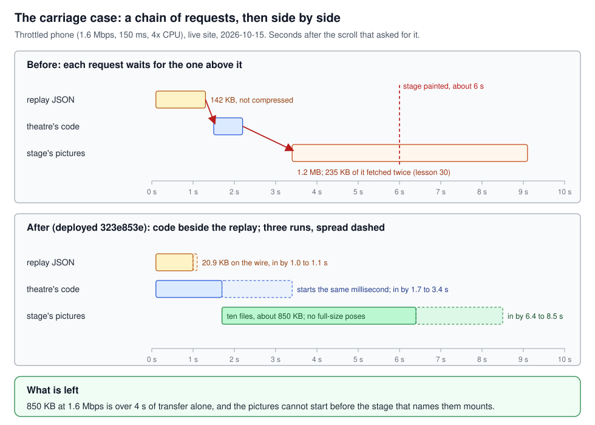
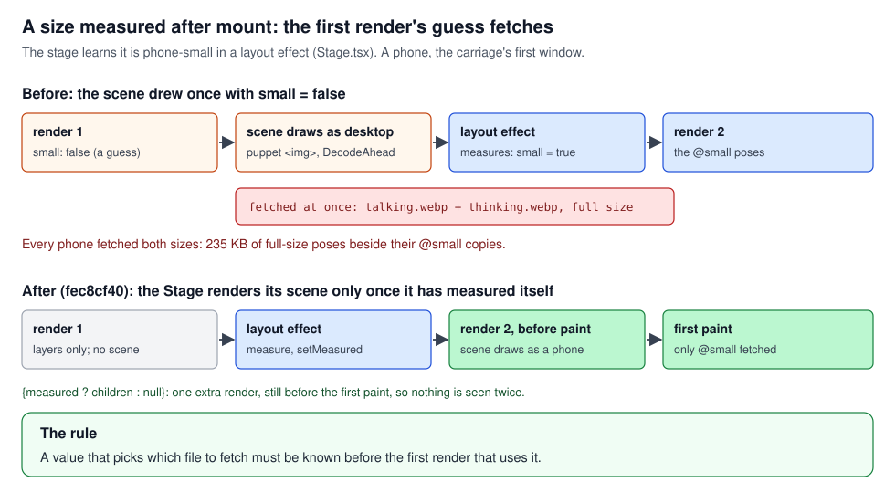
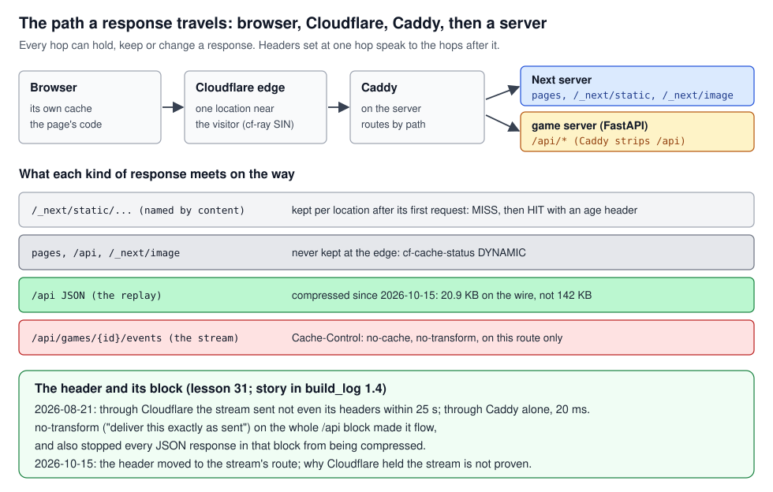
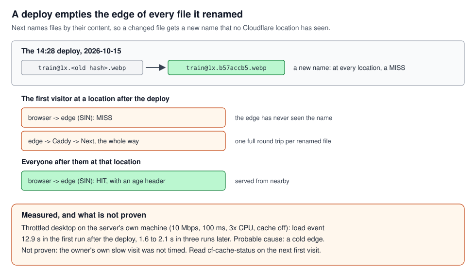
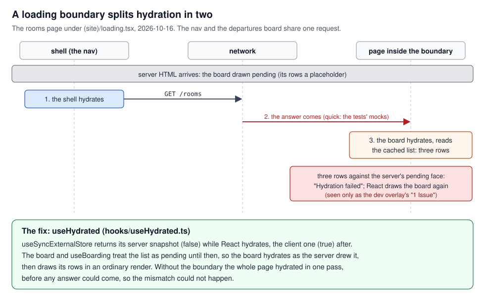
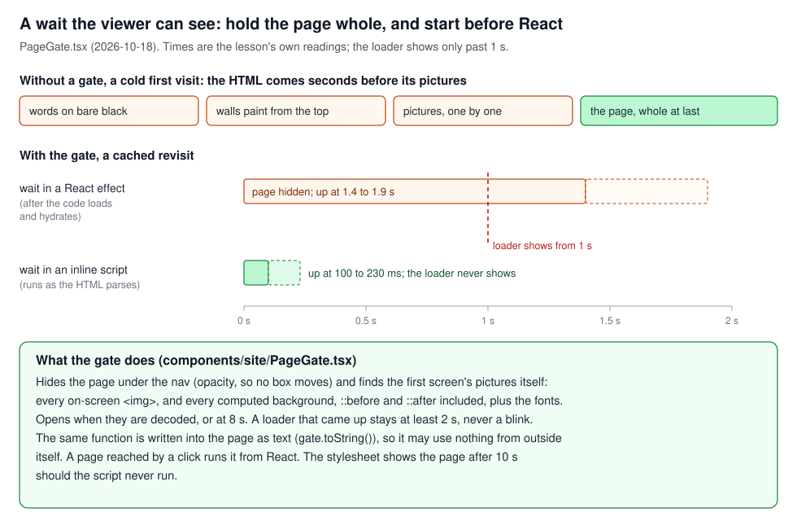

# Loading, hydration and deploys

## What this teaches, and what you need first

What the browser fetches, in what order, through which hops, and what the viewer sees while it
waits, up to React taking over the server's HTML. The worked example through the middle is the
landing's carriage on 2026-10-15, which took about 6 s to paint on a throttled phone for three
reasons, none of them the size of the game it plays.

You need [`react_identity.md`](../react_identity/react_identity.md) (render and commit, effects
and layout effects, server and client components) and
[`rendering_pipeline.md`](../rendering_pipeline/rendering_pipeline.md) (what a paint is, and what
a layer costs). This tutorial builds on both.

Words used throughout:

- **Bundle** and **chunk**: the build turns the app's source into JavaScript files the browser
  downloads. A chunk is one such file; a page loads the chunks it needs.
- **Dynamic import**: `import('./X')` called as a function. It downloads the module's chunk when
  the call runs and returns a promise of the module. `next/dynamic` wraps it as a component.
- **Origin**, **CDN**, **edge**, **header**: section 4. **Hydration**: section 5.
- **The carriage**: the landing's railway carriage, whose window plays a reel of an archived game:
  the replay theatre in its mini mode
  (`src/app/(site)/_components/landing/FeaturedReplay.tsx::FeaturedReplay`).

---

## 1. Code splitting, and when a chunk starts loading

`next/dynamic` moves a component's code out of the page's first load into a chunk of its own. That
decides *where* the code lives, not *when* it loads. The component `dynamic()` returns calls its
loader the first time it renders; until then nothing is fetched, and from then on, it is.

```jsx
const Theatre = dynamic(() => import('./Theatre'), { ssr: false });
{data ? <Theatre data={data} /> : null}   // the chunk is asked for only once data has come
```

So a component rendered only once its data arrive asks for its code only then: two requests in a
row where they could run side by side. Conversely, a dynamic component rendered at once loads at
once. (`ssr: false` means the server draws nothing in its place.) The cure for the chain is to
start the download yourself: the module system keeps one promise per module, so calling the same
`import()` early starts the request, and the later render picks up the promise under way.

Data and pictures follow the same logic: a query enabled at once fetches at once, and a picture is
requested when an element naming it is on the page. A part is deferred only if its mount, its data
and its pictures all wait (lesson 23).

### In this project

**Lesson 29b, the carriage's chain (2026-10-15).** The carriage was meant to start its code, its
replay and its pictures together. It rendered `ReplayTheatre` only once the replay had arrived, so
the three ran one after another. Measured on the live site with a throttled phone profile
(1.6 Mbps, 150 ms latency, CPU four times slower), seconds after the scroll that asked for it: the
replay JSON from 0.1 to 1.3 s, the theatre's code from 1.5 to 2.2 s, the stage's pictures from 3.4
to 9.1 s, the stage painted at about 6 s. A desktop on a fast line ran the same chain in 2 s, which
is why nobody had seen it.



The fix, `FeaturedReplay.tsx::theatreCode` (commit `a4411355`): one function holds the `import()`,
the `dynamic()` wrapper calls it, and the effect that enables the replay's query calls it too, so
the code request starts beside the replay's (7 ms after it, in the lesson's reading). The phone's
controls under the platform, `underCode`, are started the same way, on a phone only.

**Lesson 23, deferred only if everything waits.** The carriage's chunk, replay and pictures now
start together. The converse is in the guide: the case file's three demos are `next/dynamic`
components rendered unconditionally (`src/app/(site)/_components/guide/CaseFile.tsx`), so their
chunk loads with the page, deliberately (section 3).

**When the carriage starts, as of 2026-10-18.** Lesson 23 had it start when the carriage came
within a screen of the view (`useNear` in `FeaturedReplay.tsx`). Since the owner's ruling of
2026-10-18 it starts as soon as the page's first screen is up (`usePageOpen`, section 6), or when
it comes near, whichever is first: never compete with the first screen, and be ready before the
viewer arrives. The file's head comment still says nothing is fetched until the carriage is near.

**Still on the first load (the audit's follow-up, 2026-10-15, open).** Six preloaded stage fonts
(about 135 KB; deferred by the owner to the font change), the full Mantine stylesheet (33 KB
gzipped, render-blocking) and the blur placeholders in the asset manifest's chunk (about 32 KB).

### See it yourself

- DevTools, Network tab, cache disabled, a custom throttling profile of 1.6 Mbps and 150 ms, and
  the Performance tab's CPU set four times slower. Load `/` and read the waterfall: the replay's
  `/api/replays/<id>` request and the `ReplayTheatre` chunk should start in the same moment, after
  the hero's pictures. A request that starts only when another finishes is waiting on it. (No
  committed script produces the 2026-10-15 numbers.)
- The committed check is `e2e/site.spec.ts`, "landing preview ... loads once the first screen is
  up, before it is scrolled to": it counts the replay requests (exactly one) and the backdrop
  sheets' sizes.

### The rule

A dynamic component's code starts loading at its first render, so start the `import()` yourself
beside the data it waits for.

---

## 2. A value that picks a file must be known before the first render

A size measured from the DOM is known only after a commit: a layout effect reads it, sets state,
and React renders again before the browser paints, so the viewer sees only the second render. But
the first render's work still happened: an `` it rendered started downloading, and so did an
`Image()` made in an effect. A guess that picks a file is paid in bytes even when corrected unseen.

### In this project

**Lesson 30, the full-size poses on every phone.** The stage learns it is phone-small in a layout
effect (`src/stage/Stage.tsx::Stage`, which provides `SmallContext`), and the flag started as
`false`. The scenes rendered once as a desktop's before the re-render, which was enough for the
puppet's `priority` image and `DecodeAhead`'s `new Image()` to ask for the full-size poses. Every
phone fetched both sizes: in the carriage's first window, the full `talking.webp` and
`thinking.webp` (235 KB) beside their `@small` copies. Lesson 22 had fixed this for the backdrop
alone ([`memory_and_pictures.md`](../memory_and_pictures/memory_and_pictures.md)).



The fix (commit `fec8cf40`): the Stage sets `measured` in the layout effect that measures, and
renders its children only after (`{measured ? children : null}`). Its first render draws the empty
layers, the second the scene, both before the first paint, so every stage has the fix: live,
replay, the guide's demos, the carriage and the workbench.

### See it yourself

On `/` with a phone viewport (DevTools device toolbar, iPhone 13) and the cache disabled, filter
the Network tab on `talking`: only the `@small` file should appear. To see the old behaviour, set
`measured`'s initial state to `true` locally, reload, and watch both sizes arrive; then put it
back.

### The rule

A value that picks which file to fetch must be known before the first render that uses it, or that
render waits for it.

---

## 3. Deferring a mount, only into a box of its final size

Deferring a mount (rendering a part only near the view, or once its tab opens) saves its CPU and
requests at load, but its box may change size when it arrives. A part growing a screen away is
invisible while scrolling, yet it moves everything below it, including the target of an anchor link
the browser is scrolling to. So a deferred part needs a box already at its final size (a fixed
height, an aspect ratio, a same-size placeholder); without one, mount it at load.

### In this project

**Lesson 27, the guide's demos (2026-10-15).** The guide's eleven demo stages were all built on
load and kept a phone-speed CPU busy for about 9 s after it, so whatever the reader scrolled to
stuttered. Mounting them near the view was right for the day line, whose slot is a fixed height
(`DayLine.module.css`, `.live`), and wrong for the tools and the case file, which grew 50 to 430 px
when their demos arrived. Today `src/app/(site)/_components/guide/useNear.ts::useNear` (an
IntersectionObserver reaching one screen ahead) mounts only the day line's seven demos; the others
mount on load. Box sizing itself is [`css_layout.md`](../css_layout/css_layout.md)'s subject.

**The carriage holds its frame.** Lesson 23's other half: `FeaturedReplay` draws the carriage at
full size before anything loads, with the board's seven tiles blank, the details line a
non-breaking space and the phone's controls' room kept, so nothing moves when the game arrives, as
the 2026-10-11 audit (§2) asked. Its follow-up (2026-10-15) left open that the carriage never
unmounts once up.

### See it yourself

`e2e/site.spec.ts`, "guide: no tab set moves the page, whichever tab is shown", measures each tab
set's section and fails if a tab changes its height
(`npx playwright test e2e/site.spec.ts -g "no tab set"` in `frontend/`, dev server up). In the
browser: open `/guide`, jump to a section from the contents, and see whether it lands true.

### The rule

Defer a mount only into a box that already has its final size; otherwise mount at load.

---

## 4. The path a response travels, and what each hop does to it

A response from this site passes four places. The browser asks. Cloudflare, a **CDN** (a network
that keeps copies of responses at **edge** locations near visitors), answers from its copy or
passes the request on to the **origin**, the project's own machine. There Caddy routes by path
(`/api/*` to the game server with the prefix stripped, the rest to the Next server), and the
server makes the response. Each hop can keep a copy, compress the body, or hold the bytes back
until it has enough of them. **Headers**, lines of metadata on a request or response
(`Cache-Control: no-cache`), are how one hop tells the others what to do.



Two facts carry the cases here. A **compressor** works best on a run of text: a JSON body arrives
whole and compresses in one go, while a stream arrives a few bytes at a time, and a middleman that
wants a bigger piece to compress or to send may hold the small ones. And a **cache** at the edge
holds a file by its URL: Next names its built files by their content (`train@1x.b57accb5.webp`), so
an unchanged file keeps its name and a changed one gets a new name no location has seen.

### In this project

**Lesson 31, a header travels with its block.** The live game's event stream reached the browser
through Cloudflare so late that not even its headers arrived within 25 s, while through Caddy alone
the first frame came in 20 ms (build_log §1.4, 2026-08-21, the measurement that proved Caddy
innocent). The fix was `Cache-Control: no-cache, no-transform`, added by Caddy. `no-transform` asks
every middleman to deliver a response exactly as sent, and that includes not compressing it.
Because it was set on the whole `/api` block, every JSON response lost compression too: the replay
went out at 142 KB where gzip makes 21 KB. Since 2026-10-15 the header is on the stream's route
only (`/api/games/{id}/events`), and the rest of `/api` is compressed.

A dated correction to [build_log §1.4](../../build_log.md), which states the mechanism as fact
("transforming is what its buffering hangs off"): lesson 31 calls it a guess, since another
project's stream behind the same Cloudflare flows without the header. The header stays on the
stream because its events are tiny and a frozen-looking stream is the failure already seen once.
The lesson's test (send an opening event and heartbeats, then try without the header) is half
built: the server now pings as the stream opens and every 15 s (`server/routes/games.py`,
`_PING`), but no record says the header was tried without. How the page knows a stream is alive
belongs to [`realtime_and_sync.md`](../realtime_and_sync/realtime_and_sync.md).

**Lesson 38, a deploy empties the CDN (probable cause, not proven).** Cloudflare keeps a copy per
location (a `cf-ray` ending in `SIN` is Singapore), and only after someone there has asked once:
the first request is a `MISS` and goes all the way to the origin; later ones are a `HIT` from
nearby, with an `age` header. Pages, `/api` and `/_next/image` are never kept (`DYNAMIC`). On
2026-10-15, first opening the site on a desktop after the 14:28 deploy, the owner saw the carriage
black for more than 10 s; the phone a little later was quick. From the server's own machine, a
throttled desktop (10 Mbps, 100 ms, CPU three times slower, cache off): the landing's load event
took 12.9 s in the first run after the deploy and 1.6 to 2.1 s in three runs later, with
`train@1x`, new that day, still a `MISS`.



So the probable cause is a cold edge. It is not proven, because nobody timed the owner's own
browser. Warming the edge from the server would not help: its requests went out through other
locations (`SIN`, `CDG` and `MXP` in three requests) than a visitor's. What would soften it: fewer
renamed files per deploy, and Cloudflare's Tiered Cache, which makes a location ask a bigger
nearby one before the origin. Neither is recorded as done.

**The carriage case, told whole (2026-10-15).** Of about 6 s to a painted stage, the replay JSON
was 1.2 s; the rest was the chain (section 1), 235 KB of pictures fetched twice (section 2) and
nothing compressed (above). After the three changes, deployed at `323e853e` (the same throttled
phone, three runs, figure 1): the replay 20.9 KB and in by 1.0 to 1.1 s, the code in by 1.7 to
3.4 s, no full-size pose, and the first window's ten pictures (about 850 KB) in by 6.4 to 8.5 s.
That is the cost left: over 4 s of transfer at 1.6 Mbps, which cannot start before the stage that
names the pictures has mounted.

### See it yourself

- `curl -s -D - -o /dev/null -H 'Accept-Encoding: gzip' https://<the site>/api/replays/<id>`
  prints the response headers: `content-encoding: gzip` on JSON. For a live game's stream, add
  `-N --max-time 3` and use `/api/games/<id>/events`: the `no-transform` header, and no encoding.
  The Caddyfile is not in this repository; the header's place is as lesson 31 records it.
- After the next deploy, on the first visit, DevTools' Network tab with the `cf-cache-status` and
  `age` response headers shown: a slow request reading `MISS` confirms lesson 38; its `cf-ray`
  names the location.

### The rule

A response has a path, not just an endpoint: set a header on the one route that needs it, and judge
a CDN from far away and after a deploy, never from next to the origin.

---

## 5. Hydration, and the boundary that splits it

On a first visit Next sends HTML the server drew, client components included, so the page shows
before its JavaScript has run. When the chunks arrive, React **hydrates**: it renders the same
components in the browser, expects the result to match the HTML, and adopts that HTML, attaching
its handlers and starting its effects. If the first browser render differs, React reports a
hydration error and draws that part again from scratch.

A **Suspense boundary** marks a part that may arrive later; in the App Router a `loading.tsx` file
puts one around its route's page, with the file's content shown while the page's code loads. React
hydrates the shell around a boundary first and the part inside it as its own step, a moment later.
In between, the shell is live: its effects run, and its requests go out.

`useSyncExternalStore(subscribe, getSnapshot, getServerSnapshot)` is the tool for a value the
server cannot know. React uses `getServerSnapshot` on the server and during hydration, so the first
browser render matches the HTML; afterwards it renders again with `getSnapshot`.

### In this project

**Lesson 42, the departures board (2026-10-16).** The site's loader,
`src/app/(site)/loading.tsx::SiteLoading`, put every site page inside a Suspense boundary. The nav,
in the shell, asks for the rooms list to count the tables boarding
(`src/hooks/useBoarding.ts::useBoarding`), and the departures board, inside the page, reads the same
cached request. With the answer quick (the tests' mocks), it arrived between the two hydrations, so
the board hydrated with three rows where the server's HTML had its pending face. React logged
"Hydration failed" and drew the board again. Nobody would see it on the page; the dev overlay's
"1 Issue" badge showed up in the rooms-390 golden. Before the boundary, the whole page hydrated in
one pass, before any answer could come.



The fix is `src/hooks/useHydrated.ts::useHydrated`: `useSyncExternalStore` with a subscribe that
never fires, `true` as the client snapshot and `false` as the server's. It is false while React
hydrates and true after. `DeparturesBoard` and `useBoarding` treat the list as pending until then.

**S1, module state duplicated across two bundles (2026-10-18).** Two files importing one module do
not necessarily share it: the build can put a copy of the module into two bundles, each with its
own variables. Here the page gate's module went into the site loader's bundle and into the pages'.
The gate read "is the site loader's train up?" from a variable only the other copy ever wrote, so
the train blinked, went dark and came back. `src/components/site/PageGate.tsx` now keeps what the
two hand each other on `window` (`__gateNav`, through `nav()`).

**S18, `next dev` drops a dynamic chunk's stylesheet (2026-10).** On a hot reload the dev server
can drop the stylesheet of a `next/dynamic` chunk and never load it back: the landing's lazily
loaded theatre lost its styles when a stage file was saved, and the stage drew unclipped at full
size with no HUD, which looks like a framing bug. A production build keeps every sheet.

### See it yourself

- For lesson 42: in `useHydrated`, swap the last argument to `() => true` locally and run the
  rooms-390 golden in `e2e/` (its mocked API answers at once): the dev overlay's "1 Issue" badge
  comes back, and the browser console says "Hydration failed". Put it back.
- For S1: after `npm run build`, `grep -rl __gateNav .next/static/chunks` lists every chunk holding
  a copy of the gate's code.
- For S18: hard-reload before chasing a dynamic chunk that has lost its styles in dev.

### The rule

A part that reads data the server did not have must draw what the server drew until it has
hydrated, and adding a loading boundary is the moment to look for reads like it.

---

## 6. A wait the viewer can see must say it is waiting

A correct page can still look broken. Between the HTML and its pictures the viewer may see words on
bare black, a dark box or half the pictures, and after a second or two a dark box reads as a
fault. So for every place a viewer waits, ask what they see at each step, and end the wait when the
thing is drawn: its pictures fetched and decoded (`img.decode()`), not merely its data in.

No ready-made tool waits on that: Suspense and `loading.tsx` wait on code and data; `next/image`
knows one picture at a time and no CSS backgrounds; the `imagesLoaded` library waits for the
download, not the decode, and never reads `::before` or `::after`.

### In this project

**Lesson 39, the black glass (2026-10-15).** The carriage's window was held blank while the replay
loaded; then the stage painted its dark ground at once and its pictures as they came. On the cold
edge of section 4 that was more than 10 s of black glass, and the owner took it for a bug. The fix,
`FeaturedReplay.tsx` `painted`: a cover stays over the laid-out stage until its pictures are
decoded or `PAINT_CAP_MS` (8 s) has passed, and the replay plays only then. The lesson's "Not
deployed yet" now has its dated note: deployed 2026-10-16 at `87499f98`, with the house's loading
picture (`src/components/TrainLoader.tsx`) as the cover the same day at `aceaf93f`.

How the carriage knows its pictures are in has changed since the lesson, which names the replay
page's wait, `src/stage/pictures-of.ts::picturesOf` (still the replay page's). Since 2026-10-22
the theatre warms its reel itself (`src/stage/containers/warm-reel.ts`): it visits the scenes of
the reel's first 50 s once, still, under the cover, decodes every picture they put on the page
(capped at `WARM_CAP_MS`, 6 s), then calls `onWarm`, which sets `painted`. The first move then
waits for the cover's fade to end (`lifted && !covered`): lesson 48, at home in
[`rendering_pipeline.md`](../rendering_pipeline/rendering_pipeline.md).

**Lesson 45, a page drawn on pictures (2026-10-18).** On a first visit with nothing cached (the
owner, in a private window), the departures board's words stood on bare black, the guide's wall
painted in from the top, and the carriage's window hung in the night with no carriage. None showed
on a cached browser, where every check had been made. Three fixes in turn:

- A blurred stand-in under each picture (Next's `blurDataURL`, about 80 bytes inline). Better, but
  the page still came up in pieces.
- One gate per page, `src/components/site/PageGate.tsx::PageGate`, and one for the carriage's
  whole scene (`FeaturedReplay`'s `.gate`, `SCENE_CAP_MS` 10 s): the page under the nav is hidden
  behind the loader until its first screen's pictures and its fonts are decoded. The gate finds the
  pictures itself (every `` on screen and every computed background, `::before` and `::after`
  included), so the stylesheet stays the one place that says which picture a screen uses.
- The gate's first version waited in a React effect, so it could not open before hydration: a
  cached revisit took 1.4 to 1.9 s and showed the loader. The wait now runs from an inline script
  written into the page (`INLINE`, from `gate.toString()`) as the HTML is parsed; React runs the
  same function only after a click, since React does not run a script it renders. A cached visit
  comes up in 100 to 230 ms, a click in 100 to 340 ms, the loader never seen.



The policies, from the code's constants: the loader comes up only after 1 s (`SHOW_MS`) and, once
up, stays at least 2 s (`HOLD_MS`), both the owner's of 2026-10-18; 8 s ends the wait (`CAP_MS`).
(Lesson 45's "after 0.3 s" is the loader's own delay, which `PageGate.module.css` overrides.) The
page is hidden with `opacity`, not `display`, so no box moves, and by script, with a stylesheet
failsafe at 10 s (`gate-failsafe`) so a reader without script still gets the page. A function sent
as text may use nothing from outside itself: no imports, no module constants (they reach it as
arguments), nothing a compiler turns into a helper call (`async`/`await`, spreading a NodeList).
And never gate on something heavy the first screen does not need: the carriage has a gate of its
own and starts loading only once the page's gate has opened (`usePageOpen`, section 1).

### See it yourself

- Cold: a fresh browser profile or private window, the network throttled to about 1 Mbps, open
  `/rooms`, `/guide` and `/`. The lesson's own method was a fresh Playwright context with
  `Network.emulateNetworkConditions` over CDP and a screenshot every second; that script is not
  committed.
- Then the cached revisit and a click from the nav, each timed with the Performance tab: the page
  should come up without the train.
- `view-source:` on a site page shows the inline script at the head of `<main>`; check there that
  the built function calls no helper.

### The rule

For every place the viewer waits, decide what they see at each step, and keep the wait up until the
thing is drawn, not until its data come.

---

## Case index

| Case | Short | Section |
|---|---|---|
| 23 | Deferred only if mount, data and pictures wait | 1 (the held frame: 3) |
| 27 | Defer a mount only into a sized box | 3 |
| 29b | A dynamic component loads at first render | 1 |
| The carriage case, 2026-10-15 | The worked example for 29b to 31 | 1, 2, told whole in 4 |
| 30 | A size measured after mount fetches | 2 |
| 31 | A header travels with its block (the header half) | 4 |
| 38 | A deploy empties the CDN (probable, not proven) | 4 |
| 39 | A visible wait must say it is waiting | 6 |
| 42 | A loading boundary splits hydration | 5 |
| 45 | Hold a picture-drawn page whole, before React | 6 |
| S1 | Module state duplicated across two bundles | 5 |
| S18 | `next dev` drops a dynamic chunk's stylesheet | 5 |

Linked, at home elsewhere: lesson 48 (no first move under a fading cover) in rendering_pipeline;
lesson 22 (a picture's size from its drawn pixels) in memory_and_pictures; lesson 31's stream half
in realtime_and_sync.

---

## If you are asked about it

"AI agents built the frontend to my specs; I tested it on my own devices, which is where most of
this was found. The landing plays a game replay in a carriage, and on a throttled phone it took
about 6 s to paint, only 1.2 s of it the game data. Three causes. The theatre's code was split out
with `next/dynamic`, but a dynamic component asks for its code only at its first render, which
waited on the data, so the requests ran in a chain; now the `import()` starts beside the data
request. The stage measured its size in a layout effect, so its first render guessed desktop and
fetched full-size pictures; now it renders its scene only after measuring. And a `no-transform`
header put on the whole API block, to stop Cloudflare holding the event stream, had switched off
compression for every JSON response: 142 KB instead of 21. What is left is the pictures' transfer
time. And a black box reads as broken whatever the cause, so the waits now hold a loader until the
pictures are decoded, run from an inline script so a cached visit never sees it."

---

## Reading

From principles §5:

- web.dev's "Learn Performance" course: the critical rendering path, resource hints, `next/font`,
  lazy loading.
- *High Performance Browser Networking*, Ilya Grigorik (free online): the book for section 4.

Added, primary sources only:

- Next.js: "Lazy Loading" (`next/dynamic` and `ssr: false`, section 1) and "Loading UI and
  Streaming" (`loading.js` as a Suspense boundary, section 5).
- React: the reference pages for `hydrateRoot` (hydration and its mismatches), `<Suspense>` and
  `useSyncExternalStore` (`getServerSnapshot`).
- MDN: "Cache-Control" (`no-transform`), "HTMLImageElement: decode() method" and "Server-sent
  events".
- Cloudflare: "Default cache behavior", "Cloudflare cache responses" (the `cf-cache-status`
  values) and "Tiered Cache".
- web.dev: "Optimize Cumulative Layout Shift" (section 3).

No lesson here, so reading only: font preloading and what it competes with, and render-blocking
stylesheets (principles §5's last line; the open findings at the end of section 1).
