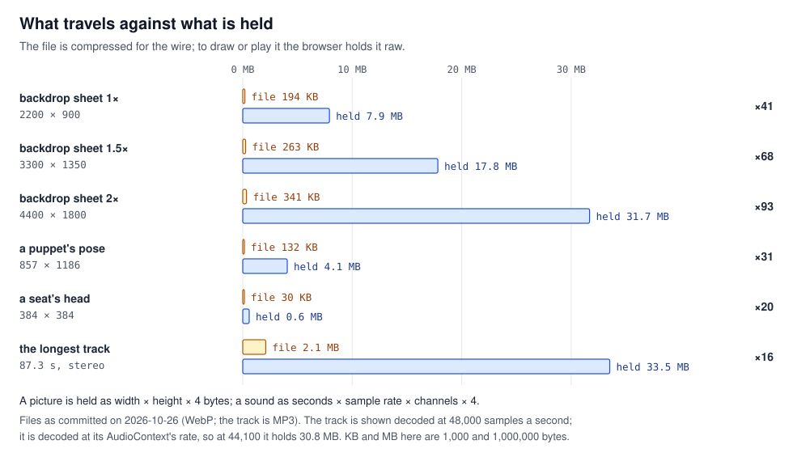
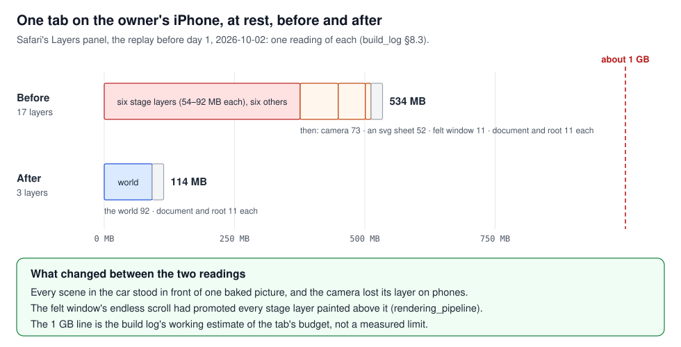
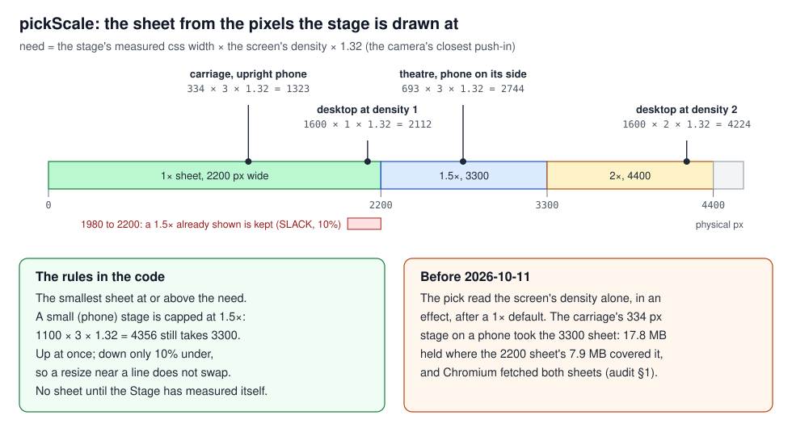
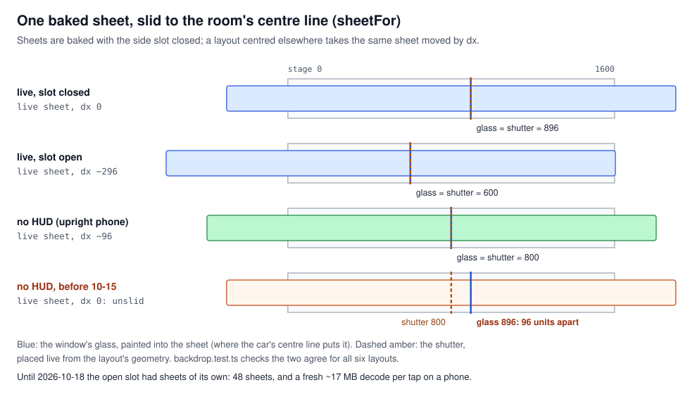
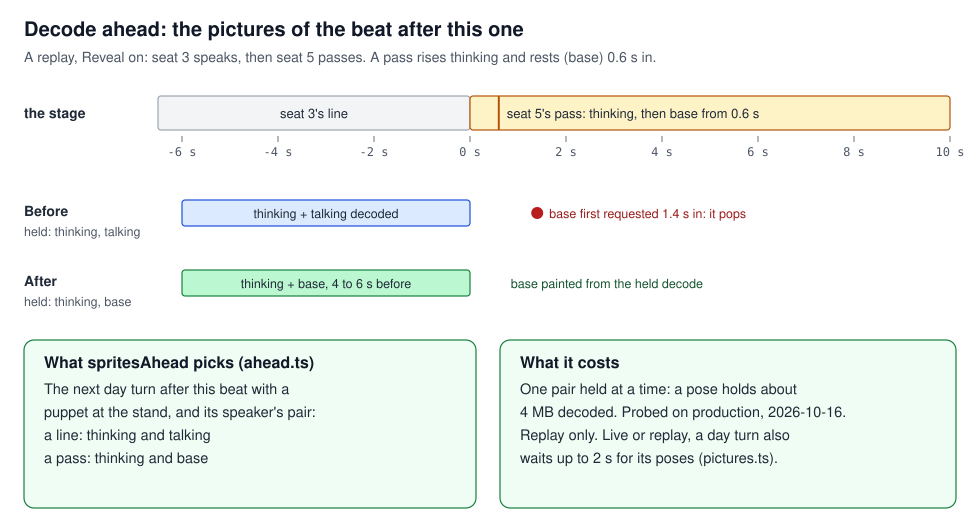
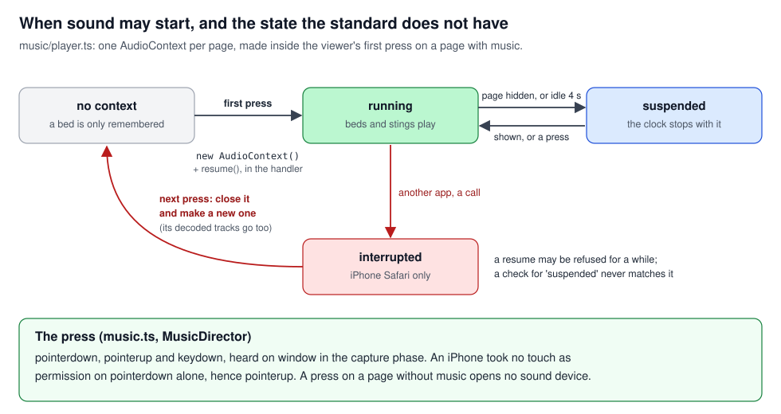

# Pictures, sound and memory

## What this teaches, and what you need first

What a picture or a sound costs once it is on the page, how the stage picks, bakes and decodes its
pictures so a phone can hold them, and when a browser lets sound start at all. The worked examples
are the stage's own: the backdrop's sheets, the puppets' poses, the seats' heads and the music.

You need [`rendering_pipeline.md`](../rendering_pipeline/rendering_pipeline.md) first: it explains
layers, the other half of the memory a page holds, and this tutorial leans on it. Two cases also
assume [`react_identity.md`](../react_identity/react_identity.md), section 3 (re-render against
remount) and section 1 (the Stage-owned backdrop).

Seven words used throughout:

- **Decode**: turning a compressed file (WebP, MP3) into raw values the browser can draw or play.
  The raw result is what the page holds in memory.
- **CSS pixel**: the unit a page is laid out in. `width: 334px` is 334 CSS pixels however dense
  the screen.
- **Physical pixel**: a dot on the screen. An iPhone has three across for every CSS pixel.
- **Density** (`window.devicePixelRatio`, DPR): physical pixels per CSS pixel. 1 on an ordinary
  desktop monitor, 2 on a Retina Mac, 3 on a recent iPhone.
- **Sheet**: one of the backdrop's baked pictures, `src/assets/sets/car-<hour>-<hud>-full@<scale>x.webp`.
- **Bake**: drawing something the page would otherwise compute live, once, ahead of time, and
  shipping the result as a picture.
- **AudioContext**: the Web Audio API's object that owns the sound device, a clock, and the graph
  of nodes that make sound.

---

## 1. File bytes against decoded bytes

A file on the wire is compressed. To draw a picture the browser decodes it into one value per
pixel, four bytes each (red, green, blue, alpha), whatever the format was. To play a sound from
Web Audio it decodes the file into one 4-byte number per sample, per channel. So:

```
picture held = width × height × 4 bytes
sound held   = seconds × sample rate × channels × 4 bytes
```

A 200 KB WebP and a 2 MB PNG of the same 2200 × 900 picture hold the same 7.9 MB once decoded. The
compression ratio of the file says nothing about the memory.



### In this project

**Lesson 13 and phone lesson 3, the backdrop.** The backdrop sheets are small WebP files, yet the
page's memory was large (build_log §8.3, 2026-10-01). The 1.5× sheet is 3300 × 1350 pixels: 263 KB
on disk today and 17.8 MB decoded. `next/image` optimises the file on the wire, so it could not
help with this cost.

**Lesson 37, the music.** The longest track, `public/music/elders-council.v1.mp3`, is a 2.1 MB file
of 87.3 seconds in stereo. `decodeAudioData` decodes it at its AudioContext's sample rate, so it
holds about 33.5 MB at 48,000 samples a second, or 30.8 MB at 44,100: sixteen times its file. The
first player kept six such tracks for as long as the tab was open. The 2026-10-11 audit's
follow-up put the decoded music at 115 to 175 MB, a large share beside the stage's pictures, though
not a crash on its own. Since `25790733` (follow-up item 6), `src/music/player.ts::MusicPlayer`:

- keeps at most three decoded tracks (`KEEP`: the bed, the one it turns to, a sting), dropping the
  least recently used, in `load`;
- lets go of every decoded track when the last page with music is left (`enter` returns the
  leaving, which clears `buffers`);
- waits 400 ms (`SETTLE_MS`) before starting a bed, so a scrub passes over beds without decoding
  each one.

**How much a page held.** A Chromium census on the production build at phone size (build_log §8.6,
2026-10-02) counted 23 pictures and 39 MB decoded at the first beat, 14 pictures and 22 MB in a
night room. A census of 140 beats in the phone frame (§8.9) counted 197 MB of decoded pictures
touched, "70 MB of them never shown" (section 3).

### See it yourself

- The arithmetic is the tool: for every picture on screen at once, `naturalWidth × naturalHeight
  × 4`. In the console on a replay:
  `[...document.images].reduce((s, i) => s + i.naturalWidth * i.naturalHeight * 4, 0) / 1e6`.
- `scripts/profile-theatre.mjs` (committed with the 2026-10-11 audit) is a repeatable census
  against a running production build: each picture's natural and drawn size and its RGBA estimate,
  which it says is not GPU memory. The 2026-10-02 census probes are not committed.

### The rule

Count what a picture or sound holds decoded, never its file size.

---

## 2. A phone kills the tab at a line

A desktop that runs short of memory gets slower: it has gigabytes to spare and can swap to disk.
iOS gives one tab a fixed budget for everything it holds (the page, its decoded pictures, its layer
bitmaps) and ends the tab when it crosses the line, with no warning to the page. Safari then shows
"A problem repeatedly occurred". So a design that is merely heavy on a desktop can be fatal on a
phone, and a desktop test cannot show it.

Decoded pictures (section 1) and layers ([`rendering_pipeline.md`](../rendering_pipeline/rendering_pipeline.md))
share that budget. A layer is a bitmap too, width × height × 4 at the screen's density, so a
full-stage layer on the owner's phone was about 54 MB.



### In this project

**Phone lesson 4 and build_log §8.3, fast beats.** With the masks gone (§8.1), every stage page
stayed up on the owner's iPhone at one beat a second and died at two to three, stepping the
workbench (2026-10-01). Each beat rebuilt the whole scene, and the browser freed the last beat's
layers a few frames after the new ones were up, so at speed two or three beats' worth overlapped:
transient pressure, not a leak, which a desktop's slack hid. The JavaScript heap stayed near 10 MB
throughout.

**The reading of record.** The owner's iPhone over Safari's Web Inspector, Layers panel, the replay
at "before day 1", at rest, one reading on 2026-10-02: seventeen layers and 534 MB before a beat
had played. After every scene in the car stood in front of one baked picture (section 4) and the
camera lost its layer on phones, the same panel read three layers and 114 MB. The cause of the
seventeen, the felt country scrolling in the car's window, is a layer story told in
rendering_pipeline (lesson 10).

What the budget is exactly was never measured. "About a gigabyte" is the build log's working
estimate (§8.3: "a budget of about a gigabyte"; phone lesson 4: "roughly a gigabyte"), not a limit
read from a device.

### See it yourself

- Safari on a Mac, Develop menu, your iPhone, the page: the Layers tab gives the layer count and
  their total memory; the Timelines tab's Memory track gives the page's side. This is the only
  instrument that reads the phone itself.
- The pace probe: `/workbench/day?auto=330` steps a beat every 330 ms. On the phone it finds the
  rate at which a scene dies.

### The rule

Test memory on the device, because a phone ends the tab at its line where a desktop only slows down.

---

## 3. Choose a picture's size from the pixels it is drawn at

A picture drawn at 334 CSS pixels on a screen of density 3 covers 1,002 physical pixels. A source
wider than that is decoded whole and then scaled down on screen: the extra pixels cost memory and
show nothing. A source narrower is scaled up and looks soft. So the right source is the smallest
whose width is at least `drawn CSS width × density`, plus any zoom the picture will be shown at.

The web's general tool is `srcset` with `sizes` on an ``. Whatever picks, the drawn width
must be known before the first request, and layout ("is the stage small?") and density are
separate questions: a small stage on a dense screen still needs pixels.



### In this project

**Lesson 22, the backdrop's sheet.** `src/stage/instruments/Backdrop.tsx::pickScale` chooses among
three sheets, 2200, 3300 and 4400 pixels wide (1×, 1.5×, 2×). The need is the stage's measured CSS
width × `devicePixelRatio` × `CAMERA_ZOOM_MAX` (1.32, the vote count's push-in, the closest the
camera comes, `src/stage/units.ts`). It takes the smallest sheet at or above the need, capped at
1.5 on a small stage, where a 2× sheet would hold 31.7 MB.

Before 2026-10-11 the pick read the screen's density alone, in an effect, after a 1× default. The
2026-10-11 audit (§1) measured the result: the landing's carriage on an upright phone, whose
backdrop was drawn about 456 CSS pixels wide with its bleed, took the 3300 sheet, 16.99 MiB as one RGBA buffer, where
the 2200 sheet's 7.55 MiB already covered it. And Chromium fetched both the 1× and the 1.5×,
because the default asked for one before the effect asked for the other. Now:

- the pick is made in render, inside `useScreen`, from the Stage's measured width
  (`useStageWidth`), and nothing is drawn until the width is known (the hook returns `null`), so the
  first sheet asked for is the right one. Lesson 30, in
  [`loading_and_deploy.md`](../loading_and_deploy/loading_and_deploy.md), carries the same fix to
  every picture on the stage (`Stage.tsx`, `measured`);
- a larger sheet already shown is kept until the need falls 10% under the smaller sheet's size
  (`SLACK`), so a window resized back and forth across a boundary does not swap sheets on every
  pixel. Trading up happens at once.

**The census, and the phone's copies (build_log §8.9, 2026-10-02).** A census of pictures against
the size they were drawn at, phone frame, 140 beats, found the jar's glass decoded at 2.4 times its
drawn size, its lid 3.7, the deal's small role cards 5 to 8, the day figures 1.3. Each got a
smaller copy, picked on a small stage: `SPRITES.small`, made by `scripts/small-sprites.mjs` (55
files then).

**Lesson 37's other half, the heads.** The seats' heads are 384 × 384. The rendering audit
(2026-10-02) saw them drawn as small as about 23 CSS pixels at density 3. A census on 2026-10-15 of
every head drawn on a phone (replay, landing and benches at 844 × 390, density 3) found none over
about 234 physical pixels, most under 120, so the phone's copy is 224 × 224 (`1381f3d3`), picked in
`src/stage/cast/ChipSprite.tsx` when `useSmall()` is true. 0.59 MB decoded becomes 0.20 MB per head.

**CSS pixels are not physical pixels.** The build log's first reading (§8.2) said a phone decoded
four times the puppet it showed. It had counted CSS pixels: about 300 CSS pixels at density 3 is
900 physical pixels, the puppet's own width. The log corrected itself on 2026-10-01.

### See it yourself

- `npm test -- backdrop` in `frontend/` runs `src/stage/instruments/backdrop.test.ts`. Its cases
  are the audit's: the carriage at 334 CSS pixels and density 3 takes `'1'`, a landscape theatre
  at 693 takes `'1.5'`, and the slack's boundaries.
- Chrome DevTools, device toolbar, an iPhone profile (density 3): load the landing, Network panel
  filtered on `car-`. One sheet should be requested, the `@1x`.
- On any picture, compare `img.naturalWidth` with
  `img.getBoundingClientRect().width * devicePixelRatio`. A ratio well above 1 is memory spent on
  nothing.

### The rule

Pick a picture's source from its drawn CSS size times the screen's density, known before the first
request, and keep a copy for each size actually drawn.

---

## 4. Baked copies, and what they must cover

Baking trades work at runtime for a file. The stage drew the dining car's paint and haze as five
full-stage SVG sheets, each a bitmap of its own at the screen's density. A bake draws them once,
photographs the result, and the page shows one picture. The browser then holds one bitmap where it
held five, and nothing is traced or composited per beat.

The price is that a copy is not the computation. It is right only for the inputs it was made from,
so two questions come with every baked picture: does it cover every case the live drawing covered,
and is a variant really a new picture, or the same one moved?



### In this project

**The bake (build_log §8.3, 2026-10-01).** After the split of set and beat, the day's loop still
died at one beat a second on the owner's phone. Subtraction found no single culprit: the page sat
near its cap with five full-stage sheets up. `scripts/bake-sets.mjs` now screenshots the
workbench's bake bench in Playwright for every hour (day, dusk, night, dawn) and HUD layout (live,
replay) at device scale 1, 1.5 and 2, encodes WebP, and writes `src/assets/sets.ts` (24 sheets,
5.0 MB today). It must be run again whenever the car's paint or haze changes. The baked day's loop
held at one beat a second.

**Lesson 29a, a copy that did not cover a layout.** The sheets were baked at two layouts, while the
shutter over the car's window is placed live from the layout's geometry. The layout with no HUD got
no sheets and reused the live HUD's, on a comment that the two were alike. They had differed since
the seat rail took 192 units (2026-09-29), which moves the room's centre line from 800 to 896. On
the one screen that used no HUD, the landing's carriage on an upright phone (from 2026-10-14), the
shutter fell 96 units short of the painted glass. Found and fixed on 2026-10-15. The fix is a
test, not a comment: `src/stage/instruments/backdrop.test.ts`, `sheetFor`, checks for all six
layouts (three HUDs, slot open or closed) that the glass's centre in the sheet, moved by `dx`, is
the shutter's centre.

**Lesson 44, a variant that was the same picture moved.** The car was baked twice per hour and
HUD, once with the side slot closed and once open, so opening the transcript swapped in a second
sheet: 48 sheets, and on a phone a fresh decode of about 17 MB on every tap. Sliding one sheet onto
the other showed the car was the same painting 296 units over; only the felt country behind its
glass and the dark past its ends stayed put, because the bake had anchored those to the stage
instead of the car. Now `Backdrop.tsx::sheetFor` returns the HUD's sheet and a slide, `dx`, the
difference between the layout's centre line and the baked one. 24 sheets instead of 48, and the goldens moved only behind the glass
(2026-10-18).

### See it yourself

- `npm test -- backdrop`: the `sheetFor` cases are the invariant that holds baked and live in
  agreement.
- `bake-sets.mjs`'s loops are the variants; each one added multiplies the sheets. Lesson 44's
  slide-and-diff was done by hand; no script for it is committed.

### The rule

Before baking a variant, check whether it is the base picture moved; and test every baked copy
against the live computation it stands in for.

---

## 5. When a picture is decoded, and what a remount costs

A browser decodes a picture lazily: usually when it is first painted, and often on the main
thread, in the frames that were meant for something else. The `` attribute `decoding` is a
hint about that moment:

- `decoding="async"` lets the browser paint the page before the picture is decoded, and draw the
  picture a frame or more later;
- `decoding="sync"` asks it to decode before the frame that shows the picture, paying the decode in
  that frame.

The browser also keeps decoded pictures in a memory cache of its own, and may drop them under
pressure. Whether a picture mounted again is decoded again therefore depends on the engine and on
memory at that moment: it is not a fixed rule.

### In this project

**Lesson 13 and phone lesson 8, the black frame (build_log §8.8, 2026-10-02).** The owner saw the
screen flash black for an instant between beats on the iPhone, and the wing flicker once per
counted chip. A Chromium probe on production found why: the scenes still keyed whole per beat
mounted a fresh backdrop `` every beat, and `next/image` sets `decoding="async"`. On the
owner's iPhone in Safari a freshly mounted `` painted nothing until its decode landed, so for
a frame the house's dark showed through. Chromium kept the decoded picture and showed no flash,
which is why the screenshot tests never saw it. Two fixes:

- the backdrop belongs to the Stage and is never remounted by a beat
  ([`react_identity.md`](../react_identity/react_identity.md), section 1). A change of hour changes
  only the `src` of the same element, and the browser keeps the old picture until the new one is
  ready, so `BackdropSheet` needs no `decoding` hint;
- the stage's pictures that can still remount carry `decoding="sync"` (the puppet in
  `src/stage/cast/Puppet.tsx`, the heads in `ChipSprite.tsx`, a night room's in
  `instruments/Compartment.tsx`, and others), so they paint at once when their bytes are cached,
  paying the decode on the main thread: a millisecond or two for a head, some tens for a night
  room's picture, as §8.8 estimates them.

**What the black frame does not prove.** §8.8 also says "the 18 MB sheet is decoded again each
beat". The rendering audit of the same day (its "What these results deprioritize") is the check on
that: in headless Chromium, warm traces of the pack's room recorded zero `Decode Image` work while
the transition still rebuilt the room. A remount does not prove a re-decode. What was observed is
one engine, Safari on the owner's iPhone, painting a fresh asynchronous `` a frame late. The
policy that follows is to remount pictures rarely, not a claim about what every remount costs.

Not every stall at a beat is a decode: the landing deal's lag (lesson 46, 2026-10-22) traced to
24 ms of decoding in 1.2 s of per-frame work. Finding where the time goes is
[`performance_method.md`](../performance_method/performance_method.md)'s subject.

### See it yourself

- The mark trick (phone lesson 8): in the console on a replay,
  `const el = document.querySelector('[data-backdrop] img'); el.mark = 1`, step beats and change
  scene, then read `el.isConnected` and `el.mark`. The backdrop keeps its element across forty
  beats and six scene changes on production.
- Chrome DevTools, Performance panel: record a beat and search the main thread for `Decode Image`
  (or `Image Decode`). Its absence on a warm remount is the audit's finding.
- Safari's Timelines on the device are the only way to see the iPhone's own behaviour.

### The rule

Keep a picture's element mounted and change its source; where a picture must remount, make it
paint at once, and do not assume a remount re-decodes.

---

## 6. Decode ahead of the beat that shows a picture

If the decode is paid when a picture is first painted, the fix for a stall at that moment is to pay
it earlier, while the screen is showing something else:

```js
const img = new Image();
img.src = url;          // starts the download
img.decode().then(...)  // resolves once the picture is decoded, off the main thread where it can be
```

Holding the `Image` object keeps the decoded copy likely to stay, and an `` with the same
source mounted later is drawn from it. Likely, not certain: a phone may discard a held decode under
memory pressure (the code's comment calls it "a strong hint, not a promise"). And every held decode
is memory (section 1), so decode ahead only what the next step will show.



### In this project

**The next speaker's poses (build_log §8.9, 2026-10-02).** On iPhone Safari a figure's picture was
decoded when first painted, in the same frames as the puppet's rise. `src/stage/cast/DecodeAhead.tsx`
now decodes the next speaker's poses while the current turn plays, in the replay only
(`ReplayTheatre.tsx` mounts it). It holds one speaker's pair at a time, since a pose is about 4 MB
decoded, and on a small stage it decodes the phone's copies, as `Puppet` draws them.

**Lesson 43, the picture a beat changes into.** With Reveal on, a replay's passes popped in: the
box, then its words, then the puppet, late and differently for each seat. The decode-ahead held the
next speaker's thinking and talking poses, but a pass rises thinking and rests (`base`) 0.6 s in,
and the rest pose was never fetched before that moment. Probed on production on 2026-10-16: each
pass's rest pose was first requested 1.4 s into its beat. Now `src/stage/cast/ahead.ts::spritesAhead`
picks the pair by the beat: thinking and base for a pass, thinking and talking for a line. The same
probe then found the pair requested 4 to 6 s before, in the previous turn. The probe (each
picture's first request against the time its beat began) is not committed.

**The next hour's sheet.** `Backdrop.tsx::BackdropSheet` takes an `ahead` hour from its scene and
decodes that sheet with `new window.Image()` and `decode()` while the current one is shown; one is
held. Without it, the winners' hour decoded at its own cut on a phone, in the frames of the
shutter's rise.

**When the file itself is late.** On a slow connection decoding ahead is not enough.
`DayScene.tsx` holds a turn back until its poses have arrived, at most `PICTURE_WAIT_MS` (2 s),
live or replay (owner, 2026-10-21); `src/stage/cast/pictures.ts` remembers which sources have
arrived, never the images, since a held decode is megabytes.

### See it yourself

- A replay with Reveal on, DevTools Network panel, filter `base`: note when each `base.webp`
  request starts against the beat on the stage. With the fix it comes during the previous turn.

### The rule

List what a beat shows from its first frame to its last, decode those pictures during the beat
before, and hold no more than that one beat's.

---

## 7. Sound starts only from a press

Browsers block sound a viewer did not ask for. An AudioContext made before the viewer has
interacted with the page starts `suspended`, and `resume()` succeeds only during or after a user
gesture (a press, a key). Safari is stricter: the context must be made or resumed inside the
gesture's own event handler, not in something that runs after it, such as a React effect.

Once running, Web Audio plays from decoded buffers (`AudioBuffer`, section 1) through a graph of
nodes: a source per sound, a `GainNode` per voice for its volume, a master gain, the speakers. A
fade is a ramp on a gain node, which the audio thread runs; no JavaScript runs per frame.

The standard gives a context three states: `suspended`, `running`, `closed`. iPhone Safari has a
fourth, `interrupted`, when the viewer switches app or takes a call.



### In this project

**S3, the press.** `src/music/music.ts::MusicDirector`, mounted once in the providers, listens on
`window` in the capture phase for `pointerdown`, `pointerup` and `keydown`, and calls
`music().unlock()` inside the handler. `MusicPlayer.wake` then makes the AudioContext and resumes
it in that same call. `pointerup` is there because an iPhone took no touch as permission on
`pointerdown` alone. Every fade is a gain ramp (`start`, `fade`), because an iPhone ignores an
audio element's `volume`.

**S4, the interrupted context.** A resume on returning to the page may be refused for a while, and
a check for `'suspended'` never matches `'interrupted'`, so the music came back only when Safari
got round to it. Now `wake(press)` checks for `'interrupted'` on a press, and `rebuild` closes the
old context and drops its decoded tracks (they belong to it), so the press makes a new one.
Showing the page again only tries a resume (`setVisible`); a refused one waits for the next press.

### See it yourself

- `src/music/player.test.ts`, "MusicPlayer and a context the phone took away": four cases, from
  "makes the context on the first press and resumes it" to "the page shown again only tries a
  resume: a refused one waits for the next press" (`npm test -- player`). They run against a stub
  AudioContext; the `interrupted` state itself is seen only on an iPhone.
- On the phone: start a replay with music, switch to another app for a minute, come back, and
  tap. The music should return on the tap.

### The rule

Make or resume an AudioContext inside the press's own handler, and treat any state but `running`,
including iPhone's `interrupted`, as needing that press.

---

## Case index

| Case | Short | Section |
|---|---|---|
| 13 | Pictures cost decoded pixels; a fresh `` black on iOS | 1, 5 (sizes: 3; decode ahead: 6) |
| 22 | Choose a picture's size from drawn pixels | 3 |
| 29a | A baked copy must cover what the computation reads | 4 |
| 37 | Count decoded bytes (pictures and sound) | 1 (the heads: 3) |
| 43 | Decode ahead every picture the next beat shows | 6 |
| 44 | A layout that moves a baked picture is that picture moved | 4 |
| S3 | Sound starts only from a press | 7 |
| S4 | iPhone's `interrupted` AudioContext | 7 |
| Phone 3 | Memory is pixels, not file size | 1, 3 |
| Phone 4 | A phone kills the tab at a line | 2 |
| Phone 8 | A fresh `` is black for a frame on iOS | 5 |
| Linked: 10 | An animated property makes a layer | rendering_pipeline (2 links it) |
| Linked: 30 | A size measured after mount fetches | loading_and_deploy (3 links it) |

---

## If you are asked about it

"On a phone, memory is what decides whether the page lives, and memory is decoded pixels, not file
size: our 263 KB backdrop holds 17.8 MB once decoded, and a 2 MB music track 33 MB. The stage was
built by AI agents to my specs; I tested it on my iPhone, where it crashed and a desktop never did,
because iOS ends a tab at a fixed budget. Over Safari's inspector I read 534 MB of layers before a
beat had played; after the fixes, 114. The picture fixes are four habits. Pick each picture's size
from the pixels it is drawn at, so the small landing preview takes the 2200-pixel sheet, not the
3300. Bake what does not change, but test the baked copy against the live layout: one shortcut
left a shutter 96 units off its window, and a variant that had been baked twice turned out to be
one picture slid 296 units. Decode the next beat's pictures during this one, including the pose a puppet
changes into halfway. And keep picture elements mounted, because a fresh image on iPhone painted
black for a frame, though a remount is not proof of a re-decode. Sound has its own rule: it starts
only inside a press's handler, and iPhone's 'interrupted' state needs a new context on the next
press."

---

## Reading

From principles §4:

- MDN: "Responsive images", and the Web Audio API's `AudioBuffer`.
- WebKit's blog posts on memory debugging with Web Inspector.

Added, primary sources only:

- MDN: `HTMLImageElement.decode()` and `HTMLImageElement.decoding` (sections 5 and 6).
- MDN: "Autoplay guide for media and Web Audio APIs", and the reference pages for
  `AudioContext.state`, `AudioContext.resume()` and `BaseAudioContext.decodeAudioData()`
  (section 7).
- MDN: `Window.devicePixelRatio` (section 3).
- Next.js: the `Image` component reference (`unoptimized`, `priority`, `sizes`), for what
  `next/image` does and does not do about decoded size.

No case here, so reading only: image formats and their decode cost (AVIF against WebP), and
`createImageBitmap` for decoding off the main thread into a bitmap the page owns.
