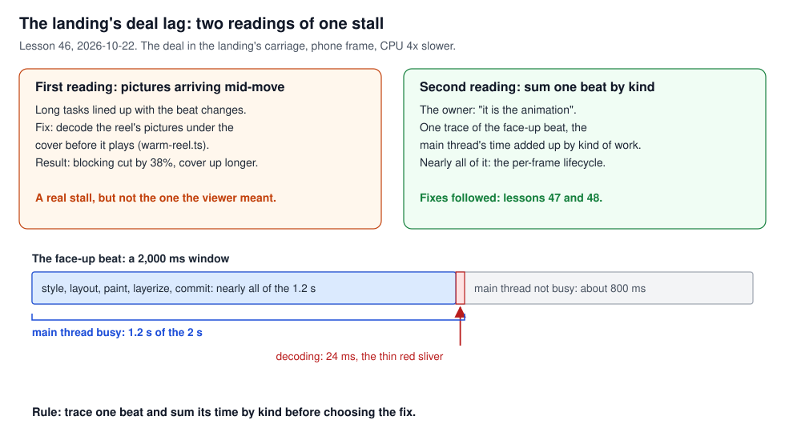
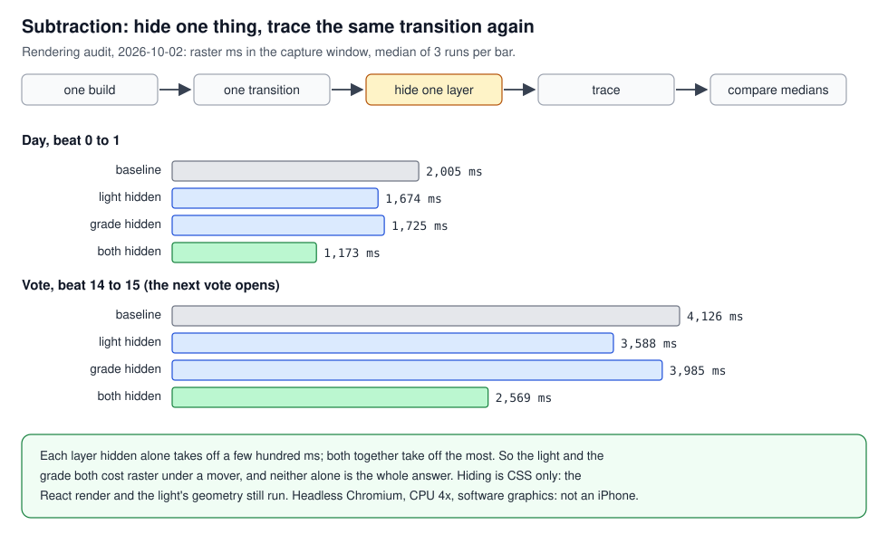
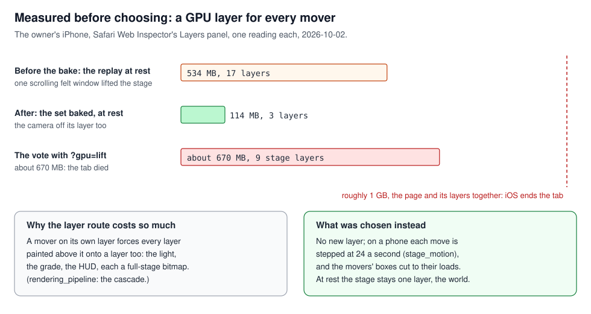
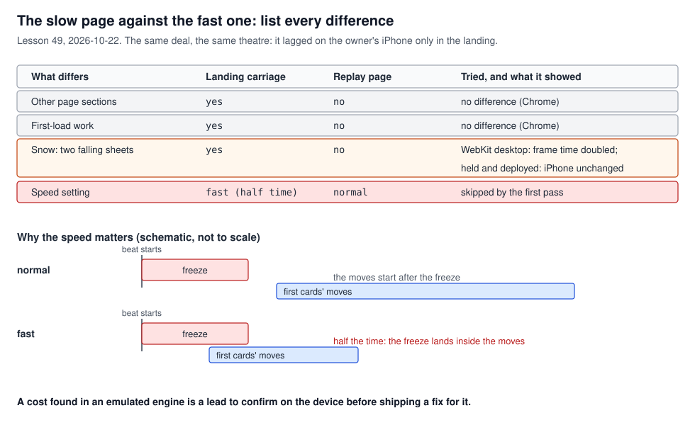
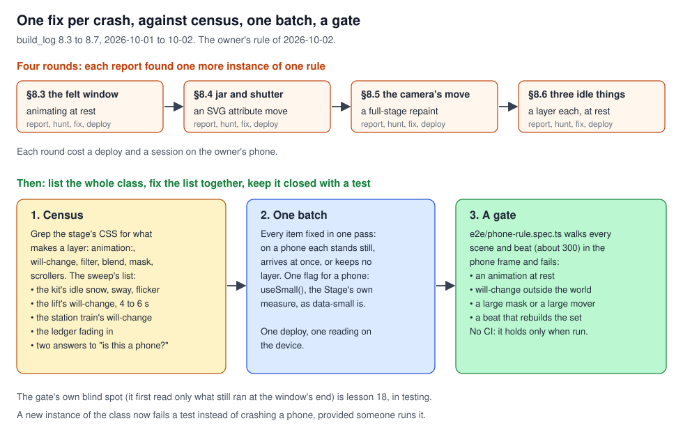
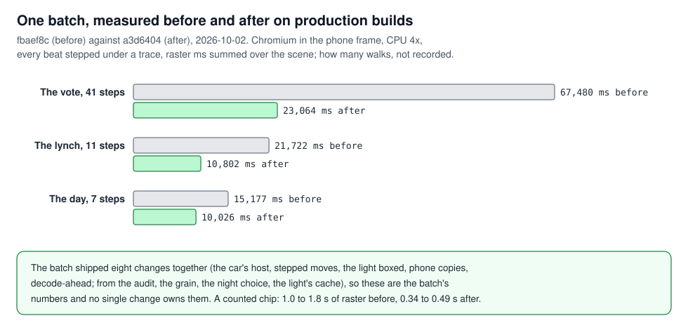

# Performance method: how to find and fix what is slow

## What this teaches, and what you need first

How to work on a slow or crashing page: turn a report into a measurement, find where the time
goes, learn what each part costs, check the tempting fix before building it, fix a whole class of
fault at once, and keep it fixed. The cases run from the stage's first iPhone crash (2026-09-28)
to the landing's deal lag (2026-10-22). The agents built the code and ran most desktop
measurements; the owner tested on the iPhone, read Safari's inspector and set the method's main
rule.

This topic builds on all four before it and uses their mechanisms without explaining them again:
[`react_identity.md`](../react_identity/react_identity.md) (re-render against remount, memo),
[`rendering_pipeline.md`](../rendering_pipeline/rendering_pipeline.md) (paint, raster, layers,
the cascade), [`memory_and_pictures.md`](../memory_and_pictures/memory_and_pictures.md) (decoded
bytes, the phone's memory line) and
[`loading_and_deploy.md`](../loading_and_deploy/loading_and_deploy.md) (the carriage, chunks).

Six words used throughout:

- **Trace**: a recording of everything the browser did over a stretch of time, task by task and
  thread by thread (Chrome's Performance panel, Safari's Timelines tab).
- **Main thread**: the thread that runs the page's JavaScript and works out style and layout.
  While it is busy, nothing on the page can respond.
- **Raster**: turning recorded paint into pixels; Chrome does it on separate raster threads.
- **CPU throttling**: Chrome running the page as if the processor were four times slower, a
  stand-in for a phone. It is not a phone.
- **The workbench**: the page `/workbench/<scene>`, one scene of a fixture game beat by beat (a
  **beat** is one step of the stage, "a chip is counted"). `frame=iphone14` draws the stage at an
  iPhone's size; `animate=1` plays each beat's arrival.
- **Production build**: what `next build` makes and the site serves; the dev server runs
  different, slower code.

---

## 1. A report is a claim to measure

A report ("it lags", "day 4 feels heavier", an audit's list of defects) tells you where to look,
not what is wrong or what to do first. Turn each claim into a question a measurement can answer,
answer it, then decide. That holds for a viewer's report, an outside audit and your own reasoning.

### In this project

**Lesson 19, an audit read as claims.** On 2026-10-02 another agent audited a production snapshot
([`rendering-audit-2026-10-02.md`](../../rendering-audit-2026-10-02.md)) and listed six costs with a
recommended order. build_log §8.9, "A second pass from the readings", took the findings that
matched the project's own traces (the grade's cost under movers, the night room's full-stage fade,
the light's geometry generated during render), and §8.10 took its full-stage wrappers. Its order,
and its hope for movers on compositor layers, were checked against the phone's numbers first; the
layer route had already been measured on the iPhone and refused (section 4).

**Lesson 19, a viewer's report.** After that batch the owner said the later days "felt a little
heavier" (§8.10, 2026-10-02). Two walks of the production replay in the phone frame answered it.
One traced all 208 beats: a day-4 speech beat cost what a day-2 one did (a new speaker 1.5 to 1.9 s
of raster on both). The other sampled the page every 20 beats over 230: heap 11 to 13 MB,
listeners 1,440 to 1,730, nothing growing. So the page was not heavier; the walk pointed at the
phone (which slows itself after minutes of work) and at the full-stage box every move paid for.

**Your own reasoning is a claim too.** §8.10 set aside an audit's item "key the light's cache by
geometry, not instance" on reasoning (one host, one instance, "rarely misses"), unmeasured. A
remount proved it wrong; the cache was rekeyed on 2026-10-15 (lesson 36, in
[`react_identity.md`](../react_identity/react_identity.md) section 4).

### See it yourself

- The day-4 walks (`day-drift.mjs`, `mem-walk.mjs`) are not committed. The committed walk closest
  to them is `scripts/profile-theatre.mjs`: against a running production build, it steps the whole
  public replay twice and records heap, DOM nodes and listeners at the same beat each time
  (`replay-end-cycle-1`, `-2`).
- By hand: Chrome's Performance monitor (DevTools, More tools) shows JS heap, DOM nodes and event
  listeners live. Open `/workbench/day?auto=1000&frame=iphone14` and watch whether they climb or
  settle.

### The rule

Write each claim as a question a measurement can answer, and act on the answer, not the claim.

---

## 2. Find where the time goes before choosing a fix

A stall is time the viewer waited, and several things can spend it: script, style and layout,
paint and raster, picture decoding, the network. Each has a different fix. So the first question
is not "is it slow" but "slow at what": record a trace over the slow moment and add up its time by
kind of work.

### In this project

**Lesson 46, the deal lag (2026-10-22).** The owner saw the landing's deal lag on a phone. The
first reading lined up long tasks with beat changes and concluded "pictures arriving
mid-animation". Warming the reel's pictures under the cover before it plays
(`src/stage/containers/warm-reel.ts`) cut that blocking by 38%, at the price of a longer cover. The
owner said the lag was the animation, and it was: a trace of the face-up beat (phone frame, CPU
four times slower) read 1.2 s of main thread in a 2 s window, nearly all of it the per-frame
lifecycle (style, layout, paint, layerize, commit), and 24 ms of decoding. The warming stayed, since
it fixed a real stall; the one the owner meant led to lessons 47 and 48, in
[`rendering_pipeline.md`](../rendering_pipeline/rendering_pipeline.md).

**Lesson 28, the guide's role cards (after they grew on 2026-10-15).** The first throttled run said
the carousel was slow with or without the cards' filters. A trace showed size observers and
layout, not painting, and wrapping `ResizeObserver` to log its targets named the guide's demo
stages, still settling after load (lesson 27, in
[`loading_and_deploy.md`](../loading_and_deploy/loading_and_deploy.md)), not the cards. Three
checks:

1. Count the work with nothing moving, in 3 s windows, until it reaches zero. A count that falls
   is a page still settling; one that stays up is a loop.
2. Measure the thing only once the page has settled.
3. On a shared machine, interleave old and new runs and take the median of three. Single runs here
   swung from 15 to 45 frames a second with the machine's load.

**A method note from lesson 40.** Under Chrome's CPU throttling the main thread's tasks are padded
with idle time, so their length says little about real work. For a paint cost, read the raster
threads and the paint rectangles instead.

### See it yourself

- Chrome DevTools, Performance panel, CPU 4x slowdown: record one beat on
  `/workbench/deal?animate=1&frame=iphone14`. The Summary tab gives the window's time by category
  (scripting, rendering, painting); the Bottom-Up tab groups it by activity.
- `console.timeStamp('beat')` at each beat change puts a mark on the timeline. Lesson 46's tracing
  script (`browser.startTracing`, then the `TimeStamp` events) is not committed.
- Lesson 28's `ResizeObserver` wrapper is not committed either. A stand-in: an init script
  (Playwright's `page.addInitScript`) that swaps in a subclass logging each `observe(target)`.

### The rule

Trace one slow moment and sum its time by kind of work before choosing a fix.

---

## 3. Subtract before you add

To learn what a part costs, remove it and measure again under the same conditions. Removing is
cheaper than any fix, needs no theory of the cause, and gives a number per part, which sets the
order of work. Remove one thing at a time: two removed together tell you only about the pair.

### In this project

**Lesson 15 and build_log §8.1, the first crash (2026-09-28 to 10-01).** After the redesign's
deploy, every page with a stage died on an iPhone at once, while every desktop browser was fine.
The cause was found by subtraction in eight taps on the phone. `src/styles/gpu-probe.css` gives the workbench a `?gpu=` switch: each word removes one kind of
work from the whole page (`nofilter`, `noblend`, `nomask`, `noshadow`, `nosvg`, `noimg`, and one
stage layer at a time). Only `nomask` and `nosvg` let the page survive, which
pointed at five full-stage SVG masks (the fix is in
[`rendering_pipeline.md`](../rendering_pipeline/rendering_pipeline.md)). Who did what (§8.1): the
owner found the crash, ran the eight probe links on their phone and read the result; the agent
proposed the probe, following the A/B by subtraction the owner had run on their own Chrome on
2026-09-25.

**No single culprit is an answer too (§8.3).** On the looping day scene, hiding any one of four
stage layers bought enough room, and hiding all pictures, all filters or all blends did not: the
page sat near the memory line with five full-stage sheets up, so the sheets were baked into one
picture ([`memory_and_pictures.md`](../memory_and_pictures/memory_and_pictures.md)).

**Lesson 15 and §8.9, the order of work.** On production in the phone frame, hiding the light
(`gpu=nolight`) doubled the frames drawn during a rise (20 to 42 on the day); hiding the grade
(`gpu=nograde`) raised them by 60 to 90% (a chip 43 to 82). The rendering audit ran the same
subtraction three times per variant (Figure 2). So the light was boxed to its gradients and the
grade's grain went off on phones.

Hiding is CSS, so React still renders and the light's geometry is still computed: subtraction
measures only what you subtracted. And subtract a suspect even when it looks guilty (lesson 40):
the speech box's felt texture and a shadow's 10,000-unit clip both did, and removing them changed
nothing.

### See it yourself

- Open `/workbench/vote?animate=1&frame=iphone14`, step to a beat just before a counted chip (the
  strip names each beat, `vote.chip-counted`), record the next step in the Performance panel, then
  the same with `&gpu=nolight`, then `&gpu=nograde`. Words combine with `+`
  (`gpu=nolight+nograde`); `src/app/workbench/[scene]/_components/Workbench.tsx` puts them on
  `<html data-gpu>`.
- The audit's scripts stayed in its temporary directory and are not committed.

### The rule

Remove one part at a time and measure again under the same trace; let the numbers set the order
of work.

---

## 4. Measure the attractive answer before taking it

The obvious fix often has a cost invisible until measured. Before building it, find the cheapest
way to see that cost (a switch or a stand-in, not the real change) and read it on the device that
matters.

### In this project

**Lesson 17 and phone lesson 11, a GPU layer for every mover (2026-10-02).** With the crashes gone,
moves still stuttered on the phone: a mover without a layer of its own is repainted by the CPU
every frame. The obvious answer was to give each mover a GPU layer (`will-change: transform`). The
workbench word `?gpu=lift` does exactly that for every element marked `data-moves`, without
changing any component. The owner opened the vote with it: Safari's Layers panel read nine stage
layers of 52 to 74 MB, about 670 MB, and the tab died. A mover's layer lifts every stage layer
painted above it (the cascade, in
[`rendering_pipeline.md`](../rendering_pipeline/rendering_pipeline.md)), and the light and the HUD
are above every mover. That morning §8.4 had estimated +60 to 130 MB a mover. The lesson's
accounting: the measurement took ten minutes; the rewrite it prevented, a day and a crash.

What was chosen instead: no new layers; on a phone each move's curve is sampled 24 times a second
(a presentation policy, told in [`stage_motion.md`](../stage_motion/stage_motion.md)), and the
movers' boxes were cut to their loads (§8.10).

### See it yourself

- On an iPhone with Safari's Web Inspector attached (Develop menu on the Mac, then the phone, then
  the page), open `/workbench/vote?beat=18&animate=1&gpu=lift` with the Layers tab open, and
  again without `gpu=lift`. Read the count and the total during the jar's tip. (The link is
  §8.4's; the default fixture has changed since, so step to the jar's tip by its beat name.)
- On a desktop, `scripts/profile-theatre.mjs` (Chromium) reports layer counts over the protocol,
  which shows the cascade's shape but not an iPhone's memory.

### The rule

Find the cheapest way to see the tempting fix's cost, and read it on the target device before
building the fix.

---

## 5. Compare like with like

A number means something only beside another taken the same way. "Before" and "after" differ by
the change and by everything else that differed between the runs: the build, the script, what else
was animating, the machine's load, the engine. Hold those still, so only the change is left.

### In this project

**Lesson 25, the landing's rooms (2026-10-14).** The rooms under the carriage were first measured
at "+100 ms on a phone, nothing on a desktop". A later script, scrolling the same rooms, found
+440 and +1,560 ms for the same commit. Two things moved them: the scroll path, and the latest
games' loading shimmer (a `background-position` animation, so a repaint every frame), which with no
API answering kept re-rastering the wall under it, about half the wall's "cost". The procedure:

1. Build the baseline (HEAD) and the change, both as production builds.
2. Run the same script against both, in one sitting.
3. Keep animations still: Playwright's `reducedMotion: 'reduce'`, or answer the data so no
   loading shimmer runs.
4. Report the difference of differences: what the change adds over HEAD, under that one script.

**S12, dev numbers are not production numbers.** The dev server runs extra checks and unminified
code; compare a production build with a production build.

**Lesson 49, the slow page against the fast one (2026-10-22).** The deal lagged on the owner's
iPhone in the landing's carriage and not on the replay page: the same beats, the same theatre.
Chrome traces (CPU 4x) read the two pages alike, and the landing's other sections and first-load
work made no difference. In desktop WebKit the landing's snow did: two sheets falling behind the
carriage doubled the frame time of the cards' drop and turn. The snow was held during the deal
and deployed (`454e2d14`); on the iPhone it changed nothing, and it was reverted the same day
(`ff75bc1e`). Desktop WebKit composites on the CPU, where two moving full-width sheets are
expensive; a phone's GPU composites them for almost nothing. The difference the first pass
skipped was a setting: the carriage plays at `fast`, half the time
(`src/stage/containers/ReplayTheatre.tsx`, `mini.speed ?? 'fast'`), so the deal's freeze at a beat's start lands inside the first cards' moves
instead of before them. The lesson names that difference; it is not a measured cause. What shipped
was a product choice: the carriage opens on the deal already done (`ec59cfaa`).

### See it yourself

- [`testing.md`](../../testing.md), "How a run is done here", is the procedure for building one
  change in a scratch copy beside HEAD.
- Lesson 49's WebKit timing: headless Playwright WebKit fires about one animation frame per beat
  and cannot time anything; run it headed under `xvfb-run`, which renders in software. The
  comparison scripts are not committed.

### The rule

Change one thing between two measurements, list every other difference (settings included), and
confirm a cost found in an emulated engine on the viewer's device before fixing it.

---

## 6. Census, one batch, a gate

When one rule is broken in many places, fixing each break as it is reported costs one crash, one
hunt and one deploy per instance, paid each round by whoever holds the device. Instead take a
**census** (list every instance at once, by search or by a walk of the app), fix the list in **one
batch**, and write a **gate** (a test that fails any new instance of the class), so the rule is
checked by a run instead of remembered.

### In this project

**Lesson 16 and phone lesson 10, the owner's rule of 2026-10-02.** Four rounds (build_log §8.3 to
§8.6) each fixed one more instance of one rule, "nothing animates at rest inside the stage, and
nothing large moves on its own layer", each found after the owner's phone crashed or stuttered
again. The owner called it whack-a-mole, and ruled the method: census, then one batch, then a gate.

- **The census.** §8.6 searched the stage's CSS for everything that makes a layer (`animation:`,
  `will-change`, filters, blends, masks, scrollers); the §8.7 sweep walked every scene and beat
  and listed the rest (Figure 5), down to two definitions of "a phone" in different components.
- **The batch.** All of them in one pass: on a phone each stands still, arrives at once or keeps
  no layer, and one flag answers "is this a phone": `src/stage/set.ts::useSmall`, the stage's own
  measured size, the same measure as the CSS's `data-small`.
- **The gate.** `e2e/phone-rule.spec.ts` walks every scene and beat, about three hundred, in the
  phone frame, and fails an animation at rest, `will-change` outside the world layer, a large
  mask, a large mover, and (since §8.9) a beat that rebuilds the scene's set. How it measures
  (build_log §8.7) and its own blind spot (it first read only what was still running at the
  window's end, and so passed a 600 ms full-stage fade: lesson 18) are told in
  [`testing.md`](../testing/testing.md).

**One batch, one number (§8.9).** The next batch shipped eight changes together and was measured
once, before and after, on production builds (Figure 6). The vote's raster over 41 steps fell from
67,480 to 23,064 ms. Because the changes shipped together, that number belongs to the batch; the
evidence for any one change is its own reading (for the car's host, a walk through thirteen
changes of scene in which the set was kept every time).

**There is no CI.** The gate fails a new instance only when someone runs it (phone lesson 10
carries that dated correction).

### See it yourself

- `npm run e2e -- e2e/phone-rule.spec.ts` in `frontend/`, with the dev server up. Each walk
  attaches a report: what moved, how much of the stage it paints, and the scrollers (listed for
  information).
- The census by hand: `grep -rnE "animation:|will-change" src/stage --include=*.css`, then ask, for
  each hit, whether it is on screen at rest on a phone.

### The rule

When a rule is broken in more than one place, list every instance, fix the list in one batch, and
add a test that fails the class.

---

## 7. A rule is kept only by a measurement

A rule written in a document does not stop code from breaking it. The only evidence that a rule
holds is a measurement that would fail if it did not.

### In this project

**Lesson 33, the render census (2026-10-15).** Lessons 5 and 6 ("ticking state belongs in the
leaf", "new objects every render defeat memo") were written on 2026-10-02. On 2026-10-15 a count
of renders per component on the live page found both broken: 41 typed letters drew the dining
car's set 82 times, 738 seat tiles and 1,394 transcript rows. After the fixes (in
[`react_identity.md`](../react_identity/react_identity.md) sections 4 and 6) the same 41 letters
rendered the dock and its composer, 41 times each, and nothing else. Conditions: dev build, warm,
seat 7 rejoining at sequence 200, before at `cab002e2`
([`frontend-audit-2026-10-11.md`](../../frontend-audit-2026-10-11.md), follow-up).

**How the census counts.** React DevTools works by finding a global object,
`__REACT_DEVTOOLS_GLOBAL_HOOK__`, that React reports each commit to. The census installs its own
stand-in under that name before React loads (a page init script), so React reports to it instead.
For each commit it walks React's internal records of the instances (**fibers**) and counts one
that is not an object seen in the previous commit and has its "performed work" flag set
(`flags & 1`), by component name. It needs a dev build, where the names survive minification.

**The hook is not committed.** So the measurement that found the breaks cannot be rerun as it was,
and lessons 5 and 6 are again kept only by people remembering them.

### See it yourself

React DevTools, Profiler tab, "Record why each component rendered" on: type into the composer of a
live game seat (or the workbench's day turn). Each commit should list the dock and its composer
only. This is the route until the census hook is committed.

### The rule

For every rule worth keeping, write the measurement that would fail if it broke, and commit it.

---

## 8. The instruments and their limits

Every instrument answers some questions and is silent or misleading on others, and knowing which
is part of the measurement. The model statement here is the rendering audit's "Scope and
reproducibility". It names the snapshot (`04005ca0`), the engine and its software graphics, the
viewport and scale, 42 captures in threes, and then what the numbers do not show: the variant
order was fixed, so order effects remain possible; raster on several threads can overlap in wall
time; nested trace events must not be added together; and intervals between
`requestAnimationFrame` callbacks are not presented frames, so it reports no frame rate.

| Instrument | What it reads | Its limits, as found here |
|---|---|---|
| Safari Web Inspector on the iPhone | Layers: count and memory per layer. Timelines: CPU, memory, frames | The only reading of the phone's own memory and layers (phone lesson 4: the device is the measurement of record). S11: a blue Composite record marks the layer tree rebuilt (in §8.9, by a keyed-whole remount); the orange band is memory, not CPU; its charts interpolate sparse samples |
| Chrome Performance panel, CPU throttled | Time by kind; the raster threads; paint records | Throttling pads main-thread tasks (lesson 40). Chromium rasters in tiles, so a smaller paint rectangle shows mostly as fewer paint records (§8.10) |
| Headless Chromium over CDP | Layer counts (`LayerTree.enable`, then `layerTreeDidChange`); heap, nodes, listeners; a trace (`browser.startTracing`) | S16: software graphics (SwiftShader), so no iPhone memory or frame rate; `Paint` clip areas are in layer space and do not sum. (§8.6's "not readable over the protocol" was corrected 2026-10-22) |
| Playwright WebKit on Linux | WebKit's own behaviour, on a desktop | Not iOS (lesson 49): it composites on the CPU, and headless it fires about one animation frame per beat |
| A dev build | Component names, for the render census | Its timings are not production's (S12) |
| `scripts/profile-theatre.mjs` | DOM, pictures, sampled animations and (Chromium) layers, on the landing, three scenes and the replay | Its header: frame gaps are not frame rate, decoded-size estimates are not GPU memory |

**S16, read layer memory on a device.** Only Safari's Layers tab on the phone reads what the phone
holds; the number that reframed the crashes came from there (17 layers and 534 MB at rest, §8.3).

**The 2026-10-11 audit's protocol for physical Safari** is the checklist for a device reading:
record the device and OS, viewport, low-power state, temperature and run order, fixture and scene;
read peak memory during transitions, not only at rest; report median and 95th-percentile frame
duration against the screen's refresh, not an average frame rate; run warm and cold, since a phone
slowing with heat is not a leak. Its 15 to 30 minute "physical-device soak" is on its list of tests
to add; no record of one was found in the frontend docs.

### See it yourself

- `node scripts/profile-theatre.mjs http://localhost:<port> chromium <out.json>` against a running
  production build (its header has the full usage); compare `peakLayers` and `uniqueImgRgbaMiB`
  between two builds, in one sitting.
- Safari on the Mac, Develop, your iPhone, the page, Layers tab: the count and the total are the two
  numbers that matter.

### The rule

State each number with its instrument, build, device and conditions, and say what that instrument
cannot show.

---

## Case index

| Case | Short | Section |
|---|---|---|
| 15 | Subtract before you add | 3 |
| 16 | Census, then one batch, then a gate | 6 |
| 17 | Measure the attractive answer first | 4 |
| 18 | A gate reading the end of a window (home: testing) | 6, linked |
| 19 | Read an audit, or a report, as claims to measure | 1 |
| 25 | A census compares two builds under one script, in one sitting | 5 |
| 28 | Find what the main thread is doing first | 2 |
| 33 | A rule is kept only by a measurement (render census) | 7 |
| 46 | Find where a stall's time goes | 2 |
| 49 | Diff the slow page from the fast one, in the viewer's engine | 5 |
| S11 | Reading Safari's timeline | 8 |
| S12 | Dev numbers are not production numbers | 5 and 8 |
| S16 | Read layer memory on a device; CDP counts layers | 8 |
| Phone 4 | The device as the measurement of record | 8 |
| Phone 10 | Subtract, census, then a gate | 3 and 6 |
| Phone 11 | What was measured before choosing | 4 |

---

## If you are asked about it

"I didn't write this frontend's code; AI agents built it to my specs, and my part in its
performance work was the device and the method. When the stage met my iPhone, every stage page
died at once and the desktops were fine. We found the cause by subtraction: a workbench switch
that removes one kind of drawing at a time, eight taps on the phone, and only removing SVG masks
kept the page alive. The next crashes were the same rule broken in new places, one per round,
until I ruled that we stop: list every instance, fix the list in one batch, and add a test that
fails the class. Before a big fix we measured its cost with a switch first. Giving every mover a
GPU layer looked obvious; on the phone it lifted every layer above the mover, about 670 MB, and
killed the tab, so we never built it. And we treat every report, including mine and an outside
audit, as a claim to measure: a walk of 'day 4 feels heavier' found no beat dearer than on day 2,
which pointed at the phone, not the page. Two
honest gaps: there is no CI, so the gate holds only when someone runs it, and the render census
that caught two broken rules was never committed."

---

## Reading

From principles §8:

- web.dev, "Core Web Vitals", and its pages on field data against lab data. Everything here is
  lab data; field data from real visitors is what this project does not have.
- Brendan Gregg, "The USE Method" (utilisation, saturation, errors).

Primary sources added:

- Chrome for Developers, "Performance features reference".
- WebKit, "Layers Tab" (Web Inspector reference), and the WebKit blog's "Memory Debugging with Web
  Inspector".
- react.dev, the `<Profiler>` reference page.
- Playwright, "Browsers".

No case here, so reading only: real-user monitoring, and statistics for noisy runs beyond the
median of three.
