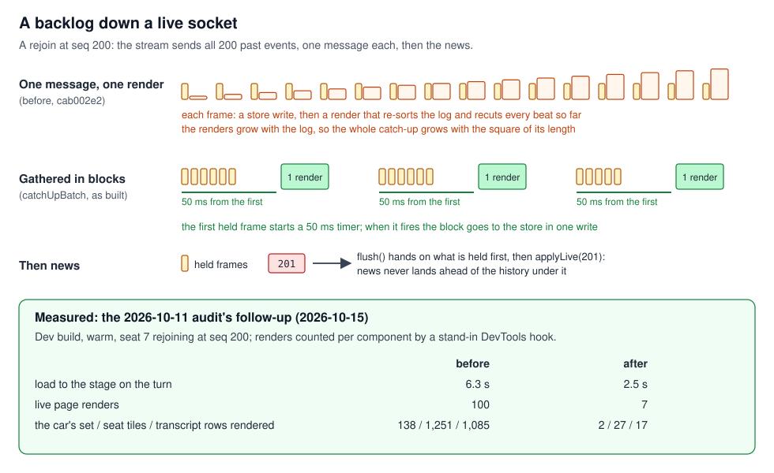
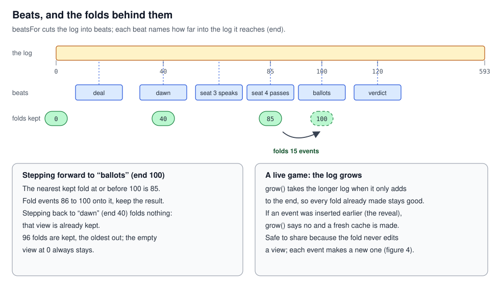
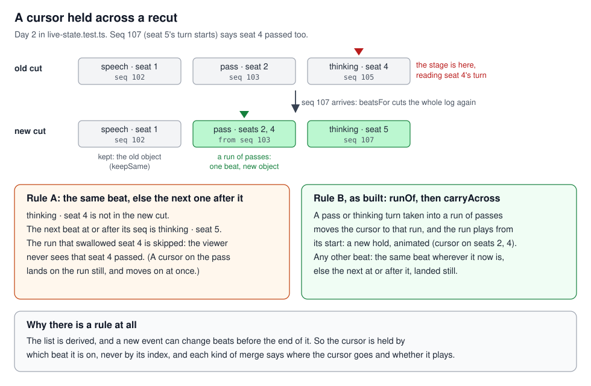
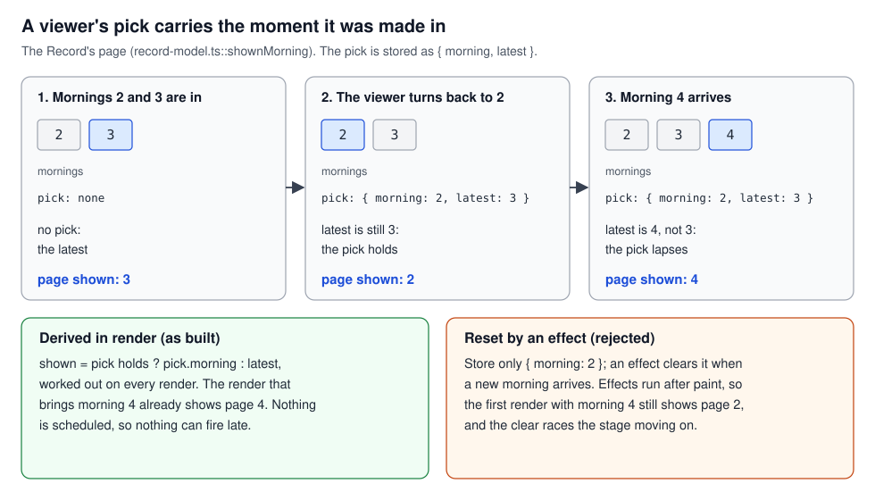
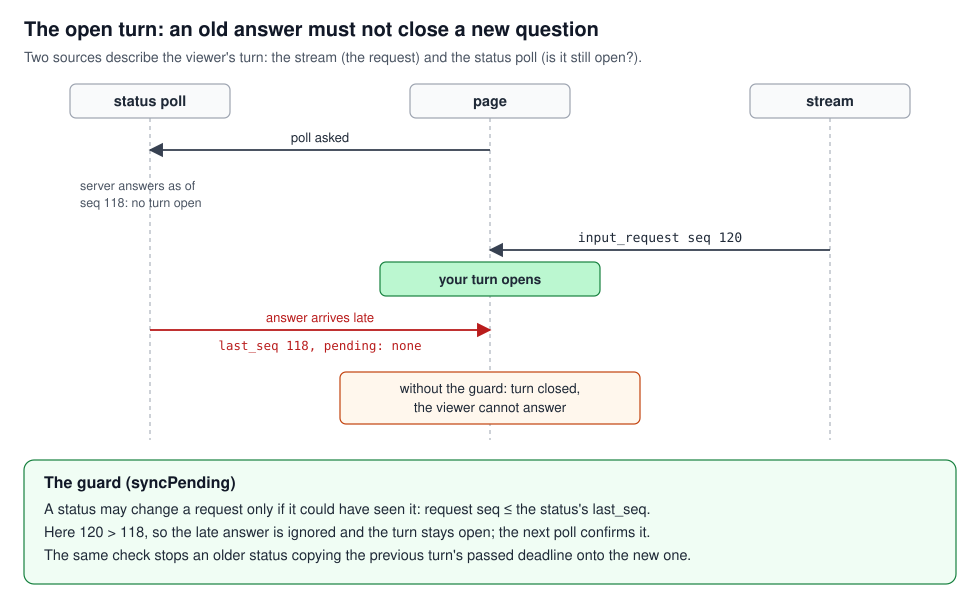
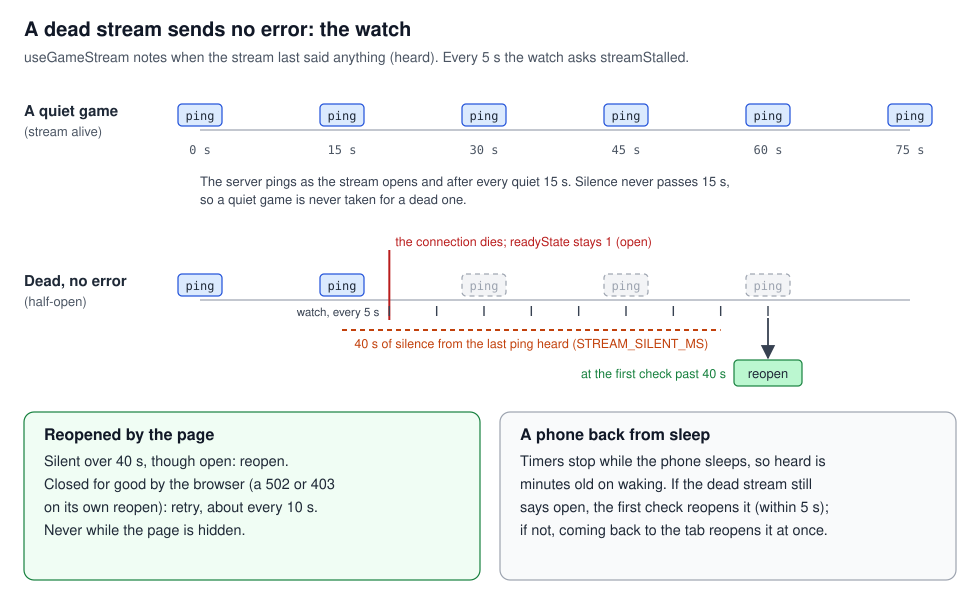
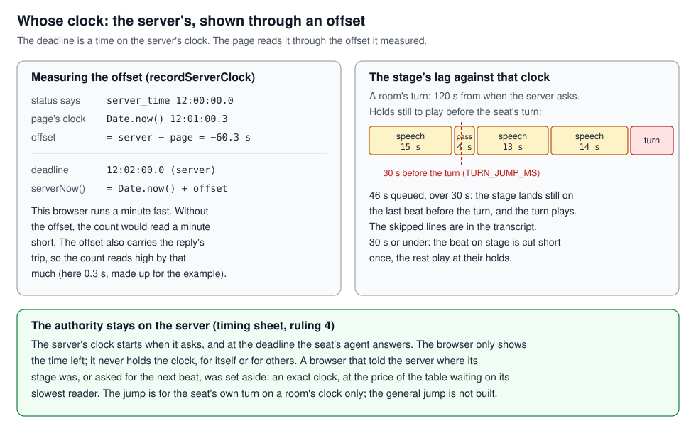

# Real time and sync: a page that follows a growing log

## What this teaches, and what you need first

A live game reaches the page as a log that keeps growing while the page draws it. This tutorial
covers what that takes: how a backlog arrives, how to cache and point into a list that keeps
changing, which of two sources wins when they disagree, how to tell a dead connection from a quiet
one, whose clock a countdown shows, and when a failed request may destroy anything.

It stands alone: you need JavaScript and the idea that React renders again when state changes.
Where a case leans on memo or effects it links
[`react_identity.md`](../react_identity/react_identity.md). The design of the same machinery, with
its tests, is [`client_design.md`](../../client_design/client_design.md); this tutorial teaches the
concepts and points there for the design.

Words used throughout:

- **Event**: one complete fact the server sends ("seat 3 spoke"), with a **seq**, its sequence
  number in the game's log. The page keeps its log sorted by seq.
- **View**: the game folded from the log (who is alive, what was said, whose turn is open) by one
  pure function, the **fold** (`src/game/foldEvents.ts::foldEvents`).
- **Beat**: one step of what the stage shows, cut from the log by `beatsFor` and held for a few
  seconds (its **hold**). The **cursor** is which beat is on the stage.
- **The stream**: one long HTTP response, Server-Sent Events (SSE), on which the server writes one
  message per event. The browser's `EventSource` fires one JavaScript event per message.
- **The status**: `GET /games/{id}`, a snapshot with the game's state, this browser's seat,
  `last_seq` (the newest event this viewer may see), deadlines and the server's clock. Polled every
  12 seconds while a game runs.
- **History and news**: events the game held before the page connected land still; events that
  happen while it watches play ([`client_design.md` §3](../../client_design/client_design.md#3-when-the-page-was-not-watching)).

Code is cited as `path::symbol`, paths relative to `frontend/`.

---

## 1. A backlog down a live socket

When the page connects to a running game, the stream sends the whole log first, then the news, on
one socket. The page draws a line from the status it asked for first: at or below `last_seq` is
history.

The cost is in how the history arrives. Each SSE message is its own **task** for the browser (one
unit of work from its queue; the page draws only between tasks). React combines state updates made
inside one task into one render, but not updates from separate tasks. So a store written once per
message renders once per message: a 200-event backlog is 200 tasks, each ending in a render.

The remedy is to **batch** before the store: hold the arriving frames and hand them on together
once they stop coming together. One rule keeps the order: when news arrives, hand on what is held
first, so news never lands ahead of the history under it.

```js
let held = [], timer = null;
function add(e) { held.push(e); timer ??= setTimeout(flush, 50); }
function flush() { clearTimeout(timer); timer = null; if (held.length) apply(held.splice(0)); }
```

### In this project

**Lesson 32, one render per past event.** The live page rendered once per backlog event, and each
render also re-sorted the log and recut the beats over everything so far, so each cost more than the
last and the catch-up grew with the square of the game's length. It was found on 2026-10-02 through
the tests, not by a player: two live tests timed out because the page took about 85 ms per
catch-up frame in the dev build, and one test streamed 406 frames, about 33 seconds (build_log
§8.10, "Found on the way").

`src/hooks/catch-up-boundary.ts::catchUpBatch` is the batcher above: the first held frame starts a
`CATCH_UP_GATHER_MS` (50 ms) timer, and the block goes to the store in one write
(`src/game/store.ts::applyCatchUp`). In `src/hooks/useGameStream.ts` each `game` message is checked
against the line: history goes to `history.add`; news calls `history.flush()`, then `applyLive`.



The measurement is the 2026-10-11 audit's follow-up of 2026-10-15: a dev build, warm, seat 7
rejoining at seq 200, renders counted per component by a stand-in React DevTools hook.

| Seat 7 rejoining at seq 200 | before (`cab002e2`) | after |
|---|---:|---:|
| load to the stage on the turn | 6.3 s | 2.5 s |
| live page renders | 100 | 7 |
| the car's set / seat tiles / transcript rows rendered | 138 / 1,251 / 1,085 | 2 / 27 / 17 |

That is one rejoin, on one machine, in a dev build, where React is slower than in production. The
audit's earlier 25 times figure measured the store alone, without React or the network, and it says
so: "not a promised end-to-end speedup".

**After a drop, the line moves.** `catchUpBoundary` keeps it. From a drop (`dropped`) until a fresh
status says how far the log has got (`resumed`), everything is history. A drop under `BLIP_MS`
(20 s), counted from the last thing the stream said, is a blip, and what follows plays as news
(`briefDrop`; owner, 2026-10-17, after a one-second drop opened the "You're back" notice). The
timing sheet's ruling 6 and its §4 reconnect row say a reconnect lands still, at the latest beat,
and that a short gap "may play forward instead", to be decided on a real game. The blip rule is
the part of that which is built.

### See it yourself

- DevTools, Network, the `events` request, EventStream tab: one row per message. Reload mid-game and
  watch the history arrive as a burst.
- React DevTools Profiler: record a reload of a live game. The catch-up shows as a few commits.
- `src/hooks/catch-up-boundary.test.ts`, "hands on the frames that arrive together as one block, and
  news flushes it first" (`npm test` in `frontend/`). The render-counting hook behind the table is
  not committed.

### The rule

When a stream carries a backlog, batch it before it reaches the store, and flush the batch before
any news.

---

## 2. A cache over a growing log grows with it

A **cache** keeps a result so it is not worked out again. When its source grows, it can be thrown
away (simple and correct, but every result is rebuilt and every object downstream is new) or
extended. Extending is valid only when the log grew at its end, because the results for the old
prefix are then unchanged.

So the cache needs a cheap, exact test for "only appended". The length is not one: a log that gained
one event in the middle and one at the end is as long as one that gained two at the end. But if the
log is kept sorted and its event objects are never copied, an insertion anywhere before the end
shifts the element at the old last position. One comparison by reference there tells an append from
everything else.

The second half is **identity**: `memo` skips a render only when every prop is the same object as
before ([`react_identity.md` §4](../react_identity/react_identity.md#4-memo-and-referential-equality)),
so a result that did not change must stay the same object.

### In this project

**Lesson 35, folds rebuilt on every event.** Each beat shows the log folded up to it. The live page
threw its folds away on every event and refolded from the first event, so the view on the stage and
every beat were new objects each time, and no memo below could hold. Now:

- `src/stage/containers/fold-cache.ts::grow` takes the longer log when `longer[n - 1]` is the very
  object it held at `n - 1`; otherwise it answers false and `LiveTheatre` makes a new cache. Each fold
  is kept by where it stopped, and the next starts from the nearest one before it; at most 96
  (`KEEP`), the oldest out.
- The store has the same two paths (`store.ts::addDurable`). Past the head, the view folds on from
  where it was. An event that belongs earlier, such as the reveal's withheld events sent after
  `game_over` with lower seqs, is inserted and the whole log refolded. Duplicates are dropped by
  membership (a binary search for the seq), not by "below the highest seq seen", which would drop
  that reveal.
- `src/stage/containers/live-state.ts::keepSame` compares each beat of a new cut with the old one at
  its place, by its JSON, and keeps the old object when they are equal.



The 2026-10-11 audit had named the trap first: "caching merely by array length would be incorrect".
The cost of the insert path's full refold is not measured
([`client_design.md`, "What is not established"](../../client_design/client_design.md#what-is-not-established)).

### See it yourself

- `src/stage/containers/replay-state.test.ts`, "grows with a log that only adds to its end, and
  keeps the folds it made": it also checks that `grow` refuses an insertion.
- `live-state.test.ts`, "keeps the old beat objects, and the old list when nothing changed".
- `src/game/store.test.ts`, "folds a catch-up block as it folds the same events one at a time".

### The rule

Grow a derived cache when its source only appends, rebuild it otherwise, and keep every unchanged
result as the same object.

---

## 3. State that points into a growing log

An index is a position, and it means something only in the list it was taken from. When a list is
derived again from a source that grew, the same index can name a different item, so whatever holds a
place must hold the item. And if the derivation can **merge** items, it needs a rule for the item it
holds being merged: where the cursor goes, and whether that beat plays again.

A viewer's **override** is the same problem in time: a choice made under one state of the log
should give way when the log moves on. An effect that resets it runs after the browser paints, so
the first render after the change still shows the old choice, and the reset races whatever else is
moving. Instead, store the moment with the choice and decide in render whether it still applies:

```js
const [pick, setPick] = useState(null);                  // { page, latest }
const shown = pick && pick.latest === latest ? pick.page : latest;
```

### In this project

**Lesson 24, the cursor and the run of passes.** The live beat list is cut again on every event, and
since 2026-10-12 a run of passes is one beat. A pass on the stage can grow into a run; a thinking
turn on the stage can be swallowed by one. The plain rule, "the same beat, else the next one at or
after it", fails both ways: a cursor on the swallowed thinking turn skips the run, and one on the
pass lands on the run still and moves on at once.

The reducer's `recut` case in `live-state.ts` works in steps. `keepSame` keeps the unchanged beats.
The private `carry` keeps the cursor if the same beat is still at its index. If not, `runOf` looks
for a run of passes that took in the beat on the stage, and the run plays from its start. Anything
else goes to `transport.ts::carryAcross`: the same beat wherever it now is, else the next at or
after it, landed still.



**Lesson 21, a pick that lapses.** The Record (the case file's pages of mornings) opens on the
latest morning, and the viewer may turn back. When a new morning arrives, or the replay steps back
past it, the pick should give way. It is stored as `{ morning, latest }`, and
`src/stage/film/record-model.ts::shownMorning` honours it only while `latest` is still the latest.
The seat chooser has the same shape: `src/stage/film/case-file.ts::shownSeat` holds the viewer's
`{ seat, key }` while the beat on the stage keeps the focus it was made under (the `key`, such as
`turn:214`) or has none; the next beat that focuses a different seat opens that seat's file.



### See it yourself

- `live-state.test.ts`, block "the live stage: a run of passes (2026-10-12)": "a pass on the stage
  that grows into a run plays again as the run" and "a thinking turn on the stage that turns out a
  pass after a pass gives the stage the run, played". They feed the log one event at a time.
- `record-model.test.ts`, "is the latest, unless the viewer paged back since it arrived";
  `case-file.test.ts`, "holds the viewer's pick until a beat brings a different seat into focus".
- Lesson 24's twin, a workbench `?beat=N` that names a beat by its index, is in
  [`../testing/testing.md`](../testing/testing.md).

### The rule

Hold a place in a derived list by the item, decide for each kind of merge where the cursor goes, and
store an override with the moment it was made in, derived in render, never expired by an effect.

---

## 4. Two sources describing one thing, and which one wins

When two channels describe the same fact, their answers can arrive in the wrong order: a reply to a
question asked before a change can land after it. So neither arrival order nor "the latest reply
wins" is safe. Each answer needs the **version** of the world it was taken at, here a seq, and an
answer from an older version must not overwrite one from a newer version. A cached answer is the
same problem: it comes from an earlier moment, and wherever it is used as "now", it must be fetched
now.

### In this project

The page hears about the seat's open turn twice. The stream carries the turn request, with its form
and its deadline. The status poll lists the seats with a turn pending and their deadlines. The
policy: the request owns the form, the status owns whether the turn is still open, and a status may
change a request only if it could have seen it, that is if the request's seq is at or below the
status's `last_seq` (`store.ts::syncPending`).



**Multiplayer finding 8 (2026-10-15), the old deadline on a new turn.** The guard had been added
where the race was first seen, a stale status clearing a newer request; the branch that only
refreshes a deadline was taken to be safe. It was not. A status asked before a new question existed,
answered after it arrived, copied the previous turn's passed deadline onto the new one: the dock
called the turn expired while the server still waited, and the seat's agent answered at the real
deadline. Back-to-back pack lines made it likely. That branch now has the same guard
(`pending.seq > snapshotLastSeq`: nothing moves). It relies on finding 1's server fix: the status's
`last_seq` counts the events this viewer may see, and the seat's own request is always one.

**Multiplayer finding 9, a cached status is an earlier moment.** The page draws the history line and
reads the server's clock from the first status it holds. TanStack Query, the fetching library, keeps
a status fresh for 30 seconds by the app's default, so a friend who came back to a game within that
window got the old one: everything since played as news, with no "You're back", and the clock read
late. Now `useGameStream` asks again on every mount (`refetchOnMount: 'always'`) and uses no status
until this visit's answer is in (`isFetchedAfterMount`).

A gentler case: the night's progress bar arrives as pacing snapshots that can come out of order, and
`store.ts::applyPacing` applies one only if it moves the count forward, so the bar never walks back.

### See it yourself

- `store.test.ts`: "does not let an older status response erase a newer SSE request" and "does not
  let an older status response give a newer request its passed deadline".
- Finding 9 has no unit test; its guard is the query options. In DevTools, Network: leave a live game
  for the landing and come back within 30 seconds; a fresh `GET /games/{id}` goes out each time.

### The rule

Apply an answer only if it was taken at a version at least as new as what it would change, and never
treat a cached answer as now.

---

## 5. A dead connection sends no error

A connection can die without anyone saying so. A phone that sleeps, or a network path that drops,
can leave it **half-open**: the browser still believes it is open (`EventSource.readyState` stays 1)
and no `error` fires, because nothing arrives to say otherwise. A dead stream and a quiet game look
the same.

Telling them apart takes a **heartbeat** the page can hear, written by the server on a schedule, and
a **watchdog** that acts on silence: if nothing has arrived for longer than a few heartbeats, reopen.
For SSE, a comment line (`: keep-alive`) keeps proxies from closing an idle connection but is
dropped by `EventSource` before any script sees it; a named event (`event: ping`) reaches script.

The browser's own retry covers only some failures. It reopens a stream after a network error, by
itself. But if its reopen gets an HTTP error status (a 502 during a deploy, a 403 after a restart),
it closes the stream for good (`readyState` 2) and never tries again.

### In this project

**Multiplayer finding 7 (2026-10-15), a dead stream went unnoticed.** Either the browser closed the
stream for good, and the page reopened it only when the tab was hidden and shown again; or a phone
kept a dead connection through its sleep, and the heartbeat was an SSE comment. The stage froze, the
friend's turns never showed, and their agent played them unseen. The fix has two halves:

- The server writes a named `ping` as the stream opens and after every quiet 15 seconds
  (`server/routes/games.py`, `_PING`, `_HEARTBEAT_SECONDS`).
- `useGameStream` notes `heard`, when the stream last said anything. Every 5 seconds a watch asks
  `src/hooks/catch-up-boundary.ts::streamStalled`: reopen if silent over `STREAM_SILENT_MS` (40 s),
  or if the browser closed the stream and the last try was over `STREAM_RETRY_MS` (10 s) ago. Never
  while the page is hidden. Since 2026-10-11 `reopenNow` also reopens at once when the page is shown
  again or comes back online, which a phone woken two minutes behind had waited on the browser for.

A reopen asks from the newest seq the page holds and is a catch-up like any other (section 1), with
the "You're back" notice. As the code stands, a dead stream on a visible page is reopened within
about 45 seconds of the last thing heard: 40 seconds of silence, plus up to 5 until the watch looks.
The audit was two read-only scans; that timing is read from the code, not measured on a device. The
halves had to deploy together: a new page on an old server, with no pings, would reopen a quiet game
every 40 seconds, harmlessly.



**The opposite case.** If the server's game task dies, the stream keeps pinging and the status still
says running. The status poll's `error` field is the only signal (the head of `useGameStream.ts`).

**Lesson 31's stream half, a middleman holding a stream.** Through Cloudflare the live stream was
once held so long that not even its headers arrived within 25 seconds. `Cache-Control: no-transform`
(deliver exactly as sent, so no compression either) fixed it; since 2026-10-15 it is on the stream's
route only, because on the whole `/api` block it stopped every JSON reply being compressed. Why it
helped is a guess, as the lesson says: a middleman that wants a bigger chunk may hold a stream's
small pieces. The header stays because a stream that seems frozen is a failure already seen once.
The proxy's configuration lives on the host, not in the repo.

### See it yourself

- DevTools, Network, `events`, EventStream tab: in a quiet stretch a `ping` row about every 15
  seconds. Its Response Headers show `Cache-Control: no-transform`; the replay's JSON reply shows a
  `Content-Encoding` instead.
- `catch-up-boundary.test.ts`, "a stalled stream" and "reopening the stream when the page comes
  back".
- DevTools' throttling set to Offline and back shows the browser's own retry and the connection
  pill. A true half-open connection is hard to make on a desktop.

### The rule

A connection is alive only while you hear from it: send a heartbeat the client can read, and reopen
on silence rather than wait for an error.

---

## 6. Whose clock

A deadline is an absolute time, and absolute times live on a clock. The server's and the browser's
clocks disagree, sometimes by minutes; counting down on its own clock, a browser a minute fast would
show a live turn as expired. So one clock is the **authority** and the other only shows it. The page
measures the **offset**, the server's time minus its own, from a timestamp in a reply, and reads
every deadline through it: time left is the deadline minus (the page's clock plus the offset). The
offset also carries the time the reply took to arrive, so the count reads high by about that much.

### In this project

**Timing sheet ruling 4 (owner, 2026-10-01): the server's clock is authoritative.** It starts when
the server releases the question; a browser never holds it, for itself or for others, and at the
deadline the seat's agent takes the turn. A browser telling the server where its stage is, and a
browser asking for the next beat, were set aside: both buy an exact clock at the price of each
viewer's own tempo, which in a four-human game makes the table wait on its slowest reader.

`src/hooks/useCountdown.ts::recordServerClock` stores the offset from the status's `server_time`, and
`serverNow()` applies it. Only the leaf that shows `1:14` ticks
([`react_identity.md` §6](../react_identity/react_identity.md#6-where-state-lives)).

**Multiplayer finding 10, the seat's own-turn jump.** The stage runs behind the server by design:
news plays at its normal hold however many beats are queued. On a room's 120-second clock, a stage
far behind (a phone back from a pocket, a long run of agent lines) read every beat before reaching
the turn, and the friend could lose the turn before it was on the screen. The stage still never
hurries, since trimmed holds flicker. Instead, for the seat's own turn only,
`live-state.ts::TURN_JUMP_MS` (30 s): when the holds still to play before the turn add up to more,
the stage lands still on the beat just before it, and the turn plays; the skipped lines are in the
transcript. At 30 seconds or under, the beat on the stage is cut short once. Not during the deal, and
never in a solo game, whose prompt has no deadline. No notice says the stage jumped. The general jump
in the timing sheet's ruling 3 (any queue past about 45 seconds, with a "Caught up to the table"
strip) is designed and not built.



### See it yourself

- `live-state.test.ts`, "a stage further behind its turn than TURN_JUMP_MS lands still before it,
  and the turn plays (2026-10-15)".
- In a live room, set a breakpoint in `recordServerClock` and read `server - Date.now()` as each
  status arrives. With the computer's clock set a minute ahead, the dock's count should still match
  a friend's.

### The rule

The server's clock decides; the page shows it through a measured offset and never runs a deadline of
its own.

---

## 7. Rejected against failed

A request can end two ways. **Rejected**: the server answered no. **Failed**: no answer came, or none
that speaks to the question (the network dropped, the request timed out, a proxy returned a 502 while
the server restarted). A rejection is information; a failure is its absence. Destroy something, such
as a credential, only on a definite rejection; on a failure, keep it and try again. And a retry must
be harmless if the first attempt did land: the server should answer the repeat in a way the client
can read as "done".

### In this project

**Multiplayer finding 11 (2026-10-15), a blip cost the seat.** The page keeps a copy of the seat's
token in case the cookie is lost (`client_design.md` §5). A rejoin that failed for any reason deleted
it, including no network or a server restarting, and the friend was a spectator for the rest of the
game. Now `src/lib/request.ts::ApiError.refusesToken` names the refusals: 403 (unknown token), 404
(the game is gone), 410 (it is over). Only those clear the token, in `GameClient.tsx`'s rejoin effect
and in `LiveTheatre.tsx::asSeat`. On anything else it is kept, and the page tries again after 5
seconds.

**A lost send.** `LiveTheatre.tsx::postTurn` retries a turn that got no answer (the network, or the
15-second `SEND_TIMEOUT_MS`) after 2, 5 and 10 seconds, and never retries the server's own answer. A
retry that lands on a turn already answered gets a 409, which the page reads as "already answered"
(2026-10-17, after a vote lost on bad wifi was never sent again).

One asymmetry, read from the code: `request()` makes every non-OK status an `ApiError`, a proxy's 502
included. So for the token a 502 is a failure (kept); for a send it is an answer (shown, not retried).

### See it yourself

- `src/lib/request.test.ts`, "is one the server will never take, not a failure that says nothing
  about it".
- No unit test drives the rejoin effect. On a game whose seat cookie you cleared, block the `rejoin`
  request in DevTools (Network, right-click, Block request URL): the token stays in local storage
  (`seat_{gameId}`) and the page tries again.

### The rule

Destroy state only on a definite refusal; on a failure keep it and retry, and make the retry safe to
repeat.

---

## Case index

| Case | Short | Section |
|---|---|---|
| 21 | A viewer's override lapses without an effect | 3 |
| 24 | A derived list that folds items needs a cursor rule (its test twin: testing) | 3 |
| 31, stream half | A middleman holding a stream; `no-transform` on the stream's route | 5 |
| 32 | A backlog down a live socket | 1 |
| 35 | A cache over a growing log grows with it | 2 |
| Multiplayer finding 7 | A dead stream went unnoticed | 5 |
| Multiplayer finding 8 | An older status gave a new turn the old deadline | 4 |
| Multiplayer finding 9 | A cached status is an earlier moment | 4 |
| Multiplayer finding 10 | The seat's own-turn jump | 6 |
| Multiplayer finding 11 | Rejected against failed | 7 |
| Timing sheet ruling 4 | The server's clock is authoritative | 6 |
| Timing sheet ruling 6, §4 reconnect row | A reconnect lands still; the blip | 1 |

---

## If you are asked about it

"The live game is an append-only event log streamed to the browser over Server-Sent Events. I wrote
the event schema; AI agents built the client to my specs and rulings, and I tested it in real games,
on my phone too. Most of the bugs came from the log growing under the page. On a rejoin the backlog
arrived one message per event, and each rendered the stage over the log so far, so the cost grew with
the square of the game; batching took a 200-event rejoin from 100 renders to 7 in a dev build. Caches
grow with the log instead of rebuilding, with a one-step check that tells an append from an
insertion, so memo downstream holds. Anything pointing into the derived beat list holds the beat, not
its index, with a rule for when beats merge. The rest is distributed-systems hygiene at small scale:
a late status must not overwrite a newer turn, so answers are compared by sequence number; a
half-open connection sends no error, so the server pings and the page reopens on silence; the
server's clock decides deadlines; and only a definite refusal deletes a seat token, never a network
failure."

---

## Reading

From principles §6:

- MDN: "Using server-sent events" (the `id:` and `Last-Event-ID` resume, named events) and the Page
  Visibility API.
- Martin Kleppmann, *Designing Data-Intensive Applications*: logs, ordering and replication.

From principles §7, its client half (its other lines are the server's: side channels, check-then-act
races, the player who leaves):

- Gabriel Gambetta, "Fast-Paced Multiplayer", on an authoritative server (section 6).
- Idempotency keys (section 7's safe retry).

Added, primary sources:

- The HTML Living Standard, "Server-sent events": comment lines, reconnection, and when a connection
  is failed for good (section 5).
- TanStack Query, "Important Defaults": `staleTime` and `refetchOnMount` (section 4).
- react.dev: the `useSyncExternalStore` reference page, and "Queueing a Series of State Updates", on
  which updates React renders together (section 1).

No case here, so reading only: WebSockets (the stream is one-way; turns go up by POST), and clock
synchronisation that corrects for the round trip, as NTP does (the page's offset does not).
