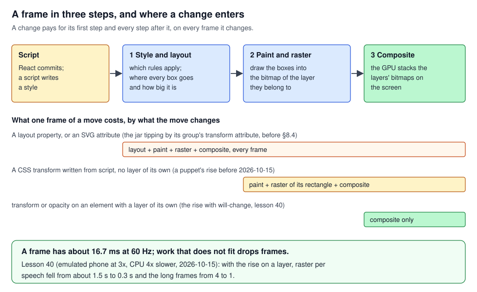
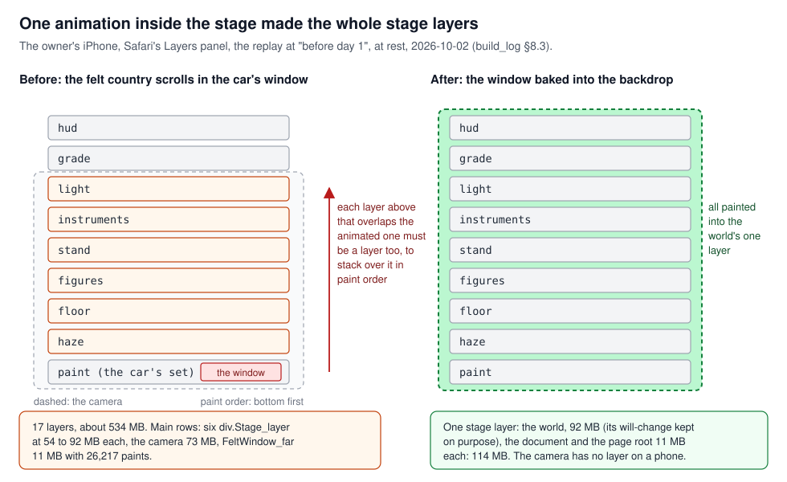
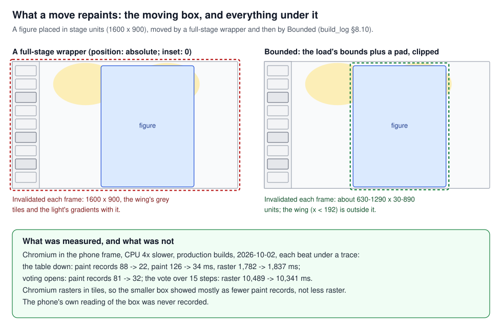
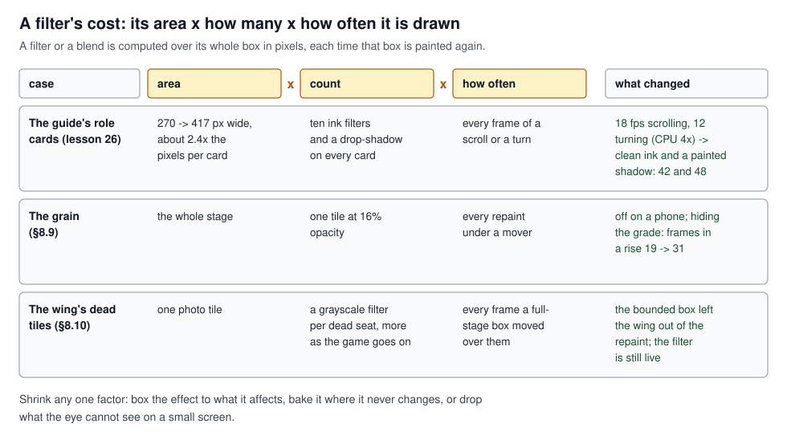
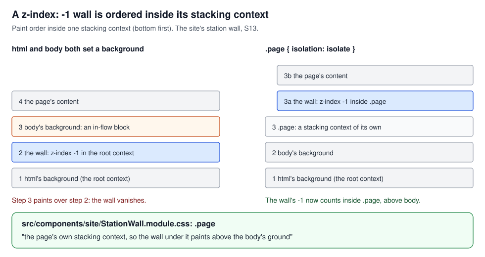

# The rendering pipeline: frames, layers, paint and what each property costs

## What this teaches, and what you need first

What the browser does after React has changed the page, and why the same change can be free on a
desktop and kill a tab on an iPhone. The cases are the stage's crashes and stutter of 2026-10-01
and 2026-10-02 and the fixes that came later. This is a foundation topic. Read
[`react_identity.md`](../react_identity/react_identity.md) first: it ends at the commit, where React
has changed the DOM, and this one starts there. [`stage_motion.md`](../stage_motion/stage_motion.md),
[`memory_and_pictures.md`](../memory_and_pictures/memory_and_pictures.md) and
[`loading_and_deploy.md`](../loading_and_deploy/loading_and_deploy.md) build on it.

Code paths are relative to `frontend/`. Words used throughout:

- **The stage**: the theatre's 16:9 picture. Inside it is **the world**, 1600 × 900 *units* (CSS
  pixels before the stage is scaled to the screen); "full-stage" means that size.
- **The stage's layers**: nine DOM wrappers, `src/stage/Stage.tsx::LAYERS`, in paint order `paint`,
  `haze`, `floor`, `figures`, `stand`, `instruments`, `light`, `grade`, `hud`. They are named for
  what they hold. Whether the browser makes any of them a *compositor* layer (section 2) is a
  separate question.
- **The camera**: the wrapper round the first seven, which zooms and pans them together.
- **A beat**: one step of what the stage shows. **The workbench** (`/workbench/<scene>`) shows any
  beat of a fixture game; `frame=iphone14` draws it phone-sized and `animate=1` plays the moves.
- **`data-small`**: the attribute the Stage sets when drawn small; the code's one flag for "a phone".
- **Device pixels**: the screen's real pixels. A phone has three per CSS pixel in each direction (a
  device pixel ratio of 3), so a box 100 CSS pixels square is 300 × 300 device pixels.

---

## 1. A frame in three steps

A screen is redrawn 60 times a second, so a frame has about 16.7 ms. When something changes, the
browser makes the next frame in up to three steps after the script has run:

1. **Style and layout.** Work out which CSS rules apply to each element, then where every box goes
   and how big it is.
2. **Paint and raster.** *Paint* records drawing commands for each box (fill this rectangle, draw
   this picture). *Raster* runs them into pixels, in the bitmap of the layer the box belongs to. At
   three device pixels per CSS pixel, that is nine times the pixels of a 1× screen.
3. **Composite.** The GPU stacks the finished bitmaps (the *layers*) on the screen, each at its
   position and opacity.

A change starts at the first step it touches and pays for every step after it. A new width runs
layout, paint and composite; a new colour skips layout; moving an element that has a bitmap of its
own runs only the composite. Work that does not fit the frame makes it late, and frames that drop
unevenly (three on time, one late, two on time) are what the eye reads as stutter.

### In this project

**The deal's lag, by step (lesson 46, 2026-10-22).** The owner saw the landing's deal lag on a
phone. A trace of its face-up beat (Chromium, phone frame, CPU throttled four times) read 1.2 s of
main-thread work in 2 s, nearly all the per-frame steps: style, layout, paint, *layerize*
(Chromium's step that decides the layers) and commit. Decoding pictures was 24 ms, though the first
reading had blamed pictures. Summing a trace by step is
[`performance_method.md`](../performance_method/performance_method.md)'s method.

**Time, not memory (build_log §8.9).** With the crashes gone, the owner read the iPhone's own
timeline: a burst of work at each counted chip (one beat of 318 ms, half script and half paint) and
slow frames through every move, while the layer count stayed at three. The burst was React
rebuilding the scene ([`react_identity.md`](../react_identity/react_identity.md) §3); the slow
frames were paint under the movers, sections 3 to 5 here.

On a phone every move is stepped at 24 positions a second (`src/stage/motion.tsx::stepped`), a
policy that belongs to [`stage_motion.md`](../stage_motion/stage_motion.md). It aims at an even
rhythm; it does not guarantee evenly presented frames (2026-10-11 audit §4).

### See it yourself

- Chrome DevTools, Performance panel: record a workbench beat. The main thread shows Recalculate
  Style, Layout, Paint, Layerize and Commit; the raster threads show Raster. Under CPU throttling
  the main thread's tasks are padded with idle time, so read the raster threads (lesson 40).
- Safari Web Inspector, Timelines, Rendering Frames: bars crossing the frame line are late frames.

### The rule

Find the first step a change touches: that step and every one after it are its price, on every
frame it changes.

---

## 2. What a layer is, and what makes one

A **layer** (compositor layer) is a bitmap the browser keeps so the GPU can move or fade it without
painting it again. It costs its width × height in device pixels × 4 bytes, for as long as it lasts.
(Lesson 10 writes "area × 4 bytes × device scale"; the scale enters twice, once per direction.)

The browser gives an element its own layer when told it will move or fade: a running CSS or Web
Animations animation of `transform` or `opacity`, or `will-change: transform`. It does **not** give
one to a style a script writes each frame, which is how the Motion library moves `x` and `y`.

Then the rule that makes layers expensive. The GPU stacks layers in paint order. An element painted
*after* a layer that overlaps it cannot go into a bitmap underneath, so it gets a layer too, and so
does whatever overlaps that. This project calls it **the cascade**: one small animation low in the
stack lifts everything above it.

### In this project

**The felt country (phone lessons 1 and 2, build_log §8.3).** Safari's Layers panel on the owner's
iPhone, the replay at "before day 1", at rest, 2026-10-02, one reading: 17 layers and about 534 MB
before a beat had played. The felt country scrolling past the car's window was an infinite CSS
animation with `will-change` (`svg.FeltWindow_far`, 26,217 paints), so a layer, and every stage
layer painted above it was lifted too, at 54 to 92 MB each. Baked into the backdrop picture, the
same panel read one stage layer, the world, at 92 MB, plus the document and the page root at 11 MB
each: 114 MB. The rule is in `stage_architecture.md` §6: **nothing animates at rest inside the
camera**. The sweep that followed found the same rule broken five more times: the night room's live
window, the wing's breathing glows, the station's seventy snowflakes, the painted kit's idle sway,
the lift's `will-change` held for a whole beat (build_log §8.6, §8.7). On `data-small` all stand
still or keep no layer.

The world keeps its layer on purpose (`src/stage/Stage.module.css`, `.world`): a stable root for
the blends and the zoom, 92 MB inside a phone budget of about a gigabyte. The camera does not: on a
phone `[data-small] .camera` sets `will-change: auto`, because a camera layer lifted the grade and
the HUD drawn after it.

**The GPU route, measured and refused (build_log §8.9).** The obvious cure for a stuttering mover
is a layer. The owner opened the vote on the phone with `?gpu=lift`, which gives the moving boxes
`will-change`: nine stage layers of 52 to 74 MB, about 670 MB, and the tab died. The light and the
HUD are above every mover, so each mover's layer lifts them. Measuring first is lesson 17, in
[`performance_method.md`](../performance_method/performance_method.md).

**Lesson 40, a layer only while it moves (2026-10-15).** The owner saw a speaker's puppet rise at a
low frame rate on a phone. On the live replay (emulated phone at 3×, CPU four times slower): about
34 fps through each rise, with 5 to 7 frames of 50 to 150 ms, and the raster threads busy flat out
for exactly the rise. Motion writes the rise's `transform` from script, so the figure and its wall
shadow, large pictures at the screen's density, were painted and rastered every frame.
`src/stage/cast/Puppet.tsx::Puppet` now holds `rising` state and sets `willChange: 'transform'` on
both until `onAnimationComplete`. Raster per speech fell from about 1.5 s to 0.3 s and the long
frames from 4 to 1. The lesson records raster and frames only; the layers the rise holds on a phone
were not read.

**Lesson 48, no first move under a fading cover (2026-10-22).** The landing's carriage began its
first beat while its loading cover was still fading off. A fade is an opacity animation, so the
cover was a layer over the stage, and the stage under it was lifted onto 79 layers (17 once it had
gone), just as the chips came down. The lesson names no engine. The reel now starts only when
`lifted && !covered` (`src/app/(site)/_components/landing/FeaturedReplay.tsx`), each flag set
`LIFT_MS` (400 ms) after the step before it.

### See it yourself

- On the device: Safari on a Mac, Develop, your iPhone, the page, the Layers tab. The count and the
  total memory are the two numbers (phone lesson 1).
- The price of a layer before paying it: `/workbench/morning?beat=5&animate=1&gpu=lift`, Layers tab
  open. Today only the shutter's panel carries `data-moves` (`src/stage/instruments/Shutter.tsx`).
- In Chrome, the Rendering drawer's "Layer borders" shows where layers are; it cannot tell you an
  iPhone's memory.
- The gate, `npm run e2e -- e2e/phone-rule.spec.ts` with the dev server up, fails a beat that
  animates at rest, keeps `will-change` beyond the world, or moves 60% of the stage or more
  (`LARGE`). There is no CI: it holds the rule only when someone runs it.

### The rule

A layer is memory held for as long as it lasts, plus every overlapping layer above it: give one only
to what moves, only while it moves.

---

## 3. What gets repainted when something moves

When an element with no layer of its own moves, the browser marks part of the layer it is painted
into as dirty: at least the rectangle the element covers, before and after, with any shadow that
hangs past it. Everything in that rectangle is painted again, not only the element: the background
under it, the pictures beside it, the gradients over it. Then raster redoes those pixels. Chromium
rasters in square tiles, so it redoes every tile the rectangle touches. Engines differ in detail,
which is why the numbers below are measured, not predicted.

So the size of the moving *box* matters, not the size of what is drawn in it.

### In this project

**The camera on a phone (phone lesson 9, build_log §8.5).** With its layer taken away on phones, a
zoom became a script transform on a plain element holding the whole world, so the world was
repainted every frame of the move. Raster in each transition beat's first 4.5 s (Chromium, phone
frame, CPU throttled four times, production, 2026-10-02):

| Beat | Raster ms | What moved |
|---|---:|---|
| `vote.count-begins` | 3,555 | the camera's push-in |
| `day.pass` | 2,065 | a puppet's rise |
| `lynch.named`, `vote.result` | 393 to 1,071 | nothing full-stage |

On `data-small` the camera now cuts: `src/stage/Stage.tsx` gives a shot a duration of 0 and keeps
its delay. Why a cut is [`stage_motion.md`](../stage_motion/stage_motion.md)'s.

**Lesson 8, the box and not the figure (phone lesson 12, build_log §8.10).** A figure is placed in
stage units, so the easy wrapper to move it was a full-stage box, `position: absolute; inset: 0`.
The vote's table, the lynch's card, the dropped figure, the figure leaving as the vote opens, the
stands' fades and the winners' rises were each a 1600 × 900 box round a load a third of its width.
Under that rectangle sat the wing, whose dead seats are photos through a `grayscale` filter, and the
light's gradients. `src/stage/instruments/Bounded.tsx::Bounded` makes the moving box the load's own
bounds plus a `pad`, clipped, with the stage's coordinates put back inside, so what rides it is
placed as before (`standBand` is the stands' box). Moves given in percent became moves in units, a
percent being now of the smaller box (S10, in stage_motion).

Measured before and after (production builds, Chromium in the phone frame, CPU throttled four
times, 2026-10-02):

| Beat | Raster ms | Paint records | Paint ms |
|---|---|---|---|
| The table down | 1,782 → 1,837 | 88 → 22 | 126 → 34 |
| Voting opens | 1,426 → 1,284 | 81 → 32 | 79 → 39 |
| The vote, 15 steps | 10,489 → 10,341 | | 523 → 387 |

In Chromium the smaller box showed as fewer paint records and less paint time, and hardly as less
raster: the log puts that down to the tiles, and says a phone's Safari paints the rectangle itself.
The phone's reading was asked of the owner and never recorded. The comment at the head of
`Bounded.tsx` says a browser "repaints the whole of a moving box each frame"; the 2026-10-11 audit
names that as stronger than the code proves. What holds is the policy, a mover's box no bigger than
its load, and the paint records above. The same walk found a day-4 beat no dearer than a day-2 one:
every move had been paying for its full-stage box, early or late.

### See it yourself

- Chrome DevTools, Rendering, "Paint flashing", on `/workbench/lynch?animate=1&frame=iphone14`: step
  to the drop. The green flash is the repainted rectangle; it should be the figure's column.
- In a Performance trace each Paint event carries its clip rectangle; those are in the layer's space
  and do not add up across events (S16).

### The rule

Move a thing in a box no bigger than itself, and check the repainted rectangle with paint records,
not with a comment.

---

## 4. Cheap and expensive properties

Which property a move changes decides where it enters Figure 1:

- **`transform` and `opacity`** never change layout. With a layer of its own the element is
  composite only; without one it skips layout and is repainted as a finished picture through a
  matrix.
- **SVG attributes** (a group's `transform="..."`, `x`, `width`, a path's `d`) are the drawing's
  geometry. Changing one lays out and paints the drawing round it again, and resamples a picture
  inside it on the CPU.
- **Layout properties** (`top`, `left`, `width`, `height`) run layout for the element and whatever
  its size pushes.
- **`visibility`** is discrete: switching it is one repaint of its area and needs no layer. An
  **opacity animation** holds a layer for its whole length, even when its keyframes jump.

### In this project

**Lesson 9, the jar and the shutter (phone lesson 6, build_log §8.4).** With the set baked, the
ballot jar going over and the shutter coming down still stuttered on the iPhone. Both were pictures
inside a full-stage SVG drawing, moved by writing the group's `transform` attribute every frame. The
puppets' rises, HTML boxes moved by a CSS `transform`, were smooth on the same phone. Each moving
picture now sits in an HTML box of its own with a small SVG inside, and Motion moves the box; every
golden at rest was unchanged. Today `src/stage/instruments/Shutter.tsx` is the case; the jar has
not tipped since 2026-10-17, but its glass still sits in its own box (`Jar.tsx`). One path still
writes SVG attributes: `src/stage/instruments/Tween.tsx::Tween`, used by the vote chips' small
flights, which the owner ruled on 2026-10-15 to keep (2026-10-11 audit, follow-up item 4).

**What Motion does (phone lesson 7, build_log §8.4).** Motion drives `x`, `y`, `rotate` and `scale`
by writing `style.transform` from JavaScript each frame. It hands only `opacity`, `filter`,
`clipPath` and a whole `transform` string to the browser's Web Animations API, and adds no
`will-change` unless asked. So a Motion move of `x` is a software move: painted through a matrix
each frame, no layer, no cascade. build_log §8.2 had said on 2026-10-01 that "motion runs on the
compositor"; §8.4 found the opposite two days later by reading Motion's source.

**Lesson 47, a swap by `visibility` (2026-10-22).** A card's turn,
`src/stage/instruments/Flip.tsx::Flip`, squeezes the card to an edge and swaps back for face there.
The swap was an opacity animation with keyframes `[1, 1, 0, 0]`: instant to the eye, but it held a
layer for the whole 0.85 s, so the deal's ten cards turning at once held twenty. Animating
`visibility` (`['visible', 'visible', 'hidden', 'hidden']`) reads the same and takes no layer: the
deal's drawing layers went from 34 to 13, its Layerize time halved and its paint fell by a third.

### See it yourself

- Chrome, Rendering, "Layer borders", on `/workbench/deal?animate=1&frame=iphone14`: count the
  bordered boxes while the cards turn.
- `document.getAnimations()` in the console during a beat lists what the browser animates itself.
  A Motion `x` move is not in it; it shows as style writes on the element in the Elements panel.

### The rule

Move with `transform` on an HTML box, swap with `visibility`, and never animate layout properties
or SVG attributes on anything large.

---

## 5. Filters and blend modes

A **filter** (`blur`, `drop-shadow`, `grayscale`, an SVG noise filter) is computed from the
element's pixels over its whole box, plus the filter's reach, each time that box is painted. A
**blend mode** (`mix-blend-mode: screen`) mixes an element with the pixels under it, so the browser
renders it through a separate surface the size of what is being repainted. A filter on something
still is paid once; under a mover, every frame. So the cost is **area × count × how often**, and any
one factor can be cut.

### In this project

**Lesson 11, the light and the grade (build_log §8.9).** Inside a moving figure's rectangle, every
frame, the light's two full-stage `screen` sheets were rendered and blended, and the grade's grain,
a noise tile at 16% opacity over the whole stage, was drawn again. Subtracting one at a time on the
workbench (Chromium, phone frame, CPU throttled four times): `gpu=nolight` doubled the frames drawn
during a rise (20 → 42 on the day, 86 → 138 at a chip); `gpu=nograde` raised them 60 to 90% (19 → 31,
43 → 82). The fixes, each cutting one factor:

- *Area*: the light's screened sheets are boxed to their gradients, the same pixels
  (`src/stage/paint/light.ts`: "a screen blend is rendered through a surface the size of the
  repaint").
- *How often*: on `data-small` the grain is not drawn (`src/stage/Atmosphere.module.css`), being
  under a pixel on a phone; the puppet's `drop-shadow` is off there too (`src/stage/cast/Puppet.module.css`),
  a blur recomputed every frame the figure moves (§8.5).
- *How often*, again: the bounded movers of section 3 took the wing's grey dead tiles out of the
  repaint. The `grayscale(1)` filter is still live (`src/stage/instruments/Wing.module.css`,
  `.dead .picture img`); the 2026-10-11 audit suggests baking grey copies.

**Lesson 26, the role cards (2026-10-15).** The guide's role cards carried ten ink filters each
(noise displacing the ink) and a `drop-shadow` on the figure. Harmless at 270 px wide. Grown to
417 px, about 2.4 times the pixels, the carousel ran at 18 fps scrolling and 12 turning a card, at
a CPU throttled four times. Clean ink and a painted shadow, a radial gradient under the figure
(`src/app/(site)/_components/RoleCard.module.css`, `.portrait::before`), gave 42 and 48. The filters
were not new; the area was. The archive's slates still carry three turbulence filters each; the
2026-10-11 audit's follow-up leaves them as "measure on a phone".

### See it yourself

- The subtraction words, one at a time, under the same trace of the same beat: `?gpu=nolight`,
  `nograde`, `nofilter`, `noblend` (`src/styles/gpu-probe.css`). They hide the rendering but leave
  React's work in place (rendering audit §3), so what changes is the paint.

### The rule

Price a filter or a blend as area × count × how often, and shrink whichever factor is cheapest:
box it, bake it, or drop what a small screen cannot show.

---

## 6. Paint order, stacking contexts and clips

What is painted later covers what came before. `z-index` changes the order, but only among elements
in the same **stacking context**: a group painted together and then placed as one unit in its
parent's order. The page's root is one. An element makes a new one when it is positioned with a
`z-index`, or has `opacity` below 1, a `transform`, a `filter`, a `mix-blend-mode`, `will-change`
naming one of those, or `isolation: isolate`, which exists only to make one.

Inside a context the order is fixed: its own background, then children with a negative `z-index`,
then ordinary in-flow blocks, then positioned children by `z-index`. Children with the same
`z-index` are painted in document order. A blend mode blends only with what is inside its own
context.

### In this project

**S13, the backdrop that vanished.** A backdrop placed behind a page with `z-index: -1` vanished
when both `html` and `body` set a background: it was a negative child of the root context, and
`body` is an in-flow block of that context, so `body`'s background was painted over it. The fix
makes the backdrop's own section a stacking context, so its `-1` counts inside it, above `body`.
The lesson names no file; the site's station wall carries the fix with the same reason in its
comment: `src/components/site/StationWall.module.css`, `.page { isolation: isolate }`, "the page's
own stacking context, so the wall under it paints above the body's ground". The landing's hero and
rooms and the departures hall do the same.

**The camera's context without its layer.** On a desktop the camera's `will-change` also made it a
stacking context, which keeps the stand's and the rooms' own `z-index`es under the HUD. Dropping the
layer on a phone would have dropped that too, so `[data-small] .camera` adds `isolation: isolate`
(`src/stage/Stage.module.css`). The same file says the stage's `.layer` wrappers "deliberately
create no stacking context of their own, so the light's blend modes reach the paint beneath".

**S20, a tie decided by mount order.** The card's veil and the notes hint both had `z-index: 5`. A
tie goes by document order, and with portals that is the order the portals were added: the veil
covered the hint only because the hint mounted first. Lesson 33's fix made renders less frequent
([`react_identity.md`](../react_identity/react_identity.md) §4), the order changed, and the hint
came out above the veil. The veil's rule is `src/stage/instruments/NightRoom.module.css`, `.veil`
(the open card of `FramedCard.tsx`); the hint's rule was not found in today's code. Anything that
must cover something gets a higher number.

**S15, a rounded clip.** A rounded `overflow: hidden` round an animating layer costs a mask the size
of the clip (section 7). The landing's carriage clips the moving stage with a plain rectangle and
draws the 6 px corner on the frame round it: `src/app/(site)/_components/landing/Carriage.module.css`,
`.screen` ("the stage, clipped by a plain rectangle") inside `.glass`.

### See it yourself

- On a site page, Elements panel: select the wrapper whose class contains `StationWall` and `page`,
  untick `isolation: isolate`, and watch whether the wall survives (it depends on whether `html` and
  `body` both set a background at the time).
- List a stylesheet's `z-index` values: two equal ones that can overlap are a tie waiting for a
  change in render order.

### The rule

Know which stacking context an element paints in, make one on purpose with `isolation`, and never
let a `z-index` tie decide what covers what.

---

## 7. Masks: a platform limit

A **mask** shows an element only where another image is opaque. The browser renders the content
into a surface of its own and the mask into another, then multiplies them, so a mask costs extra
buffers the size of the masked area, in device pixels.

### In this project

**Every stage page killed on an iPhone (build_log §8.1).** From the redesign's deploy on 2026-09-28,
every page with a stage died on an iPhone with "A problem repeatedly occurred": WebKit's content
process being killed, not a script error. Pages without a stage were fine. Desktop Chrome and
desktop WebKit never crashed, so no test could have found it, and nobody knew for three days. The
workbench's subtraction words found it in eight taps on the phone: only `nomask` and `nosvg` made
the page survive. The stage had five full-stage SVG `<mask>` elements: the house light (a dark sheet
with soft holes cut by a blurred mask), the atmosphere's veil and frame shadow, the night room's
candle light, and the drape's fade. The log's explanation, that iOS renders a masked SVG through a
software path with buffers at three times the CSS resolution, is the builder's reading of that
result, not a confirmed WebKit fact. The observation is narrower: with masks or SVG switched off the
page survived, with anything else switched off it did not. The owner found the crash and ran the
probe links; the subtraction method was the agent's proposal, after the owner's own A/B by
subtraction on Chrome on 2026-09-25; an agent built the replacement to a brief.

The masks became plain vector sheets: one path with `fill-rule="evenodd"` cutting the holes, each
hole softened from inside by a radial gradient of the sheet's own dark (`src/stage/paint/light.ts`).
A full-stage CSS `mask-image` (a chosen photo's darkening) was found the same day. The guard is
`src/stage/paint/paint.test.ts`, "no mask on the stage": it reads every stage source and fails any
SVG mask outside the 52-unit glyphs (`Sigil.tsx`, `FactionMark.tsx`) and any CSS mask outside the
word-sized `.stamp` rules. The phone gate also fails a mask over 5% of the stage (`MASK_LARGE`).

It is a limit on one technique in one engine, not a rule against masks. Off the stage the site uses
masks on still boxes painted once, such as the guide's side panel, "one mask on a still box, drawn
once with the page" (`src/app/(site)/_components/guide/Guide.module.css`).

### See it yourself

- `npm test` in `frontend/` runs `paint.test.ts`; add `<mask` to a stage file and watch it fail.
- `/workbench/day?gpu=nomask`, or `nosvg`: the words that found it. On a desktop nothing crashes
  either way, which is the point.

### The rule

A technique that is free on a desktop can be fatal in one engine: keep masks off anything large or
moving, and hold that with a test, since only the device shows the failure.

---

## Case index

| Case | Short | Section |
|---|---|---|
| Head B | A frame in three steps; what a layer is | 1 and 2 |
| 8 | The browser repaints the moving box | 3 |
| 9 | Transforms and opacity, not SVG attributes | 4 |
| 10 | An animated property makes a layer; the cascade | 2 |
| 11 | Blend modes and filters per repaint | 5 |
| 26 | A filter's cost is area × count × how often | 5 |
| 40 | A script transform needs its own layer | 2 |
| 47 | An instant swap: `visibility`, not opacity | 4 |
| 48 | No first move under a fading cover | 2 |
| S13 | A `z-index: -1` backdrop and `isolation` | 6 |
| S15 | A rounded clip round a layer costs a mask | 6 |
| S20 | A `z-index` tie is mount order | 6 |
| Phone 1 | Layers are what cost memory | 2 |
| Phone 2 | One animating element promotes everything above it | 2 |
| Phone 6 | A CSS transform against an SVG attribute | 4 |
| Phone 7 | What Motion does and does not do | 4 |
| Phone 9 | A script-driven camera repaints the world | 3 |
| Phone 12 | The box, not the figure | 3 |
| build_log §8.1 | Five full-stage masks; the subtraction probe | 7 |

---

## If you are asked about it

"A browser draws a frame in three steps: layout, then paint and raster into bitmaps, then the GPU
compositing the bitmaps, and a change pays from the first step it touches. On the werewolf stage I
own, agents built the drawing to my specs and I tested it on my iPhone with Safari's Layers panel.
The first crash was five full-stage SVG masks, found by switching off one kind of GPU work at a
time until the page survived. The next was memory: one scrolling window had its own layer, and every
layer painted above it had to become one too, 17 layers and 534 MB at rest; baked into the backdrop,
it was one layer and 114 MB. Then stutter: figures moved inside full-stage boxes, so each frame
repainted the stage under them, blends and filters included. We cut each mover's box to its load
and priced every filter as area times count times how often. The tempting fix, a GPU layer per
mover, I measured first: it lifted the whole stage to about 670 MB and killed the tab. So a layer
goes only to what moves, only while it moves, and a discrete change is a `visibility` switch, not an
opacity animation."

---

## Reading

From principles §3:

- web.dev: "Rendering performance", and "Stick to compositor-only properties and manage layer
  count".
- Chrome DevTools: the Performance panel; the Rendering drawer (paint flashing, layer borders).
- Safari Web Inspector: the Timelines and Layers tabs.

Added, primary sources only:

- WebKit, "Layers Tab" (webkit.org/web-inspector/layers-tab/): what the panel's paint count and
  memory mean.
- Motion, "Performance" (motion.dev/docs/performance): which values it animates in script and which
  it hands to the browser.
- MDN: "Stacking context", and the reference pages for `isolation`, `will-change`,
  `mix-blend-mode`, `filter` and `mask`.

No case here, so reading only: CSS containment (`contain: paint`, `content-visibility`), and drawing
a scene with canvas or WebGL instead of the DOM (the 2026-10-11 audit's PixiJS experiment, proposed
and not built).
