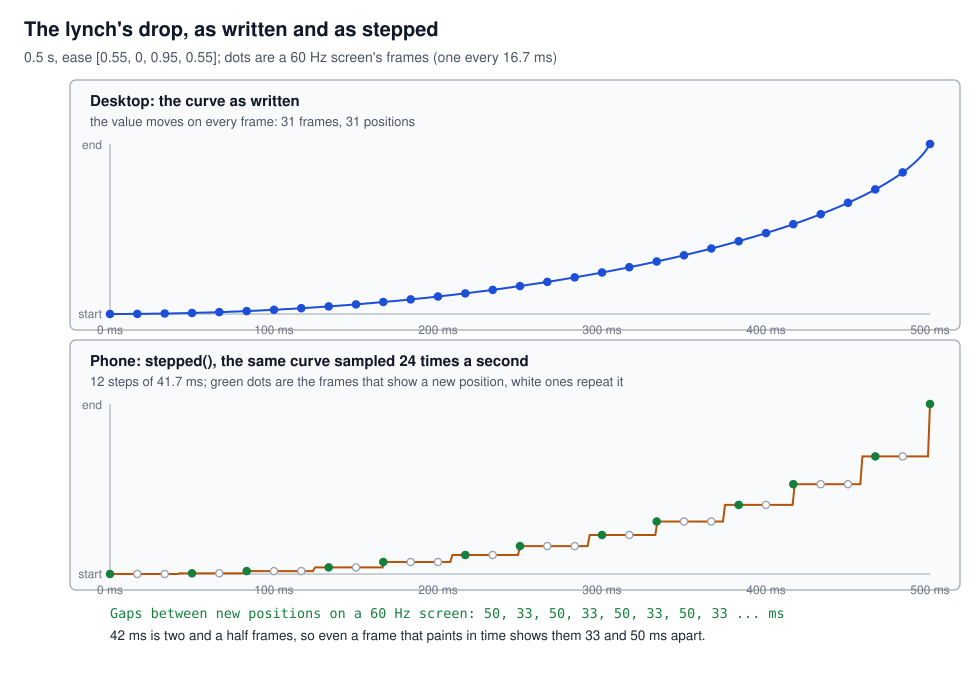
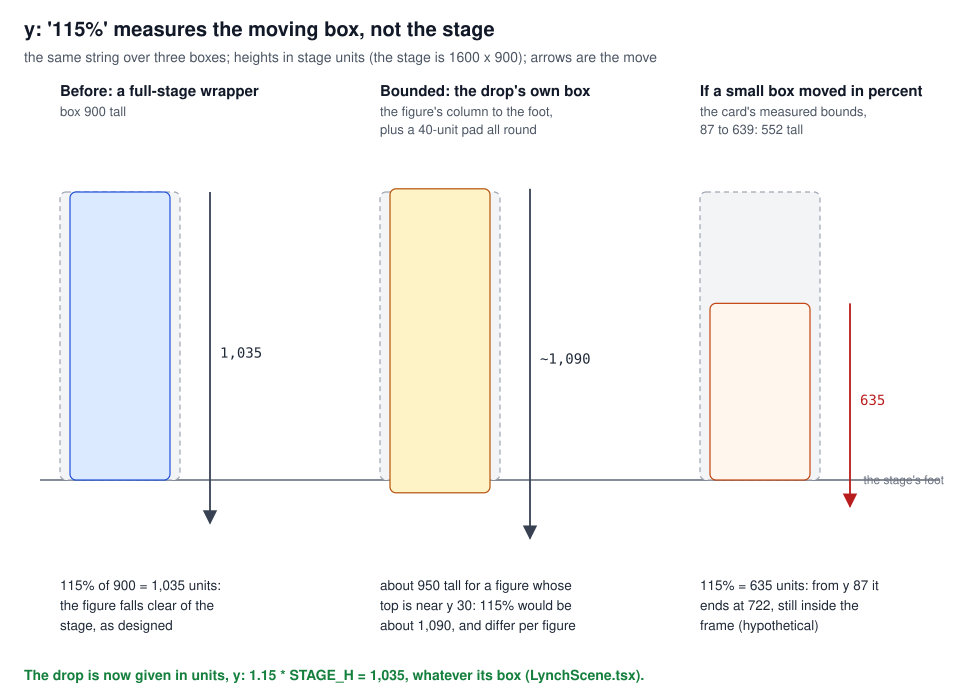
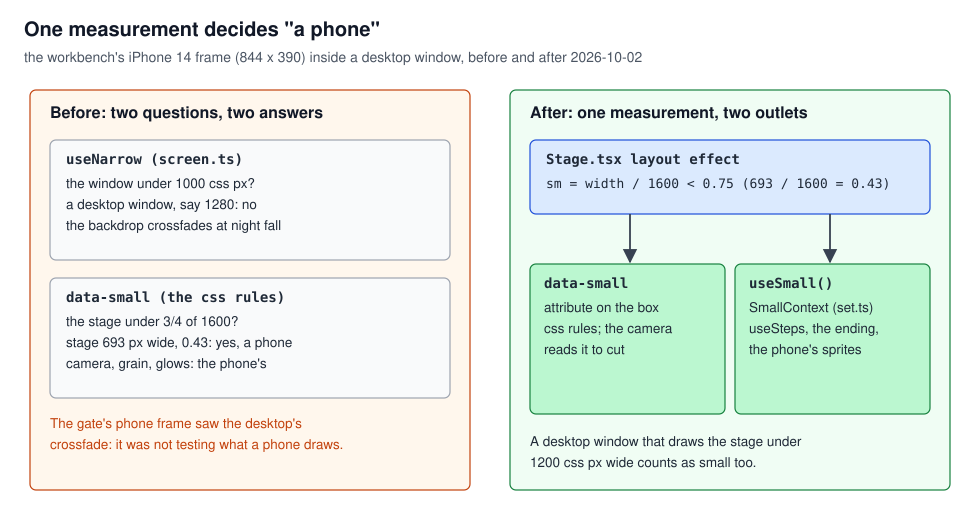
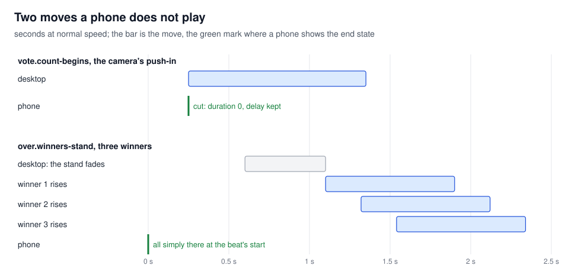
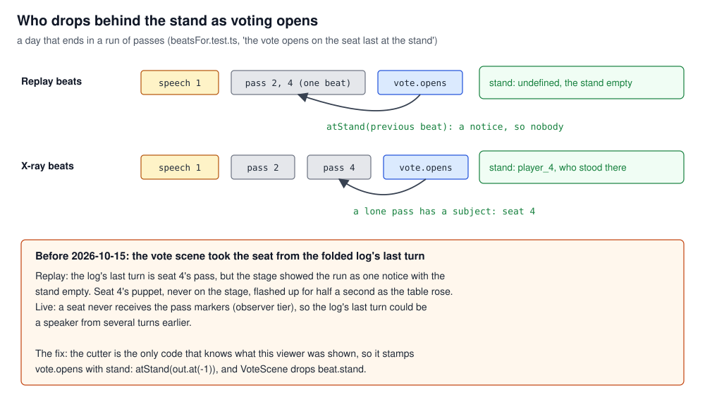

# Stage motion: what moves, how often, and what it carries over

## What this teaches, and what you need first

How the stage decides what may move, how often a move draws a new position, and which moves a phone
skips; then where a transition gets what it carries over from the beat before. You need
[`rendering_pipeline.md`](../rendering_pipeline/rendering_pipeline.md) first: what a layer is, and
why a moving element with no layer of its own is painted again on every frame. Keys and remounts are
in [`react_identity.md`](../react_identity/react_identity.md).

The rules themselves are in [`stage_architecture.md`](../../stage_architecture.md) §6 ("arrive still,
play moving", nothing animating at rest, the phone's exceptions). This tutorial explains the
mechanisms behind four of them and does not restate the list.

Words used throughout:

- **Beat**: one step of the stage ("voting opens", "a chip is counted"), cut from the event log.
- **Mover**: an element that changes position during a beat: a figure rising, a card lifted, a
  chip dropping.
- **`motion`**: the animation library the stage uses (v12). A component gives it a target and a
  **transition** (a duration, a delay and an **ease**, the curve from start to end), and it writes
  the element's `transform` from script on every frame until the move ends.
- **Small stage**: the stage drawn under three-quarters of its 1,600-unit width, which in practice
  means a phone (section 3).

---

## 1. Stepped motion: 24 positions a second

A screen shows a new frame about every 16.7 ms (60 a second). An animation is smooth only if every
frame's work fits that budget. When it does not, some frames are late: the moves come out a few at
16 ms, one at 50, then two at 16. The eye reads that unevenness as stutter, more than it reads a
lower but even rate.

**Stepping** is a way to ask for fewer, evenly spaced positions. Keep the same curve, but sample it
at fixed points and hold the value in between. CSS has it built in as `steps(n)`. A film runs at 24
pictures a second, and a puppet theatre at that rate reads as intended.

### In this project

**Lesson 14 and phone lesson 11 (build_log §8.9, 2026-10-02).** With the crashes gone, the owner's
Safari timeline still showed slow frames through every move on the iPhone. A mover with no layer is
painted again by the CPU on every frame, together with the light's gradients and blends beneath it,
and that paint did not fit 16 ms. The obvious answer, a layer for each mover, was measured on the
owner's phone with the workbench's `gpu=lift` switch: a layer for one jar and one shutter panel
lifted every stage layer painted above them, about 670 MB, and the tab died (one reading, one phone).
So the GPU route was refused.

The answer was a **motion policy**, one place that decides how every move is given to `motion`,
in `frontend/src/stage/motion.tsx`:

- `::stepped` takes a transition and returns it with its ease replaced: the same curve, sampled at
  `PHONE_FPS = 24` steps a second over the move's duration, at least two steps. A 0.5 s move becomes
  12 steps of about 41.7 ms. Start, end and shape are unchanged.
- `::useSteps` hands a component `stepped` on a small stage and the transition as written
  everywhere else. Thirteen files call it: the puppet's rise, the lift, the shutter, `Tween`, the
  string drops, the pin, the tooth, the photo and the others build_log §8.9 lists.
- Fades are not stepped. In the code's words, a fade is the compositor's and needs no stepping.

**What stepping aims at, and what it does not give.** The code comment says the stepped curve "asks
for a repaint every 42 ms". It aims at that; it does not guarantee it. Figure 1 shows why even the
best case is uneven: 42 ms is two and a half frames of a 60 Hz screen, so new positions land 50 and
33 ms apart. A frame whose paint still runs over is still late, and `motion` still runs its
callback on every display frame. Both audits say so. The rendering audit (2026-10-02) called
`PHONE_FPS = 24` "a quality/performance tradeoff, not evidence that the renderer can now sustain 60
FPS". The 2026-10-11 audit (§4): "24 distinct positions per second are not guaranteed evenly
presented frames". Lesson 14 calls it what it is: a presentation choice, not a fix for the paint
cost. It shipped in one batch with the set's host, so §8.9's before and after table measures the
batch, not the stepping alone. The 2026-10-11 audit also lists it among the small-stage compromises
and advises testing a native keyframe animation rather than lowering the rate again.

### See it yourself

- Read `stepped`: it is a dozen lines. No unit test covers it.
- In the workbench, open `/workbench/lynch?animate=1&frame=iphone14`, step to the drop, and record
  Chrome's Performance panel with Screenshots on. Then do the same without `frame=`. In the phone
  frame, look for the figure holding one position across neighbouring screenshots.

### The rule

On a phone, sample each move's curve at 24 steps a second, and call it a steadier presentation,
never a steady frame rate.

---

## 2. A percentage move is measured on the moving box

A CSS `transform: translateY(115%)`, or `motion`'s `y: '115%'`, is a percentage of the element's
own height, not of its parent or the stage. So the same string moves a tall box far and a short box
a little. Shrink the box and the move shrinks with it.

### In this project

**S10, the lynch's drop (`aca4e838`, 2026-10-02).** The dropped figure fell with `y: '115%'` on a
full-stage wrapper, 900 units tall: 1,035 units, clear of the stage. The same commit introduced
`frontend/src/stage/instruments/Bounded.tsx::Bounded`: a mover's box became its load's own bounds,
so the browser repaints the figure's column and not the whole stage. From then on a percentage meant a percentage of a box that differs per
figure. The drop is now given in units, `y: 1.15 * STAGE_H` in `LynchScene.tsx`, and `Bounded`'s
comment states the rule: moves in percent are of the box now, so give them in units.

A percentage is right when the move *should* follow the element. `Puppet.tsx` starts the rise at
`y: '100%'`: a figure rises exactly its own height into the stand, whatever its size.

### See it yourself

In `/workbench/lynch?animate=1`, select the drop's moving `div` in the Elements panel during the
drop: its height is the figure's column plus the pad, not 900.

### The rule

Give a move in your own units, and in percent only when it should scale with the element itself.

---

## 3. One flag for what a phone is

A responsive page asks "is this a phone?" in many places: in CSS, and in components that choose a
cheaper form. If two places measure different things, a page can be half phone and half desktop.

### In this project

**One measurement (build_log §8.7, 2026-10-02).** `frontend/src/stage/Stage.tsx::Stage` measures the
stage's drawn width in a layout effect (before the first paint) and calls it small when it is under
three-quarters of 1,600 units, that is under 1,200 CSS px. The same answer goes two ways: the
`data-small` attribute on the stage box, which the CSS rules key on, and `SmallContext`, which
components read through `frontend/src/stage/set.ts::useSmall`. `useSteps`, the ending's figures and
the phone's smaller pictures read `useSmall`.

Before, the backdrop's cut and the stand's arrival read `useNarrow`, the window under 1,000 CSS px.
The phone-rule gate runs in the workbench's iPhone frame (844 by 390) inside a desktop window. The
window was wide, so `useNarrow` said desktop while `data-small` said phone, and the gate saw the
desktop's crossfade at nightfall. `screen.ts` was deleted and one flag remained.

Two consequences. A desktop window that draws the stage under 1,200 px gets the phone's forms too.
And picture density is a separate question: `set.ts::useStageWidth` exists because a small stage on
a dense screen can still need a large picture.

### See it yourself

On any stage page, run `document.querySelector('[data-small]')` in the console, then narrow the
window until it returns the stage. `frontend/e2e/phone-rule.spec.ts` walks every scene in the phone
frame; there is no CI, so it holds only when someone runs it.

### The rule

Decide "small" once, from the thing being drawn, and let CSS and components read that one answer.

---

## 4. When a move costs too much, show where it ends

§6's first rule is "arrive still, play moving": a beat reached by seeking or refreshing is simply
there, and only a beat played forward animates. A phone exception applies the same idea to a move it
cannot afford: drop the travel and keep the timing, so the end state appears when the move would
have started.

### In this project

**Phone lesson 9, the camera (build_log §8.5, 2026-10-02).** The camera is one `motion.div` around
every stage layer. On a desktop it keeps `will-change: transform`, so a zoom is the GPU's. On a
phone it does not: its layer forced the grade and the HUD onto layers too, 212 MB at rest in
Safari's Layers panel. So a phone's zoom was a script-written transform on a plain element, and the
whole world was repainted every frame. A Chromium trace per transition beat (phone frame, CPU
throttled four times, production build, first 4.5 s of each beat) put the count's push-in first at
3,555 ms of raster and a pull-back second at 2,230 ms. Now `Stage.tsx::Stage`'s camera effect reads `data-small` and sets the duration to
0, keeping the delay.

**Phone lesson 12, the ending (build_log §8.10, 2026-10-02).** Three winners rising together at the
ending lagged on the owner's phone. The owner ruled that on a phone the winners are simply there: no
rise, no stand fading in. The screen of them winning is the point. In
`frontend/src/stage/scenes/GameOverScene.tsx` the rise and the stand's fade both carry `!small`. The
board still goes up and the result still arrives.

The 2026-10-11 audit lists both among the small-stage compromises, to be restored only once a
cheaper rendering has been proven on the phone.

### See it yourself

`/workbench/vote?animate=1`, stepped to the count's first beat, with and without `&frame=iphone14`.
Then `/workbench/over` at the winners' beat the same way.

### The rule

When a phone cannot afford a move, show its end state at the moment it would have started, never a
slower or cheaper version of the move.

---

## 5. Carry-over comes from what the stage showed

A transition often shows something left over from the scene before: a speaker stepping away, a card
leaving. That something must be what the viewer *saw*. The data can say something else, because
what the stage shows is a selection: beats merge, and each viewer is cut a different list.

### In this project

**Lesson 41 (`60546a00`, 2026-10-15).** As voting opens, the vote scene drops the day's last
speaker behind the stand. It took that seat from the folded log's last turn. Since 2026-10-12 a run
of passes plays as one beat, a notice with the stand empty. So in a replay of a day ending in
passes, a puppet that had never been on the stage flashed up for half a second as the table rose.
Live it was worse: a seat never receives the pass markers (they are observer-tier), so the log's
last turn could be a speaker from several turns earlier.

Only the beat cutter knows what each viewer was shown. In `frontend/src/stage/beats/beatsFor.ts`,
`push` now stamps `vote.opens` with `stand: atStand(out.at(-1))`, where `out` holds only the beats
this viewer is shown. `::atStand` returns the seat a day beat has at the stand, and nobody for a
notice. `VoteScene.tsx` drops `beat.stand`.

### See it yourself

`npm test -- beatsFor` in `frontend/` runs "the vote opens on the seat last at the stand, and on
nobody after a run", over the replay, live and X-ray cuts. The beat goldens in
`src/stage/beats/__goldens__/` print each `vote.opens` with its `stand`.

### The rule

A transition carries over what the previous beat showed, handed over by the cutter, never rebuilt
from the data.

---

## Case index

| Case | Short | Section |
|---|---|---|
| 14 | A steady low frame rate (the `stepped` policy) | 1 |
| 41 | A scene's carry-over comes from what the stage showed | 5 |
| S10 | A percentage move shrinks with its element | 2 |
| Phone 9 | The camera cuts on a phone | 4 (the flag it reads: 3) |
| Phone 11 | 24 steps a second; the GPU route refused | 1 |
| Phone 12 | The ending's winners simply there | 4 |

---

## If you are asked about it

"On my werewolf stage the moves stuttered on an iPhone because a figure moving without its own GPU
layer is repainted by the CPU every frame, and that paint missed the frame budget unevenly. Giving
each mover a layer was measured on my phone and refused: it pulled the whole stage onto layers, about
670 MB, and the tab died. So the agents who built the stage made it a policy: on a small stage every
move samples its curve 24 times a second. That gives an evener presentation, not a guaranteed frame
rate, and two audits said so. A zoom of the whole world became a cut at the moment it would have
started, and the winners at the ending simply appear. All of that hangs on one measurement of the
stage's drawn width, read by CSS and by components alike, so the phone test sees what a phone sees.
And a transition takes what it carries over from what the viewer was shown, stamped by the beat
cutter, not from the game log. I specified the stage and tested on the device; agents wrote the
code."

---

## Reading

From principles §3:

- "Even, low frame rates read better than uneven high ones" (lesson 14), with the section's list:
  web.dev, "Rendering performance" and "Stick to compositor-only properties and manage layer count";
  Chrome DevTools, the Performance panel; Safari Web Inspector, the Timelines and Layers tabs.

Added, primary sources only:

- Motion, "Performance" (motion.dev/docs/performance): which of its animations run on the
  compositor and which from script. The 2026-10-11 audit cites it.
- MDN, `steps()` under `<easing-function>` (section 1), and `translate()` under
  `<transform-function>`, for what a percentage refers to (section 2).
