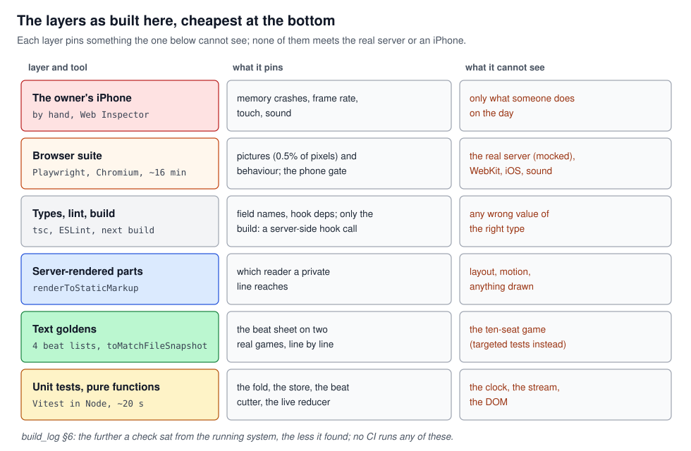
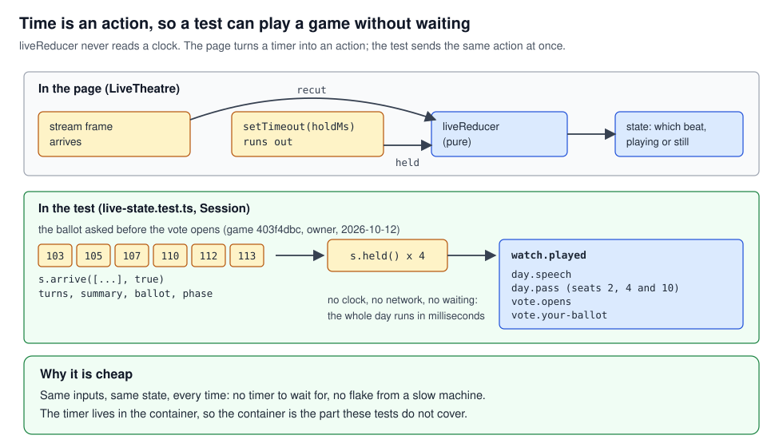
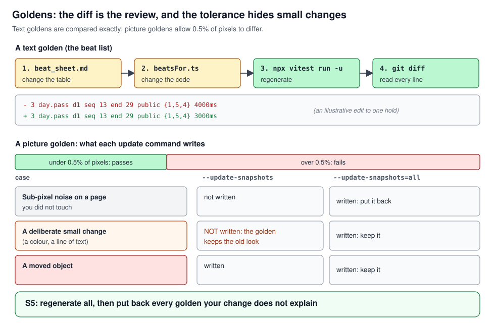
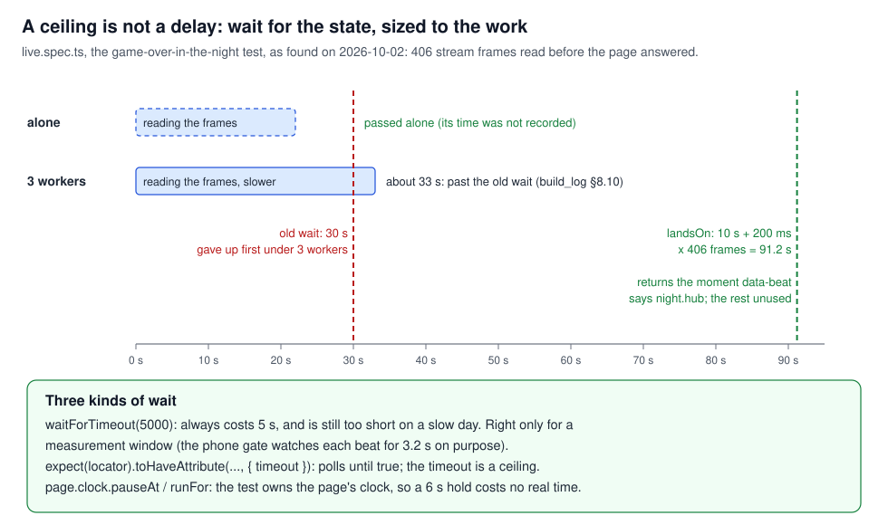
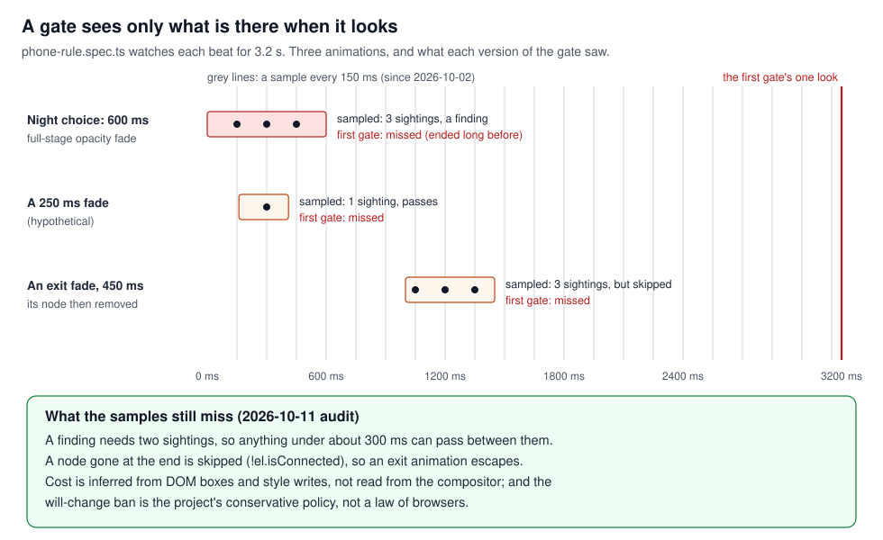
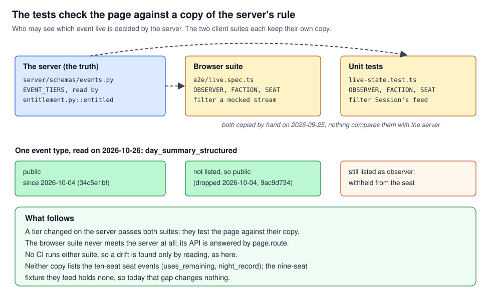

# Testing a real-time UI

## What this teaches, and what you need first

What each kind of test in this frontend proves, what it cannot see, and the ways a test of a live,
animated page went wrong here: waiting on the clock, looking at the wrong moment, running against
the wrong server, checking a copy of the truth. It comes last, and says which test pins each other
tutorial's concept:
[`react_identity`](../react_identity/react_identity.md),
[`rendering_pipeline`](../rendering_pipeline/rendering_pipeline.md),
[`memory_and_pictures`](../memory_and_pictures/memory_and_pictures.md),
[`loading_and_deploy`](../loading_and_deploy/loading_and_deploy.md),
[`stage_motion`](../stage_motion/stage_motion.md),
[`performance_method`](../performance_method/performance_method.md),
[`realtime_and_sync`](../realtime_and_sync/realtime_and_sync.md) and
[`css_layout`](../css_layout/css_layout.md). The living spec of the suite, with its commands and
ports, is [`testing.md`](../../testing.md); this tutorial teaches the ideas behind it.

The tests, like the rest of the browser code, were written by AI agents to the owner's specs. The
owner wrote the event schema, co-wrote the beat sheet the goldens pin, and ran the device checks.

Six words used throughout:

- **Assertion**: one check inside a test (`expect(x).toBe(3)`). A test fails at its first failed
  assertion.
- **Fixture**: the fixed input a test runs on. Here, mostly real games saved from the server.
- **Golden** (or snapshot): a stored copy of an expected output, compared whole with what the code
  produces now.
- **Mock**: a stand-in for something the test does not run, such as the server's API.
- **Flake**: a test that fails on some runs and passes on others with the code unchanged.
- **Gate**: a test that checks a rule across every case (every scene, every beat), not one example.

---

## 1. What a passing run proves

A test proves that for this input, under these conditions, this check held; nothing more. So the
question about a suite is not "does it pass?" but "what would it notice?", and the answer differs by
layer.

The builder's own record of the first build, in August 2026, answers it bluntly
([`build_log.md`](../../build_log.md) §6). The type
checker, lint and the build caught two invented field names and nothing else. Reducer tests on a
real archived game caught the data-model errors. Reading the HTML the server actually sent caught a
white flash. Driving the real API caught a seat recovery that could never fire. Opening the public
URL caught Cloudflare holding back the event stream. In its words: the further the check was from
the real running system, the less it found.

The layers as built today, cheapest first:



No layer meets the real server: the browser suite answers every API call from saved games. And no
layer runs by itself: there is no CI (a service that runs the tests on every commit). Counted on
2026-10-26: 73 unit test files in `src/`, 8 Playwright specs in `e2e/`.

### See it yourself

In `frontend/`: `npm test` runs the unit layer in about 20 seconds; `npm run typecheck`,
`npm run lint`, then `npm run build` the next three. The browser suite needs a running build and
has a procedure of its own ([`testing.md`](../../testing.md), "How a run is done here").

### The rule

Know what each layer can see, and check what none of them can on the running system.

---

## 2. Pure functions make the first layer cheap

A **pure function** returns the same output for the same inputs and changes nothing outside itself:
no clock, no network, no DOM. Testing one is calling it and comparing the result.

What makes a real-time page testable is making **time an input**. A function that calls
`setTimeout` can only be tested by waiting; one that is *told* "the hold ran out" is tested at once:

```js
// hard to test: the function owns the clock
function play(stage) { setTimeout(() => stage.next(), 4000); }
// easy to test: the clock is outside, and its tick is an ordinary input
function reduce(state, action) { return action.type === 'held' ? next(state) : state; }
```

### In this project

**The live stage has no clock.** `src/stage/containers/live-state.ts::liveReducer` decides which beat
is on the stage, whether it plays or lands still, and when a prompt opens. Its head: "No timers and
no network here: the live theatre runs the clock and the requests and hands the results in as
actions, so a test can feed a game in one event at a time." When a hold runs out, the theatre's
timer dispatches `{ type: 'held', step }`; the test sends the same action directly.



`src/stage/containers/live-state.test.ts` wraps that in a small `Session`: `arrive(events, asNews)`
adds events and recuts the beat list, `held()` says a hold ran out, `drain()` runs out every hold.
"The ballot, asked before the vote opens, waits for the day's passes and the opening" replays the
bug the owner found in live game 403f4dbc on 2026-10-12 (the ballot opened while the stage still
played the day's passes): six events in, the holds run out, the order played checked.

**Fixtures are real games.** `src/game/foldEvents.test.ts` folds a 593-event game captured from the
server; most other suites use the archived games in `src/stage/fixtures/`, `replay-9369a5c1.json`
above all. Real data made the first tests useful: one expected 149 annotated slots from 149
annotations, got 85, and the test was wrong (two kinds of annotation can share a slot), which forced
the real invariant into words (build_log §3.3).

**Server-rendered components.** `renderToStaticMarkup` runs a component in Node and returns its
markup; `src/stage/instruments/pack-chat.test.tsx`, for one, checks the pack's chat box shuts while
a line is on its way.

Pure tests that pin other tutorials' concepts: the history line and the blip rule in
`src/hooks/catch-up-boundary.test.ts`, and the run of passes (lesson 24) in `live-state.test.ts`,
for [`realtime_and_sync`](../realtime_and_sync/realtime_and_sync.md); "keeps the old beat objects,
and the old list when nothing changed" (`keepSame`) for
[`react_identity`](../react_identity/react_identity.md).

### See it yourself

`npx vitest run src/stage/containers/live-state.test.ts` in `frontend/`. Then break the rule on
purpose: in `liveReducer`, make `held` move two beats instead of one, run it again, and read which
tests fail and why. Undo the change.

### The rule

Keep the clock and the network outside the logic, and test the logic by feeding it events and
ticks.

---

## 3. Goldens, and how they are updated

A golden test stores an output a person once read and agreed with, and fails when the output
changes. It says what *changed*, not what is right, so updating one is a review: the diff is the
thing to read.

Two kinds live here:

- **Text goldens.** `src/stage/beats/beatsFor.test.ts` dumps the whole beat list, one line per beat,
  for two games (the nine-seat 9369a5c1 and the Phase 2 game), each in its public and its reveal cut:
  four files in `src/stage/beats/__goldens__/`. Vitest's `toMatchFileSnapshot` compares them exactly.
- **Picture goldens.** Playwright's `toHaveScreenshot` compares the page with a PNG in
  `e2e/__screenshots__/`. Pictures are never identical from run to run (anti-aliasing, sub-pixel
  placement), so `playwright.config.ts` allows 0.5% of pixels to differ (`maxDiffPixelRatio: 0.005`)
  and turns CSS animations off for the shot.

### In this project

**The order rule.** The beat sheet's head: "Change the table, change the code, regenerate the
golden, in that order." The table in [`beat_sheet.md`](../../beat_sheet.md) is the truth for what
the stage shows; `beatsFor.ts` mirrors it; the golden pins the mirror on real games. The test file
says to regenerate them with `npx vitest run -u` and read the diff, which in its words "IS the
review". The ten-seat game has no golden; targeted assertions in the same file hold it.

**S5, the tolerance hides a small change.** `--update-snapshots` rewrites only the goldens that
fail, and a golden fails only past 0.5%. A deliberate change to a colour or a line of text can stay
under it, pass against the old golden and never be written: the golden keeps the old look. So the
procedure in [`testing.md`](../../testing.md) regenerates every golden (`--update-snapshots=all`),
compares each with the commit the build was made from, and puts back the ones the change does not
explain: sub-pixel noise, a clock a second later, a section shot before it mounted, goldens another
agent's change left stale.



### See it yourself

- Open `src/stage/beats/__goldens__/9369a5c1.public.txt` beside [`beat_sheet.md`](../../beat_sheet.md):
  each line is a beat id, its day, the stretch of the log it covers, the viewer tier and its hold.
- After a picture run, `npx playwright show-report` shows each failed shot as expected, actual and
  diff.

### The rule

A golden records a reviewed output; regenerate all of them after a deliberate change, and keep only
the diffs the change explains.

---

## 4. Invariants, and names that do not move

An **invariant test** checks a property that must hold for every case, instead of one expected
output: "for every layout, A equals B", "the beat list never goes backwards". It survives changes
that rewrite the output, and it states the reason the output is right.

A test that names its target by position is the opposite: a beat number, a list index. When the
code that builds the list changes, the number points at something else, and the test fails, or
worse, passes on the wrong thing.

### In this project

**Lesson 29a, a baked copy against the live computation.** The dining car's backdrop is a baked
picture, made at two layouts, while the shutter over its window is placed live from the layout's
geometry. The layout with no HUD had no sheets of its own and reused the live HUD's, on a comment
that the two were alike; they had differed since 2026-09-29, so on the landing's carriage on an
upright phone the shutter fell 96 units short of the window (found 2026-10-15). The test that now
holds them, `src/stage/instruments/backdrop.test.ts`, "puts the painted glass under the shutter",
runs over all six layouts (three HUDs, the side slot open or closed) and checks that the glass's
centre is the shutter's. The lesson's rule: when a shortcut maps one case onto another, write the
test that says they agree, not a comment. Its home is
[`memory_and_pictures`](../memory_and_pictures/memory_and_pictures.md).

**More invariants in the suite:**

- `beatsFor.test.ts`, "reveals the log monotonically" (each beat reaches at least as far into the
  log as the one before) and "the X-ray adds beats and never drops a public one".
- `live-state.test.ts`'s `Watch` checks every move of the stage in the tests that switch it on: a
  beat that played is never played again.
- `src/stage/paint/paint.test.ts`, "is the drawing under another id once the stand-in is renamed":
  the lighting cache's contract from lessons 12 and 36
  ([`react_identity`](../react_identity/react_identity.md) §4).

**Lesson 24's test twin, names that move.** Lesson 24 is about the beat list being cut afresh on
every event, so items merge (a run of passes becomes one beat); its home is
[`realtime_and_sync`](../realtime_and_sync/realtime_and_sync.md). Its twin for tests: anything that
names an item by its index moves when the derivation changes. The workbench is addressed by index
(`/workbench/day?beat=11`), and `e2e/workbench.spec.ts` names its shots that way. On 2026-10-17 a
full run failed partly because "a workbench beat index my change shifted" and had to be renumbered
(deploy_log, that day's entry). Where the tool allows, name the item by what it is; where it does
not, the spec's comments say which golden line each index is (`workbench.spec.ts`, "golden lines 3,
4, 14 and 34").

**The fixture is part of the name.** The 2026-10-11 audit found three unit failures in
`src/stage/scenes/night-lobby.test.ts`: the tests used the workbench's default game, expecting nine
seats, and the default had become the ten-seat game. The file now pins its game (`const NINE = {
...DEFAULT_QUERY, game: '9369a5c1' }`), and "Explicit fixture identity" heads the audit's list of
tests to add.

### See it yourself

In `src/stage/instruments/Backdrop.tsx::sheetFor`, return `dx: 0` instead of the computed slide and
run `npx vitest run src/stage/instruments/backdrop.test.ts`: the two layouts that have sheets of
their own still pass, and every case that borrows or slides a sheet fails by name. Undo it.

### The rule

Test the property that makes an output right, and name what a test looks at by what it is, not
where it sits.

---

## 5. Wait on state, not on time

A browser test drives a page that does its work on its own schedule: it loads, fetches, renders and
animates while the test runs. A test that waits a fixed time (`waitForTimeout(5000)`) is betting
that the work is done by then. On a fast, idle machine it usually is; on a loaded one it is not, and
the test fails with the code unchanged. That is a flake by construction.

The alternative is to wait for the **state** the next assertion needs: an attribute, an element, a
count. Playwright's assertions retry until they hold: `expect(locator).toHaveAttribute('data-beat',
'night.hub', { timeout })` checks again and again and returns the moment it is true. The `timeout`
is a ceiling, not a delay: it costs nothing when the state comes early.

The page's own clock can also be the test's. `page.clock.install` replaces the page's timers with a
clock the test controls; `pauseAt` stops it and `runFor(ms)` moves it on. A 6-second hold then
takes no real time, and nothing moves while the test is looking.

### In this project

**Lesson 20, tests that pass alone and fail in parallel are waiting on time.** On 2026-10-02 two
live tests failed under three parallel workers and passed alone. The builder first called it
"fake-clock timing under load, not chased" (build_log §8.9), then found it was not a race in the app
(§8.10): the page reads its whole catch-up stream before it answers anything, even a read of an
attribute. The game-over-in-the-night test streams 406 frames, about 33 s by the builder's
reading, and its 30 s wait for the first beat gave up first. The fix sizes each wait to the stream
that page is served: `e2e/live.spec.ts::landsOn` waits for `data-beat` with a ceiling of 10 s plus
200 ms a frame (91.2 s for 406 frames). After it, the live suite passed three times at three
workers.



The sizing has outlived its reason in part. Since lesson 32 (2026-10-15) the page folds a catch-up
in blocks, not a render per frame, so it reads the stream faster than `landsOn`'s comment
describes. The ceiling was not shrunk, and need not be: a generous ceiling on a state wait costs
nothing.

**A settle helper that hung.** Before a screenshot, the live spec's `settle` waits for fonts and
for every picture to decode. When the transcript drawer began to stay mounted (2026-10-02), its lazy
pictures far up the scroll never loaded, so their `decode()` never settled and the wait hung. It now
waits only for pictures in the window (`live.spec.ts::settle`, `inWindow`). The rule from lesson 20:
wait only for what is in the window.

**S21, a full-page shot before the page has mounted.** Parts of the guide mount only when they come
near the view (`useNear`). A full-page screenshot can be taken before they have mounted: the
guide's golden once came back with its demos blank. Scroll each part into
view and wait for it before the whole-page shot. Today `site.spec.ts`'s guide goldens wait for the
case file's two recorded games (`#after [data-film]`, count 2) before they shoot.

**A click before hydration.** A tab clicked before React has hydrated the page does nothing. The
guide's case-file test flaked three times on 2026-10-18 beside the whole suite; it now clicks until
the tab reports itself selected (`expect(...).toPass({ timeout: 15_000 })` in `site.spec.ts`, "the
case file loads its recorded games when opened").

**A wait on time that is right.** The phone gate (section 6) watches each beat for 3.2 s with
`waitForTimeout`. There it is a measurement window, not a guess at readiness: the gate wants to see
everything that happens in those 3.2 s.

### See it yourself

Read `landsOn`, `pausedStream` and `holdsEach` in `e2e/live.spec.ts`: the first waits for state,
the second holds the stream until the page's clock is paused, the third runs that clock on in 200 ms
steps to measure each beat's hold. Run one live test with `--ui` to step through its waits on a
timeline.

### The rule

Wait for the state the next check needs, with a ceiling sized to the work; wait on time only to
measure.

---

## 6. A gate that reads a window can miss what happens inside it

A gate that checks a running page has to look at it, and it sees only what is there when it looks.
Look once at the end of a window and you miss everything that started and finished inside it. Look
every 150 ms and you miss what is shorter than your sampling. Every such gate has a blind spot; the
useful thing is to know its size.

### In this project

**The phone gate.** `e2e/phone-rule.spec.ts` turns the phone's rule into a test: on a phone nothing
animates at rest inside the stage, nothing but the world keeps `will-change`, there is no large
mask, and no large painted area moves while a beat arrives. Each of those makes a GPU layer on
iPhone Safari, and layers are what crashed the page
([`rendering_pipeline`](../rendering_pipeline/rendering_pipeline.md),
[`stage_motion`](../stage_motion/stage_motion.md)). The method behind it, census then one batch
then a gate, is lesson 16 in [`performance_method`](../performance_method/performance_method.md).

How it measures (build_log §8.7, and the code): it opens each scene in the workbench's phone frame,
steps every beat with the arrow key and watches each for 3.2 s. A `MutationObserver` counts style
writes per element (six or more in the window is a move); `document.getAnimations()` lists CSS and
Web Animations; every element's computed `will-change` and mask are read. A mover's size is the area
it paints, the union of its pictures', drawings' and text's boxes clipped to the stage, and 60% of
the stage counts as large. Since 2026-10-02 it also holds the set's elements (`SET_MARKS`: the wing,
the house light, the room's picture) before each step and fails a beat that disconnects them: the
mark trick of [`react_identity`](../react_identity/react_identity.md) §1, committed.

**Lesson 18, the window's end.** The first gate read which animations were *still running* when the
3.2 s were up. The rendering audit of 2026-10-02 (§5) found what that missed: selecting a seat in a
night room ran a 600 ms opacity fade on a 1600 by 900 element, and the layer count went from 12 to
30 at its peak and back to 11. Done well before the window closed, the fade was invisible to the
gate. The same day the gate began sampling every 150 ms and failing a large element seen animating
in two samples or more (build_log §8.9), and on a phone the choice now cuts instead of fading.



**What the samples still miss.** The 2026-10-11 audit's critique, which holds for the code today:
the gate "samples at 150 ms, requires multiple sightings, and skips disconnected nodes at the final
check: short or removed exit animations can escape it". It infers cost from DOM geometry and style
writes, not from the compositor. Its painted-bounds walk adds work of its own, so a gate run's
timings are not a benchmark. And its ban on `will-change` "is a conservative policy, not a universal
rendering law". The gate also steps beats only; it clicks nothing, so the night choice is pinned by
the code's phone cut, not by a walk of the selection. The audit's "Transient effects" test (watch
whole animation lifetimes, removed exit nodes and selections included) is not built.

### See it yourself

Phone lesson 10: `npm run e2e -- e2e/phone-rule.spec.ts` with a build serving, as
[`testing.md`](../../testing.md) describes. Each test attaches a report of what still moves and how
much of the stage it paints, scrollers listed for information. To see the blind spot, read `sample`
and `stop` in the spec's `INSTALL` script: `s.n < 2` and `!el.isConnected` are the two lines that
let an animation through.

### The rule

A gate sees only what is present when it looks: sample through the window, and write down the size
of what still slips between samples.

---

## 7. The environment is part of the test

A test runs against a build, served by a server, on a port, in a mode. Each of those is an input
the test does not name, and each has misled a run here.

### In this project

**S22, whose server answered on the port.** On 2026-10-15 another session's build held port 3121,
the port kept for test runs. The tester's own server failed to start, and the suite ran against the
other build and passed. A passing run proves nothing until you know which build answered. The
procedure in [`testing.md`](../../testing.md) now checks first: `ss -ltnp` for the port's process,
then `readlink /proc/<pid>/cwd` for its folder. It builds from a scratch copy made with `git archive
HEAD`, with only the change under test copied in, because several agents work in this repository at
once.

**S6, production prefetches every link.** A production build of Next.js prefetches each `<Link>`
that scrolls into view, as a `fetch` with an `rsc: 1` header to the page's own path; the dev server
does not. A test counting requests to `/replays/<id>` counted the prefetch too and failed on
production only. The fix is to filter on the header: `site.spec.ts`'s landing test counts a replay
request only when it is not a document and carries no `rsc` header, and `live.spec.ts::isApi` does
the same for every mocked route. That landing test also pins two lessons of
[`loading_and_deploy`](../loading_and_deploy/loading_and_deploy.md) and
[`memory_and_pictures`](../memory_and_pictures/memory_and_pictures.md): the replay is asked for once,
and the backdrop sheet is the size the screen needs (lessons 23 and 22).

**S9, a wait loop that never ends.** `pgrep -f pattern` matches the shell running the loop that
contains the pattern, so "wait until the run finishes" never finishes. Use `grep -c '[p]attern'`
on the process list: the brackets match the process but not the loop's own text.

Related, and placed elsewhere: dev numbers are not production numbers (S12), and `next dev` can drop
a stylesheet that production keeps (S18); see
[`performance_method`](../performance_method/performance_method.md) and
[`loading_and_deploy`](../loading_and_deploy/loading_and_deploy.md).

### See it yourself

Before any run: `ss -ltnp | grep 3121`. If something answers, `readlink /proc/<pid>/cwd` says
whose folder it serves. If it is not yours, the run is not yours either.

### The rule

Name the build, the server and the mode a run used before believing its result.

---

## 8. Flakes

A flake is a test whose result depends on something other than the code: timing, load, the order
tests run in, the machine. Each one costs twice: the failure is investigated, and then real failures
start being dismissed as "probably the flake". Most flakes here turned out to be a wait on time
(section 5).

### In this project

- **The curtain goldens, two runs in three** (build_log §8.8, 2026-10-02): `live-curtain.png` and
  `curtain-winding.png` failed about two runs in three on the committed code: the transcript drawer
  sometimes a few lines short of its foot at the shot, and the window's snow different from a golden
  made before the bake. Recorded as timing under the fake clock on a loaded dev server, not fixed,
  to be re-recorded on a quiet machine. No later entry says whether that happened.
- **The game-over test under three workers** (§8.9 to §8.10): first set aside as load, then traced
  to waits too short for the stream (section 5). The only flake here with a cause found and fixed.
- **The guide's case-file test** (2026-10-18): a click before hydration; now retried until the tab
  is selected.
- **The landing-1440 load flake**: in the 2026-10-22 runs, every failure was "either a known HEAD
  failure (four bleed/strip goldens, failing on a clean HEAD checkout too) or the landing-1440 load
  flake (passes alone)" (deploy_log).

That last entry shows the sorting a failed run needs: your change; a known flake (does it pass
alone?); a golden someone else's change left stale (does it fail on a clean checkout of HEAD?); the
environment (section 7).

### See it yourself

Run a suspect test alone and then with the suite: `npx playwright test e2e/live.spec.ts -g
"curtain" --repeat-each=3`. A test that passes alone and fails beside others is waiting on time
somewhere; find the wait.

### The rule

Treat a flake as a wait on time until it is proven otherwise, and sort every failure before
dismissing it.

---

## 9. What none of this covers

A suite is a model of the system, and what it leaves out is decided once and then forgotten. These
are the gaps, as of 2026-10-26.

**There is no CI.** Every test in this tutorial runs only when someone runs it. Phone lesson 10 once
said the gate keeps the class closed "without anyone remembering the rule"; its 2026-10-26 note
corrects that: only when someone runs it.

**The browser suite never meets the server.** Every API call is answered by `page.route` from a
saved game. The live spec serves seat 7's stream by filtering the saved log through its own copy of
the server's entitlement table (who may see which event), `OBSERVER`, `FACTION` and `SEAT` at the
head of `e2e/live.spec.ts`. The live reducer's tests keep a second copy in `live-state.test.ts`. A
tier changed on the server passes both suites, because each tests the page against its copy.

The copies have already drifted. Read on 2026-10-26: the server made `day_summary_structured` public
on 2026-10-04 (`34c5e1bf`). The browser spec's copy dropped it the same day (`9ac9d734`). The unit
test's copy still lists it as observer, so its `Session` withholds from the seat an event the real
server sends. Nothing failed, and nothing would have.



**Not Safari, not an iPhone.** The suite runs Chromium only. The phone frame (`frame=iphone14`) is an
iPhone's *size*, not its browser: memory limits, Safari's compositor and real frame rates show only
on the device, and every Safari crash this project had was found there. Linux WebKit would not have
helped every time: the iPadOS button bug (S23, in [`css_layout`](../css_layout/css_layout.md)) did
not reproduce in headless WebKit and was settled with a page of variants opened on the device.

**Sound** is unit-tested as a cue sheet; the browser suite never plays audio.

**Two pieces of the page have no tests of their own**: the stream hook (`useGameStream`) and the
seat-recovery effect. Their pure parts are tested (`catch-up-boundary.ts`, `request.ts`); the seat
recovery was checked by driving the real API (build_log §3.1), and no test drives either effect
([client design record](../../client_design/client_design.md), "What is not established").

**Diagnostics are not tests.** The render census (lesson 33) and the October walks found real
problems, but they print measurements and pass nothing; some are not committed
([`performance_method`](../performance_method/performance_method.md)).

The 2026-10-11 audit's "Tests to add, in order" is the list of what would close the most: explicit
fixture identity, a WebKit behaviour project, a visibility lifecycle, asset density, paint cache
correctness, live burst and reconnect, scene lifetime, transient effects, and a physical-device
soak. Several exist in part (the pinned game in `night-lobby.test.ts`, the cache's stand-in check,
the landing's sheet-size and hidden-page tests, the gate's remount check); the WebKit project, the
transient-effects walk and the device soak do not.

### See it yourself

Compare the three tables yourself: `EVENT_TIERS` in `server/schemas/events.py`, and the `OBSERVER`,
`FACTION` and `SEAT` sets at the heads of `frontend/e2e/live.spec.ts` and
`frontend/src/stage/containers/live-state.test.ts`.

### The rule

Write down what the suite cannot see, and check that part on the running system and the device.

---

## Case index

| Case | Short | Section |
|---|---|---|
| 18 | A gate reading the end of a window | 6 |
| 20 | Tests waiting on time, not state | 5 (flakes: 8) |
| 24, its test twin | A name by index moves when the derivation changes | 4 |
| 29a, its invariant test | A baked copy tested against the live computation | 4 |
| S5 | `--update-snapshots` rewrites only failures | 3 |
| S6 | Production prefetches every `<Link>` | 7 |
| S9 | `pgrep -f` matches its own loop | 7 |
| S21 | A full-page shot before `useNear` mounts | 5 |
| S22 | Whose server answered on the port | 7 |
| Phone 10 | Running the gate; the no-CI note | 6 and 9 |

---

## If you are asked about it

"The frontend's tests were written by AI agents to my specs, so my job was to know what each layer
proves. The logic is pure: the event fold, the beat cutter and the live stage's reducer take events
and clock ticks as inputs, so a test can play a whole live game in milliseconds with no timers, on
real archived games. The beat list is pinned by text goldens against the beat sheet I co-wrote, and
the rule is change the sheet, change the code, regenerate, read the diff. The browser suite checks
pictures and behaviour against a mocked API, plus a gate for the iPhone's rendering rules. The
failures taught me the rest. Tests that failed only in parallel were waiting on time, so now they
wait for the state, with ceilings sized to the work. The first phone gate looked only at the end of
each beat and missed a 600 ms full-stage fade, so it samples now, and I know what still slips
between samples. A run once passed against another session's server. And the honest limits: no CI,
the browser suite never meets the real server, and it checks entitlement against a hand copy that
had already drifted. So the final check of anything that matters is the running game, on my phone."

---

## Reading

From principles §8, its last bullet: know whose server answered before trusting a test, and when
HEAD moves during a run, compare against the commit that was built (here, section 7). That section's
own reading is about measurement and belongs to
[`performance_method`](../performance_method/performance_method.md).

Primary sources:

- Playwright docs: "Auto-waiting", "Assertions" (retrying assertions and `toPass`), "Visual
  comparisons", "Mock APIs", "Clock", "Parallelism".
- Vitest docs: "Snapshot" (file snapshots and `-u`).
- react.dev: "Keeping Components Pure" and "Extracting State Logic into a Reducer", for why a
  reducer with no clock is the testable half.
- One book: Vladimir Khorikov, *Unit Testing Principles, Practices, and Patterns*, on output-based
  tests of pure functions and on what makes a test resist refactoring.
