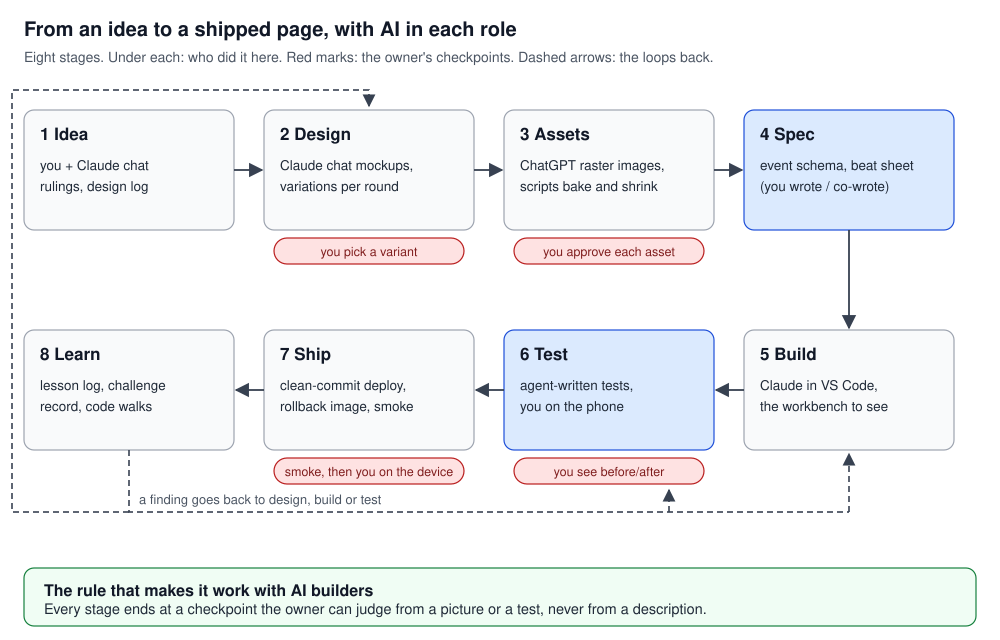

# Playbook: building a frontend with AI builders, end to end

Status (2026-10-26): draft. The owner's working rules were re-read and confirmed on 2026-10-26;
five that apply to every stage are folded into the four "Practices that run through every stage",
and one (the costume rule) is kept as the example of a design rule in a brief. Rows marked
**(next time)** were not done here: they are what a product team would add, placed beside the step
they extend.

This is the workflow the site was built with, written so that a person or an agent can follow it on
the next project. The owner ruled and AI tools did most of the making: Claude chat for ideas and
mockups, ChatGPT for raster images, Claude in VS Code for the code and its tests. The owner wrote the
event schema and co-wrote the beat sheet. Every exemplar named here is a document in this repository;
the design benches and generated masters live in `frontend/claude_artifacts/`, outside git.

**The rule under all of it.** Every stage ends at a checkpoint the owner can judge from a picture or a
test, never from a description. An AI builder is fast and confident; the checkpoint is where its work
is accepted or sent back.

**Who does what.** Self-contained, well-specified work goes to agents. Rulings, mapping a design onto
the code, and the wording of any claim stay with the owner and the main session (owner, 2026-07-14
and 2026-10-10).

## Practices that run through every stage

**Write it down as you go: the files are the agents' memory.** An agent starts every session
knowing nothing of the last one, so what was decided, learned or broken is written into the repo the
day it happens, in a fixed shape, and the next session (an agent's or the owner's) starts from it.
Here: the rulings convention (stage 1), status lines updated in the commit that ships, the lesson log
and the challenge record (stage 8), and the agents' own memory notes. It doubles as the owner's
learning material and the interview record. (Working rule, owner, 2026-10-02: general lessons are
recorded as they happen.)

**Scope the checks to the change.** While iterating, run only the tests the change can affect; run
the whole suite once at the end, and again only before a deploy. A picture swap runs only the specs
whose screenshots show that picture. The full browser suite takes about 15 minutes and every run
costs tokens, so a loop that reruns everything is the slow and expensive way to the same answer.
(Working rules, owner, 2026-09-28 and 2026-10-18.)

**Budget the machine and the session.** Agents, dev servers, builds and test runs share one machine
and one usage allowance. Use known ports only; start a test server per batch and stop it when the
batch lands; check whose build answers on a port before trusting a run; no production build while
other sessions are busy; never stop another session's process without the owner. Plan parallel
agents within the usage limit: on 2026-10-26 four of twelve agents launched together hit it, and
their work had to be checked by hand. (Working rule, owner, 2026-09-27 and 2026-10-15: stray
servers had filled memory and crashed the machine.)

**Use the library's own way first.** Change a library's behaviour through the extension points it
offers before working around it, so the code reads as if someone who knows the library wrote it.
Here: Mantine's `styles`, `classNames`, `vars` and theme, never a selector that out-specifies its CSS
(owner, 2026-10-01).

Each stage below has a table: the step, what a team does, what was done here, and the checkpoint
that ends it.

---

## 1. Idea and direction

Decide what the product is and what it must never be, before anything is drawn.

| Step | A team does | Done here | Checkpoint |
|---|---|---|---|
| Frame the product | A product brief: who it is for, the one thing it must do | Talked through in Claude chat; recorded in [`design_log.md`](../design_log.md) (2026-06-06: "watch AIs deceive each other, and see exactly why") | The owner can say it in one sentence |
| Record decisions | A decision log | **The rulings convention**: "Rulings (owner, date)" first and numbered; proposals below, marked; an amendment made in place, dated, with the old value kept beside it; "Open for the owner" at the foot, closed in place. Exemplars: [`build_plan.md`](../build_plan.md) §1, [`stage_architecture.md`](../stage_architecture.md) §1 | Every ruling has a date and a reason |
| Keep status lines true | The doc is updated when the work ships | Three briefs said DRAFT or "not deployed" weeks after shipping, corrected 2026-10-26 | The status line changes in the commit that ships |

## 2. Design exploration

Find the look by trying several, not by refining one.

| Step | A team does | Done here | Checkpoint |
|---|---|---|---|
| Gather references | A moodboard | The owner's shortlist of sites they admire | |
| Critique them | Design analysis: what makes each work | The owner asked Claude chat what makes each site that way and what they liked about it | |
| *(next time)* Write the principles | Three to five lines the variations will be judged by | Done afterwards, not before: the typography test ("would the sentence make sense if the train were real?", [`typography.md`](../typography.md)) and the costume rule are principles of this kind | The principles exist before the first variation |
| Explore in variations | Several options per round | Claude chat produced website mockups, several per round, with the owner's tweaks and feedback; often several rounds before one was accepted | |
| Converge | A review that picks one | **A mock with a switch per change**: list the candidate changes, put a toggle per change on one mock, rule switch by switch, then write the rule as a test a builder can apply. Exemplars: [`typography.md`](../typography.md); the logo in `design_2026-09-26/pages_review.md` F2 | The owner picks a variant |
| Check the mock against the code | A design review with engineering | **Mock-against-repo review**: every field the mock shows is classed as ours, derivable or missing; conflicts with the rulings and the code, each with evidence; the questions only the owner can answer. Exemplar: `design_2026-09-26/pages_review.md` §A to §F | No mock is built until its fields are known to exist |
| *(next time)* Keep what was chosen | The approved frame stays with the decision | Review artifacts were temporary and discarded once accepted | The accepted screenshot is saved beside the ruling |

Once the base template was settled, iteration moved from Claude chat to Claude in VS Code, against
the real code (stage 5).

## 3. Assets: images and sound

Generated assets need a brief as strict as code, because a model repeats its habits and invents what
it is not told.

| Step | A team does | Done here | Checkpoint |
|---|---|---|---|
| Write the brief | An art brief with a style guide | **The asset brief**: rulings first; the house style read off the approved pieces (for audio: key, tempo, loudness, measured); what the asset must never carry, with the reason (here: no costume may hint at a role, because characters are dealt to seats at random and a doctor would read as the healer); a lineup sheet first, then one item per call with the last approval attached. Exemplars: [`cast_expansion_brief.md`](../cast_expansion_brief.md) (the template), [`role_cards_brief.md`](../role_cards_brief.md) §0, §1, §5, [`music_brief.md`](../music_brief.md) | The brief names what is forbidden and why |
| Generate and iterate | An illustrator's rounds | Claude drew vectors and mockups; ChatGPT turned them into raster images and iterated the asset mockups, since Claude does not make raster images | The owner approves each asset |
| Gate each one | Art review | A measured gate in the brief (sizes, colours, what must not appear); a negative moved out of the prompt into the gate, because naming an object summons it | |
| Prepare for the web | An export pipeline | Scripts bake and shrink: `scripts/bake-sets.mjs`, `scripts/small-sprites.mjs`; picture sizes chosen from the pixels they are drawn at ([memory_and_pictures](../learning/memory_and_pictures/memory_and_pictures.md)) | |
| *(next time)* Keep provenance | An asset register | Prompts live in the briefs; not every shipped file names its prompt | Each shipped asset names the prompt and approval that made it |

## 4. Spec and handoff

The step that made an AI build checkable: the code is judged against a written spec, not against
"looks right".

| Step | A team does | Done here | Checkpoint |
|---|---|---|---|
| Fix the data contract | An API or event schema | The owner wrote the event schema (`server/schemas/events.py`); the client's types are generated from it ([`client_design.md`](../client_design/client_design.md) §7) | A wire change fails a test |
| Write the behaviour spec | Product spec and acceptance criteria | The beat sheet, co-written by the owner: one row per stage moment, mirrored by one function and pinned by goldens on real games ([`beat_sheet.md`](../beat_sheet.md)) | Change the table, change the code, regenerate the golden, in that order |
| Hand off the design | A design handoff | **Mock to spec**: a handoff that separates what was decided from how; the codebase's own "how" document wins over the handoff and lists where it departs. Exemplars: `design_2026-09-25/HANDOFF.md` §1, §4; [`stage_architecture.md`](../stage_architecture.md) §1, §2, §9 | Expensive-to-change decisions are settled before assembly |
| Name the couplings | Contract tests | **Coupling alarms**: each fact copied across a boundary gets one home and an alarm (an exhaustiveness test, or an error on the first unknown field). Exemplar: `server/README.md` "When the engine changes" | Cross-boundary couplings are allowed; silent ones are not |

## 5. Build

| Step | A team does | Done here | Checkpoint |
|---|---|---|---|
| Brief the builder | A ticket with acceptance criteria | A brief to Claude in VS Code naming the spec sections to read (not "read it all"), the affected tests, and one screenshot sheet per changed state. A tightly scoped visual task took 9 minutes and 18 calls where a loose one took an hour (owner, 2026-09-28) | |
| Give the builder eyes | A component workshop (Storybook) | **The workbench**: one route mounts the real scenes on a recorded game, the URL holds the whole state, phone frames on a desktop, and Playwright screenshots each named URL. Exemplar: [`stage_architecture.md`](../stage_architecture.md) §1 ruling 1, §7 | If a view cannot be named in a URL, an agent cannot check it |
| Review in pictures | Design QA | Temporary artifacts and screenshots the owner looked at, discarded once accepted | The owner accepts the look |
| *(next time)* A bench per component | Storybook stories with live controls | The workbench benches whole scenes; nothing lets the owner tweak one component (a button, the turn dock, a card) live and see its code | The owner can tweak a component without asking an agent |
| *(next time)* Variants in the product | A variant switch (flag, URL parameter, dev toolbar) | Done twice by hand: the typography mock's switches and the temporary `?smooth=1` | One list of variants read by the bench and the live page, so any variant is seen inside a real game |
| Re-own what was built | Code review | **The code walk**: read one module a day after it is written; ask what it guarantees; record the answer as a dated ruling with the rejected alternatives. Exemplar: [`server_design_notes.md`](../server_design_notes.md) §10 to §12 | Naming a layer does not make anyone ask what it guarantees |

## 6. Test and verify

What each layer pins is taught in the [testing tutorial](../learning/testing/testing.md); the suite
itself is [`testing.md`](../testing.md). Here, the order of work.

| Step | A team does | Done here | Checkpoint |
|---|---|---|---|
| Unit-test the logic | Unit tests on pure functions | The fold, the beat cutter and the live reducer are pure functions; 73 Vitest files feed real games in and check the state out, with time passed in as an input | Logic changes come with a test |
| Pin the spec | Snapshot or approval tests | Text goldens: the beat list of two real games, read as a diff | |
| *(next time)* Component tests | React Testing Library: render, click and type as a user, check what shows | Not built: ruled out "for now" on 2026-08-20 and never revisited. The logic sits in pure functions, so the gap is the wiring; the turn dock is the first candidate | Each interactive component has one |
| Visual regression | Screenshot tests | Playwright, 8 specs and 99 screenshot goldens, desktop Chrome at 1600×900, the server faked, animations off, 0.5% of pixels allowed to differ | |
| The agent looks first | | The agent reads its own screenshot before handing over (how the figures in these docs were checked) | No visual change reaches the owner unseen by the agent |
| The owner sees before and after | Visual review in a tool (Chromatic, Percy, the Playwright report) | The agent crops before-and-after pictures and shows them | The owner approves the look |
| *(next time)* Look only where it changed | Review the diff, not the page: the tool's pixel diff says where the change is, and only that region is looked at | Whole or cropped screenshots, judged by eye | No one reads a full-page picture to find a small change |
| *(next time)* Pin the renderer | Screenshots taken in a fixed Docker image | Taken on whichever machine ran them | Font or OS changes cannot fail a test |
| A platform you cannot run | Device testing | **Census, one batch, a gate**: probes that remove one kind of work each; list every instance of the broken rule; fix the list in one batch; make the rule a test (`e2e/phone-rule.spec.ts`); measure before and after the same way. Exemplars: [`build_log.md`](../build_log.md) §8.7, §8.9 | The owner on a real phone |
| *(next time)* The engines your users have | A WebKit and mobile project; a device farm | Only desktop Chrome is in the suite, though the worst bugs were iOS Safari's | |
| *(next time)* Accessibility | An axe check in the browser tests | None | |
| Review across layers | Code review by someone else | **An independent cross-layer review** before calling a build done; each defect found gets an exact-order regression test. Exemplar: [`build_log.md`](../build_log.md) §3.8 to §3.12 | |
| Read an audit | | **Read an audit as claims to measure**, not a to-do list; survey it against the code days later. Exemplars: `frontend-audit-2026-10-11.md` and its follow-up; [`multiplayer-audit-2026-10-15.md`](../multiplayer-audit-2026-10-15.md) | Say what was not run |
| *(next time)* Tests from the spec, not the code | A second reviewer | The same agent wrote the code and its tests, so a test can confirm the code's own mistake: the unit tests' copy of the server's tiers had drifted (found 2026-10-26) | Tests are written from the spec, or reviewed by a second agent |
| *(next time)* The owner watches each layer once | | | The owner has watched one run of each layer (`npx playwright test --ui`) before trusting it |
| *(next time)* Run everything on every change | CI that blocks the merge | No CI: a check runs only when someone runs it | Nothing merges red |

**(next time) Definition of done, by kind of change**, kept where the agent reads it every session:

| Kind of change | The agent adds |
|---|---|
| Logic (fold, reducer, cutter) | A unit test on the pure function, fed a real game |
| An interactive component | A component test: render, act as a user, check what shows |
| A visual change | The affected screenshot goldens, and before-and-after for the owner |
| A new page or route | One end-to-end smoke test and an accessibility check |
| Any change | Tests written from the spec, not by reading the code just written |

> **Working rule (owner, 2026-10-18): every visual change comes with a before-and-after picture,** cropped
> to what changed, before asking to commit. The owner judges looks from pictures, not from a
> description or a passing test.
> Cropping is also the token-efficient way to look: an image costs roughly its pixel area, so a crop
> of a tenth of the area costs about a tenth, and a component's picture far less than a scene's.

> **Working rule (owner, 2026-10-15): sweep, not whack-a-mole.** When one rule is broken in many places,
> build the census first, fix the whole list in one batch, and keep the gate running. Never ship a
> single-instance fix and ask the owner to retest: four rounds of iPhone crashes each fixed only the
> instance the last crash exposed.

## 7. Ship

| Step | A team does | Done here | Checkpoint |
|---|---|---|---|
| Build from a commit | A CI build | Build from a clean detached worktree at the commit, so uncommitted work stays out | A build is of a commit, never of the working tree |
| Migrate, then swap | A deploy pipeline | Migration first, from inside the new server image; pre-flight in that image; swap only with no room waiting and no game live; the old image kept as `:prev` for rollback | |
| Smoke | Post-deploy checks | The pages, the API's health, one game or replay in a browser; record what was not run. All 72 deploys: [`deploy_log.md`](../deploy_log.md) | Smoke passes, then the owner on the device |
| Keep public copy true | Content review | Each claim names the code it rests on; an exhibit is captured from a real run. Exemplars: `design_2026-09-28/landing_features.md` "Why this wording" | Copy describes the mechanism, never a benefit the evidence does not show |
| Watch errors | Monitoring | Sentry since 2026-10-17, on the server and in the browser, errors only; keys and typed text never sent | |
| *(next time)* Deploy from CI | Deploy after the checks pass | Deployed by hand by an agent | |

## 8. Learn and iterate

| Step | A team does | Done here | Checkpoint |
|---|---|---|---|
| Record the lesson | A retrospective | **The lesson log**: the general lesson the day it is learned, in one shape (the mistake, the rule, where to see it). [`frontend_lessons.md`](../frontend_lessons.md), 50 lessons and 23 small things; taught as tutorials in [`learning/`](../learning/README.md) | |
| Record the incident | A postmortem | **The challenge record**, written to be read cold: the story with the wrong first diagnosis kept, the decisive evidence, the fix with its test, "what to know". Exemplar: [`server_encountered_challenges.md`](../server_encountered_challenges.md) | |
| Loop back | | A finding sends the work back to design, build or test (figure 1) | |

---

**Not placed in a stage:** the owner's standing rule that model experiments run on the cheap Claude
model with the cost quoted first, and that Sonnet is never a player model. It is not a frontend rule;
it is here because frontend briefs sometimes propose model runs.
