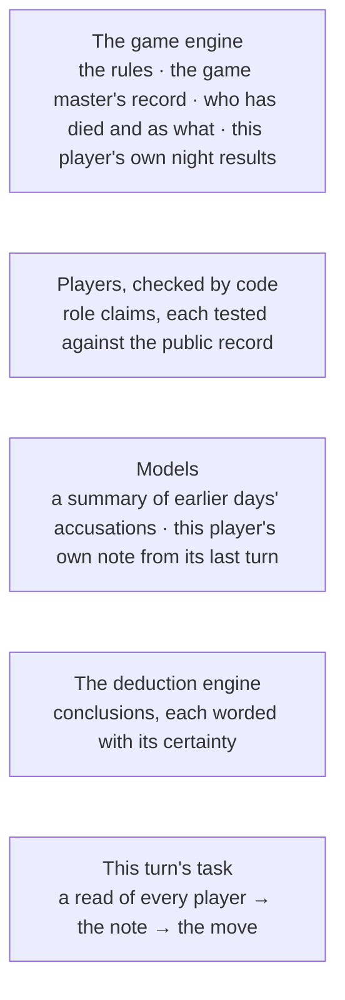

# Keeping the facts straight chapter (draft)

*Level 1 page copy, first draft 2026-10-30, written from `_authoring/context_engineering.brief.md` (the
owner's spine: four kinds of failure, four remedies). Not yet reviewed by the owner. The chapter's card
tag is context engineering; the page is organised around the problem it solves.*

---

## Page copy (draft)

### Keeping the facts straight: helping agents reason from what they know

Each AI player's turn is one model call, and everything the player knows about the game reaches it
through that call's prompt: the rules, what has happened, what it alone saw at night, what was said on
earlier days and its own notes. The obvious design is to put the game state in the prompt with a general
instruction to play well. On the small, low-cost model the game runs on, that was not enough.

Players stated things the game's record contradicted. They counted the survivors wrong, misread what an
ability shows, believed a mistaken summary of an earlier day, and missed conclusions their own facts
supported. Lying is part of Werewolf; these were mistakes, and in the earlier nine-player game about 3%
of public messages held one. How they were found and counted is in Evaluation.

Each kind of mistake needed its own remedy, and the remedies share one principle: code works out what
is certain, and the model keeps the judgement. Deciding what goes into a model's context, and in what
form, is usually called context engineering. The four sections below take the four kinds of failure in
turn.

*One turn's prompt, grouped by who wrote each part (simplified, not in prompt order). Facts come from the
engine or are checked by code; anything a model wrote is labelled as a claim or a note.*

#### Facts the model misreads or invents

A fact that is present but easy to misread fails like a missing one. A correct list of the roles still
in play did not, on its own, stop a player hunting for "the remaining wolf" when none was left. So the
engine now prints what a player would otherwise work out from prose, such as who has died and as what,
and words each of the player's night results as its own action on a named night. The rules state what
each ability shows, and they rank above any player's account of a rule.

That last line came from a run of games in which a player argued that the Sentinel should appear in its
own visitor list; in three of four games, the real Sentinel conceded the false rule and was voted out.
With the missing rule sentence added, the replayed Sentinel conceded 0 times in 10, against 10 in 10
before. A replay of one turn shows that the sentence removed this failure, not that misreadings stopped.

*Explore: Making facts available and unambiguous →*
<!-- Link specification: Level 2 page 1, not yet drafted. -->

#### Earlier days that lose their meaning or source

A player cannot reread every earlier day, so each day is condensed once it ends. A mistake in that
account is not one player's private error: every player reads it the next morning. So each statement
keeps its source, and a player reads earlier days as three blocks with different authors.

| Block | Written by | Example |
|---|---|---|
| The game master's record | the game engine | night outcomes, every ballot, each revealed role |
| Claims | each speaker's own claim fields, checked by code against the record | "player_5: claimed investigator. Night 1: checked player_9, says they read Suspicious. Record: player_9 was revealed as illusionist, as claimed." |
| Accusations | a summarising model | who argued what against whom, labelled as claims, not facts |

A record check confirms only what the public record can settle; where the record fits more than one
reading it says nothing, and a claim it cannot contradict stays a claim. The rule came from a game a
summary decided: the Investigator said "I was roleblocked last night", the summary recorded it as the
Investigator claiming to be the Chanteuse, and the next day the real Investigator accepted that premise
about itself and was voted out 7 to 1. The summariser now records what was said and never judges it, and
code drops any claimed action that could only have been done to the speaker.

*Explore: Carrying earlier days forward →*
<!-- Link specification: Level 2 page 2, not yet drafted. -->

#### Information the model has but does not use

Having the facts in the prompt did not mean the decision used them. When a player was asked which lesson
from memory it had followed only after acting, its answers read as rationalisations. So the answer is
structured so the model writes its assessment before it acts: a read of every other player with a
reason, a verdict on each lesson from memory if any are shown, its private note, and only then the
message, vote or night action. This is a structured form of chain of thought. With the reasoning moved
ahead of the vote and a verdict on each lesson required, the stated reasoning and the vote agreed 92.5%
of the time, against 75%. That shows the order changes what the model does, not that its reasoning got
better.

How the structure is imposed matters too. On one replayed turn, enforcing the answer format through the
provider left the game's model doing no reasoning at all in 4 samples of 10; sending the format as text,
it reasoned every time. Other low-cost models showed the same pattern to different degrees.

*Explore: Testing how each turn is asked →*
<!-- Link specification: Level 2 page 3, not yet drafted. -->

#### Facts the model has but does not connect

The last kind of failure was the hardest to see: every fact was present and clear, and the player still
did not draw the conclusion. On night 1 the Healer was roleblocked. In this game only the Chanteuse, a
wolf, can roleblock, and a block is a visit; the next day player_7 admitted visiting the Healer. Replayed
on the game's model at its everyday thinking setting, the Healer read player_7 as the Chanteuse 2 times
in 10.

Some conclusions follow from the rules alone, so code can work them out. A deduction engine, added after
the earlier fixes, narrows which roles each player could still hold from what that seat is allowed to
know, and writes its conclusions into the prompt, each worded with its certainty: certain, true if a
named claim is true, or the list of possibilities. For the Healer it added one certain line: the
Chanteuse came to you that night. With that line, the read rose to 8 in 10. Larger models made the link
without it (9 and 10 in 10), and so did the game's own model at its highest thinking setting (9 in 10),
at nearly three times the wait on every turn. The engine computes the certain step once instead.

The engine reads only the seat's permitted view (chapter 2), and a test that swaps roles the seat cannot
see requires its lines to stay the same. Its code was written by an AI coding assistant; I set its
requirements, its grading rule and the cases it had to pass. One turn and ten samples a setting show the
gap and how each option closes it, not an effect across whole games.

*Explore: Working out selected conclusions in code →*
<!-- Link specification: Level 2 page 4, not yet drafted; its Level 3, "The roleblocked healer". -->

None of these changes was measured as a whole-game error rate; each result is a replay of a failure that
had happened in a game. Chapter 4 turns to the other way I tried to improve play: lessons carried from
earlier games.

<!-- Sources.
Intro: ~3% of public messages, the July nine-seat census (evidence/evaluation/factual_errors/report.md
step 1; turn_prompt/report.md decision 1). "The small, low-cost model the game runs on": Claude Haiku 5.5,
the house default seat model (catalogue). The obvious design not being enough: turn_prompt/report.md
decision 1 ("printing the facts alone did not stop the error").
Figure: turn_prompt/report.md "A turn today"; day_summary/report.md §3. Simplified grouping by author.
Facts misread or invented: turn_prompt/report.md decision 1 (T1b: the fourth recurring error came back
with a correct "roles still in play" line; survivor arithmetic the commonest July error), decisions 2–4.
Sentinel: decision 4 and discussion_evidence.md §8.4 (all four GPT-6 Luna games; three concessions; the
replayed sentinel 10/10 → 0/10, GPT-6 Luna).
Earlier days: evidence/extraction/day_summary/report.md §3 (the three blocks; the ledger says nothing where
the record fits more than one reading; quoted claims line), §4 (the summariser records, never judges),
§7 (game e06: "I was roleblocked" recorded as a Chanteuse claim; voted out 7 to 1; the fix, commit
6248fc58: the ledger drops an action that can only have been done to the speaker). The invention did not
recur in replay; the code rule is the guard (§7 Limits) — on Level 2.
Information not used: turn_prompt/report.md decision 10 (after-action strategy labels read as rationalisations;
reasoning before the vote plus a required verdict per memory: coherence 75% → 92.5%; May–June,
gemini-3.5-flash-lite; the order not always kept by Haiku until the schema was reordered, 2026-10-13).
"Structured form of chain of thought": skills_inventory.md (revised 2026-10-30). Output mode:
deduction/experiment_log.md §8 Result 1 (Haiku, engine on, enforced json_schema: 0 reasoning tokens in 4
of 10; json_mode: every sample); same direction in other low-cost models: Gemini 3.5 Flash-Lite 0
reasoning with structured output at minimal and low (catalogue; discussion_evidence §6.7), forced tool
call turning thinking off (model_admission/report.md).
Not connected: deduction/experiment_log.md §8 Result 2 (game path, json_mode, engine off: Haiku low
2/10, high 9/10 at median 17.4 s against 6.3 s; Sonnet 5.5 low 9/10; Opus 5.5 low 10/10) and Result 1
(engine on, json_mode, Haiku low 8/10); deduction/report.md §1 (built after input and prompt fixes and
more thinking), §2–§4 (constraint propagation; three grades of statement; the seat view; hidden-role
tests). Authorship: the engine, solver included, AI-written; the owner's part the requirement, grading
rule, acceptance cases, experiments (project memory, code authorship split). "Nearly three times the
wait": 17.4 s against 6.3 s median per turn on this case.
Close: no whole-game error rate after the changes (content plan, care list). Memory: chapter 4.
Chapter card tags (not page copy): Context engineering, Structured outputs and validation; Symbolic
reasoning when the owner is ready to explain the algorithm and its test limits. -->
