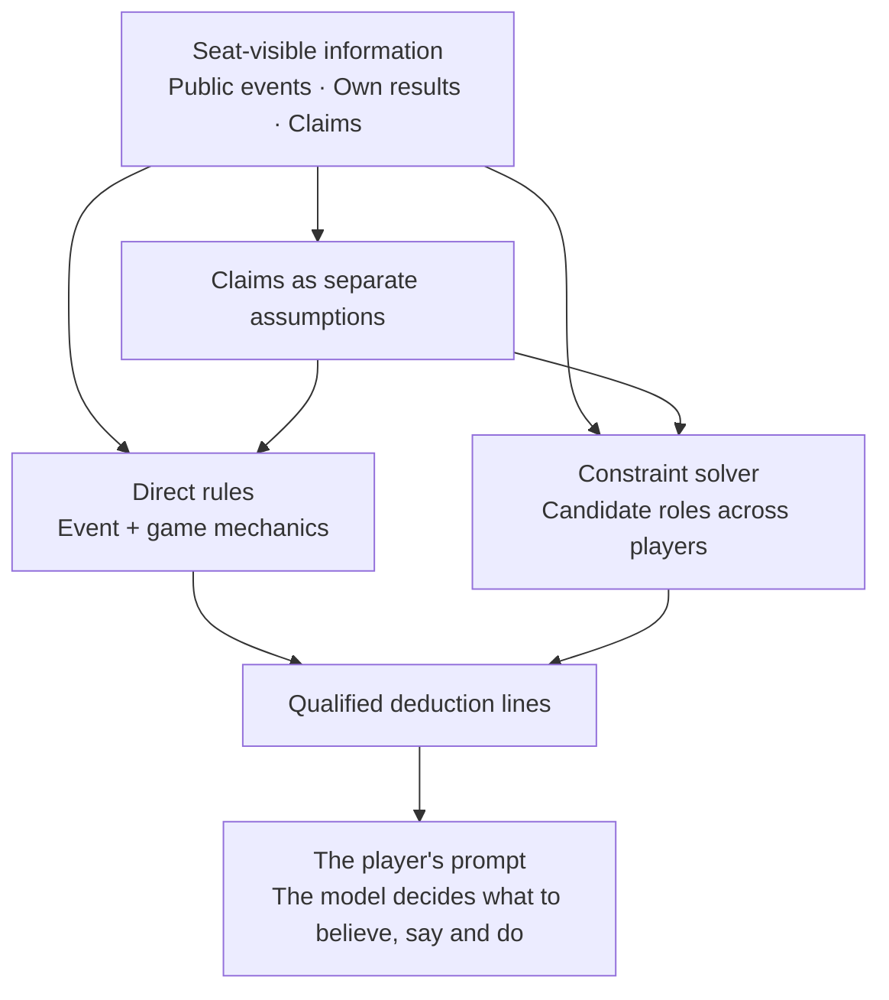

# Working out what the facts imply: the deduction engine

*Level 2 · [Context engineering](../context_engineering.md) · restructured draft for review, 2026-10-31
(the owner's version, with the evil-side block and the flow diagram placed; sources in the closing comment).*

## Page copy (draft)

### 1. When the facts were present but the inference was missing

Earlier changes clarified the agents' inputs, carried earlier days forward, and asked the model to
explain its reasoning. Those changes helped, but some failures remained even when the relevant facts
were already in context.

In one recorded game, the Healer, a town role that protects someone at night, was roleblocked on
night 1, so its protection failed. A Trailseer reported following player_7 to the Healer, and player_7
admitted visiting. Across three daytime turns, the Healer repeated those facts in its notes but never
connected the block to the only blocking role in that game's cast: the Chanteuse, a wolf. It never
raised the connection aloud.

More thinking effort helped some voting decisions in earlier tests but barely changed discussion
errors. Larger models could make this particular connection without help, at greater latency or cost.
These alternatives were useful, not universally ineffective; they simply did not remove the case for
a cheaper, targeted intervention.

I had code work out the consequences instead: it computes selected consequences of the game rules
from each agent's permitted information and adds them to its prompt. It handles mechanical
implications, not social judgment. The model still decides whom to trust, what to say, and how to act.

### 2. Three levels of reasoning assistance

The assistance progresses from interpreting a single observation to combining facts across players,
then reasoning about unverified claims. These levels correspond broadly to the record, public, and
full configuration modes.

**Level 1. Direct consequences of an agent's own results.** The Healer's night record originally
said it had been blocked but had "learned nothing tonight." That obscured what the result actually
implied. Because only the Chanteuse could block in this cast, and a block is a visit, a direct rule
now adds:

> You were roleblocked: your protection of player_5 did not happen. Only the Chanteuse could roleblock
> that night, and a block is a visit, so the Chanteuse, a wolf, came to you that night.

This is a simple observation + rule → conclusion. No general solver is needed.

**Level 2. Public deductions and possible roles.** Everyone can see deaths, revealed roles, morning
announcements, the roles dealt, and records disclosed through a dead player's read-out will. Some
conclusions from these facts are direct. Others depend on how limited copies of roles must be
distributed across several players. For those, the engine maintains each player's remaining possible
roles, including a concealed dead player's role, and uses a constraint solver to narrow them. One
output is:

> Both wolves are dead: player_9 and player_7. The Serial Killer is alive and is one of player_2,
> player_4, player_6, player_8 and player_10.

**Level 3. Conclusions that depend on claims.** Another player's report may be true, mistaken, or
deliberately false. Instead of treating it as fact, the engine compares the claim with known events or
temporarily assumes it for a separate solver run. In the Healer's case:

> player_3 says player_7 came to you on night 1, and player_7 agrees. If that is true, either player_7
> is the Chanteuse, or player_7 and the Chanteuse both came to you.

Even accepting the visit, we cannot prove that player_7 performed the block; a second visitor might
have done so. This example is a direct join between a result and claims. Other conditional conclusions
require rerunning the solver. The levels describe richer information; direct rules and solver-assisted
inference are complementary methods.

**The evil side. Constructing defensible role claims.** Another recurring failure was that wolves
and other evil agents often failed to defend themselves when challenged about observed visits. Some
stayed silent; others denied visits that were already supported by the record. Rather than asking the
model to improvise a plausible lie, the engine calculates which roles it could claim without
contradicting known facts, which roles cannot be truthfully counterclaimed by living players, and
which night-action explanations fit the evidence.

For example, it may tell an evil agent:

> No living player holds the Sentinel, so if you claim it, no one can counter-claim you truthfully.

The engine does not select the cover or decide when to use it. That remains the agent's
responsibility, guided by its role instructions.

In a small replay screen, adding cover information was associated with more role claims (36 → 44 of
82) and fewer outright denials (4 → 0). However, the comparison used different judges, and claims a
careful town could have shown false also rose, from 0 to 3.

#### From information to a prompt line

The engine runs when a player's prompt is built. Its input is a seat-specific view, not the game's
hidden-role table: public events, the seat's own role and results, and pack information if it is a
wolf. Public lines go into a shared, cacheable prompt section; seat-specific lines go into its private
section or beside its own result. The supporting rules and events are logged for inspection rather
than printed in full.

### 3. How the constraint solver works

A direct rule examines one observation. A solver becomes useful when what one player could be depends
on what other players could be.

Consider a simplified example, not a recorded game. Exactly one Healer, one Sentinel and one Chanteuse
remain to be assigned to three players:

| Player | Possible roles before solving |
|---|---|
| A | Healer, Sentinel |
| B | Healer, Sentinel |
| C | Healer, Sentinel, Chanteuse |

Neither A nor B can be the Chanteuse. Because there is one copy of each role, A and B must use up the
Healer and Sentinel roles between them. Therefore C cannot be either: C must be the Chanteuse. We have
determined C's role without deciding which of A or B is the Healer.

| Player | Possible roles after solving |
|---|---|
| A | Healer or Sentinel |
| B | Healer or Sentinel |
| C | Chanteuse |

The real solver follows the same principle, at game scale:

1. **Initialize candidates** from the dealt cast, known identities and events. Unknown dead bodies
   count too: their concealed roles still use up copies.
2. **Apply constraints:** role counts, groups that exhaust particular roles (as above), observations
   about who could have performed an action, and whether a proposed concealed-role assignment would
   have ended the game earlier.
3. **Propagate removals:** eliminating one role may make another rule applicable, so repeat until a
   full pass removes nothing.
4. **Preserve ambiguity:** if A and B remain interchangeable, keep both possibilities. If the facts
   conflict, withhold candidate conclusions rather than force an answer.

This repeated narrowing is constraint propagation. It stops because the candidate sets are finite and
only shrink. The production solver is not a brute-force search through every complete game state,
although some specialized constraints check combinations of concealed bodies. It can miss an inference
a fuller search would find; its priority is not to remove a role that is still possible.

Now suppose A says, "I'm the Healer." If that claim is true, B must be the Sentinel. But the
conclusion about B belongs to a temporary hypothetical run, not the baseline candidate sets. This is
why claim-dependent lines must keep their assumptions in the sentence itself.

Actual games add role-specific mechanics: who can block, survive an attack, visit visibly, or produce
a particular check result. A role-trait table captures these properties, checked against the real game
engine. The solver combines their implications across players, nights, role counts and concealed
deaths.

### 4. Checking the conclusions

An injected line can become part of an agent's later reasoning. If a code rule is wrong, it can
repeatedly supply the same false premise. I therefore used different checks for different ways the
engine could fail.

| Question | Check and example |
|---|---|
| Does a rule speak only when justified? | Construct a night where it should fire, then near-identical counterexamples where one relevant condition changes. Resolve them through the actual game engine and check both the conclusion and its wording. |
| Has the solver eliminated a possible role? | Compare its candidate sets with a slower brute-force oracle that enumerates role assignments compatible with the test view. In the A/B/C example, the oracle permits either A or B to be Healer but never C; the solver must not incorrectly eliminate Healer from A or B. |
| Does it leak hidden information? | Change hidden roles while keeping a seat's visible information the same. Its deductions must remain identical. This metamorphic test checks that the output does not depend on information that seat cannot see. |
| Does the actual prompt contain the right lines? | Four frozen failure turns act as acceptance cases. The Healer case must include the certain block conclusion and conditional visit alternatives, but must not assert outright that player_7 is the Chanteuse. |

Random legal nights supplement the constructed cases. Exact-output tests protect conditional wording.
The oracle also helps assess whether the solver leaves unnecessary possibilities, but agreement on
sampled games is not a universal proof: both implementations can miss the same constraint.

#### Correct inference versus improved gameplay

On the recorded Healer turn, in the live output mode, the model assessed player_7 as Chanteuse in 2/10
original-prompt samples and 8/10 with the engine intervention; it spoke in 3/10 versus 7/10. The
intervention also repaired the original misleading night-record wording, so this is not an isolated
estimate of the deduction line's effect. Nor did the evidence prove player_7 was the blocker.

Without the engine, higher thinking effort reached that assessment in 9/10 samples, at roughly 2.8×
the latency for this turn. Stronger models also reached it, at higher game cost. The engine offered a
way to supply selected inferences while retaining the smaller live model.

Those replays mainly exercise direct rules and claim joins, not the solver's independent contribution
to gameplay. There is no town-side whole-game engine-on/off comparison or measured post-engine
factual-error rate. Logical correctness tests and behavioral replays answer different questions: a
valid deduction can still be ignored or used badly.

### 5. Guardrails and limitations: deductions, not directions

**Only use the seat's knowledge.** The same public record may imply different things to different
players because of their private results. The engine must never infer from hidden roles it is not
allowed to see.

**Never turn a possibility into certainty.** A certain line must hold in every legal assignment
compatible with the seat's information. If a conclusion depends on a claim, name the claim. If multiple
explanations remain, keep the alternatives. If evidence conflicts, do not invent a forced result. The
qualification must travel with the text, including when an agent copies it into later notes.

**Give consequences, not strategy.** The Healer is told what its block implies, not whom to accuse.
Evil seats also receive facts about which cover roles and night stories fit the record; their role
cards, not the deduction engine, give strategic advice. This separation does not make prompt content
perfectly neutral: which facts are printed, and in what order, can still influence the model.

**Fail closed outside verified game rules.** The built deductions cover the standard twelve roles and
specified ability limits. An unsupported cast gets no lines. Adding another blocking role, for example,
would invalidate "only the Chanteuse could block."

Finally, the engine is selective rather than exhaustive. A missing deduction leaves an agent with less
help; an incorrectly certain deduction actively misleads it. Some implemented line types rarely appear
in recorded play, and the tests cannot establish that every legal interaction has been covered.

The result is a deliberate division of responsibility: code works out and qualifies selected
rule-based consequences; the model interprets social evidence and chooses its actions. The verification
supports many individual conclusions, and the limited replays show improvements on specific missed
inferences, not yet a general improvement in whole-game play.

Further detail: [Deduction catalogue](../../../evidence/gameplay/deduction/deduction_catalogue.md) ·
[Experiment log](../../../evidence/gameplay/deduction/experiment_log.md) ·
[Deduction implementation](../../../Agents/deduction/)

*Explore: The roleblocked healer →*

<!-- Level 3, planned at deduction_engine/roleblocked_healer.md: the enforced-mode uptake result with
its date and mode; the carried-note 2×2; the placement screens; the investigator's vote case and the
moderator closing line; the 2026-10-30 model and thinking comparison in full. Drafted after this page
is reviewed. -->

<!-- Sources for the page copy (owner's version placed 2026-10-31; every figure as it stands in the record).

§1: deduction/report.md §1 (cause table; the ten-seat attempts: thinking low→medium helped votes
65/160 → 98/160, discussion errors barely changed); experiment_log.md case R1, §4–5 (the Healer's
three passed turns); §2 Question and §8 Result 2 (larger models 9/10 and 10/10 without the engine;
about $2.30 against $0.12 a game; model names off the page).
§2 levels = DeductionMode record / public / full (Agents/schemas/deduction.py; catalogue build table
row 2, difficulty levels of 2026-10-18). Level 1 line: AC1 line 1 verbatim (catalogue "Acceptance
cases", owner's wording 2026-10-18); "learned nothing tonight": ruling R4. Level 2 line: AC2 line 1
verbatim (F3). Level 3 line: AC1 line 2 verbatim (F2). Evil side: ruling R11 (2026-10-18, "evil seats
claim; they never deny a sighting"); the quoted line = report.md §3 table row "Evil seat facts";
screen = report.md §5 (41 pressured turns × 2 samples; claims 36 → 44 of 82; denials 4 → 0; judge
changed between arms; checkably false claims 0 → 3). Flow: Agents/deduction/seat_view.py (the leak
boundary), blocks.py and render.py (public block before the cache boundary, seat block after,
derivations logged).
§3: report.md §3 "Narrow candidate roles until nothing changes" (the A/B/C illustration; the four
rule kinds; termination; contradiction → no candidate result; "not a full search"); "Keep assumptions
separate" (conditional reruns); traits: Agents/schemas/role_traits.py, checked by
tests/engine/deduction/test_role_traits.py.
§4: catalogue "Build verification" items 1–4; report.md §4 (the checks table; 20,000 random nights;
brute-force oracle on 150 generated games, 3,408 seat views, no extra candidate left; "not a
completeness proof"; the report's AI-written-tests sentence is off the page by the owner's ruling, 2026-10-31). Healer replay: experiment_log.md §8 Result 1 (live output mode; read 2/10 → 8/10; spoke
3/10 → 7/10; the engine arm also replaced the night-record wording); Result 2 (high thinking 9/10,
median 17.4 s against 6.3 s = "roughly 2.8×"). No town whole-game A/B, no post-engine error rate:
report.md §5.
§5: catalogue §0 (the three grades; "never state as absolute what is not"); report.md §3 (evil seats'
facts, cards give the advice; seat order within a block, never importance); Agents/deduction/verified.py
(twelve roles, else no lines); report.md §5 (one line type never fired in 278 census turns = "rarely
appear").
-->
