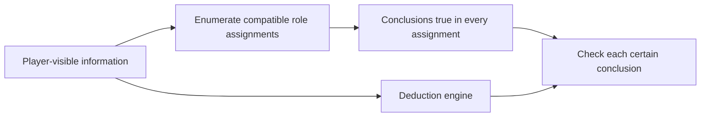

# Checking agent outputs with code

*Level 2 · [Evaluation](../evaluation.md) · previous: [Measuring play quality beyond win rate](../play_metrics/play_metrics.md) · next: [Designing and validating LLM judges](../llm_judges/llm_judges.md) · revised 2026-10-29.*

Some evaluation questions have answers that can be calculated or checked against an explicit rule. For those questions, code provides repeatable checks without asking another model to judge the output. The choice depends on what we need to establish and whether the required evidence is available.

### When code can check the answer

A direct check needs three things: an output we can inspect, a rule for deciding whether it is correct, and the data needed to apply that rule. The answer may come from a lookup, a calculation or a search through the possibilities allowed by the rules.

| Question | Evidence available | What code does |
|---|---|---|
| Did a vote target a wolf? | The selected player and the game's true roles | Looks up the target's role |
| Did a private field reach an unauthorised player? | The field's permitted recipients and recorded prompt inputs | Compares the actual recipient with the access rule |
| Is the reported player count correct? | The surviving-player roster at that decision | Counts the roster and compares the values |
| Is a deduction certain from the player's information? | Game rules and the facts available to that player | Checks the conclusion against every compatible role assignment |

These checks avoid a model call for each verdict. They can run over every available record rather than a small manually reviewed sample, and the same inputs and rules produce the same result. Failures also identify a specific mismatch—a recipient, count or conclusion—that can be reproduced and investigated. This makes code useful both for offline audits and for checks that stop a batch when an invariant is violated.

The boundary is whether the rule answers the actual question. Looking up a vote target's role establishes whom the agent selected; it does not explain the reasoning behind the choice. Likewise, finding a player name in a summary does not tell us whether the summary misrepresents what that player said. Those questions require interpreting the text. Code can prepare the relevant facts or screen candidate statements, as in the [factual-error workflow](../factual_errors/factual_errors.md), while a person or model makes the judgement.

A deterministic answer can still be wrong if the rule is wrong or its inputs are incomplete. Repeatability makes a failure reproducible; it does not validate the checker. The following techniques address the rule, its integration and the values being checked.

### Test the checker and its integration

A checker needs tests showing that it rejects known faults, and the surrounding application must supply the inputs those tests assume. Testing only clean examples cannot distinguish a working checker from one that never detects anything. Testing the function alone cannot establish that the runner calls it correctly. The information-boundary checks exposed both needs.

Each agent player should receive only the private information its role allows. Prompts are assembled from a **payload**: a bundle of fields prepared for that player. The batch runner checks recorded prompt inputs against access rules after each game. Wolf names belong only with wolves, private night results only with their owner, and dead players should receive no prompt. A detected violation fails the batch.

The first run caught **109 payload violations** after a code change included private fields for the wrong recipients. For example, a healer's payload contained the surviving wolves' names. Those fields had not reached the final prompt text, so the incident exposed an overly permissive intermediate boundary without affecting the recorded game results.

The checker also needs to demonstrate that it can fail. Unit tests build payloads with the real builders, plant a leak and require the check to catch it. This **fault injection** tests the detection logic rather than merely confirming that clean payloads pass.

Integration required a separate check. In October, three leak checks were found to receive none of their required optional inputs from the batch runner. They did nothing on those runs even though the checks existed. The runner was changed to extract those inputs from each game's final state and pass them through.

Together, these tests address both the checker and its wiring. Their coverage is structured fields and exact wording in the recorded inputs; detecting a secret paraphrased in free text requires interpretation.

### Use an independent reference for conclusions that require reasoning

For a computed conclusion, checking the output format is insufficient. A separate reference implementation can test whether the conclusion follows from the rules, using a different approach from the production implementation. In this project, exhaustive enumeration provides that reference for the deduction engine.

The deduction engine adds conclusions to an agent player's prompt, including statements that another player must have a particular role. Such certainty needs a stronger test than comparing the conclusion with the actual role. For example, the engine might identify the actual wolf even though a second player could also be the wolf under the visible evidence. The answer happens to be true, but calling it certain is unjustified.

The reference is an **oracle**: separate test code that enumerates role assignments compatible with what the agent knows. A certain conclusion must hold in every one of them.



The tests examine different ways a deduction could be wrong:

| Test | Failure it looks for |
|---|---|
| Generate legal games with random roles and moves; resolve 20,000 nights per test | A conclusion contradicts the actual game state |
| Enumerate compatible assignments for more than 8,000 player views | A conclusion claims certainty when the visible information allows alternatives |
| Swap other players' hidden roles while preserving the player's information | A conclusion depends on information the player cannot know |

The hidden-role swap is an **invariance test**: changing unavailable information should not change the engine's output. The random tests also require each kind of deduction to occur at least once. During development, deliberately broken rules were caught by those tests, checking that the tests could detect faults rather than pass through lack of coverage.

No false conclusion was found in the recorded runs. This supports **soundness** in the tested cases: emitted conclusions were justified. **Completeness**, finding every conclusion available, has narrower coverage from four real failure cases with expected and forbidden conclusions. The oracle and engine also depend on the same written rules; a shared misinterpretation could survive comparison.

### Recompute model-written values when the record determines them

Structured model output is convenient to process, but a valid number or boolean can still be factually wrong. If the underlying record determines its value, recomputing it provides a direct accuracy check. When the same calculation is available during execution, it can also replace the model's calculation entirely. The memory-query audit led to that change.

Before retrieving memories, a model used to describe the current situation and supply structured fields alongside its search text. Some of those values could be derived from the game state, including player count, remaining bullets and whether one elimination could end the game.

A July audit recomputed applicable fields and compared them with the model's answers:

| Field | Accuracy | Field comparisons |
|---|---:|---:|
| Players alive | 97% exact count | 6,099 |
| Bullets remaining | 16% | 1,109 |
| Swing day, wolf decisions | 61% | 439 |

The player count was largely read from a supplied roster; the other values required tracking or calculation. The audit exposed errors that could be checked without asking another model to judge them.

The implementation changed accordingly. Player count, remaining bullets and partner status moved into code, followed by swing-day and distance-to-win calculations. The model receives the computed values when writing its situation description.

Some fields had also been inputs to a memory-ranking experiment. The audit gave a reason to question its earlier negative interpretation, but ranking was not re-tested with corrected fields. [The field audit that reopened a memory-ranking result](field_audit.md) explains that investigation, including the mismatch between the original test cases and the audit's scope.

### What makes a passing check useful

A passing result is useful when the rule matches the question, the runner supplies valid inputs, and the check has demonstrated that it detects relevant faults. The payload incident required an access-rule fix; the inactive checks required an integration fix; the field audit led to computing values directly. Each called for a different response even though all were found through code-based evaluation.

When the question depends on meaning, code can still prepare evidence or select candidate errors. The [factual-error workflow](../factual_errors/factual_errors.md) explains that handoff to a reader. Checks on the experiment's configuration belong with [designing fair comparisons](../fair_comparisons/fair_comparisons.md).

**Evidence**

- [Deterministic evaluation](../../../evidence/evaluation/deterministic_audits/report.md): the checks and recorded results.
- [Detailed record](../../../evidence/evaluation/deterministic_audits/experiment_log.md), §1–2 and §5: leak-check integration, deduction tests and field audit.
- [Agent boundaries](../../../evidence/agent_boundaries/report.md): payload construction and information access.

<!-- Revised 2026-10-29: owner-approved joint editorial pass. L2 explains deterministic validation techniques; L3 owns the ranking investigation. Source reports checked for mechanisms and scope; no new experiments or full code audit. Earlier copy and source notes retained below. -->

<!-- Previous visible draft
# Checking agent outputs with code

*Level 2 · [Evaluation](../evaluation.md) · previous: [Measuring play quality beyond win rate](../play_metrics/play_metrics.md) · next: [Designing and validating LLM judges](../llm_judges/llm_judges.md) · status: page copy drafted 2026-10-25 with the Level 2 prompt, editorially revised, pending factual verification and the owner's review.*

## Brief

**Reader question:** Which answers can be computed, and how do we know the checker actually checks them?


**Editorial handoff:** this pass revised explanation and claim scope, without checking code or source
records. Before approval, verify the payload-versus-final-prompt distinction, the descriptions of the
three deduction tests, and the audit table and decision-rule wording against the evidence. Table
counts and the grouped player-count result were carried over from the current Level 3 draft.


Subsections: recomputing structured fields from game state; testing deductions against an independent
oracle; testing checkers with known faults; the boundary between code and interpretation.

**Lead story:** the audit of model-written memory-search fields changed how an earlier memory-ranking result
could be interpreted (gating re-scored candidates and kept the top few; it did not hard-filter). Introduce the silent leak-check failure briefly to explain why a passing result
requires complete inputs and a checker that has demonstrated it can fail.

**Exhibits:** model-written value beside recomputed value; a small view of the oracle's possible worlds
if useful. Avoid a catalogue of every test or implying personal ownership of AI-written tests.

**Sources:** [deterministic audits](../../../evidence/evaluation/deterministic_audits/report.md), especially
cases 1–3. The deduction chapter owns the solver's design; this page owns the validation approach.
Experiment guards belong to page 7, factual-error screening to page 1 and play scores to page 2.

**Level 3:** [The field audit that reopened a memory-ranking result](field_audit.md), linked beneath the subsection it deepens.

Exhibits for this page are listed in [`../exhibits/source_map.md`](../exhibits/source_map.md).

---

## Page copy (draft)

Some questions about an agent's output can be answered from the game record. Did a vote land on a wolf?
Did a private field reach a player who should not receive it? Does a deduction hold in every situation
consistent with what that player knows?

For these questions, code provides repeatable checks without model calls. The harder part is making
sure a check implements the right rule, receives the inputs it needs and catches the faults it was
designed to detect. This page follows three examples: checking private information, testing deductions
and auditing fields written by a model.

### Which answers can code decide?

A code check needs an explicit rule and enough data to apply it. True roles let it score a vote;
recorded inputs let it check who received a private field. Interpreting a claim in a conversation is a
different task. Here, code helps select statements for a person or model to review.

| Question | Where the answer comes from | How it is checked |
|---|---|---|
| Did this vote name a wolf or the lone killer? | The true roles | Compare the vote with the roles |
| Did a private field reach a player who should not have it? | Who may receive each field, and the recorded inputs | Check field access |
| Is a deduction certain? | Every assignment of roles consistent with the player's knowledge | Check that the deduction holds in all of them |
| Did this summary misrepresent what a player claimed? | The meaning of the summary and the transcript | A person or model reads both |
| Does this statement contain a factual error? | Candidate references to players, roles or counts, read in context | Code screens for known patterns; a reader decides |

That last distinction matters: recognising a player name does not establish what a sentence claims
about that player. A screen can narrow the review, but it can also miss errors outside its patterns.

### Checking prompt inputs for private information

Each player should receive only the private information its role allows. Prompts are assembled from a
*payload*: a bundle of fields prepared for that player. Checking this bundle can catch an information
boundary problem before the fields reach the final prompt text.

After each game played by the batch runner, code checks the recorded prompt inputs against the access
rules: wolf names belong only with wolves, a private night result only with its owner, and dead players
should receive no prompt. One detected leak fails the batch.

The first run, in June 2026, caught 109 violations in the intermediate payloads after a code change had
included private fields for players who should not receive them:

```
LEAK: player_2 (healer) received surviving_wolves: player_4, player_5
LEAK: player_9 (investigator) received surviving_wolves: player_4, player_5
```

Those fields had not reached the final prompt text, so the recorded incident did not affect game
results. It exposed an overly permissive payload boundary. The reported count has been zero since
the fix, within the check's coverage: structured fields and exact wording. Paraphrased secrets in free
text require interpretation, and these checks do not yet cover whether retrieved memory lessons suit
the player's role.

### Testing whether deductions deserve certainty

The deduction engine adds conclusions to a player's prompt, such as a claim that a player must have a
particular role. Agents can rely on these statements: in 10 replays of one turn, all 10 copied the
supplied conclusion into their notes. A false claim of certainty could therefore carry into later
reasoning.

A deduction is certain only if it holds in every assignment of roles consistent with what the player
knows. Checking it against the actual roles is useful, but insufficient: a conclusion could happen to
be true while the available information also permits another answer.

The tests address those questions separately. An *oracle*—separate code that derives answers from the
rules—provides a reference for comparison with the engine.

| Check | What it tests |
|---|---|
| Generate legal games with random roles and moves, resolving 20,000 nights per test | Do the engine's conclusions agree with the actual game state? |
| Enumerate all compatible role assignments for more than 8,000 player views | Does each “certain” conclusion hold in every assignment the player's knowledge allows? |
| Swap other players' hidden roles while preserving the player's information | Do the conclusions stay unchanged when only information unavailable to that player changes? |

No false conclusion was found in these runs. That supports *soundness*: the engine's conclusions held
in the tested cases. It does not establish *completeness*: whether the engine finds every conclusion
it could. Coverage of missed deductions rests on four real failure cases, each specifying conclusions
the engine should and should not produce. The oracle also shares a limitation with the engine: if both
implement the same mistaken reading of a game rule, comparing them may not reveal it.

**Link (planned):** how the engine reaches its conclusions → the deduction chapter.

### Featured story: recomputing the fields a model wrote

#### A negative result that depended on model-written fields

Before an agent searches its memory of past games, a model describes the agent's situation and fills in
a few fields: how many players are alive, how many bullets the vigilante has left, and whether today is
a *swing day*, one on which a single elimination could end the game. In June 2026 a ranking feature,
called gating, used those fields to re-score the lessons the search found and keep the top few. On 24
held-out town votes it changed which lessons were shown, but the share judged not to apply barely moved,
and the feature stayed off.

The negative result depended on the fields being reliable. The game record determines each field's
true value, so recomputing them could show whether the inputs were accurate enough to support that
result. It could not show whether matching would help once the fields were corrected.

#### The audit

The audit recomputed applicable fields from recorded game state across three runs in July 2026 and
compared them with the model's values. One condition was set before the audit: if a field used in
matching scored below 80% accuracy, the earlier negative interpretation would be reopened. Other
conditions were required to confirm it; passing this threshold alone would not be enough.

| Field | What the model had to do | Accuracy | Field comparisons |
|---|---|---|---|
| Players alive | Count a supplied roster and assign the group used in matching | 97% exact count; 99% grouped | 6,099 |
| Bullets left | Keep count across nights | 16% | 1,109 |
| Swing day, wolf decisions | Derive the flag from the counts | 61% | 439 |

Bullets were a diagnostic check, not an input to matching, so their low accuracy could not trigger the
reopening rule. The swing flag could. Always answering “no” would have scored 83% on those wolf
decisions, although it would miss every actual swing day.

In this audit, the fields the model could read from its input were far more accurate than the fields it
had to derive. On the swing flag it marked every real swing day, but also 173 of 363 ordinary ones.

#### What changed

The swing flag fell below the predeclared threshold, so the interpretation of the June result was
reopened. The observed lack of improvement remained; whether unreliable inputs contributed to it was
unresolved. The June test used town votes, while the interpretable swing-day results came from wolf
decisions. The audit therefore did not measure input errors on the original test cases or how much
benefit they might have concealed.

The ranking feature has not been re-tested. The lasting change was to compute the fields that can be
derived from game state, rather than ask the model to supply them. Those fields have been computed by
code on every memory search since July 2026.

**Level 3:** [The field audit that reopened a memory-ranking result](field_audit.md), with the rule's full
conditions, how decisions and field comparisons relate, and the audit's own input bug.

### Testing the checks themselves

A passing result is ambiguous if the check never received an input that could expose a fault. The
tests therefore included deliberate faults and checks that the relevant cases actually occurred.

The unit tests behind the leak checks build each player's payload with the real builders, then plant a
leak and require the check to catch it. While the deduction engine was built, rules were broken on
purpose, and the random games caught each deliberately introduced fault. Each kind of deduction must
also appear at least once in those games, preventing an unused rule from passing without being tested.

Testing a checker in isolation did not establish that the batch runner supplied everything it needed.
In October 2026, three leak checks were found to have done nothing on games played by the batch runner: they took optional inputs that the runner never passed. They were
fixed the same day: the runner now takes those inputs from each game's final state and passes them in.
The field audit caught a similar problem in itself before any result was read: 176 saved cases had an
empty list of surviving players, so its first pass compared the model's counts with zero.

### Where code hands over

When a verdict depends on meaning, the next step is review by a person or model. The
[factual-error workflow](../factual_errors/factual_errors.md) shows how code selects candidate statements
for that review; [LLM judge validation](../llm_judges/llm_judges.md) explains how the resulting labels are
checked. Code also checks experiment settings, such as whether a run's memory configuration matches
what it declared. Those controls belong with [designing fair comparisons](../fair_comparisons/fair_comparisons.md).

### What a passing check tells you

A useful pass needs three things: a rule that matches the intended question, valid inputs and evidence
that the check can detect relevant faults. Planted faults test the checker; inspecting the batch runner's
inputs tests whether it is being used correctly. Both matter. The remaining limit is coverage: a pass
says nothing about an untested rule, an unrecognised form of leakage or a deduction outside the tested
situations.

**Evidence.**

- [Deterministic evaluation: checks done by code](../../../evidence/evaluation/deterministic_audits/report.md) (cases 1–3; the table of every code check).
- [The detailed record](../../../evidence/evaluation/deterministic_audits/experiment_log.md), §1a (the leak checks, including the checks fed no input), §2 (the deduction tests), §5 (the field audit).
- [Agent boundaries](../../../evidence/agent_boundaries/report.md) §3–5 (where the payload boundary sits).


-->

<!-- Verified 2026-10-25 (main session): payload vs final prompt, the 109 violations and the two LEAK lines (deterministic_audits case 1); the three deduction tests, 10 of 10, four failure cases, planted rule breaks (case 2); the audit table, the 80% reopening rule, 173 of 363, 176 empty rosters (experiment_log §5a); bullets not a gating input (Agents/memory/retrieval/dimension_gating.py alignment()); fields computed on every current memory search (situation_agent.py _override_deterministic_dims, _known_board_facts; a legacy path for old payloads falls back to the model). No change needed. -->

<!-- Sources for the page copy (2026-10-25):
Leak checks: deterministic_audits/report.md case 1 (payload; after every batch game; one leak fails the
batch; 109 leaks on 2026-06-06 from a refactor; the two LEAK lines; never reached the final prompt text;
0 since; reworded leak and memory store not checked). Unit tests plant a leak: report table row 2.
Three checks fed no input on every batch-runner game, fixed the same day, the batch path now rated:
experiment_log.md §1a "Checks that had been checking nothing" (2026-10-14).
Deduction: report case 2 (10 of 10 copied; 20,000 nights per test; every line kind must fire; over 8,000
player views; swapping hidden roles; four real failure cases; rules broken on purpose; shared rules).
Field audit: as on field_audit.md (June gating test, 24 votes; July audit, three runs; the 80% reopening
bar; 97% exact, 16%, 61% vs 83%; 173 of 363; wolf vs town scope; computed by code since July).
Kept off the page (handle-with-care): the live-site audit job, test authorship and counts, CI. The leak
checks' scope is stated as "games the batch runner plays", which is what the record supports.
Ownership: no first person; the record does not say who built or ran each check. -->
