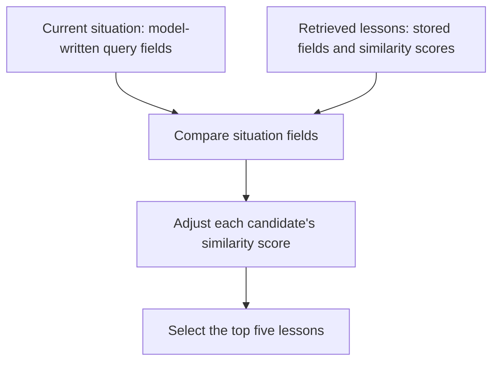

# The field audit that reopened a memory-ranking result

*Level 3 · Evaluation › [Checking agent outputs with code](code_checks.md) · revised 2026-10-29.*

Reordering retrieved memories by situation fields produced little improvement in an initial experiment. A later audit found that some model-written fields were unreliable, giving a reason to question the inputs and compute them in code. It did not directly diagnose the original test cases, and the ranking experiment was never repeated with corrected fields.

The investigation therefore led to a concrete change in how search inputs were constructed, while leaving the retrieval question open.

### What the ranking experiment depended on

Memory search retrieves lessons from earlier games. Similar wording does not necessarily mean that a lesson applies to the current situation, so a ranking feature compared structured fields attached to the query and each stored lesson.

The feature was called **gating**, but it adjusted similarity scores rather than excluding candidates outright. Agreement on the fields raised a candidate's score; disagreement lowered it. The search then selected the top five.

The four matching fields were player count grouped into early, middle or late game; a **swing-day** flag indicating whether one elimination could end the game; and categories describing the agent's information and exposure. Incorrect values could therefore change which lessons reached the agent.

The June 2026 experiment replayed **24 held-out town votes** from the nine-player game. Ranking changed the selected lessons in 23 cases, but the share judged not to apply moved only from 38% to 36%. Votes targeted a real threat about a third of the time with either setup. The feature stayed off.

The experiment showed that ranking changed retrieval without a clear measured benefit. Its small sample and single judging model limited the comparison. The audit asked a different question: were the fields reliable enough to support the intended matches?

### What the audit could check

The audit used recorded decisions from three July runs. It compared model-written fields with values recomputed from game state. Player counts applied broadly; bullets applied to the Vigilante. Each field therefore had its own denominator, and records missing the required inputs were excluded from that check.

The swing-day reference calculation represented the wolves' path to a win. Its interpretable result was restricted to **wolf decisions**, while the original ranking experiment used **town votes**. The audit could reveal problems with the field-generation approach, but it did not measure errors on the original 24 cases.

The audit plan specified a reopening condition: if any field used in matching scored below 80% accuracy, reconsider the earlier negative interpretation. It also set separate requirements for confirming that interpretation, including a human review of the category fields. That review was not completed. The [full audit protocol](../../../evidence/evaluation/deterministic_audits/experiment_log.md) records the thresholds and outstanding checks.

### What failed, and why it mattered

| Field | Accuracy | Field comparisons | Use in the experiment |
|---|---:|---:|---|
| Players alive | 97% exact; 99% in the groups used for matching | 6,099 | Ranking input |
| Swing day, wolf decisions | 61% | 439 | Ranking input; below the 80% reopening threshold |
| Bullets remaining | 16% | 1,109 | Diagnostic field; not used in ranking |

The low bullets accuracy identified a separate calculation problem, but could not trigger the ranking decision rule. The swing-day result could, because the ranking feature used it.

The swing errors mostly came from overprediction. The model identified all 76 actual swing days, but also flagged 173 of 363 ordinary days. Always answering “no” would have achieved about 83% accuracy, higher than the model's 61%, while missing every actual swing day. That baseline explains why the error breakdown matters: the field was often signalling urgency where the reference calculation found none.

Player counts were more accurate, but depended on how the input roster was assembled. Some night-turn rosters omitted the acting player. For bullets, the audited day-2 cases with two remaining were reported as having one. These patterns pointed towards input construction and counting errors that code could address directly.

### Check the audit before accepting its findings

The audit itself initially produced a misleading result. In **176 wolf night-action records**, the saved surviving-player roster was empty. The first pass treated the missing roster as a genuine count of zero, making the model appear to overcount substantially.

Those records were excluded from checks requiring the roster rather than scored against zero. Corrected wolf player-count accuracy was 97%. Other checks could still use the records where their own required inputs were available.

Inspecting the unexpected result prevented missing data from becoming a false finding about the model. The exclusion was specific to the affected comparison, rather than discarding every field from those records.

### What changed, and what still needs testing

The wolf swing-day score crossed the predeclared reopening threshold. That justified revisiting the earlier interpretation, but the audit's wolf-only reference did not show how much input error affected the town-vote experiment. The supported result remains that the original run measured little benefit; a repeat with corrected fields is still needed.

The implementation change did not depend on resolving that experiment. Player count, bullets remaining and partner status moved into code. Swing-day and distance-to-win calculations followed, extending beyond the audit's wolf-only reference. These values are supplied to the model as facts when it writes the query description. The unvalidated information and exposure categories were later removed from the query side.

Computing query fields does not also verify the fields attached to stored lessons. A new ranking test needs reliable values on both sides of the comparison. The audit fixed how computable query values were produced; whether that makes situation-based ranking useful remains the next experimental question.

**Evidence**

- [Deterministic evaluation](../../../evidence/evaluation/deterministic_audits/report.md), case 3: audit approach and implementation change.
- [Detailed record](../../../evidence/evaluation/deterministic_audits/experiment_log.md), §5a–5b: per-field results, audit-input correction, decision rule and computed fields.
- [Situation dimensions](../../../evidence/extraction/situation_dimensions/report.md), §5–6: field definitions, ranking mechanism and original experiment.

<!-- Revised 2026-10-29: owner-approved joint editorial pass. L2 explains deterministic validation techniques; L3 owns the ranking investigation. Source reports checked for mechanisms and scope; no new experiments or full code audit. Earlier copy and source notes retained below. -->

<!-- Previous visible draft
# The field audit that reopened a memory-ranking result

*Level 3 · Evaluation › [Checking agent outputs with code](code_checks.md) · status: page copy drafted 2026-10-25, for the owner's review as the Level 3 exemplar.*

## Brief

**Editorial revision — verifier handoff.** This pass revised the page's structure and explanations.
Before the owner clarified the editorial-only role, it also changed the reported coverage to 6,267
decision records and 20,284 field comparisons using the saved output and runner. The separate verifier
should review those changed units/counts, the expanded decision-rule table, and the scope of the
query-field implementation claims. The attenuation estimate was omitted rather than promoted as a
measured effect. This draft is not being marked factually verified or publication-approved.

Show the decision rule,
field definitions, separate thresholds and baselines, audit-input correction and why unreliable fields
make the original negative result inconclusive. This is a full investigation, not a chart gallery.

The parent page keeps the finding and its essential caveats; this page adds the method and analysis.
Exhibits for this page are listed in [`../exhibits/source_map.md`](../exhibits/source_map.md).

---

## Page copy (draft)

An experiment found no benefit from using situation fields to reorder retrieved memories. That left
two possible explanations: the matching idea was ineffective, or the model-generated fields were too
unreliable to test it properly.

A later audit recomputed the checkable fields from game records. One field performed worse than always
answering “no”, triggering a decision rule written before the audit. The finding reopened the earlier
result; it did not demonstrate that the feature would help. The feature is still off, but the audit's
main consequence is live: the fields it found unreliable are now computed by code on every memory
search. This investigation explains how the audit reached its conclusion and where its evidence stops.

### What the fields were for

Before searching memories of past games, a model described the agent's current situation and supplied
structured fields alongside the search text. These included the number of players alive, remaining
bullets and a *swing-day* flag: whether a single elimination could end the game. Stored lessons carried
corresponding fields generated during extraction.

The feature was called “gating”, but it did not remove lessons outright. It re-scored a wider set of
candidates by their agreement on four fields, multiplying each similarity score by between 0.7 and 1.3,
and the search then kept only the top few. A lesson whose fields disagreed usually dropped out of what
the agent saw, while a very similar one could still get through. Those fields were the player count grouped
into early, middle or late game; the swing flag; and two categories describing the agent's information
and exposure. The idea was to distinguish lessons about similar topics that applied to different
situations.

There was a reason to try this. An earlier replay found that agents judged many retrieved lessons
irrelevant, while relevant and irrelevant lessons had nearly identical average similarity scores.
Matching the situation appeared to offer information that semantic similarity alone was not capturing.

### The result that needed checking

The June 2026 experiment replayed 24 held-out town votes in the original nine-player game. Reordering
changed the top five lessons in 23 cases, but the share judged not to apply moved only from 38% to 36%.
Votes targeted a real threat about a third of the time with either setup. The feature remained off.

The change had reached retrieval, but no benefit was measured. Even with accurate fields, the experiment
would have been limited by its 24 votes, one run and one judging model. Unreliable fields created another
problem: the experiment might have tested incorrect matches rather than the intended matching rule.
The audit asked whether those inputs were dependable enough to interpret the result.

### Recomputing the fields the game record could determine

The saved audit output covers 6,267 decision records containing model-written fields, collected from
three runs in July 2026. Each decision could contain situation descriptions with several checkable
fields. The runner compared each applicable field with a value computed from the recorded game state,
producing 20,284 field comparisons. These are neither 20,284 independent situations nor 20,284 games.

Different fields have different denominators. Remaining bullets applies to the Vigilante; partner
status applies to wolves. Some records lacked the inputs needed for a comparison and were excluded
from the affected checks. The result table therefore reports a sample size for each field.

The swing-day calculation also had a scope limit: the audit's reference calculation represented the
wolves' path to a win. The interpretable swing-day result reported here is consequently restricted to
wolf decisions. The original retrieval experiment used town votes. That mismatch matters when deciding
what the audit says about the earlier experiment.

### The decision rule, written before the audit

The rule distinguished validating the original interpretation from finding a reason to reopen it.
The two outcomes did not use identical thresholds.

| Decision | Required evidence |
|---|---|
| Confirm the earlier negative interpretation under the audit plan | Grouped player-count accuracy at least 90%; wolf swing-day accuracy at least 80%; both category labels reaching agreement of at least 0.6 Cohen's kappa against reference labels from the planned human review |
| Reopen the interpretation | Any field used in matching below 80% accuracy; or, in the later label review, category agreement below 0.4 kappa |
| Neither condition met | Retain the earlier result with a caveat; do not treat the audit as confirmation |

Cohen's kappa measures label agreement beyond what would be expected from the label frequencies alone.
The category review was never completed, so this audit could not satisfy the confirmation rule even if
both computable fields passed. A player-count score between 80% and 90%, for example, would meet neither
numerical trigger by itself.

Bullets and partner status were useful diagnostic checks, but the matching feature did not use them.
Their results could not trigger this decision rule. Passing the rule would also not remove the original
experiment's small-sample limits; it would address the reliability of its inputs.

### What the audit found

| Field | Task | Accuracy | Field comparisons | Role in the decision rule |
|---|---|---|---|---|
| Players alive, grouped as the matching rule used it | Count the supplied roster and assign its group | 99% grouped; 97% exact count | 6,099 | Passed the 90% confirmation threshold |
| Wolf partner status | Read the supplied partner information | 97.5% | 439 | Not used in matching |
| Bullets left | Track use across earlier nights | 16% | 1,109 | Not used in matching |
| Swing day, wolf decisions | Derive the flag from the counts | 61% | 439 | Below the 80% reopening threshold |

Fields that could be read from supplied information were substantially more accurate than those that
required derivation in this audit. That pattern did not establish a universal model limitation. Even
the player count depended on prompt construction: some night-turn rosters omitted the acting player,
so correctly counting the supplied list could still produce the wrong board count.

The swing-day errors were especially informative. The model identified all 76 actual swing days, but
also flagged 173 of 363 ordinary days. It therefore overpredicted the condition rather than missing it.
Always answering “no” would have been correct about 83% of the time, compared with the model's 61%.
That constant answer would miss every actual swing day, so it is a baseline for interpreting accuracy,
not a useful replacement detector.

The bullets field showed a different pattern: in the audited day-2 cases with two bullets remaining,
the model reported one. This pointed to a systematic counting problem rather than scattered mistakes.

### Checking the audit's own inputs

The first pass appeared to show that wolves substantially overcounted the players alive. The problem
was in the audit input: 176 wolf night-action records had an empty surviving-player roster. Treating
that missing roster as a genuine count of zero made the model's answers look wrong.

Those records were excluded from checks requiring the roster, rather than scored against zero. The
corrected wolf player-count accuracy was 97%. This did not invalidate the other checks on those records;
only comparisons whose reference value could not be computed had to be omitted.

A deterministic checker gives repeatable results, but it still needs valid inputs. Here, inspecting an
unexpected result prevented a data-availability problem from becoming a claim about model capability.

### What changed after the audit

#### The retrieval result remained unresolved

The wolf swing-day field failed its predeclared threshold, so the audit rule reopened the interpretation
of the earlier experiment. But the audit did not directly measure the field errors on the original
24 town-vote cases. It justified questioning the negative result, not calculating how much benefit
those cases might have concealed.

The experiment was not repeated with corrected values, and the category-label review was not completed.
The supported conclusion remains “no benefit measured”. Neither the original experiment nor this audit
established that situation-based matching was useless—or that correcting the fields would make it work.

#### Computable query fields moved into code

The search now computes player count, bullets left and partner status from game state rather than
asking the model to supply them. The swing flag and distance-to-win calculations followed once their
required counts were recognised as public information; the calculations were extended beyond the
wolf-only reference used in the audit. The model receives these computed values as facts when writing
its situation description.

The unvalidated category fields were later removed from the query side. These changes improved how the
search inputs were constructed; they were not a measured improvement in gameplay.

#### Stored lessons still needed a separate check

Computing the current situation does not validate fields attached to stored lessons. A lesson describes
an earlier event whose relevant state must first be identified. In an October audit of the expanded
game's store, code reconstructed ability use from the recorded nights and checked one stored field:
remaining uses of a limited ability. It matched exactly in 165 of 196 observations, or 84%.

Most errors used the count after the action rather than before it. That exposed a definition problem
on the stored side, distinct from computing the current query correctly. It also showed why validating
one side of a match does not establish the accuracy of the other.

### What remains uncertain

The audit counts field comparisons and decisions, not independent games. Several comparisons share the
same situation, and decisions within a game share its history. Their volume should not be read as an
equivalent number of independent observations.

Accurate fields would still be only part of the retrieval problem. Later reviews found lessons whose
fields matched the board but whose advice depended on an event the agent had not observed, such as a
rival role claim. The audit established defects in the inputs and changed how they were produced. A
new retrieval experiment would still be needed to establish whether that produces more useful lessons
or better decisions.

**Evidence.**

- [Deterministic evaluation: checks done by code](../../../evidence/evaluation/deterministic_audits/report.md), case 3.
- [The detailed record](../../../evidence/evaluation/deterministic_audits/experiment_log.md), §5a (per-field results and the rule) and §5b (the fields computed by code).
- [Situation dimensions](../../../evidence/extraction/situation_dimensions/report.md), §5 (the audit table and the stored check) and §6 (the gating test).

-->

<!-- Verified 2026-10-25 (main session): 6,267 decision records and 20,284 field comparisons (dimension_audit_20260702_105203.json provenance); the confirm / reopen / middle-band rule incl. the 0.4 kappa reopening clause (dimension_accuracy_audit/experiment_log.md §3); 176 cases 'criticality uncomputable'; the query-field implementation (situation_agent.py). No change needed. -->

<!-- Sources for the page copy (checked 2026-10-25):
Fields and their purpose; 58% not relevant, similarity 0.827 vs 0.828; gating = a ×0.7–1.3 tilt by
agreement on four fields, re-orders only: situation_dimensions/report.md §3, §6 ("What was tried").
June test: 24 held-out town votes; top five changed in 23; "does not apply" 38% → 36%; vote hit a threat
a third of the time either way; left off: §6 ("What the test showed", 2026-06-18).
Audit counts corrected in this revision from the saved JSON provenance: 1,013 + 2,997 + 2,257 =
6,267 decision cases with dimensions; 20,284 comparison rows. Source:
evidence/extraction/situation_dimensions/dimension_accuracy_audit/data/dimension_audit_20260702_105203.json.
Runner rows_for_case emits one row per applicable field comparison, including a second partner-status
variant; n_situation_rows_total counts those rows, not independent situations. The summary's 6,275
and "query situations" labels were not retained.
The rule: confirm iff alive bucket ≥ 0.90 and wolf-side is_swing ≥ 0.80 and enum kappas ≥ 0.6; reopen if
any gated field < 0.80; kappa clause pending human labels: experiment_log.md §5a, "The rule set before
the run fired". Bullets outside the rule (not a gated field): content plan, source corrections.
Table: alive 0.970 exact / 0.990 bucket (6,099); ally_revealed 0.975 (439); bullets 0.164 (1,109), day 2
0.0 (said 1 where 2 were left); wolf is_swing 0.606 vs always-false 0.827 (439); 173 false positives, 76
true positives (base rate 0.173): experiment_log.md §5a. "Marked all 76": 76 true positives = 0.173 × 439,
so no real swing day was missed; 363 = 439 − 76.
Empty rosters: 176 wolf night_action cases, no_roster, corrected to 0.97: §5a.
Attenuation estimate omitted: the record’s 1 − 2ē calculation is not a measured reduction in retrieval
benefit and does not establish attenuation on the original town-vote cases.
Not re-run; kappa check never done; four query-side labels removed October 2026; "no benefit measured":
§5a correction 2026-10-23; situation_dimensions/report.md §6 "What changed".
Computed since 2026-07-02 (alive, bullets, partner) and 2026-07-11 (parity, swing); known board facts in
the prompt: experiment_log.md §5b and its correction.
Stored uses-left: 165 of 196 (84%), most errors after the action: experiment_log.md §5c;
situation_dimensions/report.md §5.
Decisions not games: §5a. Kept off the page (handle-with-care): the held spend approval, the per-case
output that was printed and not saved. Ownership: the audit's execution is written without "I".
Rubric pass 2026-10-25 additions: June test size (24 votes, one run, one judge): situation_dimensions §6
"Limits"; roster off-by-one on single-actor night payloads: experiment_log.md §5b; misfits keyed to unseen
events: situation_dimensions §6 "What it shows" and §7; the earlier conditional attenuation claim is superseded by the omission noted above; the swing flag scored wolf-side only because the July truth
counted only the wolves' path to a win (experiment_log.md §5a and its 2026-10-23 correction), while the June
test used town votes. -->

<!-- Level 3 revision: the full decision rule (including middle band and category reopening threshold)
is in the original dimension_accuracy_audit/experiment_log.md §3. Confirmation was the plan's label,
not proof of no benefit. No new audit or paid experiment was run for this editorial revision. -->
