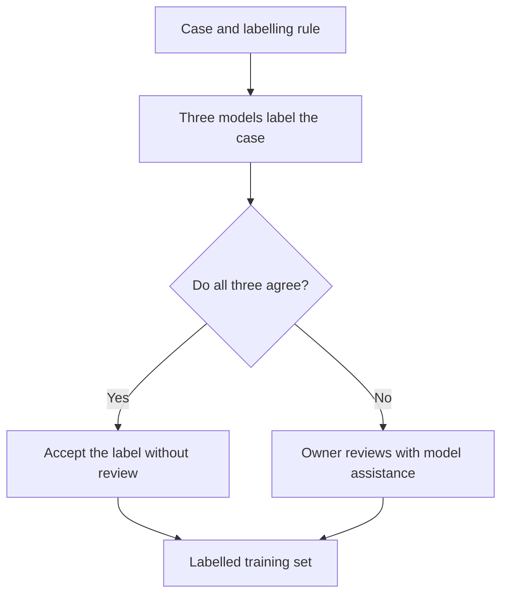

# Building golden sets for evaluation

*Level 2 · [Evaluation](../evaluation.md) · previous: [Designing and validating LLM judges](../llm_judges/llm_judges.md) · next: [Choosing between turn replays and whole games](../replays_and_games/replays_and_games.md) · revised 2026-10-29.*

A **reference set** pairs examples with expected answers so that an evaluator can be tested consistently. In this project, golden sets are used to check LLM judges, compare deduplication models and calibrate similarity thresholds.

For example, a deduplication judge decides whether a new memory duplicates one already stored. Two memories can describe the same tactic but opposite outcomes. The expected decision is **keep**, because success and failure teach different lessons. Recording that answer gives us a case against which to test the judge.

I build reference sets through manual labelling, model-assisted review or model-generated labels. The work has four parts: choose cases, define the labelling rule, assign and review the answers, then use the fixed set to compare evaluator versions. The examples below show how those choices affected the project's datasets.

### Choose cases for the decision being tested

A reference set needs the inputs the evaluator will see, together with the expected answer. For deduplication, that means the new memory and the stored candidates it is compared with. For factual-error detection, it means the response and the facts needed to check it. Keeping that context lets a reviewer inspect the label and another evaluator attempt the same decision.

Selection depends on the question the set should answer:

| Purpose | Cases to include | What the result establishes |
|---|---|---|
| Regression testing | Known failures and important edge cases | Whether the evaluator handles those specified cases |
| Performance evaluation | A sample covering the decisions the evaluator is expected to make | Measures accuracy on the selected cases. To estimate accuracy in normal use, the sample must reflect the cases encountered there. |

The first dedup set sampled **50 cases from 390 recorded decisions across 30 games**, using a fixed random seed. Half were observations, which record a situation, action and outcome; half were strategy points, which give advice. Each case retained the compared memories, and review returned to the full text when a summary was ambiguous.

The balance made it possible to inspect both memory types separately. Their equal weighting also determined the overall score, rather than their frequency in live use. The set later grew to 65 cases.

The project also freezes known factual failures with written expectations for regression testing. Those cases are selected because they exposed a problem, as described in [Finding and fixing factual errors](../factual_errors/factual_errors.md).

### Define the rule, then assign and review labels

A labelling rule makes the expected answer explainable. For an observation to be a duplicate, its situation, approach and outcome must match a stored memory. For advice, the situation and the recommended action must match. Similar wording alone is not enough.

The 65-case dedup set was labelled manually, then revised when repeated model disagreements highlighted cases worth rereading. **Fourteen labels changed across two review rounds.** The later review sharpened the criterion: would retaining only one memory lose useful information for retrieval?

Model disagreement prompted inspection; the written rule justified the correction. This matters because otherwise a reference intended to evaluate models could gradually become a record of whatever those models already answer.

For genuinely borderline cases, the label file records an alternative acceptable answer. The scorer reports strict accuracy against the primary label and lenient accuracy accepting either answer. This makes the ambiguity visible instead of silently counting a defensible answer as wrong.

For checks of model-generated labels, the prepared human-review packets hide the model's answer until labelling is complete. The reviewer gets the case and the rule, so the human label can be compared with the existing verdict afterward.

### Using model agreement to prioritise human review

Training data or a larger reference set can require hundreds of labels, making it expensive for one person to decide every case. I tried to reduce that work by accepting unanimous model labels and reviewing disagreements. Review uncovered mistakes even among unanimous answers, so consensus needed sample validation before it could justify skipping human review.

This experiment built training data for a deduplication classifier; its review strategy also applies when expanding a reference set. Three models applied the same keep-or-discard rule, with their votes determining which cases reached review:



*Original routing: human effort went to disagreements, while unanimous labels bypassed review.*

Reviewing the disagreements raised a concern: discard majorities were overturned more often than keep majorities. Review therefore expanded to unanimous discards and changed **80 of 373 to keep**. Those labels would have entered the training set unchecked under the original plan.

The reversals came from my review with a model assisting, without an independent second reviewer. The 246 unanimous keeps remained unchecked. The result exposed a problem with the shortcut; it did not establish the accuracy of the corrected dataset.

For a future labelling run at this scale, the review plan therefore needs to **sample agreed cases as well as resolve disagreements**. Check a human-reviewed sample from each agreement group before deciding whether to accept the rest.

[Why unanimous model labels still needed review](model_panel_review.md) details how review expanded and which distinctions the panel missed.

### Use the labels to compare evaluators

Once cases and labels are fixed, each evaluator version attempts the same decisions. Code compares the predictions with the reference answers. The dedup scorer reports accuracy, a confusion matrix, per-label precision and recall, and a list of mismatches to inspect. No additional LLM judgement is needed to score the decisions.

The breakdown matters because errors have different consequences. **Discard precision** asks how many proposed discards the reference supports; **discard recall** asks how many reference discards the evaluator finds. Poor precision can mean losing distinct lessons. Poor recall leaves duplicates in the store.

These golden labels supported successive dedup prompt revisions and later embedding-threshold calibration. A set used repeatedly this way is a development set: its results guide improvements, while fresh or held-out cases are needed to assess whether those improvements transfer.

### Keep the reference set relevant

An evaluator change may only require rerunning an existing set. A change to the task can require new cases or revised labels. The original dedup golden sets came from the nine-player game, before later memory fields and candidate filters changed which comparisons reached the judge. Their historical scores therefore need updating before describing the current pipeline.

The project has completed human-labelled evaluation for online and batch dedup, and a golden set used to calibrate the factual-error reader. It also has model-generated references awaiting human checks. Prepared packets cover accusation tags, the discussion echo gate and the factual-error judge; the calibration tool is built, but those labels remain outstanding.

The [reference-set inventory](../../../evidence/evaluation/labeling/report.md#reference-sets-in-this-project) records the datasets, their uses and the remaining checks. Keeping those details with the cases helps distinguish a model change that needs a rerun from a task change that needs new labelling.

**Evidence**

- [Building reference sets](../../../evidence/evaluation/labeling/report.md): construction workflow, inventory and calibration status.
- [Dedup evaluation apparatus](../../../evidence/evaluation/labeling/dedup.md): golden sets and deterministic scoring.
- [Per-extraction dedup record](../../../evidence/dedup/per_extraction/experiment_log.md): case selection, criteria, label revisions and prompt tuning.
- [Scales and scores](../../../evidence/evaluation/scoring/report.md): agreement measures and label-specific scores.

<!-- Alignment revision 2026-10-29: portfolio copy follows the revised reference-set evidence report. Case selection, labelling/review, scaling, scoring and maintenance are the main argument. Training-data panel retained as the scaling example; output-review activities excluded. -->

<!-- Previous portfolio copy before evidence-report alignment
# Building golden sets for evaluation

*Level 2 · [Evaluation](../evaluation.md) · previous: [Designing and validating LLM judges](../llm_judges/llm_judges.md) · next: [Choosing between turn replays and whole games](../replays_and_games/replays_and_games.md) · revised 2026-10-29.*

To check a memory deduplication judge, we need examples with expected answers. Suppose two memories describe the same tactic, but one reports success and the other failure. The expected decision is **keep**: the different outcomes make both worth retaining. If the judge says **discard**, we have a disagreement to investigate.

A **golden set** collects cases like these with reference labels: the expected answers used to score an evaluator. It gives us a consistent way to compare prompts, models or thresholds. The work is in choosing useful cases, defining the right answer and reviewing the labels before relying on them.

### Start with the decision the set will test

The reference must match the evaluator's job. A deduplication set asks whether a memory should be kept or discarded. A factual-error set asks whether a response contradicts the information available to the agent player.

Where the game record determines the answer, code can supply it. Judgements of meaning need labelled examples. In this project, hand-labelled golden sets anchor dedup evaluation, while model-assisted labelling has been used to build larger training datasets and other references.

A case needs more than a label. For deduplication, it includes the new memory, the stored candidates being compared with it, and the expected decision. That lets another model replay the same decision and lets a reviewer inspect why the label fits. The scorer can then compare the prediction with the reference directly, without asking another LLM to decide whether the answer was correct.

### Choose cases that test the intended behaviour

Case selection determines what a score can tell us. A set built from known failures can check whether those failures return. A sample of routine decisions can help assess performance on the work the evaluator normally sees. These are different purposes:

| Purpose | Cases to include | What the result establishes |
|---|---|---|
| Regression testing | Known failures and important edge cases | Whether the evaluator handles those specified cases |
| Performance evaluation | A sample covering the decisions the evaluator is expected to make | Measures accuracy on the selected cases. To estimate accuracy in normal use, the sample must reflect the cases encountered there. |

The initial dedup golden set used a seeded sample of **50 cases from 390 recorded decisions across 30 games**. It balanced two memory types: 25 observations, which record situations, actions and outcomes, and 25 strategy points, which give advice. Each case retained the new entry and its retrieved candidates. Reviewers consulted the full original text when a summary was ambiguous.

Balancing the sample made it possible to inspect each memory type separately. The overall score reflects that equal weighting, rather than their frequency in live use. The set subsequently grew to 65 cases.

Known factual failures serve a different purpose. They can be frozen with an explicit expectation and replayed after changes, as described in [Finding and fixing factual errors](../factual_errors/factual_errors.md). Their value is in detecting a regression, not estimating how often that failure occurs in ordinary games.

### Define and review the expected labels

A labelling rule needs to explain what makes an answer correct. For memory deduplication, “these sound similar” is insufficient. An observation is a duplicate only when its situation, approach and outcome match a stored one. That is why the opening example keeps accounts of both success and failure. For advice, the situation and the recommended action must match.

The hand-labelled dedup set also shows why labels need review. **Fourteen of its 65 labels changed** across two revision rounds. Several models repeatedly disagreed with particular labels, prompting a reread. The later review sharpened the criterion: would retaining only one lesson lose something useful for retrieval?

Model disagreement identified cases to inspect; it did not decide the replacement label. The written criterion supplied the reason for changing it. Otherwise, a reference intended to evaluate models could drift towards whatever those models already answered.

Genuinely borderline cases could record an alternative acceptable label. The scorer reported strict accuracy against the primary label and lenient accuracy accepting either answer. This preserved ambiguity explicitly instead of treating every defensible alternative as a model error.

The resulting golden set provided a human-labelled reference for prompt tuning and deterministic scoring.

### Using model agreement to prioritise human review

Training data or a larger reference set can require hundreds of labels, making it expensive for one person to decide every case. I tried to reduce that work by accepting unanimous model labels and reviewing disagreements. Review uncovered mistakes even among unanimous answers, so consensus needed sample validation before it could justify skipping human review.

The experiment produced training labels for a memory deduplication classifier. Three models applied the same keep-or-discard rule, with their votes determining which cases reached review:

```mermaid
flowchart TD
    A["Case and labelling rule"] --&gt; B["Three models label the case"]
    B --&gt; C{"Do all three agree?"}
    C --&gt;|Yes| D["Accept the label without review"]
    C --&gt;|No| E["Owner reviews with model assistance"]
    D --&gt; F["Labelled training set"]
    E --&gt; F
```

*Original routing: human effort went to disagreements, while unanimous labels bypassed review.*

Reviewing the disagreements raised a concern: discard majorities were overturned more often than keep majorities. Review therefore expanded to unanimous discards and changed **80 of 373 to keep**. Those labels would have entered the training set unchecked under the original plan.

The reversals came from my review with a model assisting, without an independent second reviewer. The 246 unanimous keeps remained unchecked. The result exposed a problem with the shortcut; it did not establish the accuracy of the corrected dataset.

For a future labelling run at this scale, the review plan therefore needs to **sample agreed cases as well as resolve disagreements**. Check a human-reviewed sample from each agreement group before deciding whether to accept the rest.

[Why unanimous model labels still needed review](model_panel_review.md) details how review expanded and which distinctions the panel missed.

### Use the set, and keep it relevant

Once the cases and labels are fixed, run each evaluator version on the same inputs and compare its predictions with the expected answers. The dedup scorer reports overall accuracy, a confusion matrix, per-label precision and recall, and the mismatched cases for inspection.

Those breakdowns help explain a score. **Discard precision** asks how many proposed discards the reference supports; **discard recall** asks how many of the reference's discards the evaluator finds. Poor precision can mean losing distinct lessons. Poor recall means leaving duplicates. Overall accuracy alone can hide that difference.

A set used repeatedly for prompt tuning is a development set. Performance on it shows how well the changes fit those examples; fresh or held-out cases are needed to assess whether improvements transfer. The dedup set supported successive prompt revisions and later embedding-threshold calibration, so its results should be read in that development context.

The cases also need to remain relevant to the system. These golden labels came from the original nine-player game, before later changes to candidate filtering and memory fields. They remain useful examples, but their historical scores do not describe the current pipeline. Updating an evaluation therefore means checking case coverage and the decision rules as well as rerunning the scorer.

The project has completed golden-set evaluation for dedup, alongside references that still need validation. For the expanded game, prepared human-check packets cover accusation tags, the discussion echo gate and the factual-error judge. The calibration tool is built, but those human checks remain outstanding.

**Evidence**

- [Dedup evaluation apparatus](../../../evidence/evaluation/labeling/dedup.md): golden sets, deterministic scoring and the scope of the results.
- [Per-extraction dedup record](../../../evidence/dedup/per_extraction/experiment_log.md): case selection, labelling criteria, revisions and prompt tuning.
- [Labelling report](../../../evidence/evaluation/labeling/report.md): reference sets, panel review and prepared calibration checks.
- [Scales and scores](../../../evidence/evaluation/scoring/report.md): agreement measures and label-specific scores.

-->

<!-- Scope revision 2026-10-29: owner confirmed reference/golden-set construction as the subject. Removed one-off output comparisons. Case selection checked against per-extraction log, Building the golden set; scoring and maintenance scope against labeling/dedup.md. No new numerical audit. -->

<!-- Prior draft before scope correction
# Building reference labels and reviewing outputs

*Level 2 · [Evaluation](../evaluation.md) · previous: [Designing and validating LLM judges](../llm_judges/llm_judges.md) · next: [Choosing between turn replays and whole games](../replays_and_games/replays_and_games.md) · revised 2026-10-29.*

To check a memory deduplication judge, we need examples with expected answers. Suppose two memories describe the same tactic, but one reports success and the other failure. The expected decision is **keep**: the different outcomes make both worth retaining. If the judge says **discard**, we have a disagreement to investigate.

That expected answer is a **reference label**. For facts such as a player's true role, the game record supplies the answer. For a judgement such as whether two lessons are equivalent, a person or model has to interpret the text. The reference can therefore be wrong too. Building useful labels means defining the judgement clearly and checking the answers before relying on them.

### What we use labels for

The project uses labels both to check evaluators and to compare generated outputs:

| Use | What the reader produces | How we use it |
|---|---|---|
| Check an evaluator | Expected labels for selected cases, such as keep or discard | Compare the evaluator's answers with them |
| Compare generated outputs | Labels describing the outputs, such as whether two messages take different stances | Compare results across prompt or feature versions |

The first can become a **reusable evaluation set**, used to compare versions of a classifier or judge. The second can be a **sampled read** for one decision, without becoming a standing test set.

Reusing a set makes comparisons consistent, but tuning and testing on the same examples can overstate performance. Agreement on those examples shows how well the evaluator fits them; fresh or held-out cases are needed to check whether the improvement transfers.

### How labels are used in the project today

In the expanded ten-player game, model readers supply labels for many checks that require interpreting text. I frame the question, often write the rubric, and use the findings to decide what to change. The evaluations use different scripts, but share this broad sequence:

1. **Write the rubric.** Define the judgement and the labels the reader can choose.
2. **Prepare examples.** Select outputs and include the context needed to judge them.
3. **Collect labels.** Model readers return a verdict, usually with a reason or supporting quote.
4. **Score and inspect.** Code compares predictions with reference labels or aggregates output labels by version. I inspect the findings to identify failures and guide changes.

These reads generally use one model reader per item. The expanded game's model-read sets have not yet had a human sample check, so their labels remain provisional.

### Define the judgement before collecting labels

A labelling rule needs to explain what makes an answer correct. For memory deduplication, “these sound similar” is insufficient. An observation is a duplicate only when its situation, approach and outcome match a stored one. That is why the opening example keeps accounts of both success and failure: removing one would lose information.

The original hand-labelled dedup set contained 65 cases. Review changed **14 labels** across two rounds. Several models repeatedly disagreed with particular labels, prompting a reread. The later review sharpened the criterion: would retaining only one lesson lose something useful for retrieval?

Model disagreement identified cases to inspect; it did not decide the replacement label. The written criterion supplied the reason for changing it. Otherwise, a reference intended to evaluate models could drift towards whatever those models already answered.

The revised set guided dedup prompt tuning. It still came from one labeller without an independent second review, so its labels were an inspectable reference rather than unquestionable ground truth.

### Using model agreement to prioritise human review

Training data or a larger reference set can require hundreds of labels, making it expensive for one person to decide every case. I tried to reduce that work by accepting unanimous model labels and reviewing disagreements. Review uncovered mistakes even among unanimous answers, so consensus needed sample validation before it could justify skipping human review.

The experiment produced training labels for a memory deduplication classifier. Three models applied the same keep-or-discard rule, with their votes determining which cases reached review:

```mermaid
flowchart TD
    A["Case and labelling rule"] --&gt; B["Three models label the case"]
    B --&gt; C{"Do all three agree?"}
    C --&gt;|Yes| D["Accept the label without review"]
    C --&gt;|No| E["Owner reviews with model assistance"]
    D --&gt; F["Labelled training set"]
    E --&gt; F
```

*Original routing: human effort went to disagreements, while unanimous labels bypassed review.*

Reviewing the disagreements raised a concern: discard majorities were overturned more often than keep majorities. Review therefore expanded to unanimous discards and changed **80 of 373 to keep**. Those labels would have entered the training set unchecked under the original plan.

The reversals came from my review with a model assisting, without an independent second reviewer. The 246 unanimous keeps remained unchecked. The result exposed a problem with the shortcut; it did not establish the accuracy of the corrected dataset.

For a future labelling run at this scale, the review plan therefore needs to **sample agreed cases as well as resolve disagreements**. Check a human-reviewed sample from each agreement group before deciding whether to accept the rest. The experiment supports adding that check, rather than treating model agreement alone as evidence that review can be skipped.

[Why unanimous model labels still needed review](model_panel_review.md) details how review expanded and which distinctions the panel missed.

### Compare outputs without assuming every difference comes from the change

Adding a speaking style should change how an agent player expresses itself. Could it also change what the agent argues? A sampled read compared messages generated with and without a line describing the agent's voice. The rubric asked whether a listener would take the same position and request from each message.

Readers received the discussion context and messages with the version labels hidden. A separate key joined their verdicts back to the versions after labelling. This **blinding** reduced the opportunity to favour the expected winner, although distinctive wording could still reveal which version produced a message.

The comparison also needed a baseline. Two calls to an unchanged prompt can produce different arguments, so a difference between styled and plain messages cannot automatically be attributed to the style instruction. The packets included both comparisons:

| Comparison | Pairs labelled as having different stances |
|---|---:|
| Styled versus plain | 9 of 30 |
| Plain versus another plain response | 3 of 10 |

Both observed rates were 30%. The read therefore did not distinguish an effect of the style instruction from ordinary output variation. The ten baseline pairs were too few to rule out a modest effect, but they prevented treating every difference as a consequence of the change.

These were model judgements, with one reader per item and no human check of the labels. Blinding and the baseline made the comparison more interpretable; neither established the reader's accuracy.

### The remaining check: validate the model-written labels

The current model reads help identify possible failures and guide implementation. To assess their accuracy against human judgement, the next step is to label a sample myself and compare the answers. Until that happens, agreement with these references means agreement with the model readers.

Packets for that check are ready for accusation tags, the discussion echo gate and the factual-error judge. Each provides a written rule and keeps the source's answers hidden during labelling. A calibration tool computes agreement, uncertainty and scores for each label; the human labels needed to run the check are still outstanding.

The check needs to show which decisions disagree, not just overall agreement. For deduplication, **discard precision** asks how many proposed discards the human reference supports; **discard recall** asks how many of the reference's discards the evaluator finds. These distinguish losing useful memories from leaving duplicates in the store. Their different consequences matter when deciding whether an evaluator is suitable for use.

**Evidence**

- [Labelling report](../../../evidence/evaluation/labeling/report.md): reference sets, provenance, dedup label revisions and panel review.
- [Sampled reads](../../../evidence/evaluation/labeling/sampled_reads/report.md): packet preparation, comparisons and reader variation.
- [Persona-line comparison](../../../evidence/gameplay/data/persona_line/README.md): styled-versus-plain and plain-versus-plain pairs.
- [Dedup labelling record](../../../evidence/dedup/per_extraction/experiment_log.md): duplicate criteria and revision rounds.
- [Scales and scores](../../../evidence/evaluation/scoring/report.md): agreement measures and statistical checks.

-->

<!-- Readability revision 2026-10-29: concrete opening, two-use table, short current workflow, supporting examples and a focused validation ending. Panel routing retained. Prior draft below; Mermaid arrows in that archive are escaped to keep the HTML comment intact. -->

<!-- Prior draft before readability pass
# Building reference labels and reviewing outputs

*Level 2 · [Evaluation](../evaluation.md) · previous: [Designing and validating LLM judges](../llm_judges/llm_judges.md) · next: [Choosing between turn replays and whole games](../replays_and_games/replays_and_games.md) · revised 2026-10-29.*

An evaluator needs something to compare its answers with. For a legal action or a player's true role, the game record can supply that answer. For a question such as whether two lessons give equivalent advice, someone has to interpret the text. Their decision becomes a **reference label**: the answer used to assess the evaluator.

That creates another engineering problem. A judge can agree with its reference and still be wrong if the reference is wrong. This project used hand-labelled examples, model panels and blind model reads to evaluate questions that code could not settle directly. The work was in making the judgement explicit, deciding what needed human review, and keeping the conclusions within what those checks could support.

### What needs a reference label

The project uses labels in two ways. A **reusable evaluation set**, such as the hand-labelled dedup set below, holds examples and their expected labels so that a classifier, similarity threshold or LLM judge can be compared across versions. A **sampled read** answers a particular question about outputs, such as whether adding a speaking style changes what an agent player argues. Here the labels directly measure the property being compared, rather than providing expected answers against which another evaluator is scored. They do not necessarily become a reusable reference set.

Both need a clear rule and enough context to apply it. They differ in what depends on the result. An exploratory read can reveal a failure worth investigating even when its labels are provisional. A reference used repeatedly to tune or select a judge needs more scrutiny, because an error in it can steer every later comparison. If the same examples are used for tuning and scoring, the resulting agreement describes performance on those examples; fresh or held-out cases are needed to assess whether it transfers.

The label's provenance also matters. A person writing a label, a person reviewing a model's label, and a model supplying an unchecked label are different levels of review. Calling a set “gold” or “silver” is shorthand; it does not explain which answers were checked or make any of them infallible.

### How labels are used in the project today

In the expanded ten-player game, model readers supply the labels for many checks that require interpreting text. I frame the question, often write the rubric, and use the findings to decide what to change. The work follows this broad sequence, although individual evaluations use different scripts and do not all run through one standardised pipeline:

1. **Define the judgement.** Specify what the reader should identify, such as duplicate advice, a factual error or a change in a message's stance, as a rubric with fixed labels written before any are collected.
2. **Prepare the cases.** Select outputs and provide the context needed to judge them. Blind comparisons hide the version behind opaque IDs, with a separate key for scoring later. Where ordinary variation could look like an effect, a read can include pairs from an unchanged version as a baseline.
3. **Collect labels.** Model readers apply the rubric and return verdicts, usually with a reason or supporting quote. Each item has one reader, so how often two readers agree has not been measured.
4. **Score and inspect.** For a judge evaluation, compare its predictions with the reference labels. For an output comparison, group the reader's labels by version after unblinding and inspect what differs.
5. **Use the finding.** The results identify possible failures and guide prompt or implementation changes. Agreement with model-written references remains agreement with those readers until their labels are checked independently.

Human validation is a prepared next step, rather than a completed stage of this workflow. Packets for my own check and a calibration tool exist for selected sources, but the expanded game's model-read reference sets have not yet had a human sample check.

The three cases below come from earlier work, and each explains part of this sequence. The dedup reference set is why the rule comes before the labels. The model-panel review is why agreement with model readers is not treated as accuracy, and why the calibration step was built. The speaking-style comparison shows the blind packet in use, and why a read can need its own baseline. Two of their lessons are not yet routine: reads use one reader per item, and no agreed model label in the ten-player game has been checked by a person.

### Define the judgement before collecting labels

The first deduplication reference set illustrates why a labelling rule matters. Memory deduplication decides whether a new lesson adds something worth retaining or repeats an existing lesson. Similar wording alone cannot answer that question: two accounts of the same tactic can teach different lessons if one succeeded and the other failed.

The rule therefore distinguished two kinds of memory. An **observation**, recording a situation, an approach and an outcome, counted as a duplicate only when all three matched. A **strategy point**, giving advice for a situation, counted as a duplicate when the situation matched and the advice pointed the same way. Borderline cases could record either label as acceptable, allowing both strict and lenient scoring.

One person labelled 65 cases. Even with those rules, 14 labels changed across two revision rounds. Several models repeatedly disagreed with particular labels, which made those cases worth rereading. The later review sharpened the question to whether retrieval would lose something by keeping only one lesson. This shifted several decisions from discard to keep.

Model disagreement was a reason to reopen a case, not sufficient reason to adopt the models' answer. Otherwise, a reference intended to evaluate models would gradually become a record of what those models preferred. The revised criterion gave the review a reason for changing each label that could be inspected separately from the vote.

The set subsequently guided dedup prompt tuning. Its value was a consistent, inspectable comparison, with limits: it came from one labeller, had no independent second opinion, and contained only 65 cases from the original nine-player game. Agreement on that set did not establish general dedup accuracy. The order it established carried forward: today's reads start from a written rubric, so a disputed label can be checked against the rule rather than against the vote.

### Using model agreement to prioritise human review

Training data or a larger reference set can require hundreds of labels, making it expensive for one person to decide every case. I tried to reduce that work by accepting unanimous model labels and reviewing disagreements. Review uncovered mistakes even among unanimous answers, so consensus needed sample validation before it could justify skipping human review.

The experiment labelled examples for a memory deduplication classifier: **keep** a new lesson if it adds useful information, or **discard** it if it duplicates a stored lesson. Three models applied the same rule, with their votes determining which cases reached review:

```mermaid
flowchart TD
    A["Case and labelling rule"] --&gt; B["Three models label the case"]
    B --&gt; C{"Do all three agree?"}
    C --&gt;|Yes| D["Accept the label without review"]
    C --&gt;|No| E["Owner reviews with model assistance"]
    D --&gt; F["Labelled training set"]
    E --&gt; F
```

*Original routing: human effort went to disagreements, while unanimous labels bypassed review.*

Reviewing the disagreements raised a concern: discard majorities were overturned more often than keep majorities. Review therefore expanded to unanimous discards and changed **80 of 373 to keep**. Those labels would have entered the training set unchecked under the original plan.

The reversals came from my review with a model assisting, without an independent second reviewer. The 246 unanimous keeps remained unchecked. The result exposed a problem with the shortcut; it did not establish the accuracy of the corrected dataset.

For a future labelling run at this scale, the review plan therefore needs to **sample agreed cases as well as resolve disagreements**. Check a human-reviewed sample from each agreement group before deciding whether to accept the rest. The experiment supports adding that check, rather than treating model agreement alone as evidence that review can be skipped.

[Why unanimous model labels still needed review](model_panel_review.md) details how review expanded and which distinctions the panel missed.

### Make one-off reviews interpretable

Some questions did not need a reusable reference set. They needed a consistent read of outputs from two versions. In the October comparisons, model readers assessed sampled messages using a fixed rubric, while I framed the question and used the results to decide what to change.

The packet preparation separated reading from knowing the treatment. Outputs were saved, sampled with a fixed seed where necessary, shuffled and assigned opaque IDs. Readers received the relevant discussion context and messages without their version labels. A separate key mapped the verdicts back to the versions after the read. Hiding those labels reduced an opportunity to favour the expected winner, although distinctive wording could still reveal which version produced an output.

A comparison of speaking styles shows why blinding alone is not enough. The experiment added a line to an agent player's prompt describing its voice. Readers compared pairs of messages and judged whether a listener would take the same position and request from them. If the style instruction changed the substance, a feature intended to change presentation could also change play.

Readers found different stances in **9 of 30 styled-versus-plain pairs**. That result needed a baseline: repeated calls to an unchanged prompt can also produce different arguments. The packets therefore included pairs of plain responses to the same prompt, and readers found different stances in **3 of 10** of those pairs.

Both observed rates were 30%. In this sample, the style instruction did not produce a higher rate of stance differences than an ordinary second response. The ten baseline pairs were too few to rule out a modest effect, but they prevented attributing every observed difference to the instruction.

These were model judgements, with one reader per item, and had not been checked against my labels. Other repeated reads in the project found that concrete labels, such as whether an agent player claimed a role, held more consistently than interpretive labels. Fixing the rubric and hiding the version made the comparison easier to inspect; they did not establish that the reader was accurate or interchangeable with another reader.

### What confidence the current labels support

The project has evidence that its references can expose useful failures: hand labels needed correction, consensus concealed disputed discards, and a baseline changed how a prompt comparison should be interpreted. It has less evidence that the model-written references themselves are accurate enough to support close comparisons.

A human check should examine which decisions disagree, as well as total agreement. In deduplication, excessive discarding loses distinct lessons; excessive keeping leaves repetition. Those failures have different consequences. Per-label precision and recall distinguish them: discard precision asks how many proposed discards the reference supports, while discard recall asks how many reference discards the evaluator finds. A high overall agreement rate can conceal poor performance on one of those decisions.

A calibration step now computes agreement, uncertainty and label-specific scores against human labels. Prepared packets for my own check cover accusation tags, the discussion echo gate and the factual-error judge, with written rules and the source answers hidden during labelling. At the time of this write-up, those packets were waiting for labels; building the check had not validated those sources.

The existing human-labelled evaluation sets come from the original nine-player game. The expanded game's model-read sets have not yet had a human sample check, although some support live features. They remain useful for locating possible failures and guiding implementation. The next step is to check the prepared samples before treating agreement with those references as evidence of accuracy against a person's judgement.

**Evidence**

- [Labelling report](../../../evidence/evaluation/labeling/report.md): reference sets, provenance, dedup label revisions and panel review.
- [Sampled reads](../../../evidence/evaluation/labeling/sampled_reads/report.md): packet preparation, comparisons and reader variation.
- [Persona-line comparison](../../../evidence/gameplay/data/persona_line/README.md): styled-versus-plain and plain-versus-plain pairs.
- [Dedup labelling record](../../../evidence/dedup/per_extraction/experiment_log.md): duplicate criteria and revision rounds.
- [Scales and scores](../../../evidence/evaluation/scoring/report.md): agreement measures and statistical checks.

-->

<!-- Editorial revision 2026-10-29: follows the owner-approved outline. L2 explains reference construction and sampled reads; L3 investigates the consensus review shortcut. Secondary experiment histories, calibration thresholds and training details remain in the evidence records. No new experiments or independent numerical audit. Prior draft and source notes retained below as history.
Small fix 2026-10-29 (owner request): each case now links to today's sequence. Steps 1–3 carry the written rubric, the optional no-change baseline and one reader per item (sampled_reads/report.md §2–4); the "historical examples, not the routine method" sentence became a paragraph mapping each case to the step it explains and naming the two lessons not yet routine (labelling/report.md "What is missing"). The panel section gains the later mixed-provider rounds (labelling/report.md case 2: round 1 reviewed, round 2 none; "a shared lean was still caught only by a different kind of judge"), which the chapter page's summary already mentions. "The owner" became first person; model family names removed. The dedup labeller stays "one person", as the record does not name them. -->


<!-- Previous visible draft, superseded 2026-10-29

# Building reference labels and reviewing outputs

*Level 2 · [Evaluation](../evaluation.md) · previous: [Designing and validating LLM judges](../llm_judges/llm_judges.md) · next: [Choosing between turn replays and whole games](../replays_and_games/replays_and_games.md) · status: page copy drafted 2026-10-25 with the level prompts, reviewed in the main session; for the owner's review.*

## Brief

**Reader question:** What should count as the answer when the evaluator itself can be wrong?

Subsections: reusable reference sets versus one-off reviews; selecting and blinding examples; turning
subjective criteria into labelling rules; using model panels without treating agreement as truth;
measuring disagreement and deciding what needs human review.

**Lead story:** the 863-case model panel, where review overturned even unanimous discard labels.
Explain why reviewing disagreements alone would miss shared errors. The smaller human-labelled dedup
set shows that human labels also need clear criteria and revision, not automatic trust.

**Sampled reads belong here as a full subsection:** explain the seeded packets, hidden version labels,
fixed rubric, scoring after unblinding and distinction between model readers and people. Use the
persona-line comparison's unchanged baseline to show why an apparent stance change needed context.

**Exhibits:** a readable example review packet; panel agreement → review → corrected labels; a small
confusion table with denominators where supported. Explain precision/recall or agreement at the point
they answer the reader's question, rather than listing metric names.

**Sources:** [labelling](../../../evidence/evaluation/labeling/report.md),
[sampled reads](../../../evidence/evaluation/labeling/sampled_reads/report.md), and scoring.

**Level 3:** [When three models agreed on the wrong label](model_panel_review.md), linked beneath the subsection it deepens.

Exhibits for this page are listed in [`../exhibits/source_map.md`](../exhibits/source_map.md).

---


## Page copy (draft)

An LLM judge is checked by comparing its answers with reference labels: answers to the same items
used as the reference for assessing the judge. When the question is about meaning, such as whether
two stored lessons say the same thing, someone has to write those labels, and they can be wrong too.
So a reference is only as trustworthy as its labelling, and as the checks made on that labelling.

This page explains how the project built its references and reviewed outputs. It covers what the
labels were for, how a judgement became a written labelling rule, how one-off comparisons hid which
version produced each output, and how disagreement decided where a person's time went. The main example
is a panel of three models whose unanimous answers turned out to be wrong too often to trust without
review.

The labelling approaches used in the project fail in different ways:

| Who writes the labels | Scale reached here | Typical failure |
|---|---|---|
| One person labels every item | Tens of items | One person's drift; too few items to separate close results |
| A panel of models, with a person reviewing | Hundreds of items | Models that share a bias agree confidently and wrongly |
| Models only | Larger sets without human review | Agreement can conceal errors shared by the models |
| A written expectation for each test case | Tens of cases | A wrong expectation makes every verdict on that case wrong |

*Below, labels made or checked by a person are called **gold**. Labels made by models and not checked by
a person are **silver**: a useful reference, but not ground truth.*

### Reusable reference sets and one-off reviews

Labels serve two different purposes. A **golden set** is kept and reused: a cheaper check, such as a
classifier, a threshold or an LLM judge, is scored against it now and again after later changes. A
**sampled read** is done once, to choose between two versions of a prompt or feature, and its labels are
not reused. Both use the same techniques. The difference is how much later work depends on the labels
being right.

A golden set is not always the best reference. When code can compute the answer from the game record,
code is the reference, and an outcome such as a player's true role is better than anyone's opinion of
it. Golden sets cover what is left: judgements of meaning. A set can be small. Thirty to a hundred
items, mixing easy and hard cases, can measure a judge's agreement before the judge labels at scale.
For a known failure kept as a test case, the label is a written expectation of a correct answer. That
form is explained with the [factual-error test cases](../factual_errors/factual_errors.md).

The current state is uneven. The project's gold sets all come from the original nine-player game,
labelled between May and July 2026. The reference sets made for the expanded ten-player game are either
model-read or written expectations, and no person has yet checked a sample of the model-read ones.

### Turning a judgement into a labelling rule

The agents keep lessons from past games in two forms. An **observation** records a situation, what was
tried and how it turned out. A **strategy point** gives advice for a situation. After each game, a
deduplication step ("dedup") compares each new lesson with the most similar stored ones and decides
whether to keep it or discard it as a duplicate. The dedup models made this call wrongly often enough
that their own answers could not serve as the reference, so one person labelled a set of 65 cases by
hand, over two sessions.

Labelling needed a rule, not a feeling of similarity. An observation counted as a duplicate only if its
situation, approach and outcome all matched a stored one; a different outcome made it a contrasting
lesson worth keeping. A strategy point counted as a duplicate when the situation was the same and the
advice pointed the same way. Genuinely borderline cases were recorded with both labels acceptable, and
scored both strictly and leniently.

Even so, the labels needed revising. Twice, every model tested rejected the same few labels. When cheap
and expensive models all fail the same case, the label may be the problem, so those cases were read
again against the rule. In the first round, four of the six "merge" labels were wrong. Merge, a third
label used at the time, folded a variant into an existing lesson. In the second round, 32 cases where
models disagreed were re-read with a sharper test: would a search that finds one lesson also find the
other? Ten labels changed, mostly from discard to keep, and 14 changed across the two rounds.

Revising labels because models disagree carries its own risk: it can pull the reference towards the
models. Writing the test into the rule limited that risk. The case was decided by the rule, not by
adopting the models' answer. The set then guided the dedup prompt to about 83% agreement. In October
2026 it also set the similarity cut-offs for a new embedding model. Its limits remain: one labeller, no
second opinion, and only 25 strategy points, too few to separate an 8-point difference between versions.

### Featured story: using a model panel without treating agreement as truth

Training a small dedup classifier needed 500 to 1,000 labelled cases, and only the 65 existed. Labelling
a thousand by hand was too much for one person. The panel design was meant to save that effort: several
models label every case, a unanimous label is kept, and a person decides the split cases. It rested on
one assumption nobody had tested: that agreement means correctness.

Three models from one vendor's family (Google's Gemini) labelled 863 dedup cases from the original
nine-player game. They agreed on 619 cases and split on 244. I reviewed the split cases, working with
Claude. The errors fell mostly on one side: when two of the three models said discard, they were wrong
37% of the time; when two said keep, 7%. That suggested a lean towards discarding that the three models
shared. So the 373 cases where all three said discard, the tier that looked safest, were reviewed too.

| Panel result | Cases | Reviewed? | What the review found |
|---|---|---|---|
| Split, two votes to one | 244 | All | A discard majority was wrong 37% of the time; a keep majority 7% |
| All three said discard | 373 | All | 80 changed to keep (21%) |
| All three said keep | 246 | No; trusted | Not measured |

*863 cases from the original nine-player game, May 2026; 617 reviewed. The final set had 390 discards
and 473 keeps.*

Reviewing only the disagreements would have missed those 80 cases. They would have gone into the
training data as settled discards. Agreement had not protected the training set from wrong discards.
If agreement determines which items a person reviews, some agreed labels need checking too.

The review was the reference here, and nobody checked it in turn. It was one pass by the owner working
with a model, not two independent people, so the 37% and 21% measure disagreement with that review.
They are not error rates against an independent human benchmark. The unanimous keeps were trusted
because the bias ran towards discarding, but their error rate was never measured.

A later panel mixed vendors, but still lacked a human check. It exposed disagreement between groups
of models without establishing which group was right. The linked investigation follows that change
and the review breakdown in detail.

**Link:** See how the review found a shared bias, class by class, and what trusting agreement would have
missed → [When three models agreed on the wrong label](model_panel_review.md).

### Hiding the version: blind sampled reads

From October 2026, one-off comparisons were read by Claude models started from the working session,
not by people. The owner set the question, often wrote the rubric, and made the decision from the
readers' summaries. Each read followed the same steps:

1. **Generate.** Replay recorded turns, or play games, under each version, and save every response.
2. **Draw.** A seeded random draw picks the items when there are too many to read.
3. **Packet.** Shuffle the items with a fixed seed and give each an opaque id. The reader sees what the
   speaking player could see and what it said. It never sees the version, the speaker's role or its
   private notes. A separate key file maps each id back.
4. **Read.** Each reader applies a fixed rubric and returns one verdict per item, usually with a quote
   or a reason.
5. **Unblind and score.** Code joins the verdicts to the key and counts them per version.

> **q04**
> A: player_1, fair question. I'm the sentinel. My only watch was night 2 on player_6, and it showed
> player_4 and player_8 at their door. [...]
> B: player_1, I watched player_6 on night 2 and it showed player_4 and player_8 coming to them. That is
> all I have. [...]

*One item from a stance packet, shortened, as the reader saw it. The sentinel watches one player at
night and sees who visits them. Which message came from which version is recorded only in the key
file.*

Hiding version labels reduces one opportunity for a reader to favour a version; distinctive content
may still reveal it. It does not make the reader's labels
correct, and a model reader is not a human check.

A read also needs a baseline from inside the experiment. One read tested a single line added to a
player's prompt to describe its speaking voice. Readers judged whether a listener would take the same
position and request from two messages. A voiced message differed in stance from a plain one in 9 of 30
pairs. Alone, that could look like the voice changing what a player argued. But the same packets
included pairs of two plain responses to the same unchanged prompt, and those differed in 3 of 10. In
this sample, adding a voice changed stance no more often than drawing a second response did. With only
10 baseline pairs, a modest effect could still be hidden by that variation.

Readers can also find what a code check misses. In a read of rewritten messages, readers found that 19
of 90 rewrites changed something a listener could act on. A code check of facts, run beside them, caught
1 of those 19.

These reads have clear limits. Each item had one reader, so agreement between readers is unknown for
every rubric. When fresh readers happened to re-read one screen's packets, counts of an act (whether a
player claimed a role) held exactly. A judgement label, whether a message explained an accusation or a
visit, moved from 29 to 19 of 73. Most pools were drawn from known failure cases, so they describe those
turns, not play in general. No rubric from these reads has yet been compared with the owner's own labels.

### Measuring disagreement and deciding what a person reviews

The panel's failure was directional: it called "discard" too often. A single agreement rate can hide a
lean like that. Three scores make it visible when a source is compared with a reference:

- **Agreement**, with its interval, and **Cohen's kappa**, which discounts the agreement expected by
  chance from how often each label occurs. That matters when one label dominates, because a source can
  then agree often just by choosing it.
- **Precision and recall for each label.** Of the items a source labels "discard", precision is the
  share the reference also calls discard. Recall is the share of the reference's discards the source
  finds. Together they show which label a source over-uses.
- **A test of the two kinds of disagreement** (an exact McNemar test). It asks whether the source's
  disagreements with the reference fall on one side more often than chance allows.

For the panel, all of this was worked out by hand. A calibration step built in October 2026 now
computes it. It compares one model source with a person's labels and applies a pass bar. By default
that bar is at least 80% agreement, a 95% interval whose lower bound is at least 75%, and no significant
lean. It has not yet been run on real labels. Owner-check packets are ready for three model sources in
the expanded game: each speaker's own tag of whom it accused, the gate that decides which open-discussion
messages are heard, and the factual-error judge. Each packet gives a written rule with worked examples,
and keeps the source's answers out of view until labelling is finished.

Two practical choices decide how much a check of this kind can establish. The sample is sized from the
precision needed: about 62 items for an interval of ±10 points, and 246 for ±5, at an expected agreement
near 80%. The sample is also spread across games to reduce clustering. Items from the same game can still be
related, so an interval that treats every item as independent may overstate precision.

The panel adds one more rule. When agreement decides what a person reviews, each agreement tier needs its
own measured error rate, unanimous tiers included.

### What remains open

The project's gold sets come from the original nine-player game. In the expanded game, references are
model-read or written expectations, and the judges and tags that rely on them have not yet been checked
against a person. The next step is small and ready: the owner labels the prepared samples, and the
calibration step reports whether each model source meets its bar. Until then, those references show
what model readers saw, not agreement with a person. How the judges themselves are designed and
validated is on [Designing and validating LLM judges](../llm_judges/llm_judges.md).

**Evidence.**

- [Labelling: golden sets and sampled reads](../../../evidence/evaluation/labeling/report.md): the shared
  techniques, every golden set, case 1 (the 65-case dedup set) and case 2 (the panel).
- [Sampled reads](../../../evidence/evaluation/labeling/sampled_reads/report.md): the October packet
  reads, §2–4.
- [Dedup: evaluation apparatus](../../../evidence/evaluation/labeling/dedup.md): the human dedup sets and
  their scoring.
- [Per-extraction dedup log](../../../evidence/dedup/per_extraction/experiment_log.md): the duplicate rule
  and the two label revisions.
- [Scales and scores](../../../evidence/evaluation/scoring/report.md): agreement, kappa, precision and
  recall, McNemar, intervals.
- [Persona line screen](../../../evidence/gameplay/data/persona_line/README.md): the
  plain-against-plain baseline.
-->

<!-- Editorial review 2026-10-25: phrasing and structure revised; no independent factual
verification. Earlier completion notes below describe the pre-edit draft and are retained as history.
Verifier handoff: The parent retains the panel result, review scope and unmeasured unanimous keeps; the later-panel
counts now live in Level 3. Check whether sample-size calculations account for clustering before
presenting their nominal precision as achieved. Blinding is described as reducing, not eliminating, bias.
Verified 2026-10-25 (main session): sample sizes are a plain normal approximation (evaluation/src/labeling/anchor.py sample_size_for_ci) and the calibration step uses an ordinary binomial interval (calibration.py via core.stats.binomial_ci); nothing in the labelling pipeline adjusts for clustering. The page's 'may overstate precision' is accurate. No change needed.
-->

<!-- Sources for the page copy (drafted 2026-10-25):
Opening, gold/silver: labeling/report.md intro ("gold ... silver"). Ways-of-labelling table: report.md
"Ways of labelling, compared" (scale and typical-failure rows, wording condensed).
Reusable vs one-off: labeling/report.md "Two uses, one set of techniques"; sampled_reads/report.md intro
and §1. Code/outcome first, 30–100 items: report.md "When a golden set is needed". Written expectations:
report.md case 4 (one sentence + link to the factual-errors page, which owns it).
Gold sets all nine-seat May–July; ten-seat model-read or expectations, none person-checked:
report.md "What the table shows" and "What is missing".
Dedup task (observation / strategy point; keep or discard against the most similar stored ones; after
every game): dedup/per_extraction/experiment_log.md "What counts as a duplicate" and §① (new entry vs
its top-k candidates). The duplicate rule (three fields for observations; same situation + same action
direction for strategy points): same section. also_acceptable borderlines, strict and lenient: §②
"Building the golden set". Two sessions; 65 cases: §② and labeling/report.md case 1.
Revisions: round 1, uniform cross-model failure, 4 of 6 MERGE labels wrong: §③ Phase 1; round 2, 32
cross-model disagreements, 10 changed mostly D→K by the retrieval test: §③ Phase 2; 14 total:
report.md case 1 and dedup.md. "The case was decided by the rule": §③ Phase 2 ("applying the retrieval
test as the decisive criterion"; six labelling principles). The risk sentence is my framing, not a
recorded finding.
~83% at the end; October embedding thresholds; one labeller; 25 SPs cannot separate 8%:
report.md case 1 and case 5.
Panel: report.md case 2; labeling/experiment_log.md §3a; fine_tuning/dedup_classifier/experiment_log.md
"Co-labeling Results" and "Final Labeled Dataset Composition" (617 records; 390 D / 473 K;
review "Manual (claude + user)"). 500–1,000 needed: report.md case 2. 37% / 7% (36.6% / 6.9% in the
fine-tuning log), 80 of 373 = 21.4%, 246 trusted.
Routing rule: labeling/experiment_log.md §3a "Decide"; dedup_classifier log "Labeling reliability".
Review never checked: report.md case 2 "How far to trust it".
Reranker rounds: report.md case 2 "Result" (round 2: five models, no review; two camps; 514 of 1,848
over-credited vs the two careful models); labeling/experiment_log.md §3b (ChatGPT and Claude Sonnet
run by hand as voters).
Sampled reads: sampled_reads/report.md "Who the readers are", §2 (five steps; four features), §3
(voice rewrite 19 of 90, gate 1), §4 (re-reads: 13 and 33 held; 29 → 19 of 73; one reader per item;
pools of failure cases; no owner calibration). Persona line: §2 and persona_line/README.md (stance
question; 9 of 30 vs 3 of 10; 10-pair baseline limit). Packet item: persona_line/stance_packet_1.md
item q04, shortened (both messages cut after their second sentence).
Scores: scoring/report.md Layer 2 and Layer 3 (kappa, precision/recall, McNemar on the disagreements,
exact intervals, items from one game not independent, owner checks spread across games).
Calibration step and its gate: labeling/report.md "Anchor to a person" and "What is missing";
the gate values from code (see completion note). Owner-check packets for three sources:
report.md §5 of the techniques and "Golden sets against what is deployed today" rows 1–3;
owner_checks/factual_errors/GUIDE.md (written rule, worked examples, judge answers kept out of view).
Sample sizes 62 / 246: report.md technique 1 and "What we would do differently", row 1.
-->

<!-- Completion note (2026-10-25)

Structure. The brief's subsection order was: reusable vs one-off; selecting and blinding; labelling
rules; model panels; measuring disagreement. I moved "labelling rules" (the 65-case dedup set) before
the panel, because the panel story needs the dedup task and the duplicate rule already explained, and
moved "selecting and blinding" (the sampled reads) after the panel, so the lead story comes earlier.
Selection without bias (seeded, outcome-blind draws) is folded into the sampled-reads subsection
rather than given its own heading. I added a short closing "What remains open". The retrieval
"incomplete-label" case (map.md) is not used: the brief does not ask for it and the page is near length.
The brief's exhibit "a small confusion table with denominators" is the tier table; a true confusion
table is not possible from the report numbers (see below).

Claims I was unsure of, for the verifier:
1. The split-case denominators. The records give 37% (36.6%) and 7% (6.9%) but not how many of the 244
   split cases had a discard majority and how many a keep majority. I did not derive them. The verifier
   could take them from the review log (colabeling_log.jsonl) if a fuller table is wanted.
2. Reranker round 2. labeling/report.md (rewritten 2026-10-23) gives two camps at 73% within and 36–43%
   across; labeling/experiment_log.md §3b (June) gives 71–74% among the auto models and 56–68% with
   ChatGPT. These may be different measures. I used neither set of percentages, only the report's
   "514 of 1,848 over-credited, measured against the two careful models". I wrote "the two voters run by
   hand" for "the two careful models"; the log names ChatGPT and Claude Sonnet as the hand-run voters.
   Please confirm they are the same two.
3. Who labelled the 65-case set. The records say "human", "a person", "we"; the report's comparison
   table implies the owner's time. I wrote "one person labelled", without "I".
4. "Every model tested rejected the same few labels" for both revision rounds. Round 1 is recorded as
   uniform cross-model failure; round 2 as "32 cross-model disagreements reviewed", "triggered the same
   way". I kept "twice" on that basis.
5. Sample sizes. The report gives 62 / 96 / 246; the code's docstring gives 62 / 97 / 246 at p = 0.8.
   I used only 62 and 246, and took "at an expected agreement near 80%" from the code.
6. I named the panel's vendor (Gemini) because the same-vendor point depends on it. Remove it if model
   names should stay off the page.

Mechanism claims checked in code:
- Blind packets: evaluation/experiments/persona_line_screen.py `packets()` (seeded shuffle, opaque ids
  q00.., random A/B order per item, blind_key.json written separately). The five steps are from the
  sampled-reads report; I checked one runner, not all seven.
- Calibration gate defaults: evaluation/src/labeling/config.py (min_agreement 0.80, min_ci_lower 0.75,
  bias_alpha 0.05); evaluation/src/labeling/calibration.py (kappa, binomial interval, exact McNemar).
- Sample sizes: evaluation/src/labeling/anchor.py `sample_size_for_ci` docstring.
- Today's pipeline voting (unanimous / strict majority / tie routed to a person): voter.py. The May
  863-case round ran on ad-hoc scripts that were later generalised into this pipeline, so the page
  describes the May design from the records, not from today's code.
- Dedup: the page describes the May-era mechanism (new lesson against its most similar stored ones,
  keep or discard). Today's code adds a deterministic gate on structured fields (Agents/memory/
  dedup_gate.py) that did not exist when the labels were made; that does not affect this page's claims.

Left off deliberately (Handle with care, and the general bookkeeping rule): that July reads left no
record; the runner's named owner second-reader pass with no record found; the Phase 3 reads' rubric
not kept; the dedup label file's stale metadata; labellers unnamed for some sets; the subscription and
cost details; the judge's model name from the owner-check guide; how long since the labelling stage
was used. Kept, because they change how to read results: the review was never checked; one reader per
item; no person has checked the expanded game's model-read sets; the calibration step is built but not
run on real labels.

Rubric self-scores (Level 2, 0/1/2):
- Reader orientation 2: the opening states the problem (references can be wrong) and the decisions.
- Added depth 2: the rule-writing, label revision, tier table, blind steps and scores go beyond Level 1.
- Conceptual coverage 2: human labels needing revision, model-panel shared bias, model readers with
  blinding, and agreement measures stay distinguishable; written expectations are linked.
- Paragraph clarity 2 (I split the panel's result from its scope).
- Narrative economy 2: the panel's finding is told once; the Level 3 page carries the class detail.
- Experimental separation 2 (required): the 65-case set, the 863-case panel, the reranker round, the
  persona read and the voice-rewrite read are each named with their own sample and setting.
- Interpretation 2 (required): "suggested a lean" is labelled as inference; agreement measures sameness;
  the review is the reference, not human validation; the persona baseline is limited to 10 pairs.
- Evidence and ownership 2 (required): "I" only for the panel review (record: claude + user); model
  readers stated as Claude models; the 65-case labeller written neutrally; numbers as in the reports.
- Technical accessibility 2: dedup, gold/silver, kappa, precision/recall and McNemar explained in place.
- Exhibits and links 2: the comparison table, the tier table and one packet item each support a claim;
  the Level 3 link sits under the featured subsection, which keeps the finding and its caveat.
Approximate length: 2,000 words of page copy including tables and captions, at the top of the range.
-->

<!-- Section before diagram-led revision, 2026-10-29
### Scale labelling without assuming agreement means correctness

Training a small dedup classifier called for hundreds of labelled examples, beyond the existing hand-labelled set. A model panel offered a way to reduce my review workload: let several models label each case, accept their unanimous answers, and review the disagreements.

Three models from one provider labelled 863 cases. Reviewing the split decisions, with a model assisting, revealed that discard majorities were overturned more often than keep majorities. That prompted a further check of the supposedly safe cases: those where all three models said discard.

The review changed **80 of 373 unanimous discards to keep**. Under the original plan, those cases would have entered the training set without review. Checking only disagreements would have missed them precisely because the models agreed.

This was my own review with a model assisting, not an independent human benchmark. The reversals show where the panel differed from that review. The 246 unanimous keeps were accepted without review, so their accuracy remained unknown. The resulting dataset therefore combined reviewed labels with labels still supported only by model agreement.

The practical consequence was to include agreed cases in the review plan. Consensus can help organise review work, but it needs checking before it becomes a reason to skip that work. Later panels mixed models from different providers. That reduced the shared lean without removing it, and the largest of those rounds had no human review. The ten-player reads that followed used one model reader per item, so this lesson now sits in the calibration step and the prepared check packets, not yet in a completed review. The investigation follows the review decisions and the kinds of distinction the panel missed: [Why unanimous model labels still needed review](model_panel_review.md).

-->
