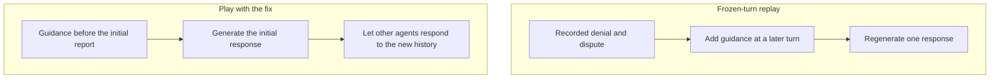

# Choosing between turn replays and whole games

*Level 2 · [Evaluation](../evaluation.md) · previous: [Building golden sets for evaluation](../reference_labels/reference_labels.md) · next: [Designing fair comparisons](../fair_comparisons/fair_comparisons.md) · revised 2026-10-29.*

A **turn replay** regenerates an agent player's response at a recorded moment, with the preceding situation held fixed. A **whole-game evaluation** lets the agents play from the starting deal through to the outcome. The choice depends on where the effect of a change should appear.

Replays help isolate an immediate effect: does an instruction change the target selected, or does added information correct a factual error? Whole games let other agents respond to the change and allow its consequences to accumulate. That adds variation and cost, but it is necessary when the question depends on what happens afterward.

### Choose the scope according to the effect you need to observe

The project starts with recorded turns when the question concerns one decision, then uses whole games for downstream effects, outcomes or integration. The scope determines which parts of the system can react to the change:

| Question | Suitable scope | Why |
|---|---|---|
| Does an instruction change a particular decision? | Turn replay | Holds the preceding situation fixed |
| Does preventing an early error change later discussion? | Whole game, or a suitable partial-game replay | Later agents must respond to the changed history |
| Does a feature work through the real game loop? | Whole game | Exercises interactions between components |
| Does a change improve game outcomes? | Whole-game comparison | Lets the full trajectory determine the result |

A replay spends calls on selected decisions rather than generating every intervening action and message. Whole games cost more because each run includes those turns, and repeated games are needed to distinguish an effect from variation in play. The saving depends on the number of replay cases and samples, not simply on calling something a replay.

Scope and scoring are separate choices. A replayed vote can be scored against the true roles by code. A replayed message may need a reader to assess its meaning. Whole games likewise produce both directly countable outcomes and outputs requiring interpretation. Holding a case fixed does not make its scoring method more accurate.

### Freeze the situation to isolate the immediate effect

For state-based replays, the saved case contains the engine state just before a turn: the board, discussion history, private record and relevant memory. Each version rebuilds its input from that state and generates a new response. This lets a comparison exercise changes to role instructions, prompt templates or guidance produced by the deduction engine.

Rebuilding is different from resending a finished prompt. A saved prompt would not exercise new code that constructs the input. Text already generated by agents or the day summariser remains part of the recorded history, while the builders can apply the version's changes to engine-written text. Some narrower screens use captured prompts or recorded lookups instead; the chosen capture must include whatever the intervention needs to change.

A replay therefore controls the environment around the decision. Both versions face the same preceding conversation and game state, rather than different histories created by earlier model responses. Model sampling still varies, and execution conditions such as the backend and prompt configuration still need controlling. The runners compare versions within the same run window; the wider controls are covered in [Designing fair comparisons](../fair_comparisons/fair_comparisons.md).

A night-one target experiment shows the practical value. Three roles make an initial choice without information: an investigator checks someone, a healer protects someone and a lone killer attacks someone. Across 32 recorded boards, their 96 baseline choices targeted seat 1 on 78 occasions.

The proposed fix shuffled the player list shown to each agent. If list position caused the concentration, shuffling should spread the choices. Instead, **95 of 96 shuffled-list choices still targeted the lowest-numbered other seat**. That ruled out list shuffling as a useful fix in this test and supported a seat-number preference rather than a simple first-listed-name preference.

An alternative had the engine draw and suggest a default target. Agents accepted it in 95 of 96 calls, and the choices spread across the seats. Code counted the selected targets directly. This replay screened two interventions on the same nine-player boards without paying to generate whole games around an uninformed first-night decision.

### Separate response variation from situation coverage

Repeating one case tells us how variable the responses are in that situation. Testing different cases tells us whether the behaviour extends to other situations. These are separate needs: a hundred responses to one prompt are still evidence about one recorded decision.

One unchanged ten-player vote illustrates why repetition matters. It selected the same player in 8 of 10 samples on one run and 1 of 10 on another. A small comparison between prompt variants could easily mistake that variation for an effect. A later interleaved run with 25 samples per version produced similar rates across versions, but that was a result for this case, not a general rule that 25 samples are sufficient.

Case selection determines the next claim. Replaying a known failure is useful for checking a proposed fix. Testing whether it helps more broadly requires other situations, including cases the original version handled correctly. Unchanged runs provide a baseline for response variation; additional cases provide coverage. Neither substitutes for the other.

### Let history change when the effect depends on later turns

A replay cannot test a change's effect on history that it keeps frozen. This matters when an early misunderstanding affects what other agents say and believe later.

In one game, an agent misinterpreted its own night result and denied another agent's accurate report. The role mechanics explain the confusion: a Sentinel sees who visited the player it watched, but does not list itself in its result. A Trailseer sees where another player went. The Sentinel treated an empty watch result as evidence that it had gone nowhere, even though the Trailseer had correctly observed its visit. Other agents then argued over the apparent contradiction.

Added guidance explained how the reports could both be true. Replaying later replies could test whether that guidance helped agents interpret the existing dispute. It could not test whether the guidance would prevent the Sentinel's initial denial and thereby avoid the dispute:

The replay showed a small reduction in mechanics errors on turns reporting the agent's own result, with no reduction on replies to other claims. Reader variation was as large as the overall observed reduction, so that screen did not establish a reliable benefit. More fundamentally, the retained denial meant it could not answer the prevention question.

The scope should therefore follow where the effect starts. A local replay tests the response at a selected point. To test whether correcting that point changes subsequent interaction, those later turns need to be generated from the changed response. The [visit-wording experiment record](../../../evidence/gameplay/data/visit_wording_ab/README.md) contains the comparisons; [Finding and fixing factual errors](../factual_errors/factual_errors.md) covers the diagnosis and intervention.

### Use whole games for outcomes and integration

Whole games let consequences accumulate. A changed vote leaves a different player alive; that changes later information, discussion and decisions. Win rate and balance depend on this trajectory, so their evaluation requires completed games.

The comparisons use matched starting deals: the same roles are assigned to the same seats under both versions. After that, responses are generated independently. Games can diverge at the first different action or message, even when the starting deal is identical. Matching controls the starting positions; it does not force the two versions through comparable later situations.

That divergence makes small effects harder to measure. Many decisions in one game share the same history, so they cannot be treated as independent samples simply because there are many of them. A paired comparison groups games by their matched deal. The project's memory evaluations also used decision-quality scores alongside wins to examine what changed within games; [Measuring play quality beyond win rate](../play_metrics/play_metrics.md) explains those measures and their validation.

Whole games have a second purpose: **integration testing**. A replay can show that one turn produces a usable answer without exercising scheduling, repeated calls, state updates or the checks run at game completion. Small full-game runs can expose these failures and measure the actual cost of running the feature, even when they are too small to establish a playing-strength improvement.

The character-voice experiment illustrates this distinction. A comparison on eight ten-player deals exposed false alarms from the privacy checker in five voiced games. Each flagged sentence contained information the receiving agent already held in its own record. The check was narrowed, and all 16 games passed afterward. This was a concrete integration finding from running the feature through the complete system.

The same games also contained more discussion with voices enabled. That creates different questions for different scopes: a frozen transcript can help test how an agent interprets a voiced message, while a game lets the extra speech change what everyone knows. A game result includes both effects unless the experiment separates them.

### The gap between one turn and a whole game

A **day replay** would freeze earlier days, then regenerate the selected day's discussion, replies and vote. It could test whether preventing an early denial changes the rest of that day's conversation, without replaying all earlier turns or waiting for the eventual winner.

This scope was designed for memory comparisons but has not been built. Its first requirement is to verify that the reconstructed starting state and unchanged replay behave as intended, before using it to compare interventions. The [day-replay design](../../../evidence/memory_system/effectiveness/day_replay/design.md) holds the proposed implementation and acceptance checks.

Until then, turn replays provide controlled tests of selected decisions, and whole games provide tests of their consequences and integration. Choosing between them starts with locating the effect: in the immediate response, in later interactions, or in the final outcome.

**Evidence**

- [Evaluation scopes](../../../evidence/evaluation/evaluation_scopes/report.md): scope choices and the unbuilt day replay.
- [Turn replays](../../../evidence/evaluation/evaluation_scopes/turn/report.md): capture methods, rebuilding inputs and replay screens.
- [Whole games](../../../evidence/evaluation/evaluation_scopes/game/report.md): matched deals, outcome comparisons and integration runs.
- [Night-one target choice](../../../evidence/gameplay/data/night1_target_bias/README.md): shuffled lists and engine-drawn defaults.

<!-- Revised 2026-10-29: owner-approved scope-selection structure. Detailed experiment records remain in evidence. Avoids universal sample-size or noise-reduction claims; distinguishes state-based replays from captured-prompt screens and integration findings from outcome comparisons. Source reports reviewed; no new experiments. -->

<!-- Previous visible draft
# Choosing between turn replays and whole games

*Level 2 · [Evaluation](../evaluation.md) · previous: [Building reference labels and reviewing outputs](../reference_labels/reference_labels.md) · next: [Designing fair comparisons](../fair_comparisons/fair_comparisons.md) · status: page copy drafted 2026-10-25 with the Level 2 prompt, reviewed in the main session; for the owner's review.*

## Brief

**Reader question:** How much of the system needs to run to answer this particular question?

Subsections: freezing state rather than merely saving a prompt; repeated responses versus case coverage;
effects a frozen transcript cannot show; whole games for cascades and live-system behaviour; the designed
but unbuilt day replay. Compare cost only using clearly labelled units and experimental configurations.
Smaller example (added 2026-10-25): a cheap replay falsified a fix before any game ran. Seat 1 took 78 of
96 unguided night-1 actions; shuffling the player list still left the target on the lowest-numbered seat
in 95 of 96, so the model follows the seat number, not the list order (turn replays, §3, "Play").

**Lead story:** changing a visit description cannot remove a denial already present in the frozen
transcript. This makes the limit of a local fix tangible without retelling page 1's investigation.
Use the whole-game records to explain why matched starting deals do not keep later trajectories matched.

**Exhibit:** state held fixed versus events allowed to unfold, with the day scope visibly unbuilt.
Describe small full-game smoke runs as integration evidence, not reliable estimates of playing strength.

**Sources:** the [scope overview](../../../evidence/evaluation/evaluation_scopes/report.md),
[turn replays](../../../evidence/evaluation/evaluation_scopes/turn/report.md) and
[whole games](../../../evidence/evaluation/evaluation_scopes/game/report.md).

**Level 3:** none initially. Turn and game reports combine here because the selection trade-off is the
main story. The implementation of a replay runner can become a deep dive if there is a useful technical
walkthrough to show; do not create separate pages just to mirror the two folders.

Exhibits for this page are listed in [`../exhibits/source_map.md`](../exhibits/source_map.md).

---

## Page copy (draft)

A change to a player's prompt can be tested in two very different ways. One is to replay a recorded
turn: rebuild the agent's input from the saved state, and generate its response under each
version. The other is to play whole games with and without the change. A replay is cheap and isolates
the decision, but everything around that decision stays as it was recorded. A game lets every
consequence unfold, but that brings in so much other variation that a small effect is hard to see.

The question for each experiment is how much of the system needs to run to answer it. In this
project the default was to start with a turn replay, and to move to whole games only for three
reasons: the question concerned an outcome, such as which side wins; the effect would build up over
later turns; or a new feature had to be shown working in the real game loop. A middle scope, replaying
one day of a recorded game, was designed for effects that build within a day. It has not been built.

| Scope | Held fixed | Allowed to unfold | What it can show | State |
|---|---|---|---|---|
| One frozen turn | Everything up to the turn: the board, the discussion so far, the agent's private record and memory | Only the agent's response | Whether a change reaches that decision, and which way it pushes it | Built; used for 14 screens, June–October 2026 |
| One day | The earlier days | That day's discussion, replies and votes | Effects that build within a day, such as replies to a claim | Designed July 2026; not built |
| Whole games | The starting deal, the code, the model and the time window | Every turn after the first one that differs | Outcomes, effects that cascade across days, the system running for real | Built; memory comparisons on the original nine-player game, smoke runs on the expanded ten-player game |

*What each scope fixes and what it lets play out. The same controls on a comparison apply at every
scope; they are explained on [Designing fair comparisons](../fair_comparisons/fair_comparisons.md).*

### What a frozen turn holds fixed

A frozen case stores the state the game engine held just before the turn, not the finished prompt.
Each version under test rebuilds the prompt from that state with its own code. This matters because
many changes live in the code that writes the prompt: a role card, a template sentence, a line the
deduction engine adds (the component that works out what a player can conclude from the game record).
A saved prompt would replay none of them. Text written by players and by the day summariser stays as
it was recorded.

Holding all of that fixed is what makes a replay sensitive. In a whole game, the deal, every other
player's moves and the course of each day all vary around the change. In a replay, the only remaining
variation is the model's own sampling, and each sample is a single model call. Where the decision is a
structured field, such as a vote target or a night target limited to legal players, code scores it
against the true roles with no model judge.

### A replay that ruled out a fix before any game ran

On the first night, three players act without any information: the investigator checks one player's
identity, the healer protects one player and the serial killer, who plays for itself, kills one. In
recorded games their choices clustered. A replay of night 1 on 32 recorded boards from the original
nine-player game, with one call per board, role and version (96 per version), showed how strongly:
seat 1 received 78 of the 96 actions. On 16 of the 32 boards the check, the protection and the kill all
fell on the same player.

The first proposed fix was to show each agent the player list in its own shuffled order. If the model
picked the first name it saw, that would spread the targets. The replay showed it would not. With the
lists shuffled, the target matched the first name shown in only 15 of 96 calls, and was still the
lowest-numbered other seat in 95 of 96. The choice followed the seat number, not the list order.

The fix that was built instead has the game engine draw a default target by lot and offer it in the
prompt. In the same replay the agents took the offered target in 95 of 96 calls, every seat received
between 6 and 16 actions, and no board had all three actions on one player. The effect is far larger
than sampling variation, and code read every target. It was measured on the nine-player boards with
one model and has not been repeated on the ten-player game. It shows where an uninformed choice
lands, not whether a drawn default makes better play.

### Many samples of one turn are not many situations

Sampling one case repeatedly measures how much the answers to one prompt vary. It does not cover
different situations. In one recorded ten-player vote, with nothing changed, the vote went to the same
player in 8 of 10 samples on one run and 1 of 10 on the next. Only at 25 samples per version, with all
versions interleaved in one schedule, did the rate settle: about one in three in every version (33 of
100 in total). In another replay, a version that only added true facts to earlier ballot lines moved
single cases from 4 to 9 and from 6 to 2 of 10, more than any effect that replay was testing.

Small changes in a few samples of one case need to be read against repeat-run variation. More samples
help describe that case; broader coverage requires cases from different situations in the relevant
game version. [Designing fair comparisons](../fair_comparisons/fair_comparisons.md) explains how unchanged
runs provide a reference for interpreting differences.

### Featured story: a fix that a frozen transcript could not fully test

The ten-player game has two information roles that track movement at night. The Sentinel watches a
player and learns who visited them; the Trailseer follows a player and learns where they went. In one
AI-only game, the Sentinel watched the Trailseer while the Trailseer followed the Sentinel. Both
results were true. The follow showed the Sentinel going to the Trailseer. The watch listed no visitors,
because a watcher is never listed in its own result. The Sentinel read its empty result as "I went
nowhere" and denied the true follow. About fifteen lines of that day's discussion went on whether the
two reports could both be right.

The first explanation tested was the wording. Perhaps the physical "visit" metaphor (came to, went
to, at my door) invited arguments about definitions. A replay took 19 turns from three live games:
eight where a seat reported its own watch or follow result and eleven that answered a sighting
claim. The alternative version described the same rules as "targeting", changing only the words a
model reads; text players had written kept the old words. Errors about the night mechanics stayed at
about one line in four on one player model and rose slightly on the other (19 to 28 of 95 replies, p
= 0.51). This wording change did not produce a clear improvement on those cases.

I chose a cheaper fix: keep the wording and have the deduction engine state the conclusion. The
Sentinel's own night record now adds that its watch was itself a visit and that its result never lists
itself; when a watch claim and a follow claim fit together this way, other seats are told so. The
replay split the result by turn type:

| Turns replayed | Mechanics errors before | After the two added lines |
|---|---|---|
| A seat reporting its own watch or follow result (8 turns) | 6 of 40 replies | 2 of 40 |
| Another seat replying to a sighting claim (11 turns) | 17 of 55 | 17 of 55 |

*Five replies per turn, read blind against a fixed rubric by model readers. The observed reduction
was confined to turns where a player reported its own result.*

The totals need caution. Different readers scored the unchanged version at 19 and 23 errors in 95
replies. That four-response difference was as large as the overall reduction after the fix, from 23
to 19. The turn-type split suggests where the fix might help, but does not establish a reliable benefit.

The frozen transcript still contained the original denial and the dispute it triggered. That may
explain why the added guidance did not improve replies to the claim. The fix's intended effect begins
earlier: a Sentinel that understands its own result might avoid the denial altogether. A frozen turn
cannot test whether preventing that denial would prevent the later dispute, because it retains the
history produced without the fix. That downstream benefit remains a question for live play.

A turn replay measures the direct effect at one decision. How a failure spreads from one component to
the next is the subject of [Finding and fixing factual errors](../factual_errors/factual_errors.md).

### Whole games: outcomes, cascades and the real system

Some questions exist only across a game. Who wins, and whether the sides stay balanced, cannot be read
from one turn. Many changes also cascade: a different vote on day 1 leaves a different player alive on
day 3, and every later decision differs.

A whole-game comparison plays the same deals with and without the change. The game id fixes the role
deal, so both versions start with the same roles in the same seats, on the same code, model and time
window. Only the start is shared. Players' responses are sampled, so the two games part at the first
line that differs, and everything after is played fresh. A same-deal check on the original nine-player
game found that games on one deal varied about as widely as games on different deals: almost all the
variation came from how play unfolded, not from the deal. Matching deals still ensures that neither
version receives easier starting positions; what it does and does not buy in analysis is covered on
[Designing fair comparisons](../fair_comparisons/fair_comparisons.md).

That variation sets the sample size. With 30 games per version, only a difference in win rate of about
35 percentage points would reliably show. A game produces about 150 decisions, but they share one
history and move together, so the unit of analysis is the deal, not the decision. The memory
comparisons therefore rested on decision-level scores computed from the game record, which are
explained in [Measuring play quality beyond win rate](../play_metrics/play_metrics.md).

The cost difference follows from the number of model calls an answer needs. On the same model in
October, a replay screen ran 75 to 164 calls in total. A ten-player game uses about 150 player calls,
and a comparison needs many games: 16 for an eight-deal check of direction, 60 for a 30-deal test.

Whole games also test the system as it actually runs. Replies in prose instead of a usable move,
stalls, the real cost per game and a privacy check misfiring on a new feature all surfaced only in
games.

### Small game runs as integration evidence

Two October changes to the live game were each run on eight deals of the ten-player game. They show
what a small run can and cannot support.

The first asked whether players still read each other well when every seat talks in a character's
voice. Reads are each player's stated guesses about the others' roles, scored against the true roles.
They were better with voices on 7 of 8 deals, but the voiced games also contained 19% more talk, which
by itself gives players more to read. Turn replays of a voiced line answered the reading question more
cleanly, because they held the transcript fixed. What the games added was an end-to-end run of the new
feature: no crashes, the real cost, and a false alarm from the leak check, which tests that no seat's
prompt contains another seat's private information. It flagged five voiced games; every flagged
sentence was one the receiving seat already held in its own record. The check was narrowed, and all
16 games then passed.

The second run tested changes to the evil seats' cards and prompts. Evil seats claimed a role 11 times
in 24 against 3 in 24, and the wolves won 3 of 8 games against none. Balance only exists across whole
games, so this question needed them, but eight deals cannot settle it, and the run bundled three
changes. A separate turn replay isolated the effect of the card text.

Both runs provided integration evidence and observations to investigate in larger comparisons.
Neither settled whether the change improved playing strength.

### The missing middle scope: replaying one day

Between one turn and a whole game sits one day. The design rebuilds a recorded game up to the start of
a chosen day, then lets that day play live under each version: the real speaking order, every turn and
the votes, with the earlier days frozen as history. It would measure effects that build within a day,
never the game outcome. It was designed in July 2026 for memory comparisons on the original nine-player
game, at an estimated fifth to a third of a game's cost per replayed day.

The design starts by replaying 10 to 15 recorded days with no intended change, then comparing measures
such as vote accuracy and abstentions with the recorded days. This would check whether the replay
reproduces the behaviour it is meant to test and measure its repeat-run variation. Matching the
transcript word for word is not the goal, because responses are sampled. A lack of statistical
significance alone would not establish that replay and original play are equivalent; the acceptance
criteria still need to make that distinction explicit.

The day replay has not been built. The October screens kept reaching the gap it was designed for:
the Sentinel's reply problem and the voiced games' extra talk both live in the rest of the day.

### Choosing the scope

A turn replay answers whether a change reaches a decision and which way it pushes, on the selected
cases. It does not estimate how large the effect is across ordinary games, and it cannot see what the
change would have done to the history it replays. Whole games see outcomes and cascades, but at the
sizes run here their win-rate estimates are imprecise, and a result alone does not explain why it
changed. The next step for questions that sit between the two is to build the day replay, starting with
its acceptance test.

**Evidence.**

- [Evaluation scopes: one turn, one day, one game](../../../evidence/evaluation/evaluation_scopes/report.md) (the three scopes, when to move up, what each cannot see).
- [Replay screens: testing one change on recorded moments](../../../evidence/evaluation/evaluation_scopes/turn/report.md) (how a replay is built, its four limits, every screen; the per-day replay design summary).
- [Whole-game evaluation: outcomes and cascading effects](../../../evidence/evaluation/evaluation_scopes/game/report.md) (the set-up, what pairing buys, the October smoke runs).
- [Night-1 target choice](../../../evidence/gameplay/data/night1_target_bias/README.md) (both runs, with the shuffle and the drawn default).
- [Visit-wording replay](../../../evidence/gameplay/data/visit_wording_ab/README.md) (the wording comparison and the deduction-engine fix, with the turn-type split).
- [Per-day replay design](../../../evidence/memory_system/effectiveness/day_replay/design.md) (the design and its acceptance test; not built).

-->

<!-- Editorial review 2026-10-25: phrasing and structure revised; no independent factual
verification. Earlier completion notes below describe the pre-edit draft and are retained as history.
Verifier handoff: The frozen-transcript explanation is now a hypothesis, and the downstream benefit remains untested.
Check the interpretation of the two judge totals. Review the proposed day-replay acceptance criterion:
a non-significant difference alone is not evidence of equivalence. This is a design question, not a
claim that a new acceptance test has been implemented.
Verified 2026-10-25 (main session): turn-type table and totals match visit_wording_ab/README.md (arm A 6/40 and 17/55, re-judged total 23/95; arm C 2/40 and 17/55, 19/95; first judging of arm A 19/95). The day-replay gate (day_replay/design.md §6) has hard invariants plus 'statistically indistinguishable' with no equivalence margin or test, so the page's caveat is correct. No change needed.
-->

<!-- Exhibit specification: render the scope table as three game timelines, showing what stays
fixed and what unfolds. Draw the day scope dashed and label it designed, not built. No costs. -->

<!-- **Link (planned):** Explore how a turn is rebuilt from saved state → the observability page. -->

<!-- Sources for the page copy (checked 2026-10-25):
Opening, three reasons to move up, day designed not built: evaluation_scopes/report.md "When to move up a
scope", table "State"; game/report.md "When to use which".
Scope table: evaluation_scopes/report.md table (held fixed; can show; state: 14 screens June–October
2026; designed July 2026, not built; game: three memory A/Bs nine-seat, two October smoke runs ten-seat).
Freezing state, rebuild from today's code, player/summariser text kept: turn/report.md §1 steps 1–2;
turn/experiment_log.md "How a frozen-turn replay is built". Checked in code (see completion note).
Fewer samples, one call per sample, code scoring of structured fields: evaluation_scopes/report.md "Why
the smaller scopes need fewer samples"; turn/report.md §1 step 4 item 1.
Night-1: turn/report.md §3 Play table; turn/experiment_log.md "Night-1 target check" (32 boards, 96 per
arm, 78/96 seat 1, 16/32 boards all three on one player, lot 95/96, every seat 6–16, shuffle 95/96 lowest
other seat, nine-seat and one model, not re-run on ten-seat); night1_target_bias/README.md Run 1 (target =
first name shown 15/96 shuffled) and Run 2 (lot arm: 0/32 boards all three on one seat).
Single-case noise: turn/report.md §2 item 1 (AC2 8/10 then 1/10; 25 per arm shuffled, about one in three
in every arm); §3 deduction table (33 of 100); Haiku vote replay true-facts arm 4→9 and 6→2 of 10.
Same-version cases: turn/report.md §2 item 3; turn/experiment_log.md checkpoint replay (no difference on
v6 cases; full store last on every readout on v7 cases). Numbers deliberately not given (memory chapter).
Featured story: visit_wording_ab/README.md (question, ~15 lines on day 2 of 2b29bfe8; 19 cases: 8 report,
11 react, three live games; arm B changes only model-read words, player text keeps old words; DeepSeek
25%/23%, Haiku 19→28 of 95 p=0.51; the Sentinel/Trailseer interaction; arm C rows A56/E19 "owner picked
the cheap fix"; arm C table: report 6/40 → 2/40, react 17/55 → 17/55; overall 23 → 19; denial and "a
dozen 'they can't both be right' lines"; react slice understates the fix; "a live game is the real test").
Judge gap 19 vs 23: turn/experiment_log.md "Visit-wording A/B", "How far it was checked". Role behaviour
(watch lists visitors, never the watcher; follow shows where the target went): deduction_catalogue.md row
A56 and theme 17. Abstain cascade: turn/experiment_log.md checkpoint replay (abstains 12–18% vs 31% live;
attributed to the trajectory).
Whole games: game/report.md "Why whole games", "How a whole-game comparison is set up", "What pairing
turned out to buy" (same-deal spread as wide as across deals, nine-seat only), "Choosing between...": 30
games a side ≈ 35-point win gap; ~150 decisions, unit is the deal; call counts 75–164 per screen, ~150
player calls per ten-seat game, 16 and 60 games; prose/stalls/cost/leak-check from "Why whole games".
Small runs: game/report.md Case 3 (8 deals, Haiku, memory off; Brier 7/8 deals, 19% more talk; leak check
flagged 5 voice games, each sentence held by the receiving seat, narrowed, all 16 passed; evil claims 11/24
vs 3/24; wolves 3/8 vs 0; three bundled changes; a replay isolated the card text; looking back).
Day replay: turn/report.md §4; day_replay/design.md §1 (day frozen prefix, live day subgraph, real
scheduler), §5 (≈20–30% of a full game; turn report says a fifth to a third), §6 (10–15 game-days,
distributional, never transcript equality, self-agreement = noise floor), §8 (never game outcome);
evaluation_scopes/report.md "the gap the October screens kept hitting"; game/report.md (voices question
fit it better).
Conclusion: turn/report.md "Bottom line"; game/report.md "Bottom line"; evaluation_scopes/report.md
"What we would do differently" row 1.
-->

<!-- Completion note

Structure. Follows the brief's five subsections, reordered for the reader: freezing state → the night-1
example (the smaller example) → repeated responses versus case coverage → featured story (the brief's
lead story, "effects a frozen transcript cannot show") → whole games → small game runs → day replay →
a short closing on choosing and the next step. The night-1 example sits before the featured story
because it shows what a replay does well before the page shows its limit. The small smoke runs got
their own short subsection because the brief asks to describe them as integration evidence. The scope
table is on the page as the exhibit's text form; the diagram spec (source map RG-held-fixed) renders its
first two columns. No Level 3 page, as instructed.

Costs. Compared in model calls on one model in one month (October, the same Haiku model for the screens
and the ten-seat games), per the brief's "clearly labelled units". Dollar figures left off: the day
replay's dollar estimate is anchored to a nine-seat, earlier-model game (~$0.50) and the June arm costs
belong to a different game and model; the day replay is given only as a fraction of a game's cost, as
its design states it ("a fifth to a third" is the turn report's wording; the design itself says ~20–30%).

Mechanism claims checked in code.
- Rebuilding a turn from stored state with today's builders and template, engine-written text updated,
  player/summariser text kept: evaluation/src/replay/hallucination_bench.py (hydrate_state,
  _engine_wording, turn_payload, turn_template). This describes the live-checkpoint and batch case
  sources; the capture-based screens re-render deduction blocks from a rebuilt payload (turn log). The
  page's one-sentence version is accurate for both; detail deferred to the planned observability page.
- The Sentinel line (A56) and the watch/follow pairing line (E19) exist in today's deduction engine:
  Agents/deduction/own_results/sightings.py, Agents/deduction/wording.py. I state "built into" via "the
  Sentinel's own night record now adds"; I did not check whether it is deployed on the live site, and
  the page does not say deployed.
- "Players' responses are sampled": player models default to temperature 1.0 in
  Agents/llm_factory/accessors.py; Claude models with thinking on take no temperature (providers/
  anthropic.py). Hence the page avoids stating "temperature 1.0" for the October games.
- The day-replay design was written against July code (nine-seat); not built, so nothing to check.

Claims I was unsure of.
- "In recorded games their choices clustered": checked against discussion_evidence.md §7.5 (over the
  28 June games, player_1 was the night-1 check in 21, the kill in 26, the protection in 25). The page's
  numbers all come from the replay itself.
- "About fifteen lines of that day's discussion": the README says "~15 lines". The game was AI-only
  (DeepSeek); I wrote "one AI-only game" without the model name.
- "I chose a cheaper fix": the README says "Owner picked the cheap fix". First person is supported for the
  choice only; the page does not claim the owner ran the replay or judged it.
- The judging caveat: the README's arm C table re-judged arm A (23/95) with fresh judges; the earlier
  arm A judgement was 19/95. The turn log's wording ("arm A was judged twice by different judge sets,
  giving 19 and 23") is what the caption uses. The report/react split comes from the arm C table, judged
  by the same four judges for A and C.
- The night-1 replay ran on an earlier model on the original game; I did not name it.
- The abstain example (31% live vs 12–18% replay) is from the checkpoint replay on the v7 store. I
  described it as "a memory store linked to many town abstentions" without saying memory harmed play,
  to keep the memory outcome in the Memory chapter. The 31% is the record's "31% live"; its denominator
  (town decisions in the live endpoint games) is my reading of "abstains ... 31% live".
- The same-deal spread is given qualitatively; the record's numbers (0.249 within a seed vs 0.211–0.262
  across) have an unstated score unit in the report, so I left them out.

Handle-with-care items deliberately left off: runs from uncommitted working trees (the visit-wording arm
B edits, arm C's working tree, 12 of 16 evil-cover runs, placement/AC2); samples kept outside git until
copied; the v7 endpoint's missing script; "model drift" as a cause (the −40-point "town collapse" called
model drift in the game log is not used; the baseline shift is only linked via fair comparisons); the
"+17pp" figure; the zero-reasoning-token finding (belongs to fair comparisons).

Rubric self-scores (Level 2 rubric).
- Reader orientation: 2. Opens with the two ways to test a change and the scope question.
- Added depth: 2. Adds the rebuild-from-state reason, the night-1 runs, single-case noise, the split
  replay result, the cascade, the unit of analysis, the smoke runs and the day design's acceptance test.
- Conceptual coverage: 2. Separates direct effect at a turn, within-day effects, cross-day cascades,
  outcomes and live-system integration; keeps both "the wording" and "the fix" hypotheses distinct.
- Paragraph clarity: 2, with one risk: the featured-story caption carries two caveats; could split.
- Narrative economy: 2. Controls, baseline shift and paired analysis linked to fair comparisons; failure
  propagation linked to factual errors; metrics to play metrics.
- Experimental separation (required): 2. The wording comparison (arm B) and the deduction-line fix (arm C)
  are reported as separate replays with their own comparisons; the night-1 runs are kept as two runs; the
  memory replay examples are kept apart from the October screens; the two smoke runs are separate.
- Interpretation (required): 2. "The wording was not the cause" is scoped to that replay; the reply
  result is explained by the frozen transcript as the record does, and the downstream benefit is
  presented as untested, not shown; night-1 supports where choices land, not better play.
- Evidence and ownership (required): 2. Numbers from the records with denominators; "I" only for the
  owner's choice of fix; day replay stated as designed, not built; the fix described as built, not deployed.
- Technical accessibility: 2. Roles, deduction engine, reads and leak check explained on first use.
- Exhibits and links: 1. The scope table and the turn-type table advance the argument; the diagram is a
  spec only (planned), and the observability link is planned.

Length: roughly 2,300 words of page copy including tables and captions, above the 1,200–2,000 guide.
Each subsection explains a different decision, so I did not cut for length. The cheapest cuts, if
wanted: the memory abstain paragraph in the featured story (a second instance of the same limit) and
the same-version memory-replay sentences in "Many samples of one turn".
-->
