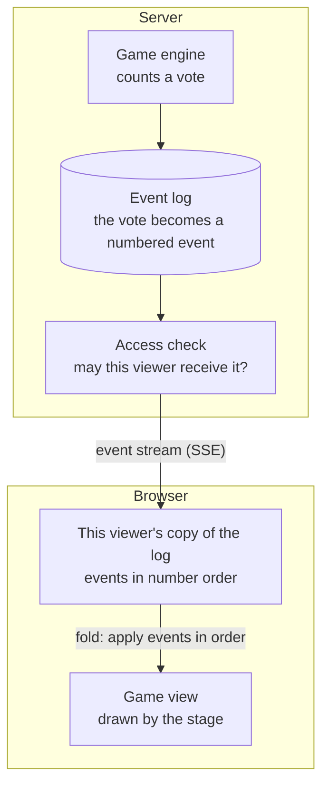

# Event stream and client synchronisation

*Level 2 · [Client-server architecture](../frontend.md) · First draft, 2026-11-22; brought up to date with the code, 2026-11-26; merged with a shorter alternate version, 2026-11-26; rewritten from a third version with standard terms, 2026-11-26*

## Page copy (draft)

The game runs on the server. Each viewer follows it through a stream of numbered **events**.
An event is a committed fact about the game that at least one viewer is entitled to know, such
as a finished speech or a counted vote. The browser builds its view from the events that viewer
is allowed to receive.

During a live vote, the browser adds each ballot to the tally as the stage shows it. A returning browser
can bring its tally up to date by applying the ballots it missed. After the game, a replay can
show the tally growing one ballot at a time. All three use the same event history and the same
code for turning votes into a tally.

### How a counted vote reaches the screen

**The server** assigns each event a number and checks which viewers may receive it.
Each viewer has one long-lived HTTP connection that carries Server-Sent Events (SSE)
from server to browser. A human player sends an answer back in a separate HTTP request.
[How the server checks viewer access](../viewer_authorization/viewer_authorization.md).

**The browser** keeps the events it receives in number order. To reconstruct the view, a
function called a **fold** starts with an empty view and applies each event in sequence.
The stage draws the result. Suppose seat 7 has no votes when event 41 arrives:

| Event number | What the browser receives (selected fields) | What the viewer sees |
|---|---|---|
| 41 | `vote_cast` · `voter: player_3` · `votee: player_7` | Seat 7 has one vote against it |
| 42 | `vote_cast` · `voter: player_5` · `votee: player_7` | Seat 7 now has two votes against it |
| 43 | `lynch_result` · `outcome: lynched` · `player: player_7` | Seat 7 is eliminated |

**Durability.** The server normally saves events before sending them. If a write fails,
live delivery continues and the server retries the write with a later batch. A restart before
a successful retry can lose events that viewers have already received.

### How the events were defined

The game engine is a graph of steps, and an event can come from three places in it.

**From what a step wrote.** Each time a step of the game finishes, the engine reports the state
fields it wrote, and the server translates them into events. Most events come from here: a
speech, the result of a vote, the result of a night.

**From which step finished.** Some facts are in no state field. The engine never stores the
phase of the game: "it is night" means only that the night's steps are running, and the browser
cannot see which step is running. The server therefore sends a phase change when a marker step
finishes, such as the step that opens the night.

**From a message the engine sends directly.** The first two sources report only when a step
finishes. That is too late for showing that a seat is thinking, and for opening a human player's
ballot while the AI seats are still voting. For these, engine code writes a message onto the
stream itself. The same route carries material that is deliberately kept out of the game's
state, such as an agent's private suspicions, which viewers can read after the game.

The list was built by examining each step in the order the steps run: each state field a step
writes is either translated into an event or kept on the server. A fact becomes an event only if it is committed, at least one viewer is entitled to know it
during or after the game, and the browser cannot compute it from events it already receives. A
seat that passes in a day's opening round has no event: the browser knows which seats were in the
round and which of them spoke.

**Events are sent only after a commit.** The server does not send a step's result while the
step is still running. For a speech this means no text while the model is writing: a written
line can still be discarded, by a
[failed validation](../../game_design_orchestration/agent_turn/agent_turn.md#validate-every-reply-enforce-the-schema-on-retry)
or by a
[check that withholds lines that add nothing](../../game_design_orchestration/conversation/conversation.md#deciding-which-lines-reach-the-table),
and text already sent would have to be taken back from every viewer's screen. The turn-start
message is sent early because it says only that a seat's turn has begun, which stays true
whatever happens to the line. Once the engine commits the line, the browser receives the
complete text and animates it.

The result is 33 event types, each with
[one of four audiences](../viewer_authorization/viewer_authorization.md). The translation happens
in one server module, which raises an error when the engine produces a step or a field that it
has no rule for. The page's TypeScript types are generated from the server's event schemas, and
a contract test fails when the saved API schema no longer matches the server.

Three kinds of message travel on the same stream without being events: the heartbeat, the
progress bar of a vote or a night, and the deadline in force for a player's turn. They carry no
number, are not saved and are never replayed, because none of them is a fact in the game's
history.

### Catching up after a disconnection

A phone can lose its connection halfway through a vote. By the time its player returns, more
votes may have been counted, the seat's AI may have taken a turn, and the player may even have
been eliminated. The reconnecting browser tells the server the last event number it holds, and
the server sends the events after it.

**Historical and live events are treated differently.** A missed event still has to be applied,
because the game view is computed from the whole log and would be wrong without it. It does not
have to be shown: a returning player should reach the current game without watching every missed
moment. The page therefore applies historical events to the view without animation and animates
only live events. The boundary comes from a status request that reports the latest event visible
to the viewer: events up to that number are historical.

Historical events were first applied one at a time, and each one rendered the live page again.
They are now collected into short blocks, and each block is applied in one state update. For a
browser rejoining at event 200:

| | Before | After |
|---|---:|---:|
| Renders of the live page | 100 | 7 |
| Time to show the current turn | 6.3 s | 2.5 s |

The figures come from a development build on one machine and are not a production benchmark.

**What the returning player is told.** Reconstructing the current state does not tell a returning
player what happened while they were away. After a disconnection of at least 20 seconds, the page
shows a summary of the game phases that passed, the turns played by the seat's AI agent, and the
player's elimination if it happened. Elimination is listed first because it changes how the
player can take part. Shorter drops show no summary, because a one-second drop would otherwise
open it.

### Deduplication when events arrive out of order

A viewer's event history is not always contiguous. During a game the server withholds events that
a viewer is not authorized to see, such as other players' hidden roles, and releases them when
the game ends.

The first deduplication rule was a **high-water mark**: the page discarded any event numbered at
or below the highest number it had received. This worked for ordinary live delivery and failed at
the final reveal. The released events had lower numbers than the game-ending event, so the page
discarded them as duplicates.

Deduplication now uses exact event numbers:

- An event already in the page's log is discarded.
- A new event with a higher number is appended.
- An unseen event with a lower number is inserted at its position, and the game view is derived
  again from the log.

These insertions are batched, as historical events are, so the view is not derived again for
each one. Across seven recorded games, a spectator received between 226 and 334 previously
withheld events at the ending, out of 317 to 439 events in the game.

**Authorization is separate from presentation.** The stage shows each step at a readable pace, so
it can run behind the server. Released events can therefore arrive while the stage is still
showing an earlier phase. The page holds them back until the stage reaches the ending, which
prevents an early reveal. This is a presentation rule and not an authorization check: by the time
the events reach the browser, the server has already authorized their release.

### Connection liveness and recovery

An inactive game and a silently failed connection look the same to the browser: neither produces
events. In one multiplayer session a phone kept a dead connection after sleeping. The page showed
a frozen game and never received the player's turn request. The deadline expired on the server,
and the seat's AI agent took the turn.

The page now monitors the connection separately from game activity.

| Mechanism | Behaviour |
|---|---|
| Application-level heartbeat | The server sends one when the stream opens and after every 15 seconds without a game event |
| Watchdog on the page | Checks every 5 seconds and reconnects after 40 seconds without a message |
| Visibility and network recovery | The page reconnects at once when it becomes visible again or the device comes back online |

The earlier heartbeat was an SSE comment line. It kept network equipment from closing the
connection, but the browser does not pass comments to the page's code. The current heartbeat is a
named event that the page's code receives, so the page can measure the time since the last
message.

With these settings, a visible page starts to reconnect within about 45 seconds of the last
message it received. That bound follows from the configured intervals and has not been measured
on a device.

Connection liveness and game liveness are separate concerns. If the server's task for a game
fails while the stream stays open, heartbeats continue to arrive. The page detects that failure
through its periodic status requests and not through the heartbeat.

<!-- Sources.
The section on the late status reply was taken off the page on 2026-11-26 (owner: hard to explain on a page; the notes are enough). It is in U6 sections 3.1 (question 5) and 3.5, with its figure at evidence/_study/engineering_notes/figures/u6_late_status_reply.svg.
Last section rewritten 2026-11-26 with the reasons the status exists (U6 section 3.1 question 5, 3.2, 3.4, 3.5; frontend/src/game/store.ts, `closedThrough` comment and `syncPending`; frontend/src/hooks/useGameStream.ts) and exhibits/late_status_reply.svg. The numbers 57 and 58 are the illustration used in U6 section 3.5, not a recorded incident's numbers. The deadline paragraph was taken off the page at the owner's request.
The subscribe-before-read order and its figure were taken off the page on 2026-11-26 (owner: good practice, but no fault behind it); the figure is now evidence/_study/engineering_notes/figures/u6_catch_up_order.svg and the mechanism is in U6 sections 1.4 and 3.2.
The catch-up sequence diagram was replaced on 2026-11-26 by exhibits/catch_up_order.svg (two orders compared), after the owner found the sequence diagram confusing.
Rewritten 2026-11-26 from another model's version, checked against the code: the earlier heartbeat was an SSE comment (server/routes/games.py, `_PING`); the deadline message is also sent when a seat's stream opens (`subscribe` -> `on_seat_returned` -> `reschedule` -> `publish_deadline`); 100 and 7 are renders of the live page counted by a hook that is not committed. Section "How the events were defined" added 2026-11-26 from frontend/docs/event_derivation.md, server_client_transport.md §5 and §8, server/game/translate.py (`node`, `silent_node`, `TranslationError`, `_turn_tick`) and server/schemas/events.py (`EVENT_TIERS`: 33 types, 13 public, 4 pack, 7 seat, 9 observer); one level deeper in U6 section 3.1 question 6. Ballots reach the browser together at the tally and the stage shows them one at a time. The diagram was changed from left-to-right to top-down for legibility. Opening and first section rewritten the same day at the owner's request: the page opens on the event-driven design, with its own data-flow diagram and a three-event example of the fold (fields from server/schemas/events.py, `VoteCast` and `LynchResult`, shortened); the phone example moved to the reconnection section. Left off: the origin of the return notice (a seat killed during a two-minute drop).
Merged 2026-11-26 with event_stream_and_sync_alt.md (another model's shorter version; that file was deleted on 2026-11-26 once the pages were settled).
Duplicates in the catch-up overlap are removed by the server, per connection: server/routes/games.py (`_sse`, the `sent` set).
Left off in the merge because the Level 1 page has them: the events / state / tokens table, the flow diagram,
the SSE and WebSocket paragraph. The 97 ms and 0.8 ms store timing is no longer quoted on the page.
What is sent, and why not tokens: frontend/docs/server_client_transport.md §§2, 3, 9; `turn_started`
as the one event before a commit (§8b). The fold and the store: frontend/src/game/foldEvents.ts,
frontend/src/game/store.ts; frontend/docs/client_design. Generated types and the drift test:
server_client_transport.md §10; frontend/package.json (`generate-api-types`);
tests/server/test_openapi_snapshot.py.
Catch-up order (subscribe, replay, then the queue) and the set of sent numbers:
server/routes/games.py (`_sse`). History and news, the 50 ms block, 100 to 7 redraws and 6.3 s to
2.5 s (development build, one machine, rejoin at event 200): frontend/docs/learning/realtime_and_sync;
frontend/src/hooks/useGameStream.ts.
Duplicates by exact number and the lost reveal: frontend/src/game/store.ts (`addDurable`), test
store.test.ts; server test test_postgame_reconnect_cursor_does_not_skip_the_withheld_backlog.
Liveness: frontend/docs/multiplayer-audit-2026-10-15.md (the frozen phone); server/routes/games.py
(15 s ping); frontend `streamStalled` (40 s, checked every 5 s); the dead game task that still
pings: improvements row 58.
Stream and status: frontend/src/game/store.ts (`syncPending`), test store.test.ts.
Added 2026-11-26, from code changed on 2026-11-23 and 2026-11-25 (built and tested; see
evidence/_study/engineering_notes/improvements.md, row 67 and the "Done" table):
save before send: server/game/game_session.py (`_on_chunk`, `_save_events`), tests/server/test_durability.py.
The released events as a block, 226 to 334 of 317 to 439, 97 ms and 0.8 ms (store alone, in Node):
frontend/src/game/store.ts (`applyLiveBlock`), frontend/src/hooks/catch-up-boundary.ts (`isBacklog`).
The deadline message: server/schemas/events.py (`TurnDeadline`), server/game/seat_clocks.py;
frontend/e2e/live.spec.ts ("back at a game that waited with nobody connected, the turn is open on
its new deadline"). The view holds nothing but the fold since `closedThrough` left it (2026-11-25).
The return notice and the 20 s rule: frontend/docs/ux_journeys.md D23, frontend/docs/client_design/client_design.md §3,
frontend/src/stage/containers/live-state.ts (`agentLine`). The reveal held until the stage reaches the ending:
client_design.md §4 ("the page's one lock").
One level deeper: evidence/_study/engineering_notes/06_realtime_transport_and_client_sync.md,
Part 3 and Appendix B.
Supporting detail left off the page: the position arrives both in the URL and in the browser's own
reconnect header, and the header wins; the
cached status fault; pacing messages carry no number; viewer queues have no size limit.
-->
