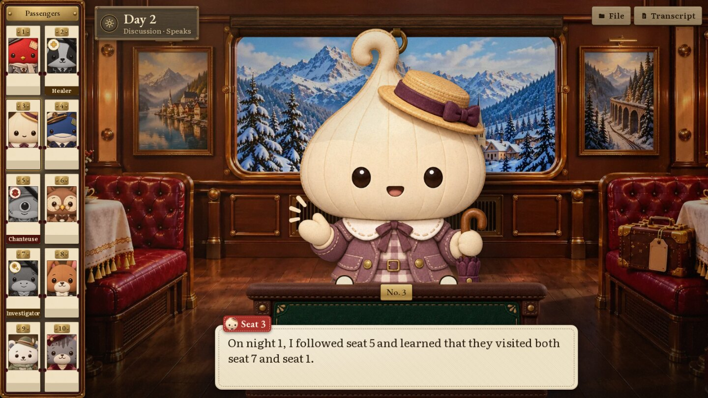
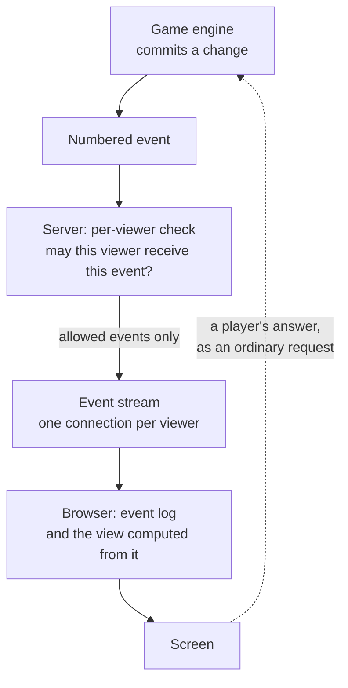
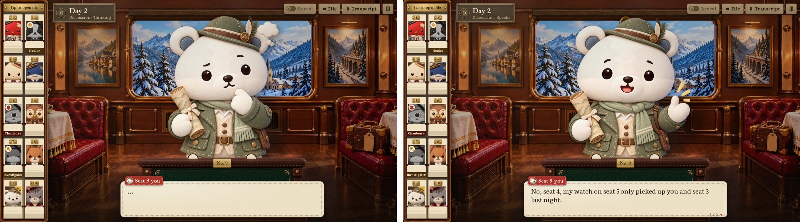
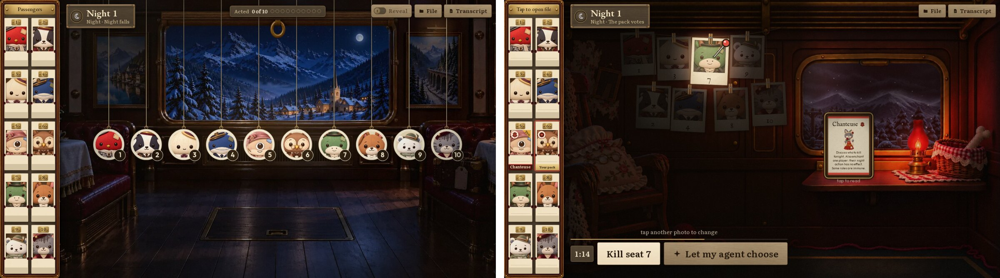

# Client-server architecture chapter (draft)

*Level 1 page copy. First draft by Claude on 2026-11-22, in the form the owner set for chapter 7 the
same day (no first-person pronoun, technical headings, no development status, limits beside the
claims they bound). Restructured on 2026-11-26 after another model's rewrite that the owner
supplied: its structure and wording, with facts checked against the records. The rendering section and the Level 2 pages were revised with the owner on 2026-11-26, and this page was checked against them the same day. Three Level 2 pages:
[event stream and client synchronisation](event_stream_and_sync/event_stream_and_sync.md),
[per-viewer authorization](viewer_authorization/viewer_authorization.md) and
[rendering](rendering/rendering.md). The authoring brief is
[`_authoring/frontend.brief.md`](_authoring/frontend.brief.md).*

---

## Page copy (draft)

### Client-server architecture: streaming a live multi-agent game to the browser

#### Introduction

The Ninth Express presents a long-running, server-hosted multi-agent game through a live browser
interface. Human players take part alongside AI agents, and spectators watch the game as it is
played.

*The live page during a day. One seat is at the stand with its line, and the panel on the left
shows the ten seats.*

Three requirements shape the architecture between the server and the browser:

- **Client synchronisation.** A game lasts tens of minutes, and many people watch on a phone. A
  browser must recover from an interrupted connection without missing or repeating events.
- **Information isolation.** Viewers are entitled to different information depending on their
  roles. Private information must not reach a viewer who is not entitled to it until the game
  ends.
- **Rendering performance.** During active phases the game produces two to three updates a
  second. An update must not rebuild parts of the scene that have not changed, and the
  page has to stay within what a phone's browser allows.

These requirements are met by an event-driven architecture, per-viewer authorization on the
server, and a reduction of the stage's rendering cost after it crashed on a phone.

*From an engine change to the screen. The dotted arrow is the only traffic in the other
direction: a human player's answer.*

#### Event stream and client synchronisation

##### Event-driven architecture

The server does not send the complete game state on every change. It represents each change the
engine commits as a numbered **event**, such as a seat speaking, voting or acting at night. The
browser derives its view of the game by applying the events in order.

The event history serves three purposes:

- **Live play:** the accumulated events form the transcript and drive the current view.
- **Reconnection:** a returning browser retrieves the events it missed.
- **Replay:** the saved event history of a finished game reconstructs that game.

One event representation serves all three, with no separate mechanism for live updates, recovery
and replay.

##### Transport and committed output

Events are delivered through server-sent events (SSE), and a human player's action goes up as an
ordinary HTTP request. Communication is mostly from server to browser, and a player acts a few
times a minute at most, so a persistent two-way WebSocket connection was not needed.

Dialogue written by a model is not streamed token by token. A generated line can still be
discarded after the model has written it: an invalid reply is generated again, and a check can
withhold a line that adds nothing. Text already shown cannot be taken back. The page shows that
a seat is thinking until the engine commits
the finished line, so a viewer receives only committed output.

*One turn as a viewer sees it. Left: the turn has begun and nothing is committed. Right: the
committed line.*

##### Separating game execution from presentation

The stage runs behind the server on purpose. It holds each step on screen for a few seconds so
that it can be read, while the server keeps running the game and the page keeps the events it
has not yet shown. Having the server wait for each viewer's stage was considered and set aside,
because a game with several human players would then wait on its slowest reader. The server's
clock alone decides when a turn's deadline passes.

##### Reconnection and liveness

A returning browser asks for the events after the last number it holds. The missed events are
applied to the view without animation, so a returning player reaches the current game without
watching every missed moment.

Two failures shaped the rest of the design. The page once discarded any event numbered below
the highest it had received, which threw away the events the server releases at the end of a
game, so the final reveal never appeared; it now discards only an exact number it already
holds. And a phone once kept a dead connection through its sleep, so a player's turn never
appeared and the seat's AI agent played it; the server now sends a heartbeat every 15 seconds,
and the page reopens a stream that has been silent for 40.

*Explore: [Event stream and client synchronisation](event_stream_and_sync/event_stream_and_sync.md) →*

#### Per-viewer authorization

##### Server-side information isolation

Viewers are entitled to different parts of the game's history. A wolf receives the pack's
private conversation, a seat with a night ability receives its own result, and a spectator
receives only public information.

*The same night of one recorded game. Left: a spectator sees only that the night is in
progress. Right: a wolf sees the pack's room and the control to choose a target.*

Filtering in the browser would not be enough. Any event delivered to a browser can be read from
its memory or its network tools, whether or not the page displays it. Authorization is therefore
enforced on the server, for each event and each viewer, before the event is sent.

Every event type is assigned one of four audiences:

| Audience | Who receives the event during the game |
|---|---|
| Public | Everyone, including spectators |
| Wolf pack | The seats whose roles belong to the pack |
| One seat | The seat named on the event |
| Withheld | Nobody until the game ends |

The audience is recorded in a table on the server and is never sent to the browser. One event
history therefore produces a different view for each viewer, and the server keeps no separate
game state for each participant. When the game ends, the withheld events are released to
every viewer.

##### Information leakage through side channels

Filtering the contents of events does not stop a viewer from inferring private information from
other things they can observe.

The night's progress bar is one case. At night the seats act in secret, and the page shows a
progress bar for the wait. A bar that counted only the seats that really act would reveal how
many roles are alive and still have a night action. So the bar counts one unit for every living
seat, whether or not that seat acts, and a timer completes the units that no real turn does.

An audit of the multiplayer game found four more side channels, such as an event number that
rose once for each private night action. Two were closed, and two were accepted as limits
because closing them would break reconnection or slow every game. The design protects the
contents of private events. It does not hide everything a viewer could work out indirectly.

*Explore: [Per-viewer authorization: event audiences, seat identity and side channels](viewer_authorization/viewer_authorization.md) →*

#### Rendering performance on a phone

After a redesign of the stage, every page that showed it died on an iPhone, while every desktop
browser ran it. A phone's browser ends a tab that uses too much memory far sooner than a
desktop does, so the fault could only be measured on the phone.

| Measurement | Before | After | Taken on |
|---|---:|---:|---|
| Elements replaced when one ballot is counted | 385 of 388 | The newest ballot line | Desktop browser, production build |
| Memory held by the stage at rest | 534 MB | 114 MB | The iPhone, one reading each |
| Drawing time for the vote scene over 41 steps | 67.5 s | 23.1 s | Desktop browser, eight changes together |

##### Diagnosis by removal

The stage's test page was given a switch that removes one kind of drawing work at a time. Eight
links, each opened once on the phone, showed which removal let the page survive: a set of masks
drawn at the size of the whole stage. With the masks gone, the page survived a slow game and
still died at two to three steps a second. Safari's inspector on the phone later showed the
memory the stage held at rest, most of it caused by one looping animation.

##### Each step rebuilt the whole scene

Most of the stage stays the same as the game advances, but one counted ballot replaced almost
every element on it. The scene's React key included the current step, and React discards and
rebuilds a component whose key changes. The key now sits on the smallest part that has to
restart, and one host component keeps the dining car in place across scenes.

##### From single fixes to a test

Further faults of the same kinds kept appearing one at a time. They were then listed across
every scene, fixed in one batch, and guarded by a structural regression test that walks about
three hundred steps of the game at phone size. The test runs in a desktop browser and checks
for the known costly patterns, not a phone's memory. Only the masks were isolated on the phone
as a cause of the crash, and no crash log was available.

*Explore: [Performance on a phone: diagnosing a crash and reducing rendering cost](rendering/rendering.md) →*

#### Covered in other chapters

- **Human-in-the-loop orchestration:** pausing and resuming the engine for a human decision.
  [Adding a human in the loop](../game_design_orchestration/human_in_the_loop/human_in_the_loop.md).
- **Crash recovery:** recovering a game and its viewers' connections after the server restarts.
  [Crash recovery](../running_in_production/restart_recovery/restart_recovery.md).
- **Cost and latency:** how long a line takes to appear, and how the pace of the show hides
  model latency. [Cost and latency](../cost_and_latency/cost_and_latency_codex.md).

<!-- Sources.
Cut to uneven section lengths on 2026-11-26 (owner: not every section deserves the same length). Moved to the Level 2 pages only: how the events were defined, the skip before a player's own turn, the progress bar's timer and remaining limit, the four-row side-channel table, the seat token, the two React problems told separately.
The rendering section was rewritten on 2026-11-26 to match the reframed Level 2 page (a phone crash and its diagnosis). The typing measurement (41 letters) left this page and is one row of the Level 2 page's closing table.
Introduction and diagram: frontend/docs/server_client_transport.md §§1–3, 5–6; server/routes/games.py
(`_sse`, per-viewer check at sending); frontend/src/game/store.ts and foldEvents.ts (the log and
the view computed from it). "Two to three updates a second": frontend/docs/learning/react_identity
§3 ("two to three beats a second").
Event stream: server_client_transport.md §2 (SSE and POST), §3 (events over state; live, reconnect,
replay from one log), §9 (events, not tokens; a line can be withheld or regenerated); status polled
every 12 s (frontend/src/hooks/useGameStream.ts). The lost reveal: frontend/docs/client_design and
frontend/src/game/store.ts (`addDurable`, membership by exact number), test store.test.ts. The
Display pacing, the server's clock as the authority, the set-aside alternatives and the 30 s jump:
frontend/docs/live_timing_sheet.md §5 rulings 3 and 4; U6 section 3.7. The
frozen phone: frontend/docs/multiplayer-audit-2026-10-15.md; heartbeat 15 s
(server/routes/games.py), 40 s watchdog (frontend, `streamStalled`); about 45 s read from code,
not measured.
Authorization: server/game/entitlement.py (`entitled`), server/schemas/events.py (`EVENT_TIERS`),
server/routes/games.py (`_sse`), server/routes/_shared.py (`set_seat_cookie`, `live_status`);
multiplayer audit findings 1 and 2 (closed), 1 second half and 3 (held, accepted).
The night's progress bar: server/game/pacing.py (module docstring: one unit per publicly alive seat,
timers at 20 to 30 s, the remaining lower bound); also on the Level 2 authorization page.
Rendering: frontend/docs/learning/react_identity/react_identity.md §§1, 3, 4, 6 (385 of 388:
rendering audit 2026-10-02, production snapshot, headless Chromium; 41 letters: development build,
2026-10-15); code read 2026-11-22 (VoteScene.tsx, CarScene.tsx, LiveTheatre.tsx, TurnDock.tsx).
One-level-deeper material: evidence/_study/engineering_notes/ 06, 07 and 12, each with a code and
evidence appendix.
Screenshots (exhibits/, captured 2026-11-26 from the workbench pages on a development build, 1440x810,
the bundled ten-seat game `replay-phase3.json`): live_stage_day = day?beat=3&viewer=spect;
thinking_then_line = day?beat=21 and 22, viewer=seat:player_9, live=1; same_night_two_viewers =
night?beat=0&viewer=spect&live=1 and pack?beat=2&viewer=seat:player_5 (seat 5 is a wolf in that game).
All with animate=0&strip=0. The two halves of the night pair are the same night, not the same instant.
Left off by ruling or choice: who wrote the frontend code (owner's ruling, 2026-11-22); the
browser's rendering pipeline, picture memory and CSS; accessibility; the generated types (on the
Level 2 page); deploy status.
-->
