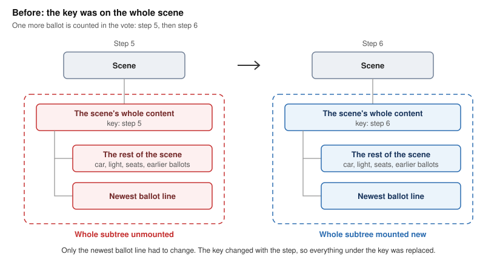
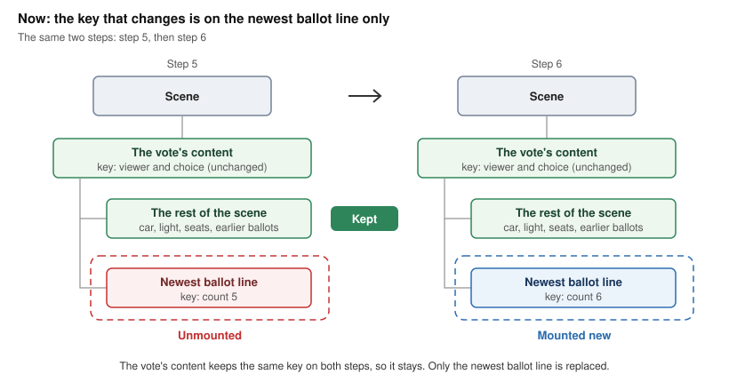
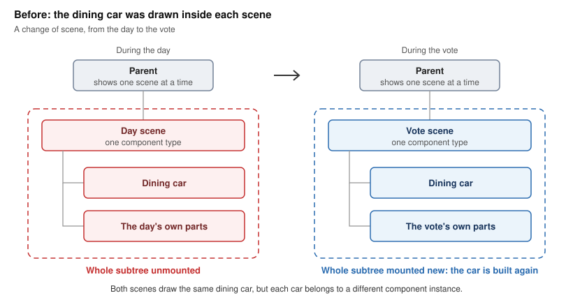
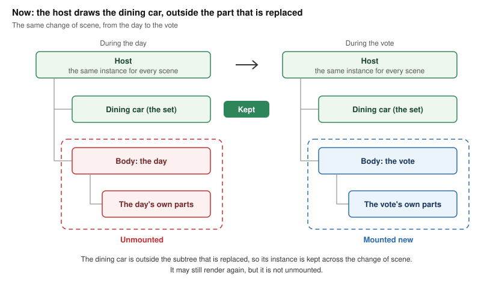

# Performance on a phone: diagnosing a crash and reducing rendering cost

*Level 2 · [Client-server architecture](../frontend.md) · First draft, 2026-11-22; merged with a shorter alternate version, 2026-11-26; reframed as a performance investigation, 2026-11-26*

## Page copy (draft)

The game is shown as an animated stage: the dining car of a train, with ten characters,
lighting and controls. As players speak, vote and act, small parts of the picture change. Most
of it stays the same from one step of the game to the next.

After a visual redesign, every page that showed this stage died on an iPhone. Safari replaced
the page with "A problem repeatedly occurred". The same pages ran on every desktop browser, so
no test had caught it.

The crash had several causes, found one after another. This page describes how they were found,
then the cause that lay in the page's own React code, then the test that now guards against the
whole group. The causes that lay in the browser's drawing work are summarised near the end.

| Measurement | Before | After | Taken on |
|---|---:|---:|---|
| Elements replaced when one ballot is counted | 385 of 388 | The newest ballot line | Desktop browser, production build |
| Memory held by the stage at rest | 534 MB | 114 MB | The iPhone, one reading each |
| Drawing time for the vote scene over 41 steps | 67.5 s | 23.1 s | Desktop browser, eight changes together |

### Finding a cause on the device, by removing one thing at a time

A desktop could not reproduce the fault, so the measurements had to be taken on the phone. A
phone's browser ends a tab that uses too much memory, at a level far below what a desktop
tolerates.

The stage's test page was given a switch in its address that removes one kind of drawing work
from the whole page: filters, blends, masks, shadows, vector drawings, pictures, or one part of
the stage at a time. Eight links, each opened once on the phone, showed which removal let the
page survive. This needs no theory of the cause, and it gives an answer on the device that
fails.

The first answer was masks drawn at the size of the whole stage. With those removed, the page
stayed up when the game advanced one step a second. It still died at two to three steps a
second, which is the pace of a vote being counted.

### Each step rebuilt the whole scene

When a ballot is counted, one new ballot line needs to appear. The car, the lighting and the
seats are already in place. A count on a production build, in a desktop browser, found that one
counted ballot replaced **385 of the 388 elements on stage**. A second count found that one line
from a fellow wolf replaced 402 of 403.

React rebuilds a component, with everything beneath it, when its key or its type changes. The
stage did both more widely than it needed to.

#### Within a scene: a key on the whole scene

The scene's key included the current game step, so every step discarded the whole scene and
built it again.

The key now sits on the smallest part that has to start over. During a vote, only the newest
ballot line is keyed on the count, so only that line is rebuilt.

#### Between scenes: the shared car inside the part that was replaced

Eight scenes are set in the same dining car. Each scene was its own component type and drew the
car inside itself, so moving from one scene to the next rebuilt the car as well.

One host component now holds the car and stays in place across scenes. Each scene only
describes what it wants the car to show.

The day scene was split this way first. Before the split the phone died at two to three steps a
second, and after it the phone did not. The likely reason is that the browser held two or three
copies of the scene at once at that pace, but memory at the moment of a crash was never
measured. A count on the split day scene found one step replacing 121 of 220 elements, all
belonging to the speaker's turn, which is the part meant to restart.

#### A cache key that changed on every rebuild

The car's lighting is a computed shape that took 60 to 110 milliseconds to produce on a slowed
desktop, and its result was cached. The cache key included an identifier that changes each time
the lighting is rebuilt, so every rebuild missed the cache and computed the shape again. The key
now contains only the options that the shape depends on. The engine once had the opposite
fault, a key with too little in it:
[the engine's cache key](../../game_design_orchestration/human_in_the_loop/cache_key.md).

### From one fix per crash to a structural regression test

The same kinds of fault kept returning in new places, and each was found only when the phone
stuttered or died again. After four such rounds the method changed: list every instance of the
fault across all scenes, fix the list in one batch, and add a test that fails on any new
instance.

The test steps through about three hundred steps of the game on a phone-sized screen. It fails
if something animates while the stage is at rest, if a large area is masked or moved as one
box, or if a step replaces the fixed parts of a scene. It is a structural test: it detects the
patterns that are known to be costly, in a desktop browser. It does not show that a real phone
stays within its memory, and it is run by hand.

One batch of eight changes, including the host component and the lighting cache, was measured
once before and once after on production builds. The browser's drawing time for the vote scene
over 41 steps fell from 67,480 to 23,064 milliseconds. That figure belongs to the batch and
cannot be divided among the eight changes.

### Other costs found in the same work

| What was found | How | What changed |
|---|---|---|
| Five masks the size of the whole stage. With masks removed the page survived on the phone; with anything else removed it did not | The eight links | The masks became plain shapes with soft edges |
| One looping animation in the car's window made the browser keep a separate full-size bitmap for every part of the stage drawn above it | Safari's inspector on the phone: 17 bitmaps and 534 MB with the stage at rest | The animation became part of the background picture: 3 bitmaps and 114 MB |
| The usual cure for stutter, a separate bitmap for each moving element | Tried with a switch on the phone before building it: about 670 MB, and the tab died | Not built |
| Each move redrew a box the size of the stage, with the lighting and a film-grain effect inside it | Hiding the lighting doubled the frames drawn during a move; hiding the grain raised them by 60 to 90% (slowed desktop) | Moving boxes cut to the size of what they carry; the grain and one shadow off on phones; moves shown at 24 positions a second on phones |
| On the live page, typing one letter re-rendered the whole stage, because the typed text was held at the top of the page | A count over 41 letters on a development build: seat tiles rendered 738 times | The text box holds its own text: the box and its input field rendered 41 times each |

The measurements on this page are single comparisons and not repeated benchmarks. The desktop
figures show the difference between two builds and do not quantify performance on a phone. The
masks were isolated as a trigger of the crash; how much each later change contributed to
ending the crashes was not established separately, and no crash log was available.

<!-- Sources.
Revised 2026-11-26 after an outside review the owner supplied: an opening that describes the stage; a results table near the top (no percentages: the rows are different kinds of reading); the two React problems under their own headings, with exhibits/scene_change_before.svg and scene_change_after.svg copied from the notes' u12_scene_change figures; the overlap of scene copies stated as the likely reason and not as a measured fact; the test named a structural regression test with what it does not check; the limits section folded into one closing paragraph. The vote scene's count after the fix was not recorded as a number, so the table describes it in words.
Reframed 2026-11-26 at the owner's request: a performance-optimisation page told around the iPhone crash and its diagnosis; React terms explained inside the cause; causes the owner has not yet studied (masks, layers, memory, paint under movers) kept to the closing table. One level deeper: U12 for the scene rebuild and the cache key, U16 (evidence/_study/engineering_notes/16_rendering_cost_and_phone_performance.md) for the rest; the owner has not yet read U16.
The crash, the eight probe links, the masks: frontend/docs/build_log.md §8.1 as told in learning/rendering_pipeline §7 and learning/performance_method §3. One step a second against two to three, and the day scene split first (2026-10-01): learning/memory_and_pictures §2, learning/react_identity §3. 17 layers and 534 MB, 3 layers and 114 MB (one reading each, Safari Layers panel, owner's iPhone, 2026-10-02): rendering_pipeline §2. About 670 MB with a layer per mover: performance_method §4. Lighting and grain subtraction, smaller boxes, 24 positions: rendering_pipeline §3 and §5, learning/stage_motion §1. Four rounds, the census, the batch, the gate, 67,480 to 23,064 ms: performance_method §6. The page says "bitmap" where the records say "layer".
Left off the page: the turn countdown; the role cards (guide page, not the stage; in U16 section 3.5); picture sizes; the landing page's lag.
Merged 2026-11-26 with rendering_alt.md (another model's shorter version; that file was deleted on 2026-11-26 once the pages were settled).
Figures: exhibits/scene_key_before.svg and scene_key_after.svg are copies of the engineering notes' figures
u12_beat_key_before.svg and u12_beat_key_after.svg, with "beat" reworded to "step" to match this page.
All measurements and cases: frontend/docs/learning/react_identity/react_identity.md §1 (keys, the
host), §3 (385 of 388 and 402 of 403: rendering audit 2026-10-02, production snapshot `04005ca0`,
headless Chromium; 121 of 220; the iPhone crash, observed), §4 (41 letters, development build,
2026-10-15; the paint cache key, 60 to 110 ms, commit `f30d4496`), §6 (countdown, typed text).
Code read 2026-11-22: frontend/src/stage/scenes/VoteScene.tsx and DayScene.tsx (keys),
CarScene.tsx (host, `memoised`), containers/LiveTheatre.tsx (`useMemo`, `useCallback`),
Stage.tsx (`drawn`, `ANY_ID`, 48 drawings kept), hooks/useCountdown.ts, instruments/CountText.tsx,
instruments/TurnDock.tsx (`useTyped`).
Engine turn cache key: Agents/config/langgraph.py (`turn_cache_key`),
tests/engine/test_turn_cache_key.py; evidence/tracing/report.md §2 (the cross-game incident).
The phone test: frontend/e2e/phone-rule.spec.ts.
One level deeper: evidence/_study/engineering_notes/12_react_identity.md.
Supporting detail left off the page: render against commit; effects and the stand's observers; the
case of a host rendering from two moments; the browser's rendering pipeline, picture decoding and
memory figures; the store and its selectors (one component reads it).
-->
