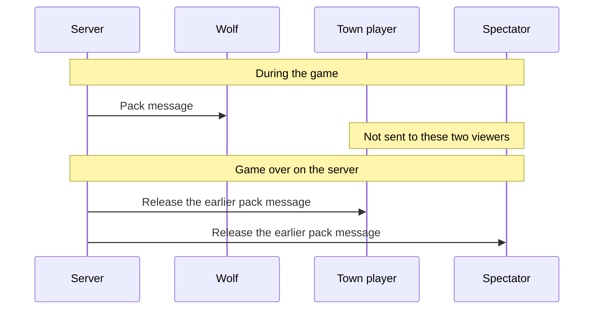

# Per-viewer authorization: event audiences, seat identity and side channels

*Level 2 · [Client-server architecture](../frontend.md) · First draft, 2026-11-22; merged with a shorter alternate version, 2026-11-26*

## Page copy (draft)

A wolf, a town player and a spectator can watch the same game. During play, only the wolf
among those three may read the pack's conversation. Once the game ends, all three can see
it in the reveal. The server makes that decision for each viewer whenever it sends an event.

### Why the decision is made on the server

The page could receive every event and display only the ones its viewer is entitled to. That
would protect nothing. An event that reaches a browser is in the browser's memory and visible in
its network tools, whether or not the page draws it. A player who wanted to know the wolves
would only need to open those tools.

The server decides which events a viewer may receive. Once an event arrives, the stage
controls when it appears. For example, a browser still showing the last night waits until its
stage reaches the ending before displaying the released roles.

### Identifying a viewer without accounts

The game has no accounts or passwords. When a player joins, the server creates a long random
**seat token** and remembers which seat it belongs to. It sends the token to the browser as a
cookie with three properties:

- scripts in the page cannot read it (`HttpOnly`);
- it is sent only over HTTPS on the hosted site (`Secure`);
- it applies to that one game's addresses only.

A cookie is used because the browser's interface for event streams cannot attach custom headers
but does send cookies. A request with no cookie is a spectator, who has no seat. A request with
an unknown token is refused.

The page keeps a copy of the seat token so that a player can take their seat again if the cookie
is lost. The page first deleted that copy whenever an attempt to rejoin failed. A network drop
is also a failure, so a player who lost their connection for a moment lost their seat and
watched the rest of the game as a spectator.

The page now deletes the copy only when the server has definitely refused the token. On any
other failure it keeps the copy and tries again. The copy is held in the browser's local storage,
which scripts in the page can read, unlike the cookie.

### Four audiences, checked for each event and each viewer

Every type of event has one of four audiences:

| Audience | Who receives it during the game | Examples |
|---|---|---|
| Public | Everyone, including spectators | A speech, a vote, the result of a night |
| Wolf pack | The seats whose role belongs to the pack | A wolf's private message, the pack's chosen target |
| One seat | The seat named on the event | That seat's own role, the question for its turn, the result of its investigation |
| Withheld | Nobody, until the game is over | Every seat's role, an AI seat's private reasoning |

*The same message on three open connections. During the game only the wolf is sent it. When
the game ends, the server releases it to the other two viewers.*

Three design decisions sit behind this:

1. **The audience is recorded on the server, by event type.** It is a table in the server's
   code and is not a field on the event, so it never travels to the browser and the browser
   cannot alter it.
2. **An event type with no audience cannot be sent by accident.** When the server starts, it
   checks that every event type has an entry in the table and refuses to start if one is
   missing. Treating an unlisted type as public would be the unsafe default.
3. **The check runs at the moment of sending, for each event.** A viewer's rights are not fixed
   when the connection opens: streams open before the seats and roles are dealt, so a decision
   made at connection time would be out of date.

One function makes the decision, and the live stream, the catch-up after a reconnect and the
status request all call it. Two other routes return game events and use narrower conditions of
their own: a public summary of a running game reads only event types that are public, and a
replay is served only once the game is complete.

When the game ends, every viewer may receive everything. The server then sends each viewer the
events that were withheld from them, and the roles and private reasoning appear in the final
reveal.

### Side channels: what a viewer can work out without receiving a hidden event

Filtering events is not enough by itself. A viewer can learn a hidden fact from something that is
not hidden: a count, a number, how long something takes, or the wording of an error. An audit of
the multiplayer game looked for these.

| What the viewer could observe | What it revealed | State |
|---|---|---|
| A status request returned the number of the newest event | The number rose once for each private night action, so polling it counted the actions | Closed: the status reports the newest event this viewer may receive |
| The error for a turn sent at the wrong moment | Its wording differed when another seat still owed a turn, which showed that someone was acting in secret | Closed: the message depends only on the caller's own seat |
| The numbers on the events a viewer receives | Gaps in the numbers count the hidden events between | Accepted: a reconnecting page resumes from these numbers |
| The length of a night | A human night turn can keep the night open after the progress timers finish | Accepted as a small leak |

**What the night progress bar can reveal.** Everyone can see the bar while players take their
private turns. If it counted only seats with a night action, its total would reveal how many
living seats can act. The bar therefore counts one unit for every living seat. A real turn
can complete a unit early. A timer completes each outstanding unit 20 to 30 seconds into
the night, so even a seat with no action contributes to progress. One limit remains: until the
first timer fires, each completed unit is a real turn, so the early count is a lower bound on
how many seats act that night.

Closing a side channel has a cost. Giving each viewer a private numbering would complicate
reconnecting, and holding every night to a fixed length would slow every game. The game therefore
keeps the shared event numbers and lets each night finish when the players are ready.

<!-- Sources.
Merged 2026-11-26 with viewer_authorization_alt.md (another model's shorter version; that file was deleted on 2026-11-26 once the pages were settled).
Removed from the page in the merge, and told on no other page yet: the draft limit that simultaneous requests
could pass (the count is now compared and increased in one step, and given back if the model call fails;
server/game/game_session.py `draft_line`, multiplayer audit finding 4). It needs a home in chapter 7 or the cost chapter.
The reveal is held by the stage until it reaches the ending: frontend/docs/client_design/client_design.md §4.
Why on the server; the page draws what arrives: frontend/docs/server_client_transport.md §6;
frontend/src/game/foldEvents.ts (header comment: tier filtering is the server's job).
Seat token and cookie: server/game/lobby.py (uuid4 at join), server/routes/_shared.py
(`set_seat_cookie`: HttpOnly, SameSite=Lax, per-game path, 24 h; `Secure` from configuration, on in
production); server/game/game_session.py (`seat_of_viewer`); 403 for an unknown token
(server/routes/games.py). Tests: tests/server/test_http_api.py.
Audiences: server/schemas/events.py (`Tier`, `EVENT_TIERS`, the startup check);
server/game/entitlement.py (`entitled`); server/routes/games.py (`_sse`: `may_see` per event, seat
looked up per event; release at game over); server/routes/_shared.py (`live_status`). Tests:
tests/server/test_game_session.py (one per audience), tests/server/test_event_schema_contract.py.
Side channels: frontend/docs/multiplayer-audit-2026-10-15.md, findings 1 and 2 (fixed), 1 second
half (held) and 3 (accepted); server/game/pacing.py (the bar: public roster total, 20–30 s timers,
the remaining lower bound in its docstring).
Draft limit: server/game/game_session.py (`draft_line`, three per question); audit finding 4.
Deleting the copy: frontend/src/lib/request.ts (`refusesToken`: 403, 404, 410),
frontend/src/lib/storage.ts; audit finding 11.
One level deeper: evidence/_study/engineering_notes/07_authorization_and_side_channels.md, Part 3
and Appendix B.
Supporting detail left off the page: the ledger and replay routes keep hidden events back by their
own conditions and not by the shared function; the startup check is an `assert`; the token is
stored unhashed in the database; no route has a rate limit (notes U7 3.8, improvements rows 41,
62 to 64).
-->
