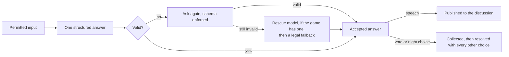

# One agent turn, from input to action

*Level 2 · [Game design and orchestration](../game_design_orchestration.md) · previous: [Executing a day and night](../day_and_night/day_and_night.md) (not yet drafted) · next: [Adding a human in the loop](../human_in_the_loop/human_in_the_loop.md) · status: page copy drafted 2026-10-26 with the level prompts; for the owner's review.*

## Brief

Condensed from [`../content_plan.md`](../content_plan.md), "Level 2 page briefs", section 4, with its
"Widened 2026-10-26" note (owner); the plan keeps its copy until the owner moves it.

**Scope (widened 2026-10-26):** one whole turn: the player's input, the model's response, validation,
retries and fallback, and the hand-off to the game (speech published; a vote or night choice collected
for the resolution, which is page 3's). What goes into the input is chapter 2's; how it is worded is
chapter 3's. Diagram: input → response → validation / retry / fallback → accepted speech or choice →
(for choices) collect → resolve.

**Reader question:** how do you make a model's turn something code can trust? One answer of a known
shape, always legal, and always resolvable, even when the model or the provider fails.

**Promise:** the output contract, validation, retries and fallback. Page 3 is how ten turns become a
game; this page is how one answer becomes a move.

**Open with the game:** a role may act only on certain players, and only while its uses remain (the
Vigilante's two bullets, the Speculator's one pick). The engine must be able to apply whatever comes
back.

**Featured story:** legal targets live in the schema, and on Claude Haiku 5.5 that collided with
caching (104): an enforced schema counts as the start of the prompt, and a vote's schema lists that
seat's targets; the schema is now text after the cached part, checked in code, enforced only on a
retry; 1 failure in 412 Haiku calls; votes and night actions went from never reading the cache to
reading most of it. The cost side is chapter 6's.

**Subsections:** (1) code asks, the model answers one structured question: the eight-row who-decides
table, deduction row "→ chapter 3", a seat has no tools (103); (2) why not a tool loop: the owner's
reasoning, reasoned not measured, the Haiku forced-tool probe, the cost accepted (103, 100); (3) the
output contract: required fields, "no" as a value, legal targets, fields read downstream, field order
one sentence → chapter 3 (104, 147); (4) enforced by the provider, or checked in code: the featured
story (104); (5) when a reply fails: enforced retry, rescue model if any, legal fallback, stall budget →
chapter 7, the cached fallback pass → page 5 Level 3 (104, 97); (6) semantic guardrails sit on page 2,
one paragraph. Limits: no optional-field failure rate; no alternative compared; Haiku has no rescue;
field order and unenforced schema unchecked for message quality.

**Length:** the shortest page, about 1,000–1,400 words. **Tags:** structured outputs and validation,
output guardrails, graceful degradation.

Exhibits for this page are listed in [`../exhibits/source_map.md`](../exhibits/source_map.md) (rows
proposed in the drafting notes, not yet added).

---

## Page copy (draft)

A turn is the moment one player acts: it speaks in the discussion, votes, or uses a night ability. The
rules limit every one of those acts. A player can vote only for someone alive, and a role can act only
on certain players and only while its uses remain: the Vigilante has two bullets for the whole game,
the Speculator one pick.

Here the player is a model call, and the engine has to apply whatever comes back. So every turn must
end in one answer of a known shape that is legal under the rules, and it must end that way even when
the model writes something broken or its provider stops answering. A game that waits on an answer it
cannot use never finishes.

Every turn follows the same four steps: build the player's permitted input, ask the model for one
structured answer, check it, and hand the result to the game.

*Every path ends in an accepted answer. A vote or night choice changes the game only when the phase
resolves.*

### Code asks; the model answers one structured question

The input is one prompt built fresh for this seat: the public record of the game, the seat's own role
and private results, and whatever its faction shares. Which information may enter it is the subject of
chapter 2, [Information boundaries](../../../evidence/agent_boundaries/report.md); how it is worded is
chapter 3's, context engineering.

The model answers with a *structured response*: a JSON object whose fields are fixed in advance by a
schema. Every turn opens with the seat's read of each other living player and its private note to
itself, then the turn's own fields: a message, a vote or a night target. The model has no tools to
call; the schema is the whole of what it can do.

That split follows one rule: code decides whatever a rule can decide, and the model decides only what
needs judgement.

| Decision | Made by |
|---|---|
| The deal, the order of phases, when the game ends | Code |
| Who speaks next, when the discussion ends, who gets a closing defence | Code, from the tags each speaker puts on its own line |
| Legal targets, the night's outcome, the vote's result | Code: the answer's schema and the rules |
| Chance, when there is no reason to choose (e.g. a first-night target) | Code, by lot |
| What follows with certainty from a seat's own results; whether a claim fits the record | Code: the deduction engine and the claim ledger (→ chapter 3) |
| Whether an opening line is of an allowed kind; whether a later line adds anything | One cheap model call each |
| What the day said, for later days | A summarising model call |
| What a player says, whom it suspects, its vote and night target, whether to pass | The player's model |

### Why not a tool loop

Agent frameworks usually let a model act through tools: it calls `vote(target)` or `shoot(target)`, the
framework runs the tool, and the model carries on. That suits an agent that must discover what it can
do. A seat here has nothing to discover. Each turn's options are fixed and few: one legal target, a
pass, or a message.

So a tool would be called on every turn, and each call would cost something. It adds a model
round-trip and more output tokens. It makes the start of the prompt less stable, and the start is the
part the provider can cache and reuse across calls. And the tool's arguments would still have to be
validated as structured data, which a structured response does in one call. That reasoning is mine,
and I did not measure the extra cost.

One part was measured. Before Claude Haiku 5.5 joined the game, a probe made 51 calls on ten-seat
turn schemas (17 schemas, three calls each, 2026-10-11). Forced to answer through a tool call, it
passed 45 of 51 and returned no thinking tokens in any call: forcing the tool switched its thinking
off. Answering a JSON schema, it passed 51 of 51 and thought for about 312 tokens a call.

The cost I accepted is that the model can do only what a field allows. An action code cannot list in
advance would need a new field before any seat could take it.

### The output contract

Three rules make an answer something code can act on.

**Every field the turn shows is required, and "no" is a value.** Gemini's Flash-Lite, the game's model
in June, silently dropped optional fields. A missing field was then ambiguous: had the seat declined,
or was the answer incomplete? So declining became an explicit answer: `pass_turn` (true or false) for
staying silent, `abstain` for a vote, and a word for each ability that may go unused, e.g. `no_check`
for the Investigator and `hold_fire` for the Vigilante.

**A target field lists only legal targets.** For each turn, code rebuilds the schema so the target
field accepts exactly the players this seat may target, and a reply naming anyone else fails
validation. Uses are counted before the turn exists: a role with no uses left gets no night turn.

**What code reads downstream is a field, not prose.** Each line carries the speaker's own tags (whom it
addresses, and whether it questions, accuses, defends or agrees), which the turn scheduler reads
([Orchestrating the conversation](../conversation/conversation.md)). A role claim and any claimed night
results are fields too, which the claim ledger checks against the record (chapter 3).

The fields also come in a set order, reads and note before the action, because where a field sits can
change the answer; that finding is chapter 3's.

### Enforced by the provider, or checked in code

A provider can enforce a schema while the model writes, so the reply cannot break it. Enforcing it on
every call is the obvious choice, and on Claude Haiku 5.5 it collided with caching.

Ten seats read the same rules and the same transcript many times a day. If every prompt opens with the
same text, the provider serves that part from its cache at a fraction of the input price. For
caching, Claude counts an enforced schema as the very start of the prompt, and a vote's schema lists
that seat's legal targets. It differs from seat to seat and changes at every death, so no two seats' votes or night
actions could share the cached transcript.

The obvious fix was to drop the target list from the schema and state it in the prompt. I ruled that
out: legal targets stay limited by code. Instead, I write the same per-seat schema as text after the
cached part of the prompt, and validate the reply in code against it. An illegal target still fails.
What changes is when a mistake is caught: after the reply instead of during it.

The open question was how often unenforced replies would break. In a trial on 2026-10-13 (probe
calls plus real ten-seat turns), 1 of 412 unenforced Haiku calls failed, and validation caught it. In
paired games on the new prompt layout (two games per arm on the same two deals), Haiku's votes read
none of their input from cache with the schema enforced and 63% with it written as text; night actions
read about 18% against 56%. On Haiku that did not lower the cost per call, because the model reasoned
more; the cost side is chapter 6's.

Twenty Haiku games played after the switch (3,118 seat decisions) broke the schema more often than
the trial: 74 replies, about one decision in forty, e.g. a malformed read or JSON cut off. The plain
retry repeated the same unenforced call, and six failed again. So a reply that breaks the schema is
now asked again with the schema enforced. That one call cannot read the cache, since its schema again
opens the prompt, but it runs only after a failure. How often it fires and holds in live games has not
been measured yet.

### When a reply still fails

After the enforced retry, a game may have a *rescue model*: a model from another provider family that
gets one try when the game's own model fails, and takes the turn outright when the provider stalls.
Haiku has none, so on Haiku a reply that fails the enforced retry goes straight to the fallback. The
stall budget and the rescue's design are chapter 7's.

If nothing produces a valid answer, code supplies a legal one, so the phase can always complete:

- a discussion turn becomes a pass, recorded as a failed generation;
- a vote, or the wolves' kill, becomes a random legal target;
- a night ability that can go unused is declined with the role's own word, because a random shot is
  worse play than none; any other night action gets a random legal target.

A fallback pass is a valid answer, and that had a consequence. One failed opening was cached like any
other answer and replayed in another game; [The cache key that crossed
games](../human_in_the_loop/cache_key.md) tells that story.

### After the answer

An accepted vote or night choice does not change the game when the model returns. It is collected
with every other player's choice and resolved in one step by the rules
([Executing a day and night](../day_and_night/day_and_night.md)). An accepted line of speech goes to the discussion, where two filters described in
[Orchestrating the conversation](../conversation/conversation.md) may hold it: one checks the kind of
an opening line, the other holds a line that only repeats the day. Both are model judgements made after
the line is written, not schema rules. Both fail open, so a failed check keeps the line, and a line
they wrongly judge acceptable is published.

### What this does not establish

- No other orchestration design was compared; the case against a tool loop is reasoned, except the
  Haiku probe above.
- No failure rate for optional fields was recorded; the rule came from schema work in June.
- Whether writing the schema as text, or today's field order, changes what Haiku's players say has not
  been measured (chapter 3).

**Evidence.**

- [Orchestration: how a game runs as a graph](../../../evidence/gameplay/orchestration/report.md), "One
  turn, end to end", "Who decides what", decision 1 and "What is not established".
- [The turn prompt](../../../evidence/gameplay/turn_prompt/report.md), "What the seat must answer",
  "Model settings, validation and retries", decisions 11 and 13.
- [Prompt caching: investigation log](../../../evidence/caching/experiment_log.md), §12 (the trial),
  §13 (the paired games), §15 (live) and §16 (twenty games and the enforced retry).
- [Model admission](../../../evidence/evaluation/model_admission/experiment_log.md), the 2026-10-11
  Claude Haiku 5.5 probe.

<!-- Sources for the page copy (drafted 2026-10-26):
Opening: content plan brief 4 ("open with the game"); uses: Agents/schemas/roles.py ROLE_SPECS
(vigilante uses=2, speculator uses=1); orchestration/report.md "The problem" (fourth requirement: a
failed call has a legal fallback). Four steps: chapter page section 4; orchestration "One turn, end to
end" (six steps, compressed: payload, model call, fallback, record; memory and the human branch left
to chapter 4 and page 5).
Input: chapter page, "Keeping each player's information separate"; orchestration step 1. Structured
response and field order: turn_prompt "What the seat must answer" (TurnOutput). No tools: orchestration
decision 1. Who-decides table: orchestration "Who decides what", eight rows, code names removed; the
deduction row labelled → chapter 3 (authorship: the deduction engine is chapter 3's).
Tool loop: orchestration decision 1 "Chosen over" (owner's reasoning, 2026-10-26; not measured); map
blocks 103, 116. Probe: evidence/evaluation/model_admission/experiment_log.md 2026-10-11 (17 schemas × 3
= 51 calls, thinking medium; forced_tool 45 of 51 with 0 reasoning tokens, all six failures replies
with no reads; json_schema 51 of 51, 312 reasoning tokens a call); map block 100; catalog.py note.
Cost accepted: decision 1; "When to revisit" (an action code cannot enumerate).
Contract: turn_prompt decision 11 (flash-lite dropped nullable fields; pass_turn, abstain, no_check,
hold_fire; no failure rate recorded); "What the seat must answer" bullets (legal targets; claims are
fields; speech-act tags); action_space.py::output_schema_with_legal_targets (Literal of the legal set);
orchestrator.py::acts_tonight (no turn with no uses left). Claim fields: decision 13. Field order: map
147, one sentence.
Featured: turn_prompt "Why the schema is not enforced on Haiku"; caching log §12 (Claude counts the
enforced schema in its cache key; vote/night schemas carry each seat's targets and change at every
death; owner constraint: targets stay in the schema; trial 2026-10-13, 1 in 412 Haiku calls, a
malformed read entry, caught by validation), §13 (paired games table: Haiku new layout enforced vote
0r, night ~18r; unenforced vote 63r, night 56r; two games per arm, same two seeds and lineups; cost per
call $1.10 vs $1.07–1.10, more reasoning), §15 (live 2026-10-14, json_mode switched on), §16 (20 Haiku
games, 3,118 seat decisions, 74 broke the schema, about one in forty; plain retry, six failed again;
enforced retry deployed the same day; the enforced call not cached; live rate unmeasured).
Fallback: turn_prompt "Model settings, validation and retries"; orchestration step 5; code
Agents/turn/agent_player.py::run_agent (enforced retry via enforced_output; one rescue try; discussion
→ GENERATION_FAILED pass; day_votes and KILL_TARGET → random.choice; night roles → spec.no_action or
random). Haiku no rescue: turn_prompt (live catalogue 2026-10-26). Stall → rescue: map block 97 (chapter
7). Cached fallback pass: map block 115; orchestration decision 12.
After the answer: chapter page section 3; discussion/report.md (opening filter "fails open: an error or
a missing verdict keeps the line"; echo gate "fails open"); plan brief 4 subsection 6.
Limits: plan brief 4 "Limits"; orchestration "What is not established"; caching log §12 "Still
unmeasured" and §16 "Not yet measured". -->
