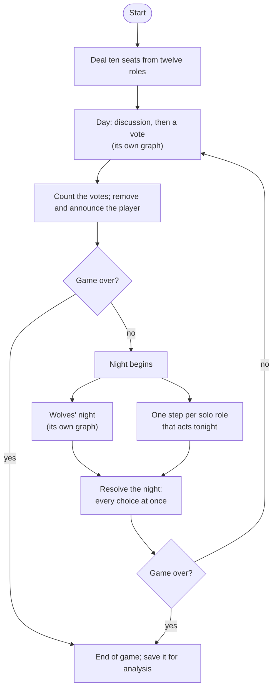

# Executing a day and night

*Level 2 · [Game design and orchestration](../game_design_orchestration.md) · previous: [Orchestrating the conversation](../conversation/conversation.md) (being drafted) · next: [One agent turn, from input to action](../agent_turn/agent_turn.md) (being drafted) · status: page copy drafted 2026-10-26 with the level prompts; for the owner's review.*

## Brief

Copied from [`../content_plan.md`](../content_plan.md), "Level 2 page briefs", section 3 (agreed with the
owner 2026-10-26); the plan keeps its copy until the owner moves it.

**Reader question:** how do ten model-driven seats become one consistent game? Who acts when, what each
receives, how their results combine, and what stops a loop from running away?

**Promise:** the familiar game cycle translated into graph execution: conversation in sequence,
independent choices, collection, resolution and state updates. LangGraph is introduced as the
implementation of those needs.

**Open with the game, not the framework:** night choices and votes are made independently and must all
be collected before the night or the vote resolves; conversation happens in turn because each line
answers the last. Only then `Send`, the collecting barrier and subgraphs.

**Featured story:** a subgraph's result comes back by hand, and one fold-back wiped every other seat's
private note each night (112): the damage from the test, notes merged by seat, the cost kept (each
wrapper must know what it sent). Told as fixed; how it was noticed is not recorded and not inferred.

**Subsections:** (1) the game as a graph, the parent graph diagram (102, 109); (2) a subgraph where a
phase has its own flow, a named node where a turn is one step, the two collapses (109); (3) the same
snapshot in parallel, conversation in sequence, the pack's night as the worked example, the day
subgraph diagram (108); (4) why the subgraphs are invoked by hand (110); (5) how a subgraph's result
comes back, the featured story (112); (6) what the agents share, four records, one error reaches all
ten seats (107); (7) the step budget (113); (8) checked without a model (114, wiring part); (9) limits
(116, graph part).

**Tags:** multi-agent orchestration, LangGraph, fan-out/fan-in, shared-state architecture.

Exhibit rows for [`../exhibits/source_map.md`](../exhibits/source_map.md) are proposed in the drafting
notes and not yet added.

---

<!-- Drafted 2026-10-26 from the sources listed at the end. Not independently verified. -->

## Page copy (draft)

Executing a day and night means turning ten players' separate decisions into one game that follows its
rules. Two needs shape it, and both are familiar from a table game.

Votes and night choices are made independently: each player decides from what they know, and nothing
happens until every choice is in. At night this matters because actions interact. A Healer's
protection stops a kill only if both are applied together, and a blocked player's action should never
land. Conversation is the opposite: each line answers the one before, so players speak in turn.

With model calls as the players, something also has to decide who acts next, give each player only
its own information, combine the results and stop when a side has won. I built that in LangGraph, a
framework that runs connected steps over shared state. This page follows a day and a night through the
graph: its shape, which steps run in parallel and which in sequence, how results come back into the
shared state (where one bug wiped the players' private notes each night), what the players share, and
what keeps a loop from running forever.

### The game as a graph

In LangGraph a *node* is a step that reads the game's state and returns changes to it. An *edge* says
which node runs next. A *router* is an edge that decides in code, e.g. "has a side won?". After every
step the framework saves the state, a *checkpoint*, which is what lets a game pause for a human
([Adding a human in the loop](../human_in_the_loop/human_in_the_loop.md)).

*The main graph. "Game over" means a side has won, no side is left, or day 12 has been reached. The
wolves' night and the solo roles' steps run in parallel; the resolution waits for all of them.*

Only the day and the night call a model. The deal, the vote count, the win checks and the resolution
are code, so the rules are applied the same way in every game.

### A subgraph where a phase has its own flow; a named node where a turn is one step

A *subgraph* is a smaller graph, with its own steps and state, that runs inside one node of the main
graph. The day and the wolves' night are subgraphs because each has an internal flow. The day loops
through a scheduler that picks the next speaker and runs parallel rounds. The wolves' night has a chat,
a kill and then each wolf's skill. A solo role's night is one model turn, so it is one node.

A separate piece of code per role is the obvious structure, and that is where the code started: the first
version gave the day and every night role a subgraph of its own. The record does not say why. The
repetition showed twice. First, the day graph routed each speaker to a node named after its role, and
12 day functions and 4 night functions had identical bodies apart from the prompt; I replaced them with
factories, functions that build each node from its prompt. Later, with twelve roles, a subgraph per role
would have given every one-step night its own state, a node to call it and a hand-written return of
results. So the
solo nights became named nodes that share one body. What differs per role (its action, its answer
field, its word for declining, its number of uses) is data in a role table. The day graph's own rule
says it: "role-specific content is payload data, not topology."

The cost: a graph built from generic nodes no longer reads role by role. That is why the solo nights
kept their names, so the graph, the traces and the server's translator (which turns graph events into
what the live site shows) still name each role. The record states only what changed in that second
collapse, so its reason is my reading.

### The same snapshot in parallel, conversation in sequence

LangGraph's `Send` starts one node with an input built for it. A router can return one `Send` per
player, and those turns then run as one parallel step. A collecting node after them waits for every
branch: a *barrier*. Votes, the day's opening and closing rounds, the solo nights and the wolves'
skills all run this way.

Anything that needs an order happens at the barrier, never in a branch. Every branch in a parallel step
reads the same snapshot of the state, so a round's turns, each numbering its line from the transcript,
would all claim the same number; the collecting node orders and numbers them instead. At night the
resolution step applies every choice together, so the order in which branches finish cannot change the
outcome. Night actions count as simultaneous: a Healer killed that night still protects, and an
Investigator killed that night made the check but receives no result. A limited use, such as a
Vigilante's bullet, is spent only in that step.

The parallel step suits a vote because a vote should be independent. That independence comes from each
player's permitted input, not from running in parallel; running in parallel only means the step waits
for its slowest player instead of adding every player's wait. Conversation needs the opposite. Asked
in parallel, players answered the same snapshot and repeated each other, so discussion turns run one at
a time, each one a single step that loops back to the scheduler. The cost is one model call in series
per speaker. The evidence for that choice, and the scheduler itself, are in
[Orchestrating the conversation](../conversation/conversation.md).

*The day subgraph. Parallel rounds end at a collecting node; the discussion loops through the
scheduler one turn at a time. A human seat takes a separate copy of each parallel turn, not shown
([Adding a human in the loop](../human_in_the_loop/human_in_the_loop.md)).*

The wolves' night uses both patterns in one subgraph. The wolves first chat one at a time, for at most
three rounds; a round in which every wolf passes ends it early, and a lone wolf skips it. One wolf, the
carrier, then makes the kill; the role rotates through the living wolves in seat order. Only then does
each wolf's skill run, in parallel: the Chanteuse blocks a player's night action, and the Illusionist can
hide the victim's role. The order follows the rules. The kill has a single visitor because the
Sentinel and Trailseer see night visitors by name, and the skills come after the kill because the
Illusionist decides on the victim. Tests pin this routing, and three ten-seat games read in full ran
every step of the wolves' night as specified.

### Why the subgraphs are invoked by hand

There are two ways to attach a subgraph. One hands it to LangGraph as a node, and the framework can then
see inside it. The other calls it like a function from inside my own node, which builds its input by
hand. I use the second, because that hand-built input is where privacy is enforced.

A `Send` passes its input to the node exactly as given, and nothing downstream narrows it. Whatever
builds the input therefore decides what a seat can see: the wolves' subgraph receives only what wolves
may know. Keeping that in one builder gives one place to enforce and test the boundary. The guarantee
and its checks are [chapter 2's](../../../evidence/agent_boundaries/report.md).

The cost is that LangGraph sees the call as one opaque step. If a human's pause lands inside it, a
resume re-runs the whole step, AI turns included; page 5 explains how caching the AI players' answers
avoids asking them again. The subgraph's results also come back by hand, which caused the bug below. The
alternative, letting LangGraph manage the subgraphs, would mean redesigning that privacy boundary.

### How a subgraph's result comes back

A node returns *changes*, and LangGraph combines each change with the current value using the field's
*reducer*, its rule for combining. The transcript and the game's records append. A field with no
reducer is simply replaced by the latest value.

Appending is why a subgraph's result is folded back by hand. The day receives the running transcript
and returns the grown one. Returned whole, the parent would append the old history a second time, so
the node that called the day returns only the entries after what it sent.

The private notes broke in the same place. Each seat keeps a private note between turns, its own plans
and suspicions, carried into its next prompt. The notes lived in one map from seat to note, in a field
with no reducer. The day and the wolves' phases returned the whole map, so they did no harm. The solo
night phases, then each a subgraph of its own, returned only their own actor's entry, and that one-entry
map replaced the whole field. Each night wiped every other seat's note. The test that pins the fix
records the damage:

- notes broken for every seat except the first night actor;
- nearly all seats blank from day 2;
- a corrupted end-of-game copy of the notes, which the memory system reads after the game.

The fix gave the notes a reducer that merges by seat, so an update replaces only its own seat's entry.
Two tests pin it: a one-seat update keeps every other seat's note, and three solo actors updating in
turn keep all three plus the seats they did not touch. The rule I took from it: choose each field's
reducer from how every node that writes it returns it.

The cost I kept is the hand-written return. Each calling node must know what it sent, and every new
list field needs the same slice. Nothing warns if one is forgotten.

### What the agents share

Agents never message each other. They share four records, rebuilt into every prompt:

- **today's transcript**: the lines published so far today;
- **the game master's record**: the engine's exact announcements of each night and each vote;
- **the claim ledger**: every role claim, per player, built by code and checked against that record;
- **the day summaries**: a model's account of who accused whom on earlier days.

The last three are labelled in that order of how far to trust them, the engine's record first.

Shared records make one agent's error everyone's premise. In a census of 50 nine-seat games from July
2026, errors clustered, the worst game-day having 24 errors, with one player's false premise becoming others'
starting point. In one ten-seat game on Gemini 3.5 Flash-Lite, the summariser turned "I was roleblocked"
into a claim to be the role that blocks, and the real Investigator was voted out 7 to 1. The fixes to
the summary and the ledger are chapter 3's, and how the errors were counted is in the Evaluation
chapter. The design response here is structural: each record carries its trust label, code rather than
the summariser checks claims, and a line held back from publication reaches no prompt.

### The step budget

LangGraph caps how many steps a run may take, its *recursion limit*, and stops with an error when the
cap is reached. The discussion is a loop, one turn and one scheduler step at a time, and how long it
runs depends on who is alive. The day should end by the game's own rules: the talk stops once every
question and accusation has had its reply and the floor has gone round, or at a cap of three lines per living player. It
should never end on that error.

Because the day subgraph is called by hand, it can be given a limit of its own. So the day's budget is
computed each morning from the survivors and the rules that end the talk: two steps per discussion
turn; room for twice the speaking cap, since a pass does not count toward the cap and could follow
every real line; a pass by every survivor each time the floor goes round the table; one last reply per
survivor after the cap; and the steps for the rounds, the summary and the vote. Its stated aim is that "the graceful cap always
fires before an ungraceful GraphRecursionError". The cost is upkeep: each change to the day has added a
term to the formula. The main graph still uses LangGraph's default limit of 100, which is not derived
from the game's length.

### Checked without a model

The wiring is tested with a scripted model that fills whatever answer format it is given. It plays whole
games on the real main graph, streamed through the server's translator, for two of the four lineups,
which between them deal every drawn role, and every solo role dealt is routed to its night step. Other
tests pin the wolves' night routing, the day's rounds, the note merge, and a list of every class stored
in the state, without which a checkpoint could not save and reload it. These tests show that the graph
runs and its state combines as designed. They say nothing about how well the agents play.

### Limits

No alternative orchestration design was compared: the evidence is implementation tests, recorded
faults and their fixes. Why the first version gave every role a subgraph is not recorded, and the
reason for collapsing the solo nights into named nodes is inferred. The main graph's recursion limit is the default, not
derived from the length of a game.

**Evidence.**

- [Orchestration: how a game runs as a graph](../../../evidence/gameplay/orchestration/report.md),
  "A game today" (the parent graph, the day subgraph, the nights, state and fold-back, the step budget,
  what the agents share), decisions 2–10, "How it was checked" and "What is not established".
- [Node-factory collapse](../../../evidence/refactor/node_factory_pattern.md) (the June factories).
- [Ten-seat wiring census](../../../evidence/gameplay/roles/phase3_wiring_census.md), §2 (the per-role
  subgraphs listed for rewriting) and the plan's decisions.

<!-- Sources for the page copy (drafted 2026-10-26):
Opening: content plan brief 3 ("open with the game"); orchestration/report.md "The problem"; decision 2
(simultaneous actions; killed healer still protects; killed investigator's check not delivered).
"Blocked player's action should never land": role_sheet.md "Visits" (a blocked player does not visit).
The game as a graph: orchestration "The parent graph" (node/edge/router definitions; the START→END
text diagram; nodes outside day and night make no model calls; day 12); Agents/graphs/parent.py::
build_parent_graph (docstring and wiring; ONE_MORE_DAY and NIGHT_START folded into labels). Checkpoint
after every step: "Checkpointing" paragraph. Map 102, 109.
Subgraph vs named node: orchestration decision 3 (rule today; first files gave day and each night role
a subgraph, reason not recorded; June one file per role; census §2; October named nodes sharing one
body; inferred reason; names kept "so the graph, the traces and the translator still read role by role",
solo.py docstring); decision 4 (12 day and 4 night functions, identical bodies apart from the prompt;
factories; the day graph docstring quote; cost: graph and traces no longer read role by role);
refactor/node_factory_pattern.md (routing by role-named node; factories). "The nights" (registry: the
action, output field, word for declining, uses). Map 109.
Parallel/sequential: orchestration "The day subgraph" (Send; barrier; COLLECT_ROUND numbering; discussion
sequential, SCHEDULE hub); decision 2 (resolution after barrier; uses spent only there); decision 6 (waits
for slowest branch; near-identical lines in June and in a parallel open floor reverted; one call in series
per speaker); decision 5 (one node per discussion turn); interview_prep/langgraph_langfuse_issues.md §1.3
(same snapshot → same sequence number). Independence from the permitted view: chapter page "Running the
game". Pack: "The nights"; decision 7 (carrier rotation, three rounds, early end, lone wolf; one visitor
because Sentinel and Trailseer see visitors by name; skills after the kill because the Illusionist decides
on the victim; tests; three ten-seat games read in full 2026-10-09). Role glosses: role_sheet.md (Chanteuse
"kept you at her table" = block; Illusionist = role vanished; Sentinel/Trailseer see visits). Day diagram:
Agents/graphs/day.py wiring (START_OPENING, COLLECT_ROUND, SCHEDULE/discuss, START_CLOSING, SUMMARIZE,
START_VOTING, COLLECT_VOTES; human twins omitted). Map 108.
Invoked by hand: frontend/docs/server_encountered_challenges.md §3 (two ways to attach; hand-built input
is the privacy boundary; wolf subgraph receives only what wolves may know; black box re-runs the node);
orchestration decision 8 (Send passes its payload unfiltered; one enforcer, one place to test); decision
12 "Instead of" (framework-managed subgraphs would mean redesigning the privacy boundary). Map 110.
Fold-back and the note wipe: orchestration "State, and how a subgraph's result comes back" (reducers;
slice past what was sent); decision 9 (bug, damage list, merge per key, cost); interview_prep §1.1–1.2
(no reducer = last value wins; day and wolf phases returned the full map, so they hid it; lesson);
tests/engine/test_agent_strategies_merge.py (module docstring: the damage; two tests). Solo nights
were subgraphs at the time: decision 3 (per-role subgraphs from May/June until 2026-10-09; fix dated
2026-07-23). How the bug was noticed: not recorded, not stated. Map 112.
Shared records: orchestration "What the agents share" (four records; never message directly; structural
safeguards); turn_prompt/report.md "The record of past days" (trust order: game master's record, claim
ledger, accusations/summary); evaluation/factual_errors/report.md (50 nine-seat games, July 2026; worst
game-day 24; false premise becoming the room's starting point); extraction/day_summary/report.md §7 (e06,
ten-seat, Gemini 3.5 Flash-Lite in every seat, read 2026-10-10; investigator voted out 7 to 1). Map 107.
Step budget: orchestration "The step budget", decision 10 (quoted aim; upkeep; parent default 100);
Agents/config/langgraph.py::discussion_recursion_limit (terms); speaking cap three lines per living
player: chapter page "Giving players opportunities". Map 113.
Checks: orchestration "How it was checked" rows 1, 4, 6 (scripted model, two of four lineups dealing every
drawn role, every dealt solo role routed; note merge; checkpoint allowlist; pack and day-round tests);
"implementation evidence, nothing about play". Map 114.
Limits: orchestration "Version and evidence", "What is not established" bullets 1, 2, 6. Map 116. -->
