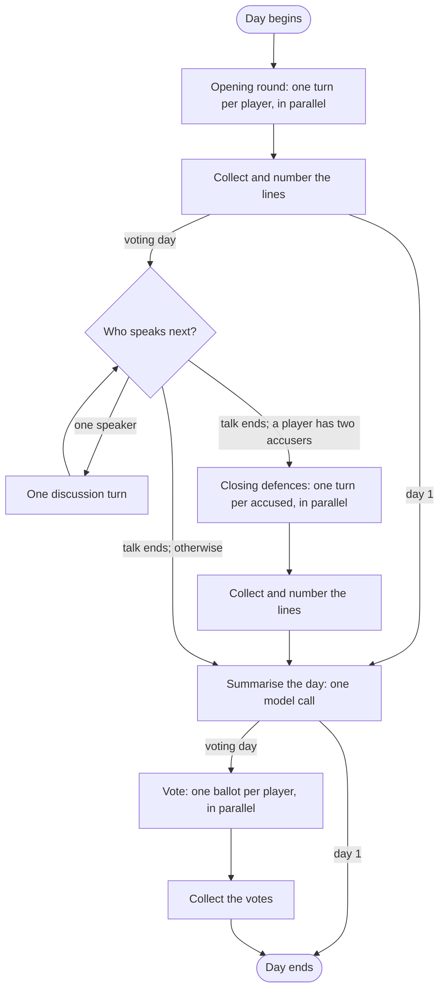

# Multi-Agent Game Orchestration

*Coordinating agent decisions, resolving actions, and maintaining consistent game state.*

*Level 2 · [Game design and orchestration](../game_design_orchestration.md) · previous: [Orchestrating the conversation](../conversation/conversation.md) (being drafted) · next: [Structured Agent Execution](../agent_turn/agent_turn.md) (being drafted) · status: page copy drafted 2026-10-26 with the level prompts; restructured 2026-10-28 to follow the game loop (detail moved to the supporting notes); for the owner's review.*

## Original drafting brief

This brief records the earlier outline. The 2026-10-27 editorial revision and verification questions
are recorded in [the editorial notes](../editorial_notes.md).

Copied from [`../content_plan.md`](../content_plan.md), "Level 2 page briefs", section 3 (agreed with the
owner 2026-10-26); the plan keeps its copy until the owner moves it.

**Reader question:** how do ten model-driven seats become one consistent game? Who acts when, what each
receives, how their results combine, and what stops a loop from running away?

**Promise:** the familiar game cycle translated into graph execution: conversation in sequence,
independent choices, collection, resolution and state updates. LangGraph is introduced as the
implementation of those needs.

**Open with the game, not the framework:** night choices and votes are made independently and must all
be collected before the night or the vote resolves; conversation happens in turn because each line
answers the last. Only then `Send`, the collecting barrier and subgraphs.

**Featured story:** a subgraph's result comes back by hand, and one fold-back wiped every other seat's
private note each night (112): the damage from the test, notes merged by seat, the cost kept (each
wrapper must know what it sent). Told as fixed; how it was noticed is not recorded and not inferred.

**Subsections:** (1) the game as a graph, the parent graph diagram (102, 109); (2) a subgraph where a
phase has its own flow, a named node where a turn is one step, the two collapses (109); (3) the same
snapshot in parallel, conversation in sequence, the pack's night as the worked example, the day
subgraph diagram (108); (4) why the subgraphs are invoked by hand (110); (5) how a subgraph's result
comes back, the featured story (112); (6) what the agents share, four records, one error reaches all
ten seats (107); (7) the step budget (113); (8) checked without a model (114, wiring part); (9) limits
(116, graph part).

**Tags:** multi-agent orchestration, LangGraph, fan-out/fan-in, shared-state architecture.

Exhibit rows for [`../exhibits/source_map.md`](../exhibits/source_map.md) are proposed in the drafting
notes and not yet added.

---

<!-- Drafted 2026-10-26 from the sources listed at the end. Not independently verified. -->

## Page copy (draft)

Ten agent players contribute to one game, but their decisions have different dependencies.
Discussion needs to proceed one speaker at a time so each agent can respond to what was just said.
Votes must be collected without revealing other ballots. Night actions must be resolved together:
a block can prevent an attack, and protection can prevent a kill.

The orchestration layer preserves these relationships regardless of how quickly each model answers.
I built it with LangGraph, representing the game as steps that read and update shared state. Models
choose actions; code controls the execution order and applies the game rules.

### The game loop

The main graph follows the game's cycle: run the day, resolve the vote, run the night, and resolve
its actions. After each resolution, code checks whether the game has ended.

*The main graph. The game ends when a side has won, no side is left, or day 12 has been reached.
The wolves' night and the solo roles run in parallel; night resolution waits for both.*

Each step is a **node**, and the connections between steps determine what runs next. The day and the
wolves' night each contain several steps, so they have their own **subgraphs**. A solo role's night
action needs only one model turn and runs as a single node. Those solo nodes share an implementation,
with role-specific actions and permitted answers supplied as data.

Model calls sit inside the day and night phases. Dealing roles, counting votes, checking win
conditions and resolving night actions are handled by code. This keeps the application of the rules
separate from the agents' decisions.

### A day: rounds in parallel, conversation in turn

The opening round, closing defences and vote each collect responses from a set of eligible players.
Within each round, agents receive their permitted view of the game and respond without seeing the
other responses being collected. The engine waits for the whole round before advancing.

This is a **fan-out/fan-in** pattern. LangGraph's `Send` starts a branch with an input prepared for
one player. A collecting node acts as a **barrier**, waiting for those branches to finish. Running
them in parallel means waiting for the slowest response rather than making every call in sequence.
Ballots remain independent because other ballots are excluded from each agent's input.

Discussion has a different dependency: the next speaker needs the latest published line. When
agents were asked in parallel, they responded to the same discussion snapshot and repeated each
other. Discussion therefore loops through a scheduler: choose one speaker, run its turn, then choose
the next. This adds a model call in sequence for each speaker. [Orchestrating the
conversation](../conversation/conversation.md) explains how the scheduler selects them.

*The day subgraph. Openings, closing defences and votes end at collecting nodes. Discussion advances
one turn at a time. Human turns use separate branches, omitted here; see [Adding a human in the
loop](../human_in_the_loop/human_in_the_loop.md).*

Collecting responses also gives the engine one place to order them. Each parallel branch starts
from the same state snapshot. If every branch numbered its own transcript entry, they would all
choose the same next number. The collecting node assigns those numbers after the round finishes.

### A night: choose together, resolve once

At night, the wolves' subgraph runs alongside the solo roles' turns. These branches submit choices;
the resolution step applies their effects only after every branch has finished. A fast model's
attack therefore cannot take effect before a slower model submits its protection.

Resolution follows the game's simultaneous-action rules. A Healer killed that night still protects
its target. An Investigator killed that night performs the check but receives no result. Limited
uses, such as a Vigilante's bullet, are spent during resolution.

The wolves' branch also contains decisions that depend on one another. They first chat in sequence,
then one wolf chooses the kill target, then their individual skills are chosen in parallel. The
Illusionist can hide the victim's role, so it needs the selected target before choosing its skill.
The attack itself still waits for night resolution. Routing tests check this sequence, and three
ten-seat games read in full followed it as specified.

### Passing information in, and results back out

The game state contains information that individual agents must never see. Before a phase runs,
its input must be restricted to what its participants may know. For example, the wolves' subgraph
receives the wolves' permitted information rather than unrestricted access to the full game state.

I enforce this boundary in a wrapper node that builds the input and invokes the subgraph. `Send`
passes along the input it is given; it does not remove private fields automatically. Keeping the
input construction in one place makes the boundary explicit and testable. [Agent information
boundaries](../../../evidence/agent_boundaries/report.md) describes those checks.

This choice also makes the wrapper responsible for returning the subgraph's updates to the parent
graph. The parent must combine them with existing state correctly. A field can define a **reducer**,
a rule for combining updates: the transcript appends new entries, for example. Without a reducer,
an update replaces the field's previous value.

An earlier implementation exposed the danger of that default. Each agent keeps a private note of
its plans and suspicions for its next turn. All notes were stored in one map, keyed by player, with
no reducer. The solo night subgraphs returned only the acting player's note, replacing the entire
map with that one entry:

| Update | Notes retained |
|---|---|
| Before the Healer's update | Every agent's note |
| Apply the update by replacement | Only the Healer's note |
| Apply the update by merging on player | Every agent's note, with the Healer's updated |

The regression test records nearly all seats losing their notes from day 2, as well as a corrupted
end-of-game copy used by memory extraction. The day and wolves' subgraphs returned the whole map,
which had masked the problem. I fixed it with a reducer that merges notes by player. Tests check
that updating one agent preserves the others, and that successive updates from three solo roles
preserve both their notes and those of agents who did not act.

The transcript needs different treatment. A day subgraph receives the existing transcript and
returns it with new lines added. Appending that entire result would duplicate the old history.
The wrapper therefore returns only the new entries. Each new append-only field needs the same
care: its return value and reducer must agree on whether the update contains new data or the
complete record.

Explicit wrappers also affect human pauses. Resuming a paused subgraph re-enters its wrapper, which
can repeat AI turns; cached answers are used to avoid repeating their model calls. [Adding a human
in the loop](../human_in_the_loop/human_in_the_loop.md) explains that mechanism and its limits.
Using framework-managed subgraphs would require revisiting how these information boundaries and
state updates are implemented.

### What every player reads

Preserving state is only part of the problem. The engine must turn it into an account of the game
that each agent can use. Agents communicate through published records that the engine includes in
their prompts:

- **Today's transcript:** lines published so far today.
- **The game master's record:** exact announcements of night and vote results.
- **The claim ledger:** role claims organised by player, maintained by code and checked against the
  game master's record.
- **Day summaries:** a model's account of earlier discussions.

These sources have different authority. An engine announcement establishes a game result; a claim
records what a player said; a summary is a model's interpretation. The prompts keep them separate
and label their authority, with engine results taking precedence over claims and summaries.

A summary error can otherwise become a premise for several agents. In one ten-seat game, the
summariser turned “I was roleblocked” into a claim to be the role that blocks. The real Investigator
was later voted out 7 to 1. That sequence illustrates the risk, although it does not isolate the
summary's effect on the vote. The [day-summary
report](../../../evidence/extraction/day_summary/report.md) covers the error and subsequent fixes.
Here, the architectural responsibility is to preserve the distinction between engine facts,
player claims and model interpretations.

### Ending the day safely

Discussion ends according to the game's rules: finish outstanding reply obligations and the final
sweeps of the floor. A speaking cap provides another route to closure, allowing a final round of
owed replies before the day ends.

The framework imposes a separate limit. LangGraph's **recursion limit** caps execution steps and
raises an error if the graph exceeds it. The day needs enough steps to reach its normal ending,
including turns where an agent passes and final replies after the speaking cap.

I calculate the day subgraph's budget from the number of living players and the discussion rules.
The aim is for normal termination to happen before the framework limit is reached. That calculation
needs maintenance whenever the discussion flow changes. The main graph still uses the default
limit of 100 rather than a budget derived from the game's maximum length.

### Checking the wiring

A scripted model supplies responses in the required formats so whole games can exercise the real
graph without live model calls. These tests run through the server's event translator and cover two
of the four lineups, together including every drawn role. They check that each dealt solo role
reaches its night-action node.

Targeted tests cover the wolves' routing, the day's rounds and private-note merging. A separate
check covers the state classes needed to save and reload **checkpoints**, the saved execution state
used when a game pauses and resumes.

These checks establish execution and state-handling behaviour in the tested cases. Agent playing
quality requires separate evaluation, and no alternative orchestration architecture was compared.

<!-- Supporting notes (moved out of the page copy 2026-10-28, restructure to follow the game loop;
interview defence, not page text).
- Subgraph vs single node, history: earlier versions used repeated functions and a subgraph for each
  night role (day.py, healer.py, investigator.py, wolf_night.py); the solo nights were subgraphs from
  May/June until 2026-10-09. The refactor record evidence/refactor/node_factory_pattern.md documents
  how the repeated functions were replaced. Solo night nodes share one implementation but keep their
  role names in the graph and traces, so it stays possible to see which role is acting.
- Role-specific data per solo role: the action, the answer field, the permitted decline, the number
  of uses.
- `Send` rounds: votes, the day's opening and closing rounds, the solo nights and the wolves' skills.
- Wolves' night particulars: chat for at most three rounds; a round in which every wolf passes ends it
  early; a lone wolf skips it. One wolf, the carrier, makes the kill; the role rotates through the
  living wolves in seat order. The kill has a single visitor because the Sentinel and Trailseer see
  night visitors by name. The Chanteuse blocks a player's night action; the Illusionist can hide the
  victim's role. Three ten-seat games read in full on 2026-10-09.
- Notes bug: fixed 2026-07-23 (d1cbd2f8), when the solo nights were each a subgraph and games were
  nine-seat. Damage as the test records it (tests/engine/test_agent_strategies_merge.py): notes
  broken for every seat except the first night actor; nearly all seats blank from day 2; a corrupted
  end-of-game map that memory extraction reads. Tests: a one-seat update keeps every other seat's
  note; three solo actors updating in turn keep all three plus the seats they did not touch. How the
  bug was noticed is not recorded.
- Summary error game: e06, ten-seat, Gemini 3.5 Flash-Lite in every seat, read 2026-10-10.
- Step budget terms (Agents/config/langgraph.py::discussion_recursion_limit): two steps per
  discussion turn; room for twice the speaking cap, since a pass does not count toward the cap and
  could follow every real line; a pass by every survivor each time the floor goes round; one last reply
  per survivor after the cap; and the steps for the rounds, the summary and the vote. Stated aim
  (decision 10): "the graceful cap always fires before an ungraceful GraphRecursionError".
- Limits list (orchestration "What is not established" 1, 2, 6): no alternative architecture compared;
  tests do not measure play; parent recursion limit is the default 100; the hand-written return needs
  upkeep. Each is now stated once, in the section it qualifies. -->

**Evidence.**

- [Orchestration: how a game runs as a graph](../../../evidence/gameplay/orchestration/report.md),
  "A game today" (the parent graph, the day subgraph, the nights, state and fold-back, the step budget,
  what the agents share), decisions 2–10, "How it was checked" and "What is not established".
- [Node-factory collapse](../../../evidence/refactor/node_factory_pattern.md) (the June factories).
- [Ten-seat wiring census](../../../evidence/gameplay/roles/phase3_wiring_census.md), §2 (the per-role
  subgraphs listed for rewriting) and the plan's decisions.

<!-- Sources for the page copy (drafted 2026-10-26):
Opening: content plan brief 3 ("open with the game"); orchestration/report.md "The problem"; decision 2
(simultaneous actions; killed healer still protects; killed investigator's check not delivered).
"Blocked player's action should never land": role_sheet.md "Visits" (a blocked player does not visit).
The game as a graph: orchestration "The parent graph" (node/edge/router definitions; the START→END
text diagram; nodes outside day and night make no model calls; day 12); Agents/graphs/parent.py::
build_parent_graph (docstring and wiring; ONE_MORE_DAY and NIGHT_START folded into labels). Checkpoint
after every step: "Checkpointing" paragraph. Map 102, 109.
Subgraph vs named node: orchestration decision 3 (rule today; first files gave day and each night role
a subgraph, reason not recorded; June one file per role; census §2; October named nodes sharing one
body; inferred reason; names kept "so the graph, the traces and the translator still read role by role",
solo.py docstring); decision 4 (12 day and 4 night functions, identical bodies apart from the prompt;
factories; the day graph docstring quote; cost: graph and traces no longer read role by role);
refactor/node_factory_pattern.md (routing by role-named node; factories). "The nights" (registry: the
action, output field, word for declining, uses). Map 109.
Parallel/sequential: orchestration "The day subgraph" (Send; barrier; COLLECT_ROUND numbering; discussion
sequential, SCHEDULE hub); decision 2 (resolution after barrier; uses spent only there); decision 6 (waits
for slowest branch; near-identical lines in June and in a parallel open floor reverted; one call in series
per speaker); decision 5 (one node per discussion turn); interview_prep/langgraph_langfuse_issues.md §1.3
(same snapshot → same sequence number). Independence from the permitted view: chapter page "Running the
game". Pack: "The nights"; decision 7 (carrier rotation, three rounds, early end, lone wolf; one visitor
because Sentinel and Trailseer see visitors by name; skills after the kill because the Illusionist decides
on the victim; tests; three ten-seat games read in full 2026-10-09). Role glosses: role_sheet.md (Chanteuse
"kept you at her table" = block; Illusionist = role vanished; Sentinel/Trailseer see visits). Day diagram:
Agents/graphs/day.py wiring (START_OPENING, COLLECT_ROUND, SCHEDULE/discuss, START_CLOSING, SUMMARIZE,
START_VOTING, COLLECT_VOTES; human twins omitted). Map 108.
Invoked by hand: frontend/docs/server_encountered_challenges.md §3 (two ways to attach; hand-built input
is the privacy boundary; wolf subgraph receives only what wolves may know; black box re-runs the node);
orchestration decision 8 (Send passes its payload unfiltered; one enforcer, one place to test); decision
12 "Instead of" (framework-managed subgraphs would mean redesigning the privacy boundary). Map 110.
Fold-back and the note wipe: orchestration "State, and how a subgraph's result comes back" (reducers;
slice past what was sent); decision 9 (bug, damage list, merge per key, cost); interview_prep §1.1–1.2
(no reducer = last value wins; day and wolf phases returned the full map, so they hid it; lesson);
tests/engine/test_agent_strategies_merge.py (module docstring: the damage; two tests). Solo nights
were subgraphs at the time: decision 3 (per-role subgraphs from May/June until 2026-10-09; fix dated
2026-07-23). How the bug was noticed: not recorded, not stated. Map 112.
Shared records: orchestration "What the agents share" (four records; never message directly; structural
safeguards); turn_prompt/report.md "The record of past days" (trust order: game master's record, claim
ledger, accusations/summary); evaluation/factual_errors/report.md (50 nine-seat games, July 2026; worst
game-day 24; false premise becoming the room's starting point); extraction/day_summary/report.md §7 (e06,
ten-seat, Gemini 3.5 Flash-Lite in every seat, read 2026-10-10; investigator voted out 7 to 1). Map 107.
Step budget: orchestration "The step budget", decision 10 (quoted aim; upkeep; parent default 100);
Agents/config/langgraph.py::discussion_recursion_limit (terms); speaking cap three lines per living
player: chapter page "Giving players opportunities". Map 113.
Checks: orchestration "How it was checked" rows 1, 4, 6 (scripted model, two of four lineups dealing every
drawn role, every dealt solo role routed; note merge; checkpoint allowlist; pack and day-round tests);
"implementation evidence, nothing about play". Map 114.
Limits: orchestration "Version and evidence", "What is not established" bullets 1, 2, 6. Map 116. -->
