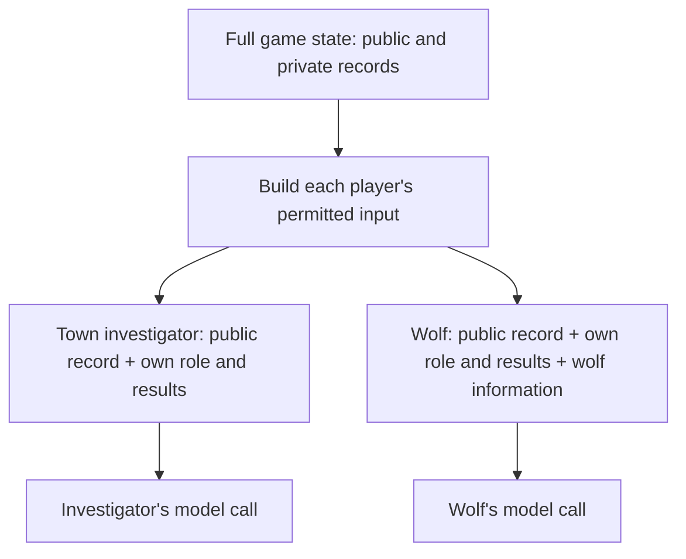

# Game design and orchestration chapter (draft)

Level 1 page copy. The chapter's structure is in [`content_plan.md`](content_plan.md); each Level 2 page
has its own folder here, with its Level 3 pages beside it; exhibits and where they come from are in
[`exhibits/source_map.md`](exhibits/source_map.md). Only page 5 is drafted; links to pages 1–4 still point to planned paths.
This revision integrates the Level 2 links into the chapter narrative; the content plan retains the
earlier summary-based layout until this draft has been reviewed.

---

## Level 1: the chapter page

### Game design and orchestration: making ten agents play together

The Ninth Express is a variant of Mafia played with AI agents. It is a social deduction game where
players have secret roles and competing objectives. A typical Mafia game has two factions. The
majority faction, such as the town, has the numbers but does not know the other players' true roles.
The minority faction, such as the wolves, knows its own members and tries to pass as townspeople.

Play alternates between two phases. During the day, players discuss whom they suspect and vote on
whom to remove. At night, the wolves secretly choose someone to kill. The town tries to identify and
remove the wolves before the wolves gain control of the vote.

My version takes inspiration from Town of Salem, which extends the basic Mafia format with additional
factions and role-specific abilities. The Ninth Express has ten players across four sides: six town
roles, two wolves, a lone killer and a neutral. Some information is public, such as the roles in the
lineup and the voting records. Each player's actual role and night results are private, although the
wolves know one another's identities.

Night abilities give players information and decisions to work with. Investigative roles receive
private evidence they can choose to share, while roles such as the Healer and Vigilante must decide
whom to protect or shoot based on what they believe.

These decisions serve different objectives. The town must identify and eliminate the wolves and lone
killer, deciding whom to trust and when to reveal evidence. The wolves must conceal their identities
and coordinate their actions, sometimes sacrificing an ally to protect the others. The lone killer
must remain hidden while managing the balance between opposing factions. The neutral pursues a
separate objective and may benefit from cooperating with another side.

The roles, abilities and information available to each side are explained in
[Designing evidence worth debating](evidence_design/evidence_design.md).

*Day 1 has openings only. Later days include a vote, which may remove a player. Night actions produce
private results and a public morning report.*

#### Keeping each player's information separate

For this game to work, players must have different information while sharing the same rules. Each
player knows their own role and private results, but learns about other players through public events
and claims that may be false. The game system therefore has to control who receives each piece of
information: public events go to everyone, private results only to the player or faction entitled to
them.

At a human table, the separation is physical. Role cards are dealt face down. At night everyone
closes their eyes, and the moderator wakes each role in turn: the wolves open their eyes to recognise
each other and point at a victim, and the Seer points at a player and the moderator silently shows
whether they are a wolf. What a player learns stays in their head. If they share it, the others hear
only a claim they cannot check. Online games such as Town of Salem do the same in software: each
screen shows only that player's role and results, and the Mafia talk in a private night chat.

AI agents have no heads to keep secrets in. The whole game lives in one program, and a model call
knows only what its input contains: it starts every turn with nothing. So before every turn, the
system has to rebuild what that player knows, and nothing more.

I construct a separate input for each turn: the public record, the player's own role and night
results, and any information its faction is allowed to share. For example, wolves receive their
private faction conversation, while a town player does not.

This is **context isolation**: controlling which game information enters each agent's context. The
boundary sits in the code that selects the input, before the prompt is formatted. I also use checks
on the assembled inputs to look for private fields reaching the wrong player. The aim is to keep
unauthorised information out of the input, rather than depend on an agent ignoring a secret it has
already received.

*Two illustrative seats. Public information can reach both; private fields are selected for the
player or faction entitled to them. The model calls do not receive the full game state.*

The detailed boundary design and its checks are recorded in
[Agent information boundaries](../../evidence/agent_boundaries/report.md), the source for chapter 2.

<!-- Replace the report link with the chapter 2 page when that page is drafted. Diagram source:
evidence/agent_boundaries/report.md §§1–2; conceptual input selection, not the full prompt pipeline. -->

#### Giving players opportunities to discuss and respond

Once players have their information, they need chances to share evidence, challenge claims and
answer accusations. The discussion also has to end, so the game can move on to a vote.

In a human game, the day usually runs on a timer, and anyone can speak whenever they like, especially
online. That works because people listen all the time: they hear each line as it is said, notice when
someone else starts talking, and jump in when they are accused.

A model can do none of that. It exists only while it is being called: it reads one fixed snapshot of
the conversation, takes a few seconds to answer, then stops until it is called again. It cannot listen
in between, or notice that another player is about to make the same point. So "speak whenever you
want" has to be imitated, and the obvious ways fail:

- **Ask everyone at once, every round.** Every player answers the same snapshot, so they talk past
  each other. My first design worked this way, and on one day five of eight players opened with the
  same question: "Does anyone have any initial thoughts…?" An accused player could answer only after
  the round, to everyone at once.
- **After every line, ask every player whether they want to speak.** That would cost nine extra model
  calls for every line spoken.
- **Run the day on a clock.** How much a player said would then depend on how fast its model answers,
  not on what it has to say.

So I let code decide who speaks next, from the conversation itself. I built a turn scheduler that
imitates the shape of a human discussion. In a real conversation, a question gets an answer before the
talk moves on, someone accused defends themselves straight away, and a person who has not said
anything is eventually asked what they think. The scheduler turns each of those habits into a rule.

Every AI player tags its own line: whom it addresses, and whether it is questioning, accusing,
defending or agreeing. A question or an accusation creates a debt: the player named owes an answer and
speaks next, before anyone else, the most recent debt first. That gives the day its back-and-forth: A
accuses B, B answers, and the others hear the exchange before they join in. A player accused by three
others is asked to answer all three in one turn. When nobody owes anything, the floor goes round the
players who have not spoken yet, like a moderator asking the quiet ones, so a player sitting on a night
result still gets a turn.

Other rules stop a few players from taking over. Pressing a player again before they have answered
creates no new debt. After two rounds of back-and-forth between the same two players, they stop
creating debts for each other for a while, so one feud cannot fill the day. The discussion ends when
nobody owes an answer and the floor has gone round, at most twice, and the whole day is capped at three
lines per living player. If the cap is reached first, open questions get one last answer and the
discussion closes. The one or two players accused by at least two others then get a last word in
their defence, and everyone votes at the same time, without seeing each other's votes.

Code decides who speaks; the model decides what to say.
[Orchestrating the conversation](conversation/conversation.md) explains each rule, how I traced and
fixed the silence in earlier games, and the check that keeps repetition off the table.

#### Moving from discussion to voting and night actions

The next requirement is to turn discussion into decisions and advance the game. In this version,
votes are chosen independently, and night actions are collected before their effects are resolved.
A player choosing later in the round should not gain access to choices that have not yet been
announced.

A human moderator manages the transition between phases, collects choices and announces their
outcomes. In the agent game, I need an explicit execution sequence to perform those tasks: finish
the discussion, request votes, resolve the vote, collect night actions, resolve the night and deliver
the results for the next day.

I represent that sequence in LangGraph, a framework that runs a program as connected steps with
shared state. Discussion proceeds one speaker at a time because each response changes what the next
speaker can say. Votes and night choices can be requested in parallel from each player's permitted
view of the same game state. A resolution step then applies the rules to the collected choices.

The code that maintains this state and applies the rules is the **game engine**. It decides what
happens when actions interact, such as an attack meeting a protection. Agents choose their actions;
they do not decide whether those actions succeed. [Executing a day and night](day_and_night/day_and_night.md)
explains how the steps, shared records and resolution fit together.

#### Turning a player's choice into a legal action

Collecting an answer is not enough: the chosen action must be allowed. A player may only target
someone permitted by its role, and a limited ability cannot be used after its uses are spent.
The system also needs to distinguish the actual choice from the explanation accompanying it.

At a human table, the moderator can clarify a choice or reject an illegal one; an online interface
can restrict the available options. A model produces a reply, so I need an explicit answer format
and validation before that reply becomes a game action.

For each turn, I supply the legal targets and ask for a structured response containing the decision.
Code checks the reply and handles failures, with a legal fallback if the turn cannot produce a valid
answer. The agent remains responsible for choosing well: an allowed action can still be a poor
strategic choice.

This gives the models freedom to reason within the game while keeping rule enforcement in the
engine. [Turning an answer into a legal action](legal_action/legal_action.md) develops the response
format, validation and fallback behaviour, including the trade-offs in how the format is enforced.

#### Letting a human join the same game

A human taking one of the seats needs the same private information, opportunities to speak and legal
actions as the AI player they replace. Their answer, however, may arrive minutes later or after they
close the tab and reconnect.

At a human table, the group can simply wait or agree to let someone else take over. A hosted agent
game needs to represent that wait explicitly and retain enough progress to continue when an answer
arrives. It must also account for decisions the other players have already made.

I pause execution at the human's decision and save a checkpoint—a record of game progress that can
be loaded again. The submitted answer goes through the same validation as an AI reply. If resuming
repeats an unfinished step, a separate cache lets completed AI turns return their earlier answers
without another model call, while the human's turn accepts the new input.

Those mechanisms have different limits. The checkpoint survives a server restart, but cached AI
answers live in server memory and expire. The game can resume after those entries are lost, though
it may have to ask the affected agents again. [Adding a human in the loop](human_in_the_loop/human_in_the_loop.md)
explains the pause, checkpoint and cache, along with how the web server hosts the game while players
are waiting.

<!-- Authoring sources retained from the fuller draft (2026-10-26). Historical findings and
experiment figures are no longer part of Level 1; the references below remain for deeper-page drafting.
Sources:
The game: evidence/gameplay/roles/role_sheet.md, "Renames" (1920s setting, away from Town of Salem),
"The lineup" (10 seats, 12 roles, 6 town / 2 wolves / 1 lone killer / 1 neutral, 8 fixed, 2 drawn),
"Win logic" (compressed per the plan's victory rule); roles/report.md "The cast today" (lineup public,
the three information roles' results) and "How each side wins". Werewolf/Mafia and the Town of Salem
inspiration: general knowledge, uncited (content plan). Ten-seat since 2026-10-09: gameplay/report.md
"Version and scope". Engine truthful / claims anything: roles/report.md decisions 3 and 5; map 133.
Transition: content plan "Level 1 presentation" item 2 (the reviewer's wording, lightly adapted).
Design rule: map block 102; orchestration/report.md "The problem".
Summary 1: map 131 (24 of 28; no evil claim; gemini-3.5-flash-lite, 2026-09-17; memory off), 132-133,
137 (41 pressured turns; Haiku 5.5; 82 samples per arm; claims 13 → 33, denials 21 → 3; four blind
Sonnet subagents, one per line), 135 and 139 (balance on Flash-Lite, held, never on Haiku); hub
problem 2 (discussion quality not measured against nine seats).
Summary 2: map 119-120 (tags, debts, sweeps), 126 (367 of 517; 28 nine-seat games; the three sources),
128 (65 lines; 10 of 29, 0 of 36; 16 ten-seat Haiku games; one reader per line; hardening task 1b).
Model for the 28 games: roles/report.md "The problem" names gemini-3.5-flash-lite for this census.
Summary 3: map 108-109; discussion/report.md decision 7 (seven lines to keep two, first game,
2026-10-07, overlapping points); the October test games were nine-seat (map 127); map 116 / orchestration
report "Version and evidence" (no alternative design compared).
Summary 4: map 103-104; turn_prompt/report.md "Why the schema is not enforced on Haiku"; caching
experiment_log.md §12 (2026-10-13: 1 in 412 Haiku calls) and §13/§15 (paired games, cache reads). Tool
loop: orchestration/report.md decision 1 (owner's reasoning, not measured).
Summary 5: map 105-106, 115; orchestration/report.md decisions 11-12 and "What is not established"
(control: same two deals, scripted model, pre-fix 5 of the second game's openings from the first's
cache, fixed code none); deploy_log.md 2026-10-26 (`2ecec0cc`). No statement about served games since.
Chapter card tags (not page copy): multi-agent orchestration, human-in-the-loop systems, structured
outputs and validation. -->
