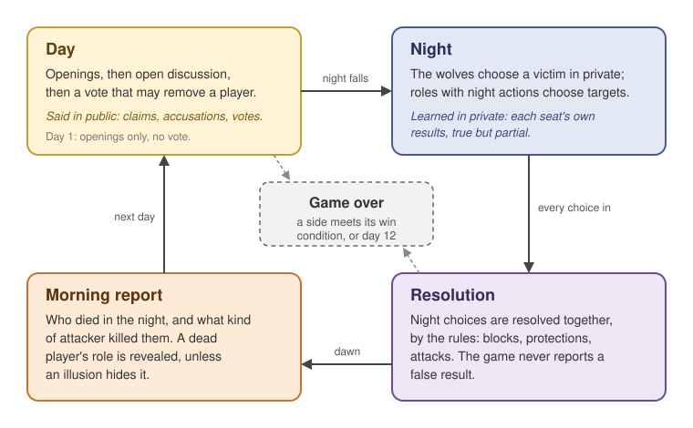
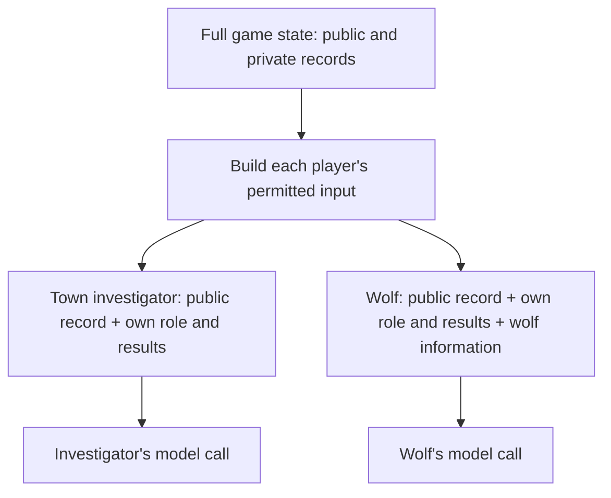
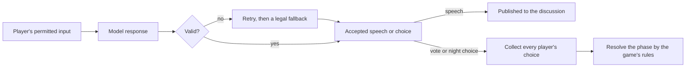

# Game design and orchestration chapter (draft)

Level 1 page copy. The chapter's structure is in [`content_plan.md`](content_plan.md); each Level 2 page
has its own folder here, with its Level 3 pages beside it; exhibits and where they come from are in
[`exhibits/source_map.md`](exhibits/source_map.md). Only page 5 is drafted; links to pages 1–4 still point to planned paths.
This revision integrates the Level 2 links into the chapter narrative; the content plan retains the
earlier summary-based layout until this draft has been reviewed.

---

## Level 1: the chapter page

### Game design and orchestration: making ten agents play together

The Ninth Express is a variant of Mafia played with AI agents. It is a social deduction game where
players have secret roles and competing objectives. A typical Mafia game has two factions. The
majority faction, such as the town, has the numbers but does not know the other players' true roles.
The minority faction, such as the wolves, knows its own members and tries to pass as townspeople.

Play alternates between two phases. During the day, players discuss whom they suspect and vote on
whom to remove. At night, the wolves secretly choose someone to kill. The town tries to identify and
remove the wolves before the wolves gain control of the vote.

My version takes inspiration from Town of Salem, which extends the basic Mafia format with additional
factions and role-specific abilities. The Ninth Express has ten players across four sides: six town
roles, two wolves, a lone killer and a neutral. Some information is public, such as the roles in the
lineup and the voting records. Each player's actual role and night results are private, although the
wolves know one another's identities.

Night abilities give players information and decisions to work with. Investigative roles receive
private evidence they can choose to share, while roles such as the Healer and Vigilante must decide
whom to protect or shoot based on what they believe.

These decisions serve different objectives. The town must identify and eliminate the wolves and lone
killer, deciding whom to trust and when to reveal evidence. The wolves must conceal their identities
and coordinate their actions, sometimes sacrificing an ally to protect the others. The lone killer
must remain hidden while managing the balance between opposing factions. The neutral pursues a
separate objective and may benefit from cooperating with another side.

The roles, abilities and information available to each side are explained in
[Designing evidence worth debating](evidence_design/evidence_design.md).

*Day 1 has openings only. Later days include a vote, which may remove a player. Night actions produce
private results and a public morning report.*

#### Keeping each player's information separate

For this game to work, players must have different information while sharing the same rules. Each
player knows their own role and private results, but learns about others through public events and
claims that may be false. The game system therefore has to control who receives each piece of
information.

In a human game, that separation comes from how information is delivered. Players receive their own
role cards, the moderator gives night results privately, and public announcements reach the whole
table. Online games such as Town of Salem do the same in software: each screen shows only that
player's role and results, and the Mafia talk in a private night chat. A player may reveal or lie about
what they know, but the others have no direct access to it.

With agents, the system holds everyone's roles, actions and results in order to run the game, and a
model call knows only what its input contains. So for every turn, I build a restricted view from that
complete record: the public record, the player's own role and results, and anything shared within its
faction. Wolves, for example, receive their faction's private conversation; town players do not. One
private result in the wrong prompt would hand that agent information it could never have obtained in
play. This is **context isolation**: controlling which information enters each agent's context.

I enforce the boundary when the input is selected, before the prompt is formatted, and check the
assembled inputs for private information reaching the wrong player. Keeping secrets out of the input
means I never rely on an agent ignoring something it has already seen.

*Two illustrative seats. Public information can reach both; private fields are selected for the
player or faction entitled to them. The model calls do not receive the full game state.*

The detailed boundary design and its checks are recorded in
[Agent information boundaries](../../evidence/agent_boundaries/report.md), the source for chapter 2.

<!-- Replace the report link with the chapter 2 page when that page is drafted. Diagram source:
evidence/agent_boundaries/report.md §§1–2; conceptual input selection, not the full prompt pipeline. -->

#### Giving players opportunities to discuss and respond

Once players have their information, they need opportunities to share evidence, challenge claims and
answer accusations, without a few players dominating or the vote being delayed indefinitely.

In a human game, the day usually runs on a timer, and anyone can speak whenever they like. Online games
such as Town of Salem work the same way in a shared chat: the discussion runs on a countdown, and
everyone types whenever they want. That works because people listen all the time: they follow the
conversation, recognise when a response is expected, and jump in when they are accused. At a table, a
moderator can also invite quieter players in or close a repetitive argument.

A model can do none of that. It exists only while it is being called: it reads one fixed snapshot of
the conversation, takes a few seconds to answer, then stops until it is called again. It cannot listen
in between, or notice that another player is about to make the same point. So "speak whenever you
want" has to be imitated, and the obvious ways fail:

- **Ask everyone at once, every round.** Every player answers the same snapshot, so they talk past
  each other. My first design worked this way, and on one day five of eight players opened with the
  same question: "Does anyone have any initial thoughts…?" An accused player could answer only after
  the round, to everyone at once.
- **After every line, ask every player whether they want to speak.** That would cost nine extra model
  calls for every line spoken.
- **Run the day on a clock.** How much a player said would then depend on how fast its model answers,
  not on what it has to say.
- **Go round the table in a fixed order.** Everyone gets a turn, but an accusation can sit unanswered
  while unrelated speeches continue.

I built a turn scheduler around the patterns of a real conversation instead. Each agent tags its
response with whom it addresses and whether it is questioning, accusing, defending or agreeing. A
question or accusation leaves the named player owing a reply, which takes priority over ordinary turns.
This produces a back-and-forth: A accuses B, B responds, and later speakers hear both. A player accused
by several others answers them together.

When no replies are owed, the scheduler offers turns to players who have not yet spoken, so someone
holding private evidence gets a chance to share it. Repeated pressure on a player who has not yet
answered adds no extra turns, and a limit on exchanges between the same pair stops one argument from
taking over the day.

Discussion closes once owed replies are answered and the floor has gone round, under an overall cap of
three lines per living player; if the cap comes first, open questions get one last answer. Players
accused by at least two others then get a closing defence before the vote. Code decides who speaks;
the model decides what to say.

[Orchestrating the conversation](conversation/conversation.md) explains the scheduling rules, stopping
conditions and handling of repetitive speech.

#### Running the game: coordinating phases and player decisions

A complete game needs to keep track of more than individual replies. It must know which phase is
running, who is still alive, which players can act, and whether a win condition has been reached.
Results from one phase also become inputs to the next: a vote changes who survives into the night, and
night outcomes change what players know the following morning.

I organise that progression using LangGraph, a framework that runs connected steps over shared state.
The graph determines which step runs next, while the state records the game's progress and the results
those steps produce.

Within that sequence, different activities need different execution patterns. Discussion runs one
speaker at a time so each agent can respond to the updated conversation. Votes and night choices are
independent: each player receives its permitted view of the same game state, without seeing choices
submitted by others in that round. (The wolves are the exception by design: they agree on their kill in
their own chat first.) Those model calls can therefore run in parallel, reducing the time spent waiting
for separate responses.

The game must then collect the choices before resolving their effects. Night actions can interact: a
block may prevent an action, while a protection may stop an attack. A dedicated resolution step applies
the game's rules to the collected choices, rather than applying each action as soon as its model call
finishes. This separates the order in which agents respond from the order in which game effects are
resolved.

[Executing a day and night](day_and_night/day_and_night.md) explains the graph's structure, how results
update the shared state, and the controls that keep execution bounded.

#### One agent turn, from input to action

Within that game sequence, each agent needs a way to receive information and return a decision the
game can use. A discussion turn produces speech; a vote or night turn produces a choice. Each follows
the same basic path: prepare the player's input, request a model response, validate it, and return the
result to the game.

The input contains only information that player is allowed to receive, following the information
boundaries described earlier. The request also specifies what kind of answer is needed and the available
choices. For example, a vote identifies a target, while a Vigilante's night action selects a legal
target or declines to shoot. The model can explain its reasoning, but the action itself must appear in
a predictable format that code can read.

I use a structured response for this because the available actions are known in advance. The model
chooses among those actions; it does not need to discover which tools are available or decide how to
invoke them. The detailed page explains that design choice and how the response format is enforced.

The response is then checked before it enters the game record. Invalid replies can trigger another
attempt; if the turn still cannot produce a valid answer, a defined fallback supplies a permitted
outcome, such as passing in discussion or declining an action. A valid vote or night choice is collected
for the resolution step described above: it does not immediately change the game when the model
returns.

*One turn ends with an accepted answer. A vote or night choice changes the game only when the phase
resolves.*

[One agent turn, from input to action](agent_turn/agent_turn.md) explains the response contract,
validation, retries and fallbacks.

#### Letting a human join the same game

A human taking one of the seats needs the same private information, opportunities to speak and legal
actions as the AI player they replace. Their answer, however, may arrive minutes later or after they
close the tab and reconnect.

At a human table, the group can simply wait or agree to let someone else take over. A hosted agent
game needs to represent that wait explicitly and retain enough progress to continue when an answer
arrives. It must also account for decisions the other players have already made.

I pause execution at the human's decision and save a checkpoint—a record of game progress that can
be loaded again. The submitted answer goes through the same validation as an AI reply. If resuming
repeats an unfinished step, a separate cache lets completed AI turns return their earlier answers
without another model call, while the human's turn accepts the new input.

Those mechanisms have different limits. The checkpoint survives a server restart, but cached AI
answers live in server memory and expire. The game can resume after those entries are lost, though
it may have to ask the affected agents again. [Adding a human in the loop](human_in_the_loop/human_in_the_loop.md)
explains the pause, checkpoint and cache, along with how the web server hosts the game while players
are waiting.

<!-- Authoring sources retained from the fuller draft (2026-10-26). Historical findings and
experiment figures are no longer part of Level 1; the references below remain for deeper-page drafting.
Sources:
The game: evidence/gameplay/roles/role_sheet.md, "Renames" (1920s setting, away from Town of Salem),
"The lineup" (10 seats, 12 roles, 6 town / 2 wolves / 1 lone killer / 1 neutral, 8 fixed, 2 drawn),
"Win logic" (compressed per the plan's victory rule); roles/report.md "The cast today" (lineup public,
the three information roles' results) and "How each side wins". Werewolf/Mafia and the Town of Salem
inspiration: general knowledge, uncited (content plan). Ten-seat since 2026-10-09: gameplay/report.md
"Version and scope". Engine truthful / claims anything: roles/report.md decisions 3 and 5; map 133.
Transition: content plan "Level 1 presentation" item 2 (the reviewer's wording, lightly adapted).
Design rule: map block 102; orchestration/report.md "The problem".
Summary 1: map 131 (24 of 28; no evil claim; gemini-3.5-flash-lite, 2026-09-17; memory off), 132-133,
137 (41 pressured turns; Haiku 5.5; 82 samples per arm; claims 13 → 33, denials 21 → 3; four blind
Sonnet subagents, one per line), 135 and 139 (balance on Flash-Lite, held, never on Haiku); hub
problem 2 (discussion quality not measured against nine seats).
Summary 2: map 119-120 (tags, debts, sweeps), 126 (367 of 517; 28 nine-seat games; the three sources),
128 (65 lines; 10 of 29, 0 of 36; 16 ten-seat Haiku games; one reader per line; hardening task 1b).
Model for the 28 games: roles/report.md "The problem" names gemini-3.5-flash-lite for this census.
Summary 3: map 108-109; discussion/report.md decision 7 (seven lines to keep two, first game,
2026-10-07, overlapping points); the October test games were nine-seat (map 127); map 116 / orchestration
report "Version and evidence" (no alternative design compared).
Summary 4: map 103-104; turn_prompt/report.md "Why the schema is not enforced on Haiku"; caching
experiment_log.md §12 (2026-10-13: 1 in 412 Haiku calls) and §13/§15 (paired games, cache reads). Tool
loop: orchestration/report.md decision 1 (owner's reasoning, not measured).
Summary 5: map 105-106, 115; orchestration/report.md decisions 11-12 and "What is not established"
(control: same two deals, scripted model, pre-fix 5 of the second game's openings from the first's
cache, fixed code none); deploy_log.md 2026-10-26 (`2ecec0cc`). No statement about served games since.
Chapter card tags (not page copy): multi-agent orchestration, human-in-the-loop systems, structured
outputs and validation. -->
