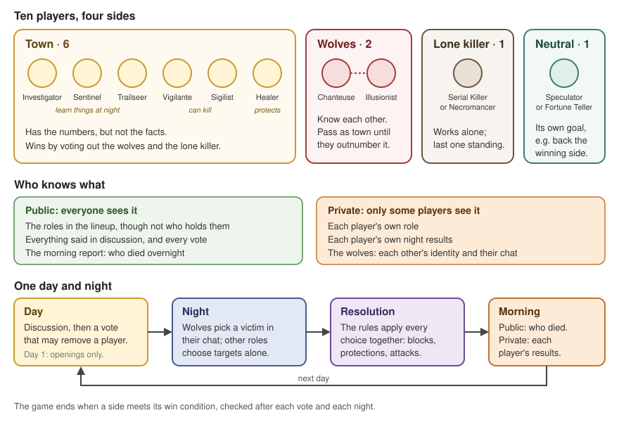
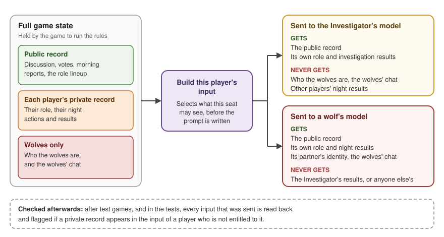
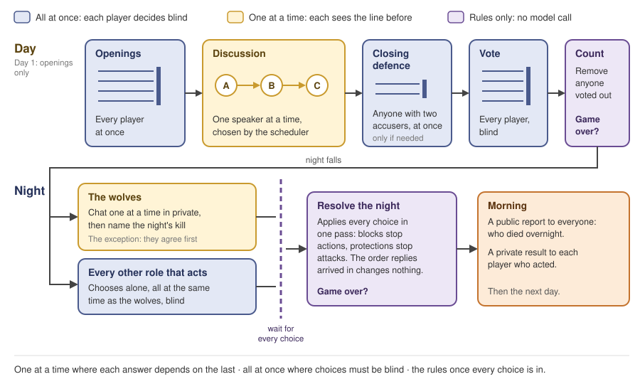
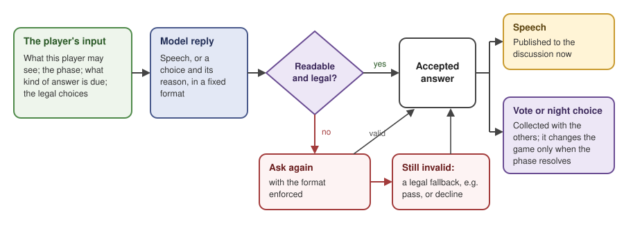
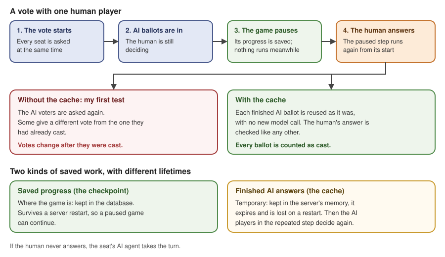

# Game design and orchestration chapter: diagram-led draft (for comparison)

Level 1 page copy, drafted beside [the current chapter page](game_design_orchestration.md) so the two
can be compared. Here, diagrams take over part of the explanation. The diagrams are in
[`exhibits/`](exhibits/); the current page's diagrams are unchanged.

The rule for this version: a diagram shows what happens and in what order; the prose keeps why it
happens: the tension, the obvious fix that fails, and the result that changed the design.

---

## Level 1: the chapter page

### Game design and orchestration: making ten agents play together

The Ninth Express is a variant of Mafia played with AI agents. It is a social deduction game where
players have secret roles, competing objectives and incomplete information.

In a typical Mafia game, the majority faction (town) must identify and eliminate a hidden minority
faction (wolves). The wolves know one another's identities and try to pass as townspeople. Players
discuss their suspicions, make claims about what they know and vote to eliminate someone. At night,
players with special abilities act privately.

My version takes inspiration from Town of Salem, extending this format with additional factions and
role-specific abilities: ten players on four sides, shown below with what each side wants and who
knows what. Some roles learn things at night and choose whether to reveal them; others must decide whom
to protect or shoot on uncertain information.

That sets the engineering problem: ten separately called language models must play one game, each with
different information, and every decision must stay within the rules.

*Players share the same game but not the same information. Public claims, private evidence and hidden
actions shape later decisions.*

*Explore: [Designing evidence worth debating](evidence_design/evidence_design.md) →*

#### Keeping each player's information separate

For social deduction to work, players must hold different information: their own role and results,
anything their faction shares, and public claims that may be true or false.

In a human game, the moderator controls this separation: role cards are dealt privately, night results
are given privately, and announcements reach the whole table. Online games such as Town of Salem do
the same through each player's screen.

With agents, the game system holds everyone's roles, actions and results in order to run the rules, but
**a model call knows only what its input contains**. Sending the full state and telling the agent to
ignore what it should not know would undermine the game: one private result in the wrong prompt hands
that player knowledge it could never have obtained in play.

So for every turn I build that player's input from the full state, selecting only what it is entitled
to, before the prompt is written. A model can still lie about what it knows, but it is never given
what it should not have. After test games, I also check every input that was sent for a private record
that reached the wrong player.

*Each model call receives a view built for its player, not the full game state.*

*Explore: [Agent information boundaries](../../evidence/agent_boundaries/report.md) →*

#### Giving players opportunities to discuss and respond

Once players have their information, they need chances to share evidence, challenge accusations and
respond to one another, without a few outspoken agents crowding out the rest or the discussion running
on indefinitely.

In a human game, the day runs on a timer and anyone can speak whenever they like; online games such as
Town of Salem do the same in a shared chat. That works because people listen all the time: they notice
when a response is expected and jump in when they are accused.

A model can do none of that. It exists only while it is being called: it reads one fixed snapshot of
the conversation, takes a few seconds to answer, then stops until it is called again. So "speak
whenever you want" has to be imitated, and each obvious way of doing it fails:

| Approach | Why it is tempting | Why it fails |
|---|---|---|
| **Simultaneous rounds** | Simple, and the calls run in parallel | Players answer the same snapshot and talk past one another |
| **Ask everyone after every line** | Each agent says whether it wants to speak | Nine extra model calls for every line spoken |
| **A real-time countdown** | Like an online human game | Faster models get more chances to speak |
| **A fixed speaking order** | Everyone gets a turn | An accusation can sit unanswered while unrelated speeches continue |

My first design used simultaneous rounds, and on one day five of eight players opened with the same
question: "Does anyone have any initial thoughts…?" An accused player could answer only in the next
round, to everyone at once. Fair turns were not enough: when one player addresses another, the answer
has to come before the conversation moves on.

So I built a scheduler around replies. Each agent tags its line with whom it addresses and whether it
is questioning, accusing, defending or agreeing. A question or accusation leaves the named player
owing a reply, which goes ahead of every other turn: A accuses B, B answers, and later speakers hear
both. A player accused by several others answers them together. When nobody owes a reply, the floor
goes to players who have not yet spoken, so someone holding private evidence gets a chance to share it.

Stopping rules keep one argument from taking over the day. Repeated pressure on a player who has not
yet answered adds no extra turns, and exchanges between the same pair are capped. Discussion ends once
owed replies are answered and everyone has had a turn, under a cap of three lines per living player; if
the cap comes first, open questions get one last answer. Players accused by at least two others then
get a closing defence before the vote. **Code decides who speaks and when; the model decides what to
say.**

*Explore: [Orchestrating the conversation](conversation/conversation.md) →*

#### Running the game: coordinating phases and player decisions

A complete game has to track who is alive, which phase comes next and whether a side has won, and each
phase feeds the next: a vote may remove a player who would have acted that night, and the night decides
what players know the next morning. I organise this progression with **LangGraph**, a framework that
connects steps through shared state: the graph decides which step runs next, and the state records the
game's progress and each step's results.

The steps need two different execution patterns. A speaker has to see what was just said, so the
open discussion runs one turn at a time. Votes and night choices must be blind, so each player decides from
its own view of the same state, and those model calls run in parallel, which also cuts the waiting.

Running choices in parallel raises a second problem: night actions interact. A block can stop another
player's action, and a protection can stop an attack. If each choice took effect as soon as its model
replied, the outcome would depend on which call finished first. So the night waits for every choice,
and one resolution step applies the rules to all of them together.

*The graph decides what runs and when; the rules decide what happens, whatever order the replies
arrive in.*

*Explore: [Executing a day and night](day_and_night/day_and_night.md) →*

#### One agent turn, from input to action

Every turn, whether a line of speech, a vote or a night action, follows the same path, shown below.
Two parts of it are design choices.

**A structured response, not tool calls.** The legal choices are known before the turn starts: a
Vigilante, for example, must pick an eligible target or decline to shoot. The agent has nothing to
discover, so instead of giving it tools to call, I ask for an answer in a fixed format that code can
read: the choice, with the agent's reasoning beside it.

**A check, and a way out.** A generated reply can still be malformed or name an ineligible target, so
every reply is checked before it reaches the game. A failed reply is asked for again with the format
enforced; if that fails too, a legal fallback, such as passing or declining, takes its place. One bad
reply never leaves the game without a legal move.

*A reply is checked before it affects the game. Votes and night choices take effect only when their
phase resolves.*

*Explore: [One agent turn, from input to action](agent_turn/agent_turn.md) →*

#### Letting a human join the game

The same game can also let a person take one of the seats. They need the same information boundaries,
speaking opportunities and legal choices as an AI player, so the game should not need a second set of
rules for them.

What differs is how a decision arrives. A model replies within seconds; a human reads the game in a
browser, may take minutes to decide, disconnect or come back later. So the game has to wait for them
without losing its progress. I pause the game at the human's decision and save its progress in a
checkpoint. When the answer arrives, the game resumes and the answer goes through the same checks as a
model's reply, so humans and agents share one turn pipeline. If the human never comes back, the seat's
AI agent takes the turn.

Resuming had a catch. Because of how the game's steps are wired to keep each player's information
separate, the game resumes by repeating the whole paused step, not only the human's part. In my first
test with two humans, the AI voters were asked again and some changed votes they had already cast. Now
each finished AI turn is cached, and a repeated step reuses it. The cache is temporary: after a server
restart the game still resumes from its checkpoint, but those AI players decide again.

*The checkpoint makes the game resumable; the cache keeps a repeated step from changing finished AI
turns.*

*Explore: [Adding a human in the loop](human_in_the_loop/human_in_the_loop.md) →*

<!-- Cut in the 2026-10-27 reduction, and what now carries each:
Opening: the per-side objectives paragraph → game_at_a_glance (each side's goal; the role kinds). The
bold engineering question → one plain statement (no rhetorical question).
Section 1: the bullet list of what a player receives, and "wolves receive their faction's chat" →
context_isolation (GETS / NEVER GETS per seat). Kept in prose: the human-table contrast, why the full
state cannot be sent, where the boundary sits.
Section 2: the human-vs-agent table → its content is in the two paragraphs before it (the owner's "A
model can do none of that" wording restored). "Conversational causality" → the plain requirement. No
diagram here, so the scheduler's reasoning stays in prose, merged from nine paragraphs into two.
Section 3: the wolves' exception → phase_execution ("the exception: they agree first"); "a dedicated
resolution step… morning report" → the diagram's resolution and morning boxes. Kept in prose: why
discussion is sequential, why decisions are parallel, why the night waits.
Section 4: the turn's steps (input contents, retry, fallback, hand-off) → agent_turn. Kept in prose:
why a structured response rather than tools; why a check and a fallback.
Section 5: "LangGraph interrupts" → plain "pause", per the ruling that framework terms stay on Level 2;
the "Checkpoints and cached decisions" subsection → human_resume's lower half, with its one consequence
kept beside the cache sentence. Kept in prose: why the step repeats, the two-human test.

Diagram sources (2026-10-27). game_at_a_glance.svg: roles/role_sheet.md "The lineup" and "Win
logic"; discussion/report.md "A day today" (day 1: openings only); orchestration/report.md "The parent
graph" (win check after the vote and after the night). context_isolation.svg: agent_boundaries/report.md
§§1–3 (the checks run over the logged inputs after batch games and in unit tests, not as a live gate).
phase_execution.svg: orchestration/report.md "The day subgraph" (openings and closing defences in
parallel, discussion one turn at a time), "The nights" (the pack chats one at a time, in parallel with
each solo role's node), NIGHT_RESOLUTION after every branch. agent_turn.svg: agent_turn.md "Retry,
then supply a legal fallback" (the retry enforces the schema; the rescue model is left to Level 2).
human_resume.svg: human_in_the_loop.md "What survives a pause or a restart?" and the first two-human
test; no framework terms, no dates. -->
