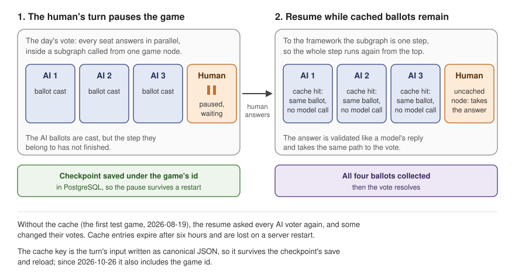

# Adding a human in the loop

*Pausing for human decisions, reusing completed agent turns, and defining what survives a restart.*

*Level 2 · [Game design and orchestration](../game_design_orchestration.md) · previous: [Structured Agent Execution](../agent_turn/agent_turn.md) · status: editorially revised 2026-10-28 around pause, replay and persistence; for the owner's review.*

## Original drafting brief

This brief records the earlier outline. The 2026-10-27 editorial revision and verification questions
are recorded in [the editorial notes](../editorial_notes.md).

Copied from [`../content_plan.md`](../content_plan.md), "Level 2 page briefs", section 5 (agreed with the
owner 2026-10-26); the plan keeps its copy until the owner moves it.

**Reader question:** what does it take to seat a human at a table of AI agents, when the game must stop
for the human, wait, survive a restart and continue without changing what the AI players already did?

**Promise:** interrupts, checkpoints, repeated execution, caching and the server host. The cross-game
cache incident remains optional deeper reading (Level 3).

**Open with the game:** a person at the table may think for minutes, close the tab or come back after a
server restart, while nine AI players have already acted. Then the framework.

**Featured story:** the resume that re-ran the AI votes, told as caught and fixed: (1) the tally, the
server's cross-check refusing a wrong lynch, the first-ballot fix crashing the other way, the latest
ballot kept; (2) the cause, a subgraph invoked inside a node is a black box, so a resume re-runs the
step, about 8 AI vote calls re-billed per human vote (nine-seat); (3) the cache, with an uncached twin
for humans; (4) the key, pickled keys never hit after a checkpoint round-trip, so canonical JSON; 20
ballots replayed.

**Subsections:** (1) a human's turn is an interrupt in the same pipeline (105, decision 11); (2) what
LangGraph did at the pause, the three-row incident table, LangGraph 1.1.10 (105); (3) why the AI turns
are cached and the human's never, the toy graph's two lines, the declined alternative, the evidence
scope, the limited-uses sentences (106, 114, 165); (4) three things kept, three scopes, the table
chapter 6 points back to (106); (5) a cache key must name its scope, one paragraph, the fix's
verification and no statement about served games since, the Level 3 link (115); (6) running the
engine inside the web server, three options, the parity check, 8 then 64 threads (111); (7) checks and
limits (114, 116).

**Level 3:** [The cache key that crossed games](cache_key.md), beneath subsection 5.

**Tags:** human-in-the-loop systems, checkpointing, cache-key design, asynchronous programming.
Reliability named without claiming exactly-once execution.

Exhibits for this page are listed in [`../exhibits/source_map.md`](../exhibits/source_map.md).

---

<!-- Drafted 2026-10-26 from the sources listed at the end. Not independently verified; the verifier
handoff is in the completion note at the bottom. -->

## Page copy (draft)

A human player may take minutes to answer while the AI agents have already finished their turns.
The engine must wait for that answer, validate it, and continue the game.

My first two-human test exposed a complication: resuming after a human vote ran the AI votes again,
and some agents changed their ballots. Saving the game's state had not prevented completed decisions
in the interrupted round from being repeated.

The implementation therefore separates two responsibilities. Checkpoints preserve game progress;
an answer cache lets repeated AI turns reuse their earlier decisions while those answers remain
cached. Handling a pause also means applying the resulting actions correctly, even when parts of
the execution repeat.

### A human answers through the same game pipeline

Every turn follows four steps: prepare the player's input, obtain a decision, validate it, and apply
it. An AI decision comes from a model. For a human, the engine requests an answer and pauses until
it arrives. The server presents legal choices, such as the players eligible to receive a vote, and
returns the person's choice in the same format as a model response. Both then pass through the same
validation and action-handling code.

LangGraph runs the game as connected steps, called **nodes**. A human turn calls `interrupt()`, which
pauses execution. A **checkpoint** saves the execution state so that the game can resume with the
submitted answer. On the server, checkpoints are stored in PostgreSQL under the game's ID. If the
human is away, the seat's AI agent can take the turn instead.

Free-text discussion needs one additional step. AI agents label whom their lines question or accuse;
the scheduler uses those tags to offer replies. A human supplies only the text, so a separate model
call adds the tags. The published line enters other players' prompts without a label identifying
its author as human. [Orchestrating the conversation](../conversation/conversation.md) explains how
those tags affect turn order.

### Why resuming changed the AI votes

The first two-human test stopped when the server's ballot count disagreed with the engine's result.
The server keeps a count of the ballots it streams to viewers as a cross-check: it believed a player
had been voted out, while the engine reported that nobody had. It refused to announce that result.

I initially suspected duplicate delivery and kept each voter's first ballot. The next test failed
in the opposite direction. Capturing the full event stream showed what was happening: after the
human answered, the engine asked the AI agents to vote again. Some changed their choices, and the
engine used the new ballots while the server retained the old ones. Keeping each voter's **latest
ballot** made the counts agree. It did not prevent the repeated calls or preserve the original choices.

The cause lay in how I connected the graphs. The day and the wolves' night each have an internal
sequence of steps, represented as a **subgraph**. A wrapper node prepares the subgraph's restricted
input and calls it. That input construction is where I control what information the phase receives.
When a human pauses inside the subgraph, resuming re-enters the wrapper. Its call with fresh input
restarts the interrupted round, including AI turns that had already returned. Completed earlier
rounds are not repeated.

A small test graph reproduced the difference without a model. When parallel turns were ordinary
nodes in the main graph, a finished AI turn ran once across a human pause and resume. When the same
turns were inside a subgraph invoked by a wrapper, it ran twice. This explained why the solo night
roles, which are ordinary main-graph nodes, did not need the same workaround.

### Reuse completed AI decisions

I kept the explicit input boundary and added a **node cache** to the affected AI turns. It stores
the completed result of a turn. When execution repeats that turn with the same input, a cache hit
returns the stored result without another model call. An AI vote can therefore remain the same
across the human's pause.

Human turns use an uncached copy of the same node. Their answer must come from the person responding
now; a matching input is no reason to substitute a previous human answer. Tests also found that
caching a node containing an interrupt caused a resume failure. Registering cached and uncached
versions preserves the shared validation code while routing humans through the uncached version.

*The day's vote, with three AI seats for illustration. The AI turns reuse completed results on cache
hits; the human turn accepts the submitted answer.*

The alternative was to let LangGraph manage the subgraphs directly, which would require revisiting
how their inputs enforce information boundaries. Caching addressed the repeated calls within the
existing design. It adds responsibilities of its own: a key must recognise the right turn, and the
stored answer must still exist when that turn repeats.

### Replaying a step must preserve the right result

The first cache failed to recognise its own saved turns. Its default key used Python's pickle
representation of the input. Reloading an input from a checkpoint preserved its values but changed
internal object metadata, producing a different key. The repeated turn therefore missed the cache
precisely when it needed the earlier answer.

I changed the key to **canonical JSON**: the input's values serialized in a consistent order. A
regression test saves and reloads an input through the checkpoint serializer and checks that the
key stays the same. In one historical nine-seat verification game, the corrected cache replayed
20 ballots, each identical to its original. That game used the earlier wolf voting system; it is
specific evidence of answer reuse, rather than coverage of every current turn type.

Recognising the same input is only half of the key's job. The server shares a cache across games,
so the key must also distinguish otherwise identical inputs belonging to different games. This
boundary was missing when the opening round adopted the caching pattern: day-1 inputs could match
across games. The incident record attributes one failed opening to reuse of an earlier game's result.

I added the game ID to cached inputs. Tests check both that a key survives checkpoint reload and
that matching openings in different games receive different keys. A scripted before-and-after
control reused five openings across games before the fix and none afterwards. The number of hosted
games affected remains unknown. [The cache key that crossed games](cache_key.md) develops the
incident and its verification.

State changes need their own protection against repetition. A limited ability, such as a
Vigilante's shot, is spent during night resolution, after the human's turn has finished. Remaining
uses are computed from the counts at the start of that night, rather than deducted each time a
turn runs. Tests check that repeating this calculation produces the same counts. A scripted game
also pauses for a human Vigilante, resumes with a shot, and checks that one bullet remains. That
covers one lineup and seed; it checks the resulting count, not exactly-once execution.

### What survives a pause or restart

A valid key helps only while the cached result exists. The checkpoint and the answer cache have
different storage lifetimes:

| Mechanism | What it retains | Lifetime |
|---|---|---|
| Game checkpoint | Execution state needed to resume | Stored in PostgreSQL; survives a server restart |
| AI node cache | Completed AI turn results | Stored in server memory for six hours; lost on restart |

A game can therefore resume after a restart while asking AI agents in its interrupted round to
decide again. The same can happen when an answer expires from the cache. The latest-ballot tally
keeps the server aligned with the engine's accepted votes, but it does not preserve the agents'
original choices. The cache also assumes that answer-affecting settings outside the input, such as
the model, do not change during a game.

The provider's **prompt cache** serves a separate purpose: it reuses input processing to reduce
cost. It does not retain a generated answer and cannot preserve an agent's decision across a pause.

### What the checks establish

Small test graphs exercise interrupts and resumes. Regression tests check cache-key stability and
game isolation, while scripted games exercise the real graph through the server's event translator.
Together with the ability-count tests, these check specific execution behaviours without relying
on live model responses. They do not assess what the game is like for a human player.

Event delivery has a further limit. The server saves streamed events before the corresponding
checkpoint is necessarily written. A hard crash in that interval can leave an event recorded even
though the resumed engine repeats the work that produced it. Existing replay guards handle several
forms of repetition, but a re-executed sequential turn can still send an event twice.

I retained that crash window. Deduplicating solely by event content or player would also suppress
legitimate repeated events, such as another request for the same player to act. Stronger delivery
guarantees remain unresolved. The [server incident
record](../../../frontend/docs/server_encountered_challenges.md) explains the window and the existing
guards; the [server design notes](../../../frontend/docs/server_design_notes.md) cover the separate
hosting question of keeping the web server responsive while a game waits.

**Evidence.**

- [Orchestration: how a game runs as a graph](../../../evidence/gameplay/orchestration/report.md),
  "Human seats", "Checkpoints and the two caches", decisions 2 and 11–13, "How it was checked" and
  "What is not established".
- [Server: encountered challenges](../../../frontend/docs/server_encountered_challenges.md), §1–6 (the
  pause incidents, the twin, the key) and §8 (the event log ahead of the checkpoint).
- [Server design notes](../../../frontend/docs/server_design_notes.md), §5 (the concurrency decision).
- [Deploy log](../../../frontend/docs/deploy_log.md), 2026-10-26 (the fix's deploy).

<!-- Sources for the page copy (drafted 2026-10-26):
Opening: content plan brief 5 ("open with the game"); orchestration/report.md "The problem" (a human
can take any seat; stops, waits, continues after a restart). "Two months later": 2026-08-19 → 2026-10-17.
Pipeline and interrupt: orchestration/report.md "One turn, end to end", "Human seats", decision 11;
discussion/report.md decision 5 (node per turn, checkpoints at node boundaries). PostgreSQL:
"Checkpointing" paragraph; server/graph_runtime.py::GraphRuntime. Delegation: "Human seats"
(server_design_notes §7, AFK fail-safe). Tag cost: decision 11; discussion decision 8. Unlabelled human
line: map block 98 (chapter 2's).
Tally story: server_encountered_challenges.md §2 (the cross-check "crashed" at a day resolution; first
fix kept the first ballot, next game crashed the other way; stream capture; last-write-wins). Incident
table: map 105; orchestration report "Human seats" table rows 1-2; decision 3 "Costs" (announce_human_turn
2026-10-06; the pack's skills 2026-10-17). Server doc §1 for "once per nesting level".
Black box and 8 calls: §3 (nine-seat; "~8 AI vote calls"); map 106, 110; orchestration decision 8.
Toy graph lines: orchestration "Human seats" (2026-10-26, LangGraph 1.1.10, no model); map 114. Solo
nights resumed surgically: same paragraph.
Declined alternative: §3; decision 12 "Instead of". Twin: §4; decision 12 (1.2.14 probe 2026-10-07).
Key: §5 (pickle; pydantic fields set, four vs ten; canonical JSON; round-trip test); 20 ballots, 17 + 3,
identical: §5 "Live confirmation"; nine-seat pack vote since replaced: decision 12 "Evidence".
Limited uses: map 165; orchestration decision 2 and "How it was checked" row; tests
test_uses_are_spent_in_the_resolution_once_per_night_and_a_decline_spends_nothing and
test_a_human_vigilantes_shot_is_spent_once_across_the_pause_and_resume (tests/engine/test_ten_seat_game.py).
Three stores: orchestration "Checkpoints and the two caches serve different purposes"; TTL six hours
(Agents/config/langgraph.py TURN_CACHE_TTL_SECONDS = 6 * 3600); map 106.
Cache key paragraph: orchestration decision 12, "The cross-game cache bug" (opening round adopted
2026-10-07, b66ce7b4; 14926d10 07:44 Haiku, all calls failed; 51226f24 GPT-6 Luna nine minutes later,
same lineup, player_9 Serial Killer, generation_failed pass without a captured prompt; "the record
identifies this as replay"); fix and tests (test_turn_cache_key.py); control: "What is not established"
bullet 5; deploy: deploy_log 2026-10-26 (2ecec0cc). Extent: 11 of 68 captures, restart times unchecked.
Lesson wording: map 115 ("a fix that makes a key stable can widen it").
Async host: server_design_notes.md §5 (options a/b/c; ~89 functions, 23 .invoke sites; partial
conversion blocks the loop; toy parity check before migrating; trade-off accepted); decision 13.
Sizing: server/app.py comment at set_default_executor (8 threads, 4-CPU host, ~10 model-bound nodes in
a night step, human wolf's prompt seconds late, 2026-10-17; 64 threads).
Checks: orchestration "How it was checked" (test_subgraph_interrupt.py docstring and
test_child_config_unit.py; test_turn_cache_key.py; test_ten_seat_game.py through the translator).
Limits: map 116; orchestration "What is not established"; server_encountered_challenges.md §8. -->

<!-- Editorial revision, 2026-10-26
The original brief remains above as planning history. Page copy now centres on the changed-ballot
incident, separates tally consistency from answer reuse, and states cache durability limits up front.
The interrupt table has two rows: the vote-tally incident is explained in prose rather than repeated.
Cross-game identifiers, the second model check and detailed key metadata remain in the source report
for the Level 3 draft. This was an editorial pass, not an implementation or experimental audit.
Verifier handoff: confirm the incident attribution (the missing call was not directly captured), the
recorded deployment, and the restart/resume scope before publication. No claim is made about served
games after deployment. The evidence/source list above is retained for tracing the draft.
-->

<!-- Supporting history: page copy before the 2026-10-28 rewrite.
Retained for source context; current public copy is above.

## Page copy (draft)

A human player may take minutes to answer while the AI players have already completed their turns.
The game needs to preserve its progress during that wait and reuse completed decisions when play
resumes. These require different mechanisms: a checkpoint saves game state, while a cache retains
finished AI answers.

That distinction mattered in my first test with two humans. Resuming after a human vote asked the AI
voters again, and some changed their ballots. Caching their completed turns prevents those repeated
calls while the cache entries exist. The checkpoint survives a server restart; the six-hour,
in-memory answer cache does not. A game can therefore resume after a restart without preserving all
of the AI decisions made in its interrupted step.

### What survives a pause or a restart?

Three things are kept, and each has its own job. Only the checkpoint holds the game's progress.

| Mechanism | What it keeps | Limit |
|---|---|---|
| Game checkpoint | The game state needed to resume | Stored in PostgreSQL under the game id; survives a server restart |
| AI node cache | Finished AI turns | In the server's memory for six hours; keyed by the turn's input and the game id |
| Provider prompt cache | A reusable start of a model's input | Cuts the cost of reading input; never keeps the model's answer |

After a restart, or once a cache entry expires, the paused step may ask the AI players again. The AI
players may then choose differently than before the pause; the server must announce the ballots the
engine ultimately accepts. The cache also assumes that nothing outside a turn's input, e.g. the
model, changes during a game.

### A human's answer goes through the same pipeline as a model's

Every turn, AI or human, goes through the same four steps: build the seat's input, get a decision,
check it, apply it. The only difference is where the decision comes from. For an AI seat, it comes
from a model. For a human seat, it comes from LangGraph's `interrupt()`, which pauses the game until
the person answers. LangGraph is the framework that runs the game as a graph of steps, called
*nodes*.

While the game is paused, the server keeps its checkpoint in PostgreSQL under the game's id. It
shows the human the legal answers, e.g. the players they may vote for, and sends the chosen answer
back in the same format as a model's reply. So a human's answer is checked and applied exactly like
a model's. If the human has gone away, the seat's AI agent takes the turn instead.

Sharing the pipeline has two side effects. An AI player tags its own lines with whom it questions or
accuses, and the turn scheduler uses those tags to decide who replies next ([Orchestrating the
conversation](../conversation/conversation.md)). A human's free text has no tags, so a separate
model call adds them. And a human's line reaches the other players' prompts like any other line,
with no label saying a human wrote it. The [information-boundary
report](../../../evidence/agent_boundaries/report.md) discusses what a player may learn about other
seats.

### Why resuming changed the ballots

The first test game with two humans, on 2026-08-19, stopped at the vote. The server keeps its own
count of the ballots it streams to viewers, as a cross-check against the engine. The two counts
disagreed: the server's said a player was voted out, the engine's said nobody was, so the server
refused to announce the result.

My first guess was that ballots were being delivered twice, so I kept each voter's first ballot. The
next game failed the other way. A capture of everything the engine streamed showed the real cause:
after the human answered, the engine ran the AI votes again, and some voters changed their minds.
The server was counting ballots the engine had thrown away. Keeping each voter's **latest** ballot
made the counts agree. It did not stop the repeated model calls or keep the AI players' original
decisions; that took the cache below.

The pause showed two more surprises at the server, both about how a pause travels between graphs:

| What reached the server | How I handled it |
|---|---|
| The same interrupt arrived once for each level of nested graphs | Read interrupts only at the top level |
| A human's interrupt arrived only after every other turn in its parallel step had finished | Announce the human's turn as soon as it is dispatched, but still take the answer only through the interrupt |

*LangGraph 1.1.10. The repeated interrupts and the count mismatch were found in August; the early
announcement was added in October.*

### Reusing the AI players' decisions

Why did resuming re-run the AI votes? Because of how I connected the graphs. The game has a main
graph, and two of its phases, the day and the wolves' night, each run as a smaller graph of their
own, a *subgraph*. I call each subgraph from inside a main-graph node, and that node builds the
subgraph's input by hand. The hand-built input is where I control what each seat is allowed to see.
The cost is that LangGraph treats the whole call as one step: when the game resumes, the node starts
again from the top, and every AI turn in the paused step runs again.

A small test graph with no model shows the difference. With the parallel turns placed directly in
the main graph, a finished AI turn ran once across a pause and resume. With the same turns inside a
subgraph called from a node, it ran twice (LangGraph 1.1.10, 2026-10-26). That is also why the roles
that act alone at night need no help: they are ordinary main-graph nodes.

I had two options. Wire the subgraphs the way LangGraph manages them, which would mean redesigning
how I control what each seat sees. Or keep that boundary and make the repeated turns free. I chose
the second: I cache each finished AI turn. When the node repeats a turn with the same input, the
cache returns the earlier answer without calling the model again.

Human turns go through an uncached copy of the same node, for two reasons. A resumed human turn must
take the answer the person just gave, not a stored one. And in my tests, caching a node that can
pause broke on resume, which a later check on LangGraph 1.2.14 still showed. The copy keeps the same
validation code without caching the person.

*The day's vote, with three AI seats for illustration. Cached ballots are reused only while their
cache entries exist; the checkpoint alone does not keep them.*

At first the cache never hit, even when nothing had changed. Its default key was built with Python's
pickle, which records how an object was built as well as its values, and an input reloaded from the
checkpoint looked different to pickle. I switched the key to canonical JSON, i.e. the input's values
written in a fixed order, and added a test that saves and reloads an input and checks that its key
stays the same. In one nine-seat verification game on 2026-08-19, the fixed cache replayed 20
ballots, each identical to its original. In that game all the wolves still voted on their kill; in
today's ten-seat game, one wolf chooses it.

A resume can't spend a limited ability twice either. A bullet or an investigation is deducted only
when the night resolves, which comes after the human's pause, and the new counts are worked out from
the counts at the start of the night. Two tests check this: running that calculation twice gives the
same counts, and in a scripted game, a human Vigilante who pauses and then shoots ends with one
bullet left. That covers one scripted game, lineup and seed, and shows the count is right, not that
the step runs exactly once.

### Keep cached answers within their game

An answer cache must recognise a repeated turn within one game without confusing it with a similar
turn in another. That boundary was missing when day-1 openings adopted the caching pattern. Their
inputs could match across games, and one shared cache served the whole server process.

The record attributes one game's failed opening to reuse from an earlier game. I added the game id
to cached inputs. Tests check that keys remain stable after checkpoint reload and differ between
games; a scripted control reused five openings across games before the fix and none after it. The
fix was deployed on 2026-10-26. How many hosted games were affected remains unknown.

[The cache key that crossed games](cache_key.md) explains the collision, the evidence for the
observed case and the before-and-after control.

### Keep the server available while a game waits

A waiting game must also leave the web server free to serve other viewers. The engine's steps are
synchronous: a step waits for its model answer. The server uses LangGraph's asynchronous streaming
API so those blocking steps can run in a thread pool while the server continues handling
connections.

A model-free check covered the interrupt and cache behaviour before that switch. This kept one
engine for hosted and batch games, with LangGraph managing the boundary between blocking and
asynchronous work. The [server design notes](../../../frontend/docs/server_design_notes.md) explain
the alternatives; the [server incident
record](../../../frontend/docs/server_encountered_challenges.md) covers thread contention and
delayed human prompts. Those hosting decisions are separate from what a checkpoint or answer cache
preserves.

### What the checks establish

The tests cover pausing and resuming, stable cache keys, isolation between games and limited
abilities. Scripted games also run the real graph through the server's streaming layer. One gap is
covered separately: the pause-and-resume test graph would pass even if my helper that hands
configuration to the subgraphs passed nothing, because LangGraph can pass it implicitly, so a unit
test checks that helper directly.

These checks show that the execution works. They say nothing about what it is like to play as a
human, and they do not prove every event is delivered exactly once. The server logs a turn's events
just before the checkpoint is saved, so a hard crash in that gap could send those events twice. I
accepted that window, because removing all repeated events would also drop events that legitimately
repeat. And as above, a saved game is not the same as saved AI answers.

-->
