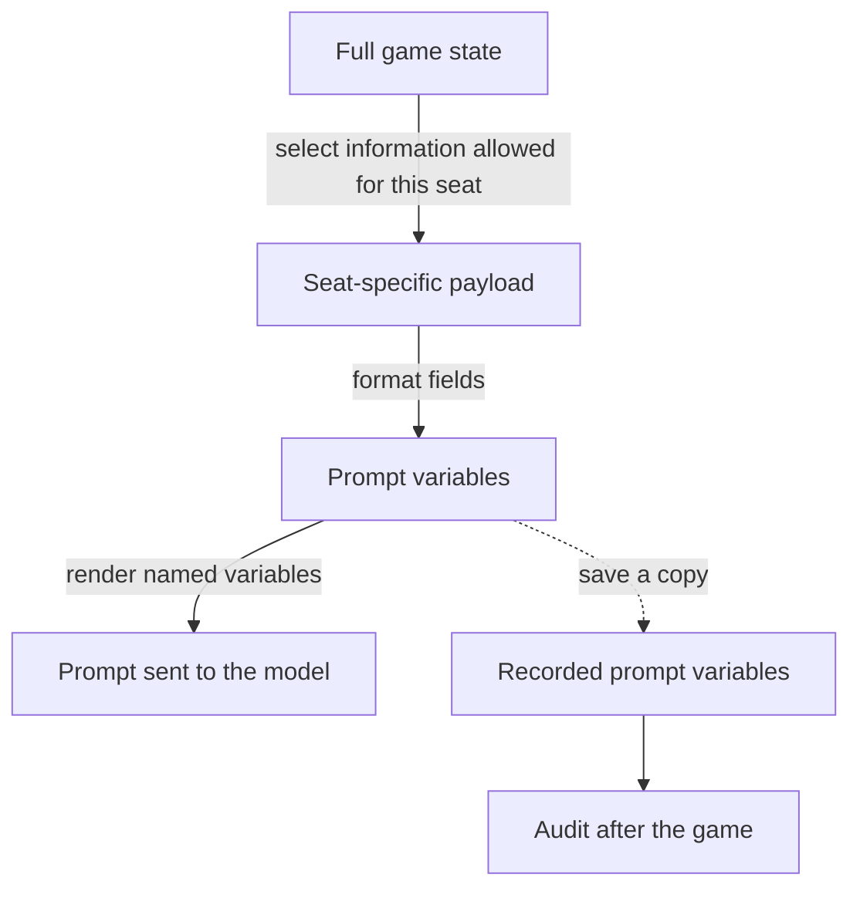

# Information boundaries chapter (draft)

*Level 1 page copy, first draft 2026-10-30, revised the same day after the editorial and claims reviews. The chapter has no Level 2 pages; its structure is in
[`content_plan.md`](content_plan.md) and the authoring brief in
[`_authoring/information_boundaries.brief.md`](_authoring/information_boundaries.brief.md). Presentation revised following owner review.*

---

## Page copy (draft)

### Information boundaries: what each agent may know

The engine knows every player's role, but each agent player should receive only what its seat is
allowed to know. A healer given the wolves' private chat could protect their intended victim using
information unavailable under the game's rules. Its decisions would no longer test play under the
intended conditions.

I enforce this separation when constructing each agent's input. Post-game checks then inspect the
recorded inputs for private information included where it does not belong. This chapter explains
what is restricted, where the selection happens, and how the checks have exposed mistakes.

#### Classifying information by who may receive it

The game assigns information to three audiences:

- **Everyone:** the public discussion, the dead and their revealed roles, and the number of each role
  in the game.
- **One faction:** the wolves' identities and their private night chat are shared within the pack.
- **One seat:** a player's own night actions and results, and the remaining uses of its limited abilities.

Some generated material is excluded from future prompts altogether. Each agent produces structured
role assessments, called *reads*, alongside its decisions. A wolf's reads can identify its packmate,
so reads never enter the game's shared state and are not carried into future prompts. A line withheld
by the discussion filter is also excluded from every player's context, because the table never heard it.
Players who have died receive no further turns.

#### Layers of protection and verification

Information passes through three stages before reaching the model: selecting the seat's data,
formatting it into prompt variables, and rendering the prompt. Each stage has a different responsibility.
Tests and post-game audits check whether the access rules hold.



##### 1. Payload construction: enforce who may receive what

The **payload** is the bundle of fields passed to a seat's turn. Its builder selects public information
and adds only the private fields that seat may receive. A healer receives its own night results;
a wolf receives the pack's roster and private chat. Daytime and nighttime builders apply the same
access rules.

This applies the principle of **least privilege** to model context: provide only the information the
recipient is authorised to use. Selecting it here means later prompt changes should not be able to
expose private fields that never entered the payload.

The deduction engine also receives a view built from this selected payload; chapter 3 explains how
it computes and validates advice from that information.

##### 2. Formatting and rendering: prepare the prompt

A formatter converts the payload into **prompt variables**, without checking access by role.
The template then inserts the variables it names into the text sent to the model.

A template can keep an unwanted field out of the model's prompt by leaving it unused. For example,
suppose a bug puts `wolf_names` into a healer's input (simplified field names):

```text
Input fields:
  your_role: Healer
  living_players: Alice, Bob, Carol
  wolf_names: Alice, Bob
```

This template does not expose the wolves:

```text
Your role: {your_role}
Living players: {living_players}
Choose someone to protect.
```

The template provides another layer of protection, but silently conceals the incorrect input.
Adding `{wolf_names}` later would expose it. That is why access is enforced at payload construction:
a healer's payload must contain no wolf identities, regardless of how its prompt is written.

##### 3. Tests and audits: check that the rule holds

The access rules are checked in two ways:

- **Unit tests** exercise the real input builders to check that private fields reach only their
  permitted recipients. Deliberately planted violations also verify that the checks detect mistakes.
- **Post-game audits** inspect inputs from actual runs. Each agent player's turn records its prompt
  variables before calling the model. After each successful batch game, code checks those records:
  wolf rosters belong only in wolf inputs, private night results belong only to their recipients,
  and withheld speech must appear nowhere. Any violation makes the batch report a failure.

The audit detects mistakes after play; it does not block model calls. Games played on the site save
the same inputs, and a nightly job is built to apply the same audit to those records.

The healer example above reflects a real failure. A discussion refactor gave every speaker a payload
containing private fields for all roles, based on an incorrect assumption that the framework would
remove undeclared fields. The first batch run with the audit connected found wolf identities and
Investigator results in other players' inputs.

A review of the templates confirmed that those fields were not rendered, so the models had not
received them. The fix restored selection by role when building each speaker's payload, and the next
run reported no violations. The audit had exposed an upstream mistake that the templates concealed.

*Explore: [Preventing private information leaks between agents](private_information_leaks.md) →*
<!-- Link specification: Level 3, writeup/information_boundaries/private_information_leaks.md (drafted 2026-10-31 as
wrong_agent_inputs.md; the owner replaced it with a short version and renamed it the same day).
Its question: how did a documented design decision put private fields into every input, why did no
model see them, and why did it go unnoticed until the checks were wired in? -->

#### What the checks cover

The audit has two limits:

- **Coverage:** it inspects recorded prompt variables, rather than the final rendered messages.
  The memory lookup query and the board prepared for a human seat use the selected payload but are
  not included in these records. During the incident above, checking the templates was a separate
  investigation into whether the misplaced fields had reached the models.
- **Detection:** the checks recognise specified fields and some exact text. They cannot reliably
  identify a secret expressed in different words.

Memory retrieval has a separate rule: a seat receives lessons from earlier games written for its own
role. Retrieval selects a role-specific store, but there is no independent assertion checking that the
requested role matches the store served. A mistake here could supply inappropriate guidance without
triggering the input audit; it would not reveal a current opponent's hidden role. The proposed check
is described in the [boundary report](../../evidence/agent_boundaries/report.md#5-known-gaps-what-is-not-guaranteed-yet).

What the server sends to a human player, spectator or replay viewer is a separate boundary, covered
in chapter 8.

<!-- Sources.
Intro: agent_boundaries/report.md §1 (the guarantee); check_wolf_channel_isolation (report §3) for the
wolves' chat reaching wolves only; the Healer reading the chat is an illustration, not an incident.
Classification: report §1 private-field table (pack rosters and wolf_channel → the pack; night_actions,
uses_left → that actor; reads, held lines, healer_target → nobody's prompt); public by design (dead
roster with revealed roles, cast census as counts; the information-fidelity pass, chapter 3);
eliminated players: check_eliminated_players_excluded. Reads never enter graph state:
experiment_log.md §4 (f3537bae).
Construction: report §2 (four layers, one enforcer; the state types are documentation only, left off the
page as a step); day builders share _private_fields (Agents/nodes/day/flow.py), night builders
Agents/nodes/night/solo.py and pack.py (report §1 "Where it is enforced").
Figure: report §2 path; the audit reads the prompt-input dict, layer 3's output (report §3 "Audit the data
layer"), so the branch is drawn from the prompt variables.
Checks: report §3 (recorded by prompt_log before generating; run after every successful batch-runner game;
batch exits non-zero); planted leaks: evidence/evaluation/deterministic_audits/report.md row 2 and
code_checks.md. Site games: report §3 (each finished game saves a capture; leak-audit in
server/housekeeping/ runs the same checks); owner 2026-10-30: mention the job without its status.
Incident: report §4 and experiment_log.md §2 (superset payload in the sequential-discussion rewrite; the
docstring "LangGraph ignores extra keys on a Send payload"; 109 flags = 76 wolf-identity + 33
investigator-result; none rendered, exhaustive template grep; fix ef43342; post-fix run 0 flags).
Deduction: report §1 (the engine reads a SeatView built from the payload); Agents/deduction/seat_view.py
docstring; gameplay/deduction/report.md §3–§4 (row "Hidden-state changes with the visible input held
equivalent"); tests/engine/deduction/test_candidates.py
::test_hidden_roles_the_seat_cannot_see_do_not_change_its_items. The engine is AI-written: stated as a
design, not as the author's code.
Coverage: report §5 (memory by construction, namespaces keyed on the requesting role in
Agents/memory/retrieval/accessors.py; two un-logged call sites: the situation agent's query and the human
seat, which builds the board a human sees from the same prompt input, Agents/turn/human_turn.py; no
standing audit of rendered prompts; the June search was a grep of the templates for the private
placeholders, experiment_log §2 "Severity"); deterministic_audits case 1 (a reworded leak is a blind
spot). The memory fix is proposed in one sentence (report §5), so "proposed, not built". That another
role's lessons reveal no current role is reasoning from how lessons are made (written offline after
earlier games), not a finding of the report; owner agreed the framing in the plan review 2026-10-30.
Recording covers player turns only (run_agent → prompt_log); the opening filter and echo gate are also
unrecorded model calls, but they take no private payload.
Chapter card tags (not page copy): Context isolation; supporting terms invariant checks and least-privilege input construction. -->
