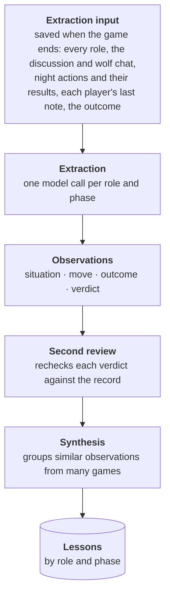
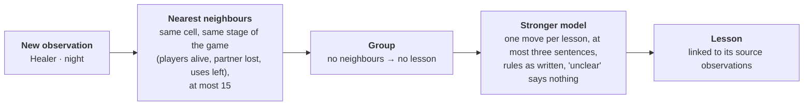

# Extracting and synthesising lessons (Level 2, draft)

Level 2 page for the memory chapter, restructured 2026-10-27 after the owner's review: the opening starts
from the first version's per-game learnings; one moment (a Healer protecting the claimed Sentinel) runs
through the page; the page separates selecting observations, deciding whether to generalise and writing actionable
lessons. Supporting experiments and operating rules are in selection_and_quality.md. Figures are Mermaid sketches and markdown tables, to be redrawn as
SVGs once their layout is agreed. Claims are bounded by
[`../../memory_presented_set.md`](../../memory_presented_set.md).

---

## Extracting and synthesising lessons

My first memory pipeline had a model read each finished game and write what every role should learn from it, as a
short paragraph per role. The paragraphs accumulated into one strategy document per role. Two Healer
entries, from consecutive games:

> *Game 2:* "Your protection is one of the most powerful tools for confirming allies. After a wolf is
> successfully voted out, the villager who led the accusation becomes the most likely target for wolf
> retaliation. Protecting that player is a high-impact move…"
>
> *Game 3:* "Your protection is a powerful tool for confirming innocent players. After a wolf is
> successfully voted out, identify the villager who was most instrumental in their elimination, as they
> are the most likely next target for the wolves. Protecting that player is a high-priority, game-winning
> move…"

Over ten or more rounds the advice grew more sophisticated, so learning across games worked. But every
game turned its own outcome straight into general advice. Recent games dominated the document, edge cases
contradicted each other, and players applied advice from one past situation to a current one where it did
not hold.

The system therefore needs advice tied to specific situations, so a player can retrieve a lesson when
its conditions apply. **Extraction** breaks a finished game into **observations**, each recording a
player's situation, their move and its outcome. **Synthesis** groups comparable observations across games
and writes **lessons**: recommendations for a particular role in a particular kind of situation. This
separates recording an individual decision from deciding what should generalise beyond that game.
Players receive the lessons, with the conditions that make them relevant.



*From a finished game to lessons. Extraction sees the whole game; the situation it writes uses only what
the player could have seen.*

The pipeline filters what becomes advice at three points: selecting observations, deciding whether
they support a recommendation, and evaluating lessons after use. Each addresses a different question,
with different limits.

| Stage | What it decides | Current treatment | Limitation |
|---|---|---|---|
| **Extraction** | Which moments are worth recording? | The prompt selects supported, situation-specific observations beyond basic strategy. | Model judgement; missed useful moments are not systematically measured. |
| **Synthesis** | Which groups support actionable advice? | Compare similar observations, weigh their outcomes, and write conditional prescriptions—or emit no lesson. | Repetition and prompt constraints do not establish strategic usefulness. |
| **[Credit](../curating_lessons/curating_lessons.md)** | Which lessons should remain after use? | Compare followed decisions with a matched memory-off baseline; prune lessons that fall below the score threshold after enough follows. | Observational comparison using coarse decision grades. |

One moment follows through this page. In a ten-seat game, the Sentinel claimed on day 2 to have seen the
Serial Killer's night visit, and the town voted the Serial Killer out. That night the Healer protected the
Sentinel. The game's saved input records it like this:

```text
[Day 2] player_2 (sentinel): On night 1, I watched player_8 and saw that player_5 visited them.
...     player_5 has been voted out and was a serial killer.
Night 2: player_3 (healer) protect player_2. player_2 was attacked by the wolves,
         and your protection saved them.
Night 2: the wolves kill player_2. player_2 survived: the healer saved them.
```

### Selecting observations worth recording

Extraction must decide which moments might teach something beyond basic strategy. The prompt asks
for pivotal decisions and non-obvious mechanisms tied to a particular situation. It excludes routine
advice, vague observations and lessons whose causal explanation the record does not support. The aim
is to retain supported candidates for learning, rather than turn every action into a lesson.

Selection still depends on the model's judgement. To improve coverage, each call reads the saved game
but focuses on one **role–phase cell**, such as Healer night actions or villager voting. This gives
less prominent roles and phases their own attention; it does not establish that every selected moment
is useful. Extraction runs offline on chosen games. We have not systematically measured which useful
moments it misses or how often it selects moments that add no useful information.

Each observation has two halves, written from two different views. The Healer's night 2, as stored:


|               | What it says                                                                                                                                                                                                                                                                                             | Written from                          |
| ------------- | -------------------------------------------------------------------------------------------------------------------------------------------------------------------------------------------------------------------------------------------------------------------------------------------------------- | ------------------------------------- |
| **Situation** | "Following the elimination of the Serial Killer caught by a Sentinel watch, Town entered the night with an exposed, highly credible information role facing immediate threat of wolf retaliation." Plus the cell's fields: information-rich, eight players alive, the claimed Sentinel the likely target | What the Healer could know that night |
| **Move**      | "Protected the claimed Sentinel who had successfully exposed the Serial Killer during the previous day's discussion."                                                                                                                                                                                    | The record                            |
| **Outcome**   | "The wolves attacked the Sentinel that night, and the protection successfully prevented the kill."                                                                                                                                                                                                       | The full record, after the game       |
| **Verdict**   | positive                                                                                                                                                                                                                                                                                                 | The full record, after the game       |

The situation supplies the conditions under which the eventual lesson should apply. It contains only
what the player could have known, so it can be compared with a live player's situation without relying
on hidden information. [Matching advice to the current situation](../matching_situations/matching_situations.md)
explains the shared representation and retrieval process. The outcome and verdict can use the full
post-game record.

#### Keeping the situation faithful to the player’s knowledge

The extraction prompt states this as one principle: each observation is a fact written with full knowledge
of the game, but it describes the board as the assigned role could read it at that moment. An
**epistemic-status rule** grades how certain each description may be:


| Level                     | What the player knows                                | How it is written                                                                            |
| ------------------------- | ---------------------------------------------------- | -------------------------------------------------------------------------------------------- |
| 1. Own knowledge          | Their own role and private findings                  | "your investigation read a player Suspicious"                                                |
| 2. Confirmed by the game  | A role revealed at death; a public save announcement | "the eliminated player was revealed as the Investigator"                                     |
| 3. Claimed, with evidence | A claim that public events support                   | "a player claiming Investigator whose finding was confirmed when the accused was eliminated" |
| 4. Claimed, no evidence   | A claim nothing has confirmed                        | "an unverified Investigator claim"                                                           |
| 5. Unknown                | No claim, no confirmation                            | "the aggressive accuser", "one quiet player"                                                 |

The Healer's situation sits at level 3: it calls the Sentinel "an exposed, highly credible information
role", because the Serial Killer's elimination had confirmed the Sentinel's report.

Level 5 also explains the rule against seat ids. "player_2" is a different person with a different role in
the next game, so an observation that named seats would match, and a lesson would advise about, a seat
rather than a kind of player. Players are named by role or by behaviour instead. Situations also describe
the board, never what to do: how to act is the lesson's job.

#### Judging the move’s contribution

Each observation includes a **verdict** to guide the direction of the eventual advice. It records the
model's assessment of whether the move helped or harmed the assigned role's objective in that game:

| Verdict | How synthesis should use it |
|---|---|
| **Positive** | Evidence for recommending the move in similar situations. |
| **Negative** | Evidence against recommending the move. A corrective action needs its own support; the opposite of a failed move is not automatically good. |
| **Mixed** | Benefits and harms to weigh; these may support advice about trade-offs or when the move is appropriate. |
| **Unclear** | No evidence for or against the move from the verdict; the observation can still supply contextual facts. |

Mixed and unclear observations are not automatically excluded from synthesis. The model considers
the group of comparable observations and emits no lesson when they do not support a recommendation.

The verdict must be grounded in what the record shows the move did. The prompt asks for the causal
chain in the outcome explanation and rejects credit based only on the team's final result. For the
Healer, the recorded attack and save support a concrete contribution: the protection prevented a
death. The team winning later would not, by itself, support that judgement.

This is an assessment of a contribution in one recorded game. It does not establish that the move
was better than another available choice, or that repeating it would improve the chance of winning.
Those are the broader claims synthesis tries to generalise toward, and they require evaluation beyond
the extraction verdict. When the record cannot support a contribution, the verdict should be unclear.

Nevertheless, verdicts were strongly associated with who eventually won. I call this the **outcome
halo**. Across 1,472 observations from 40 ten-seat games, moves graded good by fixed rules were called
positive 23% of the time on the losing side and 83% on the winning side. These rules use revealed roles
and recorded decisions—for example, whether a town vote targeted a wolf—but never the final winner.

To address this, a second model reviews each verdict against the game record, usually changing
unsupported judgements to “unclear”. The table shows positive verdict rates before → after review:

| Verdict “positive”     | Move graded bad | Move graded good |
| ---------------------- | --------------- | ---------------- |
| **Player's side lost** | 0% → 0%         | 23% → 21%        |
| **Player's side won**  | 18% → 9%        | 83% → 75%        |

The review halved positive verdicts on winners' rule-graded bad moves, but a large gap remained for
rule-graded good moves. The grades are coarse proxies for decision quality, so the comparison cannot
attribute the entire gap to hindsight bias. It does expose a risk: synthesis may learn to avoid moves
associated with losing, even when those moves served the player's objective.

The rule-based grade is stored alongside the model verdict. Synthesis uses the verdict by default and
can use the grade instead; decision-level credit uses the rules independently of either model review.
The second review changes verdicts, not the accompanying explanation, and whether it produces better
lessons has not been measured.

**Link (Level 3):** [When winning made a move look good](../../../evidence/extraction/observation_quality/report.md#4-how-strong-the-halo-is-and-what-de-halo-does):
why the gap is the most the halo could be when the rule-based grade only stands in for move quality, the
verdicts before and after the second review by phase and side, and why the review was chosen and what it
may change.

### Deciding whether observations support a lesson

Observations are candidates for learning, not advice shown directly to players. Synthesis first groups
similar observations from compatible situations within the same role and phase. An observation with
no close neighbour does not become a lesson. Grouping gives the model several accounts to compare,
rather than asking it to generalise from one game.

The second judgement is whether the group supports a recommendation. The model considers the moves,
their recorded consequences and the spread of verdicts, and may **emit no lesson**. An unclear verdict
does not support recommending or rejecting a move. Likewise, evidence that a move failed does not
establish that its opposite would succeed. Recurrence provides material for comparison, but similar
observations can repeat the same bias; it is not proof that a rule will generalise.

Synthesis works one cell at a time and builds each group outward from a new observation:



### Writing specific, actionable lessons

A usable lesson needs both **conditions of applicability** and a **prescribed action**: when this
situation occurs, take this action, for this reason. Synthesis writes situation fields representing
the shared conditions of the group, so the lesson can be retrieved when they recur. It then prescribes
one affirmative move for the role and phase, with its reason, in at most three sentences. These
constraints aim to prevent generic advice, bundles of unrelated actions and recommendations for the
wrong phase. They encourage specificity and actionability; they do not guarantee sound strategy.

The Healer's night 2 became one of three sources for this lesson in the published store, condensed
from its record and theirs:

> **Lesson:** When no result has been confirmed and the room is quiet, protect the sole publicly declared
> information-role claimant, as the most likely kill target. Expect that the attack may land elsewhere,
> and keep the pick tied to who is most visibly valuable rather than switching to guesses about
> unrevealed players.
>
> **From three observations, in three games:**
>
> - protected a claimed Sentinel who had just exposed the Serial Killer; the wolves attacked the Sentinel
>   and the protection stopped the kill (verdict: positive);
> - protected the claimed Trailseer, the only public information source; neither killer attacked them,
>   and the protection changed nothing (verdict: unclear);
> - protected a claimed Investigator whose finding had just removed a wolf; the save let them find the
>   last wolf the next night (verdict: positive).

Each lesson keeps links to its source observations, and each observation keeps its game. That makes a
lesson checkable against its evidence: reading the sources is how I found a Healer lesson that justifies
itself with a pattern ("the wolves tend to kill players who drive town reasoning") which one of its three
sources shows and the other two contradict. The links also let a game's influence be traced and removed,
and a duplicate lesson's record carries over to the lesson that replaces it.

The published store received a separate review for incorrect game mechanics and duplicate lessons.
That review did not establish whether the advice was strategically useful, and it is not an automatic
screen on later synthesis. Source inspection, verdict review and prompt constraints each address part
of the quality problem; none establishes that following a lesson improves play.

That question belongs to [Curating the lessons](../curating_lessons/curating_lessons.md), which compares
followed decisions with play without memory, and
[Testing whether memory helps](../testing_memory/testing_memory.md), which evaluates game outcomes.
The ten-seat cycle that would repeatedly extract, synthesise and curate lessons is built but has not
yet run.

[**Selecting observations and controlling lesson quality (Level 3)**](selection_and_quality.md) gives
the coverage experiments, synthesis constraints, store-growth rules and published-store audit behind
these mechanisms.

<!-- Sources, for checking each claim against the claims boundary (writeup/memory_presented_set.md).
Restructure 2026-10-27 (owner review). Removed from this page: prompt-cache warm-up, the 15% batch prefix
rewrites and the $0.95 vs $0.45 cost (evidence/caching/report.md §3.6, §4.6); how the second review was
chosen (one test game; to the L3); the June 2026 extraction-recall A/B (v7/extraction_coverage_ab_spec.md:
pivotal-turn anchor and exhaustive pass, overturned by a manual read; owner: not defended on this page).
First version: memory_stores/old_strateg_archive/strategies.json (per game, a paragraph per role; healer
game 2 and game 3 quoted, truncated); evidence/memory_system/experiment_log.md Era 1 Phase 0 (228 items, 4
roles; 10+ iterations of increasing sophistication; overfitting: contradictory edge cases, recent games
dominating, advice applied where it did not hold). Nine-seat era. Page 2 refers back for the delivery side.
Running example: game d60fde92 (ten-seat, town won); input batch_results/extraction_inputs/
backfill_2026-10-12.jsonl (Day 2 sentinel line; SK eliminated; Night 2 healer protect, wolves' attack
saved); observation b2cea6b8 in memory_records observations/healer/night_action (situation, approach,
outcome quoted; info_rich, players_alive 8; net_verdict positive). The excerpt is abridged ("..." line).
Extraction input, cells, ~30 calls, coverage story: evidence/extraction/post_game/report.md §1, §3, §5 (one
call: 5 of 8 healer observations one moment, five nine-seat games, manual read; per role 19-21; ten-seat day
split 0 -> 16 on one game). Judge scores omitted. Batch at half price: post_game §3. "I extract the games I
choose": v8 decisions §16.
Epistemic principle and ladder: Agents/prompts/extraction/cell.py (CELL_EXTRACTION_PREFIX framing: fact from
the omniscient view, board in the role's epistemic voice; naming rule; EVIDENCE; OUTCOME IS NOT CREDIT;
QUALITY BAR; fields describe state, never prescription); Agents/prompts/standards.py EPISTEMIC_STATUS_RULE
(five levels, examples quoted, abridged).
Model families not named on the page (owner, 2026-10-27): extraction and synthesis on Claude Sonnet 5.5,
second review on Claude Haiku 5.5. The seat-id model comparison (post_game §4) is off the page.
Revision after owner review: foregrounded situation-specific retrieval; linked matching_situations;
condensed halo to finding, response and limits. Granularity risk is a design consideration, not a
measured hallucination effect or evidence that the selected cell size is optimal.
Halo: evidence/extraction/observation_quality/report.md §2, §4 (1,472 observations, 40 games, two extraction
models; before and after; holds in every slice); v8 decisions §13; 27% -> 12%: §4. De-halo, grade beside the
verdict, synthesis default verdict: observation_quality §3; Agents/memory/extraction/dehalo.py.
Three filters: extraction QUALITY BAR (cell.py); synthesis neighbours and no singletons
(evidence/store_curation/report.md, learning tick step 4); credit (evidence/credit/report.md). Recall not
measured: post_game §6.
Synthesis: store_curation/report.md (neighbours at most 15, stage split, lift at 5 follows, the run rules;
only groups with a new observation, after the 5.4 -> 34 lessons-per-cell growth); v8 report §1.3 (prompt
rules, source_observations); cap 12 unproven = not protected (consolidation/store_ops.py). Exhibit lesson:
strategy_points/healer/night_action key 306db749-bc31-480b-80fa-28deb601482d, sources b2cea6b8 (game
d60fde92), 82e6b034 (game 935dc47e), 281e853c (game 23921724). Over-generalising lesson: key
0073839c-4e70-438d-b4e1-5b793316107c; 36da23ab shows the wolves targeting the vocal questioner; 0a61f94f and
f24a64b5 show them killing a quiet player. Provenance uses: presented-set retention row; merged_keys (v8
decisions §14).
Build $5.31, 605 -> 490, 37 of 605, 78 duplicates: v8 report §1.3, §3.2 and log; the owner read a sample of
the model readers' cases (owner, 2026-10-27; count not recorded). No ten-seat learning tick (tick_runs
empty). Future step (labelled moments for extraction recall): owner, 2026-10-27, cited as a next step only. -->
