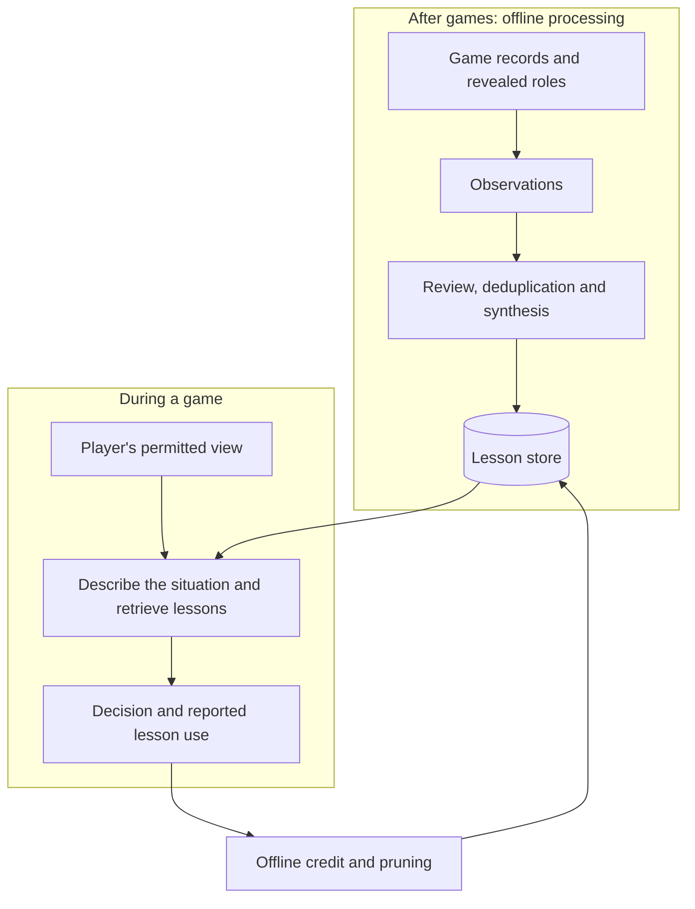

# Longer memory draft: material for Level 2

Retained on 2026-10-27 before shortening the L1 page. This is drafting material, not a second
chapter page. Develop the explanations in their relevant L2 pages rather than repeating them
as introductions. The proposed human-curated lesson workflow remains unbuilt.

---

# Memory chapter (draft)

Level 1 page copy, revised 2026-10-27 against the Evaluation and Game design and orchestration
references. Claims are bounded by [`../memory_presented_set.md`](../memory_presented_set.md).
Lines marked **Link** are editorial specifications for the five planned Level 2 pages, not live links.
The sources note at the end ties each claim to its record.

---

## Level 1: the chapter page

### Memory: learning from past games

A human player can reflect on a loss, recognise a pattern and carry a lesson into the next game. The
agents had no equivalent: each game started from a fresh context, and nothing from a finished game
carried over. Reading transcripts, I kept seeing them make the same kinds of mistakes.

I considered reinforcement learning: training the player model using rewards from self-play games.
Generating enough games would require substantial spending on model calls, while a final win or loss
provides limited feedback about which individual decisions helped. Changes to the rules or player
model would also require further training and validation.

I chose external memory instead. Lessons from previous games are retrieved and added to the agent's
context at inference time, when it generates a response. The model's weights remain unchanged, and the
advice is inspectable: I can read, revise or remove a lesson without retraining the player model. This
exposes what advice the agent receives, although it does not fully explain how it reaches its decision.

The same approach could support human-curated lessons alongside those extracted from games. That
workflow is not built, but it would let a person contribute situational strategy through the retrieval
pipeline. The engineering challenge is ensuring that lessons are useful, reach players in appropriate
situations and can be reconsidered when subsequent play exposes problems.

#### The memory pipeline: extraction, synthesis and retrieval

After a game, an offline extraction model reviews the record with access to every hidden role and
private action. It writes **observations** describing a player's situation, their move and its effects.
A synthesis step reads groups of observations and produces **lessons**: recommendations for a role in
a particular situation.

During play, a model describes the agent's situation using only information that player is allowed to
receive. The system retrieves matching lessons and adds them to the turn's input. The agent reports
whether it followed, overrode or found each lesson irrelevant, providing records for later credit
assignment and pruning.

*Games read a published store; finishing a game does not automatically update it. Individual stages
have run on the ten-seat game, but its full learning cycle has not yet run end to end.*

Privileged hindsight helps the extraction model assess what happened, but also introduces outcome
bias. Across 40 games, moves graded good by rule-based checks received positive extraction verdicts
23% of the time when their side lost, compared with 83% when it won. A second model review now
reassesses verdicts using the individual decision and its consequences. It can revise those verdicts
before synthesis, but does not correct all of the observation's text.

**Link:** Extracting and synthesising lessons — extraction, outcome review and synthesis.
Planned Level 2: `extraction_synthesis/extraction_synthesis.md`.

#### Retrieving situational advice with RAG

The first approach maintained one strategy document per role and supplied the whole document to its
players. Over successive games, it accumulated increasingly detailed advice, but recent games could
dominate and recommendations from different situations could conflict. Transcript review also found
players applying advice outside the circumstances that justified it. Adding more advice to the same
document did not address that problem.

I moved to retrieval-augmented generation (RAG): selecting stored advice for the current decision and
adding it to the model's input. Lessons are organised by role and decision phase, such as discussion,
voting or night action. An embedding model converts the stored situation descriptions and the live
query into vectors, which the system compares to find similar situations within that role and phase.
Only a few of the retrieved lessons reach the player's prompt.

The descriptions on both sides need to contain comparable information. For example, a night-action
situation may describe the evidence available, the consequences of using a limited ability and the
possible targets. Extraction and query generation fill the same situation fields; code joins the text
fields in a consistent order before embedding them. The recommended action is stored separately, so
search matches the circumstances in which advice applies.

Similarity does not establish that a lesson fits. Exact counts and opposing conditions can be poorly
distinguished by embeddings. Separate numeric and categorical fields allow additional matching rules,
but those filters and optional reranking are off in served games. The current system relies on the
text search and the player's assessment of the lessons it receives.

**Link:** Matching advice to the current situation — situation representation, query generation and
retrieval. Planned Level 2: `matching_situations/matching_situations.md`.

#### Deduplicating the memory store

Retrieving only a few lessons makes repetition costly: near-identical entries can occupy several
slots without adding useful advice. As games accumulated, I added deduplication to identify repeated
entries before they crowded the store. Similar wording alone is insufficient. Two observations of the
same situation can describe different actions or opposite outcomes, and those differences may be
useful when synthesising a lesson. The duplicate checks therefore consider the situation, action and
outcome before deciding whether an observation can be discarded.

Rewriting similar entries into a combined memory introduced another risk. In a historical review,
three of nine merged entries contained facts unsupported by either source. The active deduplication
paths now keep or discard entries without rewriting their text. This avoids introducing new claims
through merging, although the original entries can still contain errors and some duplicates remain.

Deduplication addresses repetition, but some situations had no suitable lesson to retrieve. I also
tried filtering search results and using a model to rerank them for relevance. Those studies did not
establish a general improvement. They left both retrieval quality and store coverage as open problems:
changing the ranking can help select existing advice, but cannot supply a lesson the store lacks.

**Link:** Keeping the store useful — conservative deduplication, incremental and batch processing,
provenance and growth controls. Planned Level 2: `store_upkeep/store_upkeep.md`.

#### Curating the lessons

The first stores were fixed: once a lesson was added, it remained available for retrieval regardless of
what happened when agents followed it. Earlier comparisons found no consistent improvement in play, so
retrieving relevant advice and getting agents to use it were insufficient measures of success. Agents
could assess whether a lesson appeared applicable, but that did not establish whether following it
helped. The store needed feedback from subsequent games to decide which lessons to retain.

I added decision-level credit assignment. For decisions where an agent reported following a lesson,
fixed rules assessed the action against the revealed roles and outcomes—for example, whether a town vote
targeted an enemy. The lesson's average grade was then compared with memory-off decisions by the same
role in the same phase. This avoided rewarding advice simply because its side won or its type of
decision usually succeeded. Lessons with enough uses and scores below a threshold could be pruned;
repeatedly overridden lessons could be removed, while fresh observations supplied material for
synthesis. These comparisons guide retention, but do not isolate each lesson's causal effect.

An abstention lesson exposed a gap in the scoring. It advised the Vigilante to sit out the day vote.
Town abstentions were graded neutral, and a missing memory-off baseline was treated as zero, allowing
the lesson to survive pruning. The revised rules grade town abstention as bad when nobody is voted out
and leave missing comparisons unscored. Re-scoring the recorded games removed the lesson; the corrected
loop was not played again.

**Link:** Curating the lessons: adoption records, decision credit, synthesis and pruning. Planned Level 2:
`curating_lessons/curating_lessons.md`.

#### Evaluating memory effectiveness

I tested memory by playing the same starting deals with and without it, comparing both individual
decisions and whole-game outcomes. Earlier versions produced mixed results: selected town decisions
improved in one study, but later comparisons did not establish a consistent benefit. The learning
loop's final store also showed no benefit, with results leaning toward worse play.

These studies used earlier versions of the game and memory store, so they do not establish how today's
ten-seat system performs. Memory is available as an optional setting and starts off; the latest
iteration of the memory pipeline has not yet been tested against memory-off play in the ten-seat game.

| Question | What the record supports |
|---|---|
| Can the system extract, retrieve and curate advice? | Individual stages have run on the current game, and retrieval is available during play; the full ten-seat learning cycle has not yet run end to end |
| Did earlier versions of memory improve play? | Selected early improvements for the town; later comparisons found no clear benefit, and the learning loop's result leaned negative |
| Does today's ten-seat memory improve play? | Not yet tested against memory off |

These investigations were sufficient to expose specific failure modes and guide implementation.
They were not sufficient to establish that the resulting system improves gameplay. The next comparison
would hold today's store fixed and compare memory-on and memory-off games on the same starting deals,
with both conditions run in the same time window.
Whether repeated learning cycles improve the store remains a separate question.

**Link:** Testing whether memory helps — the pivotal comparisons, experimental limits and current
validation gap. Planned Level 2: `testing_memory/testing_memory.md`.

<!-- Sources, for checking each claim against the claims boundary (writeup/memory_presented_set.md).
Revision history: first draft and editorial revisions (2026-10-27) that moved investigation detail to
L2/L3, removed unconfirmed examples, and corrected three overstatements (merging cannot make stored text
error-free; batch pricing is not the measured cost; zero reported reasoning tokens is not "no reasoning").
Language pass: restored reinforcement learning and decision-level credit assignment as explicit terms;
expanded the representation and baseline mechanisms without adding experimental campaigns. Retained
the current draft's human-player opening, outcome-bias figures, town-day policy and results table.
Situation-field composition and separate action field: extraction/situation_dimensions/report.md §§1–3.
Credit baseline, track records and retention: credit/report.md §3. Endpoint treatment included tells:
memory_system/v7/report.md and effectiveness/report.md. No code or statistical verification rerun.
Human-curated lesson workflow: proposed by the owner in this conversation, 2026-10-27; not built.
Inspectability describes visibility into stored advice, not complete model interpretability.
Opening observation: the owner's own transcript reading (map Organisation, ruling 2026-10-22). No example
mistakes are given; real ones from transcripts may be added by the owner.
Self-play alternative: evidence/fine_tuning/memory_selection_bandit/experiment_log.md (2026-06-12:
thousands of episodes at ~160 calls a game; a policy tied to rules, opponents and model) and
fine_tuning/agent_dialogue/experiment_log.md (end-to-end RL: cost, forgetting, sparse shared reward).
Recorded after memory existed, so presented as reasoning, not as the first step.
Hidden roles at extraction: Agents/memory/extraction/inputs.py::format_extraction_inputs.
Outcome bias: extraction/observation_quality/report.md (1,472 observations, 40 games: 23% vs 83%); the
second pass: Agents/memory/extraction/dehalo.py (verdicts only; detail for L2/L3).
Whole-role document: memory_system/experiment_log.md, Era 1 Phase 0 (228 items; recent games dominated;
contradictions; advice applied where it did not hold).
Retrieval: Agents/memory/retrieval/pipeline.py, accessors.py (the situation sentence searched by meaning
within the role-and-phase shelf; index field "situation"); shared conventions: extraction/
situation_summary and situation_dimensions reports. Field matching (stage filter) and reranking off in
served games: retrieval/report.md.
Merges, 3 of 9: dedup/report.md. Keep or discard only: batch_deduplication/operations.py.
Content gap; filtering and reranking studies: retrieval/report.md; memory_system/report.md.
Fixed-store comparisons: memory_system/effectiveness/report.md (June, 30 paired boards, selected town
measures, multiplicity and low-baseline caveats; v6, no clear benefit).
Credit: credit/report.md (grading against the roles, memory-off comparison, prune and evict).
Abstention case: credit/report.md §6 (the Vigilante lesson quoted; abstain graded neutral; missing
comparison treated as zero; the fix; re-scoring pruned the lesson; never replayed).
Endpoint: v7/report.md (30 paired boards, worse on 19, paired t p = 0.065; final memory against none).
Today: v8 decisions §11 (offline batch), §14 (credit apart from learning), §16; TicketOffice.tsx (off by
default); no ten-seat learning tick recorded (tick_runs empty).
Next test: owner ruling 2026-10-26 (new labelling and runs needed). -->
