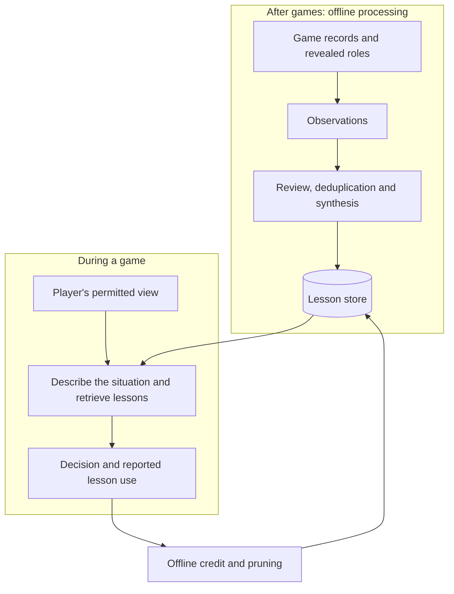

# Memory chapter (draft)

Level 1 page copy, revised 2026-10-27 against the Evaluation and Game design and orchestration
references. Claims are bounded by [`../memory_presented_set.md`](../memory_presented_set.md).
Lines marked **Link** are editorial specifications for the five planned Level 2 pages, not live links.
The sources note at the end ties each claim to its record.

---

## Level 1: the chapter page

### Memory: learning from past games

A human player can reflect on a loss, recognise a mistake and apply that lesson in the next game.
My AI agents couldn't: every game started with a fresh context, and I repeatedly observed similar
mistakes across game transcripts.

I considered reinforcement learning, but self-play training would require substantial model-call
spending, while a final win or loss provides weak feedback about individual decisions. More
importantly for this project, changes to the rules or player model would require further training
and validation. Stored lessons can instead be rewritten without retraining the player model.

I built an external memory system that extracts lessons from completed games and retrieves relevant
advice during future decisions. The stored advice is inspectable, editable and removable without
changing the player's model weights. The challenge is determining what deserves remembering, when a
lesson applies and whether following it improves play.

Earlier experiments produced mixed or negative results. The latest ten-seat pipeline has not completed
an end-to-end learning cycle, and its gameplay benefit remains untested. Memory is available as an
optional feature and starts off.

#### The memory pipeline: extraction, synthesis and retrieval

After a game, an offline model reviews the complete record, including hidden roles and private
actions. It extracts observations describing a player's situation, decision and consequences. A
synthesis step then turns groups of observations into reusable, role-specific lessons.

Access to the full outcome also introduces outcome bias. The extraction model sometimes judged a
good decision negatively because the player's team eventually lost. I introduced a second model
review to reassess decision verdicts based on the action and its consequences before synthesis.
This can revise verdicts, though it does not correct every error in the original observation text.

Lessons are published to a separate store rather than automatically becoming available after each
game. During play, agents retrieve advice from that published store.

*Offline processing produces and curates lessons; gameplay retrieves them. Individual stages have
run on the ten-seat game, but its full learning cycle has not yet run end to end.*

**Link:** Extracting and synthesising lessons — extraction, outcome review and synthesis.
Planned Level 2: `extraction_synthesis/extraction_synthesis.md`.

#### Retrieving situational advice with RAG

Initially, each role received a growing strategy document containing lessons from previous games.
This accumulated conflicting advice and encouraged agents to apply recommendations outside the
situations that justified them.

I replaced it with retrieval-augmented generation (RAG), selecting a few lessons for the agent's
current situation and adding them to its prompt. Lessons are organised by role and decision phase,
such as discussion, voting or night action. Each lesson stores its situation separately from its
recommended action. Extraction and live queries use the same situation fields, so stored lessons
and retrieval queries describe comparable information.

During play, the system describes the situation using only information the player is permitted to
know. Embedding similarity retrieves lessons from comparable situations. The stored descriptions
must also reflect what a player could know, even though offline analysis can inspect hidden roles.

Semantic similarity cannot reliably distinguish every critical condition, such as exact player
counts or opposing circumstances. I experimented with structured filters and reranking, but did not
establish a general improvement. These mechanisms remain disabled in served games; the current
system relies on semantic retrieval and the agent's assessment of applicability.

**Link:** Matching advice to the current situation — situation representation, query generation and
retrieval. Planned Level 2: `matching_situations/matching_situations.md`.

#### Deduplicating the memory store

As the store grows, redundant memories compete for limited retrieval slots. I added deduplication
to prevent near-identical entries from crowding out different lessons. Similarity alone is
insufficient: two observations may describe the same situation but record different actions or
outcomes, precisely the differences needed to learn useful strategy.

An early approach merged similar entries into rewritten memories. In one historical review, three
of nine merged entries contained facts unsupported by their sources. I switched to conservative
deduplication: compare situation, action and outcome, then retain or discard observations without
rewriting their contents.

Disabling rewriting avoids introducing unsupported facts through that merge step. It does not
correct errors in the original entries, and some duplicates remain. A well-ranked retrieval result
also cannot help when the store lacks advice for the situation.

**Link:** Removing duplicates — conservative deduplication, incremental and batch processing,
provenance and growth controls. Planned Level 2: `store_upkeep/store_upkeep.md`.

#### Curating the lessons

The first memory stores were static. Once a lesson entered the store, it remained available even
if following it repeatedly produced poor decisions. I added decision-level credit assignment to
help determine which lessons to retain.

Agents report whether they followed, overrode or found each retrieved lesson irrelevant. For
decisions where a lesson was followed, rule-based checks evaluate the action using information
revealed after the game. A lesson's average decision grade is compared against memory-off decisions
made by the same role in the same phase. This gives a reference beyond whether its team won.
Lessons with enough uses and scores below a threshold can be pruned; repeatedly overridden lessons
can also be removed, while fresh observations supply material for synthesis.

An abstention lesson exposed a scoring gap. It advised the Vigilante to sit out the day vote.
Abstentions were graded neutral, and a missing memory-off baseline was treated as zero, so the
lesson never crossed the pruning threshold. I revised the rules and re-scored the recorded games,
which removed the lesson. The corrected loop was not played again.

These scores support lesson retention, but do not establish that a lesson caused a better or worse
decision.

**Link:** Curating the lessons — adoption records, decision credit, synthesis and pruning.
Planned Level 2: `curating_lessons/curating_lessons.md`.

#### Evaluating memory effectiveness

I evaluated memory by comparing games with and without retrieved advice, using matched starting
deals and examining both individual decisions and overall outcomes. Earlier evaluations used
different game and memory versions, so their results cannot establish the effectiveness of the
latest iteration in the ten-seat game.

These investigations were sufficient to expose specific failure modes and guide implementation.
They were not sufficient to establish that the resulting system improves gameplay.

| Question | What the record supports |
|---|---|
| Can the system extract, retrieve and curate advice? | Individual stages have run on the current game, and retrieval is available during play; the full ten-seat learning cycle has not yet run end to end |
| Did earlier versions of memory improve play? | Selected early improvements for the town; later comparisons found no clear benefit, and the learning loop's result leaned negative |
| Does today's ten-seat memory improve play? | Not yet tested against memory off |

The next experiment would hold the current lesson store fixed and compare memory-on against
memory-off games using matched starting deals, run within the same time window. A separate
experiment would test whether repeated extraction, synthesis and pruning cycles improve the store
over time.

**Link:** Testing whether memory helps — the pivotal comparisons, experimental limits and current
validation gap. Planned Level 2: `testing_memory/testing_memory.md`.

<!-- Sources, for checking each claim against the claims boundary (writeup/memory_presented_set.md).
Shortened L1 revision (2026-10-27): adopted the supplied concise narrative, restored the RL
rule/model-change rationale, and placed the evidence-boundary statement before the results table.
Longer explanations, including proposed human-curated lessons, retained in l2_drafting_material.md.
Revision history: first draft and editorial revisions (2026-10-27) that moved investigation detail to
L2/L3, removed unconfirmed examples, and corrected three overstatements (merging cannot make stored text
error-free; batch pricing is not the measured cost; zero reported reasoning tokens is not "no reasoning").
Language pass: restored reinforcement learning and decision-level credit assignment as explicit terms;
expanded the representation and baseline mechanisms without adding experimental campaigns. Retained
the current draft's human-player opening, outcome-bias figures, town-day policy and results table.
Situation-field composition and separate action field: extraction/situation_dimensions/report.md §§1–3.
Credit baseline, track records and retention: credit/report.md §3. Endpoint treatment included tells:
memory_system/v7/report.md and effectiveness/report.md. No code or statistical verification rerun.
Human-curated lesson workflow: proposed by the owner in this conversation, 2026-10-27; not built.
Inspectability describes visibility into stored advice, not complete model interpretability.
Opening observation: the owner's own transcript reading (map Organisation, ruling 2026-10-22). No example
mistakes are given; real ones from transcripts may be added by the owner.
Self-play alternative: evidence/fine_tuning/memory_selection_bandit/experiment_log.md (2026-06-12:
thousands of episodes at ~160 calls a game; a policy tied to rules, opponents and model) and
fine_tuning/agent_dialogue/experiment_log.md (end-to-end RL: cost, forgetting, sparse shared reward).
Recorded after memory existed, so presented as reasoning, not as the first step.
Hidden roles at extraction: Agents/memory/extraction/inputs.py::format_extraction_inputs.
Outcome bias: extraction/observation_quality/report.md (1,472 observations, 40 games: 23% vs 83%); the
second pass: Agents/memory/extraction/dehalo.py (verdicts only; detail for L2/L3).
Whole-role document: memory_system/experiment_log.md, Era 1 Phase 0 (228 items; recent games dominated;
contradictions; advice applied where it did not hold).
Retrieval: Agents/memory/retrieval/pipeline.py, accessors.py (the situation sentence searched by meaning
within the role-and-phase shelf; index field "situation"); shared conventions: extraction/
situation_summary and situation_dimensions reports. Field matching (stage filter) and reranking off in
served games: retrieval/report.md.
Merges, 3 of 9: dedup/report.md. Keep or discard only: batch_deduplication/operations.py.
Content gap; filtering and reranking studies: retrieval/report.md; memory_system/report.md.
Fixed-store comparisons: memory_system/effectiveness/report.md (June, 30 paired boards, selected town
measures, multiplicity and low-baseline caveats; v6, no clear benefit).
Credit: credit/report.md (grading against the roles, memory-off comparison, prune and evict).
Abstention case: credit/report.md §6 (the Vigilante lesson quoted; abstain graded neutral; missing
comparison treated as zero; the fix; re-scoring pruned the lesson; never replayed).
Endpoint: v7/report.md (30 paired boards, worse on 19, paired t p = 0.065; final memory against none).
Today: v8 decisions §11 (offline batch), §14 (credit apart from learning), §16; TicketOffice.tsx (off by
default); no ten-seat learning tick recorded (tick_runs empty).
Next test: owner ruling 2026-10-26 (new labelling and runs needed). -->
