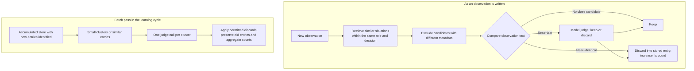

# Removing duplicates (Level 2, draft)

Drafted 2026-10-27; restructured 2026-10-28 (owner): an editorial revision following
`l3_migration_brief.md` replaced the earlier text (both working copies since removed; git history keeps
them). The lesson dedup now groups by game stage before the judge (2026-10-28). Claim
scope: [`../../memory_presented_set.md`](../../memory_presented_set.md).

---

## Removing duplicates

A memory store can grow without getting more useful. Repeated games produce similar observations, and
synthesis can phrase one recommendation several ways. A player sees only a few lessons per decision,
so copies crowd out alternatives. They also split one piece of advice's usage record across several
entries, leaving each with too few follows for credit to judge it
([Curating the lessons](../curating_lessons/curating_lessons.md)).

But similar memories can contain differences worth keeping: the same move succeeding in one game and
failing in another, or two lessons giving opposite advice about the same situation. The aim is to remove
repetition without losing those distinctions. The system uses conservative keep-or-discard decisions;
it does not rewrite entries, after an experiment showed that merging could introduce unsupported facts.

### What counts as a duplicate

An **observation** records a situation, a move and its outcome. Two observations are duplicates only
when all three match in kind, not just in wording. The same move with a different outcome stays separate,
because that contrast is evidence a lesson can be built from. When a duplicate is discarded, its
survivor's count rises, preserving how often the pattern recurred.

A **lesson** recommends a move. Two lessons about the same situation stay separate when their advice
differs in target, timing, direction, risk or scope. Deduplicating lessons must also preserve the record
of decisions made while following them: changing the advice would break the connection between its
text and its measured use.

When unsure, the judge keeps. Retaining a duplicate leaves repetition; discarding a distinct entry may
lose evidence of a situation that never comes up again.

### How an observation is judged

The first pass checks each observation as it is written. A second pass groups accumulated entries for
review during learning. Lessons use only the second path, and their pass is currently disabled.

*The write pass checks individual observations. The batch pass considers groups; its lesson run stays
off pending judge retuning. The full ten-seat learning cycle has not yet run end to end.*

**Candidate retrieval.** An embedding represents a situation as a vector, so similar descriptions can
be found without comparing every pair with a model. The store ranks situations by **cosine similarity**
within the same role and kind of decision. This narrows the search; it does not establish that the memories are
interchangeable.

**Metadata filtering.** Structured fields exclude observations whose context differs, such as game
stage, available information or verdict. A move made with private information may mean something
different from the same move made blind. These categorical fields support exact comparisons; the
remaining free text needs semantic comparison.

The metadata filter is stricter in deduplication because discarding an entry requires stronger evidence
that two memories are interchangeable. A difference in game stage or available information is enough
to keep them separate. [Retrieval](../matching_situations/matching_situations.md) allows looser matches:
advice from a different situation may still be useful, and model-written labels can be wrong. Matching
labels only makes a pair eligible for further comparison; it does not establish that either entry can
safely replace the other.

**Similarity prefilter.** The system separately embeds the full text—situation, move and outcome—of
the new observation and every remaining candidate. It scores each pair and applies the thresholds to
the highest similarity: a very high score discards the new observation into that matching entry, a low
score keeps it, and the middle band sends the candidates to the judge. These embeddings are separate
from the situation-only retrieval vectors. This shortcut is used only for observations.
Lesson embeddings can put opposite recommendations close together: “Prioritize investigating players
who are actively pushing narratives” and “Avoid investigating the most vocal leader” were nearly as
similar as true duplicates in the labelled cases.

**The judge.** A model compares the new observation with its candidates and answers keep or discard.
The fields already settled by the metadata filter are hidden from it. If it cannot return an answer
after retries, the observation is kept: this **fail-open** behaviour prevents a failed call from deleting it.

[**How the dedup judge was built (Level 3)**](dedup_judge.md): the labelled cases, prompt and model
comparisons, embedding thresholds, and the effect of cluster size.

### Why a batch pass is needed

An observation checked on arrival sees only its nearest neighbours at that moment. Near-duplicates that
missed one another can accumulate. The batch pass therefore divides the store into small groups of
likely duplicates and asks the judge about each group in one call.

The clustering approaches tested first, **single-linkage** clustering (built with union-find) and
**agglomerative** (hierarchical) clustering, produced groups too large to judge: A could join B, and B
could join C, even when A and C were not alike. I used **seeded clustering** instead. The most frequently
seen entry becomes a seed, and nearby entries within the same metadata partition join it. Those entries
leave the pool before the next seed is chosen. Every member must resemble the seed itself, preventing
chains from extending the group. Smaller groups also performed better in the labelled judge tests.

The judge proposes survivors and duplicates; code applies the permitted operations. Discards transfer
aggregate counts to the survivor. A survivor outside the cluster is rejected, as is a proposal to
rewrite entries into a merged text. These checks constrain what a judgement can change, without making
the judgement itself reliable.

### Preserving lesson history

A lesson's worth to the store is its record: every decision made while following it, and the grade each
one received. Credit decides what to keep from that record
([Curating the lessons](../curating_lessons/curating_lessons.md)), so deduplication must never break the
link between a piece of advice and the decisions it shaped. Three rules protect it. When a new lesson
duplicates an older one, the older one survives, because it holds the record and the new one has none. The
survivor keeps its own text and fields, never a merged rewrite, because its counts must keep describing the
advice that earned them. And the discarded lesson's key is listed on the survivor, so decisions recorded
against it before the discard still count toward the same advice.

The same reasoning keeps lessons from different stages of the game apart. Advice for an early game and for
an endgame can read alike, but it is served to different seats and followed on different boards, so a
shared record would mix evidence from both. The pass therefore groups lessons by stage (players alive,
whether the wolf pack has lost a member, whether a limited ability has uses left) before the judge sees
them, and a lesson is only ever compared with others from the same stage.

An intact history is also what lets a verdict be revisited. Because each lesson keeps its key and its
follows stay in the game records, credit can be run again on old games under new rules, and a lesson's
score can be checked again when the way it is scored changes
([The lesson that pruning failed to remove](../curating_lessons/abstention_credit.md) is one such
re-scoring).

The pass itself is not yet reliable. In the ten-seat build it missed duplicates that readers later removed
by hand, and it stays off until its judge is retuned.

[**Where the lesson judge failed (Level 3)**](dedup_judge.md#where-the-lesson-judge-failed): the duplicate
groups the pass missed, the trial with relaxed labels, and the grouping that once let the judge compare
lessons from different stages.

### Why the best-scoring merge was switched off

Merging was switched off because nothing checked rewritten text before it reached the store, and the
text could change what its sources recorded. In one merge from the labelled tests, an Investigator who
"had not yet found a wolf" became one who "has also privately identified or strongly suspects" the wolf.
A review by the same model that wrote the merges missed it, and flagged count totals in three merges
instead, two of which were valid sums it had no way to check. The smaller models failed differently: they
mostly dropped the merged move and outcome fields.

This happened in the best-scoring design on 111 labelled entries in 11 nine-seat clusters. A small model
first selected operations; a stronger model reconsidered merges and wrote the combined entries.
The evaluation scored whether keep, discard or merge matched the label—not whether the resulting text
was supported by its sources. A good operation score therefore did not establish safe rewriting.

The current pass keeps or discards entries without rewriting them. Merging remains disabled pending a
reliable source-faithfulness check before storage. This prevents deduplication from adding invented
details through rewriting; it does not correct errors already present in the source memories.

[**What the merge score did not measure (Level 3)**](merge_fabrication.md): the operation-label
comparison, dropped fields, the reversed situation, how the review ran, and what a checked merge would
need.

### Idempotency and incremental convergence

An exploratory **LLM-as-a-judge** evaluation raised a concern about aggressive removal. Across 40
nine-seat scenarios, the judge rated retrieved observations less relevant in 14 cases and more relevant
in 2 after an untuned prompt removed 39% of the store. A conservative prompt removed about 17%, with
small losses in judged relevance and gains in variety. Those assessments were not validated against
human relevance labels or tested for significance. They suggested possible information loss; they did
not establish that either deduplicated store was better.

A separate investigation identified a concrete flaw in **incremental deduplication**. The pass was
**idempotent** in the narrow sense: running it again with no new entries changed nothing. But when new
entries arrived, their clusters reopened old pairs for judgement. The model could classify previously
retained entries as duplicates and discard them. Idempotency on unchanged input therefore did not
ensure **convergence** as the store grew: repeated reconsideration could keep eroding settled entries.
This defect did not depend on trusting the retrieval judge's relevance scores.

The fix enforces an **invariant** in the application code: old entries cannot be discarded into one
another. Each run receives the keys of its new entries explicitly. A new duplicate can be discarded
into an old entry, but an old-against-old discard is refused, whatever the judge proposes. Old entries
are thus immutable with respect to one another's deduplication. The tradeoff is that old duplicates
missed earlier remain; protecting settled entries does not prove that the retained store is optimal.

### What remains open

The lesson judge still needs retuning and validation before its pass can resume. Observation provenance
is also incomplete: a discarded observation contributes to its survivor's count, but its own key and
game are not retained, so one game's contribution cannot be fully removed later.

Deduplication cannot bound a store of distinct entries. The learning cycle separately provides age-out
for observations that new games do not repeat, but no ten-seat learning run has yet shown where the
store settles. The current design limits what deduplication can damage; it does not establish that the
resulting memory improves play.

<!-- Sources and verification, 2026-10-27; updated 2026-10-28:
Revision 2026-10-28: body from store_upkeep_revised.md (editorial revision per l3_migration_brief.md);
two claims of the earlier text dropped by the revision: 'a wrong metadata value can only keep apart two
duplicates' (a wrong value can also group two different entries) and the 17% / 39% figures as erosion
thresholds (they belong to the retrieval comparison, not the incremental experiment). Clustering names:
dedup/report.md layer 1 (union-find and hierarchical tested; both chained). Lesson stage grouping before
the judge: dedup_gate.sp_gate_key (direction, honesty, alive bucket, partner lost, uses left; shared
definition dimension_gating.stage_facts); after-judge check operations.py kept as a backstop for a pass run
without the partition; dedup/report.md layers 2 and 5 (2026-10-28); tests/memory/test_dedup_gate.py,
test_batch_dedup.py; evaluation/experiments/sp_dedup_stage_partition_check.py. Preserving history:
credit_rules (a merged duplicate's follows count for its survivor; merged_keys); re-scoring on recorded
games: curating_lessons/abstention_credit.md.
Added 2026-10-28: gate fields and the 916 of 919 blob: dedup/report.md "The gate" and
dedup_clustering_and_sp_extraction_plan.md (hierarchical at 0.70 on the June v6 store); lesson gate sp_gate_key
(direction, honesty). Case 155 (opposite advice; actions 0.881 on Qwen, 0.913 on Gemini; labelled keep):
dedup/report.md "The embedding check"; embedding check live for observations only. Judge: keep/discard schema
(deduplication/schemas.py), gated fields hidden (situation_for_dedup), fail-open (pipeline.py). Seeded clusters:
clustering.py _bounded_seed_clusters (most-reinforced seed, ten nearest above the floor, same gate partition;
cap 15 from the 111-entry set's size table (batch log 'Accuracy by cluster size (v3)': 2-5 entries 100%, 8-10 80-100%, 11-16 64-100%, the one 23-entry cluster 65-74%; the '26-74%' in report.md L116 and batch log L110 has no visible source); width ten means the cap rarely binds);
union-find/hierarchical chained a role's entries (dedup/report.md layer 1). Apply: operations.py (summed counts;
survivor outside the cluster fails safe; triage-only skip_verify). Lesson pass: strategy_points.md §3 (follows
smeared across near-duplicates never accumulate evidence), store_ops._dedup_strategy_points (only when synthesis
added lessons), operations._apply_strategy_operation (stage rule, own text kept, merged_keys); ten_seat_v2 build:
694 -> 605, readers' 65 groups (78 lessons), 37 crossed the labels, dry run with honesty-only partition 16 of 65
caught and 25 cross-stage drops (dedup/report.md layer 5); 78 left out by hand; sp_dedup False since 2026-10-26.
Duplicate rules: Agents/prompts/dedup.py (observations: all three fields; lessons: target, timing,
direction, risk, plus scope/certainty); evidence/dedup/report.md "What counts".
Write path: Agents/memory/deduplication/pipeline.py (gate, prefilter auto-keep/auto-discard, LLM band,
fail-open); thresholds Agents/llm_factory/embeddings.py (Qwen: observations keep < 0.72, discard >= 0.94).
The auto-discard is observation-only on the live path; 2 of 116 observation cases reached 0.94 in the
232-case recheck (dedup/report.md). Survivor-credit bug (similar[0]) fixed 2026-10-27.
Fold: obs_fold.py (triage-only, skip_verify); batch_deduplication/config.py (bounded clusters),
clustering.py; dedup/report.md (union-find chained a role's entries).
Table: published build ran the write step (2,277 -> 2,008 observations) and the lesson dedup with
Flash-Lite (694 -> 605; 78 more removed by readers); consolidation/config.py sp_dedup False since
2026-10-26; no ten-seat learning tick (store_curation/report.md).
Merge experiment: batch_dedup/experiment_log.md (77/20/14 labels; 3.1 Flash-Lite triage + 2.5 Pro;
99/111; 3.5 Flash single pass 96/111, a same-prompt rerun 81%; Flash models drop merged fields; 2.5 Pro
judge on its own merges, 3 of 9 flagged; reread 2026-10-28: all three flags concern tactic counts, two are
valid sums the reviewer was not shown observation counts for, and the real failure is cluster 4's reversed
situation (source 3d9a71f0 'had not yet found a wolf' vs merged 'has also privately identified or strongly
suspects'; eval_gemini_2.5_pro_20260526_133120.json; see merge_fabrication.md). Smaller models dropped move
and outcome in 25 of 26 and 38 of 43 merges). No faithfulness check before the store write: dedup/report.md. Fold
triage-only since 2026-06-22; lessons not merged since 2026-10-13.
Retrieval impact: dedup/store_retrieval_impact/experiment_log.md (40 scenarios, gemini-2.5-flash judge;
522 -> 320 / 432; observations 2/24/14; no significance test).
Freeze-old: dedup/incremental_convergence.md (non-convergence: new entries reopen old neighbours; ~17%
helpful, ~39% information loss); operations.py _frozen_old_conflict, _resolve_survivor; new_keys passed
by the learning cycle since 2026-10-26. A manual unrestricted pass still re-judges everything.
Provenance: operations.py (summed counts; merged_keys for lessons); store_ops.py source_observations;
presented set retention row.
Growth: store_curation/report.md (age-out; cap 12 unproven = not protected; no plateau).
Lesson judge: batch_dedup/experiment_log.md October 26 addendum (Haiku 11 of 18 right, 7 wrong all
lessons; Sonnet 8 of 8 right, 8 of 20 caught); switch-off also cites the 2026-10-13 cross-stage dry run. -->
