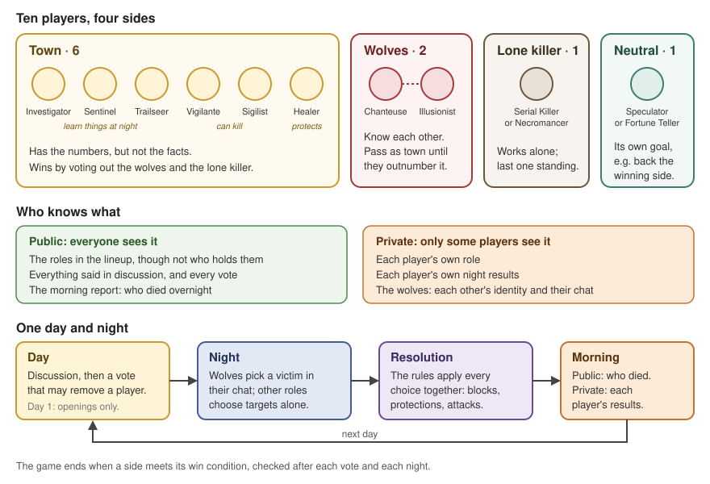
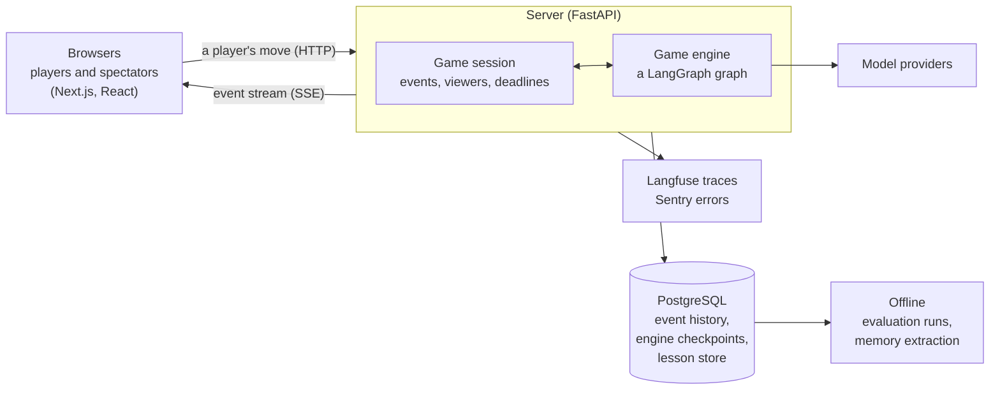
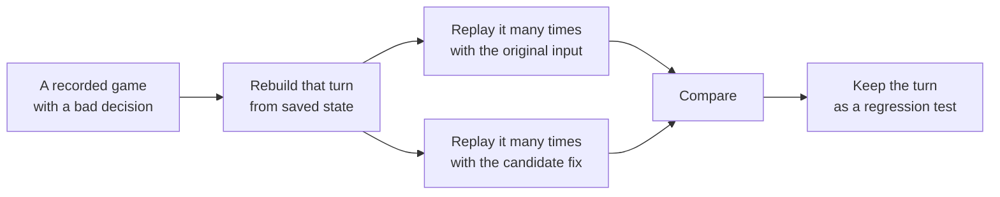
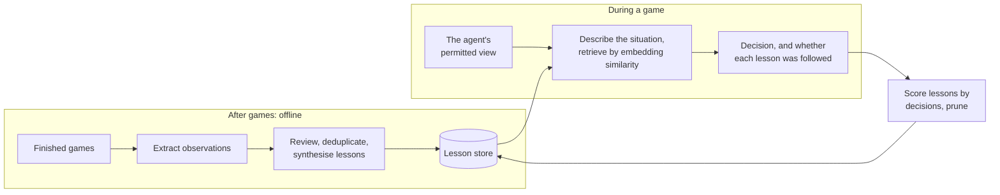
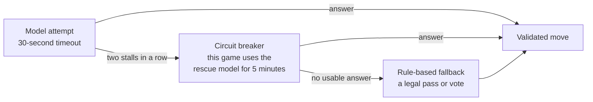
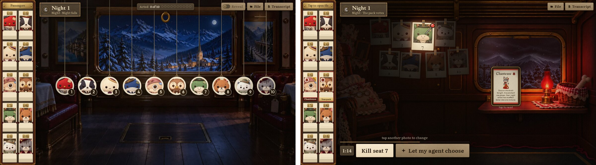

# Project overview (draft)

*Level 0: the one page above the eight chapters. Third draft by Claude on 2026-11-26. The first draft was a
ninth chapter (about 2,090 words, eight long stories). The second followed an outside reviewer's brief
(about 900 words, highlights of 60 to 90 words) and the owner found it too short and too plain: it did not
say what makes the build hard, did not introduce the game or its inspiration, and its stories lacked
detail, diagrams and the names of the tools. This draft keeps the second draft's order and strip, restores
the game and the difficulty, and gives each highlight a one-line takeaway in bold, then the detail, a
figure and the technical terms. First person is used for decisions and contributions. Not yet read by the
owner. Open facts are listed in the sources comment at the foot.*

---

## Page copy (draft)

### The Ninth Express

**A hosted multi-agent system built around a social deduction game, playable by people.**

The Ninth Express is a social deduction game played by ten AI agents, each a separately called
language model. A person can take any seat and play alongside them in a browser, and anyone can
watch a game live or replay a finished one.


[Play or watch a game: link to add] · [Source code: link to add]

*LangGraph · Python · FastAPI · PostgreSQL · Server-Sent Events · Next.js · React · TypeScript ·
Langfuse · Sentry*

| 10 | about 200 | $0.09 to $0.15 | 4 |
|:---:|:---:|:---:|:---:|
| **players, AI or human** | **model calls in a game** | **model cost of a game** | **model providers** |
| twelve roles on four sides | from two recorded games | average per completed game, by model | the model is chosen for each job |

### The game

The game belongs to the family of Mafia and Werewolf. A hidden minority, the wolves, know one
another and try to pass as ordinary players. The majority, the town, must find and vote them out.
By day everyone talks and votes. At night, players with special roles act in secret.

My version takes its design from Town of Salem: more sides and role-specific abilities. Ten
players sit on four sides, dealt from twelve roles. I designed the roles around one aim, **evidence
worth arguing about**. In my first version one role could learn another player's exact role, and
the evil players never claimed a role of their own, so there was nothing to debate. Now three town
roles each see a different, true but incomplete part of the night. The game never reports a false
result, so a lie has to be spoken: evil players plan a cover role and claim it.



### Why it is hard to build

I chose this game because it puts the open problems of agent systems in one place.

- **Agents with different, partly secret information.** One program holds every secret, because it
  applies the rules. Each agent must still act only on what its role may know.
- **A conversation among models.** A model exists only while it is being called. It cannot listen,
  interrupt or notice that it has been accused. Turn-taking has to be built.
- **Behaviour that cannot be judged from one run.** The same input gives different answers, and one
  changed line changes the rest of a game. A fix that seems to work may be chance.
- **A long-running process with people in it.** A game lasts tens of minutes and about 200 model
  calls. A person may take minutes to answer, close the tab, or come back later.
- **A real service.** A model provider can stall, the server can restart mid-game, and a player's
  browser must never receive another player's secret.

### How it fits together



The **game engine** is a LangGraph graph: steps connected through shared state. It holds the game
and decides what runs next. For each turn it builds one agent's input, calls a model, checks the
reply and applies the rules. A **game session** wraps the engine for a hosted game. It turns each
committed change into a numbered event, saves it to PostgreSQL, and streams it to the viewers who
may see it. Evaluation and memory extraction run on finished games, outside live play.

### Engineering highlights

#### 1. Orchestrating ten agents and a person in one graph

**Code decides who acts and when. The model decides only what to say or choose.**

A speaker has to hear what was just said, so discussion runs one turn at a time. Votes and night
actions must be blind, so those model calls fan out in parallel, and one resolution step applies
the rules to all of them together. Otherwise the outcome would depend on which call returned first.


My first discussion design ran simultaneous rounds, and on one day five of eight agents opened with
the same question. I replaced it with a **reply scheduler**. Each agent tags whom it addresses and
whether it is accusing, questioning or defending. An accusation leaves the accused owing an answer,
and that answer goes ahead of every other turn. Caps on repeated exchanges and on lines per player
end the day.

A person joins through the same turn pipeline, using LangGraph's interrupt and a checkpoint saved
in PostgreSQL. The game pauses at their decision and resumes when the answer arrives. In my first
test with two people, resuming repeated the whole paused step, and some AI voters changed votes
they had already cast. Each finished AI turn is now cached, so a repeated step reuses it.

*Explore: [Game design and orchestration](game_design_orchestration/game_design_orchestration.md)*

#### 2. What each agent is given, and what it must return

**Private information is kept out of a model's input, not hidden by an instruction.**

A model cannot unsee its prompt, so telling it to ignore another player's secret does not work.
This is **context isolation**, the principle of least privilege applied to a model's input. For
every turn, a builder selects from the full game state only what that seat is entitled to, before
any prompt is written.


An audit after each test game reads every input that was sent and fails the run if a private
record is in the wrong place. The first run with the audit connected found wolf identities in other
players' inputs. A refactor had put them there, and the prompt templates had hidden the mistake by
not printing those fields.

The reply is constrained too. The legal choices are known before a turn starts, so the agent
returns a **structured output**: a typed decision with its reasoning beside it. Every reply is
validated against the turn's schema and its legal targets. A failed reply is requested again with
the schema enforced by the provider, and if that fails, a legal fallback move takes its place.

*Explore: [Information boundaries](information_boundaries/information_boundaries.md) ·
[Context engineering](context_engineering/context_engineering.md)*

#### 3. Reproducible evaluation of agent behaviour

**A failing decision is rebuilt from saved state and replayed, so a fix is tested on the exact
situation that failed.**



In one game an Investigator announced a check it had never made, and the town voted out an innocent
player. With the original input, all 20 replays of that turn invented an investigation. With the
results reworded, all 20 reported the real one.

Some failures were not about wording. A Healer recorded that it had been blocked and still did not
work out who must have visited it. For those I supply the inference in code: a **deduction engine**
uses constraint propagation over the facts a seat may know and writes the conclusions into the
prompt. On replays of that turn the agent named the right role in 8 of 10 attempts with the
deductions and 2 of 10 without. These results are for single recorded situations. They show a
specific failure fixed, not a rate across games.

The evaluators are checked as well. Code checks an answer wherever the game record holds it. Where
the question is about meaning, an LLM judge is used, and then the judge is tested. Three models
labelled 863 memory cases, and in the cases I reviewed their majority vote to discard was wrong 37%
of the time. Whole-game comparisons use matched starting deals, with both versions run in the same
period.

*Explore: [Evaluation](evaluation/evaluation.md) ·
[Context engineering](context_engineering/context_engineering.md)*

#### 4. Memory across games, held to that standard

**A retrieval system that carries lessons between games. It was tested, the benefit was not
confirmed, and it ships switched off.**



This is retrieval-augmented generation (RAG) over the system's own experience. Testing shaped each
stage. A growing strategy document per role gave conflicting advice, so lessons are now retrieved
by situation. Merging similar entries into rewritten ones introduced unsupported facts in three of
nine reviewed cases, so entries are kept or discarded and never rewritten. The extraction model
judged good decisions harshly when the team lost, so a second review reassesses each verdict.

Early versions showed gains on some town decisions in games on matched deals. Later comparisons did
not confirm them, and the current ten-seat game has not been tested with memory against without.
Memory is therefore an optional switch, off by default.

*Explore: [Memory](memory/memory.md)*

#### 5. Inference cost and latency

**With about 200 model calls in a game, cost is a property of the whole design.**

I record token use by call type and separate cache reads from cache writes. Across sixteen games,
input was about nine tenths of the tokens and output about half the bill. Three choices follow.

- **A model for each job.** Agent turns need a cheap, fast model. A day summary runs once but
  enters every later prompt, so it can justify a stronger one.
- **A prompt layout built for prompt caching.** Shared material comes first and private material
  last, so that the provider can reuse the processed prefix across all ten agents.

  ```text
  Rules
  Earlier days' summaries and today's public transcript
  ──────────────── cache boundary ────────────────
  Role card and instructions for this task
  Private results, strategy notes, retrieved lessons
  ```
- **Offline batch processing** for work that live play does not wait for, such as extracting
  lessons, at batch prices that discount output as well as input.

The new layout cut one model's cost per call by 28%. Another model's cost did not fall, because it
wrote more reasoning and spoke more. A cheaper prompt can still produce a more expensive game.

For latency, what matters is the wait a player sees. The stage shows one line while the server
prepares the next, so most model latency is hidden. Across seven hosted games, the visible wait was
an estimated 3 to 5% of playing time.

*Explore: [Cost and latency](cost_and_latency/cost_and_latency_codex.md)*

#### 6. Reliability and observability in production

**A hosted game keeps moving when a model stalls, survives a server restart, and records how every
turn was decided.**

In one hosted game a player waited 301 seconds for a single AI reply, because the provider was slow
to return a rate-limit error and its client library retried. Three layers now handle a failing
model:



A turn still has no overall deadline, so two stalled models in a row can add up to two minutes.

A game survives a restart through two records in PostgreSQL: the public event history, which
rebuilds what viewers saw, and the engine's checkpoint, which resumes play. They are written
separately, so a restart between the two can replay an AI turn with a different result. I found
that dual-write gap by reading the code, and it is documented as a known limit.

A failure that the engine absorbs leaves the game looking normal, so observability matters.
Langfuse traces record every engine step and model call, a usage ledger counts calls and failures,
and Sentry reports a crashed game. Comparing those records exposed a turn that had been served from
another game's cache: the ledger showed 142 calls and no failures, yet one agent had passed on a
failed generation. The cache key now includes the game.

*Explore: [Running it in production](running_in_production/running_in_production.md)*

#### 7. Real-time play for many viewers

**One event history gives every viewer a different, authorized view.**

The server does not send the browser the state of the game. It sends numbered events over
Server-Sent Events, and each browser rebuilds the game by applying them in order. The same history
serves live play, catching up after a dropped connection, and the replay of a finished game.

Hiding information in the browser is not protection, because anything that reaches a browser can
be read there. So every event has one of four audiences (everyone, the wolf pack, one seat, or
nobody until the game ends), and the server checks each event against the viewer before sending it.



*The same night of one recorded game. Left: a spectator. Right: a wolf.*

An audit showed that hiding contents is not hiding everything. An event counter rose once for each
secret night action, which was closed. The length of a night and gaps in the numbering remain
observable.

*Explore: [Client-server architecture](frontend/frontend.md)*

### My role

This is my own project. I designed the game, the system, its experiments and its checks, wrote the
orchestration engine, and decided what each result supported. I worked with AI coding agents
throughout: they built the browser frontend and the deduction engine's solver to my requirements.

### Technical deep dives

**How the game runs**

| | |
|---|---|
| [1. Game design and orchestration](game_design_orchestration/game_design_orchestration.md) | The game's rules, the graph that runs it, the conversation scheduler, one turn's pipeline, and how a person joins |
| [2. Information boundaries](information_boundaries/information_boundaries.md) | What each agent may know, where that is enforced, and the check that caught a leak |

**Improving how agents play**

| | |
|---|---|
| [3. Context engineering](context_engineering/context_engineering.md) | Making facts explicit, carrying earlier days forward, ordering the reasoning, and computing deductions in code |
| [4. Memory](memory/memory.md) | Extracting, retrieving, deduplicating and curating lessons from past games, and testing whether they help |

**Knowing whether it worked**

| | |
|---|---|
| [5. Evaluation](evaluation/evaluation.md) | Replaying turns, play metrics beyond win rate, code checks, model judges, reference labels and fair comparisons |

**Serving it to people**

| | |
|---|---|
| [6. Cost and latency](cost_and_latency/cost_and_latency_codex.md) | Where the cost comes from, the wait a player actually sees, caching and batching |
| [7. Running it in production](running_in_production/running_in_production.md) | Crash recovery, stalled model calls, tracing, players' API keys and prompt injection from chat |
| [8. Client-server architecture](frontend/frontend.md) | The event stream, per-viewer authorization, and performance on a phone |

<!-- Sources and open facts.
Third draft: figures reused from chapter 1 (game_at_a_glance.svg, phase_execution.svg, context_isolation.svg) and chapter 8 (live_stage_day.jpg, same_night_two_viewers.jpg); the memory diagram follows chapter 4's; the prompt layout block follows chapter 6's; the replay and failure-handling diagrams are new and drawn from chapters 5 and 7. Added from the chapters: Town of Salem and the design aim (chapter 1); structured output, validation, enforced retry and fallback (chapter 1); 3 to 5% visible wait across seven hosted games, an estimate (chapter 6); the dual-write gap and the 142-call ledger (chapter 7).
Every claim is taken from a Level 1 page as it stood on 2026-11-26; nothing was re-derived from evidence/ for this draft.
At a glance: "ten players on four sides" (chapter 1); twelve roles in the pool (server/schemas/events.py, `PoolRole`).
197 and 228 calls, $0.2146 and $0.2550: chapter 6's sources comment (two memory-on Haiku games, re-derived from
batch_results/cache_ab_2026_10_13/haiku_after.jsonl). $0.09 to $0.15: chapter 6's table of site averages, which its own
sources comment marks as a rounded snapshot supplied by the owner, with sample counts, date and memory setting still to
be recorded before publication. OPEN: refresh those averages and record their conditions, or drop them.
OPEN: "Four providers' models have played hosted games" rests on that same table (DeepSeek, GPT-6 Luna, GLM, Haiku);
confirm. OPEN: the links to the live site and the source code. OPEN: the architecture diagram is described, not drawn.
"Tens of minutes": chapter 8's introduction.
Story 1: chapter 1 (simultaneous rounds, five of eight; reply scheduler; pause, checkpoint, resume; votes changed; cache
lost on restart). Story 2: chapters 1 and 2. Story 3: chapter 5 (20 of 20 and 20 of 20) and chapter 3 (8 of 10 and 2 of
10, live output mode). Story 4: chapter 5 (863 cases, 37%, a fifth of unanimous discards; 61% of 439 against 83%).
Story 5: chapter 4; the claims boundary is writeup/memory/memory_presented_set.md section 5, and no number from the
early fixed-store test (37% to 60%, 27% to 43%) is used, because later comparisons did not confirm it.
Story 6: chapter 7. Story 7: chapter 8. Story 8: chapter 6 (sixteen Haiku games memory off; Luna 28%; two deals per arm).
Role: owner's record of authorship (orchestration about 90% the owner's; the deduction engine AI-written; the frontend
built by agents to the owner's specifications, frontend/docs/learning/performance_method "If you are asked about it").
Tests are not mentioned, by the owner's ruling of 2026-10-26.
Left off this page by the selection: the forged announcement in player chat (24 of 33 to 14 of 33), the phone crash,
the example read as a target, the dual-write problem, API key redaction.
The first draft (eight long stories, about 2,090 words, with a section "Why this is a hard problem") is in git history only if committed; it was not. Cut in the rewrite: the hard-problem section, the deduction engine result (8 of 10), the evaluator figures (37% of reviewed cases from 863; 61% of 439 against 83%), the three-of-nine merge finding, the side channels, the cache-crossing incident, the percentage of code written by hand.
Replay results are told inside the evaluation highlight and are not in the strip (owner, 2026-11-26: a few replayed
cases are not system metrics).
-->
