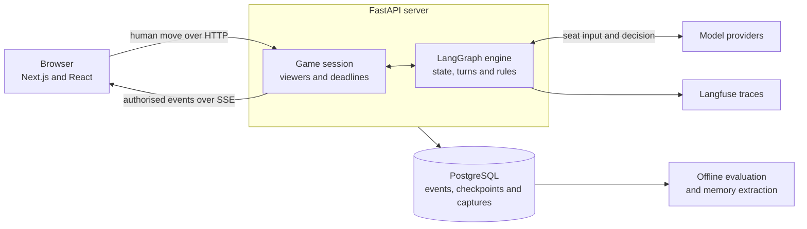
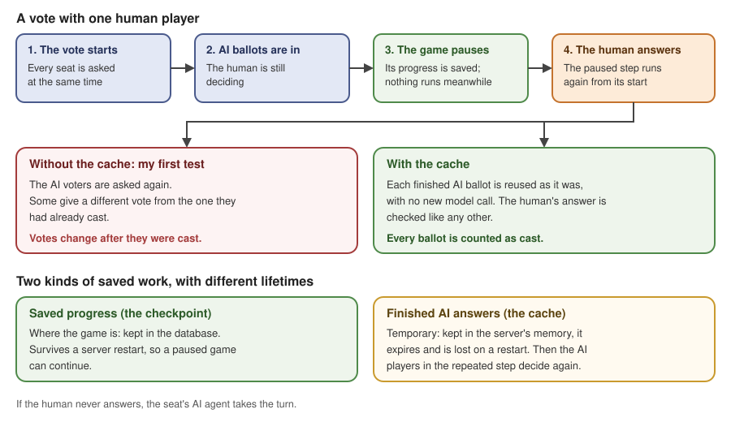
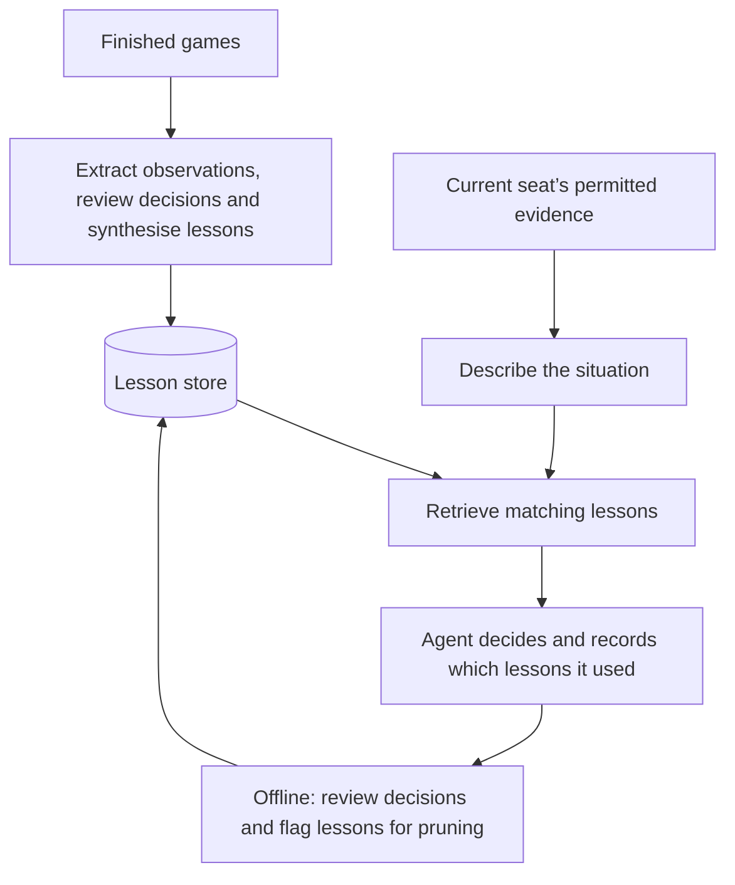

# The Ninth Express

A multiplayer social deduction game for humans and AI agents, staged as a puppet theatre aboard a 1920s railway carriage.

[Play or watch](https://wolf.liuhaochen.com/) · [Game guide](https://wolf.liuhaochen.com/guide) · [Source code](https://github.com/Haochen92/werewolf-agent-sim)

Ten passengers share the carriage, each dealt a role from a pool of twelve across four factions. By day they question one another and vote someone out. At night the wolves choose a victim while other passengers investigate, protect or kill in secret. A person can take a seat alongside the agents, play with friends, or watch. Players can write their own dialogue, give their seat’s agent rough notes to turn into a response, or delegate the turn entirely.

The hidden roles and competing factions draw on Werewolf and *Town of Salem*. For the stage, I drew on the railway mystery of *Murder on the Orient Express* and the staged confrontations of *Danganronpa*. *Sea of Stars* influenced the visual style.

I designed and developed The Ninth Express independently, with assistance from AI coding agents.

### One accusation, seen twice

At the end of a game, **Reveal** lets a viewer revisit what an agent said alongside the private notes it wrote at the time. On day three of one archived game, two passengers claimed to be the Investigator. Seat 10 had claimed the role first.

| Seat 10 speaking to the carriage (excerpt) | Seat 10’s private note (excerpt) |
|---|---|
| “That's not two investigators at dawn — that's one man correcting his story.” | “Lone wolf. Public cover: Investigator, held nights 1 and 2. … lean on the fact … that he surfaced the claim only after mine.” |

Seat 1 was the real Investigator and had checked Seat 10 as suspicious. The table voted Seat 1 out with three of the five votes.

Making room for that kind of bluff took a change to the game itself. In my original nine-seat version, the Investigator could identify a player’s exact role. Across 28 games with memory off, no wolf or Serial Killer claimed a role. The town could believe the Investigator or call the result fabricated. It rarely had a second account to weigh.

I split the town’s evidence across three roles. One learns whether a passenger appears suspicious, another who visited a passenger, and a third where a passenger went. Each result is true and incomplete. I also gave opponents a reason to prepare a cover role and a story for each night. A false claim can now account for a real observation, giving the other players something to challenge. When I replayed 41 recorded situations twice under each version of the instructions, role claims rose from 13 to 33 of 82 responses, by a model judge’s first labels. [Designing evidence worth debating](game_design_orchestration/evidence_design/evidence_design.md)

### Engineering focus

[Orchestration](#multi-agent-orchestration) · [Context and deduction](#context-engineering-and-hybrid-reasoning) · [Human turns](#human-in-the-loop-and-checkpointed-execution) · [Evaluation](#llm-debugging-and-evaluation) · [Agent memory](#experience-based-memory-and-rag) · [Cost and latency](#inference-cost-and-latency) · [Live delivery and reliability](#production-architecture-and-reliability)

**Stack:** Python, LangGraph, FastAPI, PostgreSQL, Langfuse, Sentry, Docker, Next.js, React, TypeScript and Mantine.

## System overview

| Model calls per game | Observed inference cost per completed game |
|---|---|
| **197–228** | **USD 0.09–0.15** |
| Two sampled Haiku games with memory enabled | Four model-specific site averages, excluding hosting |

The call counts and cost averages come from separate sets of games. [Cost measurements](cost_and_latency/cost_and_latency_codex.md)

Follow a single turn. LangGraph selects a seat. The engine builds that seat’s private input, asks the model for a structured decision and checks it against the legal moves. In a hosted game, the FastAPI session translates the accepted action into a numbered event and sends it to the viewers entitled to receive it. A saved decision input can later become an evaluation case.

Beyond building a game that people could play alongside AI agents, I wanted to find out whether the agents could make better decisions without retraining their models. I explored two forms of help: making the deductions available from a seat’s evidence explicit, and retrieving lessons from earlier games. Both raise a measurement problem. A wolf can win by persuading the town, or because an Investigator misread its own evidence. The final score alone cannot tell those games apart.

## Multi-agent orchestration

*LangGraph · structured outputs · parallel night actions*

My first scheduler asked everyone to speak at once. Five of eight agents opened one day with essentially the same question. Each had read the same transcript before any of the other questions appeared.

Calling one speaker at a time gave the next player something to answer. But who should speak next? A fixed queue can leave an accusation unanswered. Polling everyone after each line costs nine extra calls at a full table. I built a **reply-driven scheduler** around the tags on each line. The agent identifies whom it addresses and labels the exchange, for example as a question or an accusation. Either gives the named player a reply to make. The scheduler prioritises outstanding replies, newest first, and a player can answer several accusers in one turn. When nobody owes a reply, seats that have yet to speak get priority. The scheduler caps exchanges between the same two players and gives outstanding questions one last answer when discussion reaches its limit.

A speaker needs to hear the previous line. A voter must choose before seeing the other ballots. LangGraph therefore runs discussion sequentially and voting in parallel. Night actions can affect one another: a protection can stop an attack. The engine collects the decisions before applying the rules, so who survives the night is independent of which model answers first.

The engine knows the legal choices before it calls the model. A Vigilante, for example, can choose an eligible target or decline to shoot. An open-ended tool-calling loop would add a discovery step to a choice the engine can already enumerate, so I ask for a structured response. The engine validates the reply, retries an invalid response, and supplies a legal fallback if it still has no usable move. [Game execution and turn design](game_design_orchestration/game_design_orchestration.md)

## Context engineering and hybrid reasoning

*Role-specific prompts · constraint propagation · information isolation*

The engine needs every role to resolve a night. A Healer choosing whom to protect should never receive the wolves’ chosen target. I build a separate input for each seat before its prompt is written. A discussion refactor once put wolf identities and private investigation results into other speakers’ inputs. The prompt templates omitted those fields, so the models never saw the secrets. The post-game audit caught the error in the prepared inputs, where I could restore selection by role. [Information boundaries](information_boundaries/information_boundaries.md)

Even a correctly isolated input can leave an agent struggling with an inference. A Healer recorded that it had been prevented from acting. Only the Chanteuse could cause that effect, and doing so required a visit. The Healer therefore knew the Chanteuse had visited. A witness naming one visitor still wouldn’t prove that particular passenger was the Chanteuse: someone else could have visited too.

The deduction engine uses **constraint propagation** to eliminate possibilities incompatible with the seat’s evidence and the rules. It tells the agent which conclusions are certain, which depend on another player’s claim, and which alternatives remain open. Across ten generations of that Healer turn in the game’s live output mode, the agent identified the blocking role twice without supplied deductions and eight times with them. Stronger models could also make the inference unaided. To check the solver’s information boundary, a test changes the hidden roles, holds the seat’s visible facts fixed, and checks that its deductions stay the same.

Every turn is a new model call, so earlier information has to be carried forward. Day summaries preserve past discussion, a claim ledger records what each player has asserted, and private notes hold the agent’s own assessments. Each keeps game facts apart from players’ claims. [Context engineering](context_engineering/context_engineering.md)

## Human-in-the-loop and checkpointed execution

*LangGraph interrupts · checkpointing · node caching*

In the first two-human voting test, the server counted enough ballots to eliminate a player. The engine said nobody had been eliminated. I initially suspected duplicate delivery. Capturing the stream showed that some AI seats had actually voted twice and changed their choices.

A human seat calls LangGraph’s `interrupt()` to wait for an answer. **Checkpointing** preserves execution state in PostgreSQL. The voting round ran in a subgraph invoked by a wrapper that prepared its restricted input. On resume, execution re-entered the wrapper, and its fresh invocation repeated the round, including AI turns that had already returned. I kept that input boundary and used **node caching** to reuse completed AI ballots. The human seat goes through an uncached node to accept the answer the person just submitted.

Later, a hosted game recorded a generation failure for one seat. That seat had no opening prompt capture, and the usage ledger counted 142 model calls across the game with zero failures. Nine minutes earlier, the same seat in another game had failed to produce its opening. The cache key omitted the game ID. Matching the earlier turn to the missing capture and the clean usage ledger pointed to reuse of the earlier failure. At the time the engine had no per-turn record of cache hits.

I added the game ID to the key. In a scripted two-game test, cross-game opening cache hits fell from five to zero. The checkpoint survives a server restart; the in-memory node cache is lost. A restarted game can therefore resume while asking AI seats in the interrupted round to decide again. [Human turns](game_design_orchestration/human_in_the_loop/human_in_the_loop.md) · [Cache-key investigation](game_design_orchestration/human_in_the_loop/cache_key.md)

## LLM debugging and evaluation

*Frozen-turn replay · LLM judges · matched comparisons*

In a different game from the opening bluff, I watched a genuine Investigator announce a check on player 9 that it had never made. The village eliminated the innocent player four votes to one. A fresh game might never reproduce that situation. I used **frozen-turn replay** to reconstruct the Investigator’s decision from saved state and vary what it saw.

The Investigator had checked player 5, who died that same night. Its private result sounded like the public announcement of the dead player’s role. I also suspected a previous strategy note that referred to “my investigation result from last night.” I tried both changes separately and together, reading 20 replies per version.

| Input for that turn | Replies inventing a check |
|---|---:|
| Original: “Day 3: player_5 was revealed as healer” | 20 of 20 |
| Original, with the earlier note removed | 20 of 20 |
| Revised: “Night 3 (last night): you investigated player_5, who is the healer” | 0 of 20 |
| Revised, with the earlier note removed | 0 of 20 |

With the revision, every reply in both groups reported the real check. I kept that situation as a regression case. Measuring how often the error occurs across games requires a separate sample. [Investigator replay](evaluation/factual_errors/factual_errors.md)

**Can I trust the measurement?** One memory experiment asked the model to label whether a player’s ballot could change the outcome of the vote — a *swing vote*. The label agreed with the game record in 61% of 439 cases. Always answering “no” scored 83%. This meant a retrieval comparison could be measuring errors in the description used to find lessons. I moved computable fields into code. For questions that need an LLM judge, I also checked what its rubric rewarded. One criterion kept awarding full marks for a section the writing prompt already required. For factual-error checks, the judge gets a narrower task: identify the supplied game fact that a statement contradicts. Validation of the current ten-seat judges remains incomplete.

**Can I trust the baseline?** In a memory experiment, fresh baseline games with unchanged prompts and game logic produced fewer town wins than the historical baseline. On 20 starting deals played in both periods, town won 12 earlier and seven later. The difference was inconclusive (p = 0.18) and its cause remains unresolved. It was enough to change how I run comparisons: match the deals and run a fresh baseline alongside the candidate. [Evaluation and fair comparisons](evaluation/evaluation.md)

## Experience-based memory and RAG

*Embedding retrieval · offline extraction · lesson curation*

My first memory system gave each role a growing strategy document. A lesson learned in one game could be poor advice in the next. I switched to **retrieval-augmented generation (RAG)**. After games, an offline pipeline extracts observations and turns them into lessons. During play, the agent receives a few lessons retrieved by embedding similarity for its role, decision phase and current situation.

Offline analysis can see who the wolves really were. A useful lesson still has to describe a situation the player could recognise before the reveal. Agents record whether they followed, overrode or set aside each lesson. If decisions made with a lesson repeatedly score poorly against memory-off decisions for the same role and phase, that lesson becomes a candidate for review. The association alone cannot establish that the advice caused those outcomes.

Earlier versions helped on some town decisions, but later comparisons found no clear benefit. I haven’t run the current ten-seat learning cycle end to end or compared its gameplay against memory off. Memory is available and off by default. [Memory pipeline and evidence](memory/memory.md)

## Inference cost and latency

*Prompt caching · token accounting · stage timing*

Across 16 AI-only Haiku games with memory disabled, input accounted for about 90% of tokens and output for about half the bill. I changed the prompt layout to make **prompt caching** work across seats. The rules and public transcript now come first, followed by private material. That gives the provider a longer prefix it can reuse when the next seat speaks.

On the same two deals per version, Luna’s cost per call fell 28%. Haiku generated more reasoning and spent the input saving on output. Its cost per call stayed about the same, and it participated more in discussion, raising the total bill per game. A cache-hit rate alone would have hidden that result.

For a player, the question is how often inference holds up the stage. The browser leaves each line on screen long enough to read while the engine generates subsequent decisions. If the next line is ready when the current one finishes, the viewer sees no delay. Across seven hosted Haiku development games, I estimated that inference accounted for 3–5% of stage playing time, excluding time spent waiting for a human. The range reflects two assumptions about how much material was already queued. [Inference cost and latency](cost_and_latency/cost_and_latency_codex.md)

## Production architecture and reliability

*FastAPI · Server-Sent Events · circuit breakers · Langfuse*

**What reaches the browser.** A wolf receives the pack’s private messages during play. A spectator receives those same messages when the game ends. The server keeps one numbered event history and checks each viewer’s access before delivering an event over **Server-Sent Events (SSE)**. The browser builds its view by applying events in order. The same history supports live play, catch-up after a disconnection, and replay.

The first client discarded any arrival numbered below the latest event it had seen. That lost the final reveal: a spectator who already has event 50 can still be missing private event 32. The client now checks whether it holds that exact number and inserts newly released events where they belong. [Event stream and client synchronisation](frontend/event_stream_and_sync/event_stream_and_sync.md)

**What keeps play moving.** In one hosted game a player waited 301 seconds for a single AI response. A rescue model was available, but the primary delayed returning a rate-limit error and its client retried. Until control returned to the engine, failover could never begin. Attempts now have a 30-second limit on supported clients. After two consecutive stalls, a **per-game circuit breaker** sends requests to the rescue model for five minutes where one is configured. Scoping the breaker to a game matters because a rate limit may belong to one player’s API key. If neither model supplies a usable move, a rule supplies a legal fallback. A turn can take several attempts and still has no end-to-end deadline.

A fallback vote can look perfectly ordinary on stage. The game records rescue and fallback turns in PostgreSQL so I can tell who supplied the move. **Langfuse** traces show which engine steps and model calls ran and where time went. Prompt captures preserve the input prepared for the seat, including cases needed for replay. A resumed game starts a new trace under the same game ID. [Provider stalls](running_in_production/stalled_model_call/stalled_model_call.md) · [Observability](running_in_production/observability/observability.md)

**What a restart can change.** PostgreSQL holds the event history and the engine’s checkpoints as separate writes. If the server stops after an AI decision is recorded as an event but before its checkpoint is saved, recovery can regenerate a decision that differs from the one viewers already saw. [Crash recovery](running_in_production/restart_recovery/restart_recovery.md)

## Explore the engineering

### Game design and orchestration

How do ten independently called language models play one coherent game? Follow a day and a night, from designing evidence worth debating to deciding who speaks next, coordinating simultaneous actions and keeping every decision within the rules. The chapter also explores how human players join the same workflow without disrupting the game's progress.

*Multi-agent orchestration · LangGraph · Structured outputs · Human-in-the-loop*

[Explore game design and orchestration](game_design_orchestration/game_design_orchestration.md)

### Information boundaries

The engine holds every secret, but a model cannot unsee its input. Explore how each agent receives only the information its role permits, where those boundaries are enforced, and how automated tests and post-game audits uncover mistakes that might otherwise go unnoticed.

*Information isolation · Least privilege · Prompt construction · Leak testing*

[Explore information boundaries](information_boundaries/information_boundaries.md)

### Context engineering

Giving an agent the right information does not mean it will draw the right conclusions. Follow how a turn's context is constructed, how earlier discussion is preserved without turning claims into facts, how prompts guide strategic reasoning, and which deductions are better worked out in code.

*Context engineering · Prompt engineering · Summarisation · Chain-of-thought prompting · Rule-based deduction*

[Explore context engineering](context_engineering/context_engineering.md)

### Experience-based agent memory

What should an agent remember from a game, and when should it use that experience again? Follow a lesson from a completed game into a future decision, exploring how strategic knowledge is extracted, synthesised, retrieved and curated, and how experiments assess whether remembering actually helps.

*Retrieval-augmented generation (RAG) · Agent memory · Embedding retrieval · Memory curation*

[Explore agent memory](memory/memory.md)

### Evaluation

A winning agent is not necessarily a good decision-maker, and a high evaluation score does not necessarily mean the evaluator is right. Explore how individual failures become reproducible experiments, how code checks and LLM judges are validated, and how fair comparisons distinguish improvements from variation between runs.

*LLM evaluation · LLM-as-judge · Regression testing · Reference labels · Experimental design*

[Explore evaluation](evaluation/evaluation.md)

### Cost and latency

Which model calls drive the bill, and which ones actually make a player wait? Explore how token consumption, model choice, reasoning effort, prompt caching and offline batching affect the cost of a complete game, the quality of agent decisions and the experience of watching them unfold.

*Cost optimisation · Latency measurement · Model selection · Prompt caching · Batch inference*

[Explore cost and latency](cost_and_latency/cost_and_latency_codex.md)

### Running in production

A game that runs successfully in an experiment faces different challenges when real people start playing. Explore how sessions survive disconnections and server restarts, how the system handles unreliable model providers, how failures are investigated through traces, and how player-supplied credentials and messages are handled securely.

*Crash recovery · Circuit breakers · LLM observability · Prompt injection · API key redaction*

[Explore production engineering](running_in_production/running_in_production.md)

### Client-server architecture

Two people can watch the same game while being entitled to different information. Follow an event from the engine to the browser, exploring how live updates, reconnection and replay share one event history, how viewer access is enforced, and how the React stage was made less expensive to render on mobile devices.

*Server-Sent Events · Event-driven architecture · Authorization · Web performance*

[Explore client-server architecture](frontend/frontend.md)
