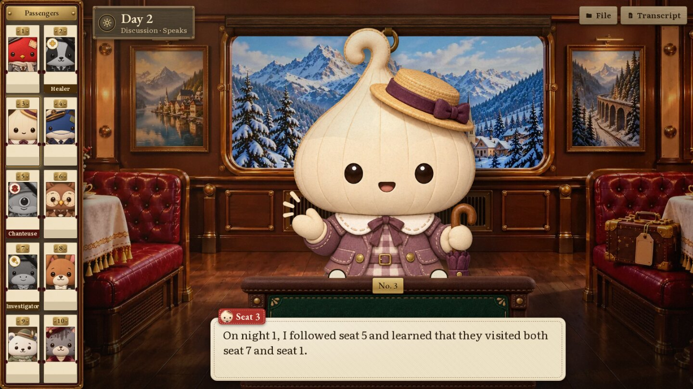
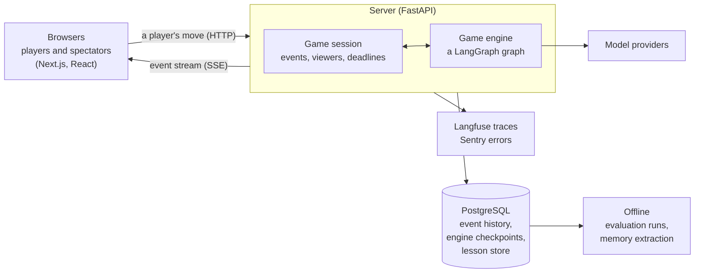
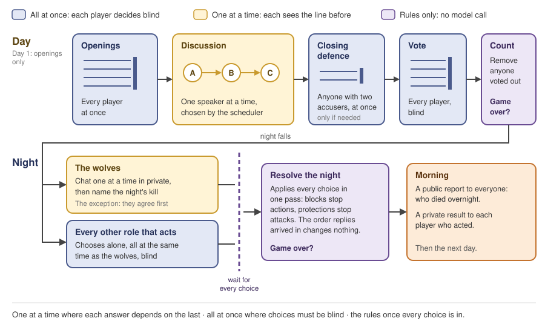
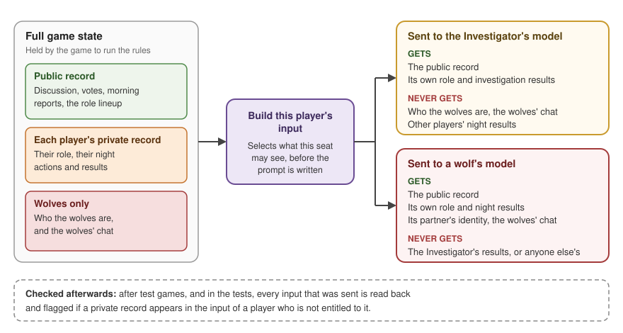
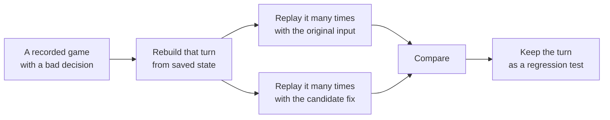
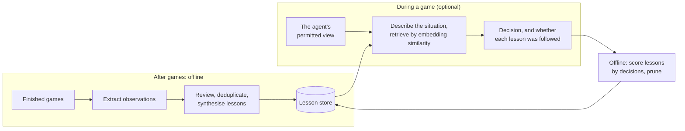
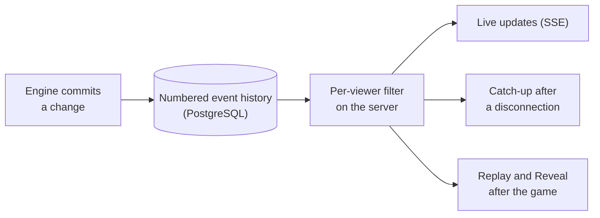

# The Ninth Express

*An interactive multi-agent AI system for social deduction, strategic reasoning and human–AI collaboration.*

[Live application](https://wolf.liuhaochen.com/) · [Game guide](https://wolf.liuhaochen.com/guide) · [GitHub](https://github.com/Haochen92/werewolf-agent-sim)

**Engineering focus**

[Multi-agent orchestration](#01--stateful-multi-agent-orchestration) · [Context engineering](#02--context-engineering-and-hybrid-reasoning) · [Information isolation](#02--context-engineering-and-hybrid-reasoning) · [Human-in-the-loop workflows](#03--durable-execution-and-human-in-the-loop-workflows) · [LLM evaluation](#04--reproducible-llm-debugging-and-evaluation) · [RAG and agent memory](#05--experience-based-agent-memory) · [Inference cost and latency](#06--inference-economics-and-responsiveness) · [Event-driven architecture](#07--hosted-application-architecture) · [Reliability and observability](#07--hosted-application-architecture)

**Technology stack**

AI and backend: Python · LangGraph · FastAPI · PostgreSQL · Langfuse · LLM APIs · Server-Sent Events · Docker · Sentry

Frontend: TypeScript · React · Next.js · Mantine

I designed and developed The Ninth Express independently, with assistance from AI coding agents.

## The project

The Ninth Express is a multiplayer social deduction game in which humans and LLM-powered agents play alongside one another, pursuing competing objectives with incomplete information.

Inspired by Town of Salem, it extends the traditional Werewolf format with twelve possible roles across four factions. Players investigate one another, construct arguments from incomplete evidence, conceal their identities and coordinate actions with allies. The game is presented as a puppet theatre aboard a 1920s railway carriage, with a visual direction inspired by Inscryption and Sea of Stars. Public discussions take place on a shared stage, while private nighttime decisions unfold in individual passenger rooms.

Players can join a game alone or with friends, with agents filling the remaining seats. Humans can make their own decisions, provide rough notes for an agent to formulate into dialogue, or delegate a turn entirely. If someone disconnects or misses a deadline, their agent can take over.

After the game, **Reveal** allows players to revisit the conversation alongside the agents' private assessments, plans and retrieved lessons. An accusation that appeared to be an honest suspicion can turn out to be a deliberate bluff.

### Behind the agents' words

*Day 3 · Seat 10, the Illusionist · From an archived game*

| Public speech | Private strategy notes |
|---|---|
| Seat 1, by the book: I published my Investigator claim on day 2 with an empty night to show. You sat silent and surfaced yours only after the chanteuse was confirmed wolf. That's not two investigators at dawn — that's one man correcting his story. I'll be voting Seat 1; the SK hunt can wait until the liar is off the board. | Lone wolf. Public cover: Investigator, held nights 1 and 2. Seat 1 counter-claims Investigator, so the day's fight is his word against mine — lean on the fact his block story mirrors the dead chanteuse's and that he surfaced the claim only after mine. … vote Seat 1 today. … Do not disclose the conceal or the pack kill. |

Seat 1 was the real Investigator. It had correctly identified Seat 10 as suspicious, but the table voted Seat 1 out with three of the five votes.

### Designing a game that requires reasoning and deception

The original nine-seat game gave players relatively little evidence to debate. The Investigator could identify another player's exact role, while opposing agents rarely offered competing accounts. An exploratory analysis of 28 games found no role claims from wolves or the Serial Killer.

I redesigned the game around three complementary observations: whether a player appears suspicious, who visited a player, and where a player went. Each observation is truthful but incomplete. Players must reconcile these observations with potentially false claims. Opposing agents also received explicit instructions to prepare and maintain plausible cover identities.

To isolate the effect of the instructions, I replayed 41 recorded situations twice under each version, keeping the other inputs fixed. Model judges identified **13 role claims in 82 responses** with the original instructions and **33 in 82** with the revised ones. These are the first model-judge labels; a later, stricter judging pass changed some of them. The increase in claiming does not establish better overall gameplay.

[Explore the environment redesign](game_design_orchestration/evidence_design/evidence_design.md)

## System overview

All ten players act within the same evolving game, but each has access to different information. The engine must coordinate their decisions without exposing private information or allowing unpredictable model outputs to override the rules. It must also keep games running through human interruptions and provider failures.

Beyond keeping the game running, two questions shaped the AI engineering work: how can agent behaviour be evaluated and improved, and how can agents learn from earlier games without retraining their models?

| Player seats | Role pool | Inference workload | Observed inference cost |
|---|---|---|---|
| 10 | 12 roles across 4 factions | Hundreds of model calls per game | $0.09–0.15 per completed game |

*Cost figures are recorded model-specific averages for four models, not a controlled comparison, and exclude hosting.*

### Architecture

The game engine is implemented as a stateful LangGraph workflow. Deterministic code manages game progression, legal actions, information access and the resolution of player decisions; language models generate dialogue, strategic assessments and actions.

The hosted application adds session management, human-in-the-loop execution, persistent checkpoints and authorised event delivery. Offline evaluation reconstructs recorded decisions for controlled experiments. An experience-based memory pipeline extracts and curates lessons from completed games for optional situational RAG during play.

## Selected engineering stories

### 01 — Stateful multi-agent orchestration

`LangGraph` · `structured outputs` · `sequential and parallel execution` · `output validation`

Human players can listen continuously and respond when challenged. LLM agents, by contrast, receive a snapshot of the conversation each time they are called.

An early implementation generated dialogue in simultaneous rounds. Because agents responded to the same conversation state, they could repeat one another: in one round, five of eight agents opened with essentially the same question.

Generating responses one at a time solves that problem, but raises another: who should speak next? A fixed order can delay relevant replies, polling every agent after each message increases inference costs, and letting response speed determine participation favours faster models.

I replaced simultaneous rounds with a **reply-driven conversation scheduler**. When an agent questions or accuses another player, the scheduler prioritises a reply from that player. To track these obligations, agents return structured metadata alongside their dialogue, identifying whom they address and the purpose of the message. The scheduler also gives quieter players opportunities to contribute, limits repetitive exchanges and bounds discussion length.

Code decides who speaks and when; the model decides what to say.

The LangGraph workflow combines sequential discussion, where each response informs later speakers, with parallel voting and most private night decisions, where players must act independently. Interacting night actions are collected before deterministic resolution, so their effects do not depend on the order model responses arrive.

The engine knows which actions are legal before asking an agent to decide, so it requests structured responses rather than using an open-ended tool-calling loop. It validates the result before applying it, using correction attempts, rescue models or legal fallback actions when necessary.

**Explore:** [Game design and orchestration](game_design_orchestration/game_design_orchestration.md)

### 02 — Context engineering and hybrid reasoning

`least-privilege context` · `prompt construction` · `constraint propagation` · `summarisation`

The engine knows every player's identity and private actions. Individual agents must not. Instead of giving a model the complete game state and asking it to ignore secrets, role-specific payload builders select only the information its seat is entitled to receive.

Unit tests and post-game audits check these boundaries. One audit found private fields in other seats' payloads, even though the prompt templates did not render them. The fix was made at the data-selection layer, rather than relying on templates to keep secrets out of prompts.

Receiving the right information does not guarantee that an agent will draw the right conclusion. In one recorded turn, a Healer knew it had been prevented from acting but failed to identify the Chanteuse, the only role capable of causing that effect.

Rather than leaving this inference entirely to the model, a rule-based **deduction engine** uses constraint propagation to eliminate possibilities that contradict the rules and the facts available to each seat. It supplies conclusions that necessarily follow from known facts, those that depend on a player's claim being true, and alternatives that remain possible.

| Without supplied deductions | With supplied deductions |
|---|---|
| 2/10 correctly identified the visitor's role | 8/10 correctly identified the visitor's role |

*Repeated generations of one recorded Healer turn, not a general gameplay improvement. Stronger models and higher reasoning settings could also make the inference.*

The deduction engine must respect the same boundary as the agent. A test changes the hidden roles while keeping the seat's visible information fixed, and checks that the deductions do not change.

Agents also need to carry information from one turn to the next. Day summaries preserve earlier discussion, a structured claim ledger records what players have asserted, and private strategy notes carry forward each agent's assessments. These representations distinguish authoritative game facts from player claims and model-generated judgements.

**Explore:** [Information boundaries](information_boundaries/information_boundaries.md) · [Context engineering](context_engineering/context_engineering.md)

### 03 — Durable execution and human-in-the-loop workflows

`LangGraph interrupts` · `checkpointing` · `node caching` · `regression tests`

Humans and AI agents use the same downstream decision pipeline. A human may submit a decision or delegate it to the seat's agent. LangGraph interrupts suspend the workflow during human input; persistent checkpoints preserve its progress.

In an early two-human game, resuming an interrupted step regenerated AI votes that had already completed. Some votes changed, leaving the server's ballot count inconsistent with the engine's result. I introduced node caching so repeated execution can reuse completed AI decisions rather than resample them.

Caching introduced a second failure. The node cache was shared across games in the same process, and its key did not identify the game. In one hosted game an agent recorded a generation failure despite having no corresponding prompt capture; the usage ledger counted 142 model calls without a failure. Comparing these records pointed to a cached failed decision from an earlier game.

The cache key now includes the game identifier. Regression tests verify stability after checkpoint serialisation and isolation between games. In a controlled two-game test with a scripted model, cross-game opening-cache hits fell from five to zero.

Checkpoints and cached decisions offer different guarantees. Checkpoints preserve progress across restarts; the in-memory cache preserves completed decisions when a step repeats within the same process. Restarting can still regenerate those decisions.

**Explore:** [Game design and orchestration](game_design_orchestration/game_design_orchestration.md) · [Cache-key investigation](game_design_orchestration/human_in_the_loop/cache_key.md)

### 04 — Reproducible LLM debugging and evaluation

`frozen-turn replay` · `LLM judges` · `matched comparisons` · `regression cases`

One agent's mistake can change every subsequent decision. If a game is played again after a prompt change, the agents may never encounter the original failure. **Frozen-turn replays** reconstruct a recorded decision so alternative inputs and models can be tested repeatedly in the same situation. Whole-game evaluations complement these tests by allowing other agents to react to the changed decisions.

In one game, an Investigator invented an investigation result and the town eliminated an innocent player. Replaying that turn reproduced the failure; rewording the investigation results corrected it.

| Original input | Revised input |
|---|---|
| 20/20 invented a result | 0/20 invented a result |

*Repeated generations of one recorded failing turn, retained as a regression case; not a general hallucination rate.*

#### Are the measurements reliable?

Deterministic checks assess computable facts and legal actions; LLM judges assess semantic questions such as whether summaries misrepresent claims. Decision-level metrics supplement noisy win rates.

The memory system initially used model-generated descriptions of the current situation to retrieve relevant lessons. One field indicated whether a vote was a swing vote. Checking it against the game record revealed that it was correct in only 61% of 439 cases, compared with 83% for always answering no.

Earlier retrieval experiments could therefore have been testing the accuracy of the situation descriptions rather than the effectiveness of the matching strategy. Fields that could be computed from the game state were moved into code.

Another problem arose when comparing summary quality. A broad LLM-judge rubric consistently awarded perfect scores for a criterion that largely rewarded the presence of a section already required by the summarisation prompt. The score could not distinguish versions on that criterion. Later rubrics focused on narrower requirements and supplied the evidence needed to assess them. Validation of the current ten-seat judges remains incomplete.

#### Is the comparison valid?

An earlier memory experiment initially relied on historical baseline games. Fresh baseline games produced fewer town victories despite unchanged prompts and game logic. Reanalysis of twenty starting deals played in both periods found 12 earlier wins and seven fresh wins. The difference was statistically inconclusive (p = 0.18); its cause remained unresolved.

The shift made the historical baseline questionable even though provider drift was not established. Comparisons now use fresh baselines from the same time window, matched inputs, consistent scoring and repeated trials. Some runners enforce same-window execution; others require manual scheduling.

**Explore:** [Evaluation](evaluation/evaluation.md)

### 05 — Experience-based agent memory

`RAG` · `embedding retrieval` · `offline batch pipeline` · `lesson curation`

How can agents reuse experience from earlier games without retraining their underlying models? The first memory implementation supplied each role with a growing strategy document. As lessons accumulated, recommendations became redundant, conflicting or inappropriate to the current situation.

The system evolved into **situational retrieval-augmented generation (RAG)**. An offline pipeline extracts observations from completed games, reviews decision verdicts and synthesises reusable lessons. During play, semantic retrieval matches the current situation against lessons scoped by role and decision phase, using only information available to the seat.

Agents record whether they follow or override each retrieved lesson, or consider it irrelevant. Decisions that follow a lesson are compared with memory-off decisions for the same role and phase. Lessons that repeatedly accompany poor decisions can become candidates for removal. These comparisons guide pruning but do not establish that a lesson caused the outcome.

Earlier experiments showed promising improvements in selected decisions but no consistent gameplay benefit. The current ten-seat pipeline has undergone component checks; its full learning cycle and gameplay effectiveness remain unvalidated. Memory is optional and off by default.

**Explore:** [Memory architecture](memory/memory.md)

### 06 — Inference economics and responsiveness

`token accounting` · `prompt caching` · `model selection` · `batch inference`

With hundreds of model calls per game, inference efficiency is a system-level concern. Usage accounting distinguishes ordinary input, cached input, cache writes and generated output.

Across sixteen AI-only Haiku games with memory disabled, approximately 90% of tokens were input, yet output accounted for roughly half the inference bill.

| | Share of tokens | Share of the bill |
|---|---|---|
| Input | about 90% | about half |
| Output | about 10% | about half |

Much of the agents' context is shared, including the rules and public conversation. Placing this material before seat-specific information allows model providers to reuse a longer cached prompt prefix across agents. In a small matched-deal experiment, Luna's cost per call fell by 28%. Haiku, however, generated additional reasoning that offset the input savings, while increased participation raised the overall cost per game.

Improved cache reuse therefore needs to be evaluated alongside changes in generated output and the number of calls. Model selection and reasoning settings are also tailored to individual tasks, while discounted batch inference reduces the cost of offline processing.

Responsiveness also depends on when a player actually needs the next model output. During live play, the browser presents committed events at a readable pace while the server continues generating subsequent decisions. If the next event is ready before the current one finishes displaying, the player does not experience that inference delay. Across seven hosted Haiku development games, inference-related waiting was an estimated 3–5% of stage playing time, excluding human decision time.

**Explore:** [Cost and latency](cost_and_latency/cost_and_latency_codex.md)

### 07 — Hosted application architecture

`FastAPI` · `Server-Sent Events` · `PostgreSQL` · `circuit breaker` · `Langfuse tracing`

A game must continue to function when a player closes their browser or loses a connection. The server manages the game session, human deadlines and agent takeover independently of the browser. A numbered history of committed events supports **live play, reconnection and replay** without requiring separate representations of the game.

Server-Sent Events deliver updates; HTTP requests submit human decisions. Events are authorised on the server according to the viewer's seat or faction. After the game, previously withheld information becomes available through Reveal.

In one hosted game, a player waited **301 seconds** for an AI response. A rescue model was already available, but failover could not begin until the stalled primary request returned control to the engine.

Per-attempt timeouts now limit individual requests on supported clients. A per-game circuit breaker temporarily bypasses a repeatedly stalled primary model where a rescue model is configured. Legal fallback actions keep play moving when no usable response is available, but there is still no whole-turn deadline.

PostgreSQL stores game events and engine checkpoints separately. If the server stops after recording an AI decision but before saving the corresponding checkpoint, recovery may regenerate a decision that differs from the one already recorded in the event history.

Langfuse traces, prompt captures and usage records help investigate these kinds of discrepancies by connecting recorded game behaviour with the engine operations and model calls behind it.

**Explore:** [Running it in production](running_in_production/running_in_production.md) · [Client-server architecture](frontend/frontend.md)

## Engineering deep dives

Explore the full technical work, including contributions beyond the selected stories above.

### Agent architecture

#### Game design and orchestration

Designing the environment and coordinating agent participation.

- Calibrated repetition filtering to decide when an agent should speak or remain silent.
- Compared revised cover strategies in whole games, where competing claims sometimes persuaded the town to eliminate genuine investigators.
- Tested game rules and balance separately; observed balance results apply to the tested model and configurations.

[Read chapter](game_design_orchestration/game_design_orchestration.md)

#### Information boundaries

Testing whether agents receive only the information they are entitled to.

- Tested post-game information audits using deliberately planted leaks.
- Examined how offline lesson extraction can use complete game records without passing hidden facts into live agent context.

*The audit inspects recorded prompt variables, not the final rendered prompt.*

[Read chapter](information_boundaries/information_boundaries.md)

#### Context engineering

Making evidence and strategy usable by language models.

- Reworked ambiguous descriptions of nighttime visits after agents misinterpreted who visited whom.
- Investigated summaries that turned disputed player statements into apparent facts.
- Separated written assessments from final decisions so both could be inspected during replay.

[Read chapter](context_engineering/context_engineering.md)

#### Memory

Maintaining the quality of accumulated strategic experience.

- Reviewed past decisions to avoid treating a good move as a mistake simply because the player eventually lost.
- Stopped merging similar observations after three of nine reviewed merges introduced unsupported facts. Deduplication now retains or discards observations without rewriting them.
- Used recorded lesson adoption and decision scores to identify potentially unhelpful lessons.

*These comparisons do not establish causal effects.*

[Read chapter](memory/memory.md)

### Evaluation and optimisation

#### Evaluation

Testing the measurements and experiments, not just the agents.

- Review overturned about one fifth of the examined cases where multiple model judges unanimously recommended discarding a memory observation.
- Found that healer save rate no longer distinguished winning from losing games after the ten-seat redesign.
- Tested candidate models with integration probes, saved-turn quality checks and live games.
- Checked whether requested model settings actually took effect, rather than relying on the recorded configuration alone.

[Read chapter](evaluation/evaluation.md)

#### Cost and latency

Measuring and optimising inference across the complete application.

- In a saved-vote experiment, higher reasoning effort increased the share of votes targeting a real threat from 62% to 77%, but raised output from about 1,440 to 2,120 tokens per vote. The benefit did not carry over to discussion turns.
- An offline batch run cost $19.99 rather than the estimated $9.50, because validation retries created new cache entries instead of reusing shared input.

[Read chapter](cost_and_latency/cost_and_latency_codex.md)

### Production engineering

#### Running it in production

Investigating operational failures and securing player-supplied inputs.

- Ran blocking engine steps on worker threads to keep the web server responsive while games waited for models or humans.
- Recorded when rescue models or fallback rules made decisions, exposing failures that a completed game might otherwise conceal.
- Explicitly attributed player speech to reduce the influence of forged game announcements. Votes targeting an innocent player fell from 24/33 to 14/33 in repeated votes across three saved situations; protection remains partial.
- Moved API-key redaction to the point where provider errors are caught, after a rejected key appeared in a saved checkpoint.

*Concurrent game capacity remains unmeasured.*

[Read chapter](running_in_production/running_in_production.md)

#### Client-server architecture

Handling client state, information leakage and rendering performance.

- Reconciled turn prompts with server status because the event stream alone does not record every way a turn closes.
- Deduplicated events by individual ID rather than discarding every event older than the latest received ID. This allows previously withheld events to arrive later.
- Examined indirect information leakage through progress indicators and event numbering; some side channels remain.
- Investigated iPhone rendering crashes through on-device isolation and reduced unnecessary React remounts, with structural regression coverage.

[Read chapter](frontend/frontend.md)
