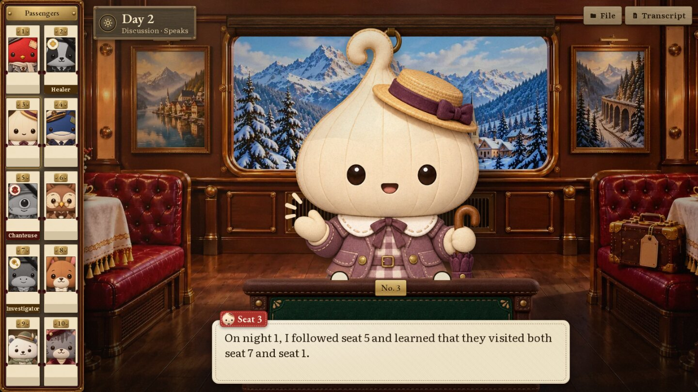
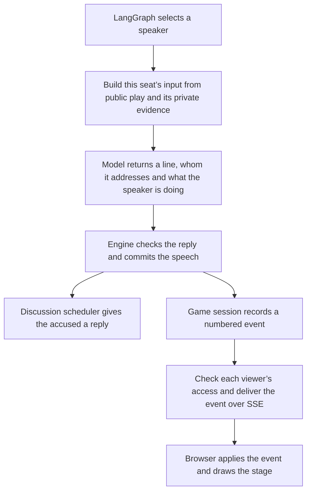
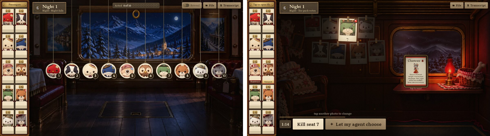
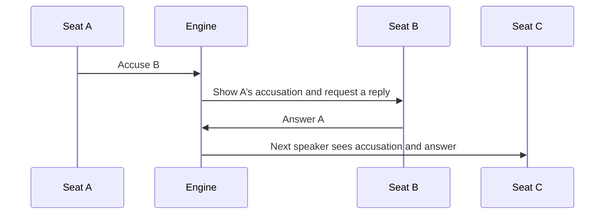
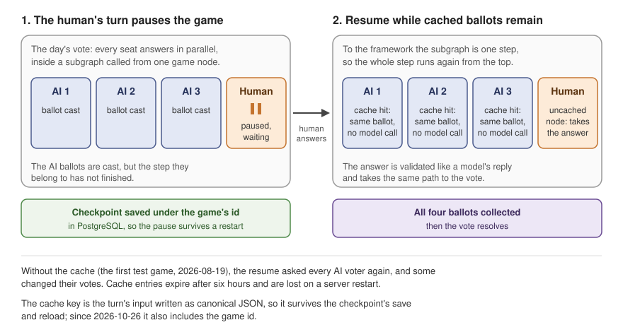

# The Ninth Express

Ten passengers share a train. By day they debate whom to vote out. At night the wolves choose a victim, and other passengers investigate, protect or kill in secret. The wolves know one another. Most passengers have to decide whom to trust from what people say and how they vote. AI agents can play all ten seats, a human can take a seat alongside them, and spectators can follow the game live.

I took the day-and-night structure from Mafia and Werewolf and drew on *Town of Salem* for the competing factions and private abilities. In my first version, an Investigator could learn a passenger’s exact role. The wolves rarely offered a competing account, so the town had little to debate beyond whether the Investigator was lying. I redesigned the evidence. Three town roles now learn different parts of the night: how suspicious a passenger appears, who visited a passenger, or where a passenger went. Each observation is true but incomplete. A wolf can prepare a cover story that fits what another passenger saw.

I designed the game and its experiments, wrote the orchestration engine, and worked with AI coding agents throughout. They implemented the browser frontend and the deduction solver to my requirements. [Source repository](https://github.com/Haochen92/werewolf-agent-sim)

| Seats | Model calls | Inference cost |
|---|---|---|
| 10 seats drawn from 12 roles on four sides | 197 and 228 in two completed Haiku games with memory enabled | $0.21 and $0.26 respectively for those games |

## How an accusation travels through the system

A human around a table hears an accusation and knows when to answer. An AI player only sees the conversation when the engine calls it. The engine has to decide who acts next, give that player exactly the evidence they could know, and turn the answer into something the other players can respond to.

There are two places where a secret could escape. Before the model call, a refactor once put wolf identities and private investigation results in every speaker’s prepared input. The prompt templates happened to omit those fields, so the models never saw them. A post-game audit of the prepared inputs exposed the mistake. I restored role-based selection where the input was assembled. A check of the final dialogue alone would have missed the fault. [Agent information boundaries](information_boundaries/information_boundaries.md)

The second check happens when the server sends events to a browser. The engine keeps one numbered history; the server checks each event against the viewer’s seat before sending it over Server-Sent Events (SSE). The browser applies the events in order. The same history drives the live stage, brings a returning browser up to date, and supplies the final replay. [Client-server architecture](frontend/frontend.md)

*Two views from the same recorded night. The spectator can see that the game is waiting. Only the wolf gets the pack’s conversation and controls.*

## Giving an accused player a chance to answer

My first discussion scheduler asked everyone to speak in simultaneous rounds. Five of eight players opened one day with variations of the same question. They had all read the same transcript before any of those questions appeared. Polling everyone after each new line would give them a current transcript, but at a full table it would cost nine extra model calls per line. Letting agents speak as soon as their calls finished would give faster models more turns.

I made the relationship between two speeches explicit. Each agent returns its line with structured fields saying whom it addresses and whether it is questioning, accusing, defending or agreeing. The scheduler uses those fields to decide when someone owes a reply.

Several accusations against the same player can be answered together. When nobody owes a reply, players who have yet to speak get priority. Voting has the opposite timing requirement: a player must commit without seeing anyone else’s ballot. LangGraph can run those decisions in parallel and the engine resolves them together. The rules for concurrency follow from what each player should know at the moment they act. [Orchestrating the conversation](game_design_orchestration/conversation/conversation.md)

## Replaying the turn that got an innocent player eliminated

While I was playing a villager, the Investigator announced that it had checked player 9 the previous night and found the remaining wolf. The village voted that player out four to one. They were innocent. I reconstructed the Investigator’s turn from saved state. Its real target, player 5, had died that same night. The private result used the language of a public death announcement. An earlier note also mentioned “my investigation result from last night.” Either could have contributed to the error.

I held the game situation fixed and varied those two parts of the input. Each version generated 20 replies, which I read against the checks the Investigator had actually made.

| Input on that turn | Replies inventing a check |
|---|---:|
| Original result: “Day 3: player_5 was revealed as healer” | 20 of 20 |
| Same result, with the earlier note removed | 20 of 20 |
| Reworded result: “Night 3 (last night): you investigated player_5, who is the healer” | 0 of 20 |
| Reworded result, with the earlier note removed | 0 of 20 |

With the revised wording, all 20 replies in each arm reported the real check. The experiment isolated a useful change for this particular situation, which I kept as a regression case. Estimating how often Investigators invent evidence across games takes a different sample. [Factual-error investigation](evaluation/factual_errors/factual_errors.md)

## Why a human answering once made the AI vote twice

In the first two-human test, the server counted enough ballots to eliminate a player. The engine reported that nobody had been eliminated. Capturing the event stream showed that several AI seats had voted twice and changed their choices the second time.

A human seat uses LangGraph’s `interrupt()` to pause for a decision. PostgreSQL holds the checkpoint needed to resume. The vote ran inside a subgraph called by a wrapper that prepared its restricted input. When the human answered, execution re-entered that wrapper, which invoked the subgraph with fresh input and restarted the interrupted round. A small graph reproduced the difference without a model: the same finished AI turn ran once as a top-level node and twice in the wrapped subgraph.

I kept the input boundary and cached completed AI decisions. On resume, an AI seat can reuse its original ballot. A human seat goes through an uncached node and supplies the answer just submitted. Both use the same validation rules.

The identity of a cached turn matters. In one hosted game a seat passed with a generation failure, yet there was no new prompt capture for that turn. Nine minutes earlier, the same seat in another game had produced that failure. The two turns shared a cache key. Adding the game ID let a resumed game find its own decisions while keeping different games apart. The checkpoint survives a restart; the in-memory answer cache does not, so an interrupted round can still require fresh AI decisions after a restart. [Human turns and graph resumption](game_design_orchestration/human_in_the_loop/human_in_the_loop.md) · [Investigating the cache key](game_design_orchestration/human_in_the_loop/cache_key.md)

## Which lessons from an earlier game can a player use?

The first memory system gave each role a growing strategy document. Advice accumulated across situations where different moves made sense. I replaced it with retrieval-augmented generation (RAG). An offline pipeline extracts a situation and a recommended action from past games. During play, the system describes the seat’s current situation and retrieves similar lessons by embedding similarity within the relevant role and decision phase. A lesson extracted after the outcome is known still has to describe a situation the player could recognise from its own evidence.

Earlier versions improved some town decisions. Later comparisons found no clear benefit, and the current ten-seat game has yet to be compared with memory off. Memory is therefore available but off by default. [Cross-game memory and its evaluation](memory/memory.md)

## When failover itself has to wait

In one hosted game, a player waited 301 seconds for an AI reply. A rescue model was already available. The primary provider took time to return a rate-limit error, and the client library retried; until control returned to the engine, the rescue model could do nothing.

I put a 30-second timeout on each attempt and a circuit breaker on each game. After two consecutive stalls, a game with a rescue model bypasses its primary for five minutes. Scoping the breaker to the game matters because the rate limit may belong to one player’s API key. If neither model supplies a usable move, the rules provide a legal fallback. A turn can still take several attempts, so 30 seconds bounds an attempt rather than the player’s total wait. [Provider stalls and failover](running_in_production/stalled_model_call/stalled_model_call.md)

A fallback can produce a valid-looking vote. To find out who decided it, the game records rescue and fallback turns in PostgreSQL. Self-hosted **Langfuse** traces show which engine steps and model calls ran and how long they took. A restart begins a new trace under the same game ID. For evaluation, I need the original decision input even when a trace is incomplete or expensive to retrieve, so the batch runner saves replay cases directly. [Observability and decision records](running_in_production/observability/observability.md)

## Explore the eight chapters

| | Chapter | Question |
|---|---|---|
| How the game runs | [Game design and orchestration](game_design_orchestration/game_design_orchestration.md) | Who speaks, who can act, and how does a human take a seat? |
| | [Information boundaries](information_boundaries/information_boundaries.md) | How can one engine hold every secret while each agent knows only its own? |
| Improving play | [Context engineering](context_engineering/context_engineering.md) | How do private evidence, public claims and earlier days enter the next decision? |
| | [Memory](memory/memory.md) | Which lessons can agents retrieve, and what evidence would show they help? |
| Measuring behaviour | [Evaluation](evaluation/evaluation.md) | When can a replay, a code check or a model judge support a claim about play? |
| Serving the game | [Cost and latency](cost_and_latency/cost_and_latency_codex.md) | What drives the inference bill and the wait between turns? |
| | [Running in production](running_in_production/running_in_production.md) | What happens when a provider stalls, a process restarts or an apparently legal move came from a fallback? |
| | [Client-server architecture](frontend/frontend.md) | How do viewers receive, replay and render their own view of the game? |
