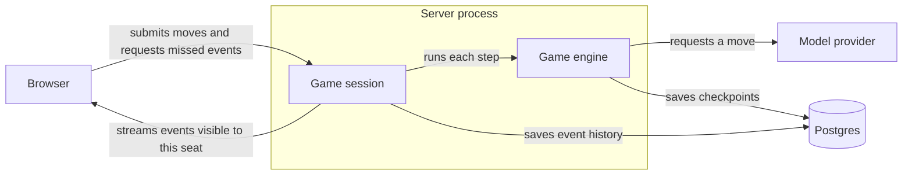

# Running the game engine as a production service

In the hosted version of Werewolf, people and AI players share a table. The server runs the game, asks a model to play each AI seat and sends each person the events their seat is allowed to see. I wanted a player who briefly lost their connection to be able to return to the same game. In multiplayer, the people still at the table also needed a way to finish the round if that player never came back.

Keeping the table together was one part of running the service. Play also depended on outside model providers, so the engine needed a way to finish a turn when a provider stalled. I needed records that could explain an unexpected move afterwards. Players could also supply an API key to pay for a game and write messages that other seats would read. The server had to keep the key private and make clear to each AI which words came from a player.

## Keeping games alive across disconnects and restarts

In a solo playtest, a player’s phone went to sleep for about two minutes. By the time they came back, their character had been killed. The game had carried on as designed, but the only person it was running for had missed the chance to play. Now, while the solo player’s character is alive, a disconnect pauses the game between engine steps. Speeches already being generated can still finish. On return, the browser requests events after the last one it received, and the server sends the missing events visible to that seat.

Multiplayer calls for a different rule. Suppose one player loses their connection while the table is waiting for their vote. A connected player ordinarily has two minutes to answer. On disconnect, the server allows up to 30 seconds to return, within the original deadline. If time runs out while another seated player is connected, the absent seat’s AI takes that turn. After two consecutive substitutions for a disconnected player, its AI takes later turns immediately until the player returns. If everyone has left when a deadline expires, the server leaves the question open and starts no new model work. When a seated player reconnects, play can resume. If their own question is still open, they get a fresh two-minute window. Other absent seats still have at most 30 seconds.

This **session continuity** depends on the server owning the game. Each game has its own session in one server process. The engine already had a synchronous interface used by the command-line runner, batch experiments and tests. I kept that interface and put blocking engine steps on worker threads so the server could still handle connections while a model was answering. One game can end with an error while the others continue. Restarting the shared process interrupts them all. I haven’t measured its concurrent-game capacity.

**Crash recovery** requires two records in Postgres. The game session rebuilds its event history so browsers can catch up. The engine loads a checkpoint containing the current step and private game state, including roles and night targets. I tested recovery by killing the process while a game waited for a human turn. A new process restored the pending question, accepted the player’s request to delegate the turn and continued the game. An integration test also rebuilds the server’s objects against real Postgres at a human pause. If a player’s answer was acknowledged just before a crash, the recovered checkpoint can still contain the open question, and the player may have to answer again.

An interruption during an AI speech is a different case. Suppose the session has saved the speech, but the engine’s latest checkpoint still says it’s that speaker’s turn. On restart, the engine can ask the model to speak again. The session sees that the speaker’s place in the conversation is already filled, so viewers keep the first line. The engine, meanwhile, can carry the second line into its next decision. I found that possibility by tracing the two writes in the code. The restart tests exercised the human pause and did not reproduce a repeated speech.

[Inside restart recovery](../../../evidence/production/serving_and_restart/report.md#4-restart-recovery-and-repeated-work)

## Handling model providers that stall

A stalled request can hold up every player who needs the result before they can act. In one hosted game, a player waited **301 seconds** for an AI to draft a line while the server continued answering status requests. Of that wait, 282 seconds went into retrieving lessons from past games, which itself required a model call. The provider took minutes to return a rate-limit error, then its client library retried. The game already had a second model available for rescue. It could only take over once the failure reached the engine.

A stall can affect the current request, the next player and the eventual move.

1. **During the request.** On the affected client, I set a 30-second timeout for an ordinary model attempt and allowed the client library one retry. Once the engine receives a stall, it can send the decision to a rescue model if the game has one.
2. **On subsequent turns.** A per-game circuit breaker changes which model the next seat tries first. After two consecutive primary stalls, a game with a rescue model starts its seat decisions there for five minutes. The model call that prepares a lesson search follows the same rule. Each game keeps its own count because one player’s key can exhaust its quota while other games still get answers.
3. **When a move is due.** If a stall leaves the game without a model decision, the engine records a technical pass in discussion or chooses a random legal vote. That lets play continue, at the cost of a vote that can change who gets eliminated.

Three weeks later, a game using a different client went through three attempts with that client’s 600-second timeout before reaching rescue. The first fix had covered only Gemini. I extended the timeout configuration to the OpenAI-compatible and Claude clients. Even on those clients, preparing the prompt, drafting the line and checking it can each take a separate call. The game still has no deadline for the whole turn, and I haven’t measured how often hosted turns stall since the changes.

[How the engine chooses a fallback](../../../evidence/production/dependency_failures/report.md#3-how-the-engine-chooses-the-next-move)

## Explaining failures from game records

### A failed turn with no failed model call

In one hosted game, an AI player passed on its first chance to speak. To find out why, I compared three records from the game.

| Record | What I found |
|---|---|
| Event history | The player passed. The recorded reason was `generation_failed`. |
| Saved prompts | Eight of the nine AI seats had an opening prompt. The seat that passed was the missing one. |
| Model usage | Across the game, the ledger counted 142 calls and zero failures. |

The missing prompt narrowed the search to code that could supply a turn before the engine contacted a model. When a human answers, the engine can run part of a step again. The server keeps completed AI turns in memory so it can reuse an answer the player has already waited for. The cache key identified the turn, but left out which game it belonged to.

Nine minutes earlier, another game with the same lineup had stored a failed opening turn for that seat. Both opening turns had the same cache key. Reusing that earlier pass explained why the later game could report a failure without preparing a prompt or calling a model. The cache key now includes the game identifier. [How a human turn uses the cache](../../game_design_orchestration/human_in_the_loop/cache_key.md)

At the time, the game saved no record of a cache hit. A vote from the rescue model or a random fallback vote could also look like an ordinary vote in the event history. The server now saves a count of cached steps and records which turns the primary model did not decide. Those changes were deployed and still awaited a check against a new hosted game. One gap remains for a player staring at a quiet table. If the game stops advancing without raising an error, the server has no automatic alert for that silence.

[What a hosted game records](../../../evidence/tracing/report.md)

## Protecting API keys and handling player messages

### Where an API key can end up

Players can pay for model calls with their own provider key. Sending those requests from the browser would put the other seats’ private prompts on the player’s device. The server therefore makes the requests and holds the key in memory for that game. Before play begins, it checks the key with a small provider request so a player can correct a refused key before the table starts waiting for AI turns. If the process restarts, a player has to supply the key again before model calls resume.

I tested that design by planting invented keys, completing a game against real Postgres and searching every table for the full keys. Neither appeared. Then I made the provider refuse one of the keys and quote it in the error message. This time the search found the key in an engine checkpoint. By the time the server cleaned the error message, the engine had already saved it.

The deployed fix removes the complete key where the provider error is first caught. It still depends on an exact match. In a separate check with invented keys, two of five providers returned fragments, which that replacement would miss. The fix had yet to be exercised in a subsequent hosted game.

### When player speech looks official

A player’s words enter the prompts of the AI seats that speak or vote next. A player could end a message with a line that looked like an official announcement accusing another seat of a night killing. The engine checks that the target of every vote is eligible. In this case the accused player was eligible, so even a vote based on the forged announcement would pass that check.

I replayed three saved voting situations with one model. In each, the accusation named an innocent player. One change to the prompt put the entire message on the speaker’s line. I tested whether identifying the words as player speech also changed how often town voters chose the accused.

| How the accusation appeared | Town votes for the accused |
|---|---:|
| Player speech on one line, with the accusation styled as an announcement | 24 of 33 |
| The same speech in quotation marks under a caption identifying it as player speech | 14 of 33 |
| A player openly making the accusation | 0 of 33 |

Each row counts repeated votes in the same three situations. I adopted the quotation marks and caption. One voter who still chose the accused under that formatting explained its decision by citing the game master’s record. The engine could enforce who was eligible for the vote. The voter still had to work out who had spoken.

<!-- Evidence, relative to this draft:
../../../evidence/production/session_and_human_turn/report.md — solo pause, multiplayer turn deadlines, substitution and parking.
../../../evidence/production/serving_and_restart/report.md — worker threads, restart checks and separate writes.
../../../evidence/production/dependency_failures/report.md — both waits, timeout coverage and fallback decisions.
../../../evidence/tracing/report.md — the opening pass, the cache and the additional records.
../../../evidence/production/keys_and_input/report.md — credential handling and planted-key tests.
../../../evidence/agent_boundaries/forged_speaker/report.md — voting comparison and its scope.
-->
