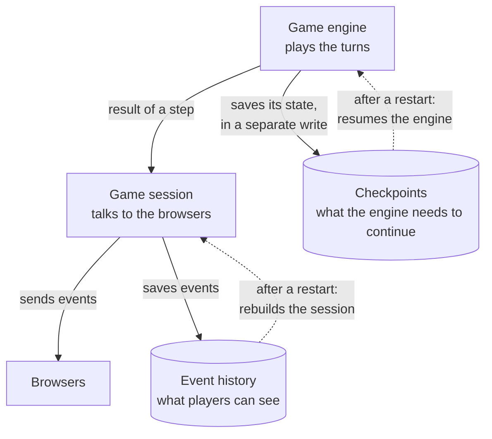
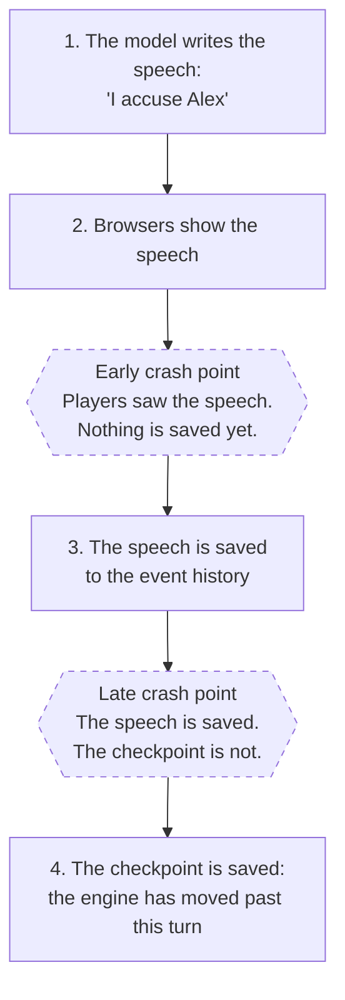

# Crash recovery: event history, checkpoints and the dual-write problem

*Level 2 · [Running it in production](../running_in_production.md) · Revised draft, 2026-11-22*

## Page copy (draft)

A hosted game has to survive two different interruptions: a player's browser losing its connection, and the server process itself stopping. This page explains what the server saves so that a game can continue after each one, what a player finds on returning, and where the saved records can disagree.

### How events reach the browsers

All running games live in one server process. Each game has a session in memory that turns the engine's output into numbered events. The session keeps the game's event history in memory and gives every connected browser its own outgoing queue. Each event is added to the history, placed on the queues, and sent to each browser over a streaming connection (server-sent events).

A simplified view of one game's event history, and what two different browsers are sent:

```text
number  event                                    town player's browser   wolf's browser
31      speech        player_4 speaks            sent                    sent
32      vote_cast     player_2 votes player_7    sent                    sent
33      phase_change  night begins               sent                    sent
34      wolf message  player_9 to the wolves     not sent                sent
35      phase_change  day begins                 sent                    sent
```

*An illustration with shortened event contents. Every event has a number, and each browser receives only the events its player is allowed to see.*

The cost of keeping everything in one process is that games are not isolated from it. A restart interrupts every running game, and anything held only in memory is lost. A message broker, such as Redis Streams, with games running in separate worker processes would remove that dependence, at the price of coordination between processes; it was not needed at this scale. The rest of this page is about what is saved so that a game can continue after a restart.

### Reconnecting a browser

A browser that loses its connection does not interrupt the game. The server process is still running, so the game stays in its memory and play continues.

When the browser reconnects, it tells the server the number of the last event it received, and the server sends the later events that its player is allowed to see. In the illustration above, a town player's browser that last received event 32 is sent events 33 and 35. A wolf's browser is sent 33, 34 and 35, because the wolves' private message is meant for it.

### Restarting the server: two saved records

When the server itself stops, the live sessions disappear. On startup, it looks for games marked as running and uses two records in Postgres to recover each one.



*Solid arrows show normal play. Dotted arrows show what each record is used for after a restart.*

| | Event history | Checkpoints |
|---|---|---|
| **What it saves** | One row for each event, in order: every speech, vote and announcement, and private items such as a wolf's night message | The engine's state after a step: every player's role, the night's targets, which abilities each player can still use, whose turn is next, and any question still waiting for a person |
| **Who reads it** | Browsers, during live play, on reconnecting and in replays; and the server, to rebuild a game after a restart | Only the engine |
| **Hidden information** | Private items are sent only to the players allowed to see them | It holds all of the game's hidden information and is never sent to a browser |
| **Written by** | The game session | The framework that runs the engine, LangGraph |

So the event history lets each returning player catch up, and the latest checkpoint lets the engine continue from where it stopped.

One record for both jobs was considered. Rebuilding the engine from events alone, an approach called *event sourcing*, would require recording every change to the game, including changes no player sees. More secrets would then depend on the server filtering the event history correctly for each player. The framework that runs the game, LangGraph, already saves checkpoints. Using them lets the engine recover its private state while the event history serves the players. The trade-off is that the two records are saved separately, so they can describe slightly different points in the game.

### What is restored after a restart

What happens to a particular player depends on what was saved before the crash.

| Before the crash | After the restart |
|---|---|
| The engine saved a question for a human player. | The player sees the question and can answer it. A living solo player has no deadline. In multiplayer, the timer starts afresh and can shorten if the player is disconnected. |
| The server confirmed receipt of an answer and still held it only in memory. | The player may need to submit the answer again. |
| The game was a free one: the site pays for its AI calls, using the server's own API key. | The game resumes without anyone acting, because the server still has that key. |
| A player supplied their own API key to pay for the AI calls. | A player in that game must supply a key again. A player's key is held only in memory, so the restart loses it. |
| Players were waiting for the game to start. | They need a new room. The server starts saving a game once play begins. |

### The dual-write problem: when events and checkpoints disagree

The event and the checkpoint are two separate writes, and no single transaction covers both. This is a *dual-write problem*: a crash between the two writes leaves one record ahead of the other. The window is narrow. The server has to stop in the short time between two writes for the same engine step, while an AI turn is in that step. With no crash, both writes complete and the records agree.



*The order of writes for one AI speech. The numbered boxes are the steps. The two dashed boxes are not steps: they mark the moments at which a crash leaves the records in disagreement.*

If the server stops at either marked point, the latest checkpoint is from before the turn. After the restart the engine asks the model to speak again, and the model may write a different line. The server recognises a speech that is already in the event history and does not show the repeat, so players never see the same turn twice. It does not make the two records agree: the engine continues with the second version of the line, while the history may hold the first.

### What the recovery tests cover

In one manual test, the server process was stopped abruptly while a solo game was waiting for the player to answer. After the restart, the player saw the same question and asked the AI to take that turn. The game continued. A separate integration test uses scripted AI players and a real Postgres database. It recreates the server components at a pending question, plays to the end and checks the saved history for gaps and duplicate event numbers.

Both tests interrupt a game at a saved question. Neither stops the server between the event write and the checkpoint write. The two crash points above come from the order of writes in the code.

<!-- Sources
How events reach the browsers: evidence/production/serving_and_restart/report.md §1.1–1.2 (session, in-memory history, one outgoing queue per viewer), §2.1 (broker and worker processes considered; judgement, not a measured comparison; no process isolation); server/routes/games.py (text/event-stream). The browser's half of the stream is planned for chapter 8 (treatment map rows S1, S3, S4).
evidence/production/serving_and_restart/report.md §§1.2–1.3, 3–5; evidence/production/session_and_human_turn/report.md §§5–6; manual restart record in commit 5d63349a (question at event 56, delegated turn, continued to event 77).
Supporting detail: startup closes finished games from history and records individual recovery failures before continuing. Wolf messages use day, round and wolf as their identity. Restart loses the in-memory AI decision cache. In a small test graph a top-level parallel step repeated only unfinished tasks, whereas a nested parallel step repeated every task.
-->

<!-- Supporting notes: detail moved out of the dual-write section on 2026-11-22 (owner: keep the section in proportion to a rare edge case). Not page copy.

*The order of writes for one AI speech. The numbered boxes are the steps. The two dashed boxes are not steps: they mark the moments at which a crash leaves the records in disagreement. A crash after step 4 causes no problem, because both records are saved.*

In both cases the latest checkpoint is from before this turn, so after the restart the engine asks the model to speak again. The model is not guaranteed to repeat itself. Suppose it now accuses Sam.

| | Early crash (between steps 2 and 3): shown, not saved | Late crash (between steps 3 and 4): saved, checkpoint not yet |
|---|---|---|
| **Event history after the restart** | Has no entry for this turn | Contains the accusation against Alex |
| **What the engine does** | Plays the turn again and gets the accusation against Sam | Plays the turn again and gets the accusation against Sam |
| **What the history keeps** | Sam. Nothing marks the place as filled, so the second speech is saved | Alex. The server recognises a speech by its day and its place in the discussion, sees that the place is already filled, and leaves the second speech out |
| **What goes wrong** | A player who saw Alex accused remembers a speech that the saved history does not contain | Players see Alex accused, while the next AI player receives the accusation against Sam from the engine and responds to that |

So the design limits one symptom and leaves the underlying problem open. Recognising a speech that is already in the history keeps players from seeing the same turn twice. It does not make the event history and the engine agree: after a late crash the engine still continues with a speech the players never saw, and after an early crash the second speech replaces one that a player did see.

Two further points apply to both cases. Leaving a repeated speech out of the history does not undo the second model call or its cost, and the amount of repeated work on the hosted server has yet to be measured. And during normal play the server retries an event write that failed, so the early-crash case needs the server to stop before that retry.

Candidate fixes and their trade-offs: evidence/_study/engineering_notes/03_state_persistence.md section 3.8 (gaps 2, 3 and 7); improvements.md rows 10 and 11.
-->
