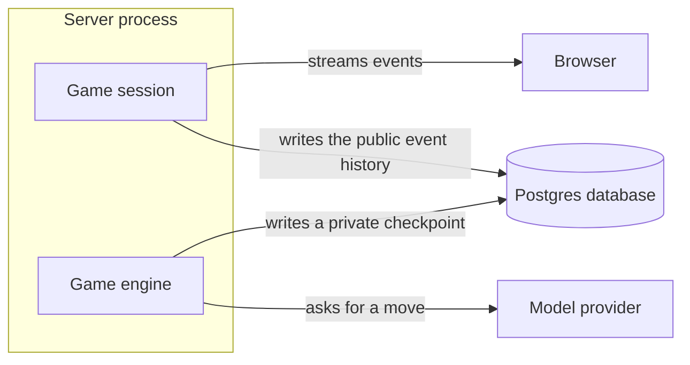

# Running it in production chapter (draft)

*Level 1 page copy. Introduction and section bodies rewritten by the owner on 2026-11-22; Claude then corrected facts against the reports, removed the first-person pronoun (owner's ruling), linked the four Level 2 pages ([restart recovery](restart_recovery/restart_recovery.md), [the stalled model call](stalled_model_call/stalled_model_call.md), [observability](observability/observability.md), [keys and player messages](keys_and_player_messages/keys_and_player_messages.md)) and cut two section openings that repeated the introduction. The observability section and four linked Level 2 pages were subsequently revised. The topics are in
[`content_plan.md`](content_plan.md) and the authoring brief in
[`_authoring/running_in_production.brief.md`](_authoring/running_in_production.brief.md).*

---

## Page copy (draft)

### Running it in production: hosting the game for other people

#### Introduction

The hosted version of The Ninth Express combines two systems: a stateful, turn-based social deduction game
that people can play in or watch, and a multi-agent system in which AI players decide their
moves through external language models.

Combining them enables more flexible participation and dynamic gameplay. AI agents allow people to play without assembling a full group, and can take over when a human leaves a multiplayer game so the remaining players can continue. LLM agents can engage in free-form discussions and adapt their decisions to the evolving game state, allowing each game to unfold differently.

These capabilities also introduce operational challenges. A game runs across many turns, during which human players may disconnect or leave decisions unanswered. The server needs to give them time to return without making everyone else wait indefinitely. AI takeover helps, but the agents themselves depend on external model calls that may stall, fail or return unusable responses. Recovering from a server restart adds another complication: replaying an AI turn may produce a different result from the one players have already seen.

Even when a game continues running, determining whether it is behaving as intended can be difficult. Model failures may be hidden by fallback moves, while a cached result reused in the wrong place can produce a seemingly valid action. Successful game progression therefore does not guarantee correct execution. Investigating unexpected behavior requires visibility into model calls, execution paths and the decisions produced during play.

Human participation also introduces security concerns. Players can supply their own provider API keys, which must be protected from accidental persistence or exposure. Their discussion messages also enter the AI agents' prompts as untrusted input, creating a prompt-injection risk: a player can impersonate an authoritative game announcement and cause an agent to treat player-supplied claims as game facts. The challenge is to preserve the trust boundary between player speech and authoritative game information without preventing the deception that is part of normal gameplay.

This chapter covers four areas of operating the hosted game: **session continuity and crash recovery, model-provider reliability, observability, and input security**. It examines the design decisions, failures and limitations encountered in the hosted system.

*One hosted game. The game session talks to the browsers and the game engine plays the turns.
Each saves its own record to the same database, in separate writes.*

#### Session continuity and crash recovery

A game can run across many turns, and a player's browser may disconnect at any point. The
server therefore manages games independently of browser connections, allowing returning
players to catch up through the public event history.

In multiplayer games, a connected player has 120 seconds to answer a turn. If the player
disconnects, the deadline shortens to 30 seconds, and reconnecting in time restores the
original deadline. When a deadline expires, the seat's own AI agent plays that turn. Once a
disconnected player's agent has played two turns in a row, it plays the seat's later turns
immediately until the person reconnects. This gives players time to return without making
everyone else wait indefinitely. If no player remains connected, the game pauses rather than
continuing to consume model calls. A solo game sets no deadline for a living player and stops
advancing while that player is disconnected, because no other person is waiting.

The time limits are working values chosen by judgment. None was tuned by comparing
alternatives.

Game steps can also wait seconds for a model or minutes for a person. The engine was
originally written as synchronous code, so a step blocks while it waits. To keep the server
responsive to browsers during those waits, the server runs the blocking steps on worker
threads. Rewriting the engine as async code is left as future work, because it would also
change the engine's existing command-line, batch and test callers. The rewrite would become
worthwhile if simultaneous model calls outgrew what a thread pool can serve. How many games
one server can hold at once has not been measured.

**Crash recovery relies on two separate records:**

- **Public event history** stores the actions needed for browser catch-up, for replays, and
  for rebuilding a game after a restart.
- **Engine checkpoints** preserve private execution state, allowing the engine to resume after
  a restart.

The separation creates a **dual-write consistency problem**. If the server stops after saving
an AI speech but before saving the following checkpoint, recovery may execute that turn again
and generate a different response. The public history and resumed engine state can then
disagree.

Recovery was verified by restarting the server during a pending human turn. The dual-write
failure was identified through code inspection.

*Explore: [Crash recovery: event history, checkpoints and the dual-write problem](restart_recovery/restart_recovery.md) →*
<!-- Link specification: Level 2, restart_recovery/restart_recovery.md (drafted 2026-11-22). -->

#### Provider timeouts, failover and circuit breaking

AI agents make most of the game's decisions, so an unresponsive model provider can prevent the
entire game from progressing.

The engine already supported a secondary rescue model, but failover depended on the primary
model returning an error. In one hosted game, a player waited **301 seconds for a single AI
response** because the provider delayed returning a rate-limit error and its client library
retried.

The engine now has three layers of failure handling:

1. **Per-attempt timeouts:** A 30-second limit prevents individual model attempts from waiting
   indefinitely before retries and failover.
2. **Per-game circuit breaker:** After two consecutive stalls, the game bypasses the primary
   model and uses the rescue model, where the game has one, for five minutes. Failure tracking
   is scoped to each game because rate limits may be specific to a player's API key.
3. **Rule-based fallback:** If no model produces a usable answer, the engine supplies a
   technical pass or a random legal vote. This keeps the game progressing, although the
   fallback can affect the outcome.

These mechanisms address provider failures at different stages, but **they do not impose an
end-to-end deadline on a turn**. A turn can make several requests in a row: if the primary
model and the rescue model both stall, their timeouts alone add up to 120 seconds. The 30
seconds, the two stalls and the five minutes are also working values chosen by judgment, not
tuned by comparing alternatives.

*Explore: [When a model call fails: timeouts, failover and the circuit breaker](stalled_model_call/stalled_model_call.md) →*
<!-- Link specification: Level 2, stalled_model_call/stalled_model_call.md (drafted 2026-11-22). -->

#### Observability and tracing

A replay can show who cast the deciding vote. To judge how well an AI seat played, it also matters who chose the target. The primary model might have answered, a rescue model might have taken over, or the engine might have picked a legal target after both failed. All three paths can put the same vote on screen.

The server keeps the game events in Postgres. Langfuse traces record the engine steps and model calls within a run, including how long they took. A game that resumes after a restart gets another trace under the same game ID. Prompt captures preserve the inputs prepared for AI seats, and a usage ledger counts provider calls and failures. A game task that crashes is reported to Sentry. A failure the engine handles can leave the game playing normally.

In one hosted game an AI player passed because generation had failed. Yet the game had no opening prompt for that seat, and its ledger counted 142 model calls with zero failures. Comparing the records uncovered a failed turn reused from an earlier game's cache. The cache key now includes the game. New game records also identify turns decided by rescue models or fallback rules, although cache use is recorded only as a count.

*Explore: [Tracing and investigating a hosted game](observability/observability.md) →*

#### Credential handling and prompt-injection boundaries

Players supply two inputs that cross a trust boundary: provider credentials, and discussion
messages that become part of the prompts consumed by AI agents.

##### Protecting player-supplied API keys

The server makes model requests on behalf of players because calling providers from the
browser would expose private information belonging to other AI seats. Each supplied API key is
held in memory, scoped to its game, and excluded from normal state persistence. A restart
therefore requires the player to supply the key again.

However, a database test exposed an unintended persistence path. When a provider rejected a
test key and included it in an error message, the key appeared in a saved engine checkpoint.
**The exception was serialized before credential redaction occurred.**

Redaction now happens at the point where provider errors are first caught. The fix removes
exact matches of the full key, but may miss key fragments returned by providers.

##### Separating player speech from the game's announcements

Deception is an intended part of the game, but player messages are **untrusted prompt
content**, not authoritative game information.

The attack tested was a prompt injection in which a player disguised an accusation as an
official announcement naming another player as a wolf. Although the engine validates legal
votes, that cannot prevent an AI agent from basing a valid vote on a forged announcement.

The prompt formatting now quotes each message on one line under an explicit player-speech
caption. Replaying three saved voting situations with one model produced these results:

| Presentation of the accusation | Town votes for the accused player |
|---|---:|
| Inside player speech, on one line | 24 / 33 |
| Quoted under a player-speech caption | 14 / 33 |
| Openly attributed to the player (for comparison) | 0 / 33 |

These were repeated decisions over saved situations, not independent games. The formatting
reduced the observed influence but did not eliminate it.

**The engine can guarantee that a vote is legal. It cannot guarantee that the model knows who
said what.**

*Explore: [Protecting API keys and handling prompt injection from player messages](keys_and_player_messages/keys_and_player_messages.md) →*
<!-- Link specification: Level 2 (short), keys_and_player_messages/keys_and_player_messages.md (drafted 2026-11-22). -->

<!-- Sources.
Opening and diagram: evidence/production/serving_and_restart/report.md §1.1–1.3 (session, engine,
two separate writes).
Keeping a game alive: evidence/production/session_and_human_turn/report.md §5.1 (120 s per turn,
30 s after a disconnect, the seat's own AI plays the turn, an empty table is parked);
serving_and_restart §1.3 (a reconnecting browser asks for events after its last one); §2.2 (blocking engine kept; graph.astream places
blocking steps on worker threads; async rewrite estimated at ~89 functions and would break the
CLI, batch, evaluation and test callers); §3.1 (events vs checkpoints); §4.1, §4.3 (event history
ahead of the checkpoint; divergent speech found by code inspection, not reproduced); §5.1–5.2
(manual kill at event 56, continued to event 77; automated test 1f263a3d is a controlled
shutdown at a human pause, not a kill mid-write); §5.4 (capacity unmeasured).
Provider: evidence/production/dependency_failures/report.md §1 (rescue, breaker: two consecutive
stalls, 300 s, per game; legal defaults), §2 (301-second draft, 2026-09-30; 30 s per attempt;
389 discussion calls on one model, max 16.6 s, p95 10.8 s; first fix reached one provider's
client, DeepSeek game e45eda20 on 2026-10-21 waited through three attempts at the SDK's 600 s),
§5 (120 s sum; no whole-turn deadline; frequency unmeasured). Content plan care items 1–4:
"where the game has one"; the 11-second figure is not used. Left for Level 2 B: 282 of the 301
seconds were lesson retrieval; the Mistral client has no explicit timeout; the house model's
rescue setting in the live database is unchecked; helper calls and the embedding request.
Records: evidence/tracing/report.md §§1, 4.4–4.6 (record types, errors and hosted traces), §2 (pass_marker, eight of nine captures, 142 calls and no
failures, cache key without the game, nine minutes earlier), §4.4 (turns the game's own model did
not decide, cached steps count; image 3c2430d7, deployed 2026-11-20, no game played on it), §6
(no watchdog). Langfuse trace grouping and Sentry coverage: evidence/tracing/report.md §§4.4–4.5.
Key: evidence/production/keys_and_input/report.md §2 (why the server holds the key; validation
before creation, 20 s; per-game runtime object 81348121; restart loses the key, any seat holder
may supply it again), §3 (planted-key tests; fix e1ca21fb; five-provider sample, two fragments).
Words: keys_and_input §5 and evidence/agent_boundaries/forged_speaker/report.md (24/33, 14/33,
0/33 across three saved moments, one model, two source games, 438 calls; formatting change
6577f79c deployed, not yet exercised in a game). Left off: the first comparison (27/27 vs 6/27,
26/27), the 112-call ordinary-play check, house-funded daily limit, browser "remember key".
Deploy state: frontend/docs/deploy_log.md entries 2026-11-19 (087812dd) and 2026-11-20 (3c2430d7).
-->
